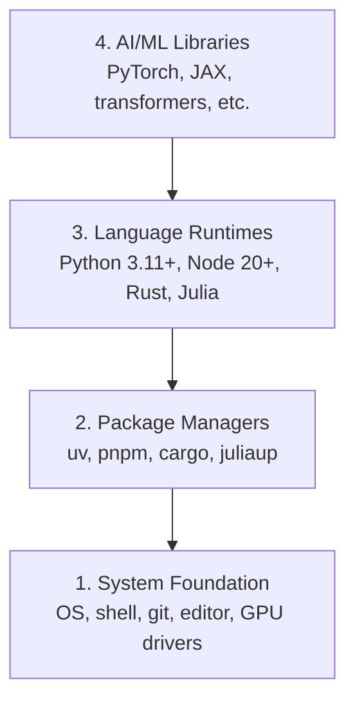

# 开发环境

> 工具塑造思维。一次性把它们装好、装对。

**Type:** Build
**Languages:** Python, Node.js, Rust
**Prerequisites:** None
**Time:** ~45 minutes

## 学习目标

- 从头安装 Python 3.11+、Node.js 20+ 和 Rust 工具链
- 配置虚拟环境和包管理器，实现可复现构建
- 验证 CUDA/MPS 的 GPU 访问，并运行测试张量运算
- 理解四层栈：系统、包、运行时、AI 库

## 问题

你即将用 Python、TypeScript、Rust 和 Julia 学习超过 500 节 AI 工程课程。如果环境出了问题，每一节课都会变成和工具搏斗，而不是学习。

大多数人会跳过环境配置。然后他们花数小时调试导入错误、版本冲突和缺失的 CUDA 驱动。我们要一次性、正确地完成它。

## 概念

AI 工程环境有四层：



我们自下而上安装。每一层都依赖它下面的那一层。

```figure
s0-env-stack
```

## 构建它

### 步骤 1：系统基础

检查系统并安装基础工具。

```bash
# macOS
xcode-select --install
brew install git curl wget

# Ubuntu/Debian
sudo apt update && sudo apt install -y build-essential git curl wget unzip

# Windows (use WSL2)
wsl --install -d Ubuntu-24.04
```

### 步骤 2：用 uv 安装 Python

我们使用 `uv` —— 它比 pip 快 10-100 倍，并自动处理虚拟环境。

```bash
curl -LsSf https://astral.sh/uv/install.sh | sh

uv python install 3.12

uv venv
source .venv/bin/activate  # or .venv\Scripts\activate on Windows

uv pip install numpy matplotlib jupyter
```

验证：

```python
import sys
print(f"Python {sys.version}")

import numpy as np
print(f"NumPy {np.__version__}")
a = np.array([1, 2, 3])
print(f"Vector: {a}, dot product with itself: {np.dot(a, a)}")
```

### 步骤 3：用 pnpm 安装 Node.js

用于 TypeScript 课程（智能体、MCP 服务器、Web 应用）。

```bash
curl -fsSL https://fnm.vercel.app/install | bash
fnm install 22
fnm use 22

npm install -g pnpm

node -e "console.log('Node', process.version)"
```

fnm 安装程序会先检查 `unzip`，缺少时会退出并提示 `Not installing fnm due to missing dependencies.`：在 Linux 上它解压 zip 归档，在 macOS 上通过 Homebrew 安装。macOS 自带 `unzip`；Ubuntu、Debian 和 WSL2 需要从步骤 1 的 apt 命令中获取（如果跳过了该步骤，请运行 `sudo apt install -y unzip`）。

**macOS / Apple Silicon (M1/M2/M3/M4)：** 如果安装程序停在 `Error: Cannot install under Rosetta 2 in ARM default prefix (/opt/homebrew)`，说明你的终端在 Rosetta 2 下运行（`arch` 输出 `i386`），而 Homebrew 是原生 arm64 构建。强制 arm64 安装 fnm，将其接入 shell，然后从 `fnm install 22` 开始重新运行上面的命令：

```bash
arch -arm64 brew install fnm
echo 'eval "$(fnm env --use-on-cd)"' >> ~/.zshrc
source ~/.zshrc
```

### 步骤 4：Rust

用于性能关键型课程（推理、系统）。

```bash
curl --proto '=https' --tlsv1.2 -sSf https://sh.rustup.rs | sh

rustc --version
cargo --version
```

### 步骤 5：Julia（可选）

用于 Julia 擅长的数学密集型课程。

```bash
curl -fsSL https://install.julialang.org | sh

julia -e 'println("Julia ", VERSION)'
```

### 步骤 6：GPU 设置（如果你有 GPU）

**NVIDIA (Linux / Windows)：**

```bash
nvidia-smi

# Install PyTorch with CUDA
uv pip install torch torchvision torchaudio --index-url https://download.pytorch.org/whl/cu124
```

**macOS / Apple Silicon (M1/M2/M3/M4)：** Mac 上没有 CUDA —— 这是正常现象，不是错误。不要传入 `--index-url .../cuXXX`（这些 wheel 只适用于 Linux/Windows，安装会失败）。安装普通版本即可，它包含 Apple 的 MPS（Metal）GPU 后端：

```bash
uv pip install torch torchvision torchaudio
```

验证（适用于所有平台）：

```python
import torch
print(f"CUDA available: {torch.cuda.is_available()}")           # False on macOS — expected
print(f"MPS available:  {torch.backends.mps.is_available()}")   # True on Apple Silicon
if torch.cuda.is_available():
    print(f"GPU: {torch.cuda.get_device_name(0)}")
```

没有 GPU？没问题。大多数课程都能在 CPU 上运行。对于训练密集型课程，使用 Google Colab 或云 GPU。

### 步骤 7：验证你想开始的路线

本节课的所有命令都要在仓库根目录运行，即包含 `README.md` 和 `phases/` 的目录。预检只检查你开始所选路线所需的内容。默认跳过后续工具，让初学者看到一条清晰的答案，而不是一堵警告墙。

启动完整初学者序列：

```bash
python3 phases/00-setup-and-tooling/01-dev-environment/code/verify.py --route beginner
```

或者只检查你想要的路线：

```bash
python3 phases/00-setup-and-tooling/01-dev-environment/code/verify.py --route ml-foundations
python3 phases/00-setup-and-tooling/01-dev-environment/code/verify.py --route llm-engineering
python3 phases/00-setup-and-tooling/01-dev-environment/code/verify.py --route agents
python3 phases/00-setup-and-tooling/01-dev-environment/code/verify.py --route mcp
python3 phases/00-setup-and-tooling/01-dev-environment/code/verify.py --route agent-skills
python3 phases/00-setup-and-tooling/01-dev-environment/code/verify.py --route certification
```

添加 `--show-later` 可让同一预检检查后续课程使用的可选工具和依赖项。缺失的后续工具不会阻塞所选路线。

每个失败的要求检查都会包含检测到的路径或导入错误，以及精确的修复命令。Agent Skills 和 certification 路线还会显示手动主机检查，因为 Python 脚本无法证明 AI 主机已发现某个 skill，或你选择的 skill 作用域可写。

当初学者预检通过时，它会打印出第一条可运行课程的确切路径：

```text
Ready to start Beginner course.
Next: python3 phases/01-math-foundations/01-linear-algebra-intuition/code/vectors.py
```

## 使用它

你的环境已准备好开始你所检查的路线。当课程要求时再安装后续工具，不要让第一堂课被整个工具栈卡住。以下是你在整个课程中会用到的东西：

| 语言 | 使用场景 | 包管理器 |
|----------|---------|-----------------|
| Python | 阶段 1-12（机器学习、深度学习、NLP、计算机视觉、音频、LLM） | uv |
| TypeScript | 阶段 13-17（工具、智能体、群体智能、基础设施） | pnpm |
| Rust | 阶段 12、15-17（性能关键型系统） | cargo |
| Julia | 阶段 1（数学基础） | Pkg |

## 交付它

本节课产出一个验证脚本，任何人都可以运行它来检查自己的设置。

查看 `outputs/prompt-env-check.md`，获取帮助 AI 助手诊断环境问题的提示词。

## 练习

1. 运行验证脚本并修复任何失败项
2. 为本课程创建一个 Python 虚拟环境并安装 PyTorch
3. 用四种语言分别写一个 "hello world" 并运行它们

### 提示

**练习 1。** 从仓库根目录运行 `python3 phases/00-setup-and-tooling/01-dev-environment/code/verify.py --route beginner`，先修复第一个失败的行，然后再看下一个。当再次运行脚本且所有要求的检查都通过时，就完成了。

**练习 2。** 在仓库根目录用 `uv venv` 创建环境，激活它，然后用与你的硬件匹配的步骤 6 命令安装 PyTorch。在环境内运行 `python -c "import torch; print(torch.__version__)"`；如果能打印出版本号，说明安装成功。

**练习 3。** 使用「概念」中栈里的四个运行时：Python、Node.js 上的 TypeScript、Rust 和 Julia。为每种语言写一个小文件，并分别用 `python3`、`npx tsx`（Node.js 不能直接运行 `.ts` 文件）、`cargo run` 或 `rustc`、`julia` 运行。每次运行都要打印你的消息并以退出码 0 结束。
