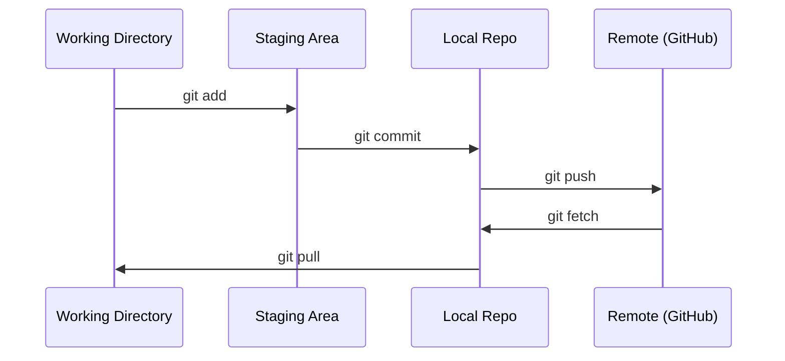

# Git 与协作

> 版本控制不是可选项。你在这里做的每一次实验、每一个模型、每一节课都会被追踪。

**Type:** Learn
**Languages:** --
**Prerequisites:** Phase 0, Lesson 01
**Time:** ~30 minutes

## 学习目标

- 配置 git 身份，使用 add、commit、push 的日常工作流
- 创建并合并分支，进行隔离实验而不破坏 main
- 编写 `.gitignore`，排除模型 checkpoint 和大体积二进制文件
- 使用 `git log` 浏览提交历史，理解项目演进

## 问题

你即将在 20 个阶段中编写数百个代码文件。没有版本控制，你会丢失工作、破坏无法撤销的东西，也无法与他人协作。

Git 是工具。GitHub 是代码的托管地。本节课只讲本课程需要的内容。

## 概念



记住三件事：

1. 经常保存（`git commit`）
2. 推送到远程（`git push`）
3. 为实验创建分支（`git checkout -b experiment`）

```figure
s0-commit-dag
```

## 构建它

### 步骤 1：配置 git

```bash
git config --global user.name "Your Name"
git config --global user.email "you@example.com"
```

### 步骤 2：日常工作流

```bash
git status
git add file.py
git commit -m "Add perceptron implementation"
git push origin main
```

### 步骤 3：为实验创建分支

```bash
git checkout -b experiment/new-optimizer

# ... make changes, commit ...

git checkout main
git merge experiment/new-optimizer
```

### 步骤 4：使用本课程仓库

你不能直接推送本课程仓库 —— 只有维护者有写权限。先在 GitHub 上 fork（右上角的 Fork 按钮），让 `origin` 指向你自己的副本：

```bash
git clone https://github.com/YOUR-USERNAME/ai-engineering-from-scratch.git
cd ai-engineering-from-scratch

git checkout -b my-progress
# work through lessons, commit your code
git push origin my-progress
```

## 使用它

对于本课程，你只需要下面这些命令：

| 命令 | 使用时机 |
|---------|------|
| `git clone` | 获取课程仓库 |
| `git add` + `git commit` | 保存工作 |
| `git push` | 备份到 GitHub |
| `git checkout -b` | 在不破坏 main 的情况下尝试 |
| `git log --oneline` | 查看你做了什么 |

就这些。本课程不需要 rebase、cherry-pick 或 submodules。

## 练习

1. Fork 本仓库，克隆你的 fork，创建一个名为 `my-progress` 的分支，创建一个文件，提交并推送
2. 创建一个 `.gitignore`，排除模型 checkpoint 文件（`.pt`、`.pth`、`.safetensors`）
3. 使用 `git log --oneline` 查看本仓库的提交历史，了解课程是如何被添加进来的

### 提示

**练习 1。** 点击 GitHub 上的 Fork，然后 `git clone` 你自己 fork 的 URL。执行 `git push -u origin my-progress` 后，打开 GitHub 上的 fork，确认分支列表中显示了带有你文件的 `my-progress`。

**练习 2。** 在仓库根目录的 `.gitignore` 中每个扩展名占一行，例如 `*.pt`。用每个扩展名创建一个空文件并运行 `git status`；这些文件都不应出现在未跟踪文件列表中。

**练习 3。** 运行 `git log --oneline`，然后运行 `git log --oneline -- phases/00-setup-and-tooling` 以只显示修改了本阶段的提交。挑选一个提交并运行 `git show --stat <hash>`，查看它添加了哪些课程文件。

## 关键术语

| 术语 | 通俗说法 | 实际含义 |
|------|----------------|----------------------|
| Commit | "Saving" | 项目在某一时刻的完整快照 |
| Branch | "A copy" | 一个指向提交的指针，会随着工作推进向前移动 |
| Merge | "Combining code" | 把某个分支的改动应用到另一个分支 |
| Remote | "The cloud" | 托管在其他地方的仓库副本（GitHub、GitLab） |
