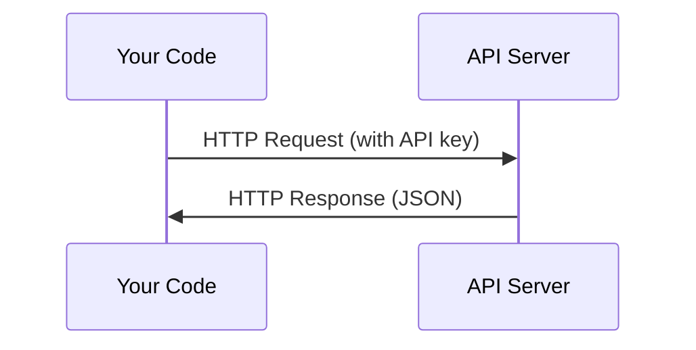

# API 与密钥

> 每个 AI API 的工作方式都相同：发送请求，获取响应。细节会变，模式不变。

**Type:** Build
**Languages:** Python, TypeScript
**Prerequisites:** Phase 0, Lesson 01
**Time:** ~30 minutes

## 学习目标

- 使用环境变量和 `.env` 文件安全存储 API 密钥
- 分别使用 Anthropic Python SDK 和原始 HTTP 发起 LLM API 调用
- 对比基于 SDK 与原始 HTTP 的请求/响应格式，用于调试
- 识别并处理常见 API 错误，包括认证失败和速率限制

## 问题

从阶段 11 开始，你会调用 LLM API（Anthropic、OpenAI、Google）。在阶段 13-16，你会构建在循环中调用这些 API 的智能体。你需要了解 API 密钥的工作原理、如何安全存储它们，以及如何发起第一次 API 调用。

## 概念



每次 API 调用都包含：

1. 一个 endpoint（URL）
2. 一个 API key（认证）
3. 一个 request body（你想要什么）
4. 一个 response body（你得到什么）

```figure
s0-secret-inject
```

## 构建它

### 步骤 1：安全存储 API 密钥

永远不要把 API 密钥写在代码里。使用环境变量。

```bash
export ANTHROPIC_API_KEY="sk-ant-..."
export OPENAI_API_KEY="sk-..."
```

或者使用 `.env` 文件（把它加入 `.gitignore`）：

```
ANTHROPIC_API_KEY=sk-ant-...
OPENAI_API_KEY=sk-...
```

### 步骤 2：第一次 API 调用（Python）

```python
import os

import anthropic

client = anthropic.Anthropic()

MODEL = os.environ.get("LLM_MODEL", "claude-sonnet-5")

response = client.messages.create(
    model=MODEL,
    max_tokens=256,
    messages=[{"role": "user", "content": "What is a neural network in one sentence?"}]
)

print(response.content[0].text)
```

`LLM_MODEL` 选择 Anthropic 的模型 id，默认是未标注日期的 Sonnet 别名。其他提供商（OpenAI、Google 等）遵循相同的「密钥 + 模型 id」模式，但各自拥有独立的 SDK、endpoint 和请求/响应格式。

### 步骤 3：第一次 API 调用（TypeScript）

```typescript
import Anthropic from "@anthropic-ai/sdk";

const client = new Anthropic();

const MODEL = process.env.LLM_MODEL ?? "claude-sonnet-5";

const response = await client.messages.create({
  model: MODEL,
  max_tokens: 256,
  messages: [{ role: "user", content: "What is a neural network in one sentence?" }],
});

console.log(response.content[0].text);
```

### 步骤 4：原始 HTTP（无 SDK）

```python
import os
import urllib.request
import json

url = "https://api.anthropic.com/v1/messages"
headers = {
    "Content-Type": "application/json",
    "x-api-key": os.environ["ANTHROPIC_API_KEY"],
    "anthropic-version": "2023-06-01",
}
body = json.dumps({
    "model": os.environ.get("LLM_MODEL", "claude-sonnet-5"),
    "max_tokens": 256,
    "messages": [{"role": "user", "content": "What is a neural network in one sentence?"}],
}).encode()

req = urllib.request.Request(url, data=body, headers=headers, method="POST")
with urllib.request.urlopen(req) as resp:
    result = json.loads(resp.read())
    print(result["content"][0]["text"])
```

这就是 SDK 在底层做的事情。理解原始 HTTP 调用有助于调试。

## 使用它

对于本课程：

| API | 使用场景 | 免费额度 |
|-----|-----------------|-----------|
| Anthropic (Claude) | 阶段 11-16（智能体、工具） | 注册赠送 $5 额度 |
| OpenAI | 阶段 11（对比） | 注册赠送 $5 额度 |
| Hugging Face | 阶段 4-10（模型、数据集） | 免费 |

你现在不需要全部设置。课程要求时再设置。

## 交付它

本节课产出：

- `outputs/prompt-api-troubleshooter.md` —— 诊断常见 API 错误

## 练习

1. 获取一个 Anthropic API 密钥并发起第一次 API 调用
2. 尝试原始 HTTP 版本，并对比它与 SDK 版本的响应格式
3. 故意使用错误的 API 密钥并阅读错误信息

### 提示

**练习 1。** 在 Anthropic Console 中创建密钥，按课程所示放入 `ANTHROPIC_API_KEY`，然后运行 `code/first_api_call.py`。当脚本打印模型回复且没有错误时，调用成功。

**练习 2。** `code/first_api_call.py` 中的两个函数都只打印文本和 token 数量。在 `call_with_sdk()` 中添加 `print(response)`，在 `call_raw_http()` 中添加 `print(result)`，然后运行脚本查看完整响应。对比字段名：原始 JSON 与 SDK 对象属性具有相同的 `content`、`usage` 和 `stop_reason` 字段。

**练习 3。** 仅在一个终端中将 `ANTHROPIC_API_KEY` 设为假值，然后再次运行脚本。在输出中找到 HTTP 状态码和错误类型；认证失败会返回 401 状态码。

## 关键术语

| 术语 | 通俗说法 | 实际含义 |
|------|----------------|----------------------|
| API key | "Password for the API" | 唯一字符串，用于标识你的账户并授权请求 |
| Rate limit | "They're throttling me" | 每分钟/小时的最大请求数，用于防止滥用并保证公平使用 |
| Token | "A word"（在 API 语境中） | 计费单位：输入 token 和输出 token 分别计数并计费 |
| Streaming | "Real-time responses" | 逐字获取响应，而不是等待完整响应返回 |
