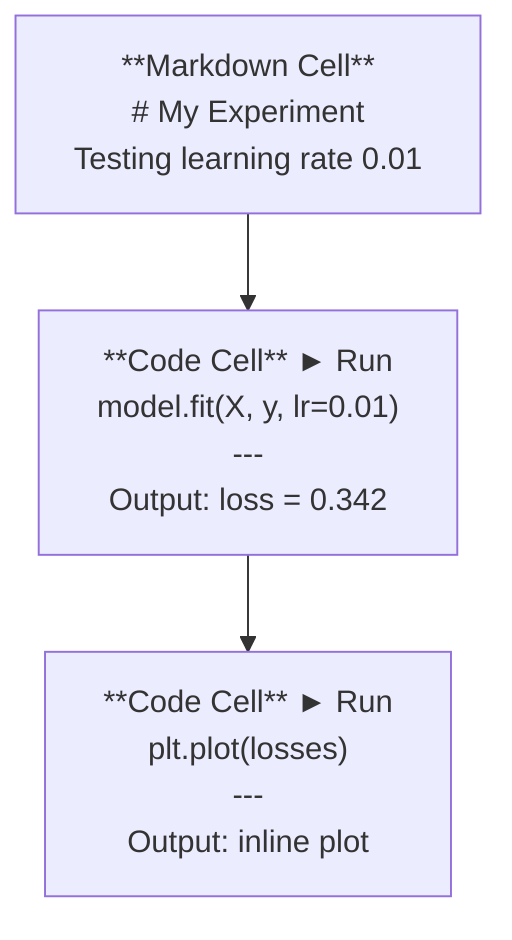
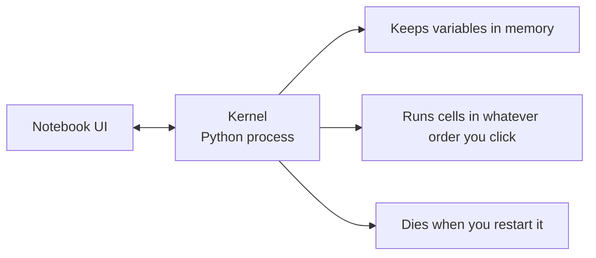

# Jupyter Notebook

> Notebook 是 AI 工程的实验台。你先在这里做原型，再把能用的部分搬进生产环境。

**Type:** Build
**Languages:** Python
**Prerequisites:** Phase 0, Lesson 01
**Time:** ~30 minutes

## 学习目标

- 安装并启动 JupyterLab、Jupyter Notebook 或带 Jupyter 扩展的 VS Code
- 使用 magic 命令（`%timeit`、`%%time`、`%matplotlib inline`）进行内联基准测试和可视化
- 区分何时使用 notebook、何时使用脚本，并应用「在 notebook 中探索，在脚本中交付」的工作流
- 识别并避开常见 notebook 陷阱：乱序执行、隐藏状态和内存泄漏

## 问题

每一篇 AI 论文、教程和 Kaggle 竞赛都使用 Jupyter notebook。它们让你分段运行代码、内联查看输出、混合代码与说明，并快速迭代。如果不用 notebook 学习 AI，就像做数学作业没有草稿纸。

但 notebook 也有真正的陷阱。人们把它们用在所有事情上，包括它们并不擅长的事。知道何时使用 notebook、何时使用脚本，能让你避免日后的调试噩梦。

## 概念

Notebook 是一系列 cell 的列表。每个 cell 要么是代码，要么是文本。



Kernel 是在后台运行的 Python 进程。运行 cell 时，代码被发送到 kernel，由它执行并把结果返回。所有 cell 共享同一个 kernel，因此变量会在 cell 之间保持。



「按你点击的任意顺序执行」这一点既是超能力，也是坑。

```figure
s0-cell-order
```

## 构建它

### 步骤 1：选择界面

三种界面，同一种格式：

| 界面 | 安装 | 最适合 |
|-----------|---------|----------|
| JupyterLab | `pip install jupyterlab` 然后 `jupyter lab` | 完整 IDE 体验，多标签页、文件浏览器、终端 |
| Jupyter Notebook | `pip install notebook` 然后 `jupyter notebook` | 简单轻量，一次一个 notebook |
| VS Code | 安装 "Jupyter" 扩展 | 已在编辑器内，集成 git，可调试 |

三种界面都读写相同的 `.ipynb` 文件。选你喜欢的即可。JupyterLab 是 AI 工作中最常见的。

```bash
pip install jupyterlab
jupyter lab
```

### 步骤 2：键盘快捷键

你在两种模式下操作。按 `Escape` 进入命令模式（左侧蓝条），按 `Enter` 进入编辑模式（左侧绿条）。

**命令模式（最常用）：**

| 按键 | 动作 |
|-----|--------|
| `Shift+Enter` | 运行 cell 并跳到下一个 |
| `A` | 在上方插入 cell |
| `B` | 在下方插入 cell |
| `DD` | 删除 cell |
| `M` | 转换为 markdown |
| `Y` | 转换为代码 |
| `Z` | 撤销 cell 操作 |
| `Ctrl+Shift+H` | 显示所有快捷键 |

**编辑模式：**

| 按键 | 动作 |
|-----|--------|
| `Tab` | 自动补全 |
| `Shift+Tab` | 显示函数签名 |
| `Ctrl+/` | 切换注释 |

`Shift+Enter` 是你一天会用上千次的快捷键。先记住它。

### 步骤 3：Cell 类型

**代码 cell** 运行 Python 并显示输出：

```python
import numpy as np
data = np.random.randn(1000)
data.mean(), data.std()
```

输出：`(0.0032, 0.9987)`

**Markdown cell** 渲染格式化文本。用它们记录你在做什么以及为什么。支持标题、加粗、斜体、LaTeX 数学（`$E = mc^2$`）、表格和图片。

### 步骤 4：Magic 命令

这些不是 Python。它们是 Jupyter 专用命令，以 `%`（行 magic）或 `%%`（cell magic）开头。

**给代码计时：**

```python
%timeit np.random.randn(10000)
```

输出：`45.2 us +/- 1.3 us per loop`

```python
%%time
model.fit(X_train, y_train, epochs=10)
```

输出：`Wall time: 2.34 s`

`%timeit` 多次运行代码并取平均。`%%time` 只运行一次。微基准测试用 `%timeit`，训练运行用 `%%time`。

**启用内联绘图：**

```python
%matplotlib inline
```

现在每个 `plt.plot()` 或 `plt.show()` 都会直接在 notebook 中渲染。

**不用离开 notebook 即可安装包：**

```python
!pip install scikit-learn
```

`!` 前缀可以运行任意 shell 命令。

**检查环境变量：**

```python
%env CUDA_VISIBLE_DEVICES
```

### 步骤 5：内联显示富输出

Notebook 会自动显示 cell 中最后一个表达式。但你可以控制它：

```python
import pandas as pd

df = pd.DataFrame({
    "model": ["Linear", "Random Forest", "Neural Net"],
    "accuracy": [0.72, 0.89, 0.94],
    "training_time": [0.1, 2.3, 45.6]
})
df
```

这会渲染一个格式化的 HTML 表格，而不是文本转储。绘图也一样：

```python
import matplotlib.pyplot as plt

plt.figure(figsize=(8, 4))
plt.plot([1, 2, 3, 4], [1, 4, 2, 3])
plt.title("Inline Plot")
plt.show()
```

图片会直接出现在 cell 下方。这就是 notebook 主导 AI 工作的原因：你可以同时看到数据、图表和代码。

对于图片：

```python
from IPython.display import Image, display
display(Image(filename="architecture.png"))
```

### 步骤 6：Google Colab

Colab 是一个免费的云端 Jupyter notebook。它提供 GPU、预装库和 Google Drive 集成。无需配置。

1. 访问 [colab.research.google.com](https://colab.research.google.com)
2. 上传本课程的任意 `.ipynb` 文件
3. 运行时 > 更改运行时类型 > T4 GPU（免费）

Colab 与本地 Jupyter 的区别：

- 文件不会在会话之间持久化（保存到 Drive 或下载）
- 已预装：numpy、 pandas、matplotlib、torch、tensorflow、sklearn
- 用 `from google.colab import files` 上传/下载文件
- 用 `from google.colab import drive; drive.mount('/content/drive')` 进行持久化存储
- 免费版会话在 90 分钟无活动后超时

## 使用它

### Notebook 与脚本：何时使用谁

| 用 notebook 做 | 用脚本做 |
|-------------------|-----------------|
| 探索数据集 | 训练 pipeline |
| 原型化模型 | 可复用工具函数 |
| 可视化结果 | 任何带 `if __name__` 的代码 |
| 解释你的工作 | 定时运行的代码 |
| 快速实验 | 生产代码 |
| 课程练习 | 包和库 |

规则：**在 notebook 中探索，在脚本中交付**。

常见的 AI 工作流程：

1. 在 notebook 中探索数据
2. 在 notebook 中原型化模型
3. 一旦能工作，就把代码移到 `.py` 文件
4. 把这些 `.py` 文件重新导入 notebook 进行进一步实验

### 常见陷阱

**乱序执行。** 你先运行 cell 5，再运行 cell 2，然后 cell 7。在你的机器上能跑通，但别人从上到下运行时就会崩溃。修复：分享前执行 Kernel > Restart & Run All。

**隐藏状态。** 你删除了一个 cell，但它创建的变量仍在内存中。Notebook 看起来很干净，却依赖一个「幽灵 cell」。修复：定期重启 kernel。

**内存泄漏。** 加载 4GB 数据集、训练模型、再加载另一个数据集。没有任何东西被释放。修复：`del variable_name` 和 `gc.collect()`，或者重启 kernel。

## 交付它

本节课产出：

- `outputs/prompt-notebook-helper.md` —— 调试 notebook 问题

## 练习

1. 打开 JupyterLab，创建一个 notebook，用 `%timeit` 对比「列表推导式」与 numpy 生成 100,000 个随机数的速度
2. 创建一个同时包含 markdown cell 和代码 cell 的 notebook，加载 CSV、显示 dataframe 并绘制图表。然后执行 Kernel > Restart & Run All，验证它能从上到下正常运行
3. 把 `code/notebook_tips.py` 的代码粘贴到 Colab notebook 中，并用免费 GPU 运行

### 提示

**练习 1。** 用 `jupyter lab` 启动 JupyterLab，然后把每个版本放在各自以 `%timeit` 开头的 cell 中。两个 cell 使用相同的 100,000 规模，这样两次测量才是相同工作量。

**练习 2。** 用 `pd.read_csv` 读取数据，把 dataframe 作为 cell 的最后一行显示，并用 `df.plot()` 或 matplotlib 绘图。执行 Kernel > Restart & Run All 后，每个 cell 都必须显示执行序号，且不能有 cell 报错。

**练习 3。** 在 Colab 中，粘贴代码前先选择 运行时 > 更改运行时类型 > GPU。当 `code/notebook_tips.py` 中的每个函数都打印出对应部分，并且某个 cell 中 `torch.cuda.is_available()` 返回 `True` 时，运行正确。

## 关键术语

| 术语 | 通俗说法 | 实际含义 |
|------|----------------|----------------------|
| Kernel | "The thing running my code" | 执行 cell 并在内存中保存变量的独立 Python 进程 |
| Cell | "A code block" | Notebook 中可独立运行的单元，要么是代码，要么是 markdown |
| Magic command | "Jupyter tricks" | 以 `%` 或 `%%` 为前缀、用于控制 notebook 环境的特殊命令 |
| `.ipynb` | "Notebook file" | 包含 cell、输出和元数据的 JSON 文件。代表 IPython Notebook |

## 延伸阅读

- [JupyterLab 文档](https://jupyterlab.readthedocs.io/)，了解完整功能
- [Google Colab 常见问题](https://research.google.com/colaboratory/faq.html)，了解 Colab 的限制与功能
- [28 个 Jupyter Notebook 技巧](https://www.dataquest.io/blog/jupyter-notebook-tips-tricks-shortcuts/)，了解高级快捷键
