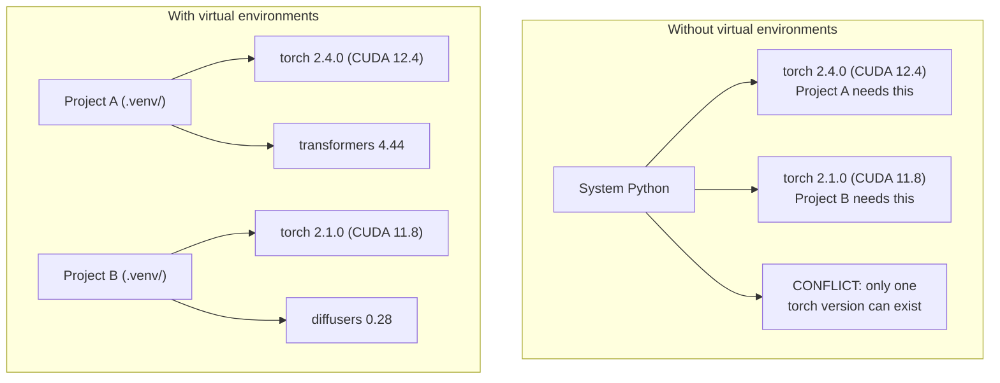

# Python 环境

> 依赖地狱真实存在。虚拟环境就是解药。

**Type:** Build
**Languages:** Shell
**Prerequisites:** Phase 0, Lesson 01
**Time:** ~30 minutes

## 学习目标

- 使用 `uv`、`venv` 或 `conda` 创建隔离的虚拟环境
- 编写带可选依赖组的 `pyproject.toml`，并生成 lockfile 以保证可复现性
- 诊断并修复常见陷阱：全局安装、pip/conda 混用、CUDA 版本不匹配
- 为依赖冲突的项目实现按阶段隔离的环境策略

## 问题

你为一个微调项目安装了 PyTorch 2.4。下周，另一个项目需要 PyTorch 2.1，因为它的 CUDA 构建被固定。你全局升级，第一个项目就崩了。你降级，第二个项目又崩了。

这就是依赖地狱。它在 AI/ML 工作中经常发生，因为：

- PyTorch、JAX 和 TensorFlow 各自附带自己的 CUDA 绑定
- 模型库会固定特定的框架版本
- 全局 `pip install` 会覆盖之前存在的版本
- CUDA 11.8 构建无法在 CUDA 12.x 驱动上运行（反之亦然）

解决方案：每个项目都有自己隔离的环境和独立的包。

## 概念



```figure
s0-env-isolation
```

## 构建它

### 选项 1：uv venv（推荐）

`uv` 是最快的 Python 包管理器（比 pip 快 10-100 倍）。它在一个工具中处理虚拟环境、Python 版本和依赖解析。

```bash
curl -LsSf https://astral.sh/uv/install.sh | sh

uv python install 3.12

cd your-project
uv venv
source .venv/bin/activate
```

安装包：

```bash
uv pip install torch numpy
```

一步创建带 `pyproject.toml` 的项目：

```bash
uv init my-ai-project
cd my-ai-project
uv add torch numpy matplotlib
```

### 选项 2：venv（内置）

如果你无法安装 `uv`，Python 自带 `venv`：

```bash
python3 -m venv .venv
source .venv/bin/activate  # Linux/macOS
.venv\Scripts\activate     # Windows

pip install torch numpy
```

比 `uv` 慢，但在任何已安装 Python 的地方都能工作。

### 选项 3：conda（需要时使用）

Conda 管理非 Python 依赖，如 CUDA toolkit、cuDNN 和 C 库。在以下情况使用它：

- 你需要特定版本的 CUDA toolkit，又不想系统级安装
- 你在共享集群上，无法安装系统包
- 库的安装说明写着「use conda」

```bash
# Install miniconda (not the full Anaconda)
curl -LsSf https://repo.anaconda.com/miniconda/Miniconda3-latest-Linux-x86_64.sh -o miniconda.sh
bash miniconda.sh -b

conda create -n myproject python=3.12
conda activate myproject

conda install pytorch torchvision torchaudio pytorch-cuda=12.4 -c pytorch -c nvidia
```

一条规则：如果你在某个环境中使用 conda，那就该环境中所有包都用 conda。把 `pip install` 混进 conda 环境会导致痛苦的依赖冲突。

### 针对本课程：按阶段的环境策略

你可以为整个课程创建一个环境。不要这么做。不同阶段需要不同（有时相互冲突）的依赖。

策略：

```
ai-engineering-from-scratch/
├── .venv/                    <-- 阶段 0-3 共享的轻量环境
├── phases/
│   ├── 04-neural-networks/
│   │   └── .venv/            <-- PyTorch 环境
│   ├── 05-cnns/
│   │   └── .venv/            <-- 同一个 PyTorch 环境（符号链接或共享）
│   ├── 08-transformers/
│   │   └── .venv/            <-- 可能需要不同的 transformer 版本
│   └── 11-llm-apis/
│       └── .venv/            <-- API SDK，不需要 torch
```

`code/env_setup.sh` 中的脚本会创建本课程的基础环境。

## pyproject.toml 基础

每个 Python 项目都应该有一个 `pyproject.toml`。它用一个文件取代了 `setup.py`、`setup.cfg` 和 `requirements.txt`。

```toml
[project]
name = "ai-engineering-from-scratch"
version = "0.1.0"
requires-python = ">=3.11"
dependencies = [
    "numpy>=1.26",
    "matplotlib>=3.8",
    "jupyter>=1.0",
    "scikit-learn>=1.4",
]

[project.optional-dependencies]
torch = ["torch>=2.3", "torchvision>=0.18"]
llm = ["anthropic>=0.39", "openai>=1.50"]
```

然后安装：

```bash
uv pip install -e ".[torch]"    # base + PyTorch
uv pip install -e ".[llm]"     # base + LLM SDKs
uv pip install -e ".[torch,llm]" # everything
```

## Lockfiles

Lockfile 把每个依赖（包括传递依赖）固定到精确版本。这保证了可复现性：任何从 lockfile 安装的人都会得到完全相同的包。

```bash
# uv generates uv.lock automatically when using uv add
uv add numpy

# pip-tools approach
uv pip compile pyproject.toml -o requirements.lock
uv pip install -r requirements.lock
```

把 lockfile 提交到 git。当别人克隆仓库时，他们从 lockfile 安装，得到完全一致的版本。

## 常见错误

### 1. 全局安装

```bash
pip install torch  # BAD: installs to system Python

source .venv/bin/activate
pip install torch  # GOOD: installs to virtual environment
```

检查包安装到了哪里：

```bash
which python       # should show .venv/bin/python, not /usr/bin/python
which pip           # should show .venv/bin/pip
```

### 2. 混用 pip 和 conda

```bash
conda create -n myenv python=3.12
conda activate myenv
conda install pytorch -c pytorch
pip install some-other-package   # BAD: can break conda's dependency tracking
conda install some-other-package # GOOD: let conda manage everything
```

如果你必须在 conda 内部使用 pip（某些包只有 pip 版），先安装所有 conda 包，最后再安装 pip 包。

### 3. 忘记激活

```bash
python train.py           # uses system Python, missing packages
source .venv/bin/activate
python train.py           # uses project Python, packages found
```

你的 shell 提示符应该显示环境名：

```
(.venv) $ python train.py
```

### 4. 把 .venv 提交到 git

```bash
echo ".venv/" >> .gitignore
```

虚拟环境大小为 200MB-2GB。它们是本地环境，不能在不同机器间迁移。改为提交 `pyproject.toml` 和 lockfile。

### 5. CUDA 版本不匹配

```bash
nvidia-smi                # shows driver CUDA version (e.g., 12.4)
python -c "import torch; print(torch.version.cuda)"  # shows PyTorch CUDA version

# These must be compatible.
# PyTorch CUDA version must be <= driver CUDA version.
```

## 使用它

运行设置脚本创建你的课程环境：

```bash
bash phases/00-setup-and-tooling/06-python-environments/code/env_setup.sh
```

这会在仓库根目录创建一个 `.venv`，安装并验证核心依赖。

## 练习

1. 运行 `env_setup.sh` 并验证所有检查通过
2. 创建第二个虚拟环境，在其中安装不同版本的 numpy，并确认两个环境相互隔离
3. 写一个同时需要 PyTorch 和 Anthropic SDK 的项目的 `pyproject.toml`
4. 故意全局安装一个包（不激活 venv），观察它安装到了哪里，然后卸载它

### 提示

**练习 1。** 从仓库根目录运行 `bash phases/00-setup-and-tooling/06-python-environments/code/env_setup.sh`。阅读每一行输出；当某个检查失败时，修复该项并重新运行脚本，直到没有检查失败。

**练习 2。** 在新文件夹中用 `uv venv` 创建第二个环境，激活它，并安装一个带版本锁定的旧 numpy，例如 `numpy==1.26.4`。在每个环境中运行 `python -c "import numpy; print(numpy.__version__)"`；两个版本必须不同。

**练习 3。** 从「pyproject.toml 基础」的示例开始，在 `dependencies` 中列出 `torch` 和 `anthropic`。在新环境中运行 `uv pip install -e .` 或 `uv sync`；当两个包都能导入且不出错时，文件正确。

**练习 4。** 停用所有环境，运行 `pip install --user <small package>`，然后运行 `pip show <package>` 并阅读 `Location` 行。用 `pip uninstall <package>` 卸载它，再运行 `pip show` 确认它已消失。

## 关键术语

| 术语 | 通俗说法 | 实际含义 |
|------|----------------|----------------------|
| Virtual environment | "A venv" | 包含 Python 解释器和包的隔离目录，与系统 Python 分离 |
| Lockfile | "Pinned dependencies" | 列出每个包及其精确版本的文件，保证不同机器上安装一致 |
| pyproject.toml | "The new setup.py" | 标准的 Python 项目配置文件，取代 setup.py/setup.cfg/requirements.txt |
| Transitive dependency | "A dependency of a dependency" | 包 B 依赖 C；如果你安装 A，而 A 依赖 B，那么 C 就是 A 的传递依赖 |
| CUDA mismatch | "My GPU isn't working" | PyTorch 编译时针对的 CUDA 版本与 GPU 驱动支持的版本不一致 |
