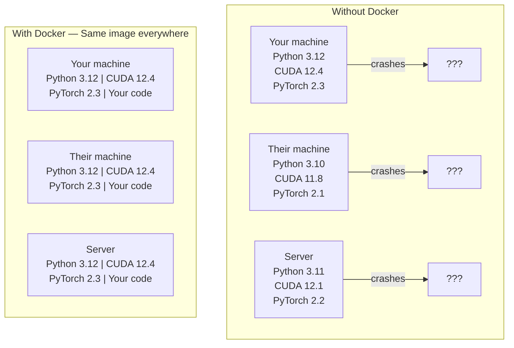

# Docker 赋能 AI

> 容器让「在我机器上能跑」成为历史。

**Type:** Build
**Languages:** Docker
**Prerequisites:** Phase 0, Lessons 01 and 03
**Time:** ~60 minutes

## 学习目标

- 从 Dockerfile 构建包含 CUDA、PyTorch 与 AI 库的 GPU 镜像
- 将主机目录挂载为卷，以便在容器重建后保留模型、数据集与代码
- 配置 NVIDIA Container Toolkit，使容器内部可访问 GPU
- 使用 Docker Compose 编排多服务 AI 应用（推理服务器 + 向量数据库）

## 问题

你在笔记本上用 PyTorch 2.3、CUDA 12.4 和 Python 3.12 训练了一个模型。你的同事用的是 PyTorch 2.1、CUDA 11.8 和 Python 3.10。模型在他的机器上崩溃。你的 Dockerfile 能让两者都跑通。

AI 项目是依赖关系的噩梦。一个典型栈包括 Python、PyTorch、CUDA 驱动、cuDNN、系统级 C 库，以及 flash-attn 这类需要精确编译器版本的专用包。Docker 把所有这些打包成一个镜像，在任何地方都以相同方式运行。

## 概念

Docker 将代码、运行时、库和系统工具封装成一个称为容器的隔离单元。可以把它想象成一台轻量级虚拟机，但它共享主机 OS 内核，而不是运行自己的内核，因此启动只需数秒而非数分钟。



### 为什么 AI 项目比其他项目更需要 Docker

1. **GPU 驱动很脆弱。** CUDA 12.4 的代码无法在 CUDA 11.8 上运行。Docker 将 CUDA 工具包隔离在容器内，同时通过 NVIDIA Container Toolkit 共享主机的 GPU 驱动。

2. **模型权重很大。** 一个 7B 参数的模型以 fp16 存储约为 14 GB。你不希望每次重建都要重新下载。Docker 卷允许你挂载主机上的模型目录。

3. **多服务架构很常见。** 真正的 AI 应用不只是 Python 脚本，而是推理服务器、用于 RAG 的向量数据库，可能还有 Web 前端。Docker Compose 用一个命令就能编排所有服务。

### 关键术语

| Term | What it means |
|------|---------------|
| Image | A read-only template. Your recipe. Built from a Dockerfile. |
| Container | A running instance of an image. Your kitchen. |
| Dockerfile | Instructions to build an image. Layer by layer. |
| Volume | Persistent storage that survives container restarts. |
| docker-compose | A tool for defining multi-container applications in YAML. |

### AI 中常见的容器模式

```
Dev Container
  Full toolkit. Editor support. Jupyter. Debugging tools.
  Used during development and experimentation.

Training Container
  Minimal. Just the training script and dependencies.
  Runs on GPU clusters. No editor, no Jupyter.

Inference Container
  Optimized for serving. Small image. Fast cold start.
  Runs behind a load balancer in production.
```

```figure
s0-image-layers
```

## 构建它

### 步骤 1：安装 Docker

```bash
# macOS
brew install --cask docker
open /Applications/Docker.app

# Ubuntu
curl -fsSL https://get.docker.com | sh
sudo usermod -aG docker $USER
# Log out and back in for group change to take effect
```

验证：

```bash
docker --version
docker run hello-world
```

### 步骤 2：安装 NVIDIA Container Toolkit（Linux + NVIDIA GPU）

它让 Docker 容器访问你的 GPU。macOS 和 Windows（WSL2）用户可以跳过这一步；Docker Desktop 在这些平台上以不同方式处理 GPU 透传。

```bash
distribution=$(. /etc/os-release;echo $ID$VERSION_ID)
curl -fsSL https://nvidia.github.io/libnvidia-container/gpgkey | sudo gpg --dearmor -o /usr/share/keyrings/nvidia-container-toolkit-keyring.gpg
curl -s -L https://nvidia.github.io/libnvidia-container/$distribution/libnvidia-container.list | \
    sed 's#deb https://#deb [signed-by=/usr/share/keyrings/nvidia-container-toolkit-keyring.gpg] https://#g' | \
    sudo tee /etc/apt/sources.list.d/nvidia-container-toolkit.list

sudo apt-get update
sudo apt-get install -y nvidia-container-toolkit
sudo nvidia-ctk runtime configure --runtime=docker
sudo systemctl restart docker
```

在容器内测试 GPU 访问：

```bash
docker run --rm --gpus all nvidia/cuda:12.4.1-base-ubuntu22.04 nvidia-smi
```

如果看到 GPU 信息，说明工具包已正常工作。

### 步骤 3：理解基础镜像

选对基础镜像能省下数小时调试时间。

```
nvidia/cuda:12.4.1-devel-ubuntu22.04
  Full CUDA toolkit. Compilers included.
  Use for: building packages that need nvcc (flash-attn, bitsandbytes)
  Size: ~4 GB

nvidia/cuda:12.4.1-runtime-ubuntu22.04
  CUDA runtime only. No compilers.
  Use for: running pre-built code
  Size: ~1.5 GB

pytorch/pytorch:2.6.0-cuda12.4-cudnn9-runtime
  PyTorch pre-installed on top of CUDA.
  Use for: skipping the PyTorch install step
  Size: ~6 GB

python:3.12-slim
  No CUDA. CPU only.
  Use for: inference on CPU, lightweight tools
  Size: ~150 MB
```

### 步骤 4：编写 AI 开发 Dockerfile

下面是 `code/Dockerfile` 的内容。逐步阅读：

```dockerfile
FROM --platform=linux/amd64 nvidia/cuda:12.4.1-devel-ubuntu22.04

ENV DEBIAN_FRONTEND=noninteractive
ENV PYTHONUNBUFFERED=1

RUN apt-get update && apt-get install -y --no-install-recommends \
    software-properties-common \
    git \
    curl \
    build-essential \
    && add-apt-repository -y ppa:deadsnakes/ppa \
    && apt-get update && apt-get install -y --no-install-recommends \
    python3.12 \
    python3.12-venv \
    python3.12-dev \
    && rm -rf /var/lib/apt/lists/*

RUN update-alternatives --install /usr/bin/python python /usr/bin/python3.12 1

RUN curl -sSL https://raw.githubusercontent.com/pypa/get-pip/3b73145063be545b649ad9ca83ea8da5fc915a4f/public/get-pip.py -o /tmp/get-pip.py \
    && echo "a341e1a43e38001c551a1508a73ff23636a11970b61d901d9a1cad2a18f57055  /tmp/get-pip.py" | sha256sum -c - \
    && python /tmp/get-pip.py \
    && rm /tmp/get-pip.py \
    && update-alternatives --install /usr/bin/pip pip /usr/local/bin/pip3.12 1

RUN python -m pip install --no-cache-dir --upgrade pip setuptools wheel

RUN python -m pip install --no-cache-dir \
    torch==2.6.0+cu124 \
    torchvision==0.21.0+cu124 \
    torchaudio==2.6.0+cu124 \
    --index-url https://download.pytorch.org/whl/cu124

RUN python -m pip install --no-cache-dir \
    numpy \
    pandas \
    scikit-learn \
    matplotlib \
    jupyter \
    transformers \
    datasets \
    accelerate \
    safetensors

WORKDIR /workspace

VOLUME ["/workspace", "/models"]

EXPOSE 8888

CMD ["python"]
```

构建：

```bash
docker build -t ai-dev -f phases/00-setup-and-tooling/07-docker-for-ai/code/Dockerfile .
```

首次构建需要一些时间（下载 CUDA 基础镜像 + PyTorch）。后续构建会利用缓存层。

**macOS / Apple Silicon（M1/M2/M3/M4）：** `FROM` 行中的 `--platform=linux/amd64` 是让 Mac 构建成功的关键。CUDA 基础镜像也提供 arm64 变体，Docker Desktop 在 Apple Silicon 上会自动选择它，但 PyTorch 的 `cu124` wheel 只发布 x86_64 版本，因此 `pip install torch==2.6.0+cu124` 那层会失败，提示 `No matching distribution found for torch==2.6.0+cu124`。固定平台会拉取 x86_64 镜像并在模拟下运行：构建更慢，且容器没有 GPU（Mac 本就没有 CUDA）。在 Mac 上请省略下面 `docker run` 命令中的 `--gpus all`。若要在 Apple Silicon 上做 GPU 工作，请使用第 01 课的 MPS 原生运行，而把这个镜像留给带 NVIDIA GPU 的 x86_64 Linux 主机。

运行：

```bash
docker run --rm -it --gpus all \
    -v $(pwd):/workspace \
    -v ~/models:/models \
    ai-dev python -c "import torch; print(f'PyTorch {torch.__version__}, CUDA: {torch.cuda.is_available()}')"
```

在容器内运行 Jupyter：

```bash
docker run --rm -it --gpus all \
    -v $(pwd):/workspace \
    -v ~/models:/models \
    -p 8888:8888 \
    ai-dev jupyter notebook --ip=0.0.0.0 --port=8888 --no-browser --allow-root
```

### 步骤 5：用于数据与模型的卷挂载

卷挂载对 AI 工作至关重要。没有它，你下载的 14 GB 模型会在容器停止后消失。

```bash
# Mount your code
-v $(pwd):/workspace

# Mount a shared models directory
-v ~/models:/models

# Mount datasets
-v ~/datasets:/data
```

在训练脚本内部，从挂载路径加载：

```python
from transformers import AutoModel

model = AutoModel.from_pretrained("/models/llama-7b")
```

模型位于主机文件系统中。你可以随意重建容器而无需重新下载。

### 步骤 6：多服务 AI 应用的 Docker Compose

一个真正的 RAG 应用需要推理服务器和向量数据库。Docker Compose 用一个命令同时运行两者。

参见 `code/docker-compose.yml`：

```yaml
services:
  ai-dev:
    build:
      context: .
      dockerfile: Dockerfile
    deploy:
      resources:
        reservations:
          devices:
            - driver: nvidia
              count: all
              capabilities: [gpu]
    volumes:
      - ../../../:/workspace
      - ~/models:/models
      - ~/datasets:/data
    ports:
      - "8888:8888"
    stdin_open: true
    tty: true
    command: jupyter notebook --ip=0.0.0.0 --port=8888 --no-browser --allow-root

  qdrant:
    image: qdrant/qdrant:v1.12.5
    ports:
      - "6333:6333"
      - "6334:6334"
    volumes:
      - qdrant_data:/qdrant/storage

volumes:
  qdrant_data:
```

启动所有服务：

```bash
cd phases/00-setup-and-tooling/07-docker-for-ai/code
docker compose up -d
```

现在，AI 开发容器可以通过服务名访问向量数据库 `http://qdrant:6333`。Docker Compose 会自动创建共享网络。

在 AI 容器内测试连接：

```python
from qdrant_client import QdrantClient

client = QdrantClient(host="qdrant", port=6333)
print(client.get_collections())
```

停止所有服务：

```bash
docker compose down
```

加上 `-v` 可同时删除 qdrant 卷：

```bash
docker compose down -v
```

### 步骤 7：AI 工作中常用的 Docker 命令

```bash
# List running containers
docker ps

# List all images and their sizes
docker images

# Remove unused images (reclaim disk space)
docker system prune -a

# Check GPU usage inside a running container
docker exec -it <container_id> nvidia-smi

# Copy a file from container to host
docker cp <container_id>:/workspace/results.csv ./results.csv

# View container logs
docker logs -f <container_id>
```

## 使用它

你现在拥有了一个可复现的 AI 开发环境。在本课程的后续部分：

- 使用 `docker compose up` 同时启动开发环境和向量数据库
- 将代码、模型和数据挂载为卷，重建时不会丢失任何内容
- 当某节课需要新的 Python 包时，把它加到 Dockerfile 里并重建
- 把 Dockerfile 分享给队友。他们会得到完全相同的环境。

### 没有 GPU？

去掉 `--gpus all` 和 NVIDIA 部署块。容器对基于 CPU 的课程仍然有效。PyTorch 会自动检测不到 CUDA 并回退到 CPU。

## 练习

1. 构建 Dockerfile，并在容器内运行 `python -c "import torch; print(torch.__version__)"`
2. 启动 docker-compose 栈，并验证 AI 容器能通过 `http://qdrant:6333/collections` 访问 Qdrant
3. 在 Dockerfile 中添加 `flask`，重建镜像，并在 5000 端口运行一个简单的 API 服务器。用 `-p 5000:5000` 映射端口
4. 用 `docker images` 查看镜像大小。尝试将基础镜像从 `devel` 切换到 `runtime`，并比较大小

### 提示

**练习 1.** 使用本课的 `docker build -t ai-dev -f phases/00-setup-and-tooling/07-docker-for-ai/code/Dockerfile .` 命令构建，然后在 `docker run --rm ai-dev` 内运行 import。在 Mac 上省略 `--gpus all`，原因见上文。容器必须打印以 `2.6.0` 开头的版本。

**练习 2.** 在 `code/` 文件夹运行 `docker compose up -d`，然后用 `docker compose exec ai-dev bash` 在 `ai-dev` 服务中打开 shell。在里面运行 `curl http://qdrant:6333/collections`；如果返回 JSON，说明 compose 网络上的服务名可以解析。

**练习 3.** 在 Dockerfile 中加入一行 `RUN pip install flask`，重建镜像，并以 `host="0.0.0.0"` 启动服务器，因为绑定到容器内 localhost 的服务从外部无法访问。在浏览器打开 `http://localhost:5000` 确认端口映射生效。

**练习 4.** 运行 `docker images ai-dev` 并记下 SIZE 列。把 `FROM` 行中的 `devel` 改成 `runtime`，用新标签构建，并比较两个大小；runtime 镜像不包含编译器和头文件。

## 关键术语

| Term | What people say | What it actually means |
|------|----------------|----------------------|
| Container | "Lightweight VM" | An isolated process using the host kernel, with its own filesystem and network |
| Image layer | "Cached step" | Each Dockerfile instruction creates a layer. Unchanged layers are cached, so rebuilds are fast. |
| NVIDIA Container Toolkit | "GPU in Docker" | A runtime hook that exposes host GPUs to containers via `--gpus` flag |
| Volume mount | "Shared folder" | A directory on the host mapped into the container. Changes persist after the container stops. |
| Base image | "Starting point" | The `FROM` image your Dockerfile builds on top of. Determines what is pre-installed. |
