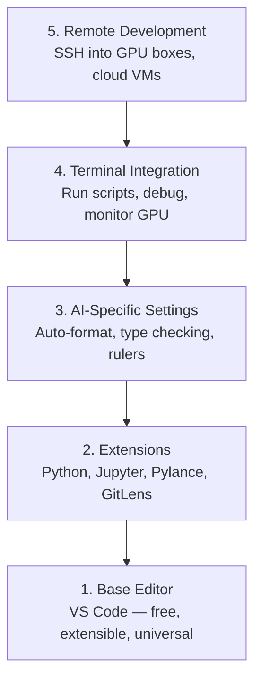

# 编辑器配置

> 编辑器就是你的副驾。一次性配置好，它就不会碍事，还能真正帮上忙。

**Type:** Build
**Languages:** --
**Prerequisites:** Phase 0, Lesson 01
**Time:** ~20 minutes

## 学习目标

- 安装 VS Code，并配置 Python、Jupyter、代码检查、linting 与远程 SSH 等核心扩展
- 配置保存时自动格式化、类型检查以及 notebook 输出滚动，适配 AI 工作流
- 设置 Remote SSH，使远程 GPU 机器上的编辑与调试像本地一样顺滑
- 评估编辑器替代品（Cursor、Windsurf、Neovim），以及它们在 AI 工作中的取舍

## 问题

你将在编辑器中度过数千小时：写 Python、运行 notebook、调试训练循环、通过 SSH 连接 GPU 机器。配置不当的编辑器会让每次工作都充满阻力：没有自动补全、没有类型提示、没有内联错误、手动格式化、终端流程笨拙。

正确的配置只需 20 分钟。跳过它，每天都会多浪费 20 分钟。

## 概念

AI 工程所需的编辑器配置包含五件事：



```figure
s0-lsp-roundtrip
```

## 构建它

### 步骤 1：安装 VS Code

VS Code 是推荐的编辑器。它免费、跨平台、原生支持 Jupyter notebook，扩展生态也覆盖了 AI 工作所需的一切。

从 [code.visualstudio.com](https://code.visualstudio.com/) 下载。

在终端验证：

```bash
code --version
```

如果 macOS 找不到 `code`，打开 VS Code，按 `Cmd+Shift+P`，输入 "Shell Command"，然后选择 "Install 'code' command in PATH"。

### 步骤 2：安装核心扩展

打开 VS Code 集成终端（各平台都是 `` Ctrl+` ``），安装 AI 工作中真正重要的扩展：

```bash
code --install-extension ms-python.python
code --install-extension ms-python.vscode-pylance
code --install-extension ms-toolsai.jupyter
code --install-extension eamodio.gitlens
code --install-extension ms-vscode-remote.remote-ssh
code --install-extension ms-python.debugpy
code --install-extension ms-python.black-formatter
code --install-extension charliermarsh.ruff
```

它们各自的作用：

| Extension | Why |
|-----------|-----|
| Python | Language support, virtual env detection, run/debug |
| Pylance | Fast type checking, autocomplete, import resolution |
| Jupyter | Run notebooks inside VS Code, variable explorer |
| GitLens | See who changed what, inline git blame |
| Remote SSH | Open a folder on a remote GPU box as if it were local |
| Debugpy | Step-through debugging for Python |
| Black Formatter | Auto-format on save, consistent style |
| Ruff | Fast linting, catches common mistakes |

本课的 `code/vscode/extensions.json` 包含完整推荐列表。把它复制到项目文件夹的 `.vscode/extensions.json`，打开该文件夹时 VS Code 会提示你安装。

### 步骤 3：配置设置

复制本课 `code/vscode/settings.json` 中的设置，或者通过 `Settings > Open Settings (JSON)` 手动应用。

AI 工作的关键设置：

```jsonc
{
    "python.analysis.typeCheckingMode": "basic",
    "editor.formatOnSave": true,
    "editor.rulers": [88, 120],
    "notebook.output.scrolling": true,
    "files.autoSave": "afterDelay"
}
```

这些设置为什么重要：

- **Type checking on basic**：在运行前捕获参数类型错误。能省下大量调试张量形状不匹配或 API 参数错误的时间。
- **Format on save**：再也不用考虑格式问题。Black 会自动处理。
- **Rulers at 88 and 120**：Black 在 88 字符处换行。120 的标线提示 docstring 和注释是否写得太长。
- **Notebook output scrolling**：训练循环可能输出数千行。没有滚动，输出面板会爆掉。
- **Auto-save**：你总会忘记保存。训练脚本可能运行旧代码。自动保存可以防止这一点。

### 步骤 4：终端集成

VS Code 的集成终端是你运行训练脚本、监控 GPU、管理环境的地方。

正确配置：

```jsonc
{
    "terminal.integrated.defaultProfile.osx": "zsh",
    "terminal.integrated.defaultProfile.linux": "bash",
    "terminal.integrated.fontSize": 13,
    "terminal.integrated.scrollback": 10000
}
```

实用快捷键：

| Action | macOS | Linux/Windows |
|--------|-------|---------------|
| Toggle terminal | `` Ctrl+` `` | `` Ctrl+` `` |
| New terminal | `` Ctrl+Shift+` `` | `` Ctrl+Shift+` `` |
| Split terminal | `Cmd+\` | `Ctrl+Shift+5` |

拆分终端很有用：一个窗格跑脚本，另一个用 `nvidia-smi -l 1` 或 `watch -n 1 nvidia-smi` 监控 GPU。

### 步骤 5：远程开发（SSH 连接 GPU 机器）

这是 AI 工作中最重要的扩展。你会在远程机器上训练（云 VM、实验室服务器、Lambda、Vast.ai）。Remote SSH 让你打开远程文件系统、编辑文件、运行终端、调试，一切都像本地一样。

设置步骤：

1. 安装 Remote SSH 扩展（Step 2 已完成）。
2. 按 `Ctrl+Shift+P`（或 `Cmd+Shift+P`），输入 "Remote-SSH: Connect to Host"。
3. 输入 `user@your-gpu-box-ip`。
4. VS Code 会自动在远程机器上安装其服务端组件。

为了实现无密码访问，配置 SSH 密钥：

```bash
ssh-keygen -t ed25519 -C "your-email@example.com"
ssh-copy-id user@your-gpu-box-ip
```

把主机加到 `~/.ssh/config` 中，方便后续连接：

```
Host gpu-box
    HostName 203.0.113.50
    User ubuntu
    IdentityFile ~/.ssh/id_ed25519
    ForwardAgent yes
```

现在选择 `Remote-SSH: Connect to Host > gpu-box` 即可瞬间连接。

## 其他选择

### Cursor

[cursor.com](https://cursor.com) 是内置 AI 代码生成的 VS Code 分支。它使用同样的扩展生态和设置格式。如果你用 Cursor，本课的所有内容仍然适用。导入相同的 `settings.json` 和 `extensions.json` 即可。

### Windsurf

[windsurf.com](https://windsurf.com) 是另一款 AI 优先的 VS Code 分支。情况相同：同样的扩展、同样的设置格式、同样的 Remote SSH 支持。

### Vim/Neovim

如果你已经在用 Vim 或 Neovim 并且能高效工作，就继续用。AI Python 工作的最低配置：

- **pyright** 或 **pylsp** 做类型检查（通过 Mason 或手动安装）
- **nvim-lspconfig** 集成语言服务器
- **jupyter-vim** 或 **molten-nvim** 实现类似 notebook 的执行
- **telescope.nvim** 做文件/符号搜索
- **none-ls.nvim** 配合 black 与 ruff 做格式化/linting

如果你本来就不用 Vim，现在也别开始。学习曲线会分散你学习 AI 工程的精力。用 VS Code。

## 使用它

配置完成后，你的日常工作流应该是：

1. 在 VS Code 中打开项目文件夹（或通过 Remote SSH 连接到 GPU 机器）。
2. 在编辑器中写 Python，享受自动补全、类型提示和内联错误。
3. 用 Jupyter 扩展在编辑器内运行 notebook。
4. 用集成终端跑训练脚本、执行 `uv pip install`、监控 GPU。
5. 提交前用 GitLens 查看变更。

## 练习

1. 安装 VS Code 与 Step 2 列出的所有扩展
2. 把本课的 `settings.json` 复制进你的 VS Code 配置
3. 打开一个 Python 文件，验证 Pylance 能显示类型提示，Black 能在保存时格式化
4. 如果你有远程机器可用，设置 Remote SSH 并在上面打开一个文件夹

### 提示

**练习 1.** 安装 Step 2 表格中的扩展，或用 `code --install-extension <id>` 安装 `code/vscode/extensions.json` 中的每个 ID。运行 `code --list-extensions` 并逐一核对。

**练习 2.** 打开 Settings > Open Settings (JSON)，把 `code/vscode/settings.json` 的内容复制进去。如果文件里已有设置，合并这些键并保持 JSON 有效；VS Code 会用红线标记损坏的文件。

**练习 3.** 写一个带类型注解的函数，然后把光标悬停在一次调用上，Pylance 会显示推断类型。在某一行中加入多余空格并保存文件，Black 必须在保存时重新格式化该行。

**练习 4.** 先把服务器加到 `~/.ssh/config`，确认终端里 `ssh <host>` 能工作。然后使用 Remote SSH 命令连接；当 VS Code 在远程机器上运行时，状态栏会显示主机名。

## 关键术语

| Term | What people say | What it actually means |
|------|----------------|----------------------|
| LSP | "Autocomplete engine" | Language Server Protocol: a standard for editors to get type info, completions, and diagnostics from a language-specific server |
| Pylance | "The Python plugin" | Microsoft's Python language server using Pyright for type checking and IntelliSense |
| Remote SSH | "Working on the server" | VS Code extension that runs a lightweight server on a remote machine and streams the UI to your local editor |
| Format on save | "Auto-prettier" | The editor runs a formatter (Black, Ruff) every time you save, so code style is always consistent |
