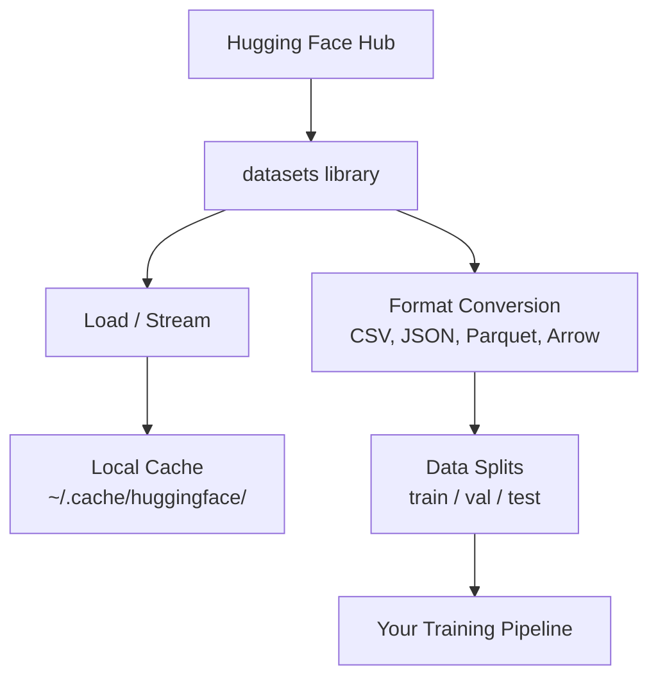

# 数据管理

> 数据是燃料，你如何管理它决定了你能跑多快。

**Type:** Build
**Language:** Python
**Prerequisites:** Phase 0, Lesson 01
**Time:** ~45 minutes

## 学习目标

- 使用 Hugging Face 的 `datasets` 库加载、流式读取和缓存数据集
- 在 CSV、JSON、Parquet、Arrow 格式之间转换，并解释它们的取舍
- 使用固定随机种子创建可复现的训练/验证/测试划分
- 使用 `.gitignore`、Git LFS 或 DVC 管理大型模型与数据集文件

## 问题

每个 AI 项目都从数据开始。你需要找到数据集、下载、格式转换、划分训练与评估集、版本化，以保证实验可复现。每次都手动完成既慢又容易出错。你需要一套可重复的工作流。

## 概念



Hugging Face 的 `datasets` 库是 AI 工作中加载数据的标准方式。它内置了下载、缓存、格式转换和流式读取。

```figure
s0-data-pipeline
```

## 构建它

### 步骤 1：安装 datasets 库

```bash
pip install datasets huggingface_hub
```

### 步骤 2：加载数据集

```python
from datasets import load_dataset

dataset = load_dataset("stanfordnlp/imdb")
print(dataset)
print(dataset["train"][0])
```

这会下载 IMDB 影评数据集。首次下载后，它会从 `~/.cache/huggingface/datasets/` 缓存加载。

### 步骤 3：流式读取大型数据集

有些数据集太大，无法完整存入磁盘。流式读取会逐行加载，而无需下载完整数据。

```python
dataset = load_dataset("wikimedia/wikipedia", "20231101.en", split="train", streaming=True)

for i, example in enumerate(dataset):
    print(example["title"])
    if i >= 4:
        break
```

流式读取返回一个 `IterableDataset`。数据逐行到达时进行处理。无论数据集多大，内存占用都保持不变。

### 步骤 4：数据集格式

`datasets` 库底层使用 Apache Arrow。你可以根据 pipeline 需要转换成其他格式。

```python
dataset = load_dataset("stanfordnlp/imdb", split="train")

dataset.to_csv("imdb_train.csv")
dataset.to_json("imdb_train.json")
dataset.to_parquet("imdb_train.parquet")
```

格式对比：

| Format | Size | Read Speed | Best For |
|--------|------|-----------|----------|
| CSV | Large | Slow | Human readability, spreadsheets |
| JSON | Large | Slow | APIs, nested data |
| Parquet | Small | Fast | Analytics, columnar queries |
| Arrow | Small | Fastest | In-memory processing (what `datasets` uses internally) |

对于 AI 工作，Parquet 是最佳存储格式。Arrow 是你在内存中使用的格式。CSV 和 JSON 用于数据交换。

### 步骤 5：数据划分

每个 ML 项目都需要三个划分：

- **Train**：模型从中学习（通常 80%）
- **Validation**：在训练期间检查进展（通常 10%）
- **Test**：训练结束后的最终评估（通常 10%）

有些数据集已经预划分。如果没有，自己划分：

```python
dataset = load_dataset("stanfordnlp/imdb", split="train")

split = dataset.train_test_split(test_size=0.2, seed=42)
train_val = split["train"].train_test_split(test_size=0.125, seed=42)

train_ds = train_val["train"]
val_ds = train_val["test"]
test_ds = split["test"]

print(f"Train: {len(train_ds)}, Val: {len(val_ds)}, Test: {len(test_ds)}")
```

始终设置 seed 以保证可复现性。相同的 seed 每次都会得到相同的划分。

### 步骤 6：下载与缓存模型

模型是大文件。`huggingface_hub` 库负责下载和缓存。

```python
from huggingface_hub import hf_hub_download, snapshot_download

model_path = hf_hub_download(
    repo_id="sentence-transformers/all-MiniLM-L6-v2",
    filename="config.json"
)
print(f"Cached at: {model_path}")

model_dir = snapshot_download("sentence-transformers/all-MiniLM-L6-v2")
print(f"Full model at: {model_dir}")
```

模型缓存到 `~/.cache/huggingface/hub/`。下载一次后，后续运行可瞬间加载。

### 步骤 7：处理大文件

模型权重和大型数据集不应该进入 git。有三种选择：

**Option A: .gitignore（最简单）**

```
*.bin
*.safetensors
*.pt
*.onnx
data/*.parquet
data/*.csv
models/
```

**Option B: Git LFS（在 git 中跟踪大文件）**

```bash
git lfs install
git lfs track "*.bin"
git lfs track "*.safetensors"
git add .gitattributes
```

Git LFS 在仓库中存储指针，实际文件放在单独的服务器上。GitHub 免费提供 1 GB。

**Option C: DVC（数据版本控制）**

```bash
pip install dvc
dvc init
dvc add data/training_set.parquet
git add data/training_set.parquet.dvc data/.gitignore
git commit -m "Track training data with DVC"
```

DVC 会生成很小的 `.dvc` 文件指向你的数据。数据本身存放在 S3、GCS 或其他远程存储后端。

| Approach | Complexity | Best For |
|----------|-----------|----------|
| .gitignore | Low | Personal projects, downloaded data you can re-fetch |
| Git LFS | Medium | Teams sharing model weights via git |
| DVC | High | Reproducible experiments, large datasets, teams |

对于本课程，`.gitignore` 已足够。当你需要跨机器复现精确实验时，再使用 DVC。

### 步骤 8：存储模式

**本地存储**适用于约 10 GB 以下的数据集。HF 缓存会自动处理。

**云存储**用于更大或需要在多台机器间共享的数据：

```python
import os

local_path = os.path.expanduser("~/.cache/huggingface/datasets/")

# s3_path = "s3://my-bucket/datasets/"
# gcs_path = "gs://my-bucket/datasets/"
```

DVC 直接与 S3 和 GCS 集成：

```bash
dvc remote add -d myremote s3://my-bucket/dvc-store
dvc push
```

对于本课程，本地存储已足够。云存储在远程 GPU 实例上做微调时才变得相关。

## 本课程使用的数据集

| Dataset | Lessons | Size | What It Teaches |
|---------|---------|------|----------------|
| IMDB | Tokenization, classification | 84 MB | Text classification basics |
| WikiText | Language modeling | 181 MB | Next-token prediction |
| SQuAD | QA systems | 35 MB | Question answering, spans |
| Common Crawl (subset) | Embeddings | Varies | Large-scale text processing |
| MNIST | Vision basics | 21 MB | Image classification fundamentals |
| COCO (subset) | Multimodal | Varies | Image-text pairs |

你现在不需要下载全部。每节课都会说明需要什么。

## 使用它

运行工具脚本验证一切正常：

```bash
python code/data_utils.py
```

它会下载一个小数据集，转换、划分，并打印摘要。

## 交付它

本节课产出：
- `code/data_utils.py` —— 可复用的数据加载与缓存工具
- `outputs/prompt-data-helper.md` —— 用于为任务寻找合适数据集的 prompt

## 练习

1. 加载 `glue` 数据集的 `mrpc` 配置，查看前 5 条示例
2. 流式读取 `c4` 数据集，统计 10 秒内能处理多少条示例
3. 将数据集转换为 Parquet，并与 CSV 的文件大小做比较
4. 使用固定 seed 创建 70/15/15 的训练/验证/测试划分，并验证大小

### 提示

**练习 1.** 调用 `code/data_utils.py` 中的 `load_and_inspect("glue", "mrpc")`，或直接调用 `load_dataset("glue", "mrpc")`，然后打印 `ds["train"][:5]`。每条示例必须包含 `sentence1`、`sentence2` 和 `label` 字段。

**练习 2.** 以 `streaming=True` 加载数据集，就像 `stream_dataset` 那样，用循环读取示例，当 `time.time()` 超过开始时间加 10 秒时停止。打印计数；运行两次，因为第一次运行包含连接启动时间。

**练习 3.** 像 `convert_format` 那样，用 `to_csv` 和 `to_parquet` 保存同一数据集，然后用 `ls -lh` 或 `os.path.getsize` 比较大小。用 `load_from_parquet` 加载 Parquet 文件，检查行数是否不变。

**练习 4.** 使用固定 `seed` 调用两次 `train_test_split`：先分出 30%，再把这 30% 对半分。三个划分的长度之和必须等于原始长度；用相同 seed 再次运行时，每个划分的第一行必须相同。

## 关键术语

| Term | What people say | What it actually means |
|------|----------------|----------------------|
| Dataset split | "Training data" | A named subset (train/val/test) used at different stages of the ML lifecycle |
| Streaming | "Load it lazily" | Processing data row by row from a remote source without downloading the full dataset |
| Parquet | "Compressed CSV" | A columnar file format optimized for analytical queries and storage efficiency |
| Arrow | "Fast dataframe" | An in-memory columnar format used internally by the datasets library for zero-copy reads |
| Git LFS | "Git for big files" | An extension that stores large files outside the git repo while keeping pointers in version control |
| DVC | "Git for data" | A version control system for datasets and models that integrates with cloud storage |
| Cache | "Already downloaded" | A local copy of previously fetched data, stored at ~/.cache/huggingface/ by default |
