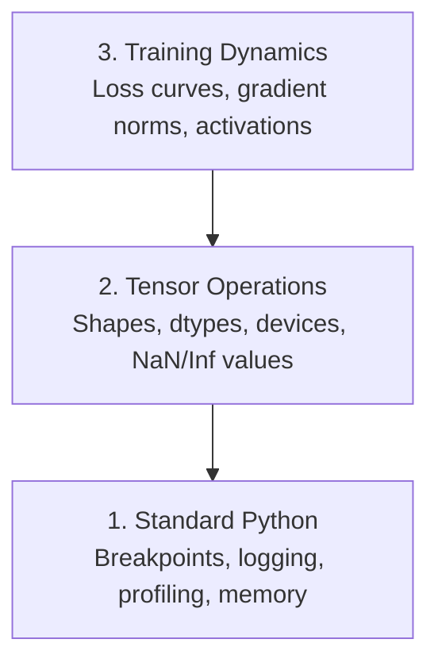

# 调试与性能分析

> 最糟糕的 AI bug 不会崩溃。它们会静默地用垃圾数据训练，并输出一条漂亮的损失曲线。

**Type:** Build
**Language:** Python
**Prerequisites:** Lesson 1 (Dev Environment), basic PyTorch familiarity
**Time:** ~60 minutes

## 学习目标

- 使用条件 `breakpoint()` 与 `debug_print` 检查训练过程中张量的形状、dtype 和 NaN 值
- 使用 `cProfile`、`line_profiler` 与 `tracemalloc` 分析训练循环，找出瓶颈
- 检测常见 AI bug：形状不匹配、NaN 损失、数据泄漏、张量设备错误
- 设置 TensorBoard，可视化损失曲线、权重直方图与梯度分布

## 问题

AI 代码的失效方式与普通代码不同。Web 应用会带着堆栈跟踪崩溃。而一个配置错误的训练循环会跑 8 小时、烧掉 200 美元 GPU 费用，最后产出一个对任何输入都预测均值的模型。代码没有报错。bug 可能是张量放在了错误设备上、漏了 `.detach()`，或标签泄露到了特征里。

你需要能在这些静默失败浪费时间和算力之前抓住它们的调试工具。

## 概念

AI 调试分三个层次：



大多数人直接跳到第 3 层（盯着 TensorBoard）。但 80% 的 AI bug 其实住在第 1 和第 2 层。

```figure
s0-flame-hot
```

## 构建它

### 第 1 部分：打印调试（确实有用）

打印调试常被轻视。不应该。对于张量代码，一条精准的 print 语句胜过单步调试器，因为你需要同时看到形状、dtype 和数值范围。

```python
def debug_print(name, tensor):
    print(f"{name}: shape={tensor.shape}, dtype={tensor.dtype}, "
          f"device={tensor.device}, "
          f"min={tensor.min().item():.4f}, max={tensor.max().item():.4f}, "
          f"mean={tensor.mean().item():.4f}, "
          f"has_nan={tensor.isnan().any().item()}")
```

在每个可疑操作后调用它。找到 bug 后再删掉 print。简单有效。

### 第 2 部分：Python 调试器（pdb 与 breakpoint）

内置调试器在 AI 工作中被低估了。在训练循环里丢一个 `breakpoint()`，就可以交互式检查张量。

```python
def training_step(model, batch, criterion, optimizer):
    inputs, labels = batch
    outputs = model(inputs)
    loss = criterion(outputs, labels)

    if loss.item() > 100 or torch.isnan(loss):
        breakpoint()

    loss.backward()
    optimizer.step()
```

调试器进入后，有用的命令：

- `p outputs.shape` 检查形状
- `p loss.item()` 查看损失值
- `p torch.isnan(outputs).sum()` 统计 NaN 数量
- `p model.fc1.weight.grad` 检查梯度
- `c` 继续，`q` 退出

这是条件调试。只有看起来异常时才停下。对于 10000 步的训练循环，这很重要。

### 第 3 部分：Python 日志

当调试不只是快速检查时，用 logging 替代 print。

```python
import logging

logging.basicConfig(
    level=logging.INFO,
    format="%(asctime)s [%(levelname)s] %(message)s",
    handlers=[
        logging.FileHandler("training.log"),
        logging.StreamHandler()
    ]
)
logger = logging.getLogger(__name__)

logger.info("Starting training: lr=%.4f, batch_size=%d", lr, batch_size)
logger.warning("Loss spike detected: %.4f at step %d", loss.item(), step)
logger.error("NaN loss at step %d, stopping", step)
```

日志提供时间戳、严重级别和文件输出。当训练在凌晨 3 点失败时，你需要的是日志文件，而不是已经滚出屏幕的终端输出。

### 第 4 部分：给代码段计时

知道时间花在哪里，是优化的第一步。

```python
import time

class Timer:
    def __init__(self, name=""):
        self.name = name

    def __enter__(self):
        self.start = time.perf_counter()
        return self

    def __exit__(self, *args):
        elapsed = time.perf_counter() - self.start
        print(f"[{self.name}] {elapsed:.4f}s")

with Timer("data loading"):
    batch = next(dataloader_iter)

with Timer("forward pass"):
    outputs = model(batch)

with Timer("backward pass"):
    loss.backward()
```

常见发现：数据加载占了训练时间的 60%。解决方案是在 DataLoader 里设置 `num_workers > 0`，而不是换更快的 GPU。

### 第 5 部分：cProfile 与 line_profiler

当手动计时不够时：

```bash
python -m cProfile -s cumtime train.py
```

这会按累计时间排序显示每个函数调用。如果需要逐行分析：

```bash
pip install line_profiler
```

```python
@profile
def train_step(model, data, target):
    output = model(data)
    loss = F.cross_entropy(output, target)
    loss.backward()
    return loss

# Run with: kernprof -l -v train.py
```

### 第 6 部分：内存分析

#### 用 tracemalloc 分析 CPU 内存

```python
import tracemalloc

tracemalloc.start()

# your code here
model = build_model()
data = load_dataset()

snapshot = tracemalloc.take_snapshot()
top_stats = snapshot.statistics("lineno")
for stat in top_stats[:10]:
    print(stat)
```

#### 用 memory_profiler 分析 CPU 内存

```bash
pip install memory_profiler
```

```python
from memory_profiler import profile

@profile
def load_data():
    raw = read_csv("data.csv")       # watch memory jump here
    processed = preprocess(raw)       # and here
    return processed
```

运行 `python -m memory_profiler your_script.py`，查看逐行内存占用。

#### 用 PyTorch 分析 GPU 内存

```python
import torch

if torch.cuda.is_available():
    print(torch.cuda.memory_summary())

    print(f"Allocated: {torch.cuda.memory_allocated() / 1e9:.2f} GB")
    print(f"Cached: {torch.cuda.memory_reserved() / 1e9:.2f} GB")
```

遇到 OOM（Out of Memory）时：

1. 减小 batch size（永远先尝试这个）
2. 使用 `torch.cuda.empty_cache()` 释放缓存内存
3. 对大的中间张量使用 `del tensor` 后再 `torch.cuda.empty_cache()`
4. 使用混合精度（`torch.cuda.amp`）让内存占用减半
5. 对非常深的模型使用梯度 checkpoint

### 第 7 部分：常见 AI bug 及捕捉方法

#### 形状不匹配

最常见的 bug。张量形状是 `[batch, features]`，而模型期望 `[batch, channels, height, width]`。

```python
def check_shapes(model, sample_input):
    print(f"Input: {sample_input.shape}")
    hooks = []

    def make_hook(name):
        def hook(module, inp, out):
            in_shape = inp[0].shape if isinstance(inp, tuple) else inp.shape
            out_shape = out.shape if hasattr(out, "shape") else type(out)
            print(f"  {name}: {in_shape} -> {out_shape}")
        return hook

    for name, module in model.named_modules():
        hooks.append(module.register_forward_hook(make_hook(name)))

    with torch.no_grad():
        model(sample_input)

    for h in hooks:
        h.remove()
```

用一批样本运行一次。它会映射模型中每一步的形状变换。

#### NaN 损失

NaN 损失意味着某个地方爆炸了。常见原因：

- 学习率过高
- 自定义损失中除以零
- 对零或负数取对数
- RNN 中的梯度爆炸

```python
def detect_nan(model, loss, step):
    if torch.isnan(loss):
        print(f"NaN loss at step {step}")
        for name, param in model.named_parameters():
            if param.grad is not None:
                if torch.isnan(param.grad).any():
                    print(f"  NaN gradient in {name}")
                if torch.isinf(param.grad).any():
                    print(f"  Inf gradient in {name}")
        return True
    return False
```

#### 数据泄漏

模型在测试集上达到 99% 准确率。听起来很棒。这是 bug。

```python
def check_data_leakage(train_set, test_set, id_column="id"):
    train_ids = set(train_set[id_column].tolist())
    test_ids = set(test_set[id_column].tolist())
    overlap = train_ids & test_ids
    if overlap:
        print(f"DATA LEAKAGE: {len(overlap)} samples in both train and test")
        return True
    return False
```

还要检查时间泄漏：用未来数据预测过去。划分前按时间戳排序。

#### 设备错误

张量位于不同设备（CPU 与 GPU）会导致运行时错误。但有时候某个张量会静默留在 CPU 上，而其他部分都在 GPU，结果训练只是变慢。

```python
def check_devices(model, *tensors):
    model_device = next(model.parameters()).device
    print(f"Model device: {model_device}")
    for i, t in enumerate(tensors):
        if t.device != model_device:
            print(f"  WARNING: tensor {i} on {t.device}, model on {model_device}")
```

### 第 8 部分：TensorBoard 基础

TensorBoard 让你看到训练过程中发生了什么。

```bash
pip install tensorboard
```

```python
from torch.utils.tensorboard import SummaryWriter

writer = SummaryWriter("runs/experiment_1")

for step in range(num_steps):
    loss = train_step(model, batch)

    writer.add_scalar("loss/train", loss.item(), step)
    writer.add_scalar("lr", optimizer.param_groups[0]["lr"], step)

    if step % 100 == 0:
        for name, param in model.named_parameters():
            writer.add_histogram(f"weights/{name}", param, step)
            if param.grad is not None:
                writer.add_histogram(f"grads/{name}", param.grad, step)

writer.close()
```

启动：

```bash
tensorboard --logdir=runs
```

需要关注的现象：

- **Loss not decreasing**：学习率过低，或模型架构有问题
- **Loss oscillating wildly**：学习率过高
- **Loss goes to NaN**：数值不稳定（参见上面的 NaN 部分）
- **Train loss decreasing, val loss increasing**：过拟合
- **Weight histograms collapsing to zero**：梯度消失
- **Gradient histograms exploding**：需要梯度裁剪

### 第 9 部分：VS Code 调试器

对于交互式调试，用 `launch.json` 配置 VS Code：

```json
{
    "version": "0.2.0",
    "configurations": [
        {
            "name": "Debug Training",
            "type": "debugpy",
            "request": "launch",
            "program": "${file}",
            "console": "integratedTerminal",
            "justMyCode": false
        }
    ]
}
```

点击行号旁的区域设置断点。用 Variables 面板检查张量属性。Debug Console 允许你在执行过程中运行任意 Python 表达式。

这非常适合逐步查看数据预处理 pipeline 的每一次转换。

## 使用它

以下调试工作流能抓住大多数 AI bug：

1. **训练前**：用一批样本运行 `check_shapes`，验证输入和输出维度是否符合预期。
2. **前 10 步**：对损失、输出和梯度使用 `debug_print`，确认没有 NaN 且数值在合理范围。
3. **训练期间**：记录损失、学习率和梯度范数。用 TensorBoard 可视化。
4. **出问题时**：在故障点插入 `breakpoint()`，交互式检查张量。
5. **性能问题**：分别给数据加载、前向、反向传播计时。接近 OOM 时分析内存。

## 交付它

运行调试工具包脚本：

```bash
python phases/00-setup-and-tooling/12-debugging-and-profiling/code/debug_tools.py
```

参见 `outputs/prompt-debug-ai-code.md`，其中有一个用于诊断 AI 特有 bug 的 prompt。

## 练习

1. 运行 `debug_tools.py`，通读每一节的输出。修改 dummy 模型引入 NaN（提示：在前向传播中除以零），观察检测器如何捕获。
2. 用 `cProfile` 分析一个训练循环，找出最慢的函数。
3. 用 `tracemalloc` 找出数据加载管道中分配内存最多的那一行。
4. 为一个简单训练运行设置 TensorBoard，判断模型是否过拟合。
5. 在训练循环中使用 `breakpoint()`，练习在调试器提示符下检查张量形状、设备和梯度值。

### 提示

**练习 1.** 运行 `python3 phases/00-setup-and-tooling/12-debugging-and-profiling/code/debug_tools.py`，阅读每个 demo 函数的输出。然后修改 `demo_nan_detection` 中的模型，让它的输出除以零，再次运行；`detect_nan` 必须打印出包含步数的 NaN 警告。

**练习 2.** 用 `python -m cProfile -s cumtime your_script.py` 运行循环，或把它包装在 `cProfile.Profile()` 中。读取 `cumtime` 列最上面的几行；累计时间最大且属于你自己代码的函数就是最慢的。

**练习 3.** 在数据加载代码前调用 `tracemalloc.start()`，之后调用 `tracemalloc.take_snapshot()`，就像在 `demo_memory_tracking` 中那样。打印 `snapshot.statistics("lineno")[:5]`；第一行就是分配最大的文件和行号。

**练习 4.** 在每个 epoch 把训练损失和验证损失记录到 `SummaryWriter`，然后运行 `tensorboard --logdir=runs`。如果训练损失持续下降而验证损失上升，说明模型过拟合。

**练习 5.** 把 `breakpoint()` 放在循环中 `loss.backward()` 之后并运行脚本。在 `(Pdb)` 提示符下，打印 `x.shape`、`x.device` 和 `next(model.parameters()).grad`，然后输入 `c` 继续下一步。

## 关键术语

| Term | What people say | What it actually means |
|------|----------------|----------------------|
| NaN loss | "Not a number" | A loss value that became invalid, usually from division by zero, log(0), or exploding gradients |
| Data leakage | "It got 99% accuracy" | Train and test sets overlap, or future information leaked into training data |
| Shape mismatch | "Wrong dimensions" | A tensor's shape does not match what an operation or layer expects |
| Gradient clipping | "Stop gradients from exploding" | Capping gradient values to prevent them from growing too large during backpropagation |
| Mixed precision | "FP16 training" | Using 16-bit floats for some operations to save memory and speed up training |
| OOM | "Out of memory" | GPU or RAM ran out of space, usually fixed by smaller batches or memory optimization |
