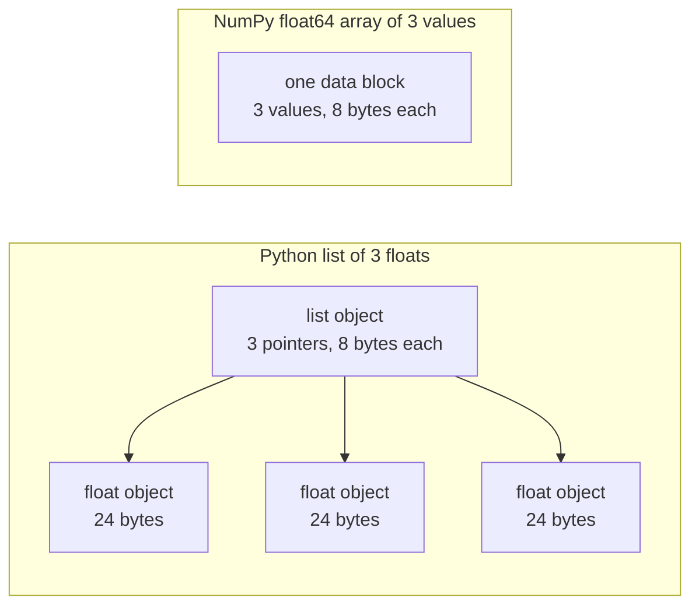

# 面向 AI 工程的 Python

> 本课程的大部分代码都使用一小套 Python 惯用法。在后续数学和模型课依赖它们之前，先在这里学会这套惯用法。

**Type:** Build
**Languages:** Python
**Prerequisites:** Dev Environment, Python Environments
**Time:** ~120 minutes

## 学习目标

- 读写本课程大部分代码都会用到的惯用法，从解包和 f-string 到 dataclass 和推导式。
- 找出三个会给出错误结果却不报错的 Python 陷阱：共享列表、可变默认值和用完的生成器。
- 仅使用标准库构建 CSV 与 JSON 加载器、带种子的划分，以及 mini-batch 生成器。
- 用纯 Python 实现点积、均值和标准差，并测量它们的速度和内存占用。
- 解释为什么对数字进行纯 Python 循环很慢，以及 NumPy 的广播如何把循环移到编译代码里。

## 问题

本阶段之后的课程会用纯 Python 做数学和模型。在 541 个课程 Python 文件中，有 276 个导入了 `dataclasses`，187 个调用了 `random.seed` 或创建了 `random.Random` 生成器。如果你还不熟悉这些惯用法，那么当你想看懂数学时，实际上却在看语法。

Python 还有一些行为，会在不报错的情况下给出错误结果。两个名字可以指向同一个列表，因此通过一个名字修改，另一个名字也能看到变化。一个默认参数会保留上一次调用的值。一个生成器在一次遍历后就会变空，因此第二轮训练 epoch 拿不到任何数据，损失也不会变化。

最后一个问题是速度。在我们的测试笔记本上，对一百万个浮点数做纯 Python 循环大约需要 30 毫秒。NumPy 计算同样的点积不到 1 毫秒。你需要知道原因，这样才能在清晰的循环和数组操作之间做出选择。

## 概念

### 课程代码使用什么

我们用 `ast` 模块解析了 `phases/*/*/code/` 下的全部 541 个 Python 文件。下表统计了至少使用过一次各个构造的文件数。这些统计来自编写本课当天，会随着课程增加而变化。

| Construct | Files | Share |
|-----------|-------|-------|
| Function definitions | 541 | 100% |
| `if __name__ == "__main__":` | 529 | 98% |
| f-strings | 517 | 96% |
| Tuple unpacking | 448 | 83% |
| Classes | 379 | 70% |
| List comprehensions | 375 | 69% |
| Type hints on functions | 342 | 63% |
| Generator expressions | 326 | 60% |
| Slices | 314 | 58% |
| `lambda` | 175 | 32% |
| `try` and `except` | 120 | 22% |
| `with` statements | 96 | 18% |
| Dict comprehensions | 93 | 17% |
| Generator functions with `yield` | 14 | 3% |

导入部分说明了哪些标准模块最重要。在 541 个文件中，340 个以 `from __future__ import annotations` 开头，276 个导入了 `dataclasses`。`math`、`random` 和 `json` 模块分别出现在 187、175 和 126 个文件中。`collections` 模块出现在 70 个文件中，`itertools` 只出现在 4 个文件中。

没有任何一节课调用 `map()` 或 `filter()`。推导式承担了这些工作。带 `key=` 函数调用 `sorted`、`min`、`max` 或 `.sort` 的写法出现在 140 多个文件中。本课会把最多时间花在这些列表顶部的惯用法上。

### 名字指向对象

在 Python 中，变量是指向对象的名字。赋值把名字绑定到对象上，并不会复制对象。当两个名字指向同一个列表时，通过任一名字所做的修改都会反映到另一个名字上。数字、字符串和元组不可变，因此这条规则对它们不会造成影响。列表、字典和集合可变，所以当你需要独立副本时要显式复制。

### 列表存指针，数组存数字

Python 列表并不直接存储数字。它存储指针，每个指针指向一个完整的 Python 对象。在 64 位 CPython 上，每个指针占 8 字节，每个 `float` 对象占 24 字节。NumPy 的 `float64` 数组则把原始 8 字节值并排存放在同一块内存中。



对列表做循环时，每个元素都要做大量工作。解释器逐条执行字节码。对每个元素，它都要跟随指针，检查每个操作数的类型，然后调用浮点数乘法代码，并新建一个 Python float 对象来保存结果。

NumPy 则用编译代码循环遍历原始值来完成同样的算术。它只为整个数组检查一次数据类型，并且不会为每个元素创建 Python 对象。向量化代码描述对整个数组的一次操作，例如 `(x - mean) / std`，由库来执行循环。本课的向量化函数都遵循这条规则：每个函数只做一次数组操作，这样你以后可以用一个 NumPy 调用替换它。

### 列表保存所有元素，生成器只保存一个

列表推导式在下一行运行前就把所有元素构建完成。生成器则在调用者每次请求下一个元素时才构建一个。列表的内存随元素数量增长；而生成器的内存几乎不随元素数量变化。

生成器只能遍历一次。到最后一个元素之后，每次请求都会抛出 `StopIteration`，因此第二次 `for` 循环遍历它时拿不到任何元素。训练代码每个 epoch 都会读取一次数据集，所以每个 epoch 都必须创建新的生成器。

生成器函数在课程代码中很少见。深度学习课使用的数据加载器是按 batch 组织的可迭代对象，因此这种思想存在于每一个训练循环中。下图展示了同一批八行数据在两种做法下的对比。

```figure
s0-list-vs-generator
```

## 你需要掌握的惯用法

本节中的每个代码块都可以单独保存为文件并用 `python3` 运行。这些代码块需要 Python 3.11 或更新版本，也就是我们在开发环境课中安装的版本。

### 1. 值、集合与解包

Python 有四种内置集合。要学会在什么时候使用哪一种。

| Type | Example | Ordered | Can change | Typical use in the course |
|------|---------|---------|------------|---------------------------|
| `list` | `[0.5, 1.2]` | Yes | Yes | 样本、损失、权重 |
| `tuple` | `(32, 784)` | Yes | No | 形状、固定记录、字典键 |
| `dict` | `{"lr": 0.01}` | Insertion order | Yes | 配置、词表、JSON 行 |
| `set` | `{"cat", "dog"}` | No | Yes | 唯一 token、重叠检查 |

下面的代码块展示了赋值并不会复制列表。

```python
weights = [0.5, -1.2, 3.0]
alias = weights
alias[0] = 99.0
print(weights)

independent = list(weights)
independent[1] = 0.0
print(weights, independent)

grid = [[0] * 3] * 2
grid[0][0] = 1
print(grid)

grid = [[0] * 3 for _ in range(2)]
grid[0][0] = 1
print(grid)
```

```text
[99.0, -1.2, 3.0]
[99.0, -1.2, 3.0] [99.0, 0.0, 3.0]
[[1, 0, 0], [1, 0, 0]]
[[1, 0, 0], [0, 0, 0]]
```

表达式 `[[0] * 3] * 2` 创建的外层列表包含两个指向同一个内层列表的引用。而推导式会为每一行创建一个新的内层列表。数学阶段会用列表构建矩阵，因此请使用推导式形式。

解包可以在一行里把序列的元素赋给多个名字。带星号的名字会收集剩下的元素。f-string 可以把表达式的值放进字符串，冒号后面还可以加可选的格式。

```python
shape = (32, 784)
batch_size, n_features = shape
first, *middle, last = [1, 2, 3, 4, 5]
x, y = 1.0, 3.0
x, y = y, x

config = {"lr": 0.01, "epochs": 5}
config["seed"] = 7
tokens = ["the", "cat", "sat", "on", "the", "mat"]
vocab = set(tokens)

print(batch_size, n_features, first, middle, last, x, y)
print(config.get("momentum", 0.9), "cat" in vocab, len(vocab))
print(f"lr={config['lr']:.0e} loss={0.123456:.3f} n={60_000:,} {batch_size=}")
```

```text
32 784 1 [2, 3, 4] 5 3.0 1.0
0.9 True 5
lr=1e-02 loss=0.123 n=60,000 batch_size=32
```

`dict.get` 在键不存在时返回默认值。对集合使用 `in` 测试时，耗时几乎不随集合大小变化。`{batch_size=}` 这种形式会同时打印名字和值，调试时很有用。

切片 `a[start:stop:step]` 包含 `start`，不包含 `stop`。负索引从末尾开始计数。列表切片会生成一个新列表，因此对大列表切片会复制它的所有指针。

```python
tokens = ["<s>", "the", "cat", "sat", "on", "the", "mat", "</s>"]
print(tokens[1:-1])
print(tokens[:3], tokens[-3:])
print(tokens[::2])
print(tokens[::-1][:2])
windows = [tokens[i:i + 3] for i in range(len(tokens) - 2)]
print(len(windows), windows[0])
```

```text
['the', 'cat', 'sat', 'on', 'the', 'mat']
['<s>', 'the', 'cat'] ['the', 'mat', '</s>']
['<s>', 'cat', 'on', 'mat']
['</s>', 'mat']
6 ['<s>', 'the', 'cat']
```

### 2. 推导式

推导式用单个表达式从一个可迭代对象构建列表、字典或集合。它读起来就像它所描述的数学式。

```python
scores = [0.91, 0.42, 0.77, 0.15, 0.66]
labels = [1 if s >= 0.5 else 0 for s in scores]
high = [s for s in scores if s > 0.6]
squares = {i: i * i for i in range(4)}
lengths = {len(word) for word in ["a", "bb", "cc", "ddd"]}
sum_sq = sum(s * s for s in scores)

matrix = [[1, 2, 3], [4, 5, 6]]
transposed = [list(column) for column in zip(*matrix)]
flat = [v for row in matrix for v in row]

print(labels, high, squares, lengths, round(sum_sq, 4))
print(transposed, flat)
```

```text
[1, 0, 1, 0, 1] [0.91, 0.77, 0.66] {0: 0, 1: 1, 2: 4, 3: 9} {1, 2, 3} 2.0555
[[1, 4], [2, 5], [3, 6]] [1, 2, 3, 4, 5, 6]
```

尾部加 `if` 只保留满足条件的元素。`for` 前面的表达式可以是条件表达式 `a if condition else b`。两个 `for` 子句的执行顺序与两层嵌套循环相同。

圆括号构成生成器表达式。在 `sum(s * s for s in scores)` 中，`sum` 一次读取一个平方值，Python 不会构建列表。在 `zip(*matrix)` 中，星号把每一行作为独立参数传入，`zip` 把每个位置上的元素配对。

### 3. 函数、参数与闭包

默认值让参数变为可选。关键字参数在调用时通过参数名传参。参数列表中单独出现的 `*` 会让后面的参数只能通过关键字传入。

```python
def clip(value, low=0.0, high=1.0):
    return max(low, min(high, value))


def train(data, *, lr=0.01, epochs=3):
    return f"{len(data)} samples, lr={lr}, epochs={epochs}"


def make_scaler(factor):
    def scale(values):
        return [v * factor for v in values]
    return scale


print(clip(1.7), clip(-3.0, low=-1.0), clip(0.4, high=0.3))
print(train([1, 2, 3], lr=0.1))
to_percent = make_scaler(100)
print(to_percent([0.25, 0.5]))
```

```text
1.0 -1.0 0.3
3 samples, lr=0.1, epochs=3
[25.0, 50.0]
```

有了关键字-only 参数，像 `train(data, 0.1, 3)` 这样的调用就会抛出 `TypeError`。调用者必须写成 `lr=0.1`，这样两个数字就不会意外互换位置。

内部函数 `scale` 使用了创建它的函数中的 `factor`。只要 `scale` 还存在，Python 就会一直保留 `factor`。一个保存了创建者变量的函数就是闭包。构建它一节中的 standardizer 就用闭包来保存训练统计量。

`lambda` 是一个没有名字的单表达式函数。课程代码主要把它用作 `key=` 函数，第 8 部分会展示。

Python 只在执行 `def` 语句时计算一次默认值。每个使用默认值的调用都会得到同一个对象。

```python
def add_bad(item, bucket=[]):
    bucket.append(item)
    return bucket


def add_good(item, bucket=None):
    if bucket is None:
        bucket = []
    bucket.append(item)
    return bucket


add_bad("a")
print(add_bad("b"))
add_good("a")
print(add_good("b"))
```

```text
['a', 'b']
['b']
```

对于列表、字典或集合，请用 `None` 作为默认值，在函数内部创建新对象。

### 4. 类与 dataclass

`@dataclass` 装饰器会根据带类型注解的字段自动生成 `__init__`、`__repr__` 和 `__eq__`。加上 `frozen=True` 后，对象创建后不可变，可以作为字典键或放入集合。

```python
from dataclasses import dataclass, field


@dataclass(frozen=True)
class Example:
    features: tuple[float, ...]
    label: int


@dataclass
class TrainConfig:
    lr: float = 0.01
    epochs: int = 5
    hidden: list[int] = field(default_factory=lambda: [64, 32])

    def describe(self):
        return f"lr={self.lr} epochs={self.epochs} hidden={self.hidden}"


ex = Example((1.5, 2.0), 1)
print(ex)
print(ex == Example((1.5, 2.0), 1), len({ex, Example((1.5, 2.0), 1)}))
print(TrainConfig(epochs=10).describe())
try:
    ex.label = 0
except AttributeError as err:
    print(type(err).__name__)
```

```text
Example(features=(1.5, 2.0), label=1)
True 1
lr=0.01 epochs=10 hidden=[64, 32]
FrozenInstanceError
```

`field(default_factory=...)` 会为每个实例创建一个新列表，它解决了第 3 部分中共享默认值的问题，且适用于 dataclass 内部。

特殊方法把类连接到 Python 语法。`len(ds)` 会调用 `__len__`，`ds[2]` 会调用 `__getitem__`。

```python
class SquaresDataset:
    def __init__(self, n):
        self.n = n

    def __len__(self):
        return self.n

    def __getitem__(self, index):
        if not 0 <= index < self.n:
            raise IndexError(index)
        return index, index * index


ds = SquaresDataset(4)
print(len(ds), ds[2])
print(list(ds))
```

```text
4 (2, 4)
[(0, 0), (1, 1), (2, 4), (3, 9)]
```

`list(ds)` 里的 `for` 循环即使没有 `__iter__` 方法也能工作。Python 会用 0、1、2……依次调用 `__getitem__`，直到抛出 `IndexError` 为止。PyTorch 的 map-style 数据集也使用同样的两个方法：`__len__` 和 `__getitem__`。

### 5. 迭代器与生成器

可迭代对象（iterable）是任何能被 `for` 循环接受的对象。`iter()` 从中获取迭代器（iterator），`next()` 向迭代器请求一个元素。当迭代器没有更多元素时，会抛出 `StopIteration`。`for` 循环会替你调用 `next()`，并在遇到 `StopIteration` 时停止。

```python
numbers = [10, 20, 30]
it = iter(numbers)
print(next(it), next(it), next(it))
try:
    next(it)
except StopIteration:
    print("no more items")


def countdown(n):
    while n > 0:
        yield n
        n -= 1


gen = countdown(3)
print(type(gen).__name__)
print(list(gen))
print(list(gen))
```

```text
10 20 30
no more items
generator
[3, 2, 1]
[]
```

函数体中包含 `yield` 的函数是生成器函数。调用它不会执行任何代码，而是返回一个生成器对象。每次调用 `next()` 都会把函数体执行到下一个 `yield` 并暂停。第二次 `list(gen)` 是空的，因为第一次已经用完了这个生成器。

生成器可以一次读取文件的一行。

```python
import os
import tempfile


def read_rows(path):
    with open(path, encoding="utf-8") as fh:
        header = fh.readline().rstrip("\n").split(",")
        for line in fh:
            yield dict(zip(header, line.rstrip("\n").split(",")))


with tempfile.TemporaryDirectory() as tmp:
    path = os.path.join(tmp, "rows.csv")
    with open(path, "w", encoding="utf-8") as fh:
        fh.write("x,label\n")
        fh.writelines(f"{i * 0.5},{i % 2}\n" for i in range(5))
    rows = read_rows(path)
    print(next(rows))
    print(sum(1 for _ in rows))
```

```text
{'x': '0.0', 'label': '0'}
4
```

`read_rows` 一次只在内存中保留文件的一行。它就是图中展示的那个 `read_rows`。为了示例简短，它按逗号分割。真实 CSV 文件的字段内部可能包含逗号，因此构建它一节会使用 `csv` 模块。

```python
import sys

as_list = [i * i for i in range(1_000_000)]
as_generator = (i * i for i in range(1_000_000))
print(sys.getsizeof(as_list), sys.getsizeof(as_generator))
print(sum(as_list) == sum(as_generator))
```

在 64 位 CPython 上，列表大约占用 8 MB，生成器大约占用 200 字节。`sys.getsizeof` 只统计列表的指针部分，整数对象本身还会占用更多内存。构建它一节会用 `tracemalloc` 测量真正的峰值内存，我们在调试与性能分析课中已经用过它。

### 6. 上下文管理器与异常

`with` 语句先执行初始化代码，然后运行语句体，最后执行清理代码。即使语句体抛出了异常，清理代码也会执行。`open()` 返回的文件对象就是一个上下文管理器，它会关闭文件。

在调试与性能分析课中，我们写了一个带 `__enter__` 和 `__exit__` 的 `Timer` 类。`contextlib.contextmanager` 装饰器可以把生成器转换成同样的对象。`yield` 之前的代码是初始化，`finally` 块是清理。

```python
import time
from contextlib import contextmanager


@contextmanager
def timer(label):
    start = time.perf_counter()
    try:
        yield
    finally:
        print(f"{label}: {(time.perf_counter() - start) * 1000:.1f} ms")


def parse_label(text):
    try:
        return int(text)
    except ValueError:
        raise ValueError(f"label must be an integer, got {text!r}") from None


with timer("sum of squares"):
    total = sum(i * i for i in range(200_000))

print(parse_label("3"))
try:
    parse_label("cat")
except ValueError as err:
    print("rejected:", err)
```

```text
sum of squares: 9.4 ms
3
rejected: label must be an integer, got 'cat'
```

你机器上的时间会不同。在 `except` 子句中指定你期望的确切异常类型，例如 `ValueError` 或 `KeyError`。不带异常类型的裸 `except:` 也会捕获 `KeyboardInterrupt`，所以包含它的循环可能无法被 Ctrl+C 停止。输入错误时抛出带清晰信息的异常。当你的信息要替代原始 traceback 时，加上 `from None`。

### 7. 类型提示、模块与主程序保护

类型提示告诉读者函数接受什么参数、返回什么值。Python 在代码运行时不会检查它们。类型检查器（例如 mypy）在代码运行前读取它们。

```python
from __future__ import annotations

from collections.abc import Iterable, Sequence


def mean(values: Sequence[float]) -> float:
    if not values:
        raise ValueError("mean() needs at least one value")
    return sum(values) / len(values)


def count_tokens(docs: Iterable[str]) -> int:
    return sum(len(doc.split()) for doc in docs)


def main() -> None:
    print(mean([1.0, 2.0, 4.0]))
    print(count_tokens(["the cat sat", "on the mat"]))
    print(mean.__annotations__)


if __name__ == "__main__":
    main()
```

```text
2.3333333333333335
6
{'values': 'Sequence[float]', 'return': 'float'}
```

有了 `from __future__ import annotations`，Python 会把每个提示存成字符串，如最后一行所示。`Sequence` 表示任何有 `len()` 和索引的对象，例如列表或元组。`Iterable` 表示任何能被 `for` 循环接受的对象。很多课程文件从 `typing` 导入同样的名字，也同样有效。

每个 `.py` 文件都是一个模块。当你用 `python3 file.py` 运行文件时，Python 会把它的 `__name__` 设为 `"__main__"`。当其他文件导入它时，`__name__` 是模块名。主程序保护只在第一种情况下调用 `main()`。正因为有这个保护，`code/tests/` 中的测试才能导入 `main.py` 而不会触发演示代码。

### 8. 文件、JSON、CSV 与排序

`pathlib.Path` 用 `/` 拼接路径，并且可以用一次调用读写整个文件。始终指定 `encoding="utf-8"`，因为默认编码取决于操作系统。

```python
import csv
import json
import tempfile
from pathlib import Path

rows = [
    {"text": "great movie", "label": 1, "score": 0.93},
    {"text": "boring plot", "label": 0, "score": 0.12},
    {"text": "fine acting", "label": 1, "score": 0.58},
]

with tempfile.TemporaryDirectory() as tmp:
    json_path = Path(tmp) / "reviews.json"
    json_path.write_text(json.dumps(rows, indent=2), encoding="utf-8")
    from_json = json.loads(json_path.read_text(encoding="utf-8"))

    csv_path = Path(tmp) / "reviews.csv"
    with csv_path.open("w", newline="", encoding="utf-8") as fh:
        writer = csv.DictWriter(fh, fieldnames=["text", "label", "score"])
        writer.writeheader()
        writer.writerows(rows)
    with csv_path.open(newline="", encoding="utf-8") as fh:
        from_csv = list(csv.DictReader(fh))

print(from_json == rows)
print(from_csv[0])

by_score = sorted(rows, key=lambda r: r["score"], reverse=True)
print([r["text"] for r in by_score])
print(max(rows, key=lambda r: r["score"])["text"])
print([r["text"] for r in sorted(rows, key=lambda r: (-r["label"], r["text"]))])
```

```text
True
{'text': 'great movie', 'label': '1', 'score': '0.93'}
['great movie', 'fine acting', 'boring plot']
great movie
['fine acting', 'great movie', 'boring plot']
```

JSON 把数字保留为数字。CSV 会把所有字段都作为字符串返回，所以你必须转换每个字段。按照 `csv` 文档的要求，打开 CSV 文件时使用 `newline=""`。

`key=` 函数返回 Python 用于比较每个元素的值。`sorted`、`min` 和 `max` 都接受这个参数。元组键会先按第一个值排序，只有在第一个值相等时才使用第二个值。负号让较大的 label 排在前面。Python 的排序是稳定的，因此键相等的元素会保持原始顺序。

### 9. 计数、分组与迭代工具

这两个模块提供了普通列表和字典无法直接给你的数据结构和迭代工具。

```python
from collections import Counter, defaultdict, deque
from itertools import chain, islice, product

labels = ["cat", "dog", "cat", "bird", "cat", "dog"]
counts = Counter(labels)
print(counts.most_common(2))

positions = defaultdict(list)
for i, label in enumerate(labels):
    positions[label].append(i)
print(dict(positions))

recent = deque(maxlen=3)
for loss in [2.0, 1.5, 1.2, 1.1, 0.9]:
    recent.append(loss)
print(list(recent), round(sum(recent) / len(recent), 3))

print(list(product([0.1, 0.01], [16, 32])))
print(list(chain([1, 2], [3], [4, 5])))
print(list(islice(range(100), 5, 10)))
```

```text
[('cat', 3), ('dog', 2)]
{'cat': [0, 2, 4], 'dog': [1, 5], 'bird': [3]}
[1.2, 1.1, 0.9] 1.067
[(0.1, 16), (0.1, 32), (0.01, 16), (0.01, 32)]
[1, 2, 3, 4, 5]
[5, 6, 7, 8, 9]
```

`Counter` 统计可哈希元素的数量，例如 label 或 token。`defaultdict(list)` 在你第一次使用新键时自动创建空列表，因此分组循环不需要检查键是否存在。`deque(maxlen=3)` 在添加第四个元素时移除最旧的元素，从而得到最近损失的滑动窗口。`enumerate` 给出每个元素及其索引。

`product` 给出输入的所有组合，也就是超参数网格。`chain` 把多个可迭代对象首尾相接。`islice` 可以对任何迭代器（包括生成器）取切片。构建它一节中的 mini-batch 生成器会使用 `islice`。

### 10. 为什么数字循环很慢

`dis` 模块会打印解释器为函数执行的字节码指令。

```python
import dis


def dot(a, b):
    total = 0.0
    for x, y in zip(a, b):
        total += x * y
    return total


dis.dis(dot)
```

从 `FOR_ITER` 到跳回它的指令对每个元素都会执行一次。每个乘加操作大约有十条指令。具体指令名在不同 Python 版本之间会有所变化。

当循环中更少的步骤以字节码形式运行时，循环会变快。`sum`、`map`、`zip` 等内置函数是用 C 写的。构建它一节会在纯 Python 中测量这种效果，使用它一节则把整个循环移到 NumPy 中。

## 构建它

现在构建后续课程需要的组件。完整版本在 `code/main.py` 中，`code/tests/test_main.py` 对它进行测试。下面的每个代码块都可以单独运行。

### 步骤 1：记录类型与数据集加载器

加载器把 CSV 或 JSON 文件读成统一的形状：浮点特征元组和整数标签。

```python
import csv
import json
import tempfile
from dataclasses import dataclass
from pathlib import Path


@dataclass(frozen=True)
class Record:
    features: tuple[float, ...]
    label: int


def row_to_record(row, names, label_field="label"):
    if label_field not in row:
        raise ValueError(f"row has no {label_field!r} field: {row}")
    if set(row) != {*names, label_field}:
        raise ValueError(f"row fields {list(row)} do not match {[*names, label_field]}")
    return Record(tuple(float(row[name]) for name in names), int(row[label_field]))


def load_records(path, label_field="label"):
    path = Path(path)
    if path.suffix == ".json":
        rows = json.loads(path.read_text(encoding="utf-8"))
    elif path.suffix == ".csv":
        with path.open(newline="", encoding="utf-8") as fh:
            rows = list(csv.DictReader(fh))
    else:
        raise ValueError(f"unsupported file type: {path.suffix!r}")
    if not rows:
        return []
    names = [key for key in rows[0] if key != label_field]
    return [row_to_record(row, names, label_field) for row in rows]


with tempfile.TemporaryDirectory() as tmp:
    csv_path = Path(tmp) / "data.csv"
    csv_path.write_text("x1,x2,label\n1.5,60,1\n1.8,82.5,0\n", encoding="utf-8")
    json_path = Path(tmp) / "data.json"
    json_path.write_text('[{"x1": 1.5, "x2": 60, "label": 1}]', encoding="utf-8")
    print(load_records(csv_path))
    print(load_records(json_path))
```

```text
[Record(features=(1.5, 60.0), label=1), Record(features=(1.8, 82.5), label=0)]
[Record(features=(1.5, 60.0), label=1)]
```

第一行确定了特征名及其顺序。`DictReader` 和 `json.loads` 会保留文件中的键顺序，字典也会保留插入顺序。JSON 标准没有定义对象键的顺序，因此 `row_to_record` 按照第一行的名字顺序读取每一行。缺失的 label、缺失或多余的特征、以及未知的文件类型都会抛出带提示信息的 `ValueError`，从而让坏文件在运行开始时就被拦下。`main.py` 还包含 `save_records`，用于写入同样的两种格式。

### 步骤 2：带种子的训练/测试划分

```python
import random


def train_test_split(items, test_fraction=0.2, seed=0):
    if not 0.0 < test_fraction < 1.0:
        raise ValueError(f"test_fraction must be between 0 and 1, got {test_fraction}")
    if len(items) < 2:
        raise ValueError(f"need at least 2 items to split, got {len(items)}")
    order = list(range(len(items)))
    random.Random(seed).shuffle(order)
    n_test = min(max(1, round(len(items) * test_fraction)), len(items) - 1)
    test = [items[i] for i in order[:n_test]]
    train = [items[i] for i in order[n_test:]]
    return train, test


items = list(range(10))
print(train_test_split(items, seed=1))
print(train_test_split(items, seed=1) == train_test_split(items, seed=1))
print(train_test_split(items, seed=2)[1])
print(items)
```

```text
([9, 7, 5, 3, 0, 4, 1, 2], [6, 8])
True
[5, 9]
[0, 1, 2, 3, 4, 5, 6, 7, 8, 9]
```

`random.Random(seed)` 创建一个独立的随机数生成器。`random.seed(seed)` 会重置所有模块共享的全局生成器，因此其他库中的调用可能改变你的序列。在本课程中，100 个课程文件调用 `random.seed`，96 个创建 `random.Random`。在新代码中请使用独立生成器。

该函数打乱的是索引列表，因此输入列表保持不变。相同的种子总是得到相同的划分。每一侧至少保留一个元素，因此长度小于 2 的列表会抛出 `ValueError`。在标准化等会从数据学习的步骤之前先划分数据。在调试与性能分析课中，我们看到训练集和测试集重叠会导致测试分数虚高。

### 步骤 3：Mini-batch 生成器

```python
from itertools import islice


def batches(items, batch_size, drop_last=False):
    if batch_size < 1:
        raise ValueError(f"batch_size must be at least 1, got {batch_size}")
    return _batch_iter(iter(items), batch_size, drop_last)


def _batch_iter(iterator, batch_size, drop_last):
    while True:
        batch = list(islice(iterator, batch_size))
        if not batch or (drop_last and len(batch) < batch_size):
            return
        yield batch


print(list(batches(range(10), 4)))
print(list(batches(range(10), 4, drop_last=True)))
squares = (i * i for i in range(7))
print([len(b) for b in batches(squares, 3)])

for epoch in range(2):
    sizes = [len(b) for b in batches(range(10), 4)]
    print(f"epoch {epoch}: {sizes}")
```

```text
[[0, 1, 2, 3], [4, 5, 6, 7], [8, 9]]
[[0, 1, 2, 3], [4, 5, 6, 7]]
[3, 3, 1]
epoch 0: [4, 4, 2]
epoch 1: [4, 4, 2]
```

`islice` 从迭代器中取最多 `batch_size` 个元素。`batches` 只需要 `iter()`，因此可以接受列表、文件和其他生成器。当长度不是 batch size 的倍数时，最后一个 batch 会更小。`drop_last=True` 会丢弃这个 batch，适用于需要固定 batch 形状的模型。

工作被拆成两个函数，因为生成器函数在第一次 `next()` 之前不会执行任何代码。如果把检查放在生成器内部，`batches(data, 0)` 会不报错地返回，错误要等到训练循环内部才会出现。外层是普通函数，所以会立即检查参数。epoch 循环每个 epoch 都会重新调用 `batches()`，因为生成器只能给出一次元素。

### 步骤 4：向量运算与标准化器

```python
import math


def dot(a, b):
    return sum(x * y for x, y in zip(a, b, strict=True))


def mean(values):
    if not values:
        raise ValueError("mean() needs at least one value")
    return sum(values) / len(values)


def std(values):
    mu = mean(values)
    return math.sqrt(sum((v - mu) ** 2 for v in values) / len(values))


def make_standardizer(rows):
    columns = list(zip(*rows))
    means = [mean(c) for c in columns]
    scales = [s if s > 0 else 1.0 for s in (std(c) for c in columns)]

    def standardize(row):
        return [(v - m) / s for v, m, s in zip(row, means, scales, strict=True)]

    return standardize


print(dot([1.0, 2.0, 3.0], [4.0, 5.0, 6.0]))
values = [2.0, 4.0, 4.0, 4.0, 5.0, 5.0, 7.0, 9.0]
print(mean(values), std(values))

train_rows = [(1.0, 100.0), (2.0, 300.0), (3.0, 500.0)]
standardize = make_standardizer(train_rows)
print([[round(v, 3) for v in standardize(r)] for r in train_rows])
print([round(v, 3) for v in standardize((4.0, 700.0))])
```

```text
32.0
5.0 2.0
[[-1.225, -1.225], [0.0, 0.0], [1.225, 1.225]]
[2.449, 2.449]
```

使用 `strict=True` 时，如果两个向量长度不同，`zip` 会抛出 `ValueError`。不使用它时，`zip` 会在较短的输入结束时停止，并返回一个无提示的错误答案。`strict` 参数需要 Python 3.10 或更新版本。

`std` 除以 `n`，因此给出的是总体标准差，与 `statistics.pstdev` 相同。当你用样本估计更大总体的离散程度时，除以 `n - 1`。

`make_standardizer` 是一个闭包。它根据训练行一次性计算均值和标准差，`standardize` 会保存它们。你把同一个函数应用到测试行上，因此测试数据不会影响统计量。常数列的标准差为 0，所以标准化器对它使用比例 1。

### 步骤 5：完整运行

`code/main.py` 把这些组件串起来。它从两个簇生成 400 条记录，保存为 CSV 和 JSON，然后再把两种文件加载回来。接着划分记录，在训练集上拟合标准化器，并按大小为 48 的 batch 计算类别质心。

最近质心分类器（nearest-centroid classifier）保存每个类别的平均特征向量。预测时，它选择与输入最近的质心所对应的类别。`fit_centroids` 一次只累加一个 batch 的行，因此永远不需要把整个训练集放进内存。`predict` 使用带 `key=` 函数的 `min()` 找到最近的质心。

```bash
python3 phases/00-setup-and-tooling/13-python-for-ai-engineering/code/main.py
```

```text
Python for AI engineering: a standard-library toolkit
data     400 records, CSV and JSON load back unchanged: True
split    320 train, 80 test, records in both: 0
batches  size 48: [48, 48, 48, 48, 48, 48, 32]
scale    train feature means after standardizing: [0.0, 0.0]
model    nearest-centroid test accuracy: raw 0.86, standardized 0.89
speed    dot product of 200,000 floats, best of 5:
           index loop         6.60 ms
           zip generator      5.93 ms
           map + mul          2.89 ms
memory   peak bytes to sum 100,000 squares:
           list              4,000,616
           generator               472
```

两个特征的量纲差异很大。第二个特征的分布范围是第一个的十倍，因此它主导了原始距离，原始准确率也更低。你的速度和内存数字会与这些数字不同。

### 步骤 6：测量速度与内存

```python
import operator
import random
import time
import tracemalloc


def dot_index_loop(a, b):
    total = 0.0
    for i in range(len(a)):
        total += a[i] * b[i]
    return total


def dot_zip(a, b):
    return sum(x * y for x, y in zip(a, b, strict=True))


def dot_map(a, b):
    return sum(map(operator.mul, a, b))


def best_time(fn, *args, repeat=5):
    times = []
    for _ in range(repeat):
        start = time.perf_counter()
        fn(*args)
        times.append(time.perf_counter() - start)
    return min(times)


def peak_bytes(fn):
    tracemalloc.start()
    try:
        fn()
        return tracemalloc.get_traced_memory()[1]
    finally:
        tracemalloc.stop()


rng = random.Random(0)
a = [rng.random() for _ in range(1_000_000)]
b = [rng.random() for _ in range(1_000_000)]
for fn in (dot_index_loop, dot_zip, dot_map):
    print(f"{fn.__name__:15} {best_time(fn, a, b) * 1000:7.2f} ms")

print(peak_bytes(lambda: sum([i * i for i in range(100_000)])))
print(peak_bytes(lambda: sum(i * i for i in range(100_000))))
```

`best_time` 报告多次运行中最快的一次。机器上的其他程序只会增加耗时，因此最小值最接近真实开销。`timeit` 模块的文档也给出同样的建议。

在我们的测试笔记本上用 Python 3.11，索引循环大约 33 毫秒，`zip` 版本大约 30 毫秒，`map` 版本大约 14 毫秒。三者做同样的算术。`map` 版本更快，因为 `map` 和 `operator.mul` 是用 C 写的，每个元素执行的字节码指令更少。内存数字再次印证了图中所示：列表约 4 MB，生成器不到 1 KB。

## 使用它

### 标准库版本

标准库里有我们刚才构建的大部分组件的成熟实现。

| You built | Standard library | Note |
|-----------|------------------|------|
| `mean`, `std` | `statistics.fmean`, `statistics.pstdev` | 测试会与这些函数对比 |
| `dot` | `math.sumprod` | Python 3.12 或更新版本 |
| `batches` | `itertools.batched` | Python 3.12 或更新版本，返回元组 |
| `best_time` | `timeit.repeat` | 运行期间还会关闭垃圾回收 |
| `peak_bytes` | `tracemalloc` | 同一个模块，支持快照和逐行统计 |

```python
import statistics
import sys

values = [2.0, 4.0, 4.0, 4.0, 5.0, 5.0, 7.0, 9.0]
print(statistics.fmean(values), statistics.pstdev(values))

if sys.version_info >= (3, 12):
    import math
    from itertools import batched

    print(math.sumprod([1.0, 2.0, 3.0], [4.0, 5.0, 6.0]))
    print(list(batched(range(10), 4)))
```

```text
5.0 2.0
32.0
[(0, 1, 2, 3), (4, 5, 6, 7), (8, 9)]
```

课程支持 Python 3.11，因此 `main.py` 使用自己的 `dot` 和 `batches`。在 Python 3.11 上，上面的代码块只会打印第一行。

### 用编译数组做同样的数学

在 Python 环境课创建的虚拟环境中安装 NumPy，例如用 `uv pip install numpy`。本课的代码和测试不需要它。

```python
import time

import numpy as np

n = 1_000_000
rng = np.random.default_rng(0)
a = rng.random(n)
b = rng.random(n)
a_list, b_list = a.tolist(), b.tolist()

start = time.perf_counter()
slow = sum(x * y for x, y in zip(a_list, b_list))
python_ms = (time.perf_counter() - start) * 1000

start = time.perf_counter()
fast = float(a @ b)
numpy_ms = (time.perf_counter() - start) * 1000

print(f"pure Python {python_ms:8.2f} ms")
print(f"NumPy       {numpy_ms:8.2f} ms")
print(f"difference  {abs(slow - fast):.1e}")
print(a.dtype, a.itemsize, a.nbytes)
```

在我们的测试笔记本上，NumPy 耗时不到 1 毫秒，纯 Python 版本大约 30 毫秒。两个结果在最后几位数字上会有差异，因为两个版本按不同顺序累加乘积。浮点加法在不同顺序下会给出略微不同的结果。

NumPy 更快有三个原因：

- 数组把原始 `float64` 值（每个 8 字节）存放在同一块内存中。而浮点数列表需要为每个值额外付出一个 8 字节指针和一个 24 字节的 float 对象。
- 循环在编译代码中运行。NumPy 只为整个数组检查一次数据类型，并且不为每个元素创建 Python 对象。
- 在内存中相邻的值让 NumPy 可以使用 SIMD 指令，一条指令处理多个值。

对于非常小的数组，一次 NumPy 调用的固定开销可能超过短 Python 循环。练习 4 会让你找出在自己的机器上 NumPy 开始变快的那个大小。

### 广播

广播让 NumPy 在不用写循环的情况下组合不同形状的数组。下面的代码块完成了与步骤 4 中 `make_standardizer` 相同的工作。

```python
import numpy as np

X = np.array([[1.0, 100.0], [2.0, 300.0], [3.0, 500.0]])
mu = X.mean(axis=0)
sigma = X.std(axis=0)
Z = (X - mu) / sigma
print(X.shape, mu.shape, Z.shape)
print(Z.round(3))

norms = np.sqrt((X ** 2).sum(axis=1, keepdims=True))
print(norms.shape, (X / norms).shape)
```

```text
(3, 2) (2,) (3, 2)
[[-1.225 -1.225]
 [ 0.     0.   ]
 [ 1.225  1.225]]
(3, 1) (3, 2)
```

NumPy 从最后一个维度向前比较两个形状。两个维度相等，或者其中一个为 1 时，它们是兼容的。缺失的前导维度视为 1。大小为 1 的维度会沿较大维度复用，并且不会复制数据。

| Shape of `X` | Shape of the other array | Result |
|--------------|--------------------------|--------|
| `(3, 2)` | `(2,)`, 列均值 | `(3, 2)` |
| `(3, 2)` | `(3, 1)`, 使用 `keepdims=True` 的行范数 | `(3, 2)` |
| `(3, 2)` | `(3,)`, 未使用 `keepdims` 的行范数 | `ValueError` |

最后一行是常见错误。NumPy 比较末尾的 2 和 3，两者都不是 1。当你按行归约后还要把结果与原数组组合时，请保留 `keepdims=True`。

## 交付它

本课会生成 `outputs/prompt-python-review.md`。这是一个用于审查 AI 和数据项目中 Python 代码的 review prompt。你可以给它一个文件或一个 diff。它会检查本课提到的惯用法和静默错误：

- 共享引用和可变默认参数
- 第二轮 epoch 读取时已经用完的生成器
- 没有种子，或只使用全局种子的随机数
- 来自测试划分的统计量
- 对大数值数组的纯 Python 循环

它会为每个发现报告位置、问题和修复建议。

## 练习

1. 运行 `main.py` 中的 `run_demo(seed=8)`。找出哪些输出行会变化，哪些保持不变，并解释为什么划分大小保持不变。
2. 用纯 Python 实现 `median(values)`。在奇数长度和偶数长度的列表上，与 `statistics.median` 对比测试。
3. 编写生成器 `stream_records(path)`，让它从 CSV 文件一次生成一个 `Record`。创建一个有 200,000 行的文件。用 `tracemalloc` 比较 `stream_records` 和 `load_records` 的峰值内存。
4. 分别用纯 Python 和 NumPy 实现 `matvec(matrix, vector)`。用 `best_time` 测量大小为 4、64、1024 的情况，找出在你的机器上 NumPy 开始变快的那个大小。
5. 复现概念一节中的构造扫描。对 `phases/*/*/code/*.py` 里的每个文件使用 `ast.parse` 和 `ast.walk`。统计包含 `ast.ListComp`、`ast.Yield` 和 `ast.With` 的文件数，并与表格对比。

### 提示

**练习 1.** 从 `code/main.py` 导入 `run_demo`，分别用 `seed=7` 和 `seed=8` 调用它，然后用 `format_report` 打印两次结果。来自随机数据的值会变化；划分大小只取决于 `n` 和 `test_fraction`，因此保持不变。

**练习 2.** 先对列表副本排序，然后奇数长度取中间元素，偶数长度取中间两个元素的均值。在 `[3, 1, 2]` 和 `[4, 1, 3, 2]` 等列表上与 `statistics.median` 对比，两者必须给出相同数字。

**练习 3.** 阅读 `code/main.py` 中的 `load_records`，保留它的解析逻辑，但把每个 `Record` 用 `yield` 返回，而不是追加到列表。用 `save_records` 和 `make_dataset(200_000)` 创建文件，然后比较 `peak_bytes(lambda: load_records(path))` 与 `peak_bytes(lambda: sum(1 for _ in your_generator(path)))`。生成器必须在可调用对象内部被消费，否则 `peak_bytes` 只测量它的创建。它应该报告明显更小的峰值。

**练习 4.** 以 `dot` 为模型实现纯 Python 版本，对每一行调用一次；NumPy 版本使用 `np.array(matrix) @ np.array(vector)`。用 `best_time` 为每个大小计时并打印一行表格；比较时间前，两个结果必须相等。

**练习 5.** 用 `Path.read_text` 读取每个文件，用 `ast.parse` 解析，再用 `any(isinstance(node, ast.ListComp) for node in ast.walk(tree))` 判断某个构造。每个文件只计一次，因为概念一节的表格统计的是文件数。

## 关键术语

| Term | What people say | What it means |
|------|----------------|----------------------|
| Iterable | "可以循环的东西" | 能被 `iter()` 接受的对象，例如列表、文件或生成器 |
| Iterator | "游标" | 其 `__next__` 方法每次调用返回一个元素，并在末尾抛出 `StopIteration` 的对象 |
| Generator | "惰性列表" | 来自 `yield` 函数或生成器表达式的迭代器。按需生成每个元素，且只能遍历一次。 |
| Comprehension | "一行循环" | 从一个可迭代对象构建列表、字典或集合的表达式，可带过滤条件 |
| Closure | "函数里的函数" | 保存了创建者所在函数变量的函数 |
| Dataclass | "结构体" | 由 Python 根据带注解的字段自动生成 `__init__`、`__repr__` 和 `__eq__` 的类 |
| Context manager | "with 块" | 在 `with` 块开始时运行初始化代码、结束时运行清理代码的对象，即使发生异常也会执行清理 |
| Seed | "随机数" | 伪随机生成器的起始值。相同的 seed 会给出相同的序列。 |
| Vectorized code | "快速代码" | 把同一个操作应用到整个数组，由编译代码执行循环的代码 |
| Broadcasting | "自动形状匹配" | NumPy 的规则，通过复用大小为 1 的维度来组合不同形状的数组，且不做复制 |

## 延伸阅读

- [The Python Tutorial: Data Structures](https://docs.python.org/3/tutorial/datastructures.html)：列表、元组、集合、字典和推导式。
- [The Python Tutorial: Classes](https://docs.python.org/3/tutorial/classes.html)：作用域、类、迭代器和生成器。
- [dataclasses](https://docs.python.org/3/library/dataclasses.html)：装饰器的所有选项，包括 `frozen` 和 `field`。
- [collections](https://docs.python.org/3/library/collections.html)：`Counter`、`defaultdict`、`deque` 和其他容器类型。
- [itertools](https://docs.python.org/3/library/itertools.html)：`islice`、`chain`、`product`、`batched` 以及组合它们的 recipes。
- [Sorting Techniques](https://docs.python.org/3/howto/sorting.html)：键函数、稳定排序和多键排序。
- [timeit](https://docs.python.org/3/library/timeit.html)：如何测量小段代码，以及为什么要报告最小值。
- [random](https://docs.python.org/3/library/random.html)：全局生成器、`random.Random` 实例与可复现性。
- [PEP 255: Simple Generators](https://peps.python.org/pep-0255/)：引入 `yield` 的提案，包含其设计原因。
- [NumPy: Broadcasting](https://numpy.org/doc/stable/user/basics.broadcasting.html)：完整的形状规则及图示。
- [Harris et al., Array programming with NumPy, Nature 585, 2020](https://doi.org/10.1038/s41586-020-2649-2)：NumPy 数组的设计及其速度来源。
