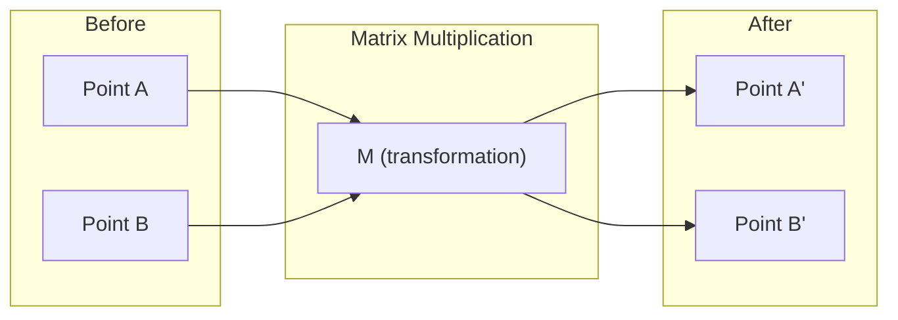
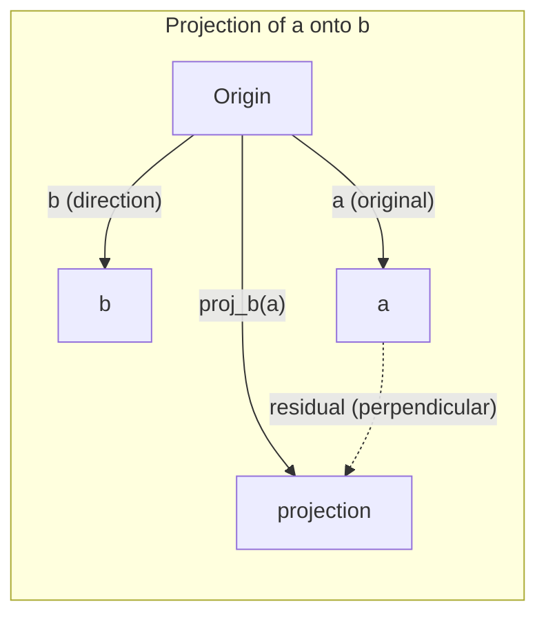

# 线性代数直觉

> 每个 AI 模型本质上都是矩阵运算披了件花哨的外衣。

**Type:** Learn
**Languages:** Python, Julia
**Prerequisites:** Phase 0
**Time:** ~60 minutes

## 学习目标

- 在 Python 中从零实现向量与矩阵运算（加法、点积、矩阵乘法）
- 用几何语言解释点积、投影和 Gram-Schmidt 过程的作用
- 使用行化简判断一组向量的线性无关性、秩和基
- 将线性代数概念与 AI 应用联系起来：embedding、注意力分数和 LoRA

## 问题

翻开任何一篇机器学习论文，第一页就会看到向量、矩阵、点积和变换。没有线性代数直觉，它们只是符号；有了直觉，你就能看出神经网络到底在做什么——在空间中移动点。

你不需要成为数学家。你需要先理解这些运算在几何上意味着什么，然后亲手把它们实现出来。

## 概念

### 向量就是点（也是方向）

向量不过是一组数字。但这些数字是有意义的——它们是空间中的坐标。

**二维向量 [3, 2]：**

| x | y | 点 |
|---|---|-------|
| 3 | 2 | 该向量从原点 (0,0) 指向平面上的 (3, 2) |

这个向量的长度（模）为 $\sqrt{3^2 + 2^2} = \sqrt{13}$，方向朝右上。

在 AI 中，向量可以表示一切：
- 一个词 → 一个 768 维的数字向量（它在 embedding 空间中的「含义」）
- 一张图 → 一个由数百万像素值组成的向量
- 一个用户 → 一个偏好向量

### 矩阵就是变换

矩阵把一个向量变成另一个向量。它可以旋转、缩放、拉伸或投影。



在 AI 中，矩阵就是模型本身：
- 神经网络的权重 → 把输入变换成输出的矩阵
- 注意力分数 → 决定关注什么的矩阵
- Embedding → 把词映射成向量的矩阵

### 点积衡量相似度

两个向量的点积告诉你它们有多相似。

```math
\begin{aligned}
a \cdot b &= a_1 \times b_1 + a_2 \times b_2 + \cdots + a_n \times b_n \\[4pt]
\text{Same direction:} \quad a \cdot b &> 0 \quad \text{(similar)} \\
\text{Perpendicular:} \quad a \cdot b &= 0 \quad \text{(unrelated)} \\
\text{Opposite direction:} \quad a \cdot b &< 0 \quad \text{(dissimilar)}
\end{aligned}
```

搜索引擎、推荐系统和 RAG 本质上就是这么工作的——找到点积高的向量。

### 线性无关

如果集合中的任一向量都不能写成其他向量的线性组合，那么这组向量就是线性无关的。如果 $v_1, v_2, v_3$ 线性无关，它们张成一个三维空间；如果其中一个是其他向量的组合，它们只能张成一个平面。

为什么这在 AI 中重要：你的特征矩阵应该有线性无关的列。如果两个特征完全相关（线性相关），模型就无法区分它们各自的影响。这会在回归中导致多重共线性——权重矩阵变得不稳定，输入的微小变化会让输出剧烈波动。

**具体例子：**

```
v1 = [1, 0, 0]
v2 = [0, 1, 0]
v3 = [2, 1, 0]   # v3 = 2*v1 + v2
```

$v_1$ 和 $v_2$ 线性无关——谁也不是另一个的标量倍数或组合。但 $v_3 = 2 v_1 + v_2$，所以 $\lbrace v_1, v_2, v_3 \rbrace$ 是一个相关集合。这三个向量都位于 xy 平面内。无论怎么组合，你都到不了 [0, 0, 1]。你有三个向量，但只有两个自由度。

在数据集中：如果 feature_3 = 2*feature_1 + feature_2，那么加入 feature_3 不会给模型带来任何新信息。更糟的是，它会让正规方程奇异——权重没有唯一解。

### 基与秩

基是一组能够张成整个空间的最小线性无关向量集合。基向量的个数就是空间的维度。

三维空间的标准基是 {[1,0,0], [0,1,0], [0,0,1]}。但三维空间中任意三个线性无关的向量都可以构成一个有效基。选择基就是选择坐标系。

矩阵的秩 = 线性无关列的数量 = 线性无关行的数量。如果 $\text{rank} < \min(\text{rows}, \text{cols})$，矩阵就是秩亏的。这意味着：
- 方程组有无穷多解（或无解）
- 变换过程中信息丢失了
- 矩阵不可逆

| 情况 | 秩 | 对 ML 意味着什么 |
|-----------|------|---------------------|
| 满秩 $(\text{rank} = \min(m, n))$ | 最大可能 | 存在唯一最小二乘解。模型条件良好。 |
| 秩亏 $(\text{rank} < \min(m, n))$ | 低于最大 | 特征冗余。权重解有无穷多个。需要正则化。 |
| 秩 1 | 1 | 每一列都是同一个向量的缩放副本。所有数据落在一条直线上。 |
| 接近秩亏（奇异值很小） | 数值上很低 | 矩阵病态。微小噪声会被放大。使用 SVD 截断或岭回归。 |

### 投影

把向量 **a** 投影到向量 **b** 上，得到的是 **a** 在 **b** 方向上的分量：

```math
\mathop{\mathrm{proj}}_b(a) = \frac{a \cdot b}{b \cdot b} \, b
```

残差 $(a - \mathop{\mathrm{proj}}_b(a))$ 与 $b$ 垂直。这种正交分解是最小二乘拟合的基础。

投影在 ML 中无处不在：
- 线性回归最小化观测值到列空间的距离——其解本身就是一个投影
- PCA 把数据投影到方差最大的方向上
- Transformer 中的注意力计算查询到键的投影



**例子：** $a = [3, 4]$，$b = [1, 0]$

$\mathop{\mathrm{proj}}_b(a) = (3 \cdot 1 + 4 \cdot 0) / (1 \cdot 1 + 0 \cdot 0) \cdot [1, 0] = 3 \cdot [1, 0] = [3, 0]$

投影去掉了 y 分量。这就是最简单的降维——扔掉你不关心的方向。

### Gram-Schmidt 过程

把任意一组无关向量转换成标准正交基。标准正交意味着每个向量长度为 1，且两两垂直。

算法：
1. 取第一个向量，归一化
2. 取第二个向量，减去它在第一个向量上的投影，再归一化
3. 取第三个向量，减去它在之前所有向量上的投影，再归一化
4. 对剩余向量重复

```
Input:  v1, v2, v3, ... (linearly independent)

u1 = v1 / |v1|

w2 = v2 - (v2 dot u1) * u1
u2 = w2 / |w2|

w3 = v3 - (v3 dot u1) * u1 - (v3 dot u2) * u2
u3 = w3 / |w3|

Output: u1, u2, u3, ... (orthonormal basis)
```

QR 分解内部就是这样工作的。Q 是标准正交基，R 保存投影系数。QR 分解用于：
- 求解线性系统（比高斯消元更稳定）
- 计算特征值（QR 算法）
- 最小二乘回归（标准数值方法）

```figure
eigen-directions
```

## 构建它

### 步骤 1：从零实现向量（Python）

```python
class Vector:
    def __init__(self, components):
        self.components = list(components)
        self.dim = len(self.components)

    def __add__(self, other):
        return Vector([a + b for a, b in zip(self.components, other.components)])

    def __sub__(self, other):
        return Vector([a - b for a, b in zip(self.components, other.components)])

    def dot(self, other):
        return sum(a * b for a, b in zip(self.components, other.components))

    def magnitude(self):
        return sum(x**2 for x in self.components) ** 0.5

    def normalize(self):
        mag = self.magnitude()
        return Vector([x / mag for x in self.components])

    def cosine_similarity(self, other):
        return self.dot(other) / (self.magnitude() * other.magnitude())

    def __repr__(self):
        return f"Vector({self.components})"


a = Vector([1, 2, 3])
b = Vector([4, 5, 6])

print(f"a + b = {a + b}")
print(f"a · b = {a.dot(b)}")
print(f"|a| = {a.magnitude():.4f}")
print(f"cosine similarity = {a.cosine_similarity(b):.4f}")
```

### 步骤 2：从零实现矩阵（Python）

```python
class Matrix:
    def __init__(self, rows):
        self.rows = [list(row) for row in rows]
        self.shape = (len(self.rows), len(self.rows[0]))

    def __matmul__(self, other):
        if isinstance(other, Vector):
            return Vector([
                sum(self.rows[i][j] * other.components[j] for j in range(self.shape[1]))
                for i in range(self.shape[0])
            ])
        rows = []
        for i in range(self.shape[0]):
            row = []
            for j in range(other.shape[1]):
                row.append(sum(
                    self.rows[i][k] * other.rows[k][j]
                    for k in range(self.shape[1])
                ))
            rows.append(row)
        return Matrix(rows)

    def transpose(self):
        return Matrix([
            [self.rows[j][i] for j in range(self.shape[0])]
            for i in range(self.shape[1])
        ])

    def __repr__(self):
        return f"Matrix({self.rows})"


rotation_90 = Matrix([[0, -1], [1, 0]])
point = Vector([3, 1])

rotated = rotation_90 @ point
print(f"Original: {point}")
print(f"Rotated 90°: {rotated}")
```

### 步骤 3：为什么这与 AI 有关

```python
import random

random.seed(42)
weights = Matrix([[random.gauss(0, 0.1) for _ in range(3)] for _ in range(2)])
input_vector = Vector([1.0, 0.5, -0.3])

output = weights @ input_vector
print(f"Input (3D): {input_vector}")
print(f"Output (2D): {output}")
print("This is what a neural network layer does -- matrix multiplication.")
```

### 步骤 4：Julia 版本

```julia
a = [1.0, 2.0, 3.0]
b = [4.0, 5.0, 6.0]

println("a + b = ", a + b)
println("a · b = ", a ⋅ b)       # Julia supports unicode operators
println("|a| = ", √(a ⋅ a))
println("cosine = ", (a ⋅ b) / (√(a ⋅ a) * √(b ⋅ b)))

# Matrix-vector multiplication
W = [0.1 -0.2 0.3; 0.4 0.5 -0.1]
x = [1.0, 0.5, -0.3]
println("Wx = ", W * x)
println("This is a neural network layer.")
```

### 步骤 5：从零实现线性无关与投影（Python）

```python
def is_linearly_independent(vectors):
    n = len(vectors)
    dim = len(vectors[0].components)
    mat = Matrix([v.components[:] for v in vectors])
    rows = [row[:] for row in mat.rows]
    rank = 0
    for col in range(dim):
        pivot = None
        for row in range(rank, len(rows)):
            if abs(rows[row][col]) > 1e-10:
                pivot = row
                break
        if pivot is None:
            continue
        rows[rank], rows[pivot] = rows[pivot], rows[rank]
        scale = rows[rank][col]
        rows[rank] = [x / scale for x in rows[rank]]
        for row in range(len(rows)):
            if row != rank and abs(rows[row][col]) > 1e-10:
                factor = rows[row][col]
                rows[row] = [rows[row][j] - factor * rows[rank][j] for j in range(dim)]
        rank += 1
    return rank == n


def project(a, b):
    scalar = a.dot(b) / b.dot(b)
    return Vector([scalar * x for x in b.components])


def gram_schmidt(vectors):
    orthonormal = []
    for v in vectors:
        w = v
        for u in orthonormal:
            proj = project(w, u)
            w = w - proj
        if w.magnitude() < 1e-10:
            continue
        orthonormal.append(w.normalize())
    return orthonormal


v1 = Vector([1, 0, 0])
v2 = Vector([1, 1, 0])
v3 = Vector([1, 1, 1])
basis = gram_schmidt([v1, v2, v3])
for i, u in enumerate(basis):
    print(f"u{i+1} = {u}")
    print(f"  |u{i+1}| = {u.magnitude():.6f}")

print(f"u1 · u2 = {basis[0].dot(basis[1]):.6f}")
print(f"u1 · u3 = {basis[0].dot(basis[2]):.6f}")
print(f"u2 · u3 = {basis[1].dot(basis[2]):.6f}")
```

## 使用它

现在用 NumPy 做同样的事——这才是你实际工作中会用到的：

```python
import numpy as np

a = np.array([1, 2, 3], dtype=float)
b = np.array([4, 5, 6], dtype=float)

print(f"a + b = {a + b}")
print(f"a · b = {np.dot(a, b)}")
print(f"|a| = {np.linalg.norm(a):.4f}")
print(f"cosine = {np.dot(a, b) / (np.linalg.norm(a) * np.linalg.norm(b)):.4f}")

W = np.random.randn(2, 3) * 0.1
x = np.array([1.0, 0.5, -0.3])
print(f"Wx = {W @ x}")
```

### 用 NumPy 计算秩、投影和 QR

```python
import numpy as np

A = np.array([[1, 2], [2, 4]])
print(f"Rank: {np.linalg.matrix_rank(A)}")

a = np.array([3, 4])
b = np.array([1, 0])
proj = (np.dot(a, b) / np.dot(b, b)) * b
print(f"Projection of {a} onto {b}: {proj}")

Q, R = np.linalg.qr(np.random.randn(3, 3))
print(f"Q is orthogonal: {np.allclose(Q @ Q.T, np.eye(3))}")
print(f"R is upper triangular: {np.allclose(R, np.triu(R))}")
```

### PyTorch —— 张量就是带自动求导的向量

```python
import torch

x = torch.randn(3, requires_grad=True)
y = torch.tensor([1.0, 0.0, 0.0])

similarity = torch.dot(x, y)
similarity.backward()

print(f"x = {x.data}")
print(f"y = {y.data}")
print(f"dot product = {similarity.item():.4f}")
print(f"d(dot)/dx = {x.grad}")
```

点积对 x 的梯度就是 y。PyTorch 自动算出了这一点。神经网络中的每个操作都是由这类操作构建的——矩阵乘法、点积、投影——而 autodiff 会跟踪所有这些操作的梯度。

你刚刚从零实现了 NumPy 一行代码就能完成的事情。现在你明白它底层到底在做什么了。

## 交付它

本节课产出：
- `outputs/prompt-linear-algebra-tutor.md` —— 一个让 AI 助手通过几何直觉教授线性代数的 prompt

## 关联

本节课的所有内容都与现代 AI 的具体部分相连：

| 概念 | 它出现在哪里 |
|---------|------------------|
| 点积 | Transformer 中的注意力分数、RAG 中的余弦相似度 |
| 矩阵乘法 | 每一个神经网络层、每一个线性变换 |
| 线性无关 | 特征选择、避免多重共线性 |
| 秩 | 判断系统是否可解、LoRA（低秩适配） |
| 投影 | 线性回归（投影到列空间）、PCA |
| Gram-Schmidt / QR | 数值求解器、特征值计算 |
| 标准正交基 | 稳定的数值计算、白化变换 |

LoRA 值得特别一提。它通过把权重更新分解成低秩矩阵来微调大语言模型。与其更新一个 4096×4096 的权重矩阵（1600 万参数），LoRA 只更新两个 4096×16 和 16×4096 的矩阵（13.1 万参数）。秩为 16 的约束意味着 LoRA 假设权重更新位于完整 4096 维空间中的一个 16 维子空间里。这就是线性代数在发挥实际作用。

## 练习

1. 实现 `Vector.angle_between(other)`，返回两个向量之间的夹角（度数）
2. 构造一个二维缩放矩阵，把 x 坐标翻倍、y 坐标变为三倍，然后作用于向量 [1, 1]
3. 给定 5 个随机「词-like」向量（维度 50），用余弦相似度找出最相似的两个
4. 验证 Gram-Schmidt 的输出确实是标准正交的：每对向量点积为 0，每个向量模为 1
5. 构造一个秩为 2 的 3×3 矩阵。用 `rank()` 方法验证。然后解释它的列张成了什么几何对象
6. 把向量 [1, 2, 3] 投影到 [1, 1, 1] 上。结果在几何上代表什么？

### 提示

**练习 1.** 从 `cosine_similarity` 出发，把值限制在 -1 到 1 之间，然后取反余弦并把弧度转成度数。检查 `Vector([1, 0])` 和 `Vector([0, 1])` 是否给出 90，向量与自身是否给出 0。

**练习 2.** 把两个缩放因子放在 2×2 矩阵的对角线上，另外两个位置填 0。对 [1, 1] 的结果必须是 [2, 3]。

**练习 3.** 计算 5 个向量两两之间的余弦相似度（共 10 对），保留最大值。先用一个向量和它自身检查，结果必须为 1。

**练习 4.** 对三个线性无关向量使用 `gram_schmidt`，然后计算每对向量的 `dot` 以及每个向量的 `magnitude`。与类似 `1e-9` 的容差比较，因为浮点数不会给出精确的 0。

**练习 5.** 让第三行或第三列等于前两行/列之和，这样有一个方向重复了。`rank()` 必须返回 2，此时列张成的是过原点的平面。

**练习 6.** 计算比例 $\frac{a \cdot b}{b \cdot b}$ 并乘以 $b$，或者调用 `project_onto`。检查 $a$ 减去投影后的余差与 [1, 1, 1] 的点积为 0。

## 关键术语

| 术语 | 人们常说 | 实际含义 |
|------|----------------|----------------------|
| 向量 | "一个箭头" | 一组数字，代表 n 维空间中的一个点或方向 |
| 矩阵 | "一张数表" | 把向量从一个空间映射到另一个空间的变换 |
| 点积 | "相乘再相加" | 衡量两个向量对齐程度——相似度搜索的核心 |
| Embedding | "某种 AI 魔法" | 代表某个事物（词、图像、用户）含义的向量 |
| 线性无关 | "它们不重叠" | 集合中的任一向量都不能写成其他向量的组合 |
| 秩 | "多少维" | 矩阵中线性无关列（或行）的数量 |
| 投影 | "影子" | 一个向量在另一个向量方向上的分量 |
| 基 | "坐标轴" | 张成空间的最小线性无关向量集合 |
| 标准正交 | "垂直的单位向量" | 两两垂直且每个长度都为 1 的向量 |

## 小结

| 公式 | 含义 |
|---------|---------|
| $a \cdot b = \sum_i a_i b_i$ | 点积。衡量对齐程度，是注意力分数和余弦相似度的核心 |
| $\cos\theta = \frac{a \cdot b}{\lvert a\rvert \lvert b\rvert}$ | 向量夹角。1 表示同向，0 表示正交 |
| $\lvert a\rvert = \sqrt{a \cdot a}$ | 向量长度（模） |
| $y = Ax, y_i = \sum_j A_{ij} x_j$ | 矩阵-向量乘积。神经网络层对每个输入都执行它 |
| $\text{proj}_b a = \frac{a \cdot b}{b \cdot b} b$ | $a$ 在 $b$ 上的投影，即 $a$ 沿 $b$ 的部分 |
| $b^\perp = a - \text{proj}_b a$ | $a$ 垂直于 $b$ 的分量，用于 Gram-Schmidt |
| $\text{rank}(A) \leq \min(m,n)$ | 秩，即独立列的数量。决定 $Ax = b$ 是否有解 |
| $\Delta W = BA$，$B$ 为 4096×16，$A$ 为 16×4096 | 低秩更新。LoRA 用一个 4096×4096 的更新（1600 万参数）替换为两个秩 16 的因子（13.1 万参数） |
| 标准正交基：$\lvert v_i\rvert = 1, v_i \cdot v_j = 0$ | 稳定、可逆的变换，如白化和 QR 分解 |
