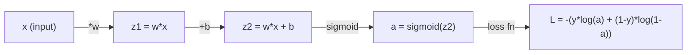
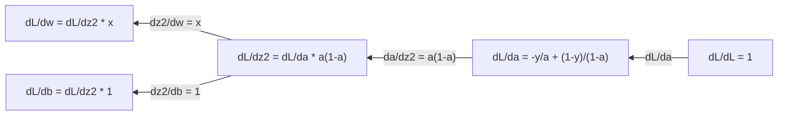
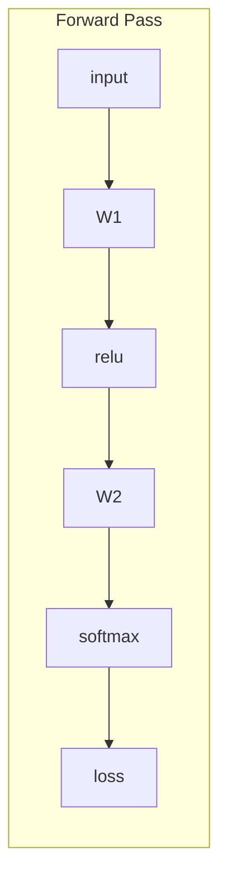
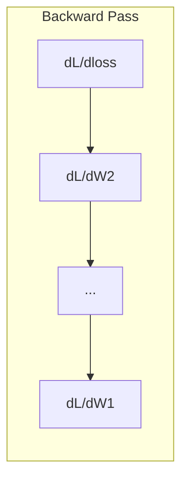

# 机器学习中的微积分

> 导数告诉你哪个方向是下坡。这就是神经网络学习所需的全部。

**Type:** Learn
**Language:** Python
**Prerequisites:** Phase 1, Lessons 01-03
**Time:** ~60 minutes

## 学习目标

- 计算常见 ML 函数的数值导数和解析导数（$x^2$、sigmoid、交叉熵）
- 从零实现梯度下降，在 1D 和 2D 中最小化损失函数
- 推导线性回归模型的梯度，并通过手动更新权重来训练它
- 解释 Hessian 矩阵、泰勒级数近似以及它们与优化方法的联系

## 问题

你有一个拥有数百万权重的神经网络。每个权重都是一个旋钮。你需要弄清楚该朝哪个方向转动每一个旋钮，才能让模型稍微少错一点。微积分给你这个方向。

没有微积分，训练神经网络就意味着随机尝试改动并寄希望于最好。有了导数，你就知道每个权重如何影响误差。你每次都能把每个旋钮转向正确方向。

## 概念

### 什么是导数

导数衡量变化率。对于函数 $y = f(x)$，导数 $f'(x)$ 告诉你：如果把 $x$ 轻微推动一下，$y$ 会改变多少？

几何上，导数是某点处切线的斜率。

**$f(x) = x^2$：**

| $x$ | $f(x)$ | $f'(x)$（斜率） |
|---|------|---------------|
| 0 | 0    | 0（平坦，位于碗底） |
| 1 | 1    | 2 |
| 2 | 4    | 4（该点切线斜率） |
| 3 | 9    | 6 |

在 $x=2$ 处，斜率是 4。如果你把 $x$ 向右移动一小点，$y$ 大约会增加 4 倍于那个移动量。在 $x=0$ 处，斜率为 0，你位于碗底。

正式定义：

```math
f'(x) = \lim_{h \to 0} \frac{f(x + h) - f(x)}{h}
```

在代码中，你跳过极限，只用一个非常小的 $h$。这就是数值导数。

### 偏导数：一次只动一个变量

真实函数有很多输入。神经网络损失取决于成千上万个权重。偏导数把其他所有变量固定，只对其中一个求导。

```math
\begin{aligned}
f(x, y) &= x^2 + 3xy + y^2 \\[4pt]
\frac{\partial f}{\partial x} &= 2x + 3y \quad \text{(treat } y \text{ as a constant)} \\
\frac{\partial f}{\partial y} &= 3x + 2y \quad \text{(treat } x \text{ as a constant)}
\end{aligned}
```

每个偏导数回答：如果我只推动这一个权重，损失会怎样变化？

### 梯度：所有偏导数组成的向量

梯度把所有偏导数收集到一个向量里。对于函数 $f(x, y, z)$，梯度为：

```math
\nabla f = \left[ \frac{\partial f}{\partial x}, \frac{\partial f}{\partial y}, \frac{\partial f}{\partial z} \right]
```

梯度指向最陡上升方向。要最小化函数，就朝相反方向走。

**$f(x,y) = x^2 + y^2$ 的等高线图：**

函数呈碗状，等高线是一系列同心圆。最小值在 (0, 0)。

| 点 | $\nabla f$ | $-\nabla f$（下降方向） |
|-------|--------|----------------------------|
| (1, 1) | [2, 2]（指向上坡，远离最小值） | [-2, -2]（指向下坡，朝向最小值） |
| (0, 0) | [0, 0]（平坦，位于最小值） | [0, 0] |

这就是梯度下降的图像：计算梯度，取反，迈一步。

### 与优化的联系

训练神经网络就是优化。你有一个损失函数 $L(w_1, w_2, \ldots, w_n)$ 衡量模型有多错，你想最小化它。

```
Gradient descent update rule:

  w_new = w_old - learning_rate * dL/dw

For every weight:
  1. Compute the partial derivative of loss with respect to that weight
  2. Subtract a small multiple of it from the weight
  3. Repeat
```

学习率控制步长。太大，会越过最小值；太小，会爬得太慢。

**损失 landscape（一维切片）：**

损失函数 $L(w)$ 随权重 $w$ 变化形成一条有峰有谷的曲线。

| 特征 | 描述 |
|---------|-------------|
| 全局最小值 | 整条曲线的最低点——最优解 |
| 局部最小值 | 比邻域低但不是整体最低的谷 |
| 斜率 | 梯度下降沿斜率从任意起点下坡 |

梯度下降沿斜率下坡。它可能陷入局部最小值，但在高维空间（数百万权重）中，这很少是实际问题。

### 数值导数 vs 解析导数

计算导数有两种方法。

解析法：手算微积分规则。对于 $f(x) = x^2$，导数是 $f'(x) = 2x$。精确、快速。

数值法：用定义近似。计算一个很小的 $h$ 对应的 $f(x+h)$ 和 $f(x-h)$，然后用差分。

```
Numerical (central difference):

f'(x) ~= f(x + h) - f(x - h)
          -----------------------
                  2h

h = 0.0001 works well in practice
```

数值导数更慢，但适用于任何函数。解析导数更快，但需要你推导出公式。神经网络框架采用第三种方法：自动微分，它机械地计算精确导数。你将在第 3 阶段看到它。

### 常用函数的解析导数

下面这些导数会在 ML 中反复出现。

```
Function        Derivative       Used in
--------        ----------       -------
f(x) = x^2     f'(x) = 2x      Loss functions (MSE)
f(x) = wx + b  f'(w) = x        Linear layer (gradient w.r.t. weight)
                f'(b) = 1        Linear layer (gradient w.r.t. bias)
                f'(x) = w        Linear layer (gradient w.r.t. input)
f(x) = e^x     f'(x) = e^x     Softmax, attention
f(x) = ln(x)   f'(x) = 1/x     Cross-entropy loss
f(x) = 1/(1+e^-x)  f'(x) = f(x)(1-f(x))   Sigmoid activation
```

对于 $f(x) = x^2$：

```
f(x) = x^2    f'(x) = 2x

  x    f(x)   f'(x)   meaning
  -2    4      -4      slope tilts left (decreasing)
  -1    1      -2      slope tilts left (decreasing)
   0    0       0      flat (minimum!)
   1    1       2      slope tilts right (increasing)
   2    4       4      slope tilts right (increasing)
```

对于 $f(w) = wx + b$，其中 $x=3$，$b=1$：

```
f(w) = 3w + 1    f'(w) = 3

The derivative with respect to w is just x.
If x is big, a small change in w causes a big change in output.
```

### 链式法则

当函数复合时，链式法则告诉你如何求导。

```
If y = f(g(x)), then dy/dx = f'(g(x)) * g'(x)

Example: y = (3x + 1)^2
  outer: f(u) = u^2       f'(u) = 2u
  inner: g(x) = 3x + 1    g'(x) = 3
  dy/dx = 2(3x + 1) * 3 = 6(3x + 1)
```

神经网络是函数的链：输入 → 线性 → 激活 → 线性 → 激活 → 损失。反向传播就是从输出到输入反复应用链式法则。这就是整个算法。

### Hessian 矩阵

梯度告诉你斜率，Hessian 告诉你曲率。

Hessian 是二阶偏导数矩阵。对于函数 $f(x_1, x_2, \ldots, x_n)$，Hessian 的第 $(i, j)$ 项为：

```math
H_{ij} = \frac{\partial^2 f}{\partial x_i \, \partial x_j}
```

对于二元函数 $f(x, y)$：

```math
H = \begin{bmatrix} \dfrac{\partial^2 f}{\partial x^2} & \dfrac{\partial^2 f}{\partial x \, \partial y} \\[8pt] \dfrac{\partial^2 f}{\partial y \, \partial x} & \dfrac{\partial^2 f}{\partial y^2} \end{bmatrix}
```

**Hessian 在临界点（梯度为 0 处）告诉你什么：**

| Hessian 性质 | 含义 | 示例曲面 |
|-----------------|---------|-----------------|
| 正定（所有特征值 > 0） | 局部最小值 | 开口向上的碗 |
| 负定（所有特征值 < 0） | 局部最大值 | 开口向下的碗 |
| 不定（特征值有正有负） | 鞍点 | 马鞍形 |

**例子：** $f(x, y) = x^2 - y^2$（鞍函数）

```
df/dx = 2x       df/dy = -2y
d^2f/dx^2 = 2    d^2f/dy^2 = -2    d^2f/dxdy = 0

H = | 2   0 |
    | 0  -2 |

Eigenvalues: 2 and -2 (one positive, one negative)
--> Saddle point at (0, 0)
```

与 $f(x, y) = x^2 + y^2$（碗）对比：

```
H = | 2  0 |
    | 0  2 |

Eigenvalues: 2 and 2 (both positive)
--> Local minimum at (0, 0)
```

**Hessian 在 ML 中为什么重要：**

牛顿法利用 Hessian 做出比梯度下降更好的优化步。它不仅跟随斜率，还考虑曲率：

```math
\begin{aligned}
\text{Newton's update:} \quad & w_{\text{new}} = w_{\text{old}} - H^{-1} \cdot \text{gradient} \\
\text{Gradient descent:} \quad & w_{\text{new}} = w_{\text{old}} - \text{lr} \cdot \text{gradient}
\end{aligned}
```

牛顿法收敛更快，因为 Hessian「重新缩放」了梯度——陡峭方向步长变小，平坦方向步长变大。

问题在于：对于有 $N$ 个参数的神经网络，Hessian 是 $N \times N$。一个 100 万参数的模型需要 1 万亿项的矩阵。这就是为什么我们使用近似。

| 方法 | 使用信息 | 每步代价 | 收敛速度 |
|--------|-------------|------|-------------|
| 梯度下降 | 仅一阶导数 | $O(N)$ | 慢（线性） |
| 牛顿法 | 完整 Hessian | $O(N^3)$ | 快（二次） |
| L-BFGS | 由梯度历史近似 Hessian | $O(N)$ | 中等（超线性） |
| Adam | 逐参数自适应学习率（对角 Hessian 近似） | $O(N)$ | 中等 |
| 自然梯度 | Fisher 信息矩阵（统计意义上的 Hessian） | $O(N^2)$ | 快 |

实践中，Adam 是深度学习的默认优化器。它通过跟踪每个参数梯度的滑动平均和方差，廉价地近似二阶信息。

### 泰勒级数近似

任何光滑函数都可以在局部用多项式近似：

```math
f(x + h) = f(x) + f'(x)\,h + \frac{1}{2} f''(x)\,h^2 + \frac{1}{6} f'''(x)\,h^3 + \cdots
```

包含的项越多，近似越好——但只在 $x$ 附近有效。

**泰勒级数在 ML 中为什么重要：**

- **一阶泰勒 = 梯度下降。** 当你使用 $f(x + h) \approx f(x) + f'(x) h$ 时，你做了一个线性近似。梯度下降通过最小化这个线性模型来选择 $h = -\text{lr} \cdot f'(x)$。

- **二阶泰勒 = 牛顿法。** 使用 $f(x + h) \approx f(x) + f'(x) h + \frac{1}{2} f''(x) h^2$ 得到二次模型。最小化它给出 $h = -f'(x)/f''(x)$——这就是牛顿步。

- **损失函数设计。** MSE 和交叉熵都是光滑函数，因此它们的泰勒展开表现良好。这不是偶然。光滑损失让优化更可预测。

```
Approximation order    What it captures    Optimization method
-------------------    -----------------   -------------------
0th order (constant)   Just the value      Random search
1st order (linear)     Slope               Gradient descent
2nd order (quadratic)  Curvature           Newton's method
Higher orders          Finer structure     Rarely used in ML
```

关键洞见：所有基于梯度的优化，本质上都是在局部近似损失函数，然后迈向该近似的最小值。

### ML 中的积分

导数告诉你变化率，积分计算累积量——曲线下面积。

在 ML 中你很少手算积分，但概念无处不在：

**概率。** 对于连续随机变量，其密度为 $p(x)$：

```math
P(a < X < b) = \int_a^b p(x) \, dx
```

概率密度曲线在 $a$ 到 $b$ 之间的面积，就是落在这个区间内的概率。

**期望。** 按概率加权后的平均结果：

```math
\mathbb{E}[f(X)] = \int f(x) \, p(x) \, dx
```

数据分布上的期望损失就是一个积分。训练最小化的是它的经验近似。

**KL 散度。** 衡量两个分布的差异：

```math
\mathrm{KL}(p \,\|\, q) = \int p(x) \log \frac{p(x)}{q(x)} \, dx
```

用于 VAE、知识蒸馏和贝叶斯推断。

**归一化常数。** 在贝叶斯推断中：

```math
p(w \mid \text{data}) = \frac{p(\text{data} \mid w) \, p(w)}{\int p(\text{data} \mid w) \, p(w) \, dw}
```

分母是对所有可能参数值的积分。它通常难以计算，这就是为什么我们使用 MCMC、变分推断等近似方法。

| 积分概念 | 在 ML 中出现的位置 |
|-----------------|----------------------|
| 曲线下面积 | 由密度函数得到概率 |
| 期望 | 损失函数、风险最小化 |
| KL 散度 | VAE、策略优化、蒸馏 |
| 归一化 | 贝叶斯后验、softmax 分母 |
| 边际似然 | 模型比较、证据下界（ELBO） |

### 计算图中的多变量链式法则

链式法则不只适用于串成一线的标量函数。在神经网络中，变量会分叉、合并。下面展示导数如何流过一次简单的前向传播：



反向传播从右到左计算梯度：



每条箭头都乘以局部导数。任意参数的梯度是从损失到该参数路径上所有局部导数的乘积。当路径分叉、合并时，你把各分支贡献相加（多变量链式法则）。

这就是反向传播的全部：通过计算图从输出到输入系统地应用链式法则。

### 雅可比矩阵

当函数把向量映射到向量（如神经网络层）时，它的导数是一个矩阵。雅可比矩阵包含每个输出对每个输入的所有偏导数。

对于 $f: \mathbb{R}^n \to \mathbb{R}^m$，雅可比矩阵 $J$ 是一个 $m \times n$ 矩阵：

| | $x_1$ | $x_2$ | ... | $x_n$ |
|---|---|---|---|---|
| $f_1$ | $\partial f_1/\partial x_1$ | $\partial f_1/\partial x_2$ | ... | $\partial f_1/\partial x_n$ |
| $f_2$ | $\partial f_2/\partial x_1$ | $\partial f_2/\partial x_2$ | ... | $\partial f_2/\partial x_n$ |
| ... | ... | ... | ... | ... |
| $f_m$ | $\partial f_m/\partial x_1$ | $\partial f_m/\partial x_2$ | ... | $\partial f_m/\partial x_n$ |

你不会为神经网络手算雅可比矩阵，PyTorch 会处理。但知道它的存在有助于理解反向传播中的形状：如果一层把 $\mathbb{R}^n$ 映射到 $\mathbb{R}^m$，它的雅可比矩阵就是 $m \times n$。梯度通过该矩阵的转置反向流动。

### 为什么这对神经网络很重要

神经网络中的每个权重都会得到一个梯度。梯度告诉你如何调整该权重以减少损失。





每次权重更新：
- `W1 = W1 - lr * dL/dW1`
- `W2 = W2 - lr * dL/dW2`

前向传播计算预测和损失。反向传播计算损失对每个权重的梯度。然后每个权重都朝下坡迈一小步。重复数百万步。这就是深度学习。

```figure
derivative-tangent
```

## 构建它

### 步骤 1：从零实现数值导数

```python
def numerical_derivative(f, x, h=1e-7):
    return (f(x + h) - f(x - h)) / (2 * h)

def f(x):
    return x ** 2

for x in [-2, -1, 0, 1, 2]:
    numerical = numerical_derivative(f, x)
    analytical = 2 * x
    print(f"x={x:2d}  f'(x) numerical={numerical:.6f}  analytical={analytical:.1f}")
```

数值导数与解析导数在许多位小数上都一致。

### 步骤 2：偏导数与梯度

```python
def numerical_gradient(f, point, h=1e-7):
    gradient = []
    for i in range(len(point)):
        point_plus = list(point)
        point_minus = list(point)
        point_plus[i] += h
        point_minus[i] -= h
        partial = (f(point_plus) - f(point_minus)) / (2 * h)
        gradient.append(partial)
    return gradient

def f_multi(point):
    x, y = point
    return x**2 + 3*x*y + y**2

grad = numerical_gradient(f_multi, [1.0, 2.0])
print(f"Numerical gradient at (1,2): {[f'{g:.4f}' for g in grad]}")
print(f"Analytical gradient at (1,2): [2*1+3*2, 3*1+2*2] = [{2*1+3*2}, {3*1+2*2}]")
```

### 步骤 3：用梯度下降求 $f(x) = x^2$ 的最小值

```python
x = 5.0
lr = 0.1
for step in range(20):
    grad = 2 * x
    x = x - lr * grad
    print(f"step {step:2d}  x={x:8.4f}  f(x)={x**2:10.6f}")
```

从 $x=5$ 出发，每一步都更接近 $x=0$（最小值）。

### 步骤 4：在二维函数上做梯度下降

```python
def f_2d(point):
    x, y = point
    return x**2 + y**2

point = [4.0, 3.0]
lr = 0.1
for step in range(30):
    grad = numerical_gradient(f_2d, point)
    point = [p - lr * g for p, g in zip(point, grad)]
    loss = f_2d(point)
    if step % 5 == 0 or step == 29:
        print(f"step {step:2d}  point=({point[0]:7.4f}, {point[1]:7.4f})  f={loss:.6f}")
```

### 步骤 5：比较数值导数和解析导数

```python
import math

test_functions = [
    ("x^2",      lambda x: x**2,          lambda x: 2*x),
    ("x^3",      lambda x: x**3,          lambda x: 3*x**2),
    ("sin(x)",   lambda x: math.sin(x),   lambda x: math.cos(x)),
    ("e^x",      lambda x: math.exp(x),   lambda x: math.exp(x)),
    ("1/x",      lambda x: 1/x,           lambda x: -1/x**2),
]

x = 2.0
print(f"{'Function':<12} {'Numerical':>12} {'Analytical':>12} {'Error':>12}")
print("-" * 50)
for name, f, df in test_functions:
    num = numerical_derivative(f, x)
    ana = df(x)
    err = abs(num - ana)
    print(f"{name:<12} {num:12.6f} {ana:12.6f} {err:12.2e}")
```

### 步骤 6：数值计算 Hessian

```python
def hessian_2d(f, x, y, h=1e-5):
    fxx = (f(x + h, y) - 2 * f(x, y) + f(x - h, y)) / (h ** 2)
    fyy = (f(x, y + h) - 2 * f(x, y) + f(x, y - h)) / (h ** 2)
    fxy = (f(x + h, y + h) - f(x + h, y - h) - f(x - h, y + h) + f(x - h, y - h)) / (4 * h ** 2)
    return [[fxx, fxy], [fxy, fyy]]

def saddle(x, y):
    return x ** 2 - y ** 2

def bowl(x, y):
    return x ** 2 + y ** 2

H_saddle = hessian_2d(saddle, 0.0, 0.0)
H_bowl = hessian_2d(bowl, 0.0, 0.0)
print(f"Saddle Hessian: {H_saddle}")  # [[2, 0], [0, -2]] -- mixed signs
print(f"Bowl Hessian:   {H_bowl}")    # [[2, 0], [0, 2]]  -- both positive
```

鞍函数的 Hessian 特征值为 2 和 -2（符号混合，确认鞍点）。碗函数的 Hessian 特征值为 2 和 2（均为正，确认最小值）。

### 步骤 7：泰勒近似实战

```python
import math

def taylor_approx(f, f_prime, f_double_prime, x0, h, order=2):
    result = f(x0)
    if order >= 1:
        result += f_prime(x0) * h
    if order >= 2:
        result += 0.5 * f_double_prime(x0) * h ** 2
    return result

x0 = 0.0
for h in [0.1, 0.5, 1.0, 2.0]:
    true_val = math.sin(h)
    t1 = taylor_approx(math.sin, math.cos, lambda x: -math.sin(x), x0, h, order=1)
    t2 = taylor_approx(math.sin, math.cos, lambda x: -math.sin(x), x0, h, order=2)
    print(f"h={h:.1f}  sin(h)={true_val:.4f}  order1={t1:.4f}  order2={t2:.4f}")
```

在 $x_0=0$ 附近，$\sin(x) \approx x$（一阶泰勒）。对很小的 $h$ 近似极好，但对大 $h$ 会失效。这就是为什么梯度下降最好搭配小学习率——每一步都假设线性近似是准确的。

### 步骤 8：为什么这对神经网络很重要

```python
import random

random.seed(42)

w = random.gauss(0, 1)
b = random.gauss(0, 1)
lr = 0.01

xs = [1.0, 2.0, 3.0, 4.0, 5.0]
ys = [3.0, 5.0, 7.0, 9.0, 11.0]

for epoch in range(200):
    total_loss = 0
    dw = 0
    db = 0
    for x, y in zip(xs, ys):
        pred = w * x + b
        error = pred - y
        total_loss += error ** 2
        dw += 2 * error * x
        db += 2 * error
    dw /= len(xs)
    db /= len(xs)
    total_loss /= len(xs)
    w -= lr * dw
    b -= lr * db
    if epoch % 40 == 0 or epoch == 199:
        print(f"epoch {epoch:3d}  w={w:.4f}  b={b:.4f}  loss={total_loss:.6f}")

print(f"\nLearned: y = {w:.2f}x + {b:.2f}")
print(f"Actual:  y = 2x + 1")
```

每个基于梯度的训练循环都遵循这个模式：预测、计算损失、计算梯度、更新权重。

## 使用它

用 NumPy，同样操作更快、更简洁：

```python
import numpy as np

x = np.array([1, 2, 3, 4, 5], dtype=float)
y = np.array([3, 5, 7, 9, 11], dtype=float)

w, b = np.random.randn(), np.random.randn()
lr = 0.01

for epoch in range(200):
    pred = w * x + b
    error = pred - y
    loss = np.mean(error ** 2)
    dw = np.mean(2 * error * x)
    db = np.mean(2 * error)
    w -= lr * dw
    b -= lr * db

print(f"Learned: y = {w:.2f}x + {b:.2f}")
```

你刚刚从零实现了梯度下降。PyTorch 自动化了梯度计算，但更新循环完全相同。

## 练习

1. 实现 `numerical_second_derivative(f, x)`，调用两次 `numerical_derivative`。验证 $x^3$ 在 $x=2$ 处的二阶导数为 12。
2. 用梯度下降求 $f(x, y) = (x - 3)^2 + (y + 1)^2$ 的最小值。从 $(0, 0)$ 出发，结果应收敛到 $(3, -1)$。
3. 给梯度下降循环加入动量：维护一个累积历史梯度的速度向量。在 $f(x) = x^4 - 3x^2$ 上比较有无动量的收敛速度。

### 提示

**练习 1.** 定义一个返回 `numerical_derivative(f, x)` 的辅助函数，再把这个辅助函数传入 `numerical_derivative`。如果结果有噪声，两次调用都用更大的步长如 `h=1e-4`；$x=2$ 处的值应接近 12。

**练习 2.** 写下梯度 $(2(x - 3), 2(y + 1))$，或使用 `numerical_gradient`，然后从 $(0, 0)$ 调用 `gradient_descent_nd`。每 10 步打印一次点；它应该向 $(3, -1)$ 移动，损失接近 0。

**练习 3.** 维护速度 `v`，按 `v = momentum * v - lr * grad` 更新，然后把 `v` 加到 `x` 上。统计每种方法达到梯度接近 0 所需的步数；最小值在 $x = \pm\sqrt{1.5} \approx \pm 1.225$。

## 关键术语

| 术语 | 人们常说 | 实际含义 |
|------|----------------|----------------------|
| 导数 | "斜率" | 函数在某点的变化率。告诉你输出对单位输入变化的响应。 |
| 偏导数 | "一个变量的导数" | 其他变量保持不变时，对某一个变量求的导数。 |
| 梯度 | "最陡上升方向" | 所有偏导数组成的向量。指向函数增长最快的方向。 |
| 梯度下降 | "往下走" | 用梯度（乘以学习率）减参数，从而降低损失。神经网络训练的核心。 |
| 学习率 | "步长" | 控制梯度下降每步大小的标量。太大：发散。太小：收敛慢。 |
| 链式法则 | "把导数乘起来" | 复合函数求导法则：$\frac{df}{dx} = \frac{df}{dg} \cdot \frac{dg}{dx}$。反向传播的数学基础。 |
| 雅可比矩阵 | "导数矩阵" | 当函数把向量映射到向量时，雅可比矩阵包含每个输出对每个输入的所有偏导数。 |
| 数值导数 | "有限差分" | 通过在两个邻近点求函数值并计算斜率来近似导数。 |
| 反向传播 | "反向模式自动微分" | 利用链式法则从输出到输入逐层计算梯度。神经网络的学习方式。 |
| Hessian | "二阶导数矩阵" | 所有二阶偏导数组成的矩阵。描述函数的曲率。临界点的 Hessian 正定意味着局部最小值。 |
| 泰勒级数 | "多项式近似" | 用导数在某点附近近似函数：$f(x+h) \approx f(x) + f'(x)h + \frac{1}{2}f''(x)h^2 + \cdots$ 理解梯度下降和牛顿法为何有效的基础。 |
| 积分 | "曲线下面积" | 某量在一个区间上的累积。在 ML 中，积分定义概率、期望和 KL 散度。 |

## 延伸阅读

- [3Blue1Brown: Essence of Calculus](https://www.3blue1brown.com/topics/calculus) —— 导数、积分和链式法则的视觉直觉
- [Stanford CS231n: Backpropagation](https://cs231n.github.io/optimization-2/) —— 梯度如何流经神经网络层
