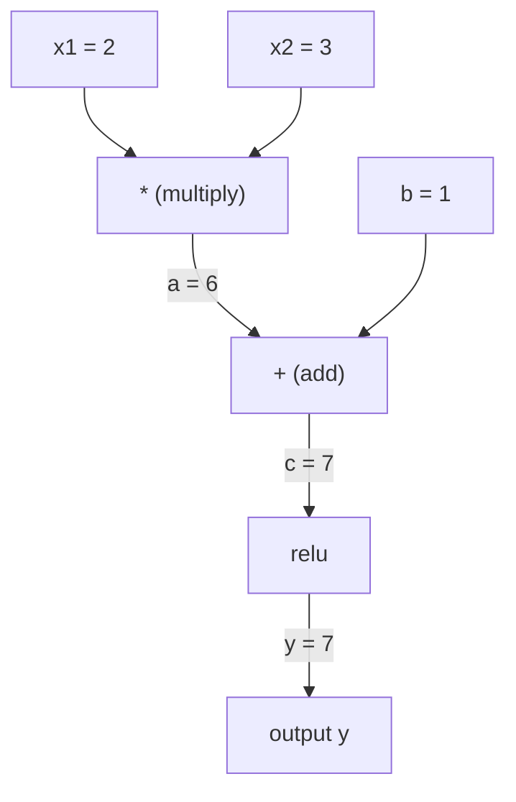
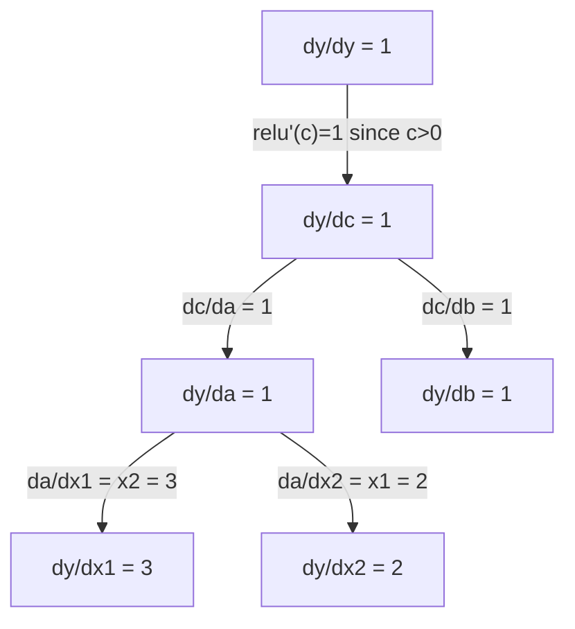

# 链式法则与自动微分

> 链式法则是每个会学习的神经网络背后的引擎。

**Type:** Build
**Language:** Python
**Prerequisites:** Phase 1, Lesson 04 (Derivatives & Gradients)
**Time:** ~90 minutes

## 学习目标

- 从零实现一个最小化的 autograd 引擎（Value 类），记录操作并通过反向模式自动微分计算梯度
- 利用拓扑排序在计算图上实现前向与反向传播
- 仅使用从零构建的 autograd 引擎构造并训练一个用于 XOR 的多层感知机
- 使用数值有限差分进行梯度检查，验证自动微分的正确性

## 问题

你已经能计算简单函数的导数。但神经网络不是简单函数。它是数百个函数的组合：矩阵乘法、加偏置、应用激活函数、再次矩阵乘法、softmax、交叉熵损失。输出是函数的函数的函数。

要训练网络，你需要损失关于每一个权重的梯度。手动计算百万量级的参数是不可能的。数值方法（有限差分）又太慢。

链式法则给你数学原理，自动微分给你算法。二者结合，让你能在与一次前向传播成正比的时间内，计算任意函数组合的精确梯度。

这就是 PyTorch、TensorFlow 和 JAX 的工作方式。你将从零构建一个微型版本。

## 概念

### 链式法则

若 $y = f(g(x))$，则 $y$ 关于 $x$ 的导数为：

```math
\frac{dy}{dx} = \frac{dy}{dg} \cdot \frac{dg}{dx} = f'(g(x)) \cdot g'(x)
```

沿链相乘导数。每一个环节贡献其局部导数。

示例：$y = \sin(x^2)$

```math
\begin{aligned}
g(x) &= x^2 \qquad & g'(x) &= 2x \\
f(g) &= \sin(g) \qquad & f'(g) &= \cos(g) \\[4pt]
\frac{dy}{dx} &= \cos(x^2) \cdot 2x
\end{aligned}
```

对于更深的组合，链继续延伸：

```math
\begin{aligned}
y &= f(g(h(x))) \\[4pt]
\frac{dy}{dx} &= f'(g(h(x))) \cdot g'(h(x)) \cdot h'(x)
\end{aligned}
```

神经网络中的每一层都是这条链上的一个环节。

### 计算图

计算图让链式法则可视化。每个操作成为一个节点。数据正向流过图，梯度反向流过图。

**前向传播（计算值）：**



**反向传播（计算梯度）：**



反向传播在每个节点应用链式法则，将梯度从输出传播到输入。

### 前向模式 vs 反向模式

通过图应用链式法则有两种方式。

**前向模式**从输入开始，将导数向前推进。它计算 $dx/dx = 1$ 并通过每个操作传播。适用于输入少、输出多的情况。

```
Forward mode: seed dx/dx = 1, propagate forward

  x = 2       (dx/dx = 1)
  a = x^2     (da/dx = 2x = 4)
  y = sin(a)  (dy/dx = cos(a) * da/dx = cos(4) * 4 = -2.615)
```

**反向模式**从输出开始，将梯度向后拉回。它计算 $dy/dy = 1$ 并反向通过每个操作传播。适用于输入多、输出少的情况。

```
Reverse mode: seed dy/dy = 1, propagate backward

  y = sin(a)  (dy/dy = 1)
  a = x^2     (dy/da = cos(a) = cos(4) = -0.654)
  x = 2       (dy/dx = dy/da * da/dx = -0.654 * 4 = -2.615)
```

神经网络有数百万输入（权重）和一个输出（损失）。反向模式一次反向传播即可算出所有梯度。这就是反向传播使用反向模式的原因。

| 模式 | 种子 | 方向 | 适用场景 |
|------|------|------|----------|
| Forward | $dx_i/dx_i = 1$ | 输入到输出 | 输入少，输出多 |
| Reverse | $dy/dy = 1$ | 输出到输入 | 输入多，输出少（神经网络） |

### 用于前向模式的对偶数

前向模式可用对偶数优雅实现。对偶数形如 $a + b\epsilon$，其中 $\epsilon^2 = 0$。

```
Dual number: (value, derivative)

(2, 1) means: value is 2, derivative w.r.t. x is 1

Arithmetic rules:
  (a, a') + (b, b') = (a+b, a'+b')
  (a, a') * (b, b') = (a*b, a'*b + a*b')
  sin(a, a')         = (sin(a), cos(a)*a')
```

将输入变量的导数设为 1。导数会自动通过每个操作传播。

### 构建 Autograd 引擎

自动微分引擎需要三样东西：

1. **值包装。** 把每个数字包装成对象，存储其值和梯度。
2. **图记录。** 每个操作记录其输入和局部梯度函数。
3. **反向传播。** 对图做拓扑排序，然后反向遍历，在每个节点应用链式法则。

这正是 PyTorch 的 `autograd` 所做的。`torch.Tensor` 类包装数值，在 `requires_grad=True` 时记录操作，并在调用 `.backward()` 时计算梯度。

### PyTorch Autograd 的内部工作原理

当你写 PyTorch 代码时：

```python
x = torch.tensor(2.0, requires_grad=True)
y = x ** 2 + 3 * x + 1
y.backward()
print(x.grad)  # 7.0 = 2*x + 3 = 2*2 + 3
```

PyTorch 内部：

1. 为 `x` 创建一个 `requires_grad=True` 的 `Tensor` 节点
2. 每个操作（`**`、`*`、`+`）创建一个新节点并记录反向函数
3. `y.backward()` 触发记录图上的反向模式自动微分
4. 每个节点的 `grad_fn` 计算局部梯度并传给父节点
5. 梯度通过加法在 `.grad` 属性中累加（而非替换）

图是动态的（define-by-run）。每次前向传播都会构建新图。这就是 PyTorch 支持模型内部控制流（if/else、循环）的原因。

```figure
chain-rule
```

## 构建它

### 第 1 步：Value 类

```python
class Value:
    def __init__(self, data, children=(), op=''):
        self.data = data
        self.grad = 0.0
        self._backward = lambda: None
        self._prev = set(children)
        self._op = op

    def __repr__(self):
        return f"Value(data={self.data:.4f}, grad={self.grad:.4f})"
```

每个 `Value` 存储其数值、梯度（初始为零）、反向函数，以及产生它的子节点指针。

### 第 2 步：带梯度追踪的算术运算

```python
    def __add__(self, other):
        other = other if isinstance(other, Value) else Value(other)
        out = Value(self.data + other.data, (self, other), '+')
        def _backward():
            self.grad += out.grad
            other.grad += out.grad
        out._backward = _backward
        return out

    def __mul__(self, other):
        other = other if isinstance(other, Value) else Value(other)
        out = Value(self.data * other.data, (self, other), '*')
        def _backward():
            self.grad += other.data * out.grad
            other.grad += self.data * out.grad
        out._backward = _backward
        return out

    def relu(self):
        out = Value(max(0, self.data), (self,), 'relu')
        def _backward():
            self.grad += (1.0 if out.data > 0 else 0.0) * out.grad
        out._backward = _backward
        return out
```

每个操作创建一个闭包，知道如何计算局部梯度并乘以上游梯度（`out.grad`）。`+=` 处理一个值被多个操作使用的情况。

### 第 3 步：反向传播

```python
    def backward(self):
        topo = []
        visited = set()
        def build_topo(v):
            if v not in visited:
                visited.add(v)
                for child in v._prev:
                    build_topo(child)
                topo.append(v)
        build_topo(self)

        self.grad = 1.0
        for v in reversed(topo):
            v._backward()
```

拓扑排序确保每个节点的梯度在传播到子节点前已完全计算。种子梯度为 1.0（$dy/dy = 1$）。

### 第 4 步：完整引擎需要的更多操作

基础 Value 类已能处理加法、乘法和 relu。真正的 autograd 引擎需要更多操作。以下是构建神经网络所需的操作：

```python
    def __neg__(self):
        return self * -1

    def __sub__(self, other):
        return self + (-other)

    def __radd__(self, other):
        return self + other

    def __rmul__(self, other):
        return self * other

    def __rsub__(self, other):
        return other + (-self)

    def __pow__(self, n):
        out = Value(self.data ** n, (self,), f'**{n}')
        def _backward():
            self.grad += n * (self.data ** (n - 1)) * out.grad
        out._backward = _backward
        return out

    def __truediv__(self, other):
        return self * (other ** -1) if isinstance(other, Value) else self * (Value(other) ** -1)

    def exp(self):
        import math
        e = math.exp(self.data)
        out = Value(e, (self,), 'exp')
        def _backward():
            self.grad += e * out.grad
        out._backward = _backward
        return out

    def log(self):
        import math
        out = Value(math.log(self.data), (self,), 'log')
        def _backward():
            self.grad += (1.0 / self.data) * out.grad
        out._backward = _backward
        return out

    def tanh(self):
        import math
        t = math.tanh(self.data)
        out = Value(t, (self,), 'tanh')
        def _backward():
            self.grad += (1 - t ** 2) * out.grad
        out._backward = _backward
        return out
```

**每个操作为何重要：**

| 操作 | 反向规则 | 用于 |
|------|----------|------|
| `__sub__` | 复用 add + neg | 损失计算（pred - target） |
| `__pow__` | $n \cdot x^{n-1}$ | 多项式激活、MSE（$\text{error}^2$） |
| `__truediv__` | 复用 mul + pow(-1) | 归一化、学习率缩放 |
| `exp` | $\exp(x) \cdot \text{upstream}$ | softmax、对数似然 |
| `log` | $(1/x) \cdot \text{upstream}$ | 交叉熵损失、对数概率 |
| `tanh` | $(1 - \tanh^2) \cdot \text{upstream}$ | 经典激活函数 |

巧妙之处在于：`__sub__` 和 `__truediv__` 用已有操作定义。由于链式法则会通过底层的加/乘/幂操作组合，它们自然得到正确的梯度。

### 第 5 步：从零构建小型 MLP

有了完整的 Value 类，你就能构建神经网络。不用 PyTorch，不用 NumPy，只用 Value 和链式法则。

```python
import random

class Neuron:
    def __init__(self, n_inputs):
        self.w = [Value(random.uniform(-1, 1)) for _ in range(n_inputs)]
        self.b = Value(0.0)

    def __call__(self, x):
        act = sum((wi * xi for wi, xi in zip(self.w, x)), self.b)
        return act.tanh()

    def parameters(self):
        return self.w + [self.b]

class Layer:
    def __init__(self, n_inputs, n_outputs):
        self.neurons = [Neuron(n_inputs) for _ in range(n_outputs)]

    def __call__(self, x):
        return [n(x) for n in self.neurons]

    def parameters(self):
        return [p for n in self.neurons for p in n.parameters()]

class MLP:
    def __init__(self, sizes):
        self.layers = [Layer(sizes[i], sizes[i+1]) for i in range(len(sizes)-1)]

    def __call__(self, x):
        for layer in self.layers:
            x = layer(x)
        return x[0] if len(x) == 1 else x

    def parameters(self):
        return [p for layer in self.layers for p in layer.parameters()]
```

一个 `Neuron` 计算 `tanh(w1*x1 + w2*x2 + ... + b)`。一个 `Layer` 是神经元列表。一个 `MLP` 堆叠层。每个权重都是 `Value`，因此调用 `loss.backward()` 会把梯度传播到每个参数。

**在 XOR 上训练：**

```python
random.seed(42)
model = MLP([2, 4, 1])  # 2 inputs, 4 hidden neurons, 1 output

xs = [[0, 0], [0, 1], [1, 0], [1, 1]]
ys = [-1, 1, 1, -1]  # XOR pattern (using -1/1 for tanh)

for step in range(100):
    preds = [model(x) for x in xs]
    loss = sum((p - y) ** 2 for p, y in zip(preds, ys))

    for p in model.parameters():
        p.grad = 0.0
    loss.backward()

    lr = 0.05
    for p in model.parameters():
        p.data -= lr * p.grad

    if step % 20 == 0:
        print(f"step {step:3d}  loss = {loss.data:.4f}")

print("\nPredictions after training:")
for x, y in zip(xs, ys):
    print(f"  input={x}  target={y:2d}  pred={model(x).data:6.3f}")
```

这就是 micrograd：一个纯 Python 的完整神经网络训练循环，带自动微分。每个商业深度学习框架本质上都在大规模做同样的事。

### 第 6 步：梯度检查

你怎么知道自动微分是否正确？与数值导数对比。这就是梯度检查。

```python
def gradient_check(build_expr, x_val, h=1e-7):
    x = Value(x_val)
    y = build_expr(x)
    y.backward()
    autodiff_grad = x.grad

    y_plus = build_expr(Value(x_val + h)).data
    y_minus = build_expr(Value(x_val - h)).data
    numerical_grad = (y_plus - y_minus) / (2 * h)

    diff = abs(autodiff_grad - numerical_grad)
    return autodiff_grad, numerical_grad, diff
```

在一个复杂表达式上测试：

```python
def expr(x):
    return (x ** 3 + x * 2 + 1).tanh()

ad, num, diff = gradient_check(expr, 0.5)
print(f"Autodiff:  {ad:.8f}")
print(f"Numerical: {num:.8f}")
print(f"Difference: {diff:.2e}")
# Difference should be < 1e-5
```

梯度检查在实现新操作时必不可少。如果反向传播有 bug，数值检查能抓住它。每个严肃的深度学习实现都会在开发期间做梯度检查。

**何时使用梯度检查：**

| 场景 | 是否做梯度检查 |
|------|----------------|
| 给 autograd 添加新操作 | 总是做 |
| 调试不收敛的训练循环 | 做，先检查梯度 |
| 生产训练 | 不做，太慢（每个参数需要 2 次前向传播） |
| autograd 代码的单元测试 | 做，并自动化 |

### 第 7 步：与手动计算核对

```python
x1 = Value(2.0)
x2 = Value(3.0)
a = x1 * x2          # a = 6.0
b = a + Value(1.0)    # b = 7.0
y = b.relu()          # y = 7.0

y.backward()

print(f"y = {y.data}")          # 7.0
print(f"dy/dx1 = {x1.grad}")   # 3.0 (= x2)
print(f"dy/dx2 = {x2.grad}")   # 2.0 (= x1)
```

手动核对：`y = relu(x1*x2 + 1)`。由于 `x1*x2 + 1 = 7 > 0`，relu 为恒等映射。
`dy/dx1 = x2 = 3`，`dy/dx2 = x1 = 2`。引擎结果一致。

## 使用它

### 与 PyTorch 核对

```python
import torch

x1 = torch.tensor(2.0, requires_grad=True)
x2 = torch.tensor(3.0, requires_grad=True)
a = x1 * x2
b = a + 1.0
y = torch.relu(b)
y.backward()

print(f"PyTorch dy/dx1 = {x1.grad.item()}")  # 3.0
print(f"PyTorch dy/dx2 = {x2.grad.item()}")  # 2.0
```

梯度相同。你的引擎得到与 PyTorch 相同的结果，因为数学相同：通过链式法则的反向模式自动微分。

### 更复杂的表达式

```python
a = Value(2.0)
b = Value(-3.0)
c = Value(10.0)
f = (a * b + c).relu()  # relu(2*(-3) + 10) = relu(4) = 4

f.backward()
print(f"df/da = {a.grad}")  # -3.0 (= b)
print(f"df/db = {b.grad}")  #  2.0 (= a)
print(f"df/dc = {c.grad}")  #  1.0
```

## 交付它

本节课产出：
- `outputs/skill-autodiff.md` —— 构建与调试 autograd 系统的 skill
- `code/autodiff.py` —— 一个可扩展的最小化 autograd 引擎

这里构建的 Value 类是第 3 阶段神经网络训练循环的基础。

## 练习

1. 给 Value 类添加 `__pow__`，使你能计算 `x ** n`。验证 $\frac{d}{dx}(x^3)$ 在 $x=2$ 时等于 `12.0`。

2. 添加 `tanh` 作为激活函数。验证 $\tanh'(0) = 1$ 且 $\tanh'(2) \approx 0.0707$。

3. 为单个神经元构建计算图：`y = relu(w1*x1 + w2*x2 + b)`。计算全部五个梯度，并与 PyTorch 核对。

4. 用对偶数实现前向模式自动微分。创建 `Dual` 类，并验证它给出与反向模式引擎相同的导数。

### 提示

**练习 1.** `Value` 已经定义了 `__pow__`。阅读它的 `_backward`，确认它把 $n x^{n-1}$ 作用于传入梯度。运行 `x = Value(2.0)`、`y = x ** 3`、`y.backward()`；`x.grad` 必须是 12.0。

**练习 2.** 在 `_backward` 中使用 $\tanh'(x) = 1 - \tanh(x)^2$。用你自己的有限差分检查：$\frac{\tanh(x + h) - \tanh(x - h)}{2h}$ 在 $x = 0$ 和 $x = 2$ 处必须一致。

**练习 3.** 用 `Value` 对象构建 `w1*x1 + w2*x2 + b`，应用 `relu`，调用 `backward`。在与 PyTorch 对比前，先手动检查：若 relu 的输入为正，则 `w1` 的梯度等于 `x1`；若为负，五个梯度全为 0。

**练习 4.** 在每个 `Dual` 中存储一个值和一个导数，乘法使用乘积法则 $(a, a')(b, b') = (ab, a'b + ab')$。输入导数种子为 1，对同一函数将结果与反向模式引擎的 `x.grad` 比较。

## 关键术语

| 术语 | 人们怎么说 | 实际含义 |
|------|------------|----------|
| Chain rule | "把导数相乘" | 复合函数的导数等于每个函数在正确点处局部导数的乘积 |
| Computational graph | "网络图" | 有向无环图，节点是操作，边在正向传递值、反向传递梯度 |
| Forward mode | "把导数往前推" | 自动微分从输入向输出传播导数。每个输入变量需一次前向传播。 |
| Reverse mode | "反向传播" | 自动微分从输出向输入传播梯度。每个输出变量需一次反向传播。 |
| Autograd | "自动梯度" | 一种记录值上操作、构建图并通过链式法则计算精确梯度的系统 |
| Dual numbers | "值加导数" | 形如 $a + b\epsilon$（$\epsilon^2 = 0$）的数，可携带导数信息参与运算 |
| Topological sort | "依赖顺序" | 对图节点排序，使每个节点都排在其所有依赖之后。正确传播梯度所必需。 |
| Gradient accumulation | "累加，不要替换" | 当一个值流入多个操作时，其梯度是所有传入梯度贡献之和 |
| Dynamic graph | "边运行边定义" | 每次前向传播都重建计算图，允许模型内部使用 Python 控制流（PyTorch 风格） |
| Gradient checking | "数值验证" | 将自动微分梯度与数值有限差分梯度对比以验证正确性。调试必备。 |
| MLP | "多层感知机" | 具有一个或多个隐藏层神经元的神经网络。每个神经元计算加权和加偏置，再应用激活函数。 |
| Neuron | "加权和 + 激活" | 基本单元：$\text{output} = \text{activation}(w_1 x_1 + w_2 x_2 + \cdots + b)$。权重和偏置是可学习参数。 |

## 延伸阅读

- [3Blue1Brown: Backpropagation calculus](https://www.youtube.com/watch?v=tIeHLnjs5U8) —— 链式法则在神经网络中的可视化解释
- [PyTorch Autograd mechanics](https://pytorch.org/docs/stable/notes/autograd.html) —— 真实系统如何工作
- [Baydin et al., Automatic Differentiation in Machine Learning: a Survey](https://arxiv.org/abs/1502.05767) —— 综合参考
