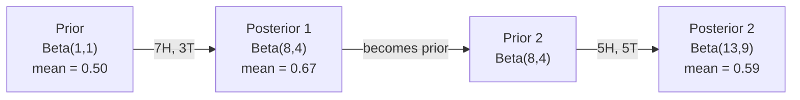

# 贝叶斯定理

> 概率关乎你预期什么。贝叶斯定理关乎你学到什么。

**Type:** Build
**Language:** Python
**Prerequisites:** Phase 1, Lesson 06 (Probability Fundamentals)
**Time:** ~75 minutes

## 学习目标

- 应用贝叶斯定理，由先验、似然和证据计算后验概率
- 从零构建 Naive Bayes 文本分类器，使用 Laplace 平滑和对数空间计算
- 比较 MLE 与 MAP 估计，并解释 MAP 如何对应 L2 正则化
- 使用 Beta-Binomial 共轭先验实现序列贝叶斯更新，用于 A/B 测试

## 问题

某种医学检测准确率 99%。你检测呈阳性。你实际患病的概率是多少？

大多数人会说 99%。真实答案取决于疾病有多罕见。如果每 10,000 人中有 1 人患病，阳性结果仅代表你约有 1% 的概率生病。其余 99% 的阳性结果来自健康人群的误报。

这不是脑筋急转弯。这就是贝叶斯定理。每个垃圾邮件过滤器、每个医学诊断、每个量化不确定性的机器学习模型都使用同样的推理。你从一个信念出发。你看到证据。你更新信念。

如果你在不理解这一点的情况下构建 ML 系统，你会误解模型输出，设置糟糕的阈值，并交付过度自信的预测。

## 概念

### 从联合概率到贝叶斯

你已经在第 06 课学到，条件概率是：

```math
P(A \mid B) = \frac{P(A \text{ and } B)}{P(B)}
```

对称地：

```math
P(B \mid A) = \frac{P(A \text{ and } B)}{P(A)}
```

两个表达式共享同一个分子：$P(A \text{ and } B)$。令它们相等并整理：

```math
\begin{aligned}
P(A \text{ and } B) &= P(A \mid B) \cdot P(B) = P(B \mid A) \cdot P(A) \\[4pt]
&\text{Therefore:} \\[4pt]
P(A \mid B) &= \frac{P(B \mid A) \cdot P(A)}{P(B)}
\end{aligned}
```

这就是贝叶斯定理。四个量，一个方程。

### 四个部分

| 部分 | 名称 | 含义 |
|------|------|------|
| $P(A \mid B)$ | 后验 | 看到证据 $B$ 后，你对 $A$ 的更新信念 |
| $P(B \mid A)$ | 似然 | 若 $A$ 为真，证据 $B$ 出现的可能性 |
| $P(A)$ | 先验 | 看到任何证据前，你对 $A$ 的信念 |
| $P(B)$ | 证据 | 在所有可能情况下看到 $B$ 的总概率 |

证据项 $P(B)$ 起归一化作用。你可以用全概率公式展开它：

```math
P(B) = P(B \mid A) \cdot P(A) + P(B \mid \text{not } A) \cdot P(\text{not } A)
```

### 医学检测示例

某种疾病影响每 10,000 人中的 1 人。检测准确率 99%（能检出 99% 的患者，对健康人有 1% 的假阳性率）。

```math
\begin{aligned}
P(\text{sick}) &= 0.0001 \quad \text{(prior: disease is rare)} \\
P(\text{positive} \mid \text{sick}) &= 0.99 \quad \text{(likelihood: test catches it)} \\
P(\text{positive} \mid \text{healthy}) &= 0.01 \quad \text{(false positive rate)} \\[6pt]
P(\text{positive}) &= P(\text{positive} \mid \text{sick}) \cdot P(\text{sick}) + P(\text{positive} \mid \text{healthy}) \cdot P(\text{healthy}) \\
&= 0.99 \cdot 0.0001 + 0.01 \cdot 0.9999 \\
&= 0.000099 + 0.009999 \\
&= 0.010098 \\[6pt]
P(\text{sick} \mid \text{positive}) &= P(\text{positive} \mid \text{sick}) \cdot P(\text{sick}) / P(\text{positive}) \\
&= 0.99 \cdot 0.0001 / 0.010098 \\
&= 0.0098 \\
&= 0.98\%
\end{aligned}
```

不到 1%。先验占主导。当疾病罕见时，即使准确的检测也会产生大量假阳性。这就是医生要求做确认检测的原因。

### 垃圾邮件过滤器示例

你收到一封包含 "lottery" 一词的邮件。它是垃圾邮件吗？

```math
\begin{aligned}
P(\text{spam}) &= 0.3 \quad \text{(30\% of email is spam)} \\
P(\text{"lottery"} \mid \text{spam}) &= 0.05 \quad \text{(5\% of spam emails contain "lottery")} \\
P(\text{"lottery"} \mid \text{not spam}) &= 0.001 \quad \text{(0.1\% of legitimate emails contain "lottery")} \\[6pt]
P(\text{"lottery"}) &= 0.05 \cdot 0.3 + 0.001 \cdot 0.7 \\
&= 0.015 + 0.0007 \\
&= 0.0157 \\[6pt]
P(\text{spam} \mid \text{"lottery"}) &= 0.05 \cdot 0.3 / 0.0157 \\
&= 0.955 \\
&= 95.5\%
\end{aligned}
```

一个词把概率从 30% 推到 95.5%。真正的垃圾邮件过滤器会同时对数百个词应用贝叶斯。

### Naive Bayes：独立性假设

Naive Bayes 通过假设所有特征在给定类别下条件独立，将这一方法扩展到多个特征：

```math
P(\text{class} \mid \text{feature}_1, \text{feature}_2, \ldots, \text{feature}_n) = \frac{P(\text{class}) \cdot P(\text{feature}_1 \mid \text{class}) \cdot P(\text{feature}_2 \mid \text{class}) \cdots P(\text{feature}_n \mid \text{class})}{P(\text{feature}_1, \text{feature}_2, \ldots, \text{feature}_n)}
```

“朴素”之处在于独立性假设。在文本中，词的出现并非独立（“New” 和 “York” 相关）。但该假设在实践中效果很好，因为分类器只需要对类别排序，无需输出校准概率。

由于分母对所有类别都相同，可以跳过它，只比较分子：

```math
\text{score}(\text{class}) = P(\text{class}) \cdot \prod_i P(\text{feature}_i \mid \text{class})
```

选择得分最高的类别。

### 最大似然估计（MLE）

如何从训练数据得到 $P(\text{feature} \mid \text{class})$？计数。

```math
P(\text{"free"} \mid \text{spam}) = \frac{\text{number of spam emails containing "free"}}{\text{total spam emails}}
```

这就是 MLE：选择使观测数据最可能的参数值。你在最大化似然函数，对于离散计数而言，它简化为相对频率。

问题：如果一个词在训练时从未出现在垃圾邮件中，MLE 会给它概率 0。一个未见过的词就能让整个乘积归零。用 Laplace 平滑修复：

```math
P(\text{word} \mid \text{class}) = \frac{\text{count}(\text{word}, \text{class}) + 1}{\text{total\_words\_in\_class} + \text{vocabulary\_size}}
```

每个计数加 1，确保没有概率为 0。

### 最大后验估计（MAP）

MLE 问：什么参数使 $P(\text{data} \mid \text{parameters})$ 最大？

MAP 问：什么参数使 $P(\text{parameters} \mid \text{data})$ 最大？

根据贝叶斯定理：

```math
P(\text{parameters} \mid \text{data}) \propto P(\text{data} \mid \text{parameters}) \cdot P(\text{parameters})
```

MAP 对参数本身添加先验。如果你相信参数应该较小，就把这一信念编码为先验，惩罚较大值。这与 ML 中的 L2 正则化完全相同。岭回归中的 “ridge” 惩罚本质上就是对权重的高斯先验。

| 估计方法 | 优化目标 | ML 对应 |
|----------|----------|---------|
| MLE | $P(\text{data} \mid \text{params})$ | 无正则化训练 |
| MAP | $P(\text{data} \mid \text{params}) \cdot P(\text{params})$ | L2 / L1 正则化 |

### 贝叶斯 vs 频率学派：实际差异

频率学派将参数视为固定的未知量。他们问：“如果我重复这个实验很多次，会发生什么？”

贝叶斯学派将参数视为分布。他们问：“给定我已观测到的数据，我对参数相信什么？”

对于构建 ML 系统，实际差异：

| 方面 | 频率学派 | 贝叶斯学派 |
|------|----------|------------|
| 输出 | 点估计 | 值的分布 |
| 不确定性 | 置信区间（关于过程） | 可信区间（关于参数） |
| 小数据 | 可能过拟合 | 先验起到正则化作用 |
| 计算 | 通常更快 | 通常需要采样（MCMC） |

大多数生产 ML 是频率学派（SGD、点估计）。贝叶斯方法在需要校准不确定性（医疗决策、安全关键系统）或数据稀缺（少样本学习、冷启动）时表现出色。

### 为什么贝叶斯思维对 ML 重要

联系远不止类比：

**先验就是正则化。** 权重上的高斯先验就是 L2 正则化。Laplace 先验就是 L1。每次添加正则项，你都在做关于预期参数值的贝叶斯陈述。

**后验就是不确定性。** 单一的预测概率无法告诉你模型对该估计有多自信。贝叶斯方法给你一个分布：“我认为 $P(\text{spam})$ 在 0.8 到 0.95 之间。”

**贝叶斯更新就是在线学习。** 今天的后验成为明天的先验。当模型看到新数据时，它增量更新信念，而不是从头重新训练。

**模型比较是贝叶斯式的。** 贝叶斯信息准则（BIC）、边际似然、Bayes factor 都使用贝叶斯推理来选择模型，同时避免过拟合。

```figure
bayes-update
```

## 构建它

### 第 1 步：贝叶斯定理函数

```python
def bayes(prior, likelihood, false_positive_rate):
    evidence = likelihood * prior + false_positive_rate * (1 - prior)
    posterior = likelihood * prior / evidence
    return posterior

result = bayes(prior=0.0001, likelihood=0.99, false_positive_rate=0.01)
print(f"P(sick|positive) = {result:.4f}")
```

### 第 2 步：Naive Bayes 分类器

```python
import math
from collections import defaultdict

class NaiveBayes:
    def __init__(self, smoothing=1.0):
        self.smoothing = smoothing
        self.class_counts = defaultdict(int)
        self.word_counts = defaultdict(lambda: defaultdict(int))
        self.class_word_totals = defaultdict(int)
        self.vocab = set()

    def train(self, documents, labels):
        for doc, label in zip(documents, labels):
            self.class_counts[label] += 1
            words = doc.lower().split()
            for word in words:
                self.word_counts[label][word] += 1
                self.class_word_totals[label] += 1
                self.vocab.add(word)

    def predict(self, document):
        words = document.lower().split()
        total_docs = sum(self.class_counts.values())
        vocab_size = len(self.vocab)
        best_class = None
        best_score = float("-inf")
        for cls in self.class_counts:
            score = math.log(self.class_counts[cls] / total_docs)
            for word in words:
                count = self.word_counts[cls].get(word, 0)
                total = self.class_word_totals[cls]
                score += math.log((count + self.smoothing) / (total + self.smoothing * vocab_size))
            if score > best_score:
                best_score = score
                best_class = cls
        return best_class
```

对数概率防止下溢。许多小概率相乘会产生浮点数无法表示的极小值。求对数概率和在数值上稳定，且在数学上等价。

### 第 3 步：在垃圾邮件数据上训练

```python
train_docs = [
    "win free money now",
    "free lottery ticket winner",
    "claim your prize today free",
    "urgent offer free cash",
    "congratulations you won free",
    "meeting tomorrow at noon",
    "project update attached",
    "can we schedule a call",
    "quarterly report review",
    "lunch on thursday sounds good",
    "team standup notes attached",
    "please review the pull request",
]

train_labels = [
    "spam", "spam", "spam", "spam", "spam",
    "ham", "ham", "ham", "ham", "ham", "ham", "ham",
]

classifier = NaiveBayes()
classifier.train(train_docs, train_labels)

test_messages = [
    "free money waiting for you",
    "meeting rescheduled to friday",
    "you won a free prize",
    "please review the attached report",
]

for msg in test_messages:
    print(f"  '{msg}' -> {classifier.predict(msg)}")
```

### 第 4 步：检查学习到的概率

```python
def show_top_words(classifier, cls, n=5):
    vocab_size = len(classifier.vocab)
    total = classifier.class_word_totals[cls]
    probs = {}
    for word in classifier.vocab:
        count = classifier.word_counts[cls].get(word, 0)
        probs[word] = (count + classifier.smoothing) / (total + classifier.smoothing * vocab_size)
    sorted_words = sorted(probs.items(), key=lambda x: x[1], reverse=True)
    for word, prob in sorted_words[:n]:
        print(f"    {word}: {prob:.4f}")

print("\nTop spam words:")
show_top_words(classifier, "spam")
print("\nTop ham words:")
show_top_words(classifier, "ham")
```

## 使用它

scikit-learn 提供生产就绪的 Naive Bayes 实现：

```python
from sklearn.feature_extraction.text import CountVectorizer
from sklearn.naive_bayes import MultinomialNB
from sklearn.metrics import classification_report

vectorizer = CountVectorizer()
X_train = vectorizer.fit_transform(train_docs)
clf = MultinomialNB()
clf.fit(X_train, train_labels)

X_test = vectorizer.transform(test_messages)
predictions = clf.predict(X_test)
for msg, pred in zip(test_messages, predictions):
    print(f"  '{msg}' -> {pred}")
```

相同算法。CountVectorizer 处理分词和词表构建。MultinomialNB 内部处理平滑和对数概率。你从零实现的版本用 40 行代码做了同样的事。

## 交付它

这里构建的 NaiveBayes 类展示了完整流程：分词、Laplace 平滑下的概率估计、对数空间预测。`code/bayes.py` 中的代码仅依赖 Python 标准库即可端到端运行。

### 共轭先验

当先验与后验属于同一分布族时，该先验称为“共轭”。这让贝叶斯更新在代数上非常简洁——无需数值积分即可得到闭式后验。

| 似然 | 共轭先验 | 后验 | 示例 |
|------|----------|------|------|
| Bernoulli | $\text{Beta}(a, b)$ | $\text{Beta}(a + \text{successes}, b + \text{failures})$ | 硬币偏差估计 |
| Normal（已知方差） | $\text{Normal}(\mu_0, \sigma_0)$ | Normal（加权均值，更小方差） | 传感器校准 |
| Poisson | $\text{Gamma}(a, b)$ | $\text{Gamma}(a + \text{sum of counts}, b + n)$ | 到达率建模 |
| Multinomial | $\text{Dirichlet}(\alpha)$ | $\text{Dirichlet}(\alpha + \text{counts})$ | 主题模型、语言模型 |

为何重要：没有共轭先验，你需要蒙特卡洛采样或变分推断来近似后验。有了共轭先验，只需更新两个数。

Beta 分布是实践中最常见的共轭先验。$\text{Beta}(a, b)$ 表示你对一个概率参数的信念。均值为 $a/(a+b)$。$a+b$ 越大，分布越集中（越自信）。

Beta 先验的特例：
- $\text{Beta}(1, 1)$ = uniform. You have no opinion about the parameter.
- $\text{Beta}(10, 10)$ = peaked at 0.5. You strongly believe the parameter is near 0.5.
- $\text{Beta}(1, 10)$ = skewed toward 0. You believe the parameter is small.

更新规则极其简单：

```math
\begin{aligned}
\text{Prior:} \quad & \text{Beta}(a, b) \\
\text{Data:} \quad & s \text{ successes}, f \text{ failures} \\
\text{Posterior:} \quad & \text{Beta}(a + s, b + f)
\end{aligned}
```

无需积分。无需采样。只需相加。

### 序列贝叶斯更新

贝叶斯推理天然是序列式的。今天的后验成为明天的先验。真实系统就是这样增量学习，而无需重新处理所有历史数据。

具体示例：估计硬币是否公平。

**第 1 天：尚无数据。**
从 $\text{Beta}(1, 1)$ 开始——均匀先验。你没有偏好。
- Prior mean: 0.5
- Prior is flat across [0, 1]

**第 2 天：观察到 7 次正面，3 次反面。**
$\text{Posterior} = \text{Beta}(1 + 7, 1 + 3) = \text{Beta}(8, 4)$
- Posterior mean: $8/12 = 0.667$
- Evidence suggests the coin is biased toward heads

**第 3 天：再观察到 5 次正面，5 次反面。**
用昨天的后验作为今天的先验。
$\text{Posterior} = \text{Beta}(8 + 5, 4 + 5) = \text{Beta}(13, 9)$
- Posterior mean: $13/22 = 0.591$
- The balanced new data pulled the estimate back toward 0.5



观察顺序无关紧要。$\text{Beta}(1,1)$ 一次性用全部 12 次正面和 8 次反面更新，得到 $\text{Beta}(13, 9)$——结果相同。序列更新与批量更新数学等价。但序列更新让你无需存储原始数据，即可在每一步做决策。

这是生产 ML 系统在线学习的基础。bandit 的 Thompson 采样、增量推荐系统、流式异常检测器都使用这一模式。

### 与 A/B 测试的关联

A/B 测试本质上是伪装的贝叶斯推理。

设定：你正在测试两种按钮颜色。变体 A（蓝色）和变体 B（绿色）。你想知道哪个获得更多点击。

贝叶斯 A/B 测试：

1. **先验。** 两个变体都从 $\text{Beta}(1, 1)$ 开始。无先验偏好。
2. **数据。** 变体 A：1000 次展示中 50 次点击。变体 B：1000 次展示中 65 次点击。
3. **后验。**
   - A: $\text{Beta}(1 + 50, 1 + 950) = \text{Beta}(51, 951)$。Mean = 0.051
   - B: $\text{Beta}(1 + 65, 1 + 935) = \text{Beta}(66, 936)$。Mean = 0.066
4. **决策。** 计算 $P(B > A)$——B 的真实转化率高于 A 的概率。

解析计算 $P(B > A)$ 很难。但蒙特卡洛让它变得简单：

```
1. Draw 100,000 samples from Beta(51, 951)  -> samples_A
2. Draw 100,000 samples from Beta(66, 936)  -> samples_B
3. P(B > A) = fraction of samples where B > A
```

若 $P(B > A) > 0.95$，就上线变体 B。若在 0.05 到 0.95 之间，继续收集数据。若 $P(B > A) < 0.05$，就上线变体 A。

相比频率学派 A/B 测试的优势：
- 你得到直接的概率陈述：“B 更好的概率是 97%”
- 没有 p 值困惑。没有“无法拒绝原假设”的含糊其辞。
- 可以随时查看结果，而不会抬高假阳性率（没有“偷看问题”）
- 可以纳入先验知识（例如，以往测试表明转化率通常在 3-8%）

| 方面 | 频率学派 A/B | 贝叶斯 A/B |
|------|--------------|------------|
| 输出 | p-value | $P(B > A)$ |
| 解释 | “若 A=B，这组数据有多意外？” | “B 比 A 好的可能性多大？” |
| 提前停止 | 抬高假阳性 | 任何时刻都安全（给定良好选择的先验和正确设定的模型） |
| 先验知识 | 不使用 | 编码为 Beta 先验 |
| 决策规则 | $p < 0.05$ | $P(B > A) > \text{threshold}$ |

## 练习

1. **多次检测。** 一位患者接受了两次独立检测（准确率均为 99%，疾病患病率 1/10,000）。两次均阳性后，$P(\text{患病})$ 是多少？用第一次检测的后验作为第二次检测的先验。

2. **平滑的影响。** 用 smoothing 值 0.01、0.1、1.0、10.0 运行垃圾邮件分类器。top 词概率如何变化？当 smoothing=0 且某个词只出现在 ham 中时会发生什么？

3. **添加特征。** 扩展 NaiveBayes 类，将消息长度（短/长）作为与词数并行的特征。从训练数据估计 $P(\text{short} \mid \text{spam})$ 和 $P(\text{short} \mid \text{ham})$，并纳入预测得分。

4. **手算 MAP。** 给定观测数据（10 次抛硬币中出现 7 次正面），使用 $\text{Beta}(2,2)$ 先验计算偏差的 MAP 估计。并与 MLE 估计（$7/10$）比较。

### 提示

**练习 1.** 调用一次 `bayes` 得到第一次检测后的后验，再用该后验作为先验调用一次。`sequential_bayes(prior, likelihood, false_positive_rate, 2)` 应给出相同值，接近 0.5。

**练习 2.** 为每个 smoothing 值创建一个 `NaiveBayes(smoothing=s)`，在相同数据上训练，并分别打印 `top_words`。当 smoothing 为 0 时，从未在垃圾邮件中出现的词概率为 0，其对数无定义。

**练习 3.** 统计垃圾邮件和正常邮件中短消息的数量，除以各自类别消息数，然后在 `predict` 的得分中加上该比率的对数。检查每个类别的两个概率之和为 1。

**练习 4.** 使用 $\text{Beta}(\alpha, \beta)$ 先验时，MAP 估计为 $\frac{h + \alpha - 1}{n + \alpha + \beta - 2}$。代入 $h = 7$、$n = 10$；结果应在 MLE（0.7）与先验众数（0.5）之间。

## 关键术语

| 术语 | 人们怎么说 | 实际含义 |
|------|------------|----------|
| Prior | "我的初始猜测" | 观察证据前对假设的信念 $P(\text{hypothesis})$。在 ML 中：正则项。 |
| Likelihood | "数据拟合得多好" | $P(\text{evidence} \mid \text{hypothesis})$。在特定假设下观测数据出现的可能性。 |
| Posterior | "我更新后的信念" | $P(\text{hypothesis} \mid \text{evidence})$。先验乘以似然，再归一化。 |
| Evidence | "归一化常数" | 所有假设下 $P(\text{data})$ 的总和。确保后验之和为 1。 |
| Naive Bayes | "那个简单文本分类器" | 假设特征在给定类别下独立的分类器。尽管假设不成立，效果却很好。 |
| Laplace smoothing | "加一平滑" | 给每个特征加一个小计数，防止未见数据导致零概率。 |
| MLE | "直接用频率" | 选择使 $P(\text{data} \mid \text{parameters})$ 最大的参数。无先验。小数据可能过拟合。 |
| MAP | "带先验的 MLE" | 选择使 $P(\text{data} \mid \text{parameters}) \cdot P(\text{parameters})$ 最大的参数。等价于正则化 MLE。 |
| Log-probability | "在对数空间工作" | 用 $\log(P)$ 代替 $P$，避免多个小数相乘时的浮点下溢。 |
| False positive | "误报" | 检测结果为阳性，但真实状态为阴性。导致基础比率谬误。 |

## 延伸阅读

- [3Blue1Brown: Bayes' theorem](https://www.youtube.com/watch?v=HZGCoVF3YvM) —— 用医学检测示例可视化解释贝叶斯定理
- [Stanford CS229: Generative Learning Algorithms](https://cs229.stanford.edu/main_notes.pdf) —— Naive Bayes 及其与判别模型的联系
- [Think Bayes](https://greenteapress.com/wp/think-bayes/) —— 免费书籍，用 Python 代码讲贝叶斯统计
- [scikit-learn Naive Bayes](https://scikit-learn.org/stable/modules/naive_bayes.html) —— 生产实现及每种变体的适用场景
