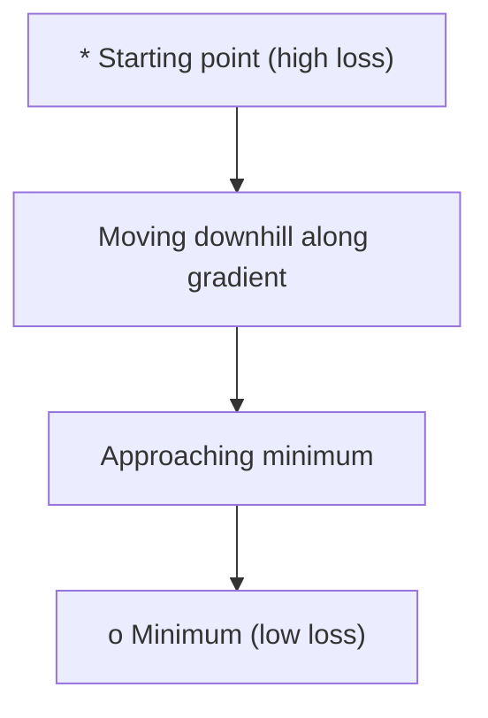
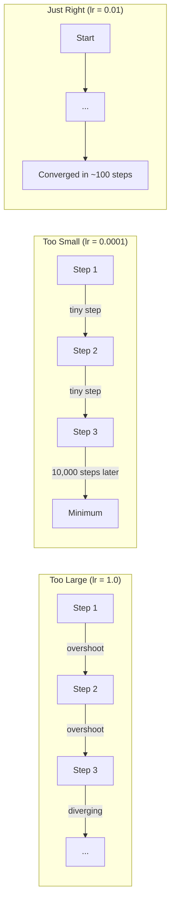
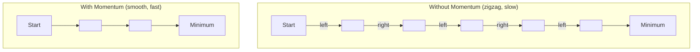
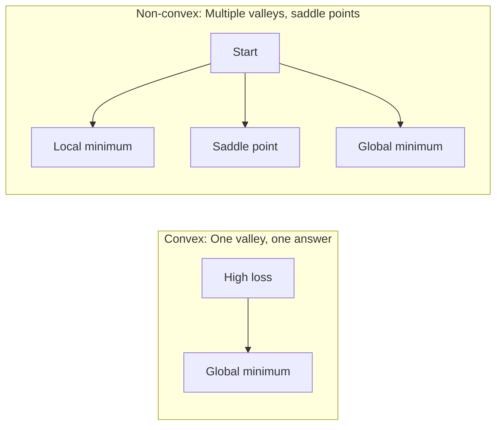
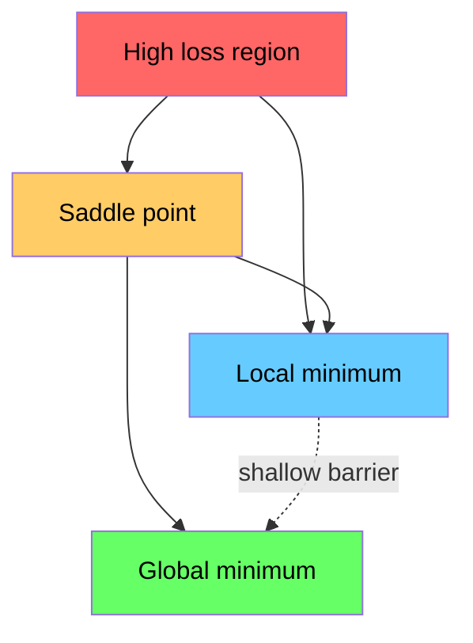

# 优化

> 训练神经网络不过是在寻找山谷底部。

**Type:** Build
**Language:** Python
**Prerequisites:** Phase 1, Lessons 04-05 (Derivatives, Gradients)
**Time:** ~75 minutes

## 学习目标

- 从头实现普通梯度下降、带动量的 SGD 和 Adam
- 在 Rosenbrock 函数上比较各优化器的收敛性，并解释 Adam 为何能为每个权重自适应学习率
- 区分凸与非凸损失景观，并解释高维空间中鞍点的作用
- 配置学习率调度（阶梯衰减、余弦退火、warmup）以稳定训练

## 问题

你有一个损失函数，它告诉你模型错得有多离谱。你有梯度，它们告诉你哪个方向会让损失变大。现在你需要一个沿着山坡往下走的策略。

朴素做法很简单：朝梯度反方向移动，步子大小由一个称为学习率的数决定，重复即可。这就是梯度下降，它确实有效。但“有效”是有前提的。学习率太大，你会直接越过山谷，在两侧来回反弹；学习率太小，你要花上数千步不必要的迭代才能接近答案；撞上鞍点，你会停在那里，尽管还没找到最小值。

深度学习中的每个优化器都在回答同一个问题：如何更快、更可靠地到达山谷底部？

## 概念

### 优化意味着什么

优化就是找到使函数最小（或最大）的输入值。在机器学习中，函数是损失，输入是模型权重。训练就是优化。

```
minimize L(w) where:
  L = loss function
  w = model weights (could be millions of parameters)
```

### 梯度下降（普通版）

最简单的优化器。计算损失关于每个权重的梯度，让每个权重沿梯度反方向移动，步子按学习率缩放。

```math
w = w - \text{lr} \cdot \text{gradient}
```

这就是整个算法，只有一行。



### 学习率：最重要的超参数

学习率控制步长，决定收敛的一切。



合适的学习率没有公式，只能通过实验找到。常见起点：Adam 用 0.001，带动量的 SGD 用 0.01。

### SGD vs 全批量 vs mini-batch

普通梯度下降在整张数据集上计算梯度后才走一步，这称为全批量梯度下降。稳定但慢。

随机梯度下降（SGD）在单个随机样本上计算梯度并立即迈步。有噪声但快。

Mini-batch 梯度下降取折中：在一小批数据（32、64、128、256 个样本）上计算梯度，然后迈步。这是实践中人人都在用的做法。

| 变体 | 批量大小 | 梯度质量 | 每步速度 | 噪声 |
|---------|-----------|-----------------|---------------|-------|
| 全批量 GD | 整个数据集 | 精确 | 慢 | 无 |
| SGD | 1 个样本 | 噪声很大 | 快 | 高 |
| Mini-batch | 32-256 | 良好估计 | 均衡 | 中等 |

SGD 和 mini-batch 中的噪声不是 bug。它帮助优化器逃离浅局部最小值和鞍点。

### 动量：滚下山坡的球

普通梯度下降只看当前梯度。如果梯度在狭窄山谷里来回震荡（很常见），进展就会很慢。动量通过把历史梯度累加到一个速度项里来解决这个问题。

```math
\begin{aligned}
v &= \beta \cdot v + \text{gradient} \\
w &= w - \text{lr} \cdot v
\end{aligned}
```

类比：一个滚下山坡的球不会在每一个小凸起处停下来再启动。它会在一致的方向上加速，并抑制震荡。



`beta` 通常取 0.9，控制保留多少历史。beta 越大，动量越强，路径越平滑，但对方向变化的响应也越慢。

### Adam：自适应学习率

不同权重需要不同的学习率。一个很少获得大梯度的权重，在终于获得大梯度时应该迈大步；一个总是获得巨大梯度的权重，则应该迈小步。

Adam（Adaptive Moment Estimation）为每个权重跟踪两个量：

1. 一阶矩（$m$）：梯度的滑动平均（类似动量）
2. 二阶矩（$v$）：梯度平方的滑动平均（梯度幅度）

```math
\begin{aligned}
m &= \beta_1 \cdot m + (1 - \beta_1) \cdot \text{gradient} \\
v &= \beta_2 \cdot v + (1 - \beta_2) \cdot \text{gradient}^2 \\[4pt]
\hat{m} &= m / (1 - \beta_1^t) \quad \text{bias correction} \\
\hat{v} &= v / (1 - \beta_2^t) \quad \text{bias correction} \\[4pt]
w &= w - \text{lr} \cdot \hat{m} / (\sqrt{\hat{v}} + \epsilon)
\end{aligned}
```

除以 `sqrt(v_hat)` 是关键洞察：大梯度的权重被大数除（有效步长小），小梯度的权重被小数除（有效步长大）。每个权重都获得自适应学习率。

默认超参数：`lr=0.001, beta1=0.9, beta2=0.999, epsilon=1e-8`。这些默认值在大多数问题上表现良好。

### 学习率调度

固定学习率是一种折中。训练初期需要大步快速推进，训练后期需要小步在最小值附近精细调整。

常见调度：

| 调度 | 公式 | 使用场景 |
|----------|---------|----------|
| 阶梯衰减 | 每 $N$ 个 epoch：$\text{lr} = \text{lr} \cdot \text{factor}$ | 简单、手动控制 |
| 指数衰减 | $\text{lr} = \text{lr}_0 \cdot \text{decay}^t$ | 平滑下降 |
| 余弦退火 | $\text{lr} = \text{lr} _{\min} + 0.5 \cdot (\text{lr} _{\max} - \text{lr} _{\min}) \cdot (1 + \cos(\pi t / T))$ | Transformers、现代训练 |
| Warmup + 衰减 | 先线性预热，再衰减 | 大模型，防止早期不稳定 |

### 凸与非凸

凸函数只有一个最小值，梯度下降总能找到它。$f(x) = x^2$ 就是凸函数。

神经网络损失函数是非凸的，有很多局部最小值、鞍点和平坦区域。



在实践中，高维神经网络中的局部最小值很少是问题。大多数局部最小值的损失都接近全局最小值。真正的障碍是鞍点（某些方向平坦、某些方向弯曲）。动量和 mini-batch 带来的噪声有助于逃离它们。

### 损失景观可视化

损失是所有权重的函数。对于 100 万个权重的模型，损失景观生活在 1,000,001 维空间中。我们通过在权重空间中随机选两个方向，并沿这两个方向绘制损失，得到二维曲面来可视化它。



尖锐的最小值泛化差，平坦的最小值泛化好。这也是为什么带动量的 SGD 常常在最终测试准确率上超过 Adam：它的噪声防止模型陷入尖锐最小值。

```figure
gradient-descent
```

## 构建它

### 第 1 步：定义测试函数

Rosenbrock 函数是经典的优化基准。它的最小值在 (1, 1)，位于一条狭窄弯曲的山谷中，山谷很容易找到但很难沿其前进。

```math
f(x, y) = (1 - x)^2 + 100 \cdot (y - x^2)^2
```

```python
def rosenbrock(params):
    x, y = params
    return (1 - x) ** 2 + 100 * (y - x ** 2) ** 2

def rosenbrock_gradient(params):
    x, y = params
    df_dx = -2 * (1 - x) + 200 * (y - x ** 2) * (-2 * x)
    df_dy = 200 * (y - x ** 2)
    return [df_dx, df_dy]
```

### 第 2 步：普通梯度下降

```python
class GradientDescent:
    def __init__(self, lr=0.001):
        self.lr = lr

    def step(self, params, grads):
        return [p - self.lr * g for p, g in zip(params, grads)]
```

### 第 3 步：带动量的 SGD

```python
class SGDMomentum:
    def __init__(self, lr=0.001, momentum=0.9):
        self.lr = lr
        self.momentum = momentum
        self.velocity = None

    def step(self, params, grads):
        if self.velocity is None:
            self.velocity = [0.0] * len(params)
        self.velocity = [
            self.momentum * v + g
            for v, g in zip(self.velocity, grads)
        ]
        return [p - self.lr * v for p, v in zip(params, self.velocity)]
```

### 第 4 步：Adam

```python
class Adam:
    def __init__(self, lr=0.001, beta1=0.9, beta2=0.999, epsilon=1e-8):
        self.lr = lr
        self.beta1 = beta1
        self.beta2 = beta2
        self.epsilon = epsilon
        self.m = None
        self.v = None
        self.t = 0

    def step(self, params, grads):
        if self.m is None:
            self.m = [0.0] * len(params)
            self.v = [0.0] * len(params)

        self.t += 1

        self.m = [
            self.beta1 * m + (1 - self.beta1) * g
            for m, g in zip(self.m, grads)
        ]
        self.v = [
            self.beta2 * v + (1 - self.beta2) * g ** 2
            for v, g in zip(self.v, grads)
        ]

        m_hat = [m / (1 - self.beta1 ** self.t) for m in self.m]
        v_hat = [v / (1 - self.beta2 ** self.t) for v in self.v]

        return [
            p - self.lr * mh / (vh ** 0.5 + self.epsilon)
            for p, mh, vh in zip(params, m_hat, v_hat)
        ]
```

### 第 5 步：运行并比较

```python
def optimize(optimizer, func, grad_func, start, steps=5000):
    params = list(start)
    history = [params[:]]
    for _ in range(steps):
        grads = grad_func(params)
        params = optimizer.step(params, grads)
        history.append(params[:])
    return history

start = [-1.0, 1.0]

gd_history = optimize(GradientDescent(lr=0.0005), rosenbrock, rosenbrock_gradient, start)
sgd_history = optimize(SGDMomentum(lr=0.0001, momentum=0.9), rosenbrock, rosenbrock_gradient, start)
adam_history = optimize(Adam(lr=0.01), rosenbrock, rosenbrock_gradient, start)

for name, history in [("GD", gd_history), ("SGD+M", sgd_history), ("Adam", adam_history)]:
    final = history[-1]
    loss = rosenbrock(final)
    print(f"{name:6s} -> x={final[0]:.6f}, y={final[1]:.6f}, loss={loss:.8f}")
```

预期输出：Adam 收敛最快，带动量的 SGD 路径更平滑，普通 GD 在狭窄山谷中进展缓慢。

## 使用它

实践中，使用 PyTorch 或 JAX 的优化器。它们处理参数组、权重衰减、梯度裁剪和 GPU 加速。

```python
import torch

model = torch.nn.Linear(784, 10)

sgd = torch.optim.SGD(model.parameters(), lr=0.01, momentum=0.9)
adam = torch.optim.Adam(model.parameters(), lr=0.001)
adamw = torch.optim.AdamW(model.parameters(), lr=0.001, weight_decay=0.01)

scheduler = torch.optim.lr_scheduler.CosineAnnealingLR(adam, T_max=100)
```

经验法则：

- 先用 Adam（lr=0.001）。不调参就能在大多数问题上工作。
- 当你需要最佳最终准确率且愿意花更多时间调参时，换用带动量的 SGD（lr=0.01, momentum=0.9）。
- Transformer 用 AdamW（解耦权重衰减的 Adam）。
- 训练超过几个 epoch 时，务必使用学习率调度。
- 训练不稳定就降低学习率，训练太慢就提高学习率。

## 交付它

本节课产出了一个用于选择合适优化器的 prompt。见 `outputs/prompt-optimizer-guide.md`。

这里构建的优化器类将在 Phase 3 从头训练神经网络时再次出现。

## 练习

1. **学习率扫描。** 用学习率 [0.0001, 0.0005, 0.001, 0.005, 0.01] 在 Rosenbrock 函数上运行普通梯度下降 5000 步，打印或绘制最终损失。找出仍能收敛的最大学习率。

2. **动量比较。** 用动量值 [0.0, 0.5, 0.9, 0.99] 在 Rosenbrock 函数上运行带动量的 SGD，记录每步损失。哪个动量收敛最快？哪个会过冲？

3. **逃离鞍点。** 定义函数 $f(x, y) = x^2 - y^2$（原点为鞍点）。从 (0.01, 0.01) 出发，比较普通 GD、带动量的 SGD 和 Adam 的行为。哪个逃离了鞍点？

4. **实现学习率衰减。** 给 `GradientDescent` 类加上指数衰减调度：`lr = lr_0 * 0.999^step`。在 Rosenbrock 函数上比较有无衰减的收敛性。

### 提示

**练习 1.** 遍历学习率，为每个创建一个 `GradientDescent(lr=...)`，并传入 `optimize` 与 `rosenbrock`、`rosenbrock_gradient`。发散的运行会显示损失增长或变成 `nan`；最小值在 $(1, 1)$，损失为 0。

**练习 2.** 为每个动量值创建 `SGDMomentum(momentum=m)` 并记录每步损失。用 `find_convergence_step` 比较速度，寻找上下波动的损失以发现过冲。

**练习 3.** 写出梯度 $(2x, -2y)$，从 (0.01, 0.01) 运行三个优化器。每 100 步打印 $y$：$\lvert y \rvert$ 变大的那个优化器就是逃离鞍点的那个。

**练习 4.** 在 `GradientDescent` 中存储 `lr_0` 和步数计数器，在 `step` 内计算 `lr = lr_0 * 0.999 ** step`。打印第 0 步和第 1000 步的学习率；它应从 `lr_0` 降到约 $0.37 \times \text{lr}_0$。

## 关键术语

| 术语 | 俗称 | 实际含义 |
|------|----------------|----------------------|
| 梯度下降 | “往下走” | 按学习率缩放后减去梯度来更新权重。最基础的优化器。 |
| 学习率 | “步长” | 控制每次更新移动权重大小的标量。太大导致发散，太小浪费计算。 |
| 动量 | “继续滚” | 将历史梯度累加到速度向量。抑制震荡并加速一致方向上的移动。 |
| SGD | “随机采样” | 随机梯度下降。在随机子集而非全数据集上计算梯度。实践中几乎总是指 mini-batch SGD。 |
| Mini-batch | “一小批数据” | 用于估计梯度的一小批训练样本（32-256 个）。在速度与梯度准确性间取得平衡。 |
| Adam | “默认优化器” | Adaptive Moment Estimation。跟踪每个权重的梯度与梯度平方的滑动平均，为每个权重提供自适应学习率。 |
| 偏差修正 | “修正冷启动” | Adam 的一阶矩和二阶矩初始化为零。偏差修正通过除以 $(1 - \beta^t)$ 来补偿早期步骤。 |
| 学习率调度 | “随时间改变 lr” | 在训练过程中调整学习率的函数。早期迈大步，后期迈小步。 |
| 凸函数 | “一个山谷” | 任意局部最小值都是全局最小值的函数。梯度下降总能找到它。神经网络损失不是凸函数。 |
| 鞍点 | “平坦但不是最小值” | 梯度为零，但在某些方向是最小值、某些方向是最大值的点。在高维空间中很常见。 |
| 损失景观 | “地形” | 损失函数在权重空间上的图像。通过沿两个随机方向切片来可视化。 |
| 收敛 | “到了” | 优化器到达进一步迈步已不再显著降低损失的点。 |

## 延伸阅读

- [Sebastian Ruder: An overview of gradient descent optimization algorithms](https://ruder.io/optimizing-gradient-descent/) —— 各大优化器的全面综述
- [Why Momentum Really Works (Distill)](https://distill.pub/2017/momentum/) —— 动量动态的可交互可视化
- [Adam: A Method for Stochastic Optimization (Kingma & Ba, 2014)](https://arxiv.org/abs/1412.6980) —— 原始 Adam 论文，简短易读
- [Visualizing the Loss Landscape of Neural Nets (Li et al., 2018)](https://arxiv.org/abs/1712.09913) —— 揭示尖锐与平坦最小值的论文
