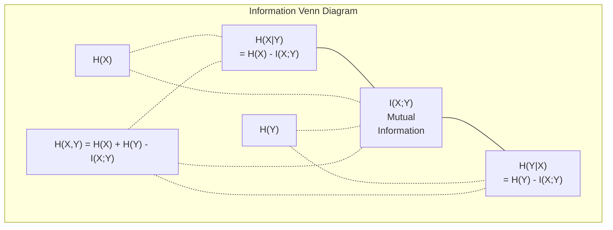

# 信息论

> 信息论度量的是惊讶程度。损失函数正是建立在其之上。

**Type:** Learn
**Language:** Python
**Prerequisites:** Phase 1, Lesson 06 (Probability)
**Time:** ~60 minutes

## 学习目标

- 从零实现熵、交叉熵和 KL 散度，并解释它们之间的关系
- 推导为什么最小化交叉熵损失等价于最大化对数似然
- 计算特征与目标之间的互信息，以对特征重要性排序
- 解释困惑度（perplexity）作为语言模型实际面对的有效词表大小

## 问题

你训练的每个分类模型都会调用 `CrossEntropyLoss()`。你读的每篇语言模型论文都会提到"困惑度"。你在 VAE、蒸馏和 RLHF 中都会看到 KL 散度。这些概念并非孤立存在，它们是同一思想戴着不同的帽子。

信息论为你提供了推理不确定性、压缩和预测的语言。Claude Shannon 在 1948 年发明它来解决通信问题。事实证明，训练神经网络也是一个通信问题：模型试图通过由学习权重构成的噪声信道传输正确标签。

本节课从零构建每一个公式，让你看清它们的来源以及为何有效。

## 概念

### 信息含量（惊讶度）

当不太可能的事情发生时，它携带的信息更多。硬币正面朝上？并不意外。中彩票？非常意外。

一个概率为 $p$ 的事件的信息含量为：

```math
I(x) = -\log(p(x))
```

使用以 2 为底的对数，单位是 bits；使用自然对数，单位是 nats。思想相同，只是单位不同。

```
Event              Probability    Surprise (bits)
Fair coin heads    0.5            1.0
Rolling a 6        0.167          2.58
1-in-1000 event    0.001          9.97
Certain event      1.0            0.0
```

确定事件携带的信息为零，因为你早已知道它会发生。

### 熵（平均惊讶度）

熵是某个分布所有可能结果的期望惊讶度。

```math
H(P) = -\sum_{x} p(x) \log(p(x))
```

公平硬币在二值变量中具有最大熵：1 bit。有偏硬币（99% 正面）的熵很低：0.08 bits。你已经知道会发生什么，所以每次翻转几乎没提供任何信息。

```math
\begin{aligned}
\text{Fair coin:} \quad & H = -(0.5 \log_2(0.5) + 0.5 \log_2(0.5)) = 1.0 \text{ bit} \\
\text{Biased coin:} \quad & H = -(0.99 \log_2(0.99) + 0.01 \log_2(0.01)) = 0.08 \text{ bits}
\end{aligned}
```

熵度量一个分布中不可约的不确定性。你无法压缩到比它更低。

### 交叉熵（你每天使用的损失函数）

交叉熵度量的是：当你用分布 $Q$ 去编码实际来自分布 $P$ 的事件时，平均会有多惊讶。

```math
H(P, Q) = -\sum_{x} p(x) \log(q(x))
```

$P$ 是真实分布（标签），$Q$ 是模型的预测。如果 $Q$ 与 $P$ 完全匹配，交叉熵就等于熵。任何不匹配都会使它变大。

在分类任务中，$P$ 是一个 one-hot 向量（真实类别的概率为 1，其余为 0）。这使得交叉熵简化为：

```math
H(P, Q) = -\log(q(\text{true\_class}))
```

这就是分类任务交叉熵损失的全部公式：最大化正确类别的预测概率。

### KL 散度（分布之间的距离）

KL 散度度量的是使用 $Q$ 而非 $P$ 所带来的额外惊讶度。

```math
\begin{aligned}
D_{KL}(P \,\|\, Q) &= \sum_{x} p(x) \log(p(x) / q(x)) \\
&= H(P, Q) - H(P)
\end{aligned}
```

交叉熵等于熵加上 KL 散度。由于真实分布的熵在训练中是常数，最小化交叉熵就等价于最小化 KL 散度。你正在将模型的分布推向真实分布。

KL 散度不是对称的：$D_{KL}(P \Vert Q) \ne D_{KL}(Q \Vert P)$。它不是真正的距离度量。

### 互信息

互信息度量的是知道一个变量后，对另一个变量的了解增加了多少。

```math
\begin{aligned}
I(X; Y) &= H(X) - H(X \mid Y) \\
&= H(X) + H(Y) - H(X, Y)
\end{aligned}
```

如果 $X$ 和 $Y$ 相互独立，互信息为零；知道其中一个对另一个毫无帮助。如果它们完全相关，互信息等于任一变量的熵。

在特征选择中，特征与目标之间的互信息越高，说明该特征越有用；互信息越低，则越可能是噪声。

### 条件熵

$H(Y \mid X)$ 度量的是在观察到 $X$ 之后，$Y$ 仍有多少不确定性。

```math
H(Y \mid X) = H(X,Y) - H(X)
```

两个极端：
- 如果 $X$ 完全决定 $Y$，则 $H(Y \mid X) = 0$。知道 $X$ 消除了关于 $Y$ 的所有不确定性。例如：$X$ 为摄氏温度，$Y$ 为华氏温度。
- 如果 $X$ 对 $Y$ 毫无提示，则 $H(Y \mid X) = H(Y)$。知道 $X$ 丝毫不能降低不确定性。例如：$X$ 为抛硬币结果，$Y$ 为明天天气。

条件熵始终非负，且从不超过 $H(Y)$：

```math
0 \le H(Y \mid X) \le H(Y)
```

在机器学习中，条件熵出现在决策树中。每次分裂时，算法选择能最小化 $H(Y \mid X)$ 的特征，也就是能最多消除标签 $Y$ 不确定性的特征。

### 联合熵

$H(X,Y)$ 是 $X$ 和 $Y$ 联合分布的熵。

```math
H(X,Y) = -\sum_{x} \sum_{y} p(x,y) \log(p(x,y))
```

关键性质：

```math
H(X,Y) \le H(X) + H(Y)
```

当 $X$ 和 $Y$ 独立时取等号。如果它们共享信息，联合熵就小于各自熵之和。"缺失"的熵正是互信息。



关系式：
- $H(X,Y) = H(X) + H(Y \mid X) = H(Y) + H(X \mid Y)$
- $I(X;Y) = H(X) - H(X \mid Y) = H(Y) - H(Y \mid X)$
- $H(X,Y) = H(X) + H(Y) - I(X;Y)$

### 互信息（深入）

互信息 $I(X;Y)$ 量化了知道一个变量能在多大程度上减少关于另一个变量的不确定性。

```math
\begin{aligned}
I(X;Y) &= H(X) - H(X \mid Y) \\
&= H(Y) - H(Y \mid X) \\
&= H(X) + H(Y) - H(X,Y) \\
&= \sum_{x} \sum_{y} p(x,y) \log\left(\frac{p(x,y)}{p(x) \, p(y)}\right)
\end{aligned}
```

性质：
- $I(X;Y) \ge 0$ 恒成立。观察任何事物都不会让你损失信息。
- $I(X;Y) = 0$ 当且仅当 $X$ 和 $Y$ 相互独立。
- $I(X;Y) = I(Y;X)$。与 KL 散度不同，它是对称的。
- $I(X;X) = H(X)$。一个变量与自身共享全部信息。

**互信息用于特征选择。** 在机器学习中，你希望特征对目标具有信息量。互信息提供了一种原则性的特征排序方法：

1. 对每个特征 $X_i$，计算 $I(X_i; Y)$，其中 $Y$ 是目标变量。
2. 按互信息得分对特征排序。
3. 保留前 $k$ 个特征。

这种方法适用于特征与目标之间的任何关系：线性、非线性、单调或非单调。相关性只能捕捉线性关系，而互信息可以捕捉一切。

| Method | Detects | Computational cost | Handles categorical? |
|--------|---------|-------------------|---------------------|
| Pearson correlation | Linear relationships | $O(n)$ | No |
| Spearman correlation | Monotonic relationships | $O(n \log n)$ | No |
| Mutual information | Any statistical dependency | $O(n \log n)$ with binning | Yes |

### 标签平滑与交叉熵

标准分类使用硬目标：[0, 0, 1, 0]。真实类别概率为 1，其余为 0。标签平滑则用软目标替代：

```math
\text{soft\_target} = (1 - \epsilon) \cdot \text{hard\_target} + \epsilon / \text{num\_classes}
```

当 $\epsilon = 0.1$ 且有 4 个类别时：
- 硬目标：[0, 0, 1, 0]
- 软目标：[0.025, 0.025, 0.925, 0.025]

从信息论角度看，标签平滑增加了目标分布的熵。硬 one-hot 目标的熵为 0，因为不存在不确定性；软目标的熵为正。

为何有效：
- 防止模型将 logit 推至极值（要在交叉熵下完美匹配 one-hot 目标需要无穷大 logit）
- 起到正则化作用：模型无法 100% 自信
- 改善校准度：预测概率更能反映真实不确定性
- 缩小训练与推理行为之间的差距

带标签平滑的交叉熵损失变为：

```math
L = (1 - \epsilon) \cdot \text{CE}(\text{hard\_target}, \text{prediction}) + \epsilon \cdot H_{\text{uniform}}(\text{prediction})
```

第二项惩罚远离均匀分布的预测，是对置信度的直接正则化。

### 为什么交叉熵是 THE 分类损失

三种视角，殊途同归。

**信息论视角。** 交叉熵度量的是：用模型分布替代真实分布时浪费了多少 bits。最小化它意味着让模型成为现实最高效的编码器。

**最大似然视角。** 对于 $N$ 个训练样本及其真实类别 $y_i$：

```math
\begin{aligned}
\text{Likelihood} &= \prod_i q(y_i) \\
\text{Log-likelihood} &= \sum_i \log(q(y_i)) \\
\text{Negative log-likelihood} &= -\sum_i \log(q(y_i))
\end{aligned}
```

最后一行就是交叉熵损失。最小化交叉熵 = 最大化模型下训练数据的似然。

**梯度视角。** 交叉熵关于 logit 的梯度就是（预测值 - 真实值）。简洁、稳定、计算快速。这就是它与 softmax 完美搭配的原因。

### Bits 与 Nats

唯一区别是对数的底。

```
log base 2   -> bits      (information theory tradition)
log base e   -> nats      (machine learning convention)
log base 10  -> hartleys  (rarely used)
```

1 nat = $1/\ln(2)$ bits = 1.4427 bits。PyTorch 和 TensorFlow 默认使用自然对数（nats）。

### 困惑度

困惑度是交叉熵的指数。它告诉你模型在不确定时面对的有效等概率选择数量。

```math
\begin{aligned}
\text{Perplexity} &= 2^{H(P,Q)} \quad \text{(if using bits)} \\
\text{Perplexity} &= e^{H(P,Q)} \quad \text{(if using nats)}
\end{aligned}
```

一个困惑度为 50 的语言模型，平均而言就像要从 50 个可能的下一个 token 中均匀挑选一样困惑。越低越好。

GPT-2 在常见基准上达到了约 30 的困惑度。现代模型在表示充分的领域可达到个位数。

```figure
entropy-kl
```

## 构建它

### 第一步：信息含量与熵

```python
import math

def information_content(p, base=2):
    if p <= 0 or p > 1:
        return float('inf') if p <= 0 else 0.0
    return -math.log(p) / math.log(base)

def entropy(probs, base=2):
    return sum(
        p * information_content(p, base)
        for p in probs if p > 0
    )

fair_coin = [0.5, 0.5]
biased_coin = [0.99, 0.01]
fair_die = [1/6] * 6

print(f"Fair coin entropy:   {entropy(fair_coin):.4f} bits")
print(f"Biased coin entropy: {entropy(biased_coin):.4f} bits")
print(f"Fair die entropy:    {entropy(fair_die):.4f} bits")
```

### 第二步：交叉熵与 KL 散度

```python
def cross_entropy(p, q, base=2):
    total = 0.0
    for pi, qi in zip(p, q):
        if pi > 0:
            if qi <= 0:
                return float('inf')
            total += pi * (-math.log(qi) / math.log(base))
    return total

def kl_divergence(p, q, base=2):
    return cross_entropy(p, q, base) - entropy(p, base)

true_dist = [0.7, 0.2, 0.1]
good_model = [0.6, 0.25, 0.15]
bad_model = [0.1, 0.1, 0.8]

print(f"Entropy of true dist:     {entropy(true_dist):.4f} bits")
print(f"CE (good model):          {cross_entropy(true_dist, good_model):.4f} bits")
print(f"CE (bad model):           {cross_entropy(true_dist, bad_model):.4f} bits")
print(f"KL divergence (good):     {kl_divergence(true_dist, good_model):.4f} bits")
print(f"KL divergence (bad):      {kl_divergence(true_dist, bad_model):.4f} bits")
```

### 第三步：作为分类损失的交叉熵

```python
def softmax(logits):
    max_logit = max(logits)
    exps = [math.exp(z - max_logit) for z in logits]
    total = sum(exps)
    return [e / total for e in exps]

def cross_entropy_loss(true_class, logits):
    probs = softmax(logits)
    return -math.log(probs[true_class])

logits = [2.0, 1.0, 0.1]
true_class = 0

probs = softmax(logits)
loss = cross_entropy_loss(true_class, logits)

print(f"Logits:      {logits}")
print(f"Softmax:     {[f'{p:.4f}' for p in probs]}")
print(f"True class:  {true_class}")
print(f"Loss:        {loss:.4f} nats")
print(f"Perplexity:  {math.exp(loss):.2f}")
```

### 第四步：交叉熵等于负对数似然

```python
import random

random.seed(42)

n_samples = 1000
n_classes = 3
true_labels = [random.randint(0, n_classes - 1) for _ in range(n_samples)]
model_logits = [[random.gauss(0, 1) for _ in range(n_classes)] for _ in range(n_samples)]

ce_loss = sum(
    cross_entropy_loss(label, logits)
    for label, logits in zip(true_labels, model_logits)
) / n_samples

nll = -sum(
    math.log(softmax(logits)[label])
    for label, logits in zip(true_labels, model_logits)
) / n_samples

print(f"Cross-entropy loss:      {ce_loss:.6f}")
print(f"Negative log-likelihood: {nll:.6f}")
print(f"Difference:              {abs(ce_loss - nll):.2e}")
```

### 第五步：互信息

```python
def mutual_information(joint_probs, base=2):
    rows = len(joint_probs)
    cols = len(joint_probs[0])

    margin_x = [sum(joint_probs[i][j] for j in range(cols)) for i in range(rows)]
    margin_y = [sum(joint_probs[i][j] for i in range(rows)) for j in range(cols)]

    mi = 0.0
    for i in range(rows):
        for j in range(cols):
            pxy = joint_probs[i][j]
            if pxy > 0:
                mi += pxy * math.log(pxy / (margin_x[i] * margin_y[j])) / math.log(base)
    return mi

independent = [[0.25, 0.25], [0.25, 0.25]]
dependent = [[0.45, 0.05], [0.05, 0.45]]

print(f"MI (independent): {mutual_information(independent):.4f} bits")
print(f"MI (dependent):   {mutual_information(dependent):.4f} bits")
```

## 使用它

下面是使用 NumPy 的同样概念，也就是你在实践中会用到的方式：

```python
import numpy as np

def np_entropy(p):
    p = np.asarray(p, dtype=float)
    mask = p > 0
    result = np.zeros_like(p)
    result[mask] = p[mask] * np.log(p[mask])
    return -result.sum()

def np_cross_entropy(p, q):
    p, q = np.asarray(p, dtype=float), np.asarray(q, dtype=float)
    mask = p > 0
    return -(p[mask] * np.log(q[mask])).sum()

def np_kl_divergence(p, q):
    return np_cross_entropy(p, q) - np_entropy(p)

true = np.array([0.7, 0.2, 0.1])
pred = np.array([0.6, 0.25, 0.15])
print(f"Entropy:    {np_entropy(true):.4f} nats")
print(f"Cross-ent:  {np_cross_entropy(true, pred):.4f} nats")
print(f"KL div:     {np_kl_divergence(true, pred):.4f} nats")
```

你从零构建了 `torch.nn.CrossEntropyLoss()` 内部所做的那些事。现在你知道为什么训练时损失会下降：模型预测分布正在以 nats 衡量的浪费信息角度不断逼近真实分布。

## 练习

1. 假设英文字母均匀分布（26 个字母），计算其熵；然后用真实字母频率估算熵。哪个更高？为什么？

2. 一个模型对真实类别为 1 的样本输出 logit [5.0, 2.0, 0.5]。先手算交叉熵损失，再用 `cross_entropy_loss` 函数验证。什么 logit 能让损失为零？

3. 证明 KL 散度不对称。任选两个分布 $P$ 和 $Q$，计算 $D_{KL}(P \Vert Q)$ 和 $D_{KL}(Q \Vert P)$，并解释为何不同。

4. 编写一个函数，计算序列 token 预测的困惑度。给定若干 (true_token_index, predicted_logits) 对，返回序列的困惑度。

### 提示

**练习 1.** 用 26 个等概率调用 `entropy`；结果应为 $\log_2 26 \approx 4.70$ bits。真实字母频率并不均匀，因此用它们算出的熵会更低。

**练习 2.** 先计算 logit 的 softmax，再取索引 1 概率的 $-\ln$，并与 `cross_entropy_loss(1, logits)` 比较；两者都应接近 3.06。只有当类别 1 的 logit 远大于另外两个时，损失才趋近于 0。

**练习 3.** 用两个形状不同的小分布，例如 $P = [0.9, 0.1]$ 和 $Q = [0.5, 0.5]$，分别两个方向调用 `kl_divergence`。两个值必然不同，因为每个方向都用不同分布加权了对数比率。

**练习 4.** 对每一对计算 `cross_entropy_loss(true_token_index, predicted_logits)`，取平均后传给 `perplexity`。用 $V$ 个 token 上的均匀 logit 验证：困惑度必须等于 $V$。

## 关键术语

| Term | What people say | What it actually means |
|------|----------------|----------------------|
| Information content | "Surprise" | The number of bits (or nats) needed to encode an event: $-\log(p)$ |
| Entropy | "Randomness" | The average surprise across all outcomes of a distribution. Measures irreducible uncertainty. |
| Cross-entropy | "The loss function" | Average surprise when using model distribution $Q$ to encode events from true distribution $P$. |
| KL divergence | "Distance between distributions" | Extra bits wasted by using $Q$ instead of $P$. Equals cross-entropy minus entropy. Not symmetric. |
| Mutual information | "How related are X and Y" | Reduction in uncertainty about $X$ from knowing $Y$. Zero means independent. |
| Softmax | "Turn logits into probabilities" | Exponentiate and normalize. Maps any real-valued vector to a valid probability distribution. |
| Perplexity | "How confused the model is" | Exponential of cross-entropy. The effective vocabulary size the model is choosing from at each step. |
| Bits | "Shannon's unit" | Information measured with log base 2. One bit resolves one fair coin flip. |
| Nats | "ML's unit" | Information measured with natural log. Used by PyTorch and TensorFlow by default. |
| Negative log-likelihood | "NLL loss" | Identical to cross-entropy loss for one-hot labels. Minimizing it maximizes the probability of correct predictions. |

## 延伸阅读

- [Shannon 1948: A Mathematical Theory of Communication](https://people.math.harvard.edu/~ctm/home/text/others/shannon/entropy/entropy.pdf) - 原始论文，至今仍然易读
- [Visual Information Theory (Chris Olah)](https://colah.github.io/posts/2015-09-Visual-Information/) - 熵与 KL 散度的最佳可视化解释
- [PyTorch CrossEntropyLoss docs](https://pytorch.org/docs/stable/generated/torch.nn.CrossEntropyLoss.html) - 框架如何实现你刚构建的内容
