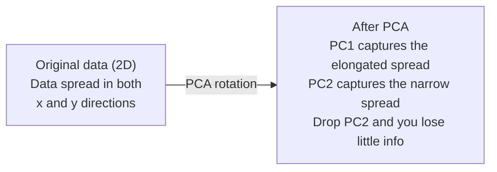

# 降维

> 高维数据自有结构。你需要找到合适的观察角度。

**Type:** Build
**Language:** Python
**Prerequisites:** Phase 1, Lessons 01 (Linear Algebra Intuition), 02 (Vectors, Matrices & Operations), 03 (Eigenvalues & Eigenvectors), 06 (Probability & Distributions)
**Time:** ~90 minutes

## 学习目标

- 从零实现 PCA：数据中心化、计算协方差矩阵、特征分解、投影
- 使用解释方差比（explained variance ratio）和肘部法选择主成分数量
- 比较 PCA、t-SNE 和 UMAP 在 2D 中可视化 MNIST 数字的效果，并解释各自的权衡
- 应用带 RBF 核的核 PCA，分离标准 PCA 无法处理的非线性数据结构

## 问题

你有一个数据集，每个样本有 784 个特征。也许是手写数字的像素值，也许是基因表达水平，也许是用户行为信号。你无法可视化 784 维，无法绘图，甚至无法直观思考。

但这 784 个特征中的大部分是冗余的。真正有用的信息生活在一片小得多的表面上。手写的一个 "7" 不需要 784 个独立数字来描述，它只需要几个：笔画角度、横杠长度、倾斜程度。其余都是噪声。

降维就是找到这片更小的表面。它把 784 维数据压缩到 2 维、10 维或 50 维，同时保留真正重要的结构。

## 概念

### 维度诅咒

高维空间是反直觉的。随着维度增长，以下三件事会出问题。

**距离变得没有意义。** 在高维空间中，任意两个随机点之间的距离会收敛到相近的值。如果每个点到其他点的距离都差不多，最近邻搜索就会失效。

```
Dimension    Avg distance ratio (max/min between random points)
2            ~5.0
10           ~1.8
100          ~1.2
1000         ~1.02
```

**体积集中在角落。** $d$ 维单位超立方体有 $2^d$ 个角。在 100 维中，几乎所有的体积都在远离中心的角落里。数据点扩散到边缘，模型在内部却缺乏数据。

**需要指数级更多的数据。** 为了在空间中保持相同的样本密度，从 2D 到 20D 意味着你需要 $10^{18}$ 倍的数据。你永远没有那么多。降维能把数据密度拉回到可处理的范围。

### PCA：找到重要的方向

主成分分析（PCA）找出数据变化最大的那些轴。它旋转坐标系，使第一根轴捕获最大方差，第二根轴捕获次大方差，依此类推。

算法：

```
1. Center the data        (subtract the mean from each feature)
2. Compute covariance     (how features move together)
3. Eigendecomposition     (find the principal directions)
4. Sort by eigenvalue     (biggest variance first)
5. Project               (keep top k eigenvectors, drop the rest)
```

为什么用特征分解？协方差矩阵是对称半正定的，其特征向量是特征空间中正交的方向，特征值告诉你每个方向捕获多少方差。最大特征值对应的特征向量指向方差最大的方向。



- **PCA 之前：** 数据云沿 x 轴和 y 轴对角扩散
- **PCA 之后：** 坐标系被旋转，使 PC1 对齐方差最大的方向（ elongated spread ），PC2 对齐方差最小的方向（ narrow spread ）
- **降维：** 去掉 PC2，把数据投影到 PC1 上，损失的信息很少

### 解释方差比

每个主成分捕获总方差的一部分。解释方差比告诉你具体是多少。

```
Component    Eigenvalue    Explained ratio    Cumulative
PC1          4.73          0.473              0.473
PC2          2.51          0.251              0.724
PC3          1.12          0.112              0.836
PC4          0.89          0.089              0.925
...
```

当累计解释方差达到 0.95 时，你就知道这么多成分已经捕获了 95% 的信息。再往后基本只剩噪声。

### 选择主成分数量

三种策略：

1. **阈值法。** 保留足够解释 90-95% 方差的成分。
2. **肘部法。** 绘制每个成分的解释方差，寻找急剧下降的位置。
3. **下游性能法。** 把 PCA 当作预处理，遍历 $k$ 并测量模型准确率。准确率不再提升处的 $k$ 就是最佳值。

### t-SNE：保留邻域

t-分布随机邻域嵌入（t-SNE）专为可视化设计。它把高维数据映射到 2D（或 3D），同时保留哪些点彼此靠近。

直观理解：在原始空间中，根据点之间的距离计算点对上的概率分布。近点概率高，远点概率低。然后寻找一个 2D 排布，使同样的概率分布成立。在 784 维中是邻居的点，在 2D 中仍是邻居。

t-SNE 的关键性质：
- 非线性。它可以展开 PCA 无法处理的复杂流形。
- 随机性。不同运行会产生不同布局。
- 困惑度（perplexity）参数控制考虑多少邻居（典型范围：5-50）。
- 输出中簇与簇之间的距离没有意义，只有簇本身有意义。
- 大数据集上较慢，默认 $O(n^2)$。

### UMAP：更快、更好的全局结构

均匀流形近似与投影（UMAP）与 t-SNE 思路类似，但有两个优势：
- 更快。它使用近似最近邻图，而不是计算所有点对距离。
- 更好的全局结构。输出中簇的相对位置通常比 t-SNE 更有意义。

UMAP 在高维空间中构建一个加权图（"模糊拓扑表示"），然后寻找一个尽可能保留该图的低维布局。

关键参数：
- `n_neighbors`：定义局部结构的邻居数（类似 perplexity）。值越大，保留越多全局结构。
- `min_dist`：输出中点聚集的紧密程度。值越低，簇越密集。

### 何时使用哪种方法

| Method | Use case | Preserves | Speed |
|--------|----------|-----------|-------|
| PCA | Preprocessing before training | Global variance | Fast (exact), works on millions of samples |
| PCA | Quick exploratory visualization | Linear structure | Fast |
| t-SNE | Publication-quality 2D plots | Local neighborhoods | Slow (< 10k samples ideal) |
| UMAP | 2D visualization at scale | Local + some global structure | Medium (handles millions) |
| PCA | Feature reduction for models | Variance-ranked features | Fast |
| t-SNE / UMAP | Understanding cluster structure | Cluster separation | Medium to slow |

经验法则：用 PCA 做预处理和数据压缩；需要把结构可视化到 2D 时再用 t-SNE 或 UMAP。

### 核 PCA

标准 PCA 寻找线性子空间：旋转坐标系后丢掉某些轴。但如果数据位于非线性流形上怎么办？2D 中的一个圆无法被任何直线分开，标准 PCA 无能为力。

核 PCA 把 PCA 应用到核函数诱导的高维特征空间中，却不需要显式计算该空间里的坐标。这就是核技巧，与 SVM 背后的思想相同。

算法：
1. 计算核矩阵 $K$，其中 $K_{ij} = k(x_i, x_j)$
2. 在特征空间中心化核矩阵
3. 对中心化后的核矩阵做特征分解
4. 顶部特征向量（按 $1/\sqrt{\text{eigenvalue}}$ 缩放）即为投影

常见核函数：

| Kernel | Formula | Good for |
|--------|---------|----------|
| RBF (Gaussian) | $\exp(-\gamma \lVert x - y \rVert^2)$ | Most nonlinear data, smooth manifolds |
| Polynomial | $(x \cdot y + c)^d$ | Polynomial relationships |
| Sigmoid | $\tanh(\alpha x \cdot y + c)$ | Neural network-like mappings |

何时使用核 PCA 与标准 PCA：

| Criterion | Standard PCA | Kernel PCA |
|-----------|-------------|------------|
| Data structure | Linear subspace | Nonlinear manifold |
| Speed | $O(\min(n^2 d, d^2 n))$ | $O(n^2 d + n^3)$ |
| Interpretability | Components are linear combinations of features | Components lack direct feature interpretation |
| Scalability | Works on millions of samples | Kernel matrix is $n \times n$, memory-limited |
| Reconstruction | Direct inverse transform | Requires pre-image approximation |

经典例子：2D 中的同心圆。两个环形点集，一个套在另一个内部。标准 PCA 把它们投影到同一条直线上，对分类毫无帮助。使用 RBF 核的核 PCA 能把内圈和外圈映射到不同区域，使其线性可分。

### 重建误差

降维效果怎么衡量？你把 784 维压缩到 50 维，损失了什么？

测量重建误差：
1. 把数据投影到 $k$ 维：$X_{\text{reduced}} = X W_k$
2. 重建：$\hat{X} = X_{\text{reduced}} W_k^T$
3. 计算 MSE：$\text{mean}((X - \hat{X})^2)$

对 PCA 而言，重建误差与解释方差有简洁关系：

```math
\begin{aligned}
\text{Reconstruction error} &= \text{sum of eigenvalues NOT included} \\
\text{Total variance} &= \text{sum of ALL eigenvalues} \\
\text{Fraction lost} &= \frac{\text{sum of dropped eigenvalues}}{\text{sum of all eigenvalues}}
\end{aligned}
```

每个成分的解释方差比为：

```math
\text{explained\_ratio}_k = \frac{\text{eigenvalue}_k}{\sum \text{all eigenvalues}}
```

绘制累计解释方差随成分数量的变化，就得到"肘部"曲线。合适的成分数量满足：
- 曲线趋于平缓（收益递减）
- 累计方差跨过了你的阈值（通常是 0.90 或 0.95）
- 下游任务性能不再提升

重建误差的用途不止选择 $k$。你还可以用它做异常检测：重建误差高的样本是不符合学习子空间的离群点。这就是生产系统中基于 PCA 的异常检测的基础。

```figure
pca-axes
```

## 构建它

### 第一步：从零实现 PCA

```python
import numpy as np

class PCA:
    def __init__(self, n_components):
        self.n_components = n_components
        self.components = None
        self.mean = None
        self.eigenvalues = None
        self.explained_variance_ratio_ = None

    def fit(self, X):
        self.mean = np.mean(X, axis=0)
        X_centered = X - self.mean

        cov_matrix = np.cov(X_centered, rowvar=False)

        eigenvalues, eigenvectors = np.linalg.eigh(cov_matrix)

        sorted_idx = np.argsort(eigenvalues)[::-1]
        eigenvalues = eigenvalues[sorted_idx]
        eigenvectors = eigenvectors[:, sorted_idx]

        self.components = eigenvectors[:, :self.n_components].T
        self.eigenvalues = eigenvalues[:self.n_components]
        total_var = np.sum(eigenvalues)
        self.explained_variance_ratio_ = self.eigenvalues / total_var

        return self

    def transform(self, X):
        X_centered = X - self.mean
        return X_centered @ self.components.T

    def fit_transform(self, X):
        self.fit(X)
        return self.transform(X)
```

### 第二步：在合成数据上测试

```python
np.random.seed(42)
n_samples = 500

t = np.random.uniform(0, 2 * np.pi, n_samples)
x1 = 3 * np.cos(t) + np.random.normal(0, 0.2, n_samples)
x2 = 3 * np.sin(t) + np.random.normal(0, 0.2, n_samples)
x3 = 0.5 * x1 + 0.3 * x2 + np.random.normal(0, 0.1, n_samples)

X_synthetic = np.column_stack([x1, x2, x3])

pca = PCA(n_components=2)
X_reduced = pca.fit_transform(X_synthetic)

print(f"Original shape: {X_synthetic.shape}")
print(f"Reduced shape:  {X_reduced.shape}")
print(f"Explained variance ratios: {pca.explained_variance_ratio_}")
print(f"Total variance captured: {sum(pca.explained_variance_ratio_):.4f}")
```

### 第三步：MNIST 数字的 2D 可视化

```python
from sklearn.datasets import fetch_openml

mnist = fetch_openml("mnist_784", version=1, as_frame=False, parser="auto")
X_mnist = mnist.data[:5000].astype(float)
y_mnist = mnist.target[:5000].astype(int)

pca_mnist = PCA(n_components=50)
X_pca50 = pca_mnist.fit_transform(X_mnist)
print(f"50 components capture {sum(pca_mnist.explained_variance_ratio_):.2%} of variance")

pca_2d = PCA(n_components=2)
X_pca2d = pca_2d.fit_transform(X_mnist)
print(f"2 components capture {sum(pca_2d.explained_variance_ratio_):.2%} of variance")
```

### 第四步：与 sklearn 对比

```python
from sklearn.decomposition import PCA as SklearnPCA
from sklearn.manifold import TSNE

sklearn_pca = SklearnPCA(n_components=2)
X_sklearn_pca = sklearn_pca.fit_transform(X_mnist)

print(f"\nOur PCA explained variance:     {pca_2d.explained_variance_ratio_}")
print(f"Sklearn PCA explained variance: {sklearn_pca.explained_variance_ratio_}")

diff = np.abs(np.abs(X_pca2d) - np.abs(X_sklearn_pca))
print(f"Max absolute difference: {diff.max():.10f}")

tsne = TSNE(n_components=2, perplexity=30, random_state=42)
X_tsne = tsne.fit_transform(X_mnist)
print(f"\nt-SNE output shape: {X_tsne.shape}")
```

### 第五步：UMAP 对比

```python
try:
    from umap import UMAP

    reducer = UMAP(n_components=2, n_neighbors=15, min_dist=0.1, random_state=42)
    X_umap = reducer.fit_transform(X_mnist)
    print(f"UMAP output shape: {X_umap.shape}")
except ImportError:
    print("Install umap-learn: pip install umap-learn")
```

## 使用它

在分类器之前用 PCA 做预处理：

```python
from sklearn.decomposition import PCA as SklearnPCA
from sklearn.linear_model import LogisticRegression
from sklearn.model_selection import train_test_split
from sklearn.metrics import accuracy_score

X_train, X_test, y_train, y_test = train_test_split(
    X_mnist, y_mnist, test_size=0.2, random_state=42
)

results = {}
for k in [10, 30, 50, 100, 200]:
    pca_k = SklearnPCA(n_components=k)
    X_tr = pca_k.fit_transform(X_train)
    X_te = pca_k.transform(X_test)

    clf = LogisticRegression(max_iter=1000, random_state=42)
    clf.fit(X_tr, y_train)
    acc = accuracy_score(y_test, clf.predict(X_te))
    var_captured = sum(pca_k.explained_variance_ratio_)
    results[k] = (acc, var_captured)
    print(f"k={k:>3d}  accuracy={acc:.4f}  variance={var_captured:.4f}")
```

性能远在达到 784 维之前就已趋于平稳。那个平稳点就是你的工作点。

## 交付它

本节课产出：
- `outputs/skill-dimensionality-reduction.md`——为给定任务选择合适降维技术的 skill

## 练习

1. 修改 PCA 类以支持 `inverse_transform`。用 10、50、200 个成分重建 MNIST 数字，打印每种情况下的重建误差（与原始图像的均方差）。

2. 用同样的 MNIST 子集运行 t-SNE，分别设置 perplexity 为 5、30、100。描述输出如何变化，并解释为什么 perplexity 会影响簇的紧密程度。

3. 构造一个 50 维但只有 5 维有信息量的数据集（用 `sklearn.datasets.make_classification` 生成）。应用 PCA，检查解释方差曲线能否正确识别数据实际是 5 维的。

### 提示

**练习 1.** 阅读 `PCA` 类中的 `inverse_transform`，为每个成分数拟合一个模型。计算 10、50、200 个成分下的 `reconstruction_error`；误差应随成分数增加而下降。

**练习 2.** 对同一子集调用 `sklearn.manifold.TSNE` 三次，只改变 `perplexity`，并使用相同的 `random_state`。低 perplexity 只看少量邻居，因此会出现小而紧的组；高 perplexity 看更多邻居，因此会出现更大、更平滑的组。

**练习 3.** 调用 `make_classification(n_features=50, n_informative=5, n_redundant=45)`，拟合 `PCA` 并打印累计解释方差。冗余特征是 informative 特征的线性组合，因此曲线会在 5 个成分处接近 1.0。然后尝试 `n_redundant=0`：其余 45 个特征是独立噪声，曲线不会变平。

## 关键术语

| Term | What people say | What it actually means |
|------|----------------|----------------------|
| Curse of dimensionality | "Too many features" | Distances, volumes, and data density all behave counterintuitively as dimensions grow. Models need exponentially more data to compensate. |
| PCA | "Reduce dimensions" | Rotate your coordinate system so the axes align with the directions of maximum variance, then drop the low-variance axes. |
| Principal component | "An important direction" | An eigenvector of the covariance matrix. The direction in feature space along which the data varies most. |
| Explained variance ratio | "How much info this component has" | The fraction of total variance captured by one principal component. Sum the top $k$ ratios to see how much $k$ components preserve. |
| Covariance matrix | "How features correlate" | A symmetric matrix where entry $(i,j)$ measures how feature $i$ and feature $j$ move together. Diagonal entries are individual variances. |
| t-SNE | "That cluster plot" | A nonlinear method that maps high-dimensional data to 2D by preserving pairwise neighborhood probabilities. Good for visualization, not for preprocessing. |
| UMAP | "Faster t-SNE" | A nonlinear method based on topological data analysis. Preserves both local and some global structure. Scales better than t-SNE. |
| Perplexity | "A t-SNE knob" | Controls the effective number of neighbors each point considers. Low perplexity focuses on very local structure. High perplexity captures broader patterns. |
| Manifold | "The surface the data lives on" | A lower-dimensional surface embedded in a higher-dimensional space. A sheet of paper crumpled in 3D is a 2D manifold. |

## 延伸阅读

- [A Tutorial on Principal Component Analysis](https://arxiv.org/abs/1404.1100) (Shlens) - 从零开始清晰推导 PCA
- [How to Use t-SNE Effectively](https://distill.pub/2016/misread-tsne/) (Wattenberg et al.) - t-SNE 陷阱与参数选择的交互式指南
- [UMAP documentation](https://umap-learn.readthedocs.io/) - UMAP 作者提供的理论与实践指导
