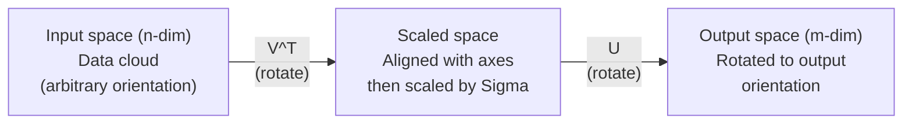
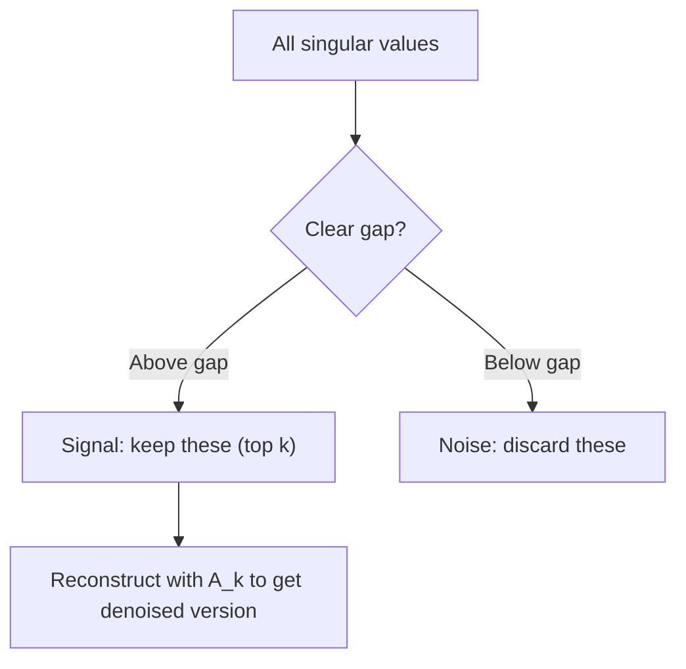

# 奇异值分解

> SVD 是线性代数中的瑞士军刀。每个矩阵都有，每个数据科学家都需要。

**Type:** Build
**Languages:** Python, Julia
**Prerequisites:** Phase 1, Lessons 01 (Linear Algebra Intuition), 02 (Vectors & Matrices Operations), 03 (Matrix Transformations)
**Time:** ~120 minutes

## 学习目标

- 用幂迭代实现 SVD，并解释 $U$、$\Sigma$、$V^T$ 的几何意义
- 应用截断 SVD 进行图像压缩，并衡量压缩比与重建误差的权衡
- 通过 SVD 计算 Moore-Penrose 伪逆，求解超定最小二乘系统
- 将 SVD 与 PCA、推荐系统（潜在因子）以及 NLP 中的潜在语义分析联系起来

## 问题

你有一个 1000×2000 的矩阵。也许是用户-电影评分，也许是文档-词频表，也许是图像的像素值。你需要压缩它、去噪它、挖掘隐藏结构，或者用它求解最小二乘系统。特征分解只适用于方阵，而且还需要矩阵有一组完整的线性无关特征向量。

SVD 适用于任何矩阵。任意形状、任意秩、无需条件。它把矩阵分解为三个因子，揭示矩阵对空间所做的几何变换。它是线性代数中最通用、最有用的分解。

## 概念

### SVD 的几何意义

每个矩阵，无论形状如何，都会依次执行三种操作：旋转、缩放、旋转。SVD 把这一分解显式地呈现出来。

```math
\underset{\substack{m \times n \\ \text{(any)}}}{A} = \underset{\substack{m \times m \\ \text{(rotate)}}}{U} \cdot \underset{\substack{m \times n \\ \text{(scale)}}}{\Sigma} \cdot \underset{\substack{n \times n \\ \text{(rotate)}}}{V^T}
```

对任意矩阵 $A$，SVD 把它分解为：
- $V^T$：在输入空间（$n$ 维）中旋转向量
- $\Sigma$：沿各轴缩放（拉伸或压缩）
- $U$：把结果旋转到输出空间（$m$ 维）



可以这样理解：你把一个矩阵交给 SVD，它告诉你——"这个矩阵先拿一个输入球，用 $V^T$ 旋转它，再用 $\Sigma$ 把它拉伸成椭球，最后用 $U$ 旋转这个椭球。"奇异值就是椭球各轴的长度。

### 完整分解

对于形状为 $m \times n$ 的矩阵 $A$：

```math
\begin{aligned}
& A = U \cdot \Sigma \cdot V^T \\[6pt]
& \text{where:} \\
& \quad U \text{ is } m \times m, \text{ orthogonal } (U^T U = I) \\
& \quad \Sigma \text{ is } m \times n, \text{ diagonal (singular values on the diagonal)} \\
& \quad V \text{ is } n \times n, \text{ orthogonal } (V^T V = I) \\[6pt]
& \text{The singular values } \sigma_1 \ge \sigma_2 \ge \cdots \ge \sigma_r > 0 \\
& \text{where } r = \mathop{\mathrm{rank}}(A)
\end{aligned}
```

$U$ 的列称为左奇异向量，$V$ 的列称为右奇异向量，$\Sigma$ 的对角线元素称为奇异值。奇异值恒为非负，并按降序排列。

### 左奇异向量、奇异值、右奇异向量

SVD 的每个组成部分都有独特的几何意义。

**右奇异向量（$V$ 的列）：** 它们构成输入空间（$\mathbb{R}^n$）的一组标准正交基。它们是输入空间中被矩阵映射到输出空间正交方向的那些方向，可以理解为定义域的自然坐标系。

**奇异值（$\Sigma$ 的对角线）：** 它们是缩放因子。第 $i$ 个奇异值告诉你矩阵沿第 $i$ 个右奇异向量方向把向量拉伸多少。奇异值为零意味着矩阵把这个方向完全压扁。

**左奇异向量（$U$ 的列）：** 它们构成输出空间（$\mathbb{R}^m$）的一组标准正交基。第 $i$ 个左奇异向量就是第 $i$ 个右奇异向量经过缩放后落到的输出空间方向。

它们之间的关系：

```
A * v_i = sigma_i * u_i

The matrix A takes the i-th right singular vector v_i,
scales it by sigma_i, and maps it to the i-th left singular vector u_i.
```

这让你能对任意矩阵的作用逐坐标地画像。

### 外积形式

SVD 可以写成一组秩-1 矩阵之和：

```
A = sigma_1 * u_1 * v_1^T + sigma_2 * u_2 * v_2^T + ... + sigma_r * u_r * v_r^T

Each term sigma_i * u_i * v_i^T is a rank-1 matrix (an outer product).
The full matrix is the sum of r such matrices, where r is the rank.
```

这种形式是低秩近似的基础。每一项都增加一层结构。第一项捕获最重要的单一模式，第二项捕获次重要的模式，依此类推。截断这个和就得到给定秩下的最佳近似。

```math
\begin{aligned}
\text{Rank-1 approx:} \quad & A_1 = \sigma_1 u_1 v_1^T \\
& \text{(captures the dominant pattern)} \\[6pt]
\text{Rank-2 approx:} \quad & A_2 = \sigma_1 u_1 v_1^T + \sigma_2 u_2 v_2^T \\
& \text{(captures the two most important patterns)} \\[6pt]
\text{Rank-}k\text{ approx:} \quad & A_k = \text{sum of top } k \text{ terms} \\
& \text{(optimal by the Eckart-Young theorem)}
\end{aligned}
```

### 与特征分解的关系

SVD 与特征分解联系紧密。$A$ 的奇异值和向量直接来自 $A^T A$ 和 $A A^T$ 的特征值与特征向量。

```
A^T A = V * Sigma^T * U^T * U * Sigma * V^T
      = V * Sigma^T * Sigma * V^T
      = V * D * V^T

where D = Sigma^T * Sigma is a diagonal matrix with sigma_i^2 on the diagonal.

So:
- The right singular vectors (V) are eigenvectors of A^T A
- The singular values squared (sigma_i^2) are eigenvalues of A^T A

Similarly:
A A^T = U * Sigma * V^T * V * Sigma^T * U^T
      = U * Sigma * Sigma^T * U^T

So:
- The left singular vectors (U) are eigenvectors of A A^T
- The eigenvalues of A A^T are also sigma_i^2
```

这种联系说明三件事：
1. 奇异值总是实数且非负（它们是半正定矩阵特征值的平方根）。
2. 你可以通过对 $A^T A$ 做特征分解来计算 SVD，但这会平方条件数、损失数值精度。专用 SVD 算法会避免这一点。
3. 当 $A$ 是方阵且对称半正定时，SVD 与特征分解相同。

### 截断 SVD：低秩近似

Eckart-Young-Mirsky 定理指出：在 Frobenius 范数和谱范数意义下，$A$ 的最佳秩-$k$ 近似就是只保留前 $k$ 个奇异值及其对应向量：

```math
\begin{aligned}
& A_k = U_k \cdot \Sigma_k \cdot V_k^T \\[6pt]
& \text{where:} \\
& \quad U_k \text{ is } m \times k \quad \text{(first } k \text{ columns of } U\text{)} \\
& \quad \Sigma_k \text{ is } k \times k \quad \text{(top-left } k \times k \text{ block of } \Sigma\text{)} \\
& \quad V_k \text{ is } n \times k \quad \text{(first } k \text{ columns of } V\text{)} \\[6pt]
& \text{Approximation error} = \sigma_{k+1} \quad \text{(in spectral norm)} \\
& \text{Approximation error} = \sqrt{\sigma_{k+1}^2 + \cdots + \sigma_r^2} \quad \text{(in Frobenius norm)}
\end{aligned}
```

这不只是"一种好的"近似，而是秩为 $k$ 时的最佳可能近似。没有任何其他秩-$k$ 矩阵能比它更接近 $A$。

| Component | Relative magnitude | Kept in rank-3 approx? |
|-----------|-------------------|------------------------|
| $\sigma_1$ | Largest | Yes |
| $\sigma_2$ | Large | Yes |
| $\sigma_3$ | Medium-large | Yes |
| $\sigma_4$ | Medium | No (error) |
| $\sigma_5$ | Medium-small | No (error) |
| $\sigma_6$ | Small | No (error) |
| $\sigma_7$ | Very small | No (error) |
| $\sigma_8$ | Tiny | No (error) |

保留前 3 个：$A_3$ 捕获了三个最大的奇异值。误差 = 剩余奇异值（$\sigma_4$ 到 $\sigma_8$）。

如果奇异值衰减很快，一个很小的 $k$ 就能捕获矩阵的大部分信息；如果衰减很慢，说明矩阵没有低秩结构。

### 用 SVD 压缩图像

灰度图是一个像素强度矩阵。一张 800×600 的图像有 480,000 个值。SVD 让你用少得多的值来近似它。

```
Original image: 800 x 600 = 480,000 values

SVD with rank k:
  U_k:      800 x k values
  Sigma_k:  k values
  V_k:      600 x k values
  Total:    k * (800 + 600 + 1) = k * 1401 values

  k=10:   14,010 values   (2.9% of original)
  k=50:   70,050 values  (14.6% of original)
  k=100: 140,100 values  (29.2% of original)

  The compression ratio improves as k gets smaller,
  but visual quality degrades.
```

关键洞察：自然图像的奇异值衰减很快。前几个奇异值捕获了大尺度的结构（形状、梯度），后面的奇异值捕获细节和噪声。在秩 50 处截断，往往能得到一张几乎与原始图像相同、却只用了 85% 更少存储的图像。

### SVD 在推荐系统中的应用

Netflix Prize 让这种方法声名大噪。你有一个用户-电影评分矩阵，其中大部分条目缺失。

```
             Movie1  Movie2  Movie3  Movie4  Movie5
  User1      [  5      ?       3       ?       1  ]
  User2      [  ?      4       ?       2       ?  ]
  User3      [  3      ?       5       ?       ?  ]
  User4      [  ?      ?       ?       4       3  ]

  ? = unknown rating
```

核心思想：这个评分矩阵是低秩的。用户的口味并非完全独立，只有少数几个潜在因子（动作 vs 剧情、老片 vs 新片、烧脑 vs 爽片）就能解释大部分偏好。

对（已填充的）评分矩阵做 SVD，把它分解为：
- $U$：潜在因子空间中的用户画像
- $\Sigma$：每个潜在因子的重要程度
- $V^T$：潜在因子空间中的电影画像

某用户对某部电影的预测评分，就是用户画像与电影画像的点积（按奇异值加权）。低秩近似会填补缺失条目。

实践中，你会使用 Simon Funk 的增量 SVD 或 ALS（交替最小二乘）等能直接处理缺失数据的变体，但核心思想相同：通过 SVD 做潜在因子分解。

### SVD 在 NLP 中的应用：潜在语义分析

潜在语义分析（LSA），也称潜在语义索引（LSI），把 SVD 应用到词-文档矩阵上。

```
             Doc1   Doc2   Doc3   Doc4
  "cat"      [  3      0      1      0  ]
  "dog"      [  2      0      0      1  ]
  "fish"     [  0      4      1      0  ]
  "pet"      [  1      1      1      1  ]
  "ocean"    [  0      3      0      0  ]

After SVD with rank k=2:

  Each document becomes a point in 2D "concept space."
  Each term becomes a point in the same 2D space.
  Documents about similar topics cluster together.
  Terms with similar meanings cluster together.

  "cat" and "dog" end up near each other (land pets).
  "fish" and "ocean" end up near each other (water concepts).
  Doc1 and Doc3 cluster if they share similar topics.
```

LSA 是最早从原始文本中捕捉语义相似性的成功方法之一。它之所以有效，是因为同义词倾向于出现在相似文档中，所以 SVD 会把它们聚到相同的潜在维度。现代词嵌入（Word2Vec、GloVe）可以被视为这一思想的后继。

### 用 SVD 去噪

 noisy 数据的信号集中在顶部奇异值，而噪声分散在所有奇异值中。截断就能去掉噪声基底。

**干净信号的奇异值：**

| Component | Magnitude | Type |
|-----------|-----------|------|
| $\sigma_1$ | Very large | Signal |
| $\sigma_2$ | Large | Signal |
| $\sigma_3$ | Medium | Signal |
| $\sigma_4$ | Near zero | Negligible |
| $\sigma_5$ | Near zero | Negligible |

**含噪信号的奇异值（噪声加到所有成分上）：**

| Component | Magnitude | Type |
|-----------|-----------|------|
| $\sigma_1$ | Very large | Signal |
| $\sigma_2$ | Large | Signal |
| $\sigma_3$ | Medium | Signal |
| $\sigma_4$ | Small | Noise |
| $\sigma_5$ | Small | Noise |
| $\sigma_6$ | Small | Noise |
| $\sigma_7$ | Small | Noise |



这在信号处理、科学测量和数据清洗中都有应用。只要矩阵被加性噪声污染，截断 SVD 就是分离信号与噪声的原则性方法。

### 通过 SVD 计算伪逆

Moore-Penrose 伪逆 $A^+$ 把矩阵求逆推广到非方阵和奇异矩阵。有了 SVD，计算它变得异常简单。

```
If A = U * Sigma * V^T, then:

A+ = V * Sigma+ * U^T

where Sigma+ is formed by:
  1. Transpose Sigma (swap rows and columns)
  2. Replace each non-zero diagonal entry sigma_i with 1/sigma_i
  3. Leave zeros as zeros

For A (m x n):      A+ is (n x m)
For Sigma (m x n):  Sigma+ is (n x m)
```

伪逆用于求解最小二乘问题。如果 $Ax = b$ 没有精确解（超定系统），那么 $x = A^+ b$ 就是最小二乘解（最小化 $\lVert Ax - b \rVert$）。

```
Overdetermined system (more equations than unknowns):

  [1  1]         [3]
  [2  1] x   =   [5]       No exact solution exists.
  [3  1]         [6]

  x_ls = A+ b = V * Sigma+ * U^T * b

  This gives the x that minimizes the sum of squared residuals.
  Same result as the normal equations (A^T A)^(-1) A^T b,
  but numerically more stable.
```

### 数值稳定性优势

对 $A^T A$ 做特征分解会平方奇异值（$A^T A$ 的特征值是 $\sigma_i^2$）。这会平方条件数，放大数值误差。

```
Example:
  A has singular values [1000, 1, 0.001]
  Condition number of A: 1000 / 0.001 = 10^6

  A^T A has eigenvalues [10^6, 1, 10^{-6}]
  Condition number of A^T A: 10^6 / 10^{-6} = 10^{12}

  Computing SVD directly: works with condition number 10^6
  Computing via A^T A:     works with condition number 10^{12}
                           (6 extra digits of precision lost)
```

现代 SVD 算法（Golub-Kahan 双对角化）直接作用于 $A$，从不显式构造 $A^T A$。这就是你应该始终优先使用 `np.linalg.svd(A)` 而不是 `np.linalg.eig(A.T @ A)` 的原因。

### 与 PCA 的联系

PCA 就是中心化数据上的 SVD。这不是比喻，而是字面意义上的同一计算。

```
Given data matrix X (n_samples x n_features), centered (mean subtracted):

Covariance matrix: C = (1/(n-1)) * X^T X

PCA finds eigenvectors of C. But:

  X = U * Sigma * V^T    (SVD of X)

  X^T X = V * Sigma^2 * V^T

  C = (1/(n-1)) * V * Sigma^2 * V^T

So the principal components are exactly the right singular vectors V.
The explained variance for each component is sigma_i^2 / (n-1).

In sklearn, PCA is implemented using SVD, not eigendecomposition.
It is faster and more numerically stable.
```

这意味着你在第 10 课学到的所有降维知识，底层都是 SVD。PCA 是机器学习中最常见的 SVD 应用。

```figure
svd-rank-reconstruction
```

## 构建它

### 第一步：用幂迭代从零实现 SVD

思路：要找最大的奇异值及其向量，对 $A^T A$（或 $A A^T$）使用幂迭代。然后对矩阵做压缩，重复寻找下一个奇异值。

```python
import numpy as np

def power_iteration(M, num_iters=100):
    n = M.shape[1]
    v = np.random.randn(n)
    v = v / np.linalg.norm(v)

    for _ in range(num_iters):
        Mv = M @ v
        v = Mv / np.linalg.norm(Mv)

    eigenvalue = v @ M @ v
    return eigenvalue, v

def svd_from_scratch(A, k=None):
    m, n = A.shape
    if k is None:
        k = min(m, n)

    sigmas = []
    us = []
    vs = []

    A_residual = A.copy().astype(float)

    for _ in range(k):
        AtA = A_residual.T @ A_residual
        eigenvalue, v = power_iteration(AtA, num_iters=200)

        if eigenvalue < 1e-10:
            break

        sigma = np.sqrt(eigenvalue)
        u = A_residual @ v / sigma

        sigmas.append(sigma)
        us.append(u)
        vs.append(v)

        A_residual = A_residual - sigma * np.outer(u, v)

    U = np.column_stack(us) if us else np.empty((m, 0))
    S = np.array(sigmas)
    V = np.column_stack(vs) if vs else np.empty((n, 0))

    return U, S, V
```

### 第二步：测试并与 NumPy 对比

```python
np.random.seed(42)
A = np.random.randn(5, 4)

U_ours, S_ours, V_ours = svd_from_scratch(A)
U_np, S_np, Vt_np = np.linalg.svd(A, full_matrices=False)

print("Our singular values:", np.round(S_ours, 4))
print("NumPy singular values:", np.round(S_np, 4))

A_reconstructed = U_ours @ np.diag(S_ours) @ V_ours.T
print(f"Reconstruction error: {np.linalg.norm(A - A_reconstructed):.8f}")
```

### 第三步：图像压缩演示

```python
def compress_image_svd(image_matrix, k):
    U, S, Vt = np.linalg.svd(image_matrix, full_matrices=False)
    compressed = U[:, :k] @ np.diag(S[:k]) @ Vt[:k, :]
    return compressed

image = np.random.seed(42)
rows, cols = 200, 300
image = np.random.randn(rows, cols)

for k in [1, 5, 10, 20, 50]:
    compressed = compress_image_svd(image, k)
    error = np.linalg.norm(image - compressed) / np.linalg.norm(image)
    original_size = rows * cols
    compressed_size = k * (rows + cols + 1)
    ratio = compressed_size / original_size
    print(f"k={k:>3d}  error={error:.4f}  storage={ratio:.1%}")
```

### 第四步：去噪

```python
np.random.seed(42)
clean = np.outer(np.sin(np.linspace(0, 4*np.pi, 100)),
                 np.cos(np.linspace(0, 2*np.pi, 80)))
noise = 0.3 * np.random.randn(100, 80)
noisy = clean + noise

U, S, Vt = np.linalg.svd(noisy, full_matrices=False)
denoised = U[:, :5] @ np.diag(S[:5]) @ Vt[:5, :]

print(f"Noisy error:    {np.linalg.norm(noisy - clean):.4f}")
print(f"Denoised error: {np.linalg.norm(denoised - clean):.4f}")
print(f"Improvement:    {(1 - np.linalg.norm(denoised - clean) / np.linalg.norm(noisy - clean)):.1%}")
```

### 第五步：伪逆

```python
A = np.array([[1, 1], [2, 1], [3, 1]], dtype=float)
b = np.array([3, 5, 6], dtype=float)

U, S, Vt = np.linalg.svd(A, full_matrices=False)
S_inv = np.diag(1.0 / S)
A_pinv = Vt.T @ S_inv @ U.T

x_svd = A_pinv @ b
x_lstsq = np.linalg.lstsq(A, b, rcond=None)[0]
x_pinv = np.linalg.pinv(A) @ b

print(f"SVD pseudoinverse solution:  {x_svd}")
print(f"np.linalg.lstsq solution:   {x_lstsq}")
print(f"np.linalg.pinv solution:    {x_pinv}")
```

## 使用它

完整可运行的演示在 `code/svd.py` 中。运行它可以看到 SVD 在图像压缩、推荐系统、潜在语义分析和去噪上的应用。

```bash
python svd.py
```

Julia 版本在 `code/svd.jl` 中，使用 Julia 原生的 `svd()` 函数和 `LinearAlgebra` 包演示相同概念。

```bash
julia svd.jl
```

## 交付它

本节课产出：
- `outputs/skill-svd.md`——知道何时以及如何在实际项目中应用 SVD 的 skill

## 练习

1. 不使用幂迭代，从零实现完整 SVD。改为计算 $A^T A$ 的特征分解以得到 $V$ 和奇异值，然后计算 $U = A V \Sigma^{-1}$。与你的幂迭代版本和 NumPy 比较数值精度。

2. 加载一张真实灰度图像（或把一张图转为灰度）。分别在秩 1、5、10、25、50、100 下压缩。对每个秩计算压缩比和相对误差，找到图像视觉上可接受的最低秩。

3. 构建一个微型推荐系统。创建一个 10×8 的用户-电影评分矩阵，部分条目已知。用行均值填充缺失项，计算 SVD 并重建一个秩-3 近似。用重建矩阵预测缺失评分，并验证预测合理。

4. 创建一个 100×50 的文档-词矩阵，包含 3 个合成主题，每个主题关联 5 个词。加入噪声后应用 SVD，验证前 3 个奇异值远大于其余值。把文档投影到 3D 潜在空间，检查同主题文档是否聚类。

5. 生成一个干净的低秩矩阵（秩 3，大小 50×40），在不同水平加入高斯噪声（$\sigma$ = 0.1、0.5、1.0、2.0）。对每个噪声水平，通过遍历 $k$ 从 1 到 40 并测量对干净矩阵的重建误差，找到最优截断秩。绘制最优 $k$ 随噪声水平的变化。

### 提示

**练习 1.** 计算 $A^T A$，用 `np.linalg.eigh` 得到其特征值和特征向量，并按降序排列。奇异值是特征值的平方根；检查 $U \Sigma V^T$ 能否重建 $A$，并将误差与 `svd_from_scratch` 和 `np.linalg.svd` 比较。

**练习 2.** 对每个秩调用 `truncated_svd`，用 `reconstruct` 重建图像，并用 `compression_ratio(m, n, k)` 计算大小。相对误差应随秩增大而下降，第一个看不到明显块状伪影的秩就是答案。

**练习 3.** 标记缺失单元格，用行均值填充，然后用 `truncated_svd` 和 `reconstruct` 重建秩 3 近似。评估结果：统计超出评分范围的预测数量，并打印已知单元格变化的最大值。秩 3 近似不能保证这两点，因此如需有效评分，可将预测裁剪到范围内。

**练习 4.** 给每个主题分配一块 5 个词，让其对应文档出现高频计数，再加入少量噪声。打印奇异值：前 3 个必须明显大于第 4 个。然后按主题给 3D 坐标上色，检查每个主题是否形成一个组。

**练习 5.** 让干净矩阵等于一个 50×3 矩阵与一个 3×40 随机矩阵的乘积，然后为每个 $\sigma$ 加入噪声。对每个 $k$，比较秩-$k$ 重建与干净矩阵的误差；低噪声时最优 $k$ 应接近 3，高噪声时则更小。

## 关键术语

| Term | What people say | What it actually means |
|------|----------------|----------------------|
| SVD | "Factor any matrix" | Decompose $A$ into $U \Sigma V^T$ where $U$ and $V$ are orthogonal and $\Sigma$ is diagonal with non-negative entries. Works for any matrix of any shape. |
| Singular value | "How important this component is" | The $i$-th diagonal entry of $\Sigma$. Measures how much the matrix stretches along the i-th principal direction. Always non-negative, sorted in decreasing order. |
| Left singular vector | "Output direction" | A column of $U$. The direction in output space that the $i$-th right singular vector maps to (after scaling by $\sigma_i$). |
| Right singular vector | "Input direction" | A column of $V$. The direction in input space that the matrix maps to the $i$-th left singular vector (after scaling by $\sigma_i$). |
| Truncated SVD | "Low-rank approximation" | Keep only the top $k$ singular values and their vectors. Produces the provably best $\text{rank-}k$ approximation to the original matrix (Eckart-Young theorem). |
| Rank | "True dimensionality" | The number of non-zero singular values. Tells you how many independent directions the matrix actually uses. |
| Pseudoinverse | "Generalized inverse" | $V \Sigma^+ U^T$. Inverts non-zero singular values, leaves zeros as zeros. Solves least-squares problems for non-square or singular matrices. |
| Condition number | "How sensitive to errors" | $\sigma_{\max} / \sigma_{\min}$. A large condition number means small input changes cause large output changes. SVD reveals this directly. |
| Latent factor | "Hidden variable" | A dimension in the low-rank space discovered by SVD. In recommendations, a latent factor might correspond to genre preference. In NLP, it might correspond to a topic. |
| Frobenius norm | "Total matrix size" | Square root of the sum of squared entries. Equals the square root of the sum of squared singular values. Used to measure approximation error. |
| Eckart-Young theorem | "SVD gives the best compression" | For any target rank $k$, the truncated SVD minimizes the approximation error over all possible $\text{rank-}k$ matrices. |
| Power iteration | "Find the biggest eigenvector" | Repeatedly multiply a random vector by the matrix and normalize. Converges to the eigenvector with the largest eigenvalue. The building block of many SVD algorithms. |

## 延伸阅读

- [Gilbert Strang: Linear Algebra and Its Applications, Chapter 7](https://math.mit.edu/~gs/linearalgebra/) - 对 SVD 及应用进行了 thorough 讲解
- [3Blue1Brown: But what is the SVD?](https://www.youtube.com/watch?v=vSczTbgc8Rc) - SVD 的几何直观
- [We Recommend a Singular Value Decomposition](https://www.ams.org/publicoutreach/feature-column/fcarc-svd) - 美国数学学会给出的易懂概述
- [Netflix Prize and Matrix Factorization](https://sifter.org/~simon/journal/20061211.html) - Simon Funk 关于 SVD 用于推荐的原始博客
- [Latent Semantic Analysis](https://en.wikipedia.org/wiki/Latent_semantic_analysis) - SVD 的原始 NLP 应用
- [Numerical Linear Algebra by Trefethen and Bau](https://people.maths.ox.ac.uk/trefethen/text.html) - 理解 SVD 算法及其数值性质的经典参考书
