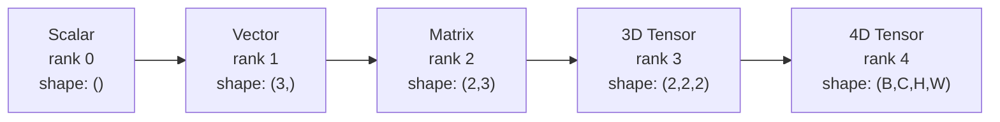
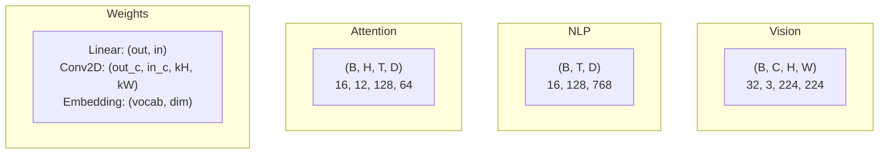
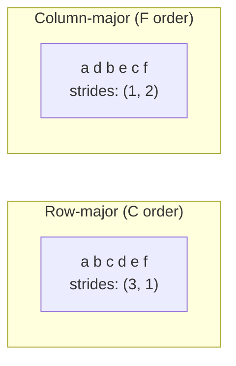
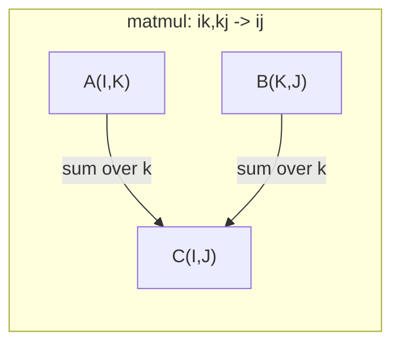

# 张量运算

> 张量是数据与深度学习之间的通用语言。每张图片、每句话、每个梯度都流经它们。

**Type:** Build
**Language:** Python
**Prerequisites:** Phase 1, Lessons 01 (Linear Algebra Intuition), 02 (Vectors, Matrices & Operations)
**Time:** ~90 minutes

## 学习目标

- 从零实现一个张量类，支持 shape、strides、reshape、transpose 和逐元素操作
- 应用广播规则，在不同形状的张量间进行操作而无需复制数据
- 用 einsum 表达点积、矩阵乘法、外积和批处理操作
- 追踪多头注意力每一步的精确张量形状

## 问题

你搭了一个 transformer。前向传播看起来没问题，一运行却报错：`RuntimeError: mat1 and mat2 shapes cannot be multiplied (32x768 and 512x768)`。你盯着形状看，尝试转置。现在它说 `Expected 4D input (got 3D input)`。你加一个 unsqueeze，别的又崩了。

形状错误是深度学习代码中最常见的 bug。它们在概念上并不难——每个操作都有形状契约——但它们会快速级联。一个 transformer 里串联着几十次 reshape、transpose 和 broadcast。一个轴错了，错误就会传导。更糟的是，有些形状错误不会抛异常，而是沿着错误的维度默默广播，或者在错误的轴上求和，产生垃圾结果。

矩阵处理两组事物之间的成对关系。但真实数据放不进两个维度。32 张 224×224 的 RGB 图像是一个 4D 张量：`(32, 3, 224, 224)`。12 个头的自注意力也是 4D：`(batch, heads, seq_len, head_dim)`。你需要一种数据结构，能泛化到任意维度，并且各种操作能在所有维度上干净地组合。这就是张量。掌握它的运算后，形状错误会变得极易调试。

## 概念

### 什么是张量

张量是具有统一数据类型的多维数字数组。维度数量称为**秩**（rank，也称 order）。每个维度是一个**轴**（axis）。**形状**（shape）是一个元组，列出各轴的大小。



总元素数 = 各轴大小的乘积。形状 `(2, 3, 4)` 包含 $2 \cdot 3 \cdot 4 = 24$ 个元素。

### 深度学习中的张量形状

按约定，不同数据类型对应特定的张量形状。



PyTorch 使用 NCHW（通道优先）。TensorFlow 默认 NHWC（通道在后）。布局不匹配会导致静默变慢或报错。

### 内存布局如何工作

内存中的 2D 数组其实是一段 1D 字节序列。**Strides** 告诉你沿每个轴前进一步需要跳过多少元素。



Transpose 不会移动数据，它只交换 strides，使张量变成**非连续**（non-contiguous）——某一行的元素在内存中不再相邻。

### 广播规则

广播让你能在不同形状的张量间进行操作而无需复制数据。从右侧对齐形状，两个维度相等或其中一个为 1 时兼容。维度较少的一方会在左侧用 1 补齐。

```
Tensor A:     (8, 1, 6, 1)
Tensor B:        (7, 1, 5)
Padded B:     (1, 7, 1, 5)
Result:       (8, 7, 6, 5)
```

### Einsum：通用的张量运算

爱因斯坦求和约定用字母标记每个轴。输入中有但输出中没有的轴会被求和。两边都有的轴会被保留。



关键模式：`i,i->`（点积）、`i,j->ij`（外积）、`ii->`（迹）、`ij->ji`（转置）、`bij,bjk->bik`（批量矩阵乘法）、`bhtd,bhsd->bhts`（注意力分数）。

```figure
tensor-broadcast
```

## 构建它

代码位于 `code/tensors.py`。下面每一步都引用那里的实现。

### 第一步：张量存储与 strides

张量用一段扁平数字列表加上形状元数据来存储。strides 告诉索引逻辑如何把多维下标映射到扁平位置。

```python
class Tensor:
    def __init__(self, data, shape=None):
        if isinstance(data, (list, tuple)):
            self._data, self._shape = self._flatten_nested(data)
        elif isinstance(data, np.ndarray):
            self._data = data.flatten().tolist()
            self._shape = tuple(data.shape)
        else:
            self._data = [data]
            self._shape = ()

        if shape is not None:
            total = reduce(lambda a, b: a * b, shape, 1)
            if total != len(self._data):
                raise ValueError(
                    f"Cannot reshape {len(self._data)} elements into shape {shape}"
                )
            self._shape = tuple(shape)

        self._strides = self._compute_strides(self._shape)

    @staticmethod
    def _compute_strides(shape):
        if len(shape) == 0:
            return ()
        strides = [1] * len(shape)
        for i in range(len(shape) - 2, -1, -1):
            strides[i] = strides[i + 1] * shape[i + 1]
        return tuple(strides)
```

对形状 `(3, 4)`，strides 是 `(4, 1)`——沿行方向前进要跳过 4 个元素，沿列方向前进要跳过 1 个元素。

### 第二步：reshape、squeeze、unsqueeze

Reshape 改变形状而不改变元素顺序。元素总数必须保持不变。某个维度可用 `-1` 让其自动推断。

```python
t = Tensor(list(range(12)), shape=(2, 6))
r = t.reshape((3, 4))
r = t.reshape((-1, 3))
```

Squeeze 移除大小为 1 的轴。Unsqueeze 插入一个大小为 1 的轴。Unsqueeze 对广播至关重要：一个 `(D,)` 的偏置要加到 `(B, T, D)` 的批量上，需要先 unsqueeze 成 `(1, 1, D)`。

```python
t = Tensor(list(range(6)), shape=(1, 3, 1, 2))
s = t.squeeze()
v = Tensor([1, 2, 3])
u = v.unsqueeze(0)
```

### 第三步：transpose 与 permute

Transpose 交换两个轴。Permute 重排所有轴。这就是 NCHW 与 NHWC 之间相互转换的方式。

```python
mat = Tensor(list(range(6)), shape=(2, 3))
tr = mat.transpose(0, 1)

t4d = Tensor(list(range(24)), shape=(1, 2, 3, 4))
perm = t4d.permute((0, 2, 3, 1))
```

经过 transpose 或 permute 后，张量在内存中不再连续。在 PyTorch 中，`view` 对非连续张量会失败——应使用 `reshape`，或先调用 `.contiguous()`。

### 第四步：逐元素操作与归约

逐元素操作（加、乘、减）独立作用于每个元素并保持形状不变。归约操作（sum、mean、max）则折叠一个或多个轴。

```python
a = Tensor([[1, 2], [3, 4]])
b = Tensor([[10, 20], [30, 40]])
c = a + b
d = a * 2
s = a.sum(axis=0)
```

CNN 中的全局平均池化：`(B, C, H, W).mean(axis=[2, 3])` 得到 `(B, C)`。NLP 中的序列平均池化：`(B, T, D).mean(axis=1)` 得到 `(B, D)`。

### 第五步：用 NumPy 演示广播

`tensors.py` 中的 `demo_broadcasting_numpy()` 函数展示了核心模式。

```python
activations = np.random.randn(4, 3)
bias = np.array([0.1, 0.2, 0.3])
result = activations + bias

images = np.random.randn(2, 3, 4, 4)
scale = np.array([0.5, 1.0, 1.5]).reshape(1, 3, 1, 1)
result = images * scale

a = np.array([1, 2, 3]).reshape(-1, 1)
b = np.array([10, 20, 30, 40]).reshape(1, -1)
outer = a * b
```

通过广播计算成对距离：把 `(M, 2)` reshape 成 `(M, 1, 2)`，把 `(N, 2)` reshape 成 `(1, N, 2)`，相减、平方、沿最后一轴求和、再开方。结果：`(M, N)`。

### 第六步：Einsum 操作

`demo_einsum()` 和 `demo_einsum_gallery()` 函数带你遍历每一种常见模式。

```python
a = np.array([1.0, 2.0, 3.0])
b = np.array([4.0, 5.0, 6.0])
dot = np.einsum("i,i->", a, b)

A = np.array([[1, 2], [3, 4], [5, 6]], dtype=float)
B = np.array([[7, 8, 9], [10, 11, 12]], dtype=float)
matmul = np.einsum("ik,kj->ij", A, B)

batch_A = np.random.randn(4, 3, 5)
batch_B = np.random.randn(4, 5, 2)
batch_mm = np.einsum("bij,bjk->bik", batch_A, batch_B)
```

一次缩并的计算成本是所有索引大小（保留和求和的）的乘积。对 `bij,bjk->bik`，若 $B=32$、$I=128$、$J=64$、$K=128$：$32 \cdot 128 \cdot 64 \cdot 128 = 33{,}554{,}432$ 次乘加。

### 第七步：用 einsum 实现注意力机制

`demo_attention_einsum()` 函数端到端实现了多头注意力。

```python
B, H, T, D = 2, 4, 8, 16
E = H * D

X = np.random.randn(B, T, E)
W_q = np.random.randn(E, E) * 0.02

Q = np.einsum("bte,ek->btk", X, W_q)
Q = Q.reshape(B, T, H, D).transpose(0, 2, 1, 3)

scores = np.einsum("bhtd,bhsd->bhts", Q, K) / np.sqrt(D)
weights = softmax(scores, axis=-1)
attn_output = np.einsum("bhts,bhsd->bhtd", weights, V)

concat = attn_output.transpose(0, 2, 1, 3).reshape(B, T, E)
output = np.einsum("bte,ek->btk", concat, W_o)
```

每一步都是张量运算：投影（通过 einsum 的矩阵乘法）、分头（reshape + transpose）、注意力分数（通过 einsum 的批量矩阵乘法）、加权求和（通过 einsum 的批量矩阵乘法）、合并头（transpose + reshape）、输出投影（通过 einsum 的矩阵乘法）。

## 使用它

### 从零实现 vs NumPy

| Operation | Scratch (Tensor class) | NumPy |
|---|---|---|
| Create | `Tensor([[1,2],[3,4]])` | `np.array([[1,2],[3,4]])` |
| Reshape | `t.reshape((3,4))` | `a.reshape(3,4)` |
| Transpose | `t.transpose(0,1)` | `a.T` or `a.transpose(0,1)` |
| Squeeze | `t.squeeze(0)` | `np.squeeze(a, 0)` |
| Sum | `t.sum(axis=0)` | `a.sum(axis=0)` |
| Einsum | N/A | `np.einsum("ij,jk->ik", a, b)` |

### 从零实现 vs PyTorch

```python
import torch

t = torch.tensor([[1, 2, 3], [4, 5, 6]], dtype=torch.float32)
t.shape
t.stride()
t.is_contiguous()

t.reshape(3, 2)
t.unsqueeze(0)
t.transpose(0, 1)
t.transpose(0, 1).contiguous()

torch.einsum("ik,kj->ij", A, B)
```

PyTorch 额外提供 autograd、GPU 支持和优化过的 BLAS 核，但形状语义完全一致。如果你理解了从零实现版本，PyTorch 的形状错误就会变得可读。

### 每个神经网络层都是张量运算

| Operation | Tensor Form | Einsum |
|---|---|---|
| Linear layer | `Y = X @ W.T + b` | `"bd,od->bo"` + bias |
| Attention QKV | `Q = X @ W_q` | `"btd,dh->bth"` |
| Attention scores | `Q @ K.T / sqrt(d)` | `"bhtd,bhsd->bhts"` |
| Attention output | `softmax(scores) @ V` | `"bhts,bhsd->bhtd"` |
| Batch norm | `(X - mu) / sigma * gamma` | element-wise + broadcast |
| Softmax | `exp(x) / sum(exp(x))` | element-wise + reduction |

## 交付它

本节课产出两个可复用 prompt：

1. **`outputs/prompt-tensor-shapes.md`**——系统化调试张量形状不匹配的 prompt。包含每种常见操作（matmul、broadcast、cat、Linear、Conv2d、BatchNorm、softmax）的决策表和修复速查表。

2. **`outputs/prompt-tensor-debugger.md`**——当形状错误卡住你时，可粘贴到任意 AI 助手里的分步调试 prompt。喂给它错误信息和你的张量形状，即可获得精确修复方案。

## 练习

1. **简单——reshape 往返。** 取形状为 `(2, 3, 4)` 的张量，依次 reshape 为 `(6, 4)`、`(24,)`，再变回 `(2, 3, 4)`。每一步都打印扁平数据，验证元素顺序保持不变。

2. **中等——实现广播。** 扩展 `Tensor` 类，增加 `broadcast_to(shape)` 方法，把大小为 1 的维度扩展到目标形状。然后修改 `_elementwise_op` 让操作前自动广播。用 `(3, 1)` 和 `(1, 4)` 测试，结果应为 `(3, 4)`。

3. **困难——从零实现 einsum。** 实现一个基础版 `einsum(subscripts, *tensors)`，至少支持：点积（`i,i->`）、矩阵乘法（`ij,jk->ik`）、外积（`i,j->ij`）和转置（`ij->ji`）。解析下标字符串，识别收缩索引，遍历所有索引组合。将结果与 `np.einsum` 比较。

4. **困难——注意力形状追踪器。** 编写一个函数，接收 `batch_size`、`seq_len`、`embed_dim`、`num_heads`，打印多头注意力每一步的精确形状：输入、Q/K/V 投影、分头、注意力分数、softmax 权重、加权求和、合并头、输出投影。与 `demo_attention_einsum()` 的输出核对。

### 提示

**练习 1.** 用 `list(range(24))` 构造张量，这样每个元素都显示自己的位置。每次 `reshape` 后打印 `flatten().to_list()`，检查顺序是否仍是 0 到 23。

**练习 2.** 只有当两个尺寸相等或其中一个为 1 时，维度才能广播，因此先检查这条规则，不满足时抛出错误。对形状 `(3, 1)` 和 `(1, 4)`，检查结果中 `[i][j]` 是否等于 `a[i][0] + b[0][j]`，并与 NumPy 对比。

**练习 3.** 用 `->` 分割下标。输入中有但输出中没有的字母就是求和索引，遍历每个字母的所有取值并累加到输出位置。用 `np.allclose(mine, np.einsum(...))` 对四个小随机数组分别测试。

**练习 4.** 先算出头大小 `embed_dim // num_heads`，并断言 `embed_dim % num_heads == 0`。注意力分数的形状是 `(batch_size, num_heads, seq_len, seq_len)`，把你的打印结果与该形状以及 `demo_attention_einsum()` 打印的形状核对。

## 关键术语

| Term | What people say | What it actually means |
|---|---|---|
| Tensor | "A matrix but more dimensions" | A multi-dimensional array with uniform type and defined shape, strides, and operations |
| Rank | "The number of dimensions" | The number of axes. A matrix has rank 2, not rank equal to its matrix rank |
| Shape | "The size of the tensor" | A tuple listing the size along each axis. `(2, 3)` means 2 rows, 3 columns |
| Stride | "How memory is laid out" | The number of elements to skip to advance one position along each axis |
| Broadcasting | "It just works when shapes differ" | A strict set of rules: align from right, dimensions must be equal or one must be 1 |
| Contiguous | "The tensor is normal" | Elements stored sequentially in memory with no gaps or reordering from the logical layout |
| Einsum | "A fancy way to write matmul" | A general notation that expresses any tensor contraction, outer product, trace, or transpose in one line |
| View | "Same as reshape" | A tensor sharing the same memory buffer but with different shape/stride metadata. Fails on non-contiguous data |
| Contraction | "Summing over an index" | The general operation where a shared index between tensors is multiplied and summed, producing a lower-rank result |
| NCHW / NHWC | "PyTorch vs TensorFlow format" | Memory layout conventions for image tensors. NCHW puts channels before spatial dims, NHWC puts them after |

## 延伸阅读

- [NumPy Broadcasting](https://numpy.org/doc/stable/user/basics.broadcasting.html) - 广播规则的权威说明，含可视化示例
- [PyTorch Tensor Views](https://pytorch.org/docs/stable/tensor_view.html) - view 何时共享内存、何时拷贝
- [einops](https://github.com/arogozhnikov/einops) - 让张量 reshape 更可读、更安全的库
- [The Illustrated Transformer](https://jalammar.github.io/illustrated-transformer/) - 可视化注意力中流动的张量形状
- [Einstein Summation in NumPy](https://numpy.org/doc/stable/reference/generated/numpy.einsum.html) - 完整 einsum 文档与示例
