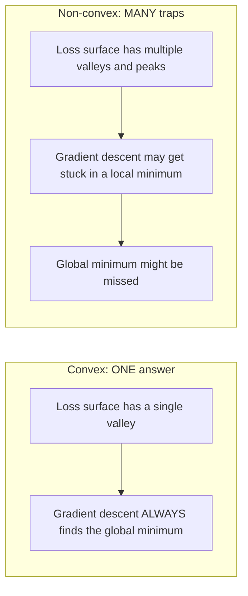
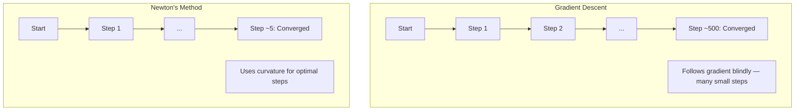
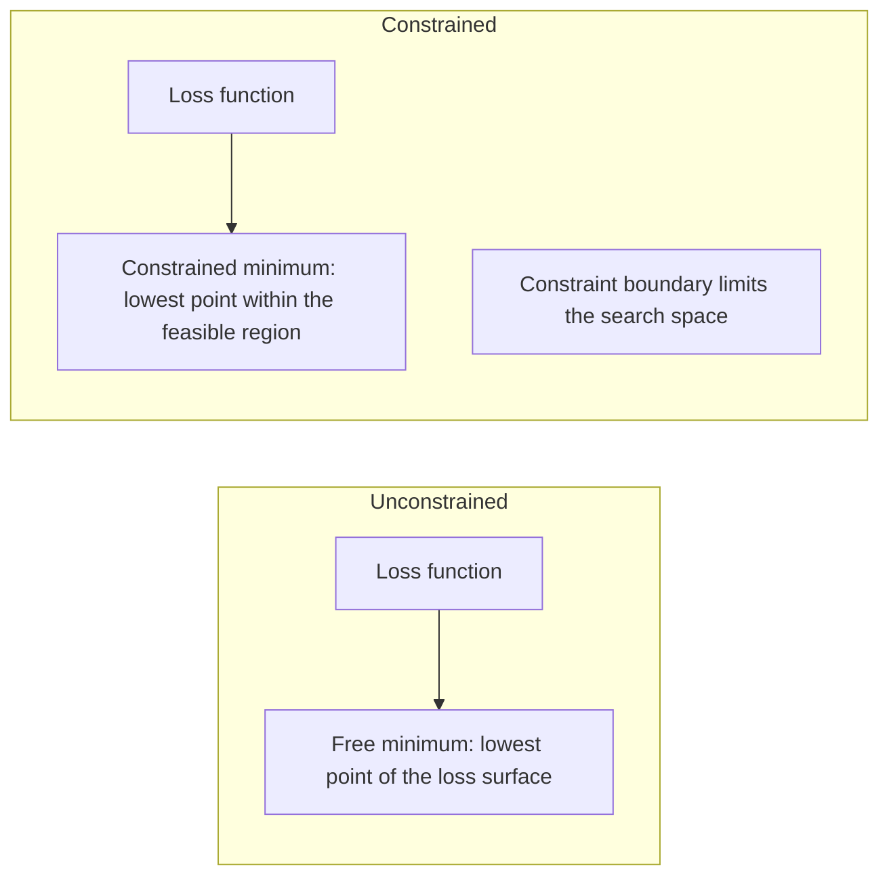
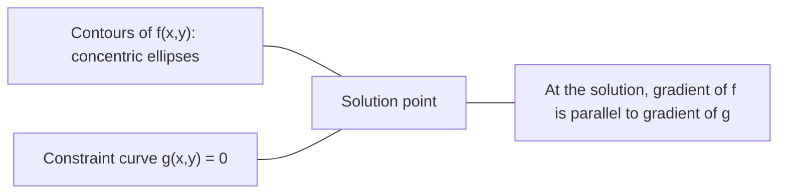

# 凸优化

> 凸问题只有一个山谷，而神经网络有数百万个。知道二者的区别很重要。

**Type:** Build
**Language:** Python
**Prerequisites:** Phase 1, Lessons 04 (Calculus for ML), 08 (Optimization)
**Time:** ~90 minutes

## 学习目标

- 使用定义、二阶导数和 Hessian 判据判断函数是否为凸函数
- 实现牛顿法，并将其二次收敛速度与梯度下降进行比较
- 使用拉格朗日乘子求解约束优化问题，并解释 KKT 条件
- 解释为什么神经网络损失景观是非凸的，而 SGD 仍然能找到好的解

## 问题

第 08 课教你梯度下降、动量和 Adam。这些优化器可以在任意表面上向下走，但它们不提供任何保证。在非凸景观上使用梯度下降可能会落入糟糕的局部最小值、卡在鞍点，或者永远震荡。你之所以仍然使用它，是因为神经网络是非凸的，而且没有别的选择。

但机器学习中的许多问题都是凸的。线性回归、逻辑回归、SVM、LASSO、岭回归。对于这些问题，存在更强有力的工具：带有数学保证的优化。一个凸问题只有一个山谷。任何向下走的算法都会到达全局最小值。不需要重启，不需要学习率调度，不需要祈祷。

理解凸性有三重作用。第一，它告诉你问题什么时候简单（凸），什么时候困难（非凸）。第二，它为你提供更快的工具，例如用于凸问题的牛顿法。第三，它解释了整个机器学习中反复出现的概念：正则化作为一种约束、SVM 中的对偶性，以及深度学习为何在违反凸性带来的所有良好性质的情况下仍然有效。

## 概念

### 凸集

如果集合 $S$ 中任意两点之间的线段也完全位于 $S$ 内，则 $S$ 是凸集。

| 凸集 | 非凸集 |
|---|---|
| **矩形**：内部任意两点都可以用一条完全留在内部的线段连接 | **星形/月牙形**：两内点之间的线段可能穿出集合 |
| **三角形**：对所有内点都成立同样的性质 | **甜甜圈/环形**：中间的洞意味着某些线段会离开集合 |
| 任意两点之间的线段都保留在集合内 | 某些点对之间的线段会离开集合 |

形式化检验：对于 $S$ 中任意两点 $x, y$ 以及任意 $t \in [0, 1]$，点 $tx + (1-t)y$ 也在 $S$ 中。

凸集示例：
- 直线、平面、整个 $\mathbb{R}^n$
- 球（圆、球面、超球面）
- 半空间：$\lbrace x : a^T x \le b \rbrace$
- 任意多个凸集的交集

非凸集示例：
- 甜甜圈（环形）
- 两个不相交圆的并集
- 任何有「凹陷」或「洞」的集合

### 凸函数

如果函数 $f$ 的定义域是凸集，并且对于定义域中任意两点 $x, y$ 以及任意 $t \in [0, 1]$：

```math
f(tx + (1-t)y) \le t f(x) + (1-t) f(y)
```

几何意义：图像上任意两点之间的线段位于或高于图像本身。

| 性质 | 凸函数 | 非凸函数 |
|---|---|---|
| **线段检验** | 图像上任意两点之间的线段位于或高于曲线 | 图像上某些点之间的线段会低于曲线 |
| **形状** | 单个向上弯曲的碗/山谷 | 多个峰谷，曲率混杂 |
| **局部最小值** | 每个局部最小值都是全局最小值 | 可能存在多个不同高度的局部最小值 |

常见凸函数：
- $f(x) = x^2$（抛物线）
- $f(x) = \lvert x \rvert$（绝对值）
- $f(x) = e^x$（指数）
- $f(x) = \max(0, x)$（ReLU，虽然是分段线性）
- $f(x) = -\log(x)$，$x > 0$（负对数）
- 任意线性函数 $f(x) = a^T x + b$（既凸又凹）

### 凸性检验

三种实用检验，从最简单到最严谨。

**检验 1：二阶导数检验（一维）。** 如果对所有 $x$ 都有 $f''(x) \ge 0$，则 $f$ 是凸函数。

- $f(x) = x^2$：$f''(x) = 2 \ge 0$。凸。
- $f(x) = x^3$：$f''(x) = 6x$。当 $x < 0$ 时为负。不凸。
- $f(x) = e^x$：$f''(x) = e^x > 0$。凸。

**检验 2：Hessian 检验（多元）。** 如果 Hessian 矩阵 $H(x)$ 对所有 $x$ 都是半正定，则 $f$ 是凸函数。Hessian 是二阶偏导数组成的矩阵。

**检验 3：定义检验。** 直接验证不等式 $f(tx + (1-t)y) \le t f(x) + (1-t) f(y)$。对于导数难以计算的函数很有用。

### 为什么凸性重要

凸优化的核心定理：

**对于凸函数，每个局部最小值都是全局最小值。**

这意味着梯度下降不会被卡住。任何 downhill 路径都通向同一个答案。算法保证收敛到最优解。



结果：
- 不需要随机重启
- 不需要复杂的学习率调度
- 可以给出收敛证明（收敛速率取决于函数性质）
- 解是唯一的（平坦区域除外）

### 机器学习中的凸与非凸

| 问题 | 是否凸 | 原因 |
|---------|---------|-----|
| 线性回归（MSE） | 是 | 损失关于权重是二次的 |
| 逻辑回归 | 是 | 对数损失关于权重是凸的 |
| SVM（hinge loss） | 是 | 线性函数的最大值 |
| LASSO（L1 回归） | 是 | 凸函数之和仍是凸函数 |
| 岭回归（L2） | 是 | 二次 + 二次 = 凸 |
| 神经网络（任意损失） | 否 | 非线性激活产生非凸景观 |
| k-means 聚类 | 否 | 离散分配步骤 |
| 矩阵分解 | 否 | 未知量的乘积 |

具有凸损失的线性模型是凸的。一旦加入带有非线性激活的隐藏层，凸性就被破坏。

### Hessian 矩阵

函数 $f: \mathbb{R}^n \to \mathbb{R}$ 的 Hessian $H$ 是 $n \times n$ 的二阶偏导数矩阵。

```math
H_{ij} = \frac{\partial^2 f}{\partial x_i \, \partial x_j}
```

对于 $f(x, y) = x^2 + 3xy + y^2$：

```math
\begin{gathered}
\begin{aligned}
\frac{\partial f}{\partial x} &= 2x + 3y & \frac{\partial^2 f}{\partial x^2} &= 2 & \frac{\partial^2 f}{\partial x \, \partial y} &= 3 \\
\frac{\partial f}{\partial y} &= 3x + 2y & \frac{\partial^2 f}{\partial y \, \partial x} &= 3 & \frac{\partial^2 f}{\partial y^2} &= 2
\end{aligned} \\[8pt]
H = \begin{bmatrix} 2 & 3 \\ 3 & 2 \end{bmatrix}
\end{gathered}
```

Hessian 告诉你关于曲率的信息：
- 所有特征值为正：函数在每个方向都向上弯曲（在该点凸）
- 所有特征值为负：在每个方向都向下弯曲（凹，局部最大）
- 正负混合：鞍点（某些方向向上，某些方向向下）
- 零特征值：在该方向平坦（退化）

对于凸性，Hessian 必须在处处半正定（所有特征值 $\ge 0$），而不仅仅在某一点。

### 牛顿法

梯度下降使用一阶信息（梯度）。牛顿法使用二阶信息（Hessian）。它在当前点拟合一个二次近似，然后直接跳到该二次近似的最小值。

```math
\begin{aligned}
\text{Update rule:} \quad & x_{\text{new}} = x - H^{-1} \cdot \text{gradient} \\
\text{Compare to gradient descent:} \quad & x_{\text{new}} = x - \text{lr} \cdot \text{gradient}
\end{aligned}
```

牛顿法用 Hessian 的逆替代标量学习率。这会根据局部曲率自动调整步长和方向。



优点：
- 在最小值附近二次收敛（每步误差平方）
- 无需调整学习率
- 尺度不变（无论问题如何参数化都有效）

缺点：
- 计算 Hessian 需要 $O(n^2)$ 内存，求逆需要 $O(n^3)$
- 对于具有 100 万个权重的神经网络，这就是 $10^{12}$ 个元素和 $10^{18}$ 次运算
- 对深度学习不实用

### 约束优化

无约束优化：在所有 $x$ 上最小化 $f(x)$。
约束优化：在满足约束条件的情况下最小化 $f(x)$。

现实问题都有约束。你想最小化成本，但预算有限。你想最小化误差，但模型复杂度有界。



### 拉格朗日乘子

拉格朗日乘子法将约束问题转化为无约束问题。

问题：在 $g(x) = 0$ 的约束下最小化 $f(x)$。

解法：引入一个新变量（拉格朗日乘子 $\lambda$），求解以下无约束问题：

```math
L(x, \lambda) = f(x) + \lambda g(x)
```

在解处，$L$ 的梯度为零：

```math
\begin{aligned}
\frac{\partial L}{\partial x} &= \frac{\partial f}{\partial x} + \lambda \frac{\partial g}{\partial x} = 0 \\
\frac{\partial L}{\partial \lambda} &= g(x) = 0
\end{aligned}
```

几何直觉：在约束最小值处，$f$ 的梯度必须与约束 $g$ 的梯度平行。如果不平行，你可以沿着约束表面移动，从而进一步减小 $f$。



示例：在约束 $x + y = 1$ 下最小化 $f(x,y) = x^2 + y^2$。

```math
\begin{aligned}
L &= x^2 + y^2 + \lambda(x + y - 1) \\[4pt]
\frac{\partial L}{\partial x} &= 2x + \lambda = 0 \implies x = -\lambda/2 \\
\frac{\partial L}{\partial y} &= 2y + \lambda = 0 \implies y = -\lambda/2 \\
\frac{\partial L}{\partial \lambda} &= x + y - 1 = 0 \\[4pt]
&\text{由前两个式子：} x = y \\
&\text{代入：} 2x = 1, \text{ 所以 } x = y = 0.5, \ \lambda = -1
\end{aligned}
```

直线 $x + y = 1$ 上离原点最近的点是 $(0.5, 0.5)$。

### KKT 条件

Karush-Kuhn-Tucker 条件将拉格朗日乘子推广到不等式约束。

问题：在 $g_i(x) \le 0$（$i = 1, \ldots, m$）的约束下最小化 $f(x)$。

KKT 条件（最优性的必要条件）：

```math
\begin{aligned}
&\text{1. Stationarity:} && \frac{\partial f}{\partial x} + \sum_i \lambda_i \frac{\partial g_i}{\partial x} = 0 \\
&\text{2. Primal feasibility:} && g_i(x) \le 0 \quad \text{for all } i \\
&\text{3. Dual feasibility:} && \lambda_i \ge 0 \quad \text{for all } i \\
&\text{4. Complementary slackness:} && \lambda_i \, g_i(x) = 0 \quad \text{for all } i
\end{aligned}
```

互补松弛性是关键洞见：要么约束是起作用的（$g_i = 0$，解落在边界上），要么乘子为零（约束不影响解）。不影响解的约束有 $\lambda = 0$。

KKT 条件对 SVM 至关重要。支持向量是那些约束起作用的数据点（$\lambda > 0$）。所有其他数据点的 $\lambda = 0$，不影响决策边界。

### 正则化作为约束优化

L1 和 L2 正则化不是随意的技巧。它们本质上是约束优化问题的伪装。

**L2 正则化（Ridge）：**

```math
\begin{aligned}
&\text{在 } \lVert w \rVert^2 \le t \text{ 约束下最小化 } \text{Loss}(w) \\[4pt]
&\text{等价的无约束形式：} \\
&\text{最小化 } \text{Loss}(w) + \lambda \lVert w \rVert^2
\end{aligned}
```

约束 $\lVert w \rVert^2 \le t$ 定义了一个球（二维是圆，三维是球面）。解是损失等值线首次触碰到这个球的位置。

**L1 正则化（LASSO）：**

```math
\begin{aligned}
&\text{在 } \lVert w \rVert_1 \le t \text{ 约束下最小化 } \text{Loss}(w) \\[4pt]
&\text{等价的无约束形式：} \\
&\text{最小化 } \text{Loss}(w) + \lambda \lVert w \rVert_1
\end{aligned}
```

约束 $\lVert w \rVert_1 \le t$ 定义了一个菱形（二维中是旋转的正方形）。

| 性质 | L2 约束（圆） | L1 约束（菱形） |
|---|---|---|
| **约束形状** | 圆（高维为球面） | 菱形（二维中为旋转的正方形） |
| **损失等值线触碰位置** | 光滑边界——圆上任意点 | 角点——与坐标轴对齐 |
| **解的行为** | 权重变小但不为零 | 部分权重恰好为零 |
| **结果** | 权重收缩 | 特征选择 |

这解释了为什么 L1 产生稀疏模型（特征选择），而 L2 只收缩权重。菱形的角与坐标轴对齐。损失等值线更可能触碰到角点，从而将一个或多个权重精确设为零。

### 对偶性

每个约束优化问题（原问题）都有一个伴随问题（对偶问题）。对于凸问题，原问题和对偶问题具有相同的最优值。这就是强对偶性。

拉格朗日对偶函数：

```math
\begin{aligned}
&\text{Primal:} && \text{在 } g(x) \le 0 \text{ 约束下最小化 } f(x) \\
&\text{Lagrangian:} && L(x, \lambda) = f(x) + \lambda g(x) \\
&\text{Dual function:} && d(\lambda) = \min_x L(x, \lambda) \\
&\text{Dual problem:} && \text{在 } \lambda \ge 0 \text{ 约束下最大化 } d(\lambda)
\end{aligned}
```

为什么对偶性重要：
- 对偶问题有时比原问题更容易求解
- SVM 在其对偶形式中求解，问题依赖于数据点之间的点积（从而可以使用核技巧）
- 对偶问题提供了原问题最优值的下界，可用于检验解的质量

对于 SVM：

```
Primal: find w, b that maximize the margin 2/||w|| subject to
        y_i(w^T x_i + b) >= 1 for all i

Dual:   maximize sum(alpha_i) - 0.5 * sum_ij(alpha_i * alpha_j * y_i * y_j * x_i^T x_j)
        subject to alpha_i >= 0 and sum(alpha_i * y_i) = 0

The dual only involves dot products x_i^T x_j.
Replace x_i^T x_j with K(x_i, x_j) to get the kernel trick.
```

### 为什么深度学习在非凸性下仍然有效

神经网络损失函数是极度非凸的。按照任何经典标准，优化它们都应该失败。然而随机梯度下降却能可靠地找到好解。以下几个因素解释了这一点。

**大多数局部最小值已经足够好。** 在高维空间中，随机临界点（梯度为零的点）绝大多数是鞍点，而不是局部最小值。仅有的少数局部最小值往往具有接近全局最小值的损失值。当参数空间有数百万维时，陷入 terrible 局部最小值的可能性极低。

**真正的障碍是鞍点，而不是局部最小值。** 在具有 $n$ 个参数的函数中，鞍点在某些方向上有正曲率，在另一些方向上有负曲率。对于高维中的随机临界点，所有 $n$ 个特征值都为正（局部最小值）的概率大约为 $2^{-n}$。几乎所有临界点都是鞍点。SGD 的噪声有助于逃离它们。

**过参数化平滑了景观。** 参数数量超过训练样本数量的网络具有更平滑、更连通的损失面。更宽的网络有更少的坏局部最小值。这违反直觉，但与经验观察一致。

**损失景观结构：**

| 性质 | 低维空间 | 高维空间 |
|---|---|---|
| **景观** | 许多孤立的峰和谷 | 平滑连通的谷 |
| **最小值** | 许多孤立的局部最小值 | 坏局部最小值很少；大多数接近最优 |
| **导航** | 难以找到全局最小值 | 许多路径通向好解 |
| **临界点** | 局部最小值与鞍点混合 | 绝大多数是鞍点，不是局部最小值 |

**随机噪声起到隐式正则化作用。** 小批量 SGD 引入的噪声阻止优化器 settle 到尖锐最小值。尖锐最小值过拟合；平坦最小值泛化更好。这种噪声使优化偏向损失景观的平坦区域。

### 实践中的二阶方法

纯牛顿法对大型模型不实用。有几种近似方法可以使二阶信息变得可用。

**L-BFGS（Limited-memory BFGS）：** 使用最近 $m$ 个梯度差来近似逆 Hessian。内存需求为 $O(mn)$，而不是 $O(n^2)$。对于最多约 10,000 个参数的问题效果很好。用于经典机器学习（逻辑回归、CRF），但不用于深度学习。

**自然梯度：** 使用 Fisher 信息矩阵（对数似然的期望 Hessian）代替标准 Hessian。这考虑了概率分布的几何结构。K-FAC（Kronecker-Factored Approximate Curvature）将 Fisher 矩阵近似为 Kronecker 积，使其对神经网络实用。

**Hessian-free 优化：** 使用共轭梯度求解 $Hx = g$，而无需显式构造 $H$。只需要 Hessian-向量乘积，可以通过自动微分在 $O(n)$ 时间内计算。

**对角近似：** Adam 的二阶矩是 Hessian 对角线的对角近似。AdaHessian 通过 Hutchinson 估计器使用真实的 Hessian 对角线元素来扩展这一点。

| 方法 | 内存 | 每步代价 | 适用场景 |
|--------|--------|--------------|-------------|
| 梯度下降 | $O(n)$ | $O(n)$ | 基线，大型模型 |
| 牛顿法 | $O(n^2)$ | $O(n^3)$ | 小型凸问题 |
| L-BFGS | $O(mn)$ | $O(mn)$ | 中型凸问题 |
| Adam | $O(n)$ | $O(n)$ | 深度学习默认选择 |
| K-FAC | $O(n)$ | 每层 $O(n)$ | 研究，大批量训练 |

```figure
convex-vs-nonconvex
```

## 构建它

### 第 1 步：凸性检查器

构建一个函数，通过采样点并检查定义来经验性地测试凸性。

```python
import random
import math

def check_convexity(f, dim, bounds=(-5, 5), samples=1000):
    violations = 0
    for _ in range(samples):
        x = [random.uniform(*bounds) for _ in range(dim)]
        y = [random.uniform(*bounds) for _ in range(dim)]
        t = random.uniform(0, 1)
        mid = [t * xi + (1 - t) * yi for xi, yi in zip(x, y)]
        lhs = f(mid)
        rhs = t * f(x) + (1 - t) * f(y)
        if lhs > rhs + 1e-10:
            violations += 1
    return violations == 0, violations
```

### 第 2 步：二维牛顿法

使用显式 Hessian 实现牛顿法。将其收敛速度与梯度下降进行比较。

```python
def newtons_method(f, grad_f, hessian_f, x0, steps=50, tol=1e-12):
    x = list(x0)
    history = [x[:]]
    for _ in range(steps):
        g = grad_f(x)
        H = hessian_f(x)
        det = H[0][0] * H[1][1] - H[0][1] * H[1][0]
        if abs(det) < 1e-15:
            break
        H_inv = [
            [H[1][1] / det, -H[0][1] / det],
            [-H[1][0] / det, H[0][0] / det],
        ]
        dx = [
            H_inv[0][0] * g[0] + H_inv[0][1] * g[1],
            H_inv[1][0] * g[0] + H_inv[1][1] * g[1],
        ]
        x = [x[0] - dx[0], x[1] - dx[1]]
        history.append(x[:])
        if sum(gi ** 2 for gi in g) < tol:
            break
    return history
```

### 第 3 步：拉格朗日乘子求解器

使用对拉格朗日函数的梯度下降来求解约束优化问题。

```python
def lagrange_solve(f_grad, g_val, g_grad, x0, lr=0.01,
                   lr_lambda=0.01, steps=5000):
    x = list(x0)
    lam = 0.0
    history = []
    for _ in range(steps):
        fg = f_grad(x)
        gv = g_val(x)
        gg = g_grad(x)
        x = [
            xi - lr * (fgi + lam * ggi)
            for xi, fgi, ggi in zip(x, fg, gg)
        ]
        lam = lam + lr_lambda * gv
        history.append((x[:], lam, gv))
    return history
```

### 第 4 步：比较一阶与二阶方法

在同一个二次函数上运行梯度下降和牛顿法。统计收敛所需的步数。

```python
def quadratic(x):
    return 5 * x[0] ** 2 + x[1] ** 2

def quadratic_grad(x):
    return [10 * x[0], 2 * x[1]]

def quadratic_hessian(x):
    return [[10, 0], [0, 2]]
```

牛顿法会在 1 步内收敛（它对二次函数是精确的）。梯度下降需要数百步，因为 Hessian 的特征值相差 5 倍，形成了一个拉长的山谷。

## 使用它

凸性分析直接适用于选择机器学习模型和求解器。

对于凸问题（逻辑回归、SVM、LASSO）：
- 使用专用求解器（liblinear、CVXPY、scipy.optimize.minimize 配合 method='L-BFGS-B'）
- 期望得到唯一的全局解
- 二阶方法实用且快速

对于非凸问题（神经网络）：
- 使用一阶方法（SGD、Adam）
- 接受解依赖于初始化和随机性
- 将过参数化、噪声和学习率调度作为隐式正则化
- 不要浪费时间去寻找全局最小值。一个好的局部最小值就足够了。

```python
from scipy.optimize import minimize

result = minimize(
    fun=lambda w: sum((y - X @ w) ** 2) + 0.1 * sum(w ** 2),
    x0=np.zeros(d),
    method='L-BFGS-B',
    jac=lambda w: -2 * X.T @ (y - X @ w) + 0.2 * w,
)
```

对于 SVM，对偶形式让你可以使用核技巧：

```python
from sklearn.svm import SVC

svm = SVC(kernel='rbf', C=1.0)
svm.fit(X_train, y_train)
print(f"Support vectors: {svm.n_support_}")
```

## 练习

1. **凸性图库。** 使用检查器测试以下函数的凸性：$f(x) = x^4$、$f(x) = \sin(x)$、$f(x,y) = x^2 + y^2$、$f(x,y) = xy$、$f(x) = \max(x, 0)$。解释为什么每个结果都合理。

2. **牛顿法与梯度下降赛跑。** 从起点 $(10, 10)$ 出发，在 $f(x,y) = 50x^2 + y^2$ 上同时运行两种方法。各自需要多少步才能使损失 < 1e-10？当条件数（Hessian 最大与最小特征值之比）增大时，梯度下降会发生什么？

3. **拉格朗日乘子几何。** 在约束 $x + 2y = 4$ 下最小化 $f(x,y) = (x-3)^2 + (y-3)^2$。通过检查在解处 $f$ 的梯度是否与 $g$ 的梯度平行来验证解。

4. **正则化约束。** 实现 L1 约束优化：在 $\lvert x \rvert + \lvert y \rvert \le 1$ 的约束下最小化 $(x-3)^2 + (y-2)^2$。证明解有一个坐标等于零（来自菱形约束的稀疏性）。

5. **Hessian 特征值分析。** 计算 Rosenbrock 函数在 (1,1) 和 (-1,1) 处的 Hessian。计算两处的特征值。这些特征值告诉你最小值附近和远离最小值处的曲率有什么不同？

### 提示

**练习 1。** 在运行 `check_convexity` 之前预测每个结果：一维时看 $f''(x)$ 的符号；二维时看 Hessian 的特征值。对于 $f(x,y) = xy$，Hessian 的特征值为 1 和 -1，所以检查器必须报告它不是凸函数。

**练习 2。** 用 $f$ 的梯度和 Hessian 调用 `optimize_gd` 和 `newtons_method`。牛顿法一步就能解二次函数。对于梯度下降，由于 $50x^2$ 项，学习率必须小于 $2/100$，所以 $y$ 方向移动缓慢。用 $100x^2$ 重复并再次统计步数。

**练习 3。** 对 $g(x,y) = x + 2y - 4$ 使用 `lagrange_solve`。在答案处，检查 $x + 2y = 4$ 以及 $\nabla f = (2(x-3), 2(y-3))$ 是 $\nabla g = (1, 2)$ 的倍数。

**练习 4。** 无约束最小值 (3, 2) 在菱形外部，所以答案在边界上。使用投影梯度下降：先走一步梯度步，再投影回 $\lvert x \rvert + \lvert y \rvert \le 1$。检查结果满足等式约束，并与 `demo_regularization_geometry` 比较。

**练习 5。** 在每一点调用 `rosenbrock_hessian` 并将结果传给 `hessian_eigenvalues_2d`。在 (1, 1) 处，两个特征值都为正，且比值很大，说明山谷在一个方向很窄，在另一个方向很平坦。将该比值与 (-1, 1) 处的比值进行比较。

## 关键术语

| 术语 | 含义 |
|------|---------------|
| 凸集 | 集合中任意两点之间的线段都保留在集合内 |
| 凸函数 | 图像上任意两点之间的线段位于或高于图像。等价地，Hessian 在处处半正定 |
| 局部最小值 | 比附近所有点都低的点。对于凸函数，每个局部最小值都是全局最小值 |
| 全局最小值 | 函数在整个定义域上的最低点 |
| Hessian 矩阵 | 所有二阶偏导数组成的矩阵。编码曲率信息 |
| 半正定 | 所有特征值都非负的矩阵。是「二阶导数 >= 0」的多维类比 |
| 条件数 | Hessian 最大与最小特征值之比。条件数高意味着山谷拉长、梯度下降缓慢 |
| 牛顿法 | 使用 Hessian 的逆来确定步长和方向的二阶优化器。在最小值附近二次收敛 |
| 拉格朗日乘子 | 为将约束优化问题转化为无约束问题而引入的变量 |
| KKT 条件 | 含不等式约束时最优性的必要条件。推广了拉格朗日乘子法 |
| 互补松弛性 | 在解处，要么约束起作用，要么其乘子为零。二者不会同时非零 |
| 对偶性 | 每个约束问题都有一个伴随的对偶问题。对于凸问题，二者最优值相同 |
| 强对偶性 | 原问题与对偶问题的最优值相等。在满足 Slater 条件的凸问题中成立 |
| L-BFGS | 近似二阶方法，存储最近 $m$ 个梯度差，而非完整 Hessian |
| 鞍点 | 梯度为零，但在某些方向是最小值、在另一些方向是最大值的点 |
| 过参数化 | 使用比训练样本更多的参数。可以平滑损失景观并减少坏局部最小值 |

## 延伸阅读

- [Boyd & Vandenberghe: Convex Optimization](https://web.stanford.edu/~boyd/cvxbook/) - 标准教材，可在线免费获取
- [Bottou, Curtis, Nocedal: Optimization Methods for Large-Scale Machine Learning (2018)](https://arxiv.org/abs/1606.04838) - 连接凸优化理论与深度学习实践
- [Choromanska et al.: The Loss Surfaces of Multilayer Networks (2015)](https://arxiv.org/abs/1412.0233) - 为什么非凸神经网络景观并没有看起来那么糟
- [Nocedal & Wright: Numerical Optimization](https://link.springer.com/book/10.1007/978-0-387-40065-5) - 牛顿法、L-BFGS 和约束优化的综合参考书
