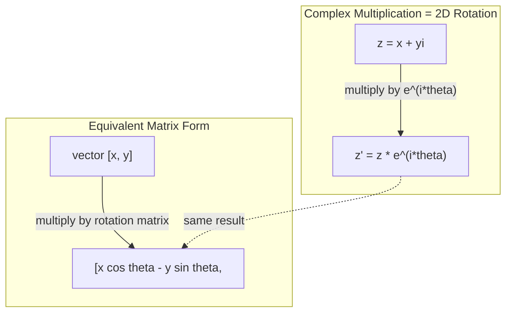
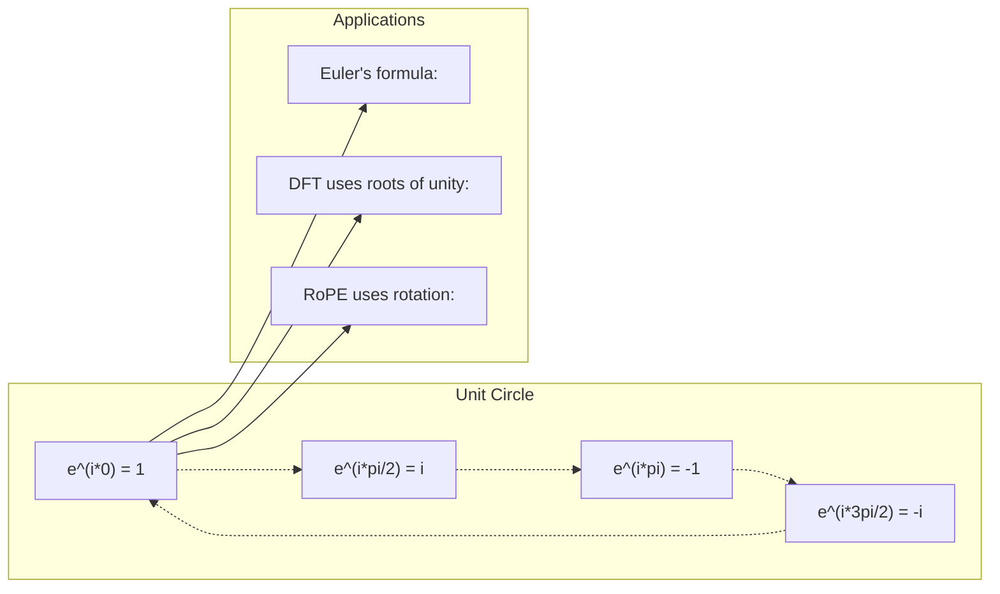

# AI 中的复数

> -1 的平方根不是虚构的。它是旋转、频率以及几乎一半信号处理的关键。

**Type:** Learn
**Language:** Python
**Prerequisites:** Phase 1, Lessons 01-04 (linear algebra, calculus)
**Time:** ~60 minutes

## 学习目标

- 在直角坐标形式和极坐标形式下进行复数运算（加、乘、除、共轭）
- 应用欧拉公式在复指数与三角函数之间转换
- 使用复数单位根实现离散傅里叶变换（DFT）
- 解释复数旋转如何构成 Transformer 中 RoPE 与正弦位置编码的基础

## 问题

你打开一篇关于傅里叶变换的论文，里面到处都是 `i`。你看到 Transformer 位置编码里在不同频率上使用 `sin` 和 `cos`——它们正是复指数的实部和虚部。你读到量子计算时，发现所有内容都用复向量空间表达。

复数看起来很抽象。一个建立在 -1 平方根之上的数系感觉像是数学技巧。但它不是技巧。它是旋转与振荡的自然语言。每当有东西在旋转、振动或震荡时，复数就是最合适的工具。

不理解复数，就无法理解离散傅里叶变换（DFT），无法理解 FFT，无法理解现代语言模型中 RoPE（旋转位置嵌入）的工作原理，也无法理解原始 Transformer 论文中的正弦位置编码为何使用那些频率。

本节课从零开始构建复数运算，把它与几何联系起来，并精确展示复数在机器学习中的出现位置。

## 概念

### 什么是复数？

复数有两部分：实部和虚部。

```
z = a + bi

where:
  a is the real part
  b is the imaginary part
  i is the imaginary unit, defined by i^2 = -1
```

就是这样。你把数轴扩展成一个平面。实数位于一条轴上，虚数位于另一条轴上。每个复数都是这个平面上的一个点。

### 复数运算

**加法。** 实部相加，虚部相加。

```math
\begin{aligned}
(a + bi) + (c + di) &= (a + c) + (b + d)i \\[4pt]
\text{Example: } (3 + 2i) + (1 + 4i) &= 4 + 6i
\end{aligned}
```

**乘法。** 使用分配律，并记住 $i^2 = -1$。

```math
\begin{aligned}
(a + bi)(c + di) &= ac + adi + bci + bdi^2 \\
&= ac + adi + bci - bd \\
&= (ac - bd) + (ad + bc)i \\[8pt]
\text{Example: } (3 + 2i)(1 + 4i) &= 3 + 12i + 2i + 8i^2 \\
&= 3 + 14i - 8 \\
&= -5 + 14i
\end{aligned}
```

**共轭。** 改变虚部的符号。

```math
\text{conjugate of } (a + bi) = a - bi
```

复数与其共轭的乘积总是实数：

```math
(a + bi)(a - bi) = a^2 + b^2
```

**除法。** 分子和分母同时乘以分母的共轭。

```math
\frac{a + bi}{c + di} = \frac{(a + bi)(c - di)}{c^2 + d^2}
```

这样可以消去分母中的虚部，得到一个干净的复数。

### 复平面

复平面把每个复数映射到一个二维点。水平轴是实轴，垂直轴是虚轴。

```
z = 3 + 2i  corresponds to the point (3, 2)
z = -1 + 0i corresponds to the point (-1, 0) on the real axis
z = 0 + 4i  corresponds to the point (0, 4) on the imaginary axis
```

复数同时是一个点，也是从原点出发的一条向量。这种双重解释使复数在几何中非常有用。

### 极坐标形式

平面上的任意一点都可以用其到原点的距离以及与正实轴的夹角来描述。

```math
\begin{aligned}
z &= r (\cos\theta + i \sin\theta) \\[4pt]
\text{where: } r &= |z| = \sqrt{a^2 + b^2} \quad \text{(magnitude, or modulus)} \\
\theta &= \mathop{\mathrm{atan2}}(b, a) \quad \text{(phase, or argument)}
\end{aligned}
```

直角坐标形式 $(a + bi)$ 便于加法。极坐标形式 $(r, \theta)$ 便于乘法。

**极坐标形式下的乘法。** 模长相乘，角度相加。

```math
\begin{aligned}
z_1 &= r_1 e^{i\theta_1} \\
z_2 &= r_2 e^{i\theta_2} \\[4pt]
z_1 z_2 &= (r_1 r_2) \, e^{i(\theta_1 + \theta_2)}
\end{aligned}
```

这就是复数特别适合旋转的原因。乘以一个模长为 1 的复数就是纯旋转。

### 欧拉公式

连接复指数与三角学的桥梁：

```math
e^{i\theta} = \cos\theta + i \sin\theta
```

这是本节课最重要的公式。当 $\theta = \pi$ 时：

```math
\begin{aligned}
e^{i\pi} &= \cos\pi + i \sin\pi = -1 + 0i = -1 \\[4pt]
\text{Therefore: } e^{i\pi} + 1 &= 0
\end{aligned}
```

五个基本常数（$e$、$i$、$\pi$、1、0）被联系在一个等式中。

### 为什么欧拉公式对 ML 重要

欧拉公式表明，当 $\theta$ 变化时，$e^{i\theta}$ 描绘出单位圆。在 $\theta = 0$ 时，你位于 $(1, 0)$；在 $\theta = \pi/2$ 时，位于 $(0, 1)$；在 $\theta = \pi$ 时，位于 $(-1, 0)$；在 $\theta = 3\pi/2$ 时，位于 $(0, -1)$。完整旋转对应 $\theta = 2\pi$。

这意味着复指数就是旋转。而旋转在信号处理和机器学习中无处不在。

### 与二维旋转的联系

把复数 $(x + yi)$ 乘以 $e^{i\theta}$，就会将点 $(x, y)$ 绕原点旋转角度 $\theta$。

```math
\begin{aligned}
&\text{Rotation via complex multiplication:} \\
&\quad (x + yi)(\cos\theta + i \sin\theta) = (x \cos\theta - y \sin\theta) + (x \sin\theta + y \cos\theta)i \\[8pt]
&\text{Rotation via matrix multiplication:} \\
&\quad \begin{bmatrix} \cos\theta & -\sin\theta \\ \sin\theta & \cos\theta \end{bmatrix} \begin{bmatrix} x \\ y \end{bmatrix} = \begin{bmatrix} x \cos\theta - y \sin\theta \\ x \sin\theta + y \cos\theta \end{bmatrix}
\end{aligned}
```

它们产生相同的结果。复数乘法就是二维旋转。旋转矩阵只是把复数乘法写成了矩阵形式。



### 相量与旋转信号

复指数 $e^{i\omega t}$ 是一个以角频率 $\omega$ 绕单位圆旋转的点。随着 $t$ 增加，该点描绘出圆周。

这个旋转点的实部是 $\cos(\omega t)$，虚部是 $\sin(\omega t)$。正弦信号就是旋转复数的投影。

```math
\begin{aligned}
e^{i\omega t} &= \cos(\omega t) + i \sin(\omega t) \\[4pt]
\text{Real part: } & \cos(\omega t) \quad \text{-- a cosine wave} \\
\text{Imaginary part: } & \sin(\omega t) \quad \text{-- a sine wave}
\end{aligned}
```

这就是相量表示。与其跟踪一条起伏的正弦波，不如跟踪一根平稳旋转的箭头。相移变成角度偏移，幅度变化变成模长变化，信号相加变成向量相加。

### 单位根

$N$ 次单位根是单位圆上均匀分布的 $N$ 个点：

```math
w_k = e^{2\pi i k/N} \quad \text{for } k = 0, 1, 2, \ldots, N-1
```

当 $N = 4$ 时，根为 $1, i, -1, -i$（四个正方向点）。
当 $N = 8$ 时，你得到四个正方向点加上四个对角线点。

单位根是离散傅里叶变换的基础。DFT 将信号分解为这些 $N$ 个等间距频率上的分量。

### 与 DFT 的联系

信号 $x[0], x[1], \ldots, x[N-1]$ 的离散傅里叶变换为：

```math
X[k] = \sum_{n=0}^{N-1} x[n] \, e^{-2\pi i k n/N}
```

每个 $X[k]$ 衡量信号与第 $k$ 个单位根——即频率为 $k$ 的复正弦波——的相关程度。DFT 把信号拆成 $N$ 个旋转相量，并告诉你每个相量的幅度和相位。

### 为什么 i 并不虚幻

「虚数」这个词是历史的偶然。笛卡尔曾轻蔑地使用它。但 $i$ 并不比人们最初拒绝负数时更虚幻。负数回答「3 减 5 等于多少？」；虚数单位回答「什么数平方会得到 -1？」

更有用的是：$i$ 是一个 90 度旋转算子。把实数乘以 $i$ 一次，就旋转 90 度到虚轴；再乘一次 $i$（即 $i^2$），再旋转 90 度——现在指向负实方向。这就是 $i^2 = -1$ 的原因。这并不神秘，只是两次四分之一转构成一次半转。

这就是复数在工程中无处不在的原因。任何会旋转的东西——电磁波、量子态、信号振荡、位置编码——都自然地用复数描述。

### 复指数与三角函数

在欧拉公式之前，工程师把信号写成 $A \cos(\omega t + \phi)$——振幅 $A$、频率 $\omega$、相位 $\phi$。这可行，但运算很痛苦：把两个不同相位的余弦相加需要三角恒等式。

使用复指数后，同一个信号变成 $A e^{i(\omega t + \phi)}$。两个信号相加就是两个复数相加；两个信号相乘（调制）就是模长相乘、角度相加；相移变成角度相加；频移变成乘以相量。

整个信号处理领域都转向了复指数表示，因为数学更简洁。「真实信号」始终是复数表示的实部。虚部作为簿记被携带，使所有代数自然成立。

### 与 Transformer 的联系

**正弦位置编码**（原始 Transformer 论文）：

```math
\begin{aligned}
PE(pos, 2i) &= \sin\left(pos / 10000^{2i/d}\right) \\
PE(pos, 2i+1) &= \cos\left(pos / 10000^{2i/d}\right)
\end{aligned}
```

sin 和 cos 成对出现，分别是不同频率复指数的实部和虚部。每个频率为位置编码提供不同的「分辨率」：低频变化缓慢（粗粒度位置），高频变化迅速（细粒度位置）。合在一起，它们给每个位置一个独特的频率指纹。

**RoPE（旋转位置嵌入）** 更进一步。它显式地把查询和键向量乘以复数旋转矩阵。两个 token 之间的相对位置变成一个旋转角度。注意力使用这些旋转向量计算，使模型通过复数乘法对相对位置敏感。

| 运算 | 代数形式 | 几何意义 |
|-----------|---------------|-------------------|
| 加法 | $(a+c) + (b+d)i$ | 平面上的向量相加 |
| 乘法 | $(ac-bd) + (ad+bc)i$ | 旋转并缩放 |
| 共轭 | $a - bi$ | 关于实轴反射 |
| 模长 | $\sqrt{a^2 + b^2}$ | 到原点的距离 |
| 辐角 | $\mathop{\mathrm{atan2}}(b, a)$ | 与正实轴的夹角 |
| 除法 | 乘以共轭 | 反向旋转并重新缩放 |
| 幂 | $r^n e^{in\theta}$ | 旋转 $n$ 次，并按 $r^n$ 缩放 |



```figure
roots-of-unity
```

## 构建它

### 第 1 步：复数类

构建一个复数类，支持直角坐标形式与极坐标形式之间的算术、模长、辐角和转换。

```python
import math

class Complex:
    def __init__(self, real, imag=0.0):
        self.real = real
        self.imag = imag

    def __add__(self, other):
        return Complex(self.real + other.real, self.imag + other.imag)

    def __mul__(self, other):
        r = self.real * other.real - self.imag * other.imag
        i = self.real * other.imag + self.imag * other.real
        return Complex(r, i)

    def __truediv__(self, other):
        denom = other.real ** 2 + other.imag ** 2
        r = (self.real * other.real + self.imag * other.imag) / denom
        i = (self.imag * other.real - self.real * other.imag) / denom
        return Complex(r, i)

    def magnitude(self):
        return math.sqrt(self.real ** 2 + self.imag ** 2)

    def phase(self):
        return math.atan2(self.imag, self.real)

    def conjugate(self):
        return Complex(self.real, -self.imag)
```

### 第 2 步：极坐标转换与欧拉公式

```python
def to_polar(z):
    return z.magnitude(), z.phase()

def from_polar(r, theta):
    return Complex(r * math.cos(theta), r * math.sin(theta))

def euler(theta):
    return Complex(math.cos(theta), math.sin(theta))
```

验证：`euler(theta).magnitude()` 应始终为 1.0；`euler(0)` 应给出 (1, 0)；`euler(pi)` 应给出 (-1, 0)。

### 第 3 步：旋转

把点 $(x, y)$ 旋转角度 $\theta$ 只需要一次复数乘法：

```python
point = Complex(3, 4)
rotated = point * euler(math.pi / 4)
```

模长保持不变，只有角度改变。

### 第 4 步：从复数运算实现 DFT

```python
def dft(signal):
    N = len(signal)
    result = []
    for k in range(N):
        total = Complex(0, 0)
        for n in range(N):
            angle = -2 * math.pi * k * n / N
            total = total + Complex(signal[n], 0) * euler(angle)
        result.append(total)
    return result
```

这是 $O(N^2)$ 的 DFT。每个输出 $X[k]$ 都是信号样本乘以单位根后的求和。

### 第 5 步：逆 DFT

逆 DFT 从频谱重建原始信号。与正向 DFT 相比，只需做两处改动：指数中的符号取反，并除以 $N$。

```python
def idft(spectrum):
    N = len(spectrum)
    result = []
    for n in range(N):
        total = Complex(0, 0)
        for k in range(N):
            angle = 2 * math.pi * k * n / N
            total = total + spectrum[k] * euler(angle)
        result.append(Complex(total.real / N, total.imag / N))
    return result
```

这能给出完美重建。先应用 DFT，再应用 IDFT，你会在机器精度内得到原始信号。没有信息丢失。

### 第 6 步：单位根

```python
def roots_of_unity(N):
    return [euler(2 * math.pi * k / N) for k in range(N)]
```

验证两条性质：
- 每个根的模长都恰好为 1。
- 所有 $N$ 个根之和为零（它们因对称性而相互抵消）。

这些性质正是 DFT 可逆的原因。单位根构成了频域的一组正交基。

## 使用它

Python 内置了复数支持。字面量 `j` 代表虚数单位。

```python
z = 3 + 2j
w = 1 + 4j

print(z + w)
print(z * w)
print(abs(z))

import cmath
print(cmath.phase(z))
print(cmath.exp(1j * cmath.pi))
```

对于数组，numpy 原生支持复数：

```python
import numpy as np

z = np.array([1+2j, 3+4j, 5+6j])
print(np.abs(z))
print(np.angle(z))
print(np.conj(z))
print(np.real(z))
print(np.imag(z))

signal = np.sin(2 * np.pi * 5 * np.linspace(0, 1, 128))
spectrum = np.fft.fft(signal)
freqs = np.fft.fftfreq(128, d=1/128)
```

## 交付它

运行 `code/complex_numbers.py` 生成 `outputs/skill-complex-arithmetic.md`。

## 练习

1. **手算复数。** 计算 $(2 + 3i)(4 - i)$ 并用代码验证。然后计算 $(5 + 2i) / (1 - 3i)$。在复平面上画出两个结果，并检查乘法是否旋转并缩放了第一个数。

2. **旋转序列。** 从点 $(1, 0)$ 开始，乘以 $e^{i\pi/6}$ 共 12 次。验证 12 次乘法后回到 $(1, 0)$。打印每一步的坐标，并确认它们描绘出一个正十二边形。

3. **已知信号的 DFT。** 构造一个信号，它是 $\sin(2\pi \cdot 3t)$ 与 $0.5 \sin(2\pi \cdot 7t)$ 之和，以 32 点采样。运行你的 DFT。验证幅度谱在频率 3 和 7 处出现峰值，且 7 处的峰值高度是 3 处的一半。

4. **单位根可视化。** 计算 8 次单位根。验证它们之和为零。验证任意根乘以本原根 $e^{2\pi i/8}$ 都会得到下一个根。

5. **旋转矩阵等价性。** 对 10 个随机角度和 10 个随机点，验证复数乘法与 2×2 旋转矩阵的矩阵-向量乘法给出相同结果。打印最大数值差异。

### 提示

**练习 1。** 利用 $i^2 = -1$ 展开乘积，除法时上下同乘共轭 $1 + 3i$。用 `Complex(2, 3) * Complex(4, -1)` 检查乘积：其 `magnitude()` 必须等于两个模长之积，其 `phase()` 必须等于两个辐角之和。

**练习 2。** 用 `euler(math.pi / 6)` 作为步长，乘以 12 次。每一步检查模长保持为 1，角度增加 30 度。最终点必须在约 1e-12 范围内接近 (1, 0)。

**练习 3。** 令 $t = n/32$ 构造时间点并调用 `dft`。只看 0 到 15 号桶，因为上半部分是镜像。振幅为 $A$ 的正弦在桶 $k$ 处的幅度约为 $AN/2$，因此桶 3 处约 16，桶 7 处约 8。

**练习 4。** 调用 `roots_of_unity(8)` 并将根相加：和的模长应接近 0。每个根除以前一个根，检查结果都等于 `euler(2 * math.pi / 8)`。

**练习 5。** 旋转矩阵为 [[cos t, -sin t], [sin t, cos t]]。对每个角度和点，计算 `euler(t) * Complex(x, y)` 和矩阵乘积，记录最大绝对差。预期值接近 $10^{-15}$。

## 关键术语

| 术语 | 含义 |
|------|---------------|
| 复数 | 形如 $a + bi$ 的数，其中 $a$ 是实部，$b$ 是虚部，且 $i^2 = -1$ |
| 虚数单位 | 数 $i$，由 $i^2 = -1$ 定义。在哲学意义上并不「虚幻」——它是一个旋转算子 |
| 复平面 | x 轴为实轴、y 轴为虚轴的二维平面。也称为 Argand 平面 |
| 模长（modulus） | 到原点的距离：$\sqrt{a^2 + b^2}$。记作 $\lvert z \rvert$ |
| 辐角（argument） | 与正实轴的夹角：$\mathop{\mathrm{atan2}}(b, a)$。记作 $\arg(z)$ |
| 共轭 | 关于实轴的镜像：$a + bi$ 的共轭是 $a - bi$ |
| 极坐标形式 | 将 $z$ 写成 $r e^{i\theta}$ 而非 $a + bi$。便于乘法 |
| 欧拉公式 | $e^{i\theta} = \cos\theta + i \sin\theta$。连接指数与三角学 |
| 相量 | 表示正弦信号的旋转复数 $e^{i\omega t}$ |
| 单位根 | $N$ 个复数 $e^{2\pi i k/N}$（$k = 0$ 到 $N-1$）。单位圆上均匀分布的 $N$ 个点 |
| DFT | 离散傅里叶变换。使用单位根将信号分解为复正弦分量 |
| RoPE | 旋转位置嵌入。使用复数乘法在 Transformer 注意力中编码相对位置 |

## 延伸阅读

- [Visual Introduction to Euler's Formula](https://betterexplained.com/articles/intuitive-understanding-of-eulers-formula/) - 不用繁重符号建立几何直觉
- [Su et al.: RoFormer (2021)](https://arxiv.org/abs/2104.09864) - 提出使用复数旋转的旋转位置嵌入
- [Vaswani et al.: Attention Is All You Need (2017)](https://arxiv.org/abs/1706.03762) - 使用正弦位置编码的原始 Transformer 论文
- [3Blue1Brown: Euler's formula with introductory group theory](https://www.youtube.com/watch?v=mvmuCPvRoWQ) - 用视觉解释为什么 $e^{i\pi} = -1$
- [Needham: Visual Complex Analysis](https://global.oup.com/academic/product/visual-complex-analysis-9780198534464) - 最优秀的复数视觉教材，充满几何洞见
- [Strang: Introduction to Linear Algebra, Ch. 10](https://math.mit.edu/~gs/linearalgebra/) - 在线性代数与特征值背景下的复数
