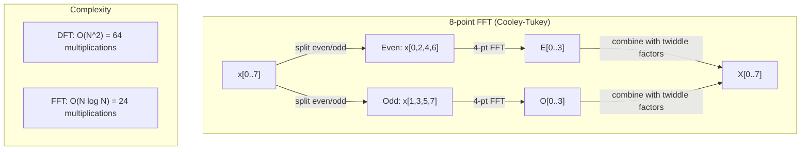
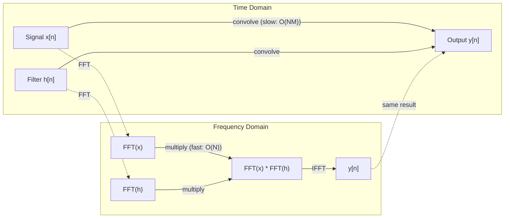

# 傅里叶变换

> 每个信号都是若干正弦波之和。傅里叶变换告诉你到底是哪些。

**Type:** Build
**Language:** Python
**Prerequisites:** Phase 1, Lessons 01-04, 19 (complex numbers)
**Time:** ~90 minutes

## 学习目标

- 从零实现 DFT，并与 $O(N \log N)$ 的 Cooley-Tukey FFT 进行验证
- 解读频率系数：从信号中提取幅度、相位和功率谱
- 应用卷积定理，通过 FFT 乘法实现卷积
- 将傅里叶频率分解与 Transformer 位置编码及 CNN 卷积层联系起来

## 问题

音频录音是一系列随时间变化的气压测量。股价是一系列随日期变化的数值。图像是空间中像素强度的网格。这些都属于时域（或空域）数据：你看到数值随某个索引变化。

但许多模式在时域中是看不见的。这段音频是单音还是和弦？这只股票有没有周周期？这张图像有没有重复纹理？这些问题关乎频率内容，而时域把它隐藏了起来。

傅里叶变换把数据从时域转换到频域。它接收一个信号，并将其分解为不同频率的正弦波。每个正弦波都有幅度（多强）和相位（从哪开始）。傅里叶变换同时告诉你两者。

这对机器学习很重要，因为频域思维无处不在。卷积神经网络执行的是卷积，而在频域中卷积就是乘法。Transformer 位置编码利用频率分解来表示位置。音频模型（语音识别、音乐生成）在频谱图上运行——频谱图是声音的频域表示。时间序列模型寻找周期性模式。理解傅里叶变换，你就拥有了处理这一切的词汇。

## 概念

### DFT 定义

给定 $N$ 个样本 $x[0], x[1], \ldots, x[N-1]$，离散傅里叶变换产生 $N$ 个频率系数 $X[0], X[1], \ldots, X[N-1]$：

```math
X[k] = \sum_{n=0}^{N-1} x[n] \, e^{-2\pi i k n/N} \qquad \text{for } k = 0, 1, \ldots, N-1
```

每个 $X[k]$ 都是复数。它的模长 $\lvert X[k] \rvert$ 告诉你频率 $k$ 的幅度；它的相位 $\angle X[k]$ 告诉你该频率的相位偏移。

关键洞见：$e^{-2\pi i k n/N}$ 是一个频率为 $k$ 的旋转相量。DFT 计算信号与 $N$ 个等间距频率之间的相关性。如果信号在频率 $k$ 上有能量，相关性就大；否则接近零。

### 每个系数的含义

**$X[0]$：直流分量。** 它是所有样本之和，与均值成正比。代表信号的恒定（零频率）偏移。

```math
X[0] = \sum_{n=0}^{N-1} x[n] \, e^0 = \text{sum of all samples}
```

**$X[k]$，$1 \le k \le N/2$：正频率。** $X[k]$ 代表每 $N$ 个样本中循环 $k$ 次的频率。$k$ 越大，频率越高（振荡越快）。

**$X[N/2]$：奈奎斯特频率。** 用 $N$ 个样本能表示的最高频率。超过这个频率就会出现混叠——高频伪装成低频。

**$X[k]$，$N/2 < k < N$：负频率。** 对于实值信号，$X[N-k] = \overline{X[k]}$。负频率是正频率的镜像。这就是有用信息集中在前 $N/2 + 1$ 个系数的原因。

### 逆 DFT

逆 DFT 从频率系数重建原始信号：

```math
x[n] = \frac{1}{N} \sum_{k=0}^{N-1} X[k] \, e^{2\pi i k n/N} \qquad \text{for } n = 0, 1, \ldots, N-1
```

与正向 DFT 相比，只有两处不同：指数中的符号为正（不是负），并带有 $1/N$ 归一化因子。

逆 DFT 是完美重建。没有信息丢失。你可以从时域到频域再返回，没有任何误差。DFT 是一种基变换——它在不同的坐标系中重新表达相同的信息。

### FFT：让它变快

上面定义的 DFT 是 $O(N^2)$：对每个 $N$ 个输出系数，都要对 $N$ 个输入样本求和。当 $N$ = 100 万时，就是 $10^{12}$ 次运算。

快速傅里叶变换（FFT）在 $O(N \log N)$ 时间内计算同样结果。当 $N$ = 100 万时，大约是 2000 万次运算，而不是一万亿。这使频率分析变得实用。

Cooley-Tukey 算法（最常见的 FFT）采用分治法：

1. 将信号分成偶数索引和奇数索引样本。
2. 递归计算每一半的 DFT。
3. 使用「旋转因子」$e^{-2\pi i k/N}$ 合并两个半尺寸的 DFT。

```math
\begin{aligned}
X[k] &= E[k] + e^{-2\pi i k/N} \, O[k] && \text{for } k = 0, \ldots, N/2 - 1 \\
X[k + N/2] &= E[k] - e^{-2\pi i k/N} \, O[k] && \text{for } k = 0, \ldots, N/2 - 1 \\[6pt]
\text{where } E &= \text{DFT of even-indexed samples} \\
O &= \text{DFT of odd-indexed samples}
\end{aligned}
```

对称性意味着递归的每一层都做 $O(N)$ 工作量，共有 $\log_2(N)$ 层。总计 $O(N \log N)$。



FFT 要求信号长度为 2 的幂。实际中，信号会被零填充到下一个 2 的幂。

### 频谱分析

**功率谱**是 $\lvert X[k] \rvert^2$——每个频率系数模长的平方。它显示每个频率上有多少能量。

**相位谱**是 $\angle X[k]$——每个频率的相位偏移。对于大多数分析任务，你只关心功率谱而忽略相位。

```math
\begin{aligned}
\text{Power at frequency } k: \quad P[k] &= |X[k]|^2 = \mathop{\mathrm{Re}}(X[k])^2 + \mathop{\mathrm{Im}}(X[k])^2 \\
\text{Phase at frequency } k: \quad \phi[k] &= \mathop{\mathrm{atan2}}(\mathop{\mathrm{Im}}(X[k]), \mathop{\mathrm{Re}}(X[k]))
\end{aligned}
```

### 频率分辨率

DFT 的频率分辨率取决于样本数 $N$ 和采样率 $f_s$。

```math
\begin{aligned}
\text{Frequency of bin } k: \quad & f_k = k \cdot f_s / N \\
\text{Frequency resolution:} \quad & \Delta f = f_s / N \\
\text{Maximum frequency:} \quad & f_{\max} = f_s / 2 \quad \text{(Nyquist)}
\end{aligned}
```

要分辨两个相距很近的频率，需要更多样本。要捕捉高频，需要更高的采样率。

### 卷积定理

这是信号处理中最重要的结果之一，也与 CNN 直接相关。

**时域中的卷积等于频域中的逐点乘法。**

```math
\begin{aligned}
& x * h = \text{IFFT}(\text{FFT}(x) \cdot \text{FFT}(h)) \\[4pt]
& \text{where } * \text{ is convolution and } \cdot \text{ is element-wise multiplication}
\end{aligned}
```

为什么重要：

- 直接卷积两个长度为 $N$ 和 $M$ 的信号需要 $O(NM)$ 次运算。
- 基于 FFT 的卷积需要 $O(N \log N)$：分别变换、相乘、逆变换。
- 对于大卷积核，FFT 卷积快得多。
- 这正是感受野较大的卷积层中发生的情况。

注意：DFT 计算的是循环卷积（信号会回绕）。对于线性卷积（不回绕），要在计算前将两个信号零填充到长度 $N + M - 1$。



### 加窗

DFT 假设信号是周期性的——它把 $N$ 个样本当作无限重复信号的一个周期。如果信号首尾值不同，边界处就会产生不连续，表现为虚假的高频内容。这称为频谱泄漏。

加窗通过在计算 DFT 前将信号两端逐渐衰减到零来减少泄漏。

常见窗函数：

| 窗函数 | 形状 | 主瓣宽度 | 旁瓣电平 | 使用场景 |
|--------|-------|----------------|-----------------|----------|
| Rectangular | 平坦（无窗） | 最窄 | 最高（-13 dB） | 信号在 N 个样本内恰好周期时 |
| Hann | 升余弦 | 中等 | 低（-31 dB） | 通用频谱分析 |
| Hamming | 修正余弦 | 中等 | 更低（-42 dB） | 音频处理、语音分析 |
| Blackman | 三重余弦 | 宽 | 很低（-58 dB） | 旁瓣抑制至关重要时 |

```math
\begin{aligned}
\text{Hann window:} \quad & w[n] = 0.5 \left(1 - \cos\frac{2\pi n}{N-1}\right) \\
\text{Hamming window:} \quad & w[n] = 0.54 - 0.46 \cos\frac{2\pi n}{N-1}
\end{aligned}
```

应用窗函数时，在 DFT 前将窗与信号逐元素相乘：`X = DFT(x * w)`。

### DFT 性质

| 性质 | 时域 | 频域 |
|----------|-------------|-----------------|
| 线性性 | $ax + by$ | $aX + bY$ |
| 时移 | $x[n - k]$ | $X[f] e^{-2\pi i f k/N}$ |
| 频移 | $x[n] e^{2\pi i f_0 n/N}$ | $X[f - f_0]$ |
| 卷积 | $x * h$ | $X \cdot H$（逐点） |
| 乘法 | $x \cdot h$（逐点） | $X * H$（循环卷积，缩放 $1/N$） |
| 帕塞瓦尔定理 | $\sum \lvert x[n] \rvert^2$ | $\frac{1}{N} \sum \lvert X[k] \rvert^2$ |
| 共轭对称（实输入） | $x[n]$ 为实数 | $X[k] = \overline{X[N-k]}$ |

帕塞瓦尔定理说明总能量在两个域中相同。能量在变换过程中守恒。

### 与位置编码的联系

原始 Transformer 使用正弦位置编码：

```math
\begin{aligned}
PE(pos, 2i) &= \sin\left(pos / 10000^{2i/d_{\text{model}}}\right) \\
PE(pos, 2i+1) &= \cos\left(pos / 10000^{2i/d_{\text{model}}}\right)
\end{aligned}
```

每个维度对 $(2i, 2i+1)$ 以不同频率振荡。频率从高频（维度 0、1）到低频（最后几个维度）按几何级数分布。这赋予每个位置在所有频带上独特的模式——类似于傅里叶系数唯一标识一个信号。

它提供的关键性质：

- **唯一性：** 没有两个位置具有相同编码。
- **有界值：** sin 和 cos 始终在 $[-1, 1]$ 内。
- **相对位置：** 位置 $p+k$ 的编码可以表示为位置 $p$ 编码的线性函数。模型可以学习关注相对位置。

### 与 CNN 的联系

卷积层通过在信号或图像上滑动一个可学习的滤波器（卷积核）来作用于输入。数学上，这就是卷积运算。

根据卷积定理，它等价于：
1. 对输入做 FFT
2. 对卷积核做 FFT
3. 在频域逐点相乘
4. 对结果做 IFFT

标准 CNN 实现使用直接卷积（对小型 3×3 卷积核更快）。但对于大卷积核或全局卷积，基于 FFT 的方法明显更快。一些架构（如 FNet）完全用 FFT 替代注意力，以 $O(N \log N)$ 复杂度达到有竞争力的精度，而非 $O(N^2)$。

### 频谱图与短时傅里叶变换

单次 FFT 给出整个信号的频率内容，但不告诉你这些频率在何时出现。啁啾（频率随时间增加的信号）与和弦（所有频率同时出现）可以具有相同的幅度谱。

短时傅里叶变换（STFT）通过在信号的重叠窗口上计算 FFT 来解决这个问题。结果是一个频谱图：一种二维表示，一个轴是时间，另一个轴是频率。每个点的强度显示该时刻该频率的能量。

```
STFT procedure:
1. Choose a window size (e.g., 1024 samples)
2. Choose a hop size (e.g., 256 samples -- 75% overlap)
3. For each window position:
   a. Extract the windowed segment
   b. Apply a Hann/Hamming window
   c. Compute FFT
   d. Store the magnitude spectrum as one column of the spectrogram
```

频谱图是音频机器学习模型的标准输入表示。语音识别模型（Whisper、DeepSpeech）在 mel 频谱图上运行——mel 频谱图将频率映射到 mel 尺度，更符合人类音高感知。

### 混叠

如果信号包含高于 $f_s/2$（奈奎斯特频率）的频率，以速率 $f_s$ 采样就会产生混叠副本。90 Hz 信号以 100 Hz 采样看起来与 10 Hz 信号完全相同。仅凭样本无法区分它们。

```
Example:
  True signal: 90 Hz sine wave
  Sampling rate: 100 Hz
  Apparent frequency: 100 - 90 = 10 Hz

  The samples from the 90 Hz signal at 100 Hz sampling rate
  are identical to the samples from a 10 Hz signal.
  No amount of math can recover the original 90 Hz.
```

这就是模数转换器在采样前使用抗混叠滤波器去除奈奎斯特频率以上频率的原因。在机器学习中，混叠出现在未经过适当低通滤波就下采样特征图时——一些架构通过抗混叠池化层来解决。

### 零填充不会提高分辨率

一个常见误解：在 FFT 前对信号进行零填充可以改善频率分辨率。事实并非如此。零填充只是在已有频率桶之间插值，使频谱看起来更平滑。但它无法揭示原始样本中不存在的频率细节。

真实频率分辨率只取决于观测时间 $T = N / f_s$。要分辨两个相距 $\Delta f$ 的频率，至少需要 $T = 1 / \Delta f$ 秒的数据。再多的零填充也无法改变这一基本限制。

```figure
fourier-synthesis
```

## 构建它

### 第 1 步：从零实现 DFT

$O(N^2)$ 的 DFT 直接来自定义。

```python
import math

class Complex:
    ...

def dft(x):
    N = len(x)
    result = []
    for k in range(N):
        total = Complex(0, 0)
        for n in range(N):
            angle = -2 * math.pi * k * n / N
            w = Complex(math.cos(angle), math.sin(angle))
            xn = x[n] if isinstance(x[n], Complex) else Complex(x[n])
            total = total + xn * w
        result.append(total)
    return result
```

### 第 2 步：逆 DFT

结构相同，指数为正，并除以 $N$。

```python
def idft(X):
    N = len(X)
    result = []
    for n in range(N):
        total = Complex(0, 0)
        for k in range(N):
            angle = 2 * math.pi * k * n / N
            w = Complex(math.cos(angle), math.sin(angle))
            total = total + X[k] * w
        result.append(Complex(total.real / N, total.imag / N))
    return result
```

### 第 3 步：FFT（Cooley-Tukey）

递归 FFT 要求长度为 2 的幂。分成偶数和奇数，递归，再用旋转因子合并。

```python
def fft(x):
    N = len(x)
    if N <= 1:
        return [x[0] if isinstance(x[0], Complex) else Complex(x[0])]
    if N % 2 != 0:
        return dft(x)

    even = fft([x[i] for i in range(0, N, 2)])
    odd = fft([x[i] for i in range(1, N, 2)])

    result = [Complex(0)] * N
    for k in range(N // 2):
        angle = -2 * math.pi * k / N
        twiddle = Complex(math.cos(angle), math.sin(angle))
        t = twiddle * odd[k]
        result[k] = even[k] + t
        result[k + N // 2] = even[k] - t
    return result
```

### 第 4 步：频谱分析辅助函数

```python
def power_spectrum(X):
    return [xk.real ** 2 + xk.imag ** 2 for xk in X]

def convolve_fft(x, h):
    N = len(x) + len(h) - 1
    padded_N = 1
    while padded_N < N:
        padded_N *= 2

    x_padded = x + [0.0] * (padded_N - len(x))
    h_padded = h + [0.0] * (padded_N - len(h))

    X = fft(x_padded)
    H = fft(h_padded)

    Y = [xk * hk for xk, hk in zip(X, H)]

    y = idft(Y)
    return [y[n].real for n in range(N)]
```

## 使用它

实际工作中，使用 numpy 的 FFT，它由高度优化的 C 库支持。

```python
import numpy as np

signal = np.sin(2 * np.pi * 5 * np.arange(256) / 256)
spectrum = np.fft.fft(signal)
freqs = np.fft.fftfreq(256, d=1/256)

power = np.abs(spectrum) ** 2

positive_freqs = freqs[:len(freqs)//2]
positive_power = power[:len(power)//2]
```

对于加窗和更高级的频谱分析：

```python
from scipy.signal import windows, stft

window = windows.hann(256)
windowed = signal * window
spectrum = np.fft.fft(windowed)
```

对于卷积：

```python
from scipy.signal import fftconvolve

result = fftconvolve(signal, kernel, mode='full')
```

对于频谱图：

```python
from scipy.signal import stft

frequencies, times, Zxx = stft(signal, fs=sample_rate, nperseg=256)
spectrogram = np.abs(Zxx) ** 2
```

频谱图矩阵的形状为 (n_frequencies, n_time_frames)。每一列是一个时间窗口的功率谱。这就是音频机器学习模型消费的输入。

## 交付它

运行 `code/fourier.py` 生成 `outputs/prompt-spectral-analyzer.md`。

## 练习

1. **纯音识别。** 构造一个未知频率（1 到 50 Hz 之间）的单正弦波信号，以 128 Hz 采样 1 秒。用你的 DFT 识别频率。验证答案是否正确。然后加入标准差为 0.5 的高斯噪声并重复。噪声如何影响频谱？

2. **FFT 与 DFT 验证。** 生成长度为 64 的随机信号。分别计算 DFT（$O(N^2){}$）和 FFT。验证所有系数在 1e-10 内一致。在长度为 256、512、1024、2048 的信号上为两者计时，绘制 DFT 时间与 FFT 时间之比。

3. **卷积定理实例验证。** 构造信号 x = [1, 2, 3, 4, 0, 0, 0, 0] 和滤波器 h = [1, 1, 1, 0, 0, 0, 0, 0]。直接计算它们的循环卷积（嵌套循环），然后通过 FFT（变换、相乘、逆变换）计算。验证结果一致。再通过适当的零填充实现线性卷积。

4. **加窗效果。** 构造一个由 10 Hz 和 12 Hz 两个正弦波（非常接近）相加而成的信号，以 128 Hz 采样 1 秒。分别计算无窗、Hann 窗和 Hamming 窗下的功率谱。哪种窗最容易区分两个峰值？为什么？

5. **位置编码分析。** 为 d_model = 128、max_pos = 512 生成正弦位置编码。对每对位置 $(p_1, p_2)$，计算它们编码的点积。证明点积只取决于 $\lvert p_1 - p_2 \rvert$，而与绝对位置无关。随着距离增大，点积如何变化？

### 提示

**练习 1。** 128 个样本持续 1 秒时，桶 $k$ 对应 $k$ Hz，因此若频率为整数，则 1 到 63 号桶中最大值的索引就是频率。选一个整数赫兹。若频率落在两个桶之间，能量会泄漏到相邻桶，峰值只给出最近的桶。使用 `generate_signal` 和 `magnitude_spectrum`。加噪后，检查峰值仍在同一桶，而其他桶升高。

**练习 2。** 使用 2 的幂长度，因为 `fft` 会把信号对半分割。检查所有系数的 `max(abs(a - b))`。时间比应大致随 $N / \log_2 N$ 增长。

**练习 3。** 对于循环卷积，手工计算 $y[n] = \sum_k h[k] x[(n-k) \bmod 8]$（$n$ = 0、1、2），并比较 `convolve_direct` 与 `convolve_fft` 的前三个值。线性卷积长度为 4 + 3 - 1 = 6，先检查当前长度 8 是否已足够。

**练习 4。** 使用 `hann_window`、`hamming_window`、`apply_window` 和 `power_spectrum`，统计 9 到 13 Hz 之间可分离的峰值数量。由于 10 Hz 和 12 Hz 都在 1 秒内完成整数个周期，无窗可能看起来最好。改用 10.5 Hz 和 12.5 Hz 重复，观察加窗如何减少泄漏。

**练习 5。** 用 `positional_encoding(pos, 128)` 计算每个编码。比较位置 (0, 10) 与 (100, 110) 的点积：二者必须在大约 1e-10 内一致。然后对固定 $p_1$，绘制点积随 $\lvert p_1 - p_2 \rvert$ 的变化。

## 关键术语

| 术语 | 含义 |
|------|---------------|
| DFT（离散傅里叶变换） | 将 $N$ 个时域样本转换为 $N$ 个频域系数。每个系数是与该频率复正弦波的相关性 |
| FFT（快速傅里叶变换） | 以 $O(N \log N)$ 计算 DFT 的算法。Cooley-Tukey 算法递归地分割偶/奇索引 |
| 逆 DFT | 从频率系数重建时域信号。公式与 DFT 相同，指数符号取反并乘以 $1/N$ |
| 频率桶 | DFT 输出中每个索引 $k$ 代表频率 $k f_s/N$ Hz。「桶」即离散频率槽 |
| 直流分量 | $X[0]$，零频率系数。与信号均值成正比 |
| 奈奎斯特频率 | $f_s/2$，采样率为 $f_s$ 时可表示的最高频率。高于它的频率会混叠 |
| 功率谱 | $\lvert X[k] \rvert^2$，每个频率系数模长的平方。展示能量在各频率上的分布 |
| 相位谱 | $\angle X[k]$，每个频率分量的相位偏移。分析中常被忽略 |
| 频谱泄漏 | 把非周期信号当作周期信号处理而产生的虚假频率内容。可通过加窗减少 |
| 窗函数 | 在 DFT 前应用的锥形函数（Hann、Hamming、Blackman），用于减少频谱泄漏 |
| 旋转因子 | 复指数 $e^{-2\pi i k/N}$，在 FFT 蝶形运算中用于合并子 DFT |
| 卷积定理 | 时域卷积等于频域逐点乘法。信号处理与 CNN 的基础 |
| 循环卷积 | 信号会回绕的卷积。这是 DFT 自然计算的形式 |
| 线性卷积 | 不回绕的标准卷积。通过对 DFT 前零填充实现 |
| 帕塞瓦尔定理 | 傅里叶变换保持总能量。$\sum \lvert x[n] \rvert^2 = \frac{1}{N} \sum \lvert X[k] \rvert^2$ |
| 混叠 | 由于采样率不足，高于奈奎斯特的频率表现为低频 |

## 延伸阅读

- [Cooley & Tukey: An Algorithm for the Machine Calculation of Complex Fourier Series (1965)](https://www.ams.org/journals/mcom/1965-19-090/S0025-5718-1965-0178586-1/) - 改变计算的原始 FFT 论文
- [3Blue1Brown: But what is the Fourier Transform?](https://www.youtube.com/watch?v=spUNpyF58BY) - 傅里叶变换的最佳视觉入门
- [Lee-Thorp et al.: FNet: Mixing Tokens with Fourier Transforms (2021)](https://arxiv.org/abs/2105.03824) - 在 Transformer 中用 FFT 替代自注意力
- [Smith: The Scientist and Engineer's Guide to Digital Signal Processing](http://www.dspguide.com/) - 免费在线教材，深入覆盖 FFT、加窗和频谱分析
- [Vaswani et al.: Attention Is All You Need (2017)](https://arxiv.org/abs/1706.03762) - 从傅里叶频率分解推导出的正弦位置编码
- [Radford et al.: Whisper (2022)](https://arxiv.org/abs/2212.04356) - 以 mel 频谱图作为输入表示的语音识别
