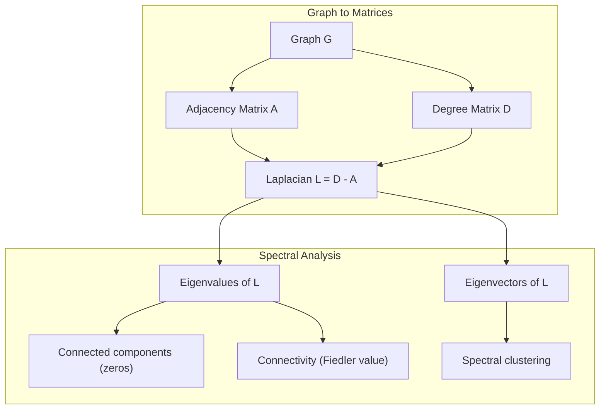
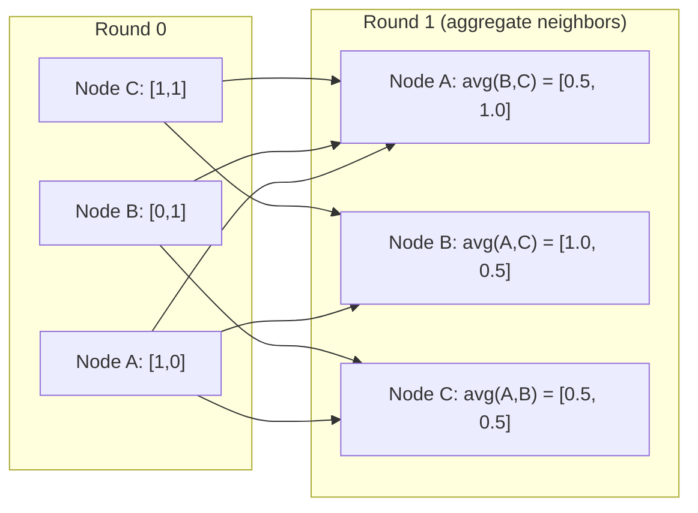

# 机器学习中的图论

> 图是关系的数据结构。如果你的数据存在连接，就需要图论。

**Type:** Build
**Language:** Python
**Prerequisites:** Phase 1, Lessons 01-03 (linear algebra, matrices)
**Time:** ~90 minutes

## 学习目标

- 构建一个图类，支持邻接矩阵/邻接表两种表示，并实现 BFS 与 DFS 遍历
- 计算图 Laplacian，并利用其特征值检测连通分量、对节点聚类
- 用归一化邻接矩阵乘法实现一轮 GNN 风格的消息传递
- 应用谱聚类，借助 Fiedler 向量对图进行划分

## 问题

社交网络、分子、知识库、引文网络、道路地图——它们都是图。传统机器学习把数据当作扁平的表格：每一行独立，每一列是一个特征。但当连接结构本身携带信息时，表格就会失效。

以社交网络为例。你想预测某个用户会购买什么商品，他的购买历史很重要，但他朋友的购买历史往往更重要。连接本身就是信号。

再比如一个分子。你想预测它是否能与某种蛋白质结合，原子固然重要，但真正重要的是原子之间如何成键。结构就是数据。

图神经网络（GNN）是深度学习发展最快的领域之一，驱动着药物发现、社交推荐、欺诈检测和知识图谱推理。每个 GNN 都建立在同一个基础之上：基本图论。

你需要掌握四件事：
1. 把图表示成矩阵的方法（这样你就可以对它们做乘法）
2. 遍历算法，用于探索图结构
3. Laplacian——谱图论中最重要的矩阵
4. 消息传递——让 GNN 运转起来的核心操作

## 概念

### 图：节点与边

一个图 $G = (V, E)$ 由顶点（节点）$V$ 和边 $E$ 组成，每条边连接两个节点。

**有向图与无向图。** 在无向图中，边 $(u, v)$ 表示 $u$ 连接到 $v$ **并且** $v$ 连接到 $u$。在有向图（digraph）中，边 $(u, v)$ 表示 $u$ 指向 $v$，但反向不一定成立。

**加权图与非加权图。** 在非加权图中，边要么存在，要么不存在。在加权图中，每条边带有一个数值权重——可以表示距离、成本或强度。

| 图类型 | 示例 |
|-----------|---------|
| 无向、非加权 | Facebook 好友网络 |
| 有向、非加权 | Twitter 关注网络 |
| 无向、加权 | 道路地图（距离） |
| 有向、加权 | 网页链接（PageRank 分数） |

### 邻接矩阵

邻接矩阵 $A$ 是图的核心表示。对于一个包含 $n$ 个节点的图：

```math
A[i][j] = \begin{cases} 1 & \text{if there is an edge from node } i \text{ to node } j \\ 0 & \text{otherwise} \end{cases}
```

对于无向图，$A$ 是对称矩阵：$A[i][j] = A[j][i]$。对于加权图，$A[i][j]$ 等于边 $(i, j)$ 的权重。

**示例——一个三角形：**

```
Nodes: 0, 1, 2
Edges: (0,1), (1,2), (0,2)

A = [[0, 1, 1],
     [1, 0, 1],
     [1, 1, 0]]
```

邻接矩阵是每个 GNN 的输入。对 $A$ 做矩阵运算，就对应着对图做操作。

### 度

节点的度（degree）是与它相连的边的数量。在有向图中，你还会遇到入度（指向该节点的边）和出度（从该节点指出的边）。

度矩阵 $D$ 是一个对角矩阵：

```math
\begin{aligned}
D[i][i] &= \text{degree of node } i \\
D[i][j] &= 0 \quad \text{for } i \ne j
\end{aligned}
```

对于上面的三角形：$D = \mathop{\mathrm{diag}}(2, 2, 2)$，因为每个节点都连接另外两个节点。

度反映节点的重要性。高度数意味着该节点是一个枢纽（hub）。网络的度分布揭示了它的结构：社交网络通常服从幂律分布（少数枢纽、大量叶子节点），而随机图的度分布接近泊松分布。

### BFS 与 DFS

这是两种最基本的图遍历算法，你都需要掌握。

**广度优先搜索（BFS）：** 先访问所有邻居，再访问邻居的邻居。使用队列（FIFO）。

```
BFS from node 0:
  Visit 0
  Queue: [1, 2]        (neighbors of 0)
  Visit 1
  Queue: [2, 3]        (add neighbors of 1)
  Visit 2
  Queue: [3]           (neighbors of 2 already visited)
  Visit 3
  Queue: []            (done)
```

BFS 能在非加权图中找到最短路径。从起点到任意节点的距离，等于该节点首次被发现时所在的 BFS 层数。因此 BFS 常用于计算社交网络中的跳数距离。

**深度优先搜索（DFS）：** 尽可能向纵深探索，直到无法前进再回溯。使用栈（LIFO）或递归实现。

```
DFS from node 0:
  Visit 0
  Stack: [1, 2]        (neighbors of 0)
  Visit 2               (pop from stack)
  Stack: [1, 3]         (add neighbors of 2)
  Visit 3               (pop from stack)
  Stack: [1]
  Visit 1               (pop from stack)
  Stack: []             (done)
```

DFS 适用于：
- 查找连通分量（从每个未访问节点启动一次 DFS）
- 检测环（DFS 树中的回边）
- 拓扑排序（按 DFS 完成时间的逆序）

| 算法 | 数据结构 | 能发现什么 | 典型用途 |
|-----------|---------------|-------|----------|
| BFS | 队列 | 最短路径 | 社交网络距离、知识图谱遍历 |
| DFS | 栈 | 连通分量、环 | 连通性判断、拓扑排序 |

### 图 Laplacian

$L = D - A$。这是谱图论中最重要的矩阵。

对于上面的三角形：

```math
D = \begin{bmatrix} 2 & 0 & 0 \\ 0 & 2 & 0 \\ 0 & 0 & 2 \end{bmatrix} \qquad A = \begin{bmatrix} 0 & 1 & 1 \\ 1 & 0 & 1 \\ 1 & 1 & 0 \end{bmatrix} \qquad L = \begin{bmatrix} 2 & -1 & -1 \\ -1 & 2 & -1 \\ -1 & -1 & 2 \end{bmatrix}
```

Laplacian 具有以下显著性质：

1. **$L$ 是半正定的。** 所有特征值都 $\ge 0$。

2. **零特征值的个数等于连通分量的个数。** 连通图恰好有一个零特征值；包含 3 个不连通部分的图则有三个零特征值。

3. **最小的非零特征值（Fiedler 值）衡量连通性。** Fiedler 值越大，图的连通性越好；Fiedler 值越小，说明图存在薄弱点——瓶颈。

4. **Fiedler 值对应的特征向量（Fiedler 向量）揭示了最佳划分。** 取值为正的节点归入一组，取值为负的节点归入另一组。这就是谱聚类。



### 谱性质

邻接矩阵和 Laplacian 的特征值可以在不做任何遍历的情况下揭示图的结构性质。

**谱聚类**的工作流程如下：
1. 计算 Laplacian $L$
2. 找到 $L$ 的 $k$ 个最小特征向量（跳过第一个，对于连通图它是全 1 向量）
3. 把这些特征向量作为每个节点的新坐标
4. 在这些坐标上运行 $k$-means

为什么有效？$L$ 的特征向量编码了图上「最平滑」的函数。连接紧密的节点会得到相近的特征向量值，而被瓶颈隔开的节点则取值不同。因此特征向量能自然地把簇分开。

**随机游走的联系。** 归一化 Laplacian 与图上的随机游走有关。随机游走的平稳分布与节点度成正比，其混合时间（随机游走多快收敛）取决于谱间隙。

### 消息传递

这是图神经网络的核心操作。每个节点收集来自邻居的消息，聚合后更新自身状态。

```math
h_v^{(k+1)} = \text{UPDATE}\left(h_v^{(k)}, \text{AGGREGATE}\left(\{h_u^{(k)} : u \in \text{neighbors}(v)\}\right)\right)
```

最简单的形式是 AGGREGATE = mean，UPDATE = 线性变换 + 激活：

```math
h_v^{(k+1)} = \sigma\left(W \cdot \text{mean}\left(\{h_u^{(k)} : u \in \text{neighbors}(v)\}\right)\right)
```

这本质上是矩阵乘法。如果 $H$ 是所有节点特征的矩阵，$A$ 是邻接矩阵：

```math
H^{(k+1)} = \sigma\left(A_{\text{norm}} H^{(k)} W\right)
```

其中 $A_{\text{norm}}$ 是归一化邻接矩阵（每行和为 1）。

一轮消息传递让每个节点「看到」它的直接邻居；两轮让它看到邻居的邻居；$K$ 轮后，每个节点获得 $K$ 跳邻域的信息。



### 概念与机器学习应用

| 概念 | 机器学习应用 |
|---------|---------------|
| 邻接矩阵 | GNN 输入表示 |
| 图 Laplacian | 谱聚类、社区发现 |
| BFS/DFS | 知识图谱遍历、路径查找 |
| 度分布 | 节点重要性、特征工程 |
| 消息传递 | GNN 层（GCN、GAT、GraphSAGE） |
| $L$ 的特征值 | 社区发现、图划分 |
| 谱聚类 | 无监督节点分组 |
| PageRank | 节点重要性、网页搜索 |

```figure
graph-degree-distribution
```

## 构建它

### 第 1 步：从零构建图类

```python
class Graph:
    def __init__(self, n_nodes, directed=False):
        self.n = n_nodes
        self.directed = directed
        self.adj = {i: {} for i in range(n_nodes)}

    def add_edge(self, u, v, weight=1.0):
        self.adj[u][v] = weight
        if not self.directed:
            self.adj[v][u] = weight

    def neighbors(self, node):
        return list(self.adj[node].keys())

    def degree(self, node):
        return len(self.adj[node])

    def adjacency_matrix(self):
        import numpy as np
        A = np.zeros((self.n, self.n))
        for u in range(self.n):
            for v, w in self.adj[u].items():
                A[u][v] = w
        return A

    def degree_matrix(self):
        import numpy as np
        D = np.zeros((self.n, self.n))
        for i in range(self.n):
            D[i][i] = self.degree(i)
        return D

    def laplacian(self):
        return self.degree_matrix() - self.adjacency_matrix()
```

邻接表（`self.adj`）高效地存储邻居。邻接矩阵的转换使用 numpy，因为所有谱运算都需要矩阵形式。

### 第 2 步：BFS 与 DFS

```python
from collections import deque

def bfs(graph, start):
    visited = set()
    order = []
    distances = {}
    queue = deque([(start, 0)])
    visited.add(start)
    while queue:
        node, dist = queue.popleft()
        order.append(node)
        distances[node] = dist
        for neighbor in graph.neighbors(node):
            if neighbor not in visited:
                visited.add(neighbor)
                queue.append((neighbor, dist + 1))
    return order, distances


def dfs(graph, start):
    visited = set()
    order = []
    stack = [start]
    while stack:
        node = stack.pop()
        if node in visited:
            continue
        visited.add(node)
        order.append(node)
        for neighbor in reversed(graph.neighbors(node)):
            if neighbor not in visited:
                stack.append(neighbor)
    return order
```

BFS 使用双端队列 `deque` 实现 $O(1)$ 的 `popleft`。DFS 用列表作为栈。两者都恰好访问每个节点一次——时间复杂度为 $O(V + E)$。

### 第 3 步：连通分量与 Laplacian 特征值

```python
def connected_components(graph):
    visited = set()
    components = []
    for node in range(graph.n):
        if node not in visited:
            order, _ = bfs(graph, node)
            visited.update(order)
            components.append(order)
    return components


def laplacian_eigenvalues(graph):
    import numpy as np
    L = graph.laplacian()
    eigenvalues = np.linalg.eigvalsh(L)
    return eigenvalues
```

`eigvalsh` 用于对称矩阵——无向图的 Laplacian 总是对称的。它按升序返回特征值。数零特征值的个数即可得到连通分量数量。

### 第 4 步：谱聚类

```python
def spectral_clustering(graph, k=2):
    import numpy as np
    L = graph.laplacian()
    eigenvalues, eigenvectors = np.linalg.eigh(L)
    features = eigenvectors[:, 1:k+1]

    labels = np.zeros(graph.n, dtype=int)
    for i in range(graph.n):
        if features[i, 0] >= 0:
            labels[i] = 0
        else:
            labels[i] = 1
    return labels
```

当 $k=2$ 时，Fiedler 向量的符号把图分成两个簇。当 $k>2$ 时，你可以在前 $k$ 个特征向量（去掉平凡的全 1 特征向量）上运行 $k$-means。

### 第 5 步：消息传递

```python
def message_passing(graph, features, weight_matrix):
    import numpy as np
    A = graph.adjacency_matrix()
    row_sums = A.sum(axis=1, keepdims=True)
    row_sums[row_sums == 0] = 1
    A_norm = A / row_sums
    aggregated = A_norm @ features
    output = aggregated @ weight_matrix
    return output
```

这是一轮 GNN 消息传递。每个节点的新特征是邻居特征的加权平均，再经过权重矩阵变换。堆叠多轮即可把信息传播到更远的地方。

## 使用它

借助 networkx 和 numpy，同样的操作可以写成一行：

```python
import networkx as nx
import numpy as np

G = nx.karate_club_graph()

A = nx.adjacency_matrix(G).toarray()
L = nx.laplacian_matrix(G).toarray()

eigenvalues = np.linalg.eigvalsh(L.astype(float))
print(f"Smallest eigenvalues: {eigenvalues[:5]}")
print(f"Connected components: {nx.number_connected_components(G)}")

communities = nx.community.greedy_modularity_communities(G)
print(f"Communities found: {len(communities)}")

pr = nx.pagerank(G)
top_nodes = sorted(pr.items(), key=lambda x: x[1], reverse=True)[:5]
print(f"Top 5 PageRank nodes: {top_nodes}")
```

networkx 用优化的 C 后端处理任意规模的图。生产环境中请使用它。你的手写实现则用来理解它内部做了什么。

### 用 numpy 做谱分析

```python
import numpy as np

A = np.array([
    [0, 1, 1, 0, 0],
    [1, 0, 1, 0, 0],
    [1, 1, 0, 1, 0],
    [0, 0, 1, 0, 1],
    [0, 0, 0, 1, 0]
])

D = np.diag(A.sum(axis=1))
L = D - A

eigenvalues, eigenvectors = np.linalg.eigh(L)
print(f"Eigenvalues: {np.round(eigenvalues, 4)}")
print(f"Fiedler value: {eigenvalues[1]:.4f}")
print(f"Fiedler vector: {np.round(eigenvectors[:, 1], 4)}")

fiedler = eigenvectors[:, 1]
group_a = np.where(fiedler >= 0)[0]
group_b = np.where(fiedler < 0)[0]
print(f"Cluster A: {group_a}")
print(f"Cluster B: {group_b}")
```

Fiedler 向量承担了主要工作：正数项在一簇，负数项在另一簇。不需要迭代优化——一次特征分解即可完成。

## 交付它

本节课产出：
- `outputs/skill-graph-analysis.md`——一份用于分析图结构数据的 skill 参考

## 关联

| 概念 | 它出现在哪里 |
|---------|------------------|
| 邻接矩阵 | GCN、GAT、GraphSAGE 的输入 |
| Laplacian | 谱聚类、ChebNet 滤波器 |
| BFS | 知识图谱遍历、最短路径查询 |
| 消息传递 | 每个 GNN 层、神经消息传递 |
| 谱间隙 | 图连通性、随机游走混合时间 |
| 度分布 | 幂律网络、节点特征工程 |
| 连通分量 | 预处理、处理不连通图 |
| PageRank | 节点重要性排序、注意力初始化 |

GNN 值得特别说明。GCN（Kipf & Welling, 2017）中的图卷积操作使用加了自环的邻接矩阵，即 $\hat{A} = A + I$：

```math
H^{(l+1)} = \sigma\left(\hat{D}^{-1/2} \hat{A} \hat{D}^{-1/2} H^{(l)} W^{(l)}\right)
```

其中 $\hat{A} = A + I$（邻接矩阵加自环），$\hat{D}$ 是 $\hat{A}$ 的度矩阵。自环确保每个节点在聚合时包含自身特征。这正是一种带有对称归一化的消息传递。$\hat{D}^{-1/2} \hat{A} \hat{D}^{-1/2}$ 就是归一化邻接矩阵。Laplacian 之所以出现，是因为这种归一化与对称归一化 Laplacian $L_{\text{sym}} = I - D^{-1/2} A D^{-1/2}$ 密切相关。理解了 Laplacian，就理解了 GCN 为什么有效。

## 练习

1. **从零实现 PageRank。** 从均匀分数开始。每一步：$\text{score}(v) = (1-d)/n + d \cdot \sum(\text{score}(u)/\text{out_degree}(u))$，对所有指向 $v$ 的 $u$ 求和。取 $d=0.85$，迭代直到变化小于 1e-6。在一个小型网页图上测试。

2. **用谱聚类发现社区。** 构建一个明显分成两簇的图（例如两个团之间只有一条边）。运行谱聚类并验证它找到了正确划分。当你增加更多跨簇边时会发生什么？

3. **实现 Dijkstra 算法**，用于在加权图中求最短路径。将结果与在相同图上使用统一权重的 BFS 进行比较。

4. **构建一个 2 层消息传递网络。** 使用不同的权重矩阵进行两轮消息传递。展示经过 2 轮后，每个节点已经获得了 2 跳邻域的信息。

5. **分析一个真实世界的图。** 使用 Karate Club 图（34 个节点、78 条边）。计算度分布、Laplacian 特征值和谱聚类结果，并与已知的真实划分进行比较。

### 提示

**练习 1。** 使用题目中的公式。一个没有出边的节点必须把它的分数均分给所有节点，否则总分将低于 1。每轮迭代后检查分数之和是否为 1，并与 `pagerank(graph)` 的结果进行比较。

**练习 2。** 用 `add_edge` 构建两个团，并用一条边连接它们，然后调用 `spectral_clustering(graph, k=2)`。检查每个团是否被赋予同一标签。当你增加跨簇边时，打印 `laplacian()` 的第二小特征值，它会在两组合并时逐渐增大。

**练习 3。** 用 `heapq` 维护一个优先队列，总是扩展当前已知距离最小的节点。先把所有权重设为 1，然后检查每个节点的 Dijkstra 距离是否等于从 `bfs(graph, start)` 得到的 BFS 层数。

**练习 4。** 用单位矩阵作为 `features`，这样每一列代表一个节点，然后调用两次 `message_passing`。此时节点 $v$ 对应行中的非零项就显示了哪些节点到达了 $v$。把这个集合与从 BFS 得到的距离 2 以内节点集合进行比较。

**练习 5。** `networkx.karate_club_graph()` 提供边列表和真实划分（节点属性 `club`）。把边复制到你的 `Graph` 中，检查它是否有 34 个节点和 78 条边。比较 `spectral_clustering` 的标签与 `club` 值，允许两个标签名互换。

## 关键术语

| 术语 | 人们常说 | 实际含义 |
|------|----------------|----------------------|
| 图 | "节点和边" | 一种数学结构 $G=(V,E)$，用于编码成对关系 |
| 邻接矩阵 | "连接表" | 一个 $n \times n$ 矩阵，当节点 $i$ 和 $j$ 相连时 $A[i][j] = 1$ |
| 度 | "一个节点有多连" | 与某节点相连的边的数量 |
| Laplacian | "D 减 A" | $L = D - A$，其特征值揭示图结构的矩阵 |
| Fiedler 值 | "代数连通度" | $L$ 的最小非零特征值，衡量图的连通程度 |
| BFS | "一层一层搜索" | 先访问所有邻居再深入的遍历算法，可找到最短路径 |
| DFS | "先走到底" | 沿着一条路径走到尽头再回溯的遍历算法 |
| 消息传递 | "节点与邻居交谈" | 每个节点聚合邻居信息，是 GNN 的核心 |
| 谱聚类 | "按特征向量聚类" | 利用图 Laplacian 的特征向量对图进行划分 |
| 连通分量 | "一个独立的部分" | 一个极大子图，其中每个节点都能到达其他所有节点 |

## 延伸阅读

- **Kipf & Welling (2017)** —— "Semi-Supervised Classification with Graph Convolutional Networks." 开启现代 GNN 的论文，证明谱图卷积可简化为消息传递。
- **Spielman (2012)** —— "Spectral Graph Theory" 讲义。关于 Laplacian、谱间隙和图划分的权威入门资料。
- **Hamilton (2020)** —— "Graph Representation Learning." 从基础到应用全面介绍 GNN 的专著。
- **Bronstein et al. (2021)** —— "Geometric Deep Learning: Grids, Groups, Graphs, Geodesics, and Gauges." 统一框架论文。
- **Veličković et al. (2018)** —— "Graph Attention Networks." 将注意力机制引入消息传递。
