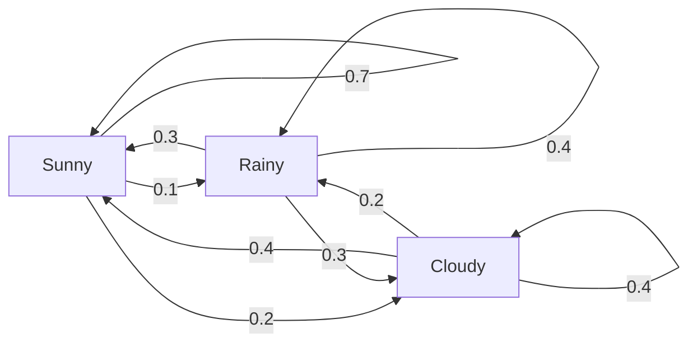
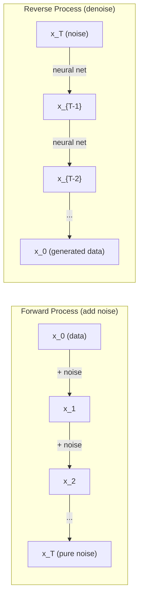

# 随机过程

> 带有结构的随机性。随机游走、马尔可夫链与扩散模型背后的数学。

**Type:** Learn
**Language:** Python
**Prerequisites:** Phase 1, Lessons 06-07 (probability, Bayes)
**Time:** ~75 minutes

## 学习目标

- 模拟 1D 和 2D 随机游走，验证位移的 $\sqrt{n}$ 缩放规律
- 构建马尔可夫链模拟器，并通过特征分解计算其平稳分布
- 实现 Metropolis-Hastings MCMC 和 Langevin 动力学，用于从目标分布中采样
- 将前向扩散过程与布朗运动联系起来，并解释反向过程如何生成数据

## 问题

许多 AI 系统都涉及时序演化的随机性。不是静态随机性，而是结构化、序列化的随机性，其中每一步都依赖于之前的状态。

语言模型逐 token 生成。每个 token 都依赖之前的上下文。模型输出一个概率分布，从中采样，然后继续。这就是一个随机过程。

扩散模型逐步向图像添加噪声，直到它变成纯噪声。然后它们逆转这一过程，逐步去噪，直到生成新图像。前向过程是一个马尔可夫链，反向过程则是一个逆向运行的、学习得到的马尔可夫链。

强化学习 Agent 在环境中采取行动。每个动作都会以一定概率导致新状态。Agent 在一个随机世界中遵循随机策略。整个过程就是一个马尔可夫决策过程。

MCMC 采样——贝叶斯推断的支柱——构建一个马尔可夫链，使其平稳分布就是你想从中采样的后验分布。

所有这些都建立在四个基础概念之上：
1. 随机游走——最简单的随机过程
2. 马尔可夫链——带有转移矩阵的结构化随机性
3. Langevin 动力学——带噪声的梯度下降
4. Metropolis-Hastings——从任意分布中采样

## 概念

### 随机游走

从位置 0 出发。每一步抛一枚公平硬币。正面：向右移动（+1）。反面：向左移动（-1）。

经过 $n$ 步后，你的位置是 $n$ 个随机 $\pm 1$ 值之和。期望位置为 0（游走无偏）。但到原点的期望距离按 $\sqrt{n}$ 增长。

这有点反直觉。游走是公平的——没有任何方向漂移。但随着时间推移，它会离起点越来越远。$n$ 步后的标准差为 $\sqrt{n}$。

```
Step 0:  Position = 0
Step 1:  Position = +1 or -1
Step 2:  Position = +2, 0, or -2
...
Step 100: Expected distance from origin ~ 10 (sqrt(100))
Step 10000: Expected distance from origin ~ 100 (sqrt(10000))
```

**在 2D 中，**游走以上、下、左、右四个方向等概率移动。到原点的距离同样遵循 $\sqrt{n}$ 缩放。路径呈现出类似分形的图案。

**为什么是 $\sqrt{n}$？** 每一步以相等概率取 +1 或 -1。$n$ 步后，位置 $S_n = X_1 + X_2 + \cdots + X_n$，其中每个 $X_i$ 为 $\pm 1$。每步方差为 1，且各步独立，因此 $\mathop{\mathrm{Var}}(S_n) = n$。标准差 = $\sqrt{n}$。根据中心极限定理，$S_n / \sqrt{n}$ 收敛于标准正态分布。

这种 $\sqrt{n}$ 缩放在机器学习中随处可见。SGD 噪声按 1/sqrt(batch_size) 缩放，嵌入维度按 $\sqrt{d}$ 缩放。平方根是独立随机累加的标志性特征。

**与布朗运动的联系。** 取一个随机游走，步长为 $1/\sqrt{n}$，每单位时间走 $n$ 步。当 $n$ 趋于无穷时，该游走收敛于布朗运动 $B(t)$——一个连续时间过程，其中 $B(t)$ 服从均值为 0、方差为 $t$ 的正态分布。

布朗运动是扩散的数学基础。它模拟流体中粒子的随机抖动、股价的波动，以及——关键的是——扩散模型中的噪声过程。

**赌徒破产问题。** 一个随机游走者从位置 $k$ 出发，在 0 和 $N$ 处有吸收壁。它先到达 $N$ 而不是 0 的概率是多少？对于公平游走：$P(\text{reach } N) = k/N$。这个结果出人意料地简洁优雅。它与鞅理论相关——公平随机游走是一个鞅（未来期望值 = 当前值）。

### 马尔可夫链

马尔可夫链是一个按固定概率在状态之间转移的系统。关键性质：下一状态只依赖当前状态，不依赖历史。

```math
P(X_{t+1} = j \mid X_t = i, X_{t-1} = \ldots) = P(X_{t+1} = j \mid X_t = i)
```

这就是马尔可夫性质。这意味着你可以用转移矩阵 $P$ 描述整个动态：

```math
P[i][j] = \text{probability of going from state } i \text{ to state } j
```

$P$ 的每一行之和为 1（你必须转移到某个状态）。

**示例——天气：**

```
States: Sunny (0), Rainy (1), Cloudy (2)

P = [[0.7, 0.1, 0.2],    (if sunny: 70% sunny, 10% rainy, 20% cloudy)
     [0.3, 0.4, 0.3],    (if rainy: 30% sunny, 40% rainy, 30% cloudy)
     [0.4, 0.2, 0.4]]    (if cloudy: 40% sunny, 20% rainy, 40% cloudy)
```

从任意状态开始。经过多次转移后，状态分布会收敛到平稳分布 $\pi$，满足 $\pi P = \pi$。这是 $P$ 对应特征值 1 的左特征向量。

对于该天气链，平稳分布为 [0.55, 0.18, 0.27]——长期来看，无论初始状态如何，晴天占比为 55%。



**计算平稳分布。** 有两种方法：

1. **幂法：** 反复用任意初始分布乘以 $P$。经过足够迭代后收敛。
2. **特征值法：** 找到 $P$ 对应特征值 1 的左特征向量，也就是 $P^T$ 对应特征值 1 的特征向量。

两种方法都要求链满足收敛条件。

**收敛条件。** 马尔可夫链收敛到唯一平稳分布，当且仅当它满足：
- **不可约：** 任意状态都可从其他状态到达
- **非周期：** 链不会按固定周期循环

你在机器学习中遇到的大多数链都满足这两个条件。

**吸收态。** 一旦进入就永远不会离开的状态称为吸收态（$P[i][i] = 1$）。吸收马尔可夫链用于建模具有终止状态的过程——一局结束的游戏、流失的客户、遇到文本结束 token 的 token 序列。

**混合时间。** 链需要多少步才能「接近」平稳分布？形式上，即到平稳分布的总变差距离低于某个阈值所需的步数。快速混合 = 所需步数少。$P$ 的谱间隙（1 减去第二大特征值）控制混合时间。间隙越大，混合越快。

### 与语言模型的联系

语言模型中的 token 生成近似是一个马尔可夫过程。给定当前上下文，模型输出下一 token 的分布。温度控制分布的尖锐程度：

```math
P(\text{token}_i) = \frac{\exp(\text{logit}_i / \text{temperature})}{\sum_j \exp(\text{logit}_j / \text{temperature})}
```

- 温度 = 1.0：标准分布
- 温度 < 1.0：更尖锐（更确定性）
- 温度 > 1.0：更平坦（更随机）
- 温度 $\to 0$：argmax（贪心）

Top-k 采样截断到概率最高的 $k$ 个 token。Top-p（核采样）截断到累积概率超过 $p$ 的最小 token 集合。两者都会修改马尔可夫转移概率。

### 布朗运动

随机游走的连续时间极限。位置 $B(t)$ 具有三个性质：
1. $B(0) = 0$
2. $B(t) - B(s)$ 服从均值为 0、方差为 $t - s$ 的正态分布（$t > s$）
3. 非重叠区间上的增量相互独立

布朗运动连续但处处不可微——它在每个尺度上都在抖动。其路径在平面上的分形维数为 2。

在离散模拟中，你可以用如下方式近似布朗运动：

```math
B(t + dt) = B(t) + \sqrt{dt} \, z, \quad \text{where } z \sim \mathcal{N}(0, 1)
```

$\sqrt{dt}$ 缩放很重要。它来自应用于随机游走的中心极限定理。

### Langevin 动力学

梯度下降寻找函数的最小值。Langevin 动力学寻找与 $\exp(-U(x)/T)$ 成正比的概率分布，其中 $U$ 是能量函数，$T$ 是温度。

```math
x_{t+1} = x_t - dt \, \nabla U(x_t) + \sqrt{2 T \, dt} \, z_t
```

两种力作用在粒子上：
1. **梯度力（$-dt \cdot \nabla U$）：** 推向低能量区域（类似梯度下降）
2. **随机力（$\sqrt{2T dt} \cdot z$）：** 向随机方向推动（探索）

当温度 $T = 0$ 时，这就是纯梯度下降。在高温下，它几乎就是随机游走。在合适温度下，粒子会探索能量 landscape，并在低能区域停留更久。

**与扩散模型的联系。** 扩散模型的前向过程为：

```math
x_t = \sqrt{\alpha_t} \, x_{t-1} + \sqrt{1 - \alpha_t} \cdot \text{noise}
```

这是一个逐步将数据与噪声混合的马尔可夫链。足够多步后，$x_T$ 变成纯高斯噪声。

反向过程——从噪声回到数据——也是一个马尔可夫链，但其转移概率由神经网络学习得到。网络学习预测每一步添加的噪声，然后将其减去。



### MCMC：马尔可夫链蒙特卡洛

有时你需要从一个分布 $p(x)$ 中采样，你可以计算它的值（差一个常数倍），但无法直接采样。贝叶斯后验是经典例子——你知道似然乘以先验，但归一化常数难以计算。

**Metropolis-Hastings** 构建一个平稳分布为 $p(x)$ 的马尔可夫链：

1. 从某个位置 $x$ 开始
2. 根据提议分布 $Q(x' \mid x)$ 提议一个新位置 $x'$
3. 计算接受率：$a = p(x') Q(x \mid x') / (p(x) Q(x' \mid x))$
4. 以概率 $\min(1, a)$ 接受 $x'$，否则停留在 $x$
5. 重复

如果 $Q$ 是对称的（例如 $Q(x' \mid x) = Q(x \mid x') = \mathcal{N}(x, \sigma^2){}$），则比率简化为 $a = p(x') / p(x)$。你只需要概率之比，归一化常数会被约掉。

在温和条件下，该链保证收敛到 $p(x)$。但如果提议分布太小（随机游走）或太大（拒绝率高），收敛可能很慢。调节提议分布是 MCMC 的艺术。

**为什么有效。** 接受率保证了细致平衡：处于 $x$ 并移动到 $x'$ 的概率，等于处于 $x'$ 并移动到 $x$ 的概率。细致平衡意味着 $p(x)$ 是该链的平稳分布。因此经过足够多的步数后，样本来自 $p(x)$。

**实际考虑：**
- **预烧（Burn-in）：** 丢弃前 $N$ 个样本。链需要一定时间从起点到达平稳分布。
- **稀释（Thinning）：** 每第 $k$ 个样本保留一个，以降低自相关性。
- **多链：** 从不同的起点运行多条链。如果它们收敛到同一分布，你就有了收敛的证据。
- **接受率：** 对于 $d$ 维高斯提议，最优接受率约为 23%（Roberts & Rosenthal, 2001）。太高意味着链几乎不动；太低意味着它拒绝几乎所有提议。

### 人工智能中的随机过程

| 过程 | AI 应用 |
|---------|---------------|
| 随机游走 | 强化学习中的探索、Node2Vec 嵌入 |
| 马尔可夫链 | 文本生成、MCMC 采样 |
| 布朗运动 | 扩散模型（前向过程） |
| Langevin 动力学 | 基于分数的生成模型、SGLD |
| 马尔可夫决策过程 | 强化学习 |
| Metropolis-Hastings | 贝叶斯推断、后验采样 |

```figure
random-walk-diffusion
```

## 构建它

### 第 1 步：随机游走模拟器

```python
import numpy as np

def random_walk_1d(n_steps, seed=None):
    rng = np.random.RandomState(seed)
    steps = rng.choice([-1, 1], size=n_steps)
    positions = np.concatenate([[0], np.cumsum(steps)])
    return positions


def random_walk_2d(n_steps, seed=None):
    rng = np.random.RandomState(seed)
    directions = rng.choice(4, size=n_steps)
    dx = np.zeros(n_steps)
    dy = np.zeros(n_steps)
    dx[directions == 0] = 1   # right
    dx[directions == 1] = -1  # left
    dy[directions == 2] = 1   # up
    dy[directions == 3] = -1  # down
    x = np.concatenate([[0], np.cumsum(dx)])
    y = np.concatenate([[0], np.cumsum(dy)])
    return x, y
```

1D 游走存储累积和。每一步是 +1 或 -1。$n$ 步后的位置就是这些步长之和。方差随 $n$ 线性增长，因此标准差按 $\sqrt{n}$ 增长。

### 第 2 步：马尔可夫链

```python
class MarkovChain:
    def __init__(self, transition_matrix, state_names=None):
        self.P = np.array(transition_matrix, dtype=float)
        self.n_states = len(self.P)
        self.state_names = state_names or [str(i) for i in range(self.n_states)]

    def step(self, current_state, rng=None):
        if rng is None:
            rng = np.random.RandomState()
        probs = self.P[current_state]
        return rng.choice(self.n_states, p=probs)

    def simulate(self, start_state, n_steps, seed=None):
        rng = np.random.RandomState(seed)
        states = [start_state]
        current = start_state
        for _ in range(n_steps):
            current = self.step(current, rng)
            states.append(current)
        return states

    def stationary_distribution(self):
        eigenvalues, eigenvectors = np.linalg.eig(self.P.T)
        idx = np.argmin(np.abs(eigenvalues - 1.0))
        stationary = np.real(eigenvectors[:, idx])
        stationary = stationary / stationary.sum()
        return np.abs(stationary)
```

平稳分布是 $P$ 对应特征值 1 的左特征向量。我们通过计算 $P^T$ 的特征向量来找到它（转置把左特征向量变成右特征向量）。

### 第 3 步：Langevin 动力学

```python
def langevin_dynamics(grad_U, x0, dt, temperature, n_steps, seed=None):
    rng = np.random.RandomState(seed)
    x = np.array(x0, dtype=float)
    trajectory = [x.copy()]
    for _ in range(n_steps):
        noise = rng.randn(*x.shape)
        x = x - dt * grad_U(x) + np.sqrt(2 * temperature * dt) * noise
        trajectory.append(x.copy())
    return np.array(trajectory)
```

梯度把 $x$ 推向低能量区域。噪声防止它陷入局部最优。在平衡时，样本分布正比于 $\exp(-U(x)/\text{temperature})$。

### 第 4 步：Metropolis-Hastings

```python
def metropolis_hastings(target_log_prob, proposal_std, x0, n_samples, seed=None):
    rng = np.random.RandomState(seed)
    x = np.array(x0, dtype=float)
    samples = [x.copy()]
    accepted = 0
    for _ in range(n_samples - 1):
        x_proposed = x + rng.randn(*x.shape) * proposal_std
        log_ratio = target_log_prob(x_proposed) - target_log_prob(x)
        if np.log(rng.rand()) < log_ratio:
            x = x_proposed
            accepted += 1
        samples.append(x.copy())
    acceptance_rate = accepted / (n_samples - 1)
    return np.array(samples), acceptance_rate
```

算法提议一个新点，检查它是否具有更高概率（或按比率概率接受），然后重复。好的混合通常对应 23%-50% 的接受率。

## 使用它

实践中，你会使用成熟的库来实现这些算法。但理解其机制对调试和调参至关重要。

```python
import numpy as np

rng = np.random.RandomState(42)
walk = np.cumsum(rng.choice([-1, 1], size=10000))
print(f"Final position: {walk[-1]}")
print(f"Expected distance: {np.sqrt(10000):.1f}")
print(f"Actual distance: {abs(walk[-1])}")
```

### 用 numpy 处理转移矩阵

```python
import numpy as np

P = np.array([[0.7, 0.1, 0.2],
              [0.3, 0.4, 0.3],
              [0.4, 0.2, 0.4]])

distribution = np.array([1.0, 0.0, 0.0])
for _ in range(100):
    distribution = distribution @ P

print(f"Stationary distribution: {np.round(distribution, 4)}")
```

反复把初始分布乘以 $P$。经过足够迭代后，它会收敛到平稳分布，与起点无关。这就是寻找主导左特征向量的幂法。

### 与真实框架的联系

- **PyTorch diffusion：** Hugging Face `diffusers` 中的 `DDPMScheduler` 实现了前向和反向马尔可夫链
- **NumPyro / PyMC：** 使用 MCMC（NUTS 采样器，对 Metropolis-Hastings 的改进）进行贝叶斯推断
- **Gymnasium（RL）：** 环境的 step 函数定义了一个马尔可夫决策过程

### 验证马尔可夫链收敛

```python
import numpy as np

P = np.array([[0.9, 0.1], [0.3, 0.7]])

eigenvalues = np.linalg.eigvals(P)
spectral_gap = 1 - sorted(np.abs(eigenvalues))[-2]
print(f"Eigenvalues: {eigenvalues}")
print(f"Spectral gap: {spectral_gap:.4f}")
print(f"Approximate mixing time: {1/spectral_gap:.1f} steps")
```

谱间隙告诉你链多快忘记初始状态。间隙为 0.2 意味着大约 5 步混合；间隙为 0.01 意味着大约 100 步。运行长时间模拟前务必检查这一点——混合慢的链会浪费算力。

## 交付它

本节课产出：
- `outputs/prompt-stochastic-process-advisor.md`——一个用于判断给定问题适合哪种随机过程框架的 prompt

## 关联

| 概念 | 它出现在哪里 |
|---------|------------------|
| 随机游走 | Node2Vec 图嵌入、强化学习中的探索 |
| 马尔可夫链 | LLM 的 token 生成、MCMC 采样 |
| 布朗运动 | DDPM 的前向扩散过程、基于 SDE 的模型 |
| Langevin 动力学 | 基于分数的生成模型、随机梯度 Langevin 动力学（SGLD） |
| 平稳分布 | MCMC 收敛目标、PageRank |
| Metropolis-Hastings | 贝叶斯后验采样、模拟退火 |
| 温度 | LLM 采样、强化学习中的 Boltzmann 探索、模拟退火 |
| 混合时间 | MCMC 收敛速度、谱间隙分析 |
| 吸收态 | 序列结束 token、强化学习中的终止状态 |
| 细致平衡 | MCMC 采样器的正确性保证 |

扩散模型值得特别关注。DDPM（Ho et al., 2020）定义了前向马尔可夫链：

```math
q(x_t \mid x_{t-1}) = \mathcal{N}\left(x_t; \sqrt{1-\beta_t} \, x_{t-1}, \beta_t I\right)
```

其中 $\beta_t$ 是噪声时间表。经过 $T$ 步后，$x_T$ 近似服从 $\mathcal{N}(0, I)$。反向过程由一个预测噪声的神经网络参数化：

```math
p_\theta(x_{t-1} \mid x_t) = \mathcal{N}\left(x_{t-1}; \mu_\theta(x_t, t), \sigma_t^2 I\right)
```

生成的每一步都是学习得到的马尔可夫链中的一步。理解马尔可夫链，就理解了扩散模型如何以及为什么能生成数据。

SGLD（Stochastic Gradient Langevin Dynamics）将 mini-batch 梯度下降与 Langevin 噪声结合起来。它不必计算完整梯度，而是使用随机估计并加入校准噪声。随着学习率衰减，SGLD 从优化过渡到采样——你可以免费获得近似的贝叶斯后验样本。这是从神经网络中获取不确定性估计的最简单方法之一。

所有这些联系的关键洞见是：随机过程不仅仅是理论工具，它们是现代 AI 系统内部的计算机制。当你调节 LLM 的温度时，你在调节一个马尔可夫链；当你训练扩散模型时，你在学习逆转一个类似布朗运动的过程；当你运行贝叶斯推断时，你在构建一个收敛到后验的链。

## 练习

1. **模拟 1000 条长度为 10000 步的随机游走。** 绘制最终位置的分布，验证它近似服从均值为 0、标准差为 $\sqrt{10000} = 100$ 的高斯分布。

2. **用马尔可夫链构建文本生成器。** 在一个小型语料上训练：对每个词，统计它转移到下一个词的次数。构建转移矩阵。通过从链中采样生成新句子。

3. **用 Metropolis-Hastings 实现模拟退火。** 从高温开始（几乎接受所有提议），逐渐冷却（只接受更优的提议）。用它寻找具有多个局部最小值的函数的全局最小值。

4. **比较不同温度下的 Langevin 动力学。** 从双势阱 $U(x) = (x^2 - 1)^2$ 中采样。低温时样本聚集在一个阱中；高温时样本扩散到两个阱中。找到链开始在阱之间混合的临界温度。

5. **实现前向扩散过程。** 从一个 1D 信号（例如正弦波）开始，按线性噪声时间表在 100 步内逐步添加噪声。展示信号如何退化为纯噪声。然后实现一个简单的去噪器来逆转该过程（即使只是朴素地减去估计噪声）。

### 提示

**练习 1。** 对 1000 个种子分别调用 `random_walk_1d(10000, seed=i)` 并记录每个最终位置。检查均值接近 0、标准差接近 100，且约 68% 的最终位置落在 -100 到 100 之间。

**练习 2。** 统计每个词对，然后把每行之和归一化为 1。把矩阵传给 `MarkovChain(transition_matrix, state_names)` 并调用 `simulate`。检查生成结果中的每个相邻词对都在语料中出现过。

**练习 3。** 以概率 $\exp(-\Delta / T)$ 接受更差的点，并在每步后将 $T$ 乘以一个如 0.99 的因子。在一个已知最小值的函数上测试，并将结果与细粒度网格搜索进行比较。

**练习 4。** 梯度为 $4x(x^2 - 1)$，把它传给 `langevin_dynamics(grad_U, x0, dt, temperature, n_steps)`。$x = 0$ 处的势垒高度为 1，因此统计在温度从 0.05 到 1 变化时 $x$ 符号改变的频率，寻找频率开始快速上升的温度。

**练习 5。** 调用 `diffusion_forward(signal, 100)` 并将最后一步的 $\bar{\alpha}$ 计算为所有 $(1 - \beta_t)$ 的乘积。如果 $\bar{\alpha}$ 离 0 还很远，说明信号尚未变成纯噪声，需要提高 `beta_end`。先用真实噪声测试你的去噪器：此时 $(x_t - \sqrt{1 - \bar{\alpha}_t} \epsilon)/\sqrt{\bar{\alpha}_t}$ 必须精确还原原始信号。

## 关键术语

| 术语 | 人们常说 | 实际含义 |
|------|----------------|----------------------|
| 随机游走 | "抛硬币式移动" | 每一步位置按随机增量变化的过程 |
| 马尔可夫性质 | "无记忆性" | 未来只依赖当前状态，不依赖历史 |
| 转移矩阵 | "概率表" | $P[i][j]$ 表示从状态 $i$ 转移到状态 $j$ 的概率 |
| 平稳分布 | "长期平均" | 满足 $\pi P = \pi$ 的分布 $\pi$——链的平衡态 |
| 布朗运动 | "随机抖动" | 随机游走的连续时间极限，$B(t) \sim \mathcal{N}(0, t)$ |
| Langevin 动力学 | "带噪声的梯度下降" | 结合确定性梯度与随机扰动的更新规则 |
| MCMC | "走向目标分布" | 构建一个平稳分布为你所需分布的马尔可夫链 |
| Metropolis-Hastings | "提议并接受/拒绝" | 用接受率保证收敛的 MCMC 算法 |
| 温度 | "随机性旋钮" | 控制探索与利用之间权衡的参数 |
| 扩散过程 | "噪声进，噪声出" | 前向：逐步加噪。反向：逐步去噪。生成数据。 |

## 延伸阅读

- **Ho, Jain, Abbeel (2020)** —— "Denoising Diffusion Probabilistic Models." 引发扩散模型革命的 DDPM 论文，清晰推导了前向和反向马尔可夫链。
- **Song & Ermon (2019)** —— "Generative Modeling by Estimating Gradients of the Data Distribution." 使用 Langevin 动力学进行采样的基于分数的方法。
- **Roberts & Rosenthal (2004)** —— "General state space Markov chains and MCMC algorithms." MCMC 何时有效、为何有效的理论基础。
- **Norris (1997)** —— "Markov Chains." 标准教材，涵盖收敛、平稳分布和击中时间。
- **Welling & Teh (2011)** —— "Bayesian Learning via Stochastic Gradient Langevin Dynamics." 将 SGD 与 Langevin 动力学结合，实现可扩展的贝叶斯推断。
