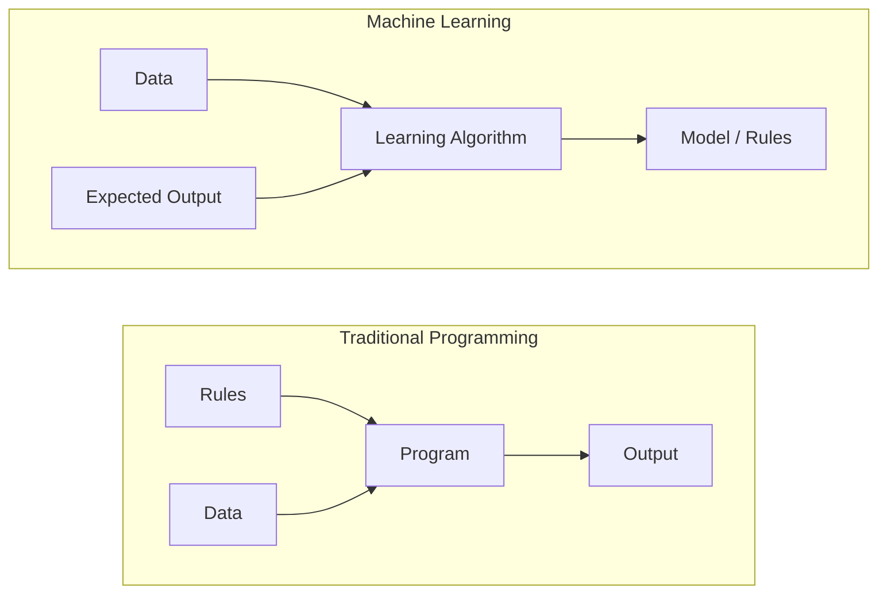
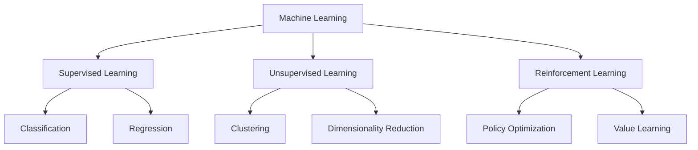
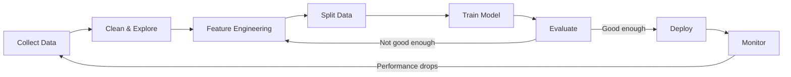
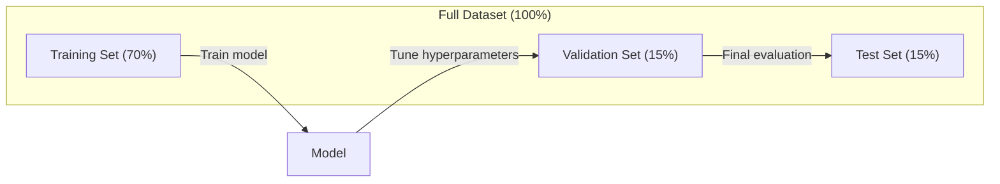
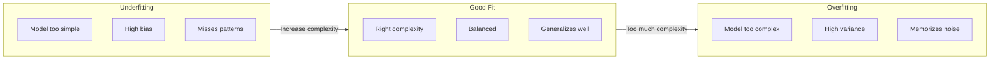
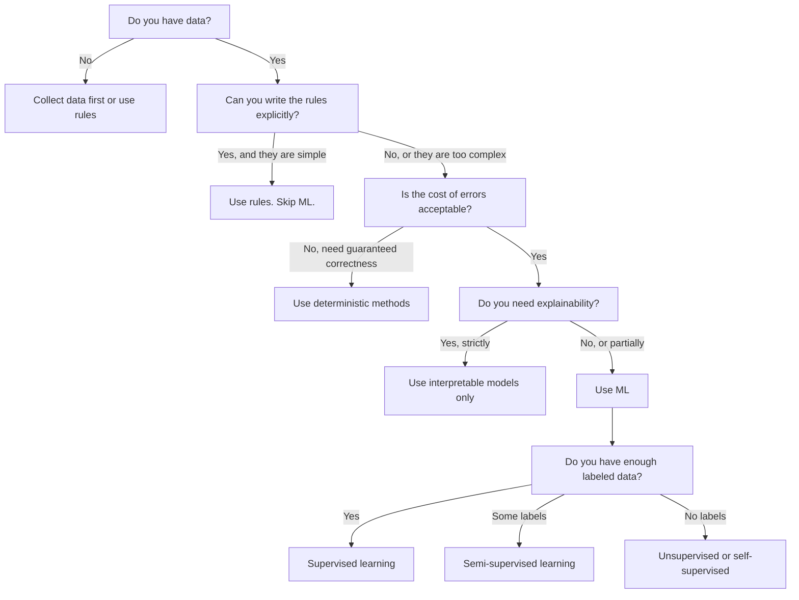

# 什么是机器学习

> 机器学习是教计算机从数据中发现规律，而不是手工编写规则。

**Type:** Learn
**Languages:** Python
**Prerequisites:** Phase 1 (Math Foundations)
**Time:** ~45 minutes

## 学习目标

- 解释监督学习、无监督学习和强化学习之间的区别，并能判断给定问题属于哪一类
- 从零实现最近质心分类器（nearest centroid classifier），并与随机基线进行对比评估
- 区分分类任务与回归任务，并为每种任务选择合适的损失函数
- 评估一个业务问题是否适合用机器学习解决，还是用确定性规则更合适

## 问题

你想做一个垃圾邮件过滤器。传统做法是坐下来写几百条规则：「如果邮件里包含『FREE MONEY』，就标为垃圾邮件」「如果感叹号超过 3 个，就标为垃圾邮件」。你会花上几周写规则，然后垃圾邮件发送者改换措辞，规则失效，你再写更多规则。这个循环永远不会结束。

机器学习把这个过程翻转过来。你不用写规则，而是给计算机成千上万封已标注的邮件（「垃圾邮件」或「正常邮件」），让它自己找出规则。计算机会发现你永远想不到的规律。当垃圾邮件发送者改变策略时，你只需用新数据重新训练，而不是重写代码。

从「编程规则」到「从数据学习」的转变，就是机器学习的核心。每一个推荐系统、语音助手、自动驾驶汽车和语言模型都是这样工作的。

## 概念

### 从数据学习，而非规则

传统编程和机器学习解决问题的方式正好相反。



传统编程：你编写规则，程序把规则应用到数据上，产生输出。

机器学习：你提供数据和期望输出，算法自己发现规则。

训练得到的「模型」就是规则，只不过被编码成了数字（权重、参数）。它从见过的样本中泛化，对从未见过的数据做出预测。

### 机器学习的三种类型



**监督学习（Supervised Learning）**：你拥有输入 - 输出配对数据，模型学习把输入映射到输出。
- 「这里有 1 万张标注了猫或狗的照片，学会区分它们。」
- 「这里有房屋特征和价格，学会预测价格。」

**无监督学习（Unsupervised Learning）**：你只有输入，没有标签，模型自己发现结构。
- 「这里有 1 万份顾客购买记录，找出自然的分组。」
- 「这里有 1000 维的数据点，降到 2 维同时保持结构。」

**强化学习（Reinforcement Learning）**：智能体（agent）在环境中采取行动，获得奖励或惩罚。它学习一种策略（policy），以最大化累计奖励。
- 「玩这个游戏。赢了 +1，输了 -1，自己找出策略。」
- 「控制这条机械臂。拿起物体 +1，每浪费一秒 -0.01。」

你在实践中构建的大部分东西都会用到监督学习。无监督学习常用于预处理和探索性分析。强化学习驱动游戏 AI、机器人以及语言模型的 RLHF。

### 三大类型之外

上面的三种分类很清晰，但现实世界的机器学习常常会模糊边界。

**半监督学习（Semi-supervised learning）** 使用少量标注数据和大量未标注数据。例如，你只有 100 张标注过的医学影像，却有 10 万张未标注影像。相关技术包括：

- **标签传播（Label propagation）**：构建一个连接相似数据点的图，标签通过图从已标注节点传播到未标注邻居。
- **伪标签（Pseudo-labeling）**：先用标注数据训练模型，再用模型预测未标注数据的标签，然后用全部数据重新训练。模型自己引导自己的训练集。
- **一致性正则化（Consistency regularization）**：模型对某个输入及其轻微扰动版本应该给出相同预测。即使没有标签也能生效。

**自监督学习（Self-supervised learning）** 从数据本身创造监督信号，完全不需要人工标注。模型利用数据的结构自创预测任务。

- **掩码语言建模（Masked language modeling，BERT）**：把句子中 15% 的词遮住，训练模型预测缺失的词。「标签」来自原文本身。
- **对比学习（Contrastive learning，SimCLR）**：取一张图片，生成两个增强版本。训练模型识别它们来自同一张图片，同时区分其他图片的增强版本。
- **下一 token 预测（Next-token prediction，GPT）**：给定前面所有词，预测下一个词。每篇文本文档都变成一个训练样本。

这些并不是与三大类并列的独立类别，而是结合了监督与无监督思想的策略。自监督学习在技术上属于监督学习（模型在预测某个东西），但标签是自动生成的，而非人工标注。

### 分类与回归

这是两类主要的监督学习任务。

| 方面 | 分类（Classification） | 回归（Regression） |
|--------|---------------|------------|
| 输出 | 离散类别 | 连续数值 |
| 示例 | 「这封邮件是垃圾邮件吗？」 | 「这套房子的价格会是多少？」 |
| 输出空间 | {cat, dog, bird} | Any real number |
| 损失函数 | Cross-entropy, accuracy | Mean squared error, MAE |
| 决策方式 | 类别之间的边界 | 拟合数据的曲线 |

分类回答「属于哪个类别？」回归回答「数值是多少？」

有些问题可以按两种方式来构建。预测股票涨或跌是分类；预测具体价格是回归。

### 机器学习工作流

每个机器学习项目都遵循同样的 pipeline，与具体算法无关。



**收集数据（Collect Data）**：收集原始数据。数据通常越多越好，但质量比数量更重要。

**清洗与探索（Clean & Explore）**：处理缺失值、删除重复项、可视化分布、发现异常值。这一步通常占整个项目时间的 60%–80%。

**特征工程（Feature Engineering）**：把原始数据转换成模型能用的特征。把日期转成星期几，数值列做归一化，类别变量做编码。好的特征比花哨的算法更重要。

**划分数据（Split Data）**：分成训练集、验证集和测试集。模型在训练集上学习，在验证集上调节超参数，在测试集上报告最终性能。

**训练模型（Train Model）**：把训练数据输入算法。算法调整内部参数，使损失函数最小化。

**评估（Evaluate）**：在验证集 / 测试集上衡量性能。如果性能不达标，就返回去尝试不同的特征、算法或超参数。

**部署（Deploy）**：把模型投入生产，对新数据做出预测。

**监控（Monitor）**：持续跟踪性能。数据分布会发生变化（数据漂移），模型会退化。性能下降时，重新训练。

### 训练集、验证集与测试集划分

这是初学者最容易搞错的概念。你必须在训练过程中从未见过的数据上评估模型，否则你衡量的是记忆能力，而不是学习能力。



| Split | Purpose | When used | Typical size |
|-------|---------|-----------|-------------|
| Training | Model learns from this data | During training | 60-80% |
| Validation | Tune hyperparameters, compare models | After each training run | 10-20% |
| Test | Final unbiased performance estimate | Once, at the very end | 10-20% |

测试集是神圣的。你只看它一次。如果你不断根据测试性能调整模型，就等于在测试集上训练，报告的数值将毫无意义。

对于小数据集，使用 $k$ 折交叉验证：把数据分成 $k$ 份，用 $k-1$ 份训练，在剩下的一份上验证，轮换并取平均结果。

### 过拟合与欠拟合



**欠拟合（Underfitting）**：模型太简单，无法捕捉数据中的规律。就像用一条直线去拟合曲线关系。训练误差高，测试误差也高。

**过拟合（Overfitting）**：模型太复杂，把训练数据（包括噪声）都记住了。就像一条弯弯曲曲的曲线穿过每个训练点，但在新数据上表现很差。训练误差低，测试误差高。

**良好拟合（Good fit）**：模型捕捉到真实规律，而没有记忆噪声。训练误差和测试误差都相对较低。

过拟合的迹象：
- 训练准确率远高于验证准确率
- 模型在训练数据上表现很好，在新数据上表现很差
- 增加训练数据能提升性能（说明模型之前在记忆，而不是学习）

解决过拟合的方法：
- 获取更多训练数据
- 降低模型复杂度（更少的参数、更简单的架构）
- 正则化（给大权重加上惩罚）
- Dropout（训练时随机把神经元置零）
- 早停（Early stopping，当验证误差开始上升时停止训练）

解决欠拟合的方法：
- 使用更复杂的模型
- 增加更多特征
- 减少正则化
- 训练更久

### 偏差 - 方差权衡

这是过拟合与欠拟合背后的数学框架。

**偏差（Bias）**：由于模型假设错误带来的误差。当真实关系是非线性时，线性模型就有高偏差。高偏差导致欠拟合。

**方差（Variance）**：模型对训练数据微小波动的敏感程度。高方差模型在不同数据子集上训练会得到差异很大的预测。高方差导致过拟合。

| Model complexity | Bias | Variance | Result |
|-----------------|------|----------|--------|
| Too low (linear model for curved data) | High | Low | Underfitting |
| Just right | Medium | Medium | Good generalization |
| Too high (degree-20 polynomial for 10 points) | Low | High | Overfitting |

$$\text{Total error} = \text{Bias}^2 + \text{Variance} + \text{Irreducible noise}$$

你无法降低不可约噪声（它是数据本身的随机性）。你要找的是让 $\text{bias}^2 + \text{variance}$ 最小的最佳平衡点。

### 没有免费的午餐定理

不存在一个算法能在所有问题上都表现最好。在某个问题类上表现优异的算法，在另一类问题上往往表现较差。这就是为什么数据科学家会尝试多种算法并比较结果。

实践中，选择取决于：
- 你有多少数据
- 有多少特征
- 关系是线性还是非线性
- 你是否需要可解释性
- 你能承受多少计算资源

### 什么时候不该用机器学习

机器学习很强大，但并不总是正确工具。在拿起模型之前，先问问是否真的需要它。

**不要用机器学习的场景：**

- **规则简单且明确。** 税务计算、排序算法、单位换算。如果你能用几条 if 语句写出逻辑，模型只会增加不必要的复杂度。
- **你没有数据，或数据极少。** 机器学习需要样本才能学习。只有 10 个数据点时，你无法训练出有意义的东西。先去收集数据。
- **错误的代价是灾难性的，且你需要保证正确性。** 药物剂量计算、核反应堆控制、密码学验证。机器学习模型是概率性的，有时会出错。如果「有时出错」不可接受，就使用确定性方法。
- **查表或启发式就能解决问题。** 如果简单阈值或表格已经覆盖 99% 的情况，引入机器学习只会增加维护成本，却没有实质提升。
- **你无法解释决策，而可解释性又是必需的。** 受监管的行业（贷款、保险、刑事司法）有时要求每个决策都能完全解释。有些机器学习模型是可解释的（线性回归、小型决策树），但大多数不是。
- **问题变化速度超过你重新训练的速度。** 如果规则每天都在变，而重新训练需要一周，模型永远是过时的。

使用下面的决策流程图：



```figure
f3-learning-boundary
```

## 构建它

`code/ml_intro.py` 中的代码从零实现了最近质心分类器，这是最简单的机器学习算法。它展示了核心思想：从数据中学习，然后对新数据进行预测。

### 第一步：从零实现最近质心分类器

最近质心分类器计算训练数据中每个类别的中心（均值）。预测时，它把每个新点分配给距离最近的类别中心。

```python
class NearestCentroid:
    def fit(self, X, y):
        self.classes = np.unique(y)
        self.centroids = np.array([
            X[y == c].mean(axis=0) for c in self.classes
        ])

    def predict(self, X):
        distances = np.array([
            np.sqrt(((X - c) ** 2).sum(axis=1))
            for c in self.centroids
        ])
        return self.classes[distances.argmin(axis=0)]
```

这就是整个算法。`fit` 计算两个均值，`predict` 计算距离。没有梯度下降，没有迭代，没有超参数。

### 第二步：在合成数据上训练

我们生成一个二维分类数据集，两个类别略有重叠。质心分类器会在两个类别中心之间画一条线性决策边界。

```python
rng = np.random.RandomState(42)
X_class0 = rng.randn(100, 2) + np.array([1.0, 1.0])
X_class1 = rng.randn(100, 2) + np.array([-1.0, -1.0])
X = np.vstack([X_class0, X_class1])
y = np.array([0] * 100 + [1] * 100)
```

### 第三步：与基线对比

每个机器学习模型都应该和一个简单的基线对比。这里的基线随机预测一个类别。如果你的模型连随机猜测都打不过，那一定有问题。

```python
baseline_preds = rng.choice([0, 1], size=len(y_test))
baseline_acc = np.mean(baseline_preds == y_test)
```

在这个干净的数据集上，质心分类器的准确率应该在 90% 左右，而随机基线大约 50%。

### 为什么这很重要

最近质心分类器极其简单。它没有超参数、没有迭代、没有梯度下降。但它抓住了机器学习的根本模式：

1. **学习**：从训练数据中学到一个表示（质心）
2. **预测**：用这个表示对新数据进行预测（最近距离）
3. **评估**：与一个基线（随机猜测）对比

从逻辑回归到 Transformer，每个机器学习算法都遵循同样的三步模式。表示越来越复杂，但工作流始终不变。

### 第四步：质心分类器做不到什么

最近质心分类器假设每个类别形成一个单一的 blob。它画出线性决策边界。在以下情况会失败：

- 一个类别有多个聚类（例如数字「1」可以用几种不同方式书写）
- 决策边界是非线性的（例如一个类别把另一个类别包围起来）
- 特征尺度差异很大（距离会被最大尺度的特征主导）

这些局限性推动了其他算法的诞生。K 近邻可以处理多个聚类，决策树可以处理非线性边界，特征缩放可以解决尺度问题。每一节课都在前一节课的局限性上继续构建。

## 使用它

sklearn 提供了 `NearestCentroid` 和合成数据生成器：

```python
from sklearn.neighbors import NearestCentroid
from sklearn.datasets import make_classification
from sklearn.model_selection import train_test_split

X, y = make_classification(
    n_samples=500, n_features=2, n_redundant=0,
    n_clusters_per_class=1, random_state=42
)
X_train, X_test, y_train, y_test = train_test_split(X, y, test_size=0.3)

clf = NearestCentroid()
clf.fit(X_train, y_train)
print(f"Accuracy: {clf.score(X_test, y_test):.3f}")
```

## 交付它

本节课会产出 `outputs/prompt-ml-problem-framer.md` —— 一个 prompt，能把模糊的业务问题变成具体的机器学习任务。给它一段问题描述（「我们想降低流失率」或「预测下季度需求」），它会识别学习类型、定义预测目标、列出候选特征、选择成功指标、建立基线，并标记数据泄漏或类别不平衡等陷阱。在任何机器学习项目开始时使用它，可以避免做出错误的东西。

## 关键术语

| 术语 | 人们常说 | 实际含义 |
|------|----------------|----------------------|
| Model | 「这个 AI」 | 一个带有可学习参数的数学函数，把输入映射到输出 |
| Training | 「教 AI」 | 运行优化算法，调整模型参数，使预测与已知输出一致 |
| Feature | 「一输入列」 | 模型用来预测的数据的可测量属性 |
| Label | 「答案」 | 训练样本的已知输出，用来计算误差信号 |
| Hyperparameter | 「一个需要调的设置」 | 训练前设置的参数，控制学习过程（学习率、层数等） |
| Loss function | 「模型有多错」 | 衡量预测值与真实值之间差距的函数，训练会试图最小化它 |
| Overfitting | 「它把测试集背下来了」 | 模型记住了训练数据特有的噪声，而不是学到通用规律，所以在新数据上失败 |
| Underfitting | 「它什么都没学到」 | 模型太简单，无法捕捉数据中的真实规律 |
| Generalization | 「它在新数据上也能用」 | 模型在未见过数据上做出准确预测的能力 |
| Cross-validation | 「用不同块来测试」 | 反复把数据分成训练 / 验证折并取平均结果，得到更稳健的性能估计 |
| Regularization | 「让权重变小」 | 在损失函数中加入惩罚项，阻止模型变得过于复杂 |
| Data drift | 「世界变了」 | incoming 数据的统计分布随时间偏移，导致模型性能下降 |

## 练习

1. 任选一个数据集（例如 Iris、Titanic），按 70/15/15 划分为训练集 / 验证集 / 测试集。解释为什么不应该在测试集上调节超参数。
2. 列出三个现实世界问题。对每个问题，判断它是分类、回归还是聚类，以及是监督学习还是无监督学习。
3. 某个模型在训练数据上达到 99% 准确率，但在测试数据上只有 60%。诊断问题并列出三种你会尝试的修复方法。

## 延伸阅读

- [An Introduction to Statistical Learning](https://www.statlearning.com/) —— 免费教材，涵盖所有经典机器学习方法及实践示例
- [Google's Machine Learning Crash Course](https://developers.google.com/machine-learning/crash-course) —— 简洁直观的机器学习概念入门
- [Scikit-learn User Guide](https://scikit-learn.org/stable/user_guide.html) —— 用 Python 实现机器学习的实用参考
