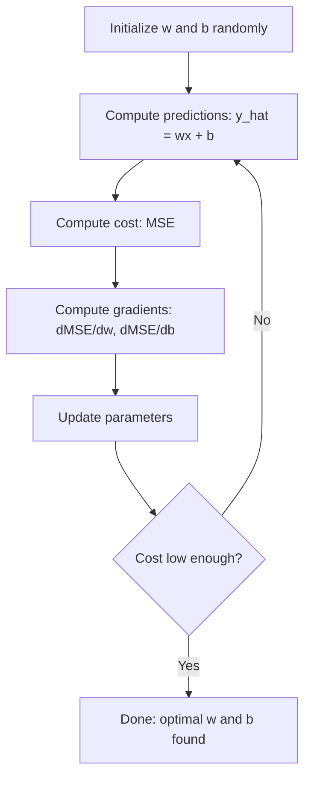

# 线性回归

> 线性回归会在你的数据上画出最佳直线。它是机器学习的「Hello World」。

**Type:** Build
**Languages:** Python
**Prerequisites:** Phase 1 (Linear Algebra, Calculus, Optimization), Phase 2 Lesson 1
**Time:** ~90 minutes

## 学习目标

- 推导均方误差（MSE）的梯度下降更新规则，并从零实现线性回归
- 比较梯度下降与正规方程的计算复杂度，以及各自的适用场景
- 构建多元线性回归模型，进行特征标准化，并解释学到的权重
- 解释 Ridge 回归（L2 正则化）如何通过惩罚大权重来防止过拟合

## 问题

你手头有数据：房屋面积和对应的售价。你想根据面积预测一套新房的价格。你可以在散点图上凭感觉估计，但你需要一个公式。你需要一条最贴合数据的直线，这样输入任意面积都能得到价格预测。

线性回归能给你这条直线。更重要的是，它引入了完整的机器学习训练循环：定义模型、定义损失函数、优化参数。每个机器学习算法都遵循这个模式。在这里用最简单的例子掌握它，之后你会在所有地方认出它。

线性回归不只用于简单问题。它在生产系统中被用于需求预测、A/B 测试分析、金融建模，以及作为每个回归任务的基线。

## 概念

### 模型

线性回归假设输入（$x$）和输出（$y$）之间存在线性关系：

```math
y = wx + b
```

- `w`（权重 / 斜率）：$x$ 增加 1 时，$y$ 变化多少
- `b`（偏置 / 截距）：$x = 0$ 时，$y$ 的值

当有多个输入（特征）时，公式扩展为：

```math
y = w_1 x_1 + w_2 x_2 + \cdots + w_n x_n + b
```

或用向量形式表示：$y = w^T x + b$

目标：找到让预测值 $y$ 在所有训练样本上都尽可能接近真实值的 $w$ 和 $b$。

### 损失函数（均方误差）

如何衡量「尽可能接近」？你需要一个单一数字来概括预测错得有多离谱。最常见的选择是均方误差（Mean Squared Error，MSE）：

```math
\text{MSE} = \frac{1}{n} \sum (y_{\text{predicted}} - y_{\text{actual}})^2
```

为什么要平方？有两个原因。第一，它让大误差比小误差受到更严厉的惩罚（误差为 10 时，惩罚是误差为 1 时的 100 倍，而不是 10 倍）。第二，平方函数处处光滑可导，这让优化变得直接。

损失函数构成一个曲面。对于单个权重 $w$ 和偏置 $b$，MSE 曲面就像一个碗（凸抛物面）。碗底就是 MSE 最小的地方。训练就是找到这个碗底。

### 梯度下降

梯度下降通过一步步向山下走，找到碗底。



梯度告诉你两件事：每个参数该往哪个方向移动，以及移动多少。

对于 MSE 和 $\hat{y} = wx + b$：

```math
\begin{aligned}
\frac{\partial \text{MSE}}{\partial w} &= \frac{2}{n} \sum (\hat{y} - y) \, x \\
\frac{\partial \text{MSE}}{\partial b} &= \frac{2}{n} \sum (\hat{y} - y)
\end{aligned}
```

更新规则：

```math
\begin{aligned}
w &= w - \text{learning\_rate} \cdot \frac{\partial \text{MSE}}{\partial w} \\
b &= b - \text{learning\_rate} \cdot \frac{\partial \text{MSE}}{\partial b}
\end{aligned}
```

学习率控制步长。太大：会越过最小值并发散。太小：训练会慢到无法忍受。典型起始值：0.01、0.001 或 0.0001。

### 正规方程（闭式解）

线性回归有一个特殊情况：可以直接算出最优权重，无需迭代：

```math
w = (X^T X)^{-1} X^T y
```

这一步通过矩阵求逆一次性解出 $w$。对小型数据集它非常完美。但对大型数据集（百万行或数千特征），梯度下降更受青睐，因为矩阵求逆的复杂度是特征数量的 $O(n^3)$。

### 多元线性回归

当有多个特征时，模型变为：

```math
y = w_1 x_1 + w_2 x_2 + \cdots + w_n x_n + b
```

所有逻辑都一样：MSE 作为损失函数，梯度下降同时更新所有权重。唯一的区别是，你拟合的不再是直线，而是超平面。

特征缩放在这里变得重要。如果一个特征范围是 0 到 1，另一个特征范围是 0 到 1,000,000，梯度下降会很吃力，因为损失曲面会变得非常狭长。训练前要标准化特征（减去均值、除以标准差）。

### 多项式回归

如果关系不是线性的怎么办？你仍然可以使用线性回归，只需构造多项式特征：

```math
y = w_1 x + w_2 x^2 + w_3 x^3 + b
```

这仍然是「线性」回归，因为模型对权重（$w_1, w_2, w_3$）是线性的。你只是把 $x$ 的非线性函数作为特征。

高次多项式能拟合更复杂的曲线，但有过拟合风险。一个 10 次多项式会穿过 10 个数据点中的每一个，但在新数据上预测很差。

### R² 分数

MSE 能告诉你错得有多厉害，但这个数值依赖于 $y$ 的尺度。R 平方（$R^2$）则提供了一个与尺度无关的衡量：

```math
\begin{aligned}
R^2 &= 1 - \frac{\text{sum of squared residuals}}{\text{sum of squared deviations from mean}} \\
&= 1 - \frac{SS_{\text{res}}}{SS_{\text{tot}}}
\end{aligned}
```

- $R^2 = 1.0$：预测完美
- $R^2 = 0.0$：模型不比每次都预测均值更好
- $R^2 < 0.0$：模型比预测均值还糟

### 正则化概览（Ridge 回归）

当你有很多特征时，模型可能通过分配大权重来过拟合。Ridge 回归（L2 正则化）会增加一项惩罚：

```math
\text{Cost} = \text{MSE} + \lambda \sum w_i^2
```

惩罚项会抑制大权重。超参数 $\lambda$ 控制权衡：$\lambda$ 越大，权重越小，正则化越强。后续课程会深入讲解。现在只需要知道它存在，以及它为什么有用。

```figure
linear-regression-fit
```

## 构建它

### 第一步：生成样本数据

```python
import random
import math

random.seed(42)

TRUE_W = 3.0
TRUE_B = 7.0
N_SAMPLES = 100

X = [random.uniform(0, 10) for _ in range(N_SAMPLES)]
y = [TRUE_W * x + TRUE_B + random.gauss(0, 2.0) for x in X]

print(f"Generated {N_SAMPLES} samples")
print(f"True relationship: y = {TRUE_W}x + {TRUE_B} (+ noise)")
print(f"First 5 points: {[(round(X[i], 2), round(y[i], 2)) for i in range(5)]}")
```

### 第二步：从零实现带梯度下降的线性回归

```python
class LinearRegression:
    def __init__(self, learning_rate=0.01):
        self.w = 0.0
        self.b = 0.0
        self.lr = learning_rate
        self.cost_history = []

    def predict(self, X):
        return [self.w * x + self.b for x in X]

    def compute_cost(self, X, y):
        predictions = self.predict(X)
        n = len(y)
        cost = sum((pred - actual) ** 2 for pred, actual in zip(predictions, y)) / n
        return cost

    def compute_gradients(self, X, y):
        predictions = self.predict(X)
        n = len(y)
        dw = (2 / n) * sum((pred - actual) * x for pred, actual, x in zip(predictions, y, X))
        db = (2 / n) * sum(pred - actual for pred, actual in zip(predictions, y))
        return dw, db

    def fit(self, X, y, epochs=1000, print_every=200):
        for epoch in range(epochs):
            dw, db = self.compute_gradients(X, y)
            self.w -= self.lr * dw
            self.b -= self.lr * db
            cost = self.compute_cost(X, y)
            self.cost_history.append(cost)
            if epoch % print_every == 0:
                print(f"  Epoch {epoch:4d} | Cost: {cost:.4f} | w: {self.w:.4f} | b: {self.b:.4f}")
        return self

    def r_squared(self, X, y):
        predictions = self.predict(X)
        y_mean = sum(y) / len(y)
        ss_res = sum((actual - pred) ** 2 for actual, pred in zip(y, predictions))
        ss_tot = sum((actual - y_mean) ** 2 for actual in y)
        return 1 - (ss_res / ss_tot)


print("=== Training Linear Regression (Gradient Descent) ===")
model = LinearRegression(learning_rate=0.005)
model.fit(X, y, epochs=1000, print_every=200)
print(f"\nLearned: y = {model.w:.4f}x + {model.b:.4f}")
print(f"True:    y = {TRUE_W}x + {TRUE_B}")
print(f"R-squared: {model.r_squared(X, y):.4f}")
```

### 第三步：正规方程（闭式解）

```python
class LinearRegressionNormal:
    def __init__(self):
        self.w = 0.0
        self.b = 0.0

    def fit(self, X, y):
        n = len(X)
        x_mean = sum(X) / n
        y_mean = sum(y) / n
        numerator = sum((X[i] - x_mean) * (y[i] - y_mean) for i in range(n))
        denominator = sum((X[i] - x_mean) ** 2 for i in range(n))
        self.w = numerator / denominator
        self.b = y_mean - self.w * x_mean
        return self

    def predict(self, X):
        return [self.w * x + self.b for x in X]

    def r_squared(self, X, y):
        predictions = self.predict(X)
        y_mean = sum(y) / len(y)
        ss_res = sum((actual - pred) ** 2 for actual, pred in zip(y, predictions))
        ss_tot = sum((actual - y_mean) ** 2 for actual in y)
        return 1 - (ss_res / ss_tot)


print("\n=== Normal Equation (Closed-Form) ===")
model_normal = LinearRegressionNormal()
model_normal.fit(X, y)
print(f"Learned: y = {model_normal.w:.4f}x + {model_normal.b:.4f}")
print(f"R-squared: {model_normal.r_squared(X, y):.4f}")
```

### 第四步：多元线性回归

```python
class MultipleLinearRegression:
    def __init__(self, n_features, learning_rate=0.01):
        self.weights = [0.0] * n_features
        self.bias = 0.0
        self.lr = learning_rate
        self.cost_history = []

    def predict_single(self, x):
        return sum(w * xi for w, xi in zip(self.weights, x)) + self.bias

    def predict(self, X):
        return [self.predict_single(x) for x in X]

    def compute_cost(self, X, y):
        predictions = self.predict(X)
        n = len(y)
        return sum((pred - actual) ** 2 for pred, actual in zip(predictions, y)) / n

    def fit(self, X, y, epochs=1000, print_every=200):
        n = len(y)
        n_features = len(X[0])
        for epoch in range(epochs):
            predictions = self.predict(X)
            errors = [pred - actual for pred, actual in zip(predictions, y)]
            for j in range(n_features):
                grad = (2 / n) * sum(errors[i] * X[i][j] for i in range(n))
                self.weights[j] -= self.lr * grad
            grad_b = (2 / n) * sum(errors)
            self.bias -= self.lr * grad_b
            cost = self.compute_cost(X, y)
            self.cost_history.append(cost)
            if epoch % print_every == 0:
                print(f"  Epoch {epoch:4d} | Cost: {cost:.4f}")
        return self

    def r_squared(self, X, y):
        predictions = self.predict(X)
        y_mean = sum(y) / len(y)
        ss_res = sum((actual - pred) ** 2 for actual, pred in zip(y, predictions))
        ss_tot = sum((actual - y_mean) ** 2 for actual in y)
        return 1 - (ss_res / ss_tot)


random.seed(42)
N = 100
X_multi = []
y_multi = []
for _ in range(N):
    size = random.uniform(500, 3000)
    bedrooms = random.randint(1, 5)
    age = random.uniform(0, 50)
    price = 50 * size + 10000 * bedrooms - 1000 * age + 50000 + random.gauss(0, 20000)
    X_multi.append([size, bedrooms, age])
    y_multi.append(price)


def standardize(X):
    n_features = len(X[0])
    means = [sum(X[i][j] for i in range(len(X))) / len(X) for j in range(n_features)]
    stds = []
    for j in range(n_features):
        variance = sum((X[i][j] - means[j]) ** 2 for i in range(len(X))) / len(X)
        stds.append(variance ** 0.5)
    X_scaled = []
    for i in range(len(X)):
        row = [(X[i][j] - means[j]) / stds[j] if stds[j] > 0 else 0 for j in range(n_features)]
        X_scaled.append(row)
    return X_scaled, means, stds


y_mean_val = sum(y_multi) / len(y_multi)
y_std_val = (sum((yi - y_mean_val) ** 2 for yi in y_multi) / len(y_multi)) ** 0.5
y_scaled = [(yi - y_mean_val) / y_std_val for yi in y_multi]

X_scaled, x_means, x_stds = standardize(X_multi)

print("\n=== Multiple Linear Regression (3 features) ===")
print("Features: house size, bedrooms, age")
multi_model = MultipleLinearRegression(n_features=3, learning_rate=0.01)
multi_model.fit(X_scaled, y_scaled, epochs=1000, print_every=200)

print(f"\nWeights (standardized): {[round(w, 4) for w in multi_model.weights]}")
print(f"Bias (standardized): {multi_model.bias:.4f}")
print(f"R-squared: {multi_model.r_squared(X_scaled, y_scaled):.4f}")
```

### 第五步：多项式回归

```python
class PolynomialRegression:
    def __init__(self, degree, learning_rate=0.01):
        self.degree = degree
        self.weights = [0.0] * degree
        self.bias = 0.0
        self.lr = learning_rate

    def make_features(self, X):
        return [[x ** (d + 1) for d in range(self.degree)] for x in X]

    def predict(self, X):
        features = self.make_features(X)
        return [sum(w * f for w, f in zip(self.weights, row)) + self.bias for row in features]

    def fit(self, X, y, epochs=1000, print_every=200):
        features = self.make_features(X)
        n = len(y)
        for epoch in range(epochs):
            predictions = [sum(w * f for w, f in zip(self.weights, row)) + self.bias for row in features]
            errors = [pred - actual for pred, actual in zip(predictions, y)]
            for j in range(self.degree):
                grad = (2 / n) * sum(errors[i] * features[i][j] for i in range(n))
                self.weights[j] -= self.lr * grad
            grad_b = (2 / n) * sum(errors)
            self.bias -= self.lr * grad_b
            if epoch % print_every == 0:
                cost = sum(e ** 2 for e in errors) / n
                print(f"  Epoch {epoch:4d} | Cost: {cost:.6f}")
        return self

    def r_squared(self, X, y):
        predictions = self.predict(X)
        y_mean = sum(y) / len(y)
        ss_res = sum((actual - pred) ** 2 for actual, pred in zip(y, predictions))
        ss_tot = sum((actual - y_mean) ** 2 for actual in y)
        return 1 - (ss_res / ss_tot)


random.seed(42)
X_poly = [x / 10.0 for x in range(0, 50)]
y_poly = [0.5 * x ** 2 - 2 * x + 3 + random.gauss(0, 1.0) for x in X_poly]

x_max = max(abs(x) for x in X_poly)
X_poly_norm = [x / x_max for x in X_poly]
y_poly_mean = sum(y_poly) / len(y_poly)
y_poly_std = (sum((yi - y_poly_mean) ** 2 for yi in y_poly) / len(y_poly)) ** 0.5
y_poly_norm = [(yi - y_poly_mean) / y_poly_std for yi in y_poly]

print("\n=== Polynomial Regression (degree 2 vs degree 5) ===")
print("True relationship: y = 0.5x^2 - 2x + 3")

print("\nDegree 2:")
poly2 = PolynomialRegression(degree=2, learning_rate=0.1)
poly2.fit(X_poly_norm, y_poly_norm, epochs=2000, print_every=500)
print(f"  R-squared: {poly2.r_squared(X_poly_norm, y_poly_norm):.4f}")

print("\nDegree 5:")
poly5 = PolynomialRegression(degree=5, learning_rate=0.1)
poly5.fit(X_poly_norm, y_poly_norm, epochs=2000, print_every=500)
print(f"  R-squared: {poly5.r_squared(X_poly_norm, y_poly_norm):.4f}")

print("\nDegree 2 fits the true curve well. Degree 5 fits training data slightly better")
print("but risks overfitting on new data.")
```

### 第六步：Ridge 回归（L2 正则化）

```python
class RidgeRegression:
    def __init__(self, n_features, learning_rate=0.01, alpha=1.0):
        self.weights = [0.0] * n_features
        self.bias = 0.0
        self.lr = learning_rate
        self.alpha = alpha

    def predict_single(self, x):
        return sum(w * xi for w, xi in zip(self.weights, x)) + self.bias

    def predict(self, X):
        return [self.predict_single(x) for x in X]

    def fit(self, X, y, epochs=1000, print_every=200):
        n = len(y)
        n_features = len(X[0])
        for epoch in range(epochs):
            predictions = self.predict(X)
            errors = [pred - actual for pred, actual in zip(predictions, y)]
            mse = sum(e ** 2 for e in errors) / n
            reg_term = self.alpha * sum(w ** 2 for w in self.weights)
            cost = mse + reg_term
            for j in range(n_features):
                grad = (2 / n) * sum(errors[i] * X[i][j] for i in range(n))
                grad += 2 * self.alpha * self.weights[j]
                self.weights[j] -= self.lr * grad
            grad_b = (2 / n) * sum(errors)
            self.bias -= self.lr * grad_b
            if epoch % print_every == 0:
                print(f"  Epoch {epoch:4d} | Cost: {cost:.4f} | L2 penalty: {reg_term:.4f}")
        return self


print("\n=== Ridge Regression (L2 Regularization) ===")
print("Same data as multiple regression, with alpha=0.1")
ridge = RidgeRegression(n_features=3, learning_rate=0.01, alpha=0.1)
ridge.fit(X_scaled, y_scaled, epochs=1000, print_every=200)
print(f"\nRidge weights: {[round(w, 4) for w in ridge.weights]}")
print(f"Plain weights: {[round(w, 4) for w in multi_model.weights]}")
print("Ridge weights are smaller (shrunk toward zero) due to the L2 penalty.")
```

## 使用它

现在用 scikit-learn 实现同样的功能，这也是你在生产中实际会用到的。

```python
from sklearn.linear_model import LinearRegression as SklearnLR
from sklearn.linear_model import Ridge
from sklearn.preprocessing import PolynomialFeatures, StandardScaler
from sklearn.model_selection import train_test_split
from sklearn.metrics import mean_squared_error, r2_score
import numpy as np

np.random.seed(42)
X_sk = np.random.uniform(0, 10, (100, 1))
y_sk = 3.0 * X_sk.squeeze() + 7.0 + np.random.normal(0, 2.0, 100)

X_train, X_test, y_train, y_test = train_test_split(X_sk, y_sk, test_size=0.2, random_state=42)

lr = SklearnLR()
lr.fit(X_train, y_train)
y_pred = lr.predict(X_test)

print("=== Scikit-learn Linear Regression ===")
print(f"Coefficient (w): {lr.coef_[0]:.4f}")
print(f"Intercept (b): {lr.intercept_:.4f}")
print(f"R-squared (test): {r2_score(y_test, y_pred):.4f}")
print(f"MSE (test): {mean_squared_error(y_test, y_pred):.4f}")

poly = PolynomialFeatures(degree=2, include_bias=False)
X_poly_sk = poly.fit_transform(X_train)
X_poly_test = poly.transform(X_test)

lr_poly = SklearnLR()
lr_poly.fit(X_poly_sk, y_train)
print(f"\nPolynomial degree 2 R-squared: {r2_score(y_test, lr_poly.predict(X_poly_test)):.4f}")

scaler = StandardScaler()
X_train_scaled = scaler.fit_transform(X_train)
X_test_scaled = scaler.transform(X_test)

ridge = Ridge(alpha=1.0)
ridge.fit(X_train_scaled, y_train)
print(f"Ridge R-squared: {r2_score(y_test, ridge.predict(X_test_scaled)):.4f}")
print(f"Ridge coefficient: {ridge.coef_[0]:.4f}")
```

你从零开始的实现和 scikit-learn 产生相同的结果。区别在于：scikit-learn 处理了边缘情况、数值稳定性和性能优化。生产环境用库函数；从零开始写是为了理解背后发生了什么。

## 交付它

本节课产出：
- `outputs/skill-regression.md` —— 一个根据问题选择合适回归方法的能力（skill）

## 练习

1. 实现批量梯度下降、随机梯度下降（SGD）和小批量梯度下降。在同一数据集上比较收敛速度。哪个收敛最快？哪个的损失曲线最平滑？
2. 生成来自三次函数的数据（$y = ax^3 + bx^2 + cx + d + \text{noise}$）。分别用 1 次、3 次和 10 次多项式拟合。比较训练 $R^2$ 和测试 $R^2$。在哪个次数上过拟合变得明显？
3. 实现 Lasso 回归（L1 正则化：$\text{penalty} = \alpha \sum \lvert w_i \rvert$）。在多特征房价数据上训练。比较哪些权重被 Ridge 压到零。为什么 L1 会产生稀疏解而 L2 不会？

## 关键术语

| 术语 | 人们常说 | 实际含义 |
|------|----------------|----------------------|
| Linear regression | 「在数据上画一条线」 | 找到权重 $w$ 和偏置 $b$，使 $wx+b$ 与真实 $y$ 之间平方差的总和最小 |
| Cost function | 「模型有多差」 | 把模型参数映射到单个数字的函数，衡量预测误差，优化过程会最小化它 |
| Mean squared error | 「误差平方的平均」 | $\frac{1}{n} \sum (\text{predicted} - \text{actual})^2$，对大误差的惩罚不成比例地重 |
| Gradient descent | 「往山下走」 | 利用偏导数，沿着降低损失函数的方向迭代调整参数 |
| Learning rate | 「步长」 | 控制每次梯度下降步长的大小的标量 |
| Normal equation | 「直接求解」 | 闭式解 $w = (X^T X)^{-1} X^T y$，无需迭代即可得到最优权重 |
| R-squared | 「拟合有多好」 | 模型解释 $y$ 方差的比例，范围从负无穷到 1.0 |
| Feature scaling | 「让特征可比」 | 把特征变换到相近范围（如零均值、单位方差），让梯度下降收敛更快 |
| Regularization | 「惩罚复杂度」 | 在损失函数中加入一项，收缩权重，防止过拟合 |
| Ridge regression | 「L2 正则化」 | 在线性回归的 MSE 上增加 $\lambda \sum w_i^2$ 惩罚 |
| Polynomial regression | 「用线性数学拟合曲线」 | 在多项式特征（$x, x^2, x^3, \ldots$）上做线性回归，仍然对权重线性 |
| Overfitting | 「记住了训练数据」 | 模型过于复杂，拟合了训练数据中的噪声，在新数据上失败 |

## 延伸阅读

- [An Introduction to Statistical Learning (ISLR)](https://www.statlearning.com/) —— 免费 PDF，第 3 章和第 6 章涵盖线性回归和正则化，并附有 R 实践示例
- [The Elements of Statistical Learning (ESL)](https://hastie.su.domains/ElemStatLearn/) —— 免费 PDF，ISLR 的数学 companion，对 Ridge 和 Lasso 有更深入的处理
- [Stanford CS229 Lecture Notes on Linear Regression](https://cs229.stanford.edu/main_notes.pdf) —— Andrew Ng 的笔记，从第一性原理推导正规方程和梯度下降
- [scikit-learn LinearRegression documentation](https://scikit-learn.org/stable/modules/linear_model.html) —— LinearRegression、Ridge、Lasso 和 ElasticNet 的实用参考及代码示例
