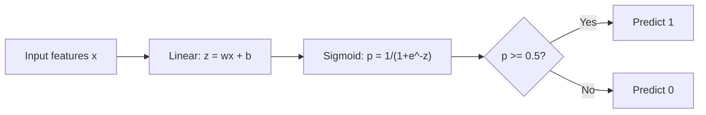
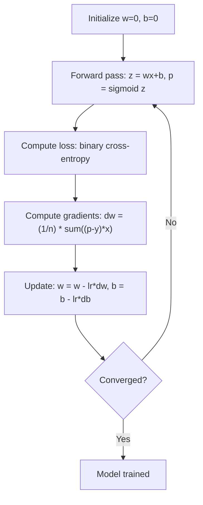

# 逻辑回归

> 逻辑回归把一条直线弯成 S 形曲线，用概率来回答是非问题。

**Type:** Build
**Languages:** Python
**Prerequisites:** Phase 2 Lesson 1-2 (What Is ML, Linear Regression)
**Time:** ~90 minutes

## 学习目标

- 使用 Sigmoid 函数和二分类交叉熵损失，从零实现逻辑回归
- 计算并解释二分类问题中的精确率、召回率、F1 分数和混淆矩阵
- 解释为什么 MSE 不适合分类任务，以及二分类交叉熵为什么能产生凸的损失曲面
- 构建用于多分类的 Softmax 回归模型，并评估阈值调节的权衡

## 问题

你想根据肿瘤大小预测它是恶性还是良性。你尝试用线性回归。它输出 0.3、1.7 或 -0.5 这样的数字。这些数字是什么意思？1.7 是「非常恶性」吗？-0.5 是「非常良性」吗？线性回归输出的是无界数值。而分类需要的是介于 0 和 1 之间的有界概率，以及一个明确的是非决策。

逻辑回归解决了这个问题。它把同样的线性组合（$wx + b$）送入 Sigmoid 函数，该函数能把任意数值压缩到 (0, 1) 区间。输出就是概率。你设定一个阈值（通常是 0.5），然后做出决策。

这是实践中使用最广泛的算法之一。尽管名字里有「回归」，逻辑回归却是一个分类算法。名字来自它所使用的 logistic（即 Sigmoid）函数。

## 概念

### 为什么线性回归不适合分类

想象根据学习时长预测通过 / 不通过（1 / 0）。线性回归会拟合一条穿过数据的直线：

```
hours:  1   2   3   4   5   6   7   8   9   10
actual: 0   0   0   0   1   1   1   1   1   1
```

线性拟合可能在第 1 小时给出 -0.2 的预测，在第 10 小时给出 1.3。这些值不是概率，它们会低于 0、高于 1。更糟的是，一个单独的异常值（有人学习了 50 小时）会拖垮整条直线，改变所有人的预测。

分类需要一个函数，它能：
- 输出 0 到 1 之间的值（概率）
- 形成急剧过渡（决策边界）
- 不会被远离边界的异常值扭曲

### Sigmoid 函数

Sigmoid 函数正好满足这些要求：

```math
\sigma(z) = \frac{1}{1 + e^{-z}}
```

性质：
- 当 $z$ 是很大的正数时，$\sigma(z)$ 接近 1
- 当 $z$ 是很大的负数时，$\sigma(z)$ 接近 0
- 当 $z = 0$ 时，$\sigma(z) = 0.5$
- 输出始终介于 0 和 1 之间
- 函数处处光滑可导

它的导数还有一个简洁形式：$\sigma'(z) = \sigma(z) (1 - \sigma(z))$。这让梯度计算非常高效。

### 逻辑回归 = 线性模型 + Sigmoid

模型先计算 $z = wx + b$（与线性回归相同），再应用 Sigmoid：



输出 $p$ 被解释为 $P(y=1 \mid x)$，即输入属于类别 1 的概率。决策边界位于 $wx + b = 0$ 处，此时 Sigmoid 的输出恰好是 0.5。

### 二分类交叉熵损失

逻辑回归不能使用 MSE。配合 Sigmoid 的 MSE 会形成一个非凸的损失曲面，带有许多局部最小值。取而代之的是二分类交叉熵（对数损失，log loss）：

```math
\text{Loss} = -\frac{1}{n} \sum \left( y \log(p) + (1-y) \log(1-p) \right)
```

它有效的原因：
- 当 $y=1$ 且 $p$ 接近 1 时：$\log(1) = 0$，损失接近 0（正确，成本低）
- 当 $y=1$ 且 $p$ 接近 0 时：$\log(0)$ 趋向负无穷，损失巨大（错误，成本高）
- 当 $y=0$ 且 $p$ 接近 0 时：$\log(1) = 0$，损失接近 0（正确，成本低）
- 当 $y=0$ 且 $p$ 接近 1 时：$\log(0)$ 趋向负无穷，损失巨大（错误，成本高）

这个损失函数对逻辑回归是凸的，保证只有一个全局最小值。

### 逻辑回归的梯度下降

二分类交叉熵配合 Sigmoid 的梯度具有简洁形式：

```math
\begin{aligned}
\frac{\partial L}{\partial w} &= \frac{1}{n} \sum (p - y) \, x \\
\frac{\partial L}{\partial b} &= \frac{1}{n} \sum (p - y)
\end{aligned}
```

这些式子看起来和线性回归的梯度一模一样。区别只在于 $p = \sigma(wx + b)$，而不是 $p = wx + b$。Sigmoid 引入了非线性，但梯度更新规则保持不变。



### 决策边界

对于二维输入（两个特征），决策边界是满足下式的直线：

```math
w_1 x_1 + w_2 x_2 + b = 0
```

直线一侧的点被分为 1，另一侧被分为 0。逻辑回归总是产生线性决策边界。如果你需要曲线边界，要么添加多项式特征，要么使用非线性模型。

### 用 Softmax 做多分类

二分类逻辑回归处理两个类别。对于 $k$ 个类别，使用 Softmax 函数：

```math
\text{softmax}(z_i) = \frac{e^{z_i}}{\sum_j e^{z_j}}
```

每个类别有自己的权重向量。模型为每个类别计算一个分数 $z_i$，Softmax 再把分数转换成总和为 1 的概率。预测类别是概率最高的那个。

损失函数变为多分类交叉熵：

```math
\text{Loss} = -\frac{1}{n} \sum \sum_k y_k \log(p_k)
```

其中 $y_k$ 对真实类别为 1，其余为 0（one-hot 编码）。

### 评估指标

只看准确率是不够的。如果数据集中 95% 为负例、5% 为正例，一个始终预测负例的模型也能达到 95% 的准确率，但毫无用处。

**混淆矩阵（Confusion Matrix）**：

| | 预测为正 | 预测为负 |
|---|---|---|
| 实际为正 | 真正例（TP） | 假负例（FN） |
| 实际为负 | 假正例（FP） | 真负例（TN） |

**精确率（Precision）**：在所有预测为正的样本中，有多少真的是正例？
```math
\text{Precision} = \frac{TP}{TP + FP}
```

**召回率（Recall）**（灵敏度）：在所有真实为正例的样本中，我们找到了多少？
```math
\text{Recall} = \frac{TP}{TP + FN}
```

**F1 分数（F1 Score）**：精确率和召回率的调和平均，平衡两者。
```math
F_1 = 2 \cdot \frac{\text{Precision} \cdot \text{Recall}}{\text{Precision} + \text{Recall}}
```

何时优先关注：
- **精确率**：当假阳性代价高昂时（垃圾邮件过滤器，你不希望误拦正常邮件）
- **召回率**：当假阴性代价高昂时（癌症筛查，你不希望漏掉肿瘤）
- **F1**：当你需要一个单一的平衡指标时

```figure
logistic-sigmoid
```

## 构建它

### 第一步：Sigmoid 函数与数据生成

```python
import random
import math

def sigmoid(z):
    z = max(-500, min(500, z))
    return 1.0 / (1.0 + math.exp(-z))


random.seed(42)
N = 200
X = []
y = []

for _ in range(N // 2):
    X.append([random.gauss(2, 1), random.gauss(2, 1)])
    y.append(0)

for _ in range(N // 2):
    X.append([random.gauss(5, 1), random.gauss(5, 1)])
    y.append(1)

combined = list(zip(X, y))
random.shuffle(combined)
X, y = zip(*combined)
X = list(X)
y = list(y)

print(f"Generated {N} samples (2 classes, 2 features)")
print(f"Class 0 center: (2, 2), Class 1 center: (5, 5)")
print(f"First 5 samples:")
for i in range(5):
    print(f"  Features: [{X[i][0]:.2f}, {X[i][1]:.2f}], Label: {y[i]}")
```

### 第二步：从零实现逻辑回归

```python
class LogisticRegression:
    def __init__(self, n_features, learning_rate=0.01):
        self.weights = [0.0] * n_features
        self.bias = 0.0
        self.lr = learning_rate
        self.loss_history = []

    def predict_proba(self, x):
        z = sum(w * xi for w, xi in zip(self.weights, x)) + self.bias
        return sigmoid(z)

    def predict(self, x, threshold=0.5):
        return 1 if self.predict_proba(x) >= threshold else 0

    def compute_loss(self, X, y):
        n = len(y)
        total = 0.0
        for i in range(n):
            p = self.predict_proba(X[i])
            p = max(1e-15, min(1 - 1e-15, p))
            total += y[i] * math.log(p) + (1 - y[i]) * math.log(1 - p)
        return -total / n

    def fit(self, X, y, epochs=1000, print_every=200):
        n = len(y)
        n_features = len(X[0])
        for epoch in range(epochs):
            dw = [0.0] * n_features
            db = 0.0
            for i in range(n):
                p = self.predict_proba(X[i])
                error = p - y[i]
                for j in range(n_features):
                    dw[j] += error * X[i][j]
                db += error
            for j in range(n_features):
                self.weights[j] -= self.lr * (dw[j] / n)
            self.bias -= self.lr * (db / n)
            loss = self.compute_loss(X, y)
            self.loss_history.append(loss)
            if epoch % print_every == 0:
                print(f"  Epoch {epoch:4d} | Loss: {loss:.4f} | w: [{self.weights[0]:.3f}, {self.weights[1]:.3f}] | b: {self.bias:.3f}")
        return self

    def accuracy(self, X, y):
        correct = sum(1 for i in range(len(y)) if self.predict(X[i]) == y[i])
        return correct / len(y)


split = int(0.8 * N)
X_train, X_test = X[:split], X[split:]
y_train, y_test = y[:split], y[split:]

print("\n=== Training Logistic Regression ===")
model = LogisticRegression(n_features=2, learning_rate=0.1)
model.fit(X_train, y_train, epochs=1000, print_every=200)

print(f"\nTrain accuracy: {model.accuracy(X_train, y_train):.4f}")
print(f"Test accuracy:  {model.accuracy(X_test, y_test):.4f}")
print(f"Weights: [{model.weights[0]:.4f}, {model.weights[1]:.4f}]")
print(f"Bias: {model.bias:.4f}")
```

### 第三步：从零实现混淆矩阵与指标

```python
class ClassificationMetrics:
    def __init__(self, y_true, y_pred):
        self.tp = sum(1 for t, p in zip(y_true, y_pred) if t == 1 and p == 1)
        self.tn = sum(1 for t, p in zip(y_true, y_pred) if t == 0 and p == 0)
        self.fp = sum(1 for t, p in zip(y_true, y_pred) if t == 0 and p == 1)
        self.fn = sum(1 for t, p in zip(y_true, y_pred) if t == 1 and p == 0)

    def accuracy(self):
        total = self.tp + self.tn + self.fp + self.fn
        return (self.tp + self.tn) / total if total > 0 else 0

    def precision(self):
        denom = self.tp + self.fp
        return self.tp / denom if denom > 0 else 0

    def recall(self):
        denom = self.tp + self.fn
        return self.tp / denom if denom > 0 else 0

    def f1(self):
        p = self.precision()
        r = self.recall()
        return 2 * p * r / (p + r) if (p + r) > 0 else 0

    def print_confusion_matrix(self):
        print(f"\n  Confusion Matrix:")
        print(f"                  Predicted")
        print(f"                  Pos   Neg")
        print(f"  Actual Pos     {self.tp:4d}  {self.fn:4d}")
        print(f"  Actual Neg     {self.fp:4d}  {self.tn:4d}")

    def print_report(self):
        self.print_confusion_matrix()
        print(f"\n  Accuracy:  {self.accuracy():.4f}")
        print(f"  Precision: {self.precision():.4f}")
        print(f"  Recall:    {self.recall():.4f}")
        print(f"  F1 Score:  {self.f1():.4f}")


y_pred_test = [model.predict(x) for x in X_test]
print("\n=== Classification Report (Test Set) ===")
metrics = ClassificationMetrics(y_test, y_pred_test)
metrics.print_report()
```

### 第四步：决策边界分析

```python
print("\n=== Decision Boundary ===")
w1, w2 = model.weights
b = model.bias
print(f"Decision boundary: {w1:.4f}*x1 + {w2:.4f}*x2 + {b:.4f} = 0")
if abs(w2) > 1e-10:
    print(f"Solved for x2:     x2 = {-w1/w2:.4f}*x1 + {-b/w2:.4f}")

print("\nSample predictions near the boundary:")
test_points = [
    [3.0, 3.0],
    [3.5, 3.5],
    [4.0, 4.0],
    [2.5, 2.5],
    [5.0, 5.0],
]
for point in test_points:
    prob = model.predict_proba(point)
    pred = model.predict(point)
    print(f"  [{point[0]}, {point[1]}] -> prob={prob:.4f}, class={pred}")
```

### 第五步：用 Softmax 做多分类

```python
class SoftmaxRegression:
    def __init__(self, n_features, n_classes, learning_rate=0.01):
        self.n_features = n_features
        self.n_classes = n_classes
        self.lr = learning_rate
        self.weights = [[0.0] * n_features for _ in range(n_classes)]
        self.biases = [0.0] * n_classes

    def softmax(self, scores):
        max_score = max(scores)
        exp_scores = [math.exp(s - max_score) for s in scores]
        total = sum(exp_scores)
        return [e / total for e in exp_scores]

    def predict_proba(self, x):
        scores = [
            sum(self.weights[k][j] * x[j] for j in range(self.n_features)) + self.biases[k]
            for k in range(self.n_classes)
        ]
        return self.softmax(scores)

    def predict(self, x):
        probs = self.predict_proba(x)
        return probs.index(max(probs))

    def fit(self, X, y, epochs=1000, print_every=200):
        n = len(y)
        for epoch in range(epochs):
            grad_w = [[0.0] * self.n_features for _ in range(self.n_classes)]
            grad_b = [0.0] * self.n_classes
            total_loss = 0.0
            for i in range(n):
                probs = self.predict_proba(X[i])
                for k in range(self.n_classes):
                    target = 1.0 if y[i] == k else 0.0
                    error = probs[k] - target
                    for j in range(self.n_features):
                        grad_w[k][j] += error * X[i][j]
                    grad_b[k] += error
                true_prob = max(probs[y[i]], 1e-15)
                total_loss -= math.log(true_prob)
            for k in range(self.n_classes):
                for j in range(self.n_features):
                    self.weights[k][j] -= self.lr * (grad_w[k][j] / n)
                self.biases[k] -= self.lr * (grad_b[k] / n)
            if epoch % print_every == 0:
                print(f"  Epoch {epoch:4d} | Loss: {total_loss / n:.4f}")
        return self

    def accuracy(self, X, y):
        correct = sum(1 for i in range(len(y)) if self.predict(X[i]) == y[i])
        return correct / len(y)


random.seed(42)
X_3class = []
y_3class = []

centers = [(1, 1), (5, 1), (3, 5)]
for label, (cx, cy) in enumerate(centers):
    for _ in range(50):
        X_3class.append([random.gauss(cx, 0.8), random.gauss(cy, 0.8)])
        y_3class.append(label)

combined = list(zip(X_3class, y_3class))
random.shuffle(combined)
X_3class, y_3class = zip(*combined)
X_3class = list(X_3class)
y_3class = list(y_3class)

split_3 = int(0.8 * len(X_3class))
X_train_3 = X_3class[:split_3]
y_train_3 = y_3class[:split_3]
X_test_3 = X_3class[split_3:]
y_test_3 = y_3class[split_3:]

print("\n=== Multi-class Softmax Regression (3 classes) ===")
softmax_model = SoftmaxRegression(n_features=2, n_classes=3, learning_rate=0.1)
softmax_model.fit(X_train_3, y_train_3, epochs=1000, print_every=200)
print(f"\nTrain accuracy: {softmax_model.accuracy(X_train_3, y_train_3):.4f}")
print(f"Test accuracy:  {softmax_model.accuracy(X_test_3, y_test_3):.4f}")

print("\nSample predictions:")
for i in range(5):
    probs = softmax_model.predict_proba(X_test_3[i])
    pred = softmax_model.predict(X_test_3[i])
    print(f"  True: {y_test_3[i]}, Predicted: {pred}, Probs: [{', '.join(f'{p:.3f}' for p in probs)}]")
```

### 第六步：阈值调节

```python
print("\n=== Threshold Tuning ===")
print("Default threshold: 0.5. Adjusting the threshold trades precision for recall.\n")

thresholds = [0.3, 0.4, 0.5, 0.6, 0.7]
print(f"{'Threshold':>10} {'Accuracy':>10} {'Precision':>10} {'Recall':>10} {'F1':>10}")
print("-" * 52)

for t in thresholds:
    y_pred_t = [1 if model.predict_proba(x) >= t else 0 for x in X_test]
    m = ClassificationMetrics(y_test, y_pred_t)
    print(f"{t:>10.1f} {m.accuracy():>10.4f} {m.precision():>10.4f} {m.recall():>10.4f} {m.f1():>10.4f}")
```

## 使用它

现在用 scikit-learn 实现同样的功能。

```python
from sklearn.linear_model import LogisticRegression as SklearnLR
from sklearn.metrics import accuracy_score, precision_score, recall_score, f1_score
from sklearn.metrics import confusion_matrix, classification_report
from sklearn.model_selection import train_test_split
from sklearn.preprocessing import StandardScaler
import numpy as np

np.random.seed(42)
X_0 = np.random.randn(100, 2) + [2, 2]
X_1 = np.random.randn(100, 2) + [5, 5]
X_sk = np.vstack([X_0, X_1])
y_sk = np.array([0] * 100 + [1] * 100)

X_tr, X_te, y_tr, y_te = train_test_split(X_sk, y_sk, test_size=0.2, random_state=42)

scaler = StandardScaler()
X_tr_sc = scaler.fit_transform(X_tr)
X_te_sc = scaler.transform(X_te)

lr = SklearnLR()
lr.fit(X_tr_sc, y_tr)
y_pred = lr.predict(X_te_sc)

print("=== Scikit-learn Logistic Regression ===")
print(f"Accuracy:  {accuracy_score(y_te, y_pred):.4f}")
print(f"Precision: {precision_score(y_te, y_pred):.4f}")
print(f"Recall:    {recall_score(y_te, y_pred):.4f}")
print(f"F1:        {f1_score(y_te, y_pred):.4f}")
print(f"\nConfusion Matrix:\n{confusion_matrix(y_te, y_pred)}")
print(f"\nClassification Report:\n{classification_report(y_te, y_pred)}")
```

你从零开始的实现会产生相同的决策边界和指标。Scikit-learn 额外提供求解器选项（liblinear、lbfgs、saga）、自动正则化、多分类策略（one-vs-rest、multinomial）以及数值稳定性优化。

## 交付它

本节课产出：
- `code/logistic_regression.py` —— 从零实现的逻辑回归及评估指标

## 练习

1. 生成一个不是线性可分的数据集（例如两个同心圆）。训练逻辑回归并观察它的失败。然后添加多项式特征（$x_1^2, x_2^2, x_1 x_2$）再训练一次，展示准确率提升。
2. 为 3 分类 Softmax 模型实现多分类混淆矩阵。计算每个类别的精确率和召回率。哪个类别最难分类？
3. 从零构建一条 ROC 曲线。对 100 个从 0 到 1 的阈值，计算真正例率（TPR）和假正例率（FPR）。用梯形法则计算 AUC（曲线下面积）。

## 关键术语

| 术语 | 人们常说 | 实际含义 |
|------|----------------|----------------------|
| Logistic regression | 「用于分类的回归」 | 一个线性模型后接 Sigmoid 函数，输出类别概率 |
| Sigmoid function | 「S 形曲线」 | 函数 $1/(1+e^{-z})$，把任意实数映射到 (0, 1) 区间 |
| Binary cross-entropy | 「对数损失」 | 损失函数 $-[y \log(p) + (1-y) \log(1-p)]$，对自信的错误预测给予严厉惩罚 |
| Decision boundary | 「分界线」 | 模型输出概率等于 0.5 的曲面，分隔预测类别 |
| Softmax | 「多分类 Sigmoid」 | 把一个分数向量转换成总和为 1 的概率向量 |
| Precision | 「选中的有多少是相关的」 | $TP / (TP + FP)$，正例预测中实际为正例的比例 |
| Recall | 「相关的有多少被选中了」 | $TP / (TP + FN)$，模型正确识别出的真实正例比例 |
| F1 score | 「平衡的准确率」 | 精确率和召回率的调和平均：$2PR / (P+R)$ |
| Confusion matrix | 「误差拆解」 | 展示 TP、TN、FP、FN 数量的表格 |
| Threshold | 「截断值」 | 模型预测类别 1 的概率阈值（默认 0.5，可调节） |
| One-hot encoding | 「类别的二进制列」 | 把类别 $k$ 表示为位置 $k$ 为 1、其余为 0 的向量 |
| Categorical cross-entropy | 「多分类对数损失」 | 使用 one-hot 标签，把二分类交叉熵扩展到 $k$ 个类别 |
