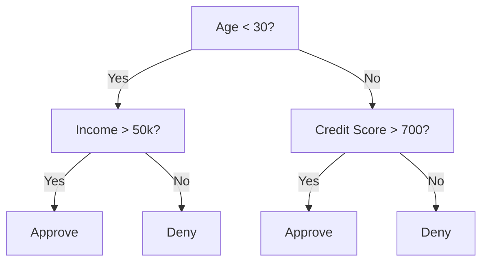
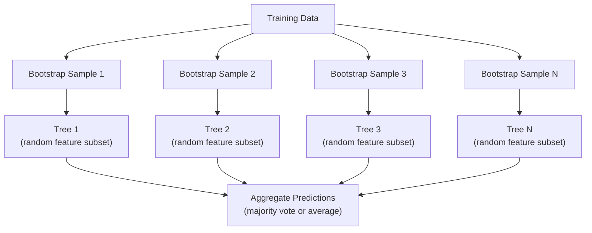

# 决策树与随机森林

> 决策树只是一张流程图。但一片由它们组成的森林，却是机器学习中最强大的工具之一。

**Type:** Build
**Language:** Python
**Prerequisites:** Phase 1 (Lessons 09 Information Theory, 06 Probability)
**Time:** ~90 minutes

## 学习目标

- 实现 Gini 不纯度、熵与信息增益的计算，以寻找最优决策树分裂点
- 从零构建带预剪枝控制（最大深度、最小样本数）的决策树分类器
- 利用自助采样与特征随机化构建随机森林，并解释它为何能降低方差
- 比较 MDI 特征重要性与排列重要性，并识别 MDI 何时存在偏差

## 问题

你手头有表格数据：行是样本，列是特征，还有一个需要预测的目标列。你可以直接套用神经网络，但对于表格数据，基于树的模型（决策树、随机森林、梯度提升树）通常始终优于深度学习。Kaggle 上的结构化数据竞赛由 XGBoost 和 LightGBM 主导，而不是 transformer。

为什么？树模型可以原生处理混合特征类型（数值与类别），无需预处理；可以发现非线性关系，无需特征工程；还具有可解释性——你可以直接观察树结构，清楚看到每个预测是如何做出的。而随机森林通过对多棵树的预测取平均，在中等规模数据集上对过拟合具有很强的抵抗力。

本节课将从递归分裂开始，从零构建决策树，再在其上构建随机森林。你将实现分裂准则背后的数学（Gini 不纯度、熵、信息增益），并理解为什么一堆弱学习器组合起来会变成强学习器。

## 概念

### 决策树的作用

决策树通过一系列是非问题，将特征空间划分成矩形区域。



每个内部节点都会对某个特征与阈值进行测试，每个叶子节点给出预测。要对新数据点分类，就从根节点出发，沿着分支前进，直到抵达叶子。

树的构建采用自顶向下的方式：在每个节点选择能够最好地分离数据的特征与阈值。"最好"由分裂准则定义。

### 分裂准则：度量不纯度

在每个节点，我们有一组样本。我们希望将它们分裂得尽可能"纯"，即每个子节点中的样本尽量属于同一类别。

**Gini 不纯度**衡量的是：如果按该节点的类别分布随机给样本打标签，一个随机选取的样本被误分类的概率。

```math
\text{Gini}(S) = 1 - \sum_k p_k^2 \quad \text{where } p_k \text{ is the proportion of class } k \text{ in set } S.
```

对于纯节点（所有样本同属一类），Gini = 0。对于二分类且 50/50 分布的节点，Gini = 0.5。越低越好。

```
Example: 6 cats, 4 dogs

Gini = 1 - (0.6^2 + 0.4^2) = 1 - (0.36 + 0.16) = 0.48
```

**熵**衡量节点中的信息量（混乱程度）。详见 Phase 1 Lesson 09。

```math
\text{Entropy}(S) = -\sum_k p_k \log_2(p_k)
```

对于纯节点，熵为 0。对于二分类 50/50 分布，熵为 1.0。越低越好。

```
Example: 6 cats, 4 dogs

Entropy = -(0.6 * log2(0.6) + 0.4 * log2(0.4))
        = -(0.6 * -0.737 + 0.4 * -1.322)
        = 0.442 + 0.529
        = 0.971 bits
```

**信息增益**是分裂后不纯度（熵或 Gini）的减少量。

```math
\begin{aligned}
& IG(S, \text{feature}, \text{threshold}) = \text{Impurity}(S) - \text{weighted\_avg}(\text{Impurity}(S_{\text{left}}), \text{Impurity}(S_{\text{right}})) \\[4pt]
& \text{where the weights are the proportions of samples in each child.}
\end{aligned}
```

每个节点上的贪心算法：尝试所有特征和所有可能阈值，选择信息增益最大的（特征，阈值）组合。

### 分裂如何工作

对于当前节点上具有 $n$ 个特征和 $m$ 个样本的数据集：

1. 对每个特征 $j$（$j = 1$ 到 $n$）：
   - 按特征 $j$ 对样本排序
   - 尝试相邻不同取值之间的每个中点作为阈值
   - 计算每个阈值的信息增益
2. 选择信息增益最大的特征与阈值
3. 将数据划分为左子集（特征 <= 阈值）和右子集（特征 > 阈值）
4. 对每个子节点递归重复

这种贪心方法不能保证得到全局最优树。寻找最优树是 NP-hard。但实际中贪心分裂效果很好。

### 停止条件

没有停止条件时，树会一直生长，直到每个叶子都是纯的（每个叶子只剩一个样本）。这会完全记住训练数据，泛化能力极差。

**预剪枝**在树完全生长前停止：
- 最大深度：树达到设定深度后停止分裂
- 叶子最小样本数：节点样本数少于 $k$ 时停止
- 最小信息增益：最佳分裂对不纯度的改善小于阈值时停止
- 最大叶子数：限制叶子总数

**后剪枝**先生长完整树，再回剪：
- 代价复杂度剪枝（scikit-learn 使用）：对叶子数量施加惩罚。增大惩罚可得到更小的树
- reduced error pruning：如果剪去子树后验证误差没有增加，则移除该子树

预剪枝更简单、更快。后剪枝通常能生成更好的树，因为它不会过早地停止那些可能带来有用后续分裂的分裂。

### 回归决策树

用于回归时，叶子预测是该叶子中目标值的均值。分裂准则也相应改变：

**方差减少**替代信息增益：

```math
VR(S, \text{feature}, \text{threshold}) = \text{Var}(S) - \text{weighted\_avg}(\text{Var}(S_{\text{left}}), \text{Var}(S_{\text{right}}))
```

选择使方差减少最大的分裂。树将输入空间划分成若干区域，每个区域预测一个常数（均值）。

### 随机森林：集成模型的力量

单棵决策树方差很高。数据的微小变化都可能导致完全不同的树。随机森林通过对多棵树取平均来解决这个问题。



两种随机性来源让树变得多样化：

**Bagging（自助聚合）：** 每棵树都在自助样本上训练，即从训练数据中有放回地随机抽样。每次自助采样大约包含原始样本的 63%（其余 37% 是袋外样本，可用于验证）。

**特征随机化：** 每次分裂时只考虑特征的随机子集。分类任务默认使用 $\sqrt{n_{\text{features}}}$ 个特征，回归任务默认使用 $n_{\text{features}}/3$。这样可以避免所有树都按同一个主导特征分裂。

关键洞察：对许多相关性较低的树取平均，可以在不增加偏差的情况下降低方差。每棵树单独看可能平平无奇，但集成起来就很强大。

### 特征重要性

随机森林天然提供特征重要性分数。最常见的方法：

**Mean Decrease in Impurity（MDI，平均不纯度下降）：** 对每个特征，累加它在所有树、所有节点上带来的总不纯度下降。在较早分裂处带来更大不纯度下降的特征更重要。

```math
\text{importance}(\text{feature}_j) = \sum_{\text{nodes where feature}_j \text{ is used}} \frac{n_{\text{samples at node}}}{n_{\text{total samples}}} \cdot \text{impurity\_decrease}
```

这种方法计算快（训练时即可得到），但会偏向高基数特征和具有更多可能分裂点的特征。

**排列重要性**是替代方案：随机打乱某个特征的取值，观察模型准确率下降多少。更可靠，但更慢。

### 树何时击败神经网络

树和森林在表格数据上始终优于神经网络。原因如下：

| 因素 | 树模型 | 神经网络 |
|--------|-------|----------------|
| 混合类型（数值 + 类别） | 原生支持 | 需要编码 |
| 小数据集（< 10k 行） | 效果好 | 容易过拟合 |
| 特征交互 | 分裂自动发现 | 需要设计架构 |
| 可解释性 | 完全透明 | 黑盒 |
| 训练时间 | 分钟级 | 小时级 |
| 超参数敏感度 | 低 | 高 |

当数据具有空间或序列结构（图像、文本、音频）时，神经网络占优。对于扁平的特征表，树模型是默认选择。

```figure
decision-tree-depth
```

## 构建它

### 第一步：Gini 不纯度与熵

从零实现两种分裂准则，并验证它们在哪些分裂上意见一致。

```python
import math

def gini_impurity(labels):
    n = len(labels)
    if n == 0:
        return 0.0
    counts = {}
    for label in labels:
        counts[label] = counts.get(label, 0) + 1
    return 1.0 - sum((c / n) ** 2 for c in counts.values())

def entropy(labels):
    n = len(labels)
    if n == 0:
        return 0.0
    counts = {}
    for label in labels:
        counts[label] = counts.get(label, 0) + 1
    return -sum(
        (c / n) * math.log2(c / n) for c in counts.values() if c > 0
    )
```

### 第二步：寻找最佳分裂

尝试每个特征和每个阈值，返回信息增益最大的那个。

```python
def information_gain(parent_labels, left_labels, right_labels, criterion="gini"):
    measure = gini_impurity if criterion == "gini" else entropy
    n = len(parent_labels)
    n_left = len(left_labels)
    n_right = len(right_labels)
    if n_left == 0 or n_right == 0:
        return 0.0
    parent_impurity = measure(parent_labels)
    child_impurity = (
        (n_left / n) * measure(left_labels) +
        (n_right / n) * measure(right_labels)
    )
    return parent_impurity - child_impurity
```

### 第三步：构建 DecisionTree 类

递归分裂、预测以及特征重要性追踪。`_build` 是树的核心：当节点已纯或达到预剪枝限制时停止；否则取最佳分裂，并对两个子节点递归。

```python
import random

class DecisionTree:
    def __init__(self, max_depth=None, min_samples_split=2,
                 min_samples_leaf=1, criterion="gini",
                 max_features=None):
        self.max_depth = max_depth
        self.min_samples_split = min_samples_split
        self.min_samples_leaf = min_samples_leaf
        self.criterion = criterion
        self.max_features = max_features
        self.tree = None
        self.feature_importances_ = None

    def fit(self, X, y):
        self.n_features = len(X[0])
        self.feature_importances_ = [0.0] * self.n_features
        self.n_samples = len(X)
        self.tree = self._build(X, y, depth=0)
        total = sum(self.feature_importances_)
        if total > 0:
            self.feature_importances_ = [
                fi / total for fi in self.feature_importances_
            ]

    def predict(self, X):
        return [self._predict_one(x, self.tree) for x in X]

    def _build(self, X, y, depth):
        if len(set(y)) == 1:
            return {"leaf": True, "value": y[0]}

        if self.max_depth is not None and depth >= self.max_depth:
            return self._make_leaf(y)

        if len(y) < self.min_samples_split:
            return self._make_leaf(y)

        best_feature, best_threshold, best_gain = self._best_split(X, y)

        if best_feature is None or best_gain <= 0:
            return self._make_leaf(y)

        left_X, left_y, right_X, right_y = self._split_data(
            X, y, best_feature, best_threshold
        )

        if len(left_y) < self.min_samples_leaf or len(right_y) < self.min_samples_leaf:
            return self._make_leaf(y)

        weight = len(y) / self.n_samples
        self.feature_importances_[best_feature] += weight * best_gain

        return {
            "leaf": False,
            "feature": best_feature,
            "threshold": best_threshold,
            "left": self._build(left_X, left_y, depth + 1),
            "right": self._build(right_X, right_y, depth + 1),
        }

    def _make_leaf(self, y):
        counts = {}
        for label in y:
            counts[label] = counts.get(label, 0) + 1
        return {"leaf": True, "value": max(counts, key=counts.get)}

    def _best_split(self, X, y):
        best_feature = None
        best_threshold = None
        best_gain = -1.0

        if self.max_features == "sqrt":
            k = max(1, int(math.sqrt(self.n_features)))
            feature_indices = random.sample(range(self.n_features), k)
        elif isinstance(self.max_features, int):
            if self.max_features < 1:
                raise ValueError("max_features must be at least 1 when given as an integer")
            k = min(self.max_features, self.n_features)
            feature_indices = random.sample(range(self.n_features), k)
        else:
            feature_indices = list(range(self.n_features))

        for feature_idx in feature_indices:
            values = sorted(set(X[i][feature_idx] for i in range(len(X))))
            if len(values) <= 1:
                continue

            for i in range(len(values) - 1):
                threshold = (values[i] + values[i + 1]) / 2.0
                left_y = [y[j] for j in range(len(X)) if X[j][feature_idx] <= threshold]
                right_y = [y[j] for j in range(len(X)) if X[j][feature_idx] > threshold]

                if len(left_y) < self.min_samples_leaf or len(right_y) < self.min_samples_leaf:
                    continue

                gain = information_gain(y, left_y, right_y, self.criterion)
                if gain > best_gain:
                    best_gain = gain
                    best_feature = feature_idx
                    best_threshold = threshold

        return best_feature, best_threshold, best_gain

    def _split_data(self, X, y, feature, threshold):
        left_X, left_y, right_X, right_y = [], [], [], []
        for i in range(len(X)):
            if X[i][feature] <= threshold:
                left_X.append(X[i])
                left_y.append(y[i])
            else:
                right_X.append(X[i])
                right_y.append(y[i])
        return left_X, left_y, right_X, right_y

    def _predict_one(self, x, node):
        if node["leaf"]:
            return node["value"]
        if x[node["feature"]] <= node["threshold"]:
            return self._predict_one(x, node["left"])
        return self._predict_one(x, node["right"])
```

### 第四步：构建 RandomForest 类

自助采样、特征随机化与多数投票。

```python
class RandomForest:
    def __init__(self, n_trees=100, max_depth=None,
                 min_samples_split=2, max_features="sqrt",
                 criterion="gini"):
        self.n_trees = n_trees
        self.max_depth = max_depth
        self.min_samples_split = min_samples_split
        self.max_features = max_features
        self.criterion = criterion
        self.trees = []

    def fit(self, X, y):
        n = len(X)
        for _ in range(self.n_trees):
            indices = [random.randint(0, n - 1) for _ in range(n)]
            X_boot = [X[i] for i in indices]
            y_boot = [y[i] for i in indices]
            tree = DecisionTree(
                max_depth=self.max_depth,
                min_samples_split=self.min_samples_split,
                max_features=self.max_features,
                criterion=self.criterion,
            )
            tree.fit(X_boot, y_boot)
            self.trees.append(tree)

    def predict(self, X):
        all_preds = [tree.predict(X) for tree in self.trees]
        predictions = []
        for i in range(len(X)):
            votes = {}
            for preds in all_preds:
                v = preds[i]
                votes[v] = votes.get(v, 0) + 1
            predictions.append(max(votes, key=votes.get))
        return predictions
```

完整实现包含所有辅助方法，见 `code/trees.py`。

## 使用它

使用 scikit-learn，训练随机森林只需三行：

```python
from sklearn.ensemble import RandomForestClassifier
from sklearn.datasets import load_iris
from sklearn.model_selection import train_test_split

X, y = load_iris(return_X_y=True)
X_train, X_test, y_train, y_test = train_test_split(X, y, random_state=42)

rf = RandomForestClassifier(n_estimators=100, random_state=42)
rf.fit(X_train, y_train)
print(f"Accuracy: {rf.score(X_test, y_test):.4f}")
print(f"Feature importances: {rf.feature_importances_}")
```

实践中，梯度提升树（XGBoost、LightGBM、CatBoost）通常比随机森林更强，因为它们按顺序建树，每棵树修正前一棵树的错误。但随机森林更难配错，几乎不需要超参数调优。

## 交付它

本节课产出 `outputs/prompt-tree-interpreter.md` —— 一个面向业务干系人解释决策树分裂的 prompt。向它输入已训练树的结构（深度、特征、分裂阈值、准确率），它会将模型翻译成 plain-language 规则、对特征重要性排序、标记过拟合或信息泄漏，并给出下一步建议。每当你需要向不会读代码的人解释基于树的模型时，都可以使用它。

## 练习

1. 在一个包含 3 个类别的二维数据集上训练单棵决策树。手动追踪分裂过程，并画出矩形决策边界。比较 max_depth=2 与 max_depth=10 时的边界。

2. 为回归树实现方差减少分裂。为 200 个点生成 $y = \sin(x) + \text{noise}$，拟合你的回归树，并将树的分段常数预测与真实曲线对比绘图。

3. 分别构建包含 1、5、10、50、200 棵树的随机森林。绘制训练准确率与测试准确率随树数量变化的曲线。观察测试准确率会趋于平稳但不会下降（森林抗拒过拟合）。

4. 在 5 个不同数据集上比较 Gini 不纯度与熵作为分裂准则。测量准确率与树深度。大多数情况下它们结果几乎相同，解释原因。

5. 实现排列重要性。将它与 MDI 重要性在一个包含高基数随机噪声特征的数据集上比较。MDI 会把噪声特征排得很高，而排列重要性不会。

## 关键术语

| 术语 | 人们常说 | 实际含义 |
|------|----------------|----------------------|
| Decision tree | "预测的流程图" | 通过学习一系列 if/else 分裂，将特征空间划分成矩形区域的模型 |
| Gini impurity | "节点有多混杂" | 在节点随机样本被误分类的概率。0 = 纯，0.5 = 二分类最大不纯度 |
| Entropy | "节点的混乱程度" | 节点中的信息量。0 = 纯，1.0 = 二分类最大不确定。来自信息论 |
| Information gain | "分裂有多好" | 分裂后不纯度的减少量。贪心算法选择分裂的准则 |
| Pre-pruning | "提前停止树的生长" | 通过设置最大深度、最小样本数或最小增益阈值，提前停止树的生长 |
| Post-pruning | "事后修剪树" | 先生长完整树，再移除不能提升验证性能的子树 |
| Bagging | "在随机子集上训练" | Bootstrap aggregating。每个模型在不同有放回随机样本上训练 |
| Random forest | "一堆树" | 决策树的集成，每棵树在自助样本上训练，每次分裂使用随机特征子集 |
| Feature importance (MDI) | "哪些特征重要" | 每个特征在所有树、所有节点上贡献的不纯度下降总和 |
| Permutation importance | "打乱后检查" | 随机打乱某特征取值后模型准确率下降的程度。对噪声特征比 MDI 更可靠 |
| Variance reduction | "回归版的信息增益" | 信息增益在回归树中的对应物。选择使目标方差减少最大的分裂 |
| Bootstrap sample | "有重复的随机样本" | 从原始数据集有放回地抽取的随机样本。大小相同，但含重复项 |

## 延伸阅读

- [Breiman: Random Forests (2001)](https://link.springer.com/article/10.1023/A:1010933404324) - 随机森林的原始论文
- [Grinsztajn et al.: Why do tree-based models still outperform deep learning on tabular data? (2022)](https://arxiv.org/abs/2207.08815) - 树模型与神经网络在表格任务上的严谨对比
- [scikit-learn Decision Trees documentation](https://scikit-learn.org/stable/modules/tree.html) - 带可视化工具的实用指南
- [XGBoost: A Scalable Tree Boosting System (Chen & Guestrin, 2016)](https://arxiv.org/abs/1603.02754) - 统治 Kaggle 的梯度提升论文
