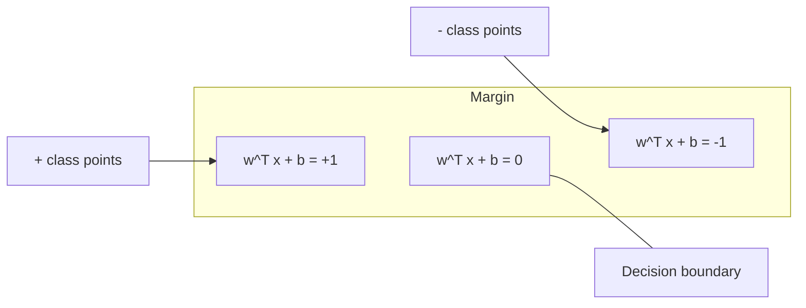
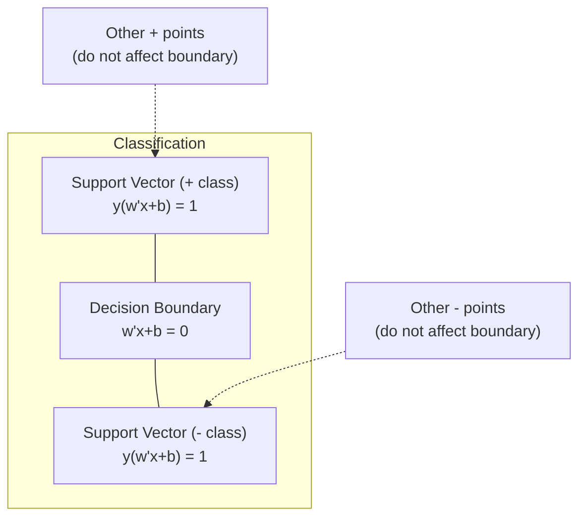
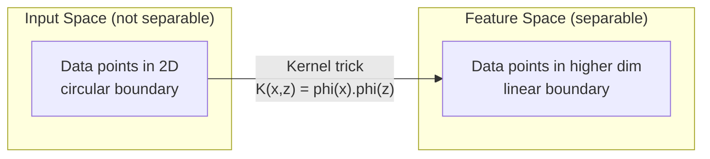

# 支持向量机

> 找到两类之间最宽的街道。这就是全部思想。

**Type:** Build
**Language:** Python
**Prerequisites:** Phase 1 (Lessons 08 Optimization, 14 Norms and Distances, 18 Convex Optimization)
**Time:** ~90 minutes

## 学习目标

- 使用 hinge loss（合页损失）和基于原始形式的梯度下降从头实现线性 SVM
- 解释最大间隔原理，并从训练好的模型中识别支持向量
- 比较线性核、多项式核和 RBF 核，并解释核技巧如何避免显式高维映射
- 评估由 C 参数控制的间隔宽度与分类错误之间的权衡

## 问题

你有一组属于两个类别的数据点，需要画一条直线（或超平面）将它们分开。有无数条直线可以做到。该选哪一条？

选间隔最大的那条。间隔是决策边界到每一侧最近数据点的距离。更宽的间隔意味着分类器更自信，对未见数据的泛化能力也更好。

这种直觉催生了支持向量机（SVM），它是机器学习中最具数学优雅性的算法之一。SVM 在深度学习出现之前是主流分类方法，至今仍是小数据集、高维数据以及需要原理清晰、理论可解释模型的场景的最佳选择。

SVM 与 Phase 1 直接相关：优化是凸的（第 18 课），间隔用范数度量（第 14 课），核技巧利用点积处理非线性边界，而无需在高维空间中实际计算。

## 概念

### 最大间隔分类器

给定线性可分数据，标签 $y_i \in \lbrace -1, +1 \rbrace$，特征向量 $x_i$，我们希望找到一个超平面 $w^T x + b = 0$ 将两类分开。

点 $x_i$ 到超平面的距离为：

```math
\text{distance} = \frac{\lvert w^T x_i + b \rvert}{\lVert w \rVert}
```

对于正确分类的点：$y_i (w^T x_i + b) > 0$。间隔是超平面到任一侧最近点距离的两倍。



优化问题：

```math
\begin{aligned}
\text{maximize} \quad & \frac{2}{\lVert w \rVert} \quad \text{(the margin width)} \\
\text{subject to} \quad & y_i (w^T x_i + b) \ge 1 \quad \text{for all } i
\end{aligned}
```

等价地（最小化 $\lVert w \rVert^2$ 更容易优化）：

```math
\begin{aligned}
\text{minimize} \quad & \frac{1}{2} \lVert w \rVert^2 \\
\text{subject to} \quad & y_i (w^T x_i + b) \ge 1 \quad \text{for all } i
\end{aligned}
```

这是一个凸二次规划问题，具有唯一的全局解。恰好落在间隔边界上的数据点（即 $y_i (w^T x_i + b) = 1$）就是支持向量。只有它们决定决策边界。移动或移除任何非支持向量，边界都不会改变。

### 支持向量：关键的少数



大多数训练点都无关紧要，只有支持向量才重要。这也是为什么 SVM 在预测时内存效率高：只需存储支持向量，而不是整个训练集。

支持向量的数量还能给出泛化误差的上界。支持向量相对于数据集越少，泛化能力通常越好。

### 软间隔：用 C 参数处理噪声

真实数据很少能完美分开。某些点可能位于边界错误一侧，或落在间隔内部。软间隔形式通过引入松弛变量允许违反约束。

```math
\begin{aligned}
\text{minimize} \quad & \frac{1}{2} \lVert w \rVert^2 + C \sum_i \xi_i \\
\text{subject to} \quad & y_i (w^T x_i + b) \ge 1 - \xi_i \\
& \xi_i \ge 0 \quad \text{for all } i
\end{aligned}
```

松弛变量 $\xi_i$ 衡量第 $i$ 个点违反间隔的程度。$C$ 控制权衡：

| $C$ 值 | 表现 |
|---------|----------|
| 大的 $C$ | 严惩违反。间隔窄，错分少。容易过拟合 |
| 小的 $C$ | 允许更多违反。间隔宽，错分多。容易欠拟合 |

$C$ 是反向的正则化强度。$C$ 大 = 正则化弱；$C$ 小 = 正则化强。

### 合页损失：SVM 的损失函数

软间隔 SVM 可以重写为一个无约束优化问题：

```math
\text{minimize} \quad \frac{1}{2} \lVert w \rVert^2 + C \sum_i \max(0, 1 - y_i (w^T x_i + b))
```

其中 $\max(0, 1 - y_i f(x_i))$ 就是 hinge loss（合页损失）。当点被正确分类且远离间隔时，它为 0；当点落在间隔内或被错分时，它线性增长。

```
Hinge loss for a single point:

loss
  |
  | \
  |  \
  |   \
  |    \
  |     \_______________
  |
  +-----|-----|-------->  y * f(x)
       0     1

Zero loss when y*f(x) >= 1 (correctly classified, outside margin).
Linear penalty when y*f(x) < 1.
```

与 logistic loss（逻辑回归）对比：

```math
\begin{aligned}
\text{Hinge:} \quad & \max(0, 1 - y f(x)) && \text{Hard cutoff at margin} \\
\text{Logistic:} \quad & \log(1 + \exp(-y f(x))) && \text{Smooth, never exactly zero}
\end{aligned}
```

合页损失产生稀疏解（只有支持向量有非零贡献），而 logistic loss 使用所有数据点。这使得 SVM 在预测时更省内存。

### 用梯度下降训练线性 SVM

你可以直接在加上 L2 正则化的合页损失上用梯度下降训练线性 SVM，而无需求解带约束的二次规划：

```math
\begin{aligned}
& L(w, b) = \frac{\lambda}{2} \lVert w \rVert^2 + \frac{1}{n} \sum_i \max(0, 1 - y_i (w^T x_i + b)) \\[6pt]
& \text{Gradient with respect to } w\text{:} \\
& \quad \text{If } y_i (w^T x_i + b) \ge 1\text{:} \quad \frac{\partial L}{\partial w} = \lambda w \\
& \quad \text{If } y_i (w^T x_i + b) < 1\text{:} \quad \frac{\partial L}{\partial w} = \lambda w - y_i x_i \\[6pt]
& \text{Gradient with respect to } b\text{:} \\
& \quad \text{If } y_i (w^T x_i + b) \ge 1\text{:} \quad \frac{\partial L}{\partial b} = 0 \\
& \quad \text{If } y_i (w^T x_i + b) < 1\text{:} \quad \frac{\partial L}{\partial b} = -y_i
\end{aligned}
```

这称为原始形式。每个 epoch 的复杂度为 $O(n \cdot d)$，其中 $n$ 是样本数，$d$ 是特征数。对于大规模稀疏高维数据（如文本分类），这很快。

### 对偶形式与核技巧

SVM 问题的拉格朗日对偶（来自 Phase 1 第 18 课的 KKT 条件）为：

```math
\begin{aligned}
\text{maximize} \quad & \sum_i \alpha_i - \frac{1}{2} \sum_{i,j} \alpha_i \alpha_j y_i y_j (x_i \cdot x_j) \\
\text{subject to} \quad & 0 \le \alpha_i \le C \\
& \sum_i \alpha_i y_i = 0
\end{aligned}
```

对偶形式只涉及数据点之间的点积 $x_i \cdot x_j$。这是关键洞察。把每个点积替换成核函数 $K(x_i, x_j)$，SVM 就能学习非线性边界，而无需显式计算变换。

```math
\begin{aligned}
\text{Linear kernel:} \quad & K(x, z) = x \cdot z \\
\text{Polynomial kernel:} \quad & K(x, z) = (x \cdot z + c)^d \\
\text{RBF (Gaussian):} \quad & K(x, z) = \exp(-\gamma \lVert x - z \rVert^2)
\end{aligned}
```

RBF 核将数据映射到无限维空间。输入空间中相近的点核值接近 1，远离的点核值接近 0。它能学习任意平滑的决策边界。



核技巧在不进入高维空间的情况下计算那里的点积。对于 $D$ 维空间中次数为 $d$ 的多项式核，显式特征空间维度为 $O(D^d)$，但 $K(x, z)$ 只需 $O(D)$ 时间即可算出。

### SVM 回归（SVR）

支持向量回归在数据周围拟合一个宽度为 $\epsilon$ 的管道。管道内的点损失为 0，管道外的点线性惩罚。

```math
\begin{aligned}
\text{minimize} \quad & \frac{1}{2} \lVert w \rVert^2 + C \sum_i (\xi_i + \xi_i^*) \\
\text{subject to} \quad & y_i - (w^T x_i + b) \le \epsilon + \xi_i \\
& (w^T x_i + b) - y_i \le \epsilon + \xi_i^* \\
& \xi_i, \xi_i^* \ge 0
\end{aligned}
```

$\epsilon$ 参数控制管道宽度。管道越宽，支持向量越少，拟合越平滑；管道越窄，支持向量越多，拟合越紧。

### SVM 为何输给深度学习（以及何时仍应选用 SVM）

SVM 从 20 世纪 90 年代末到 21 世纪初统治着机器学习。深度学习超越它们的原因有几个：

| 因素 | SVM | 深度学习 |
|--------|------|---------------|
| 特征工程 | 需要 | 自动学习 |
| 可扩展性 | 核方法 $O(n^2)$ 到 $O(n^3)$ | 用 SGD 每个 epoch $O(n)$ |
| 图像/文本/音频 | 需要手工特征 | 从原始数据学习 |
| 大数据集（>100k） | 慢 | 扩展性好 |
| GPU 加速 | 收益有限 | 大幅提速 |

SVM 在以下场景仍然占优：
- 小数据集（几百到几千个样本）
- 高维稀疏数据（用 TF-IDF 特征的文本）
- 需要数学保证（间隔界）
- 训练时间必须极短（线性 SVM 非常快）
- 具有清晰间隔结构的二分类问题
- 异常检测（单类 SVM）

```figure
svm-margin
```

## 构建它

### 第 1 步：合页损失与梯度

打下基础。为一批样本计算合页损失及其梯度。

```python
def hinge_loss(X, y, w, b):
    n = len(X)
    total_loss = 0.0
    for i in range(n):
        margin = y[i] * (dot(w, X[i]) + b)
        total_loss += max(0.0, 1.0 - margin)
    return total_loss / n
```

### 第 2 步：用梯度下降训练线性 SVM

通过最小化正则化合页损失来训练，无需 QP 求解器。

```python
class LinearSVM:
    def __init__(self, lr=0.001, lambda_param=0.01, n_epochs=1000):
        self.lr = lr
        self.lambda_param = lambda_param
        self.n_epochs = n_epochs
        self.w = None
        self.b = 0.0

    def fit(self, X, y):
        n_features = len(X[0])
        self.w = [0.0] * n_features
        self.b = 0.0

        for epoch in range(self.n_epochs):
            for i in range(len(X)):
                margin = y[i] * (dot(self.w, X[i]) + self.b)
                if margin >= 1:
                    self.w = [wj - self.lr * self.lambda_param * wj
                              for wj in self.w]
                else:
                    self.w = [wj - self.lr * (self.lambda_param * wj - y[i] * X[i][j])
                              for j, wj in enumerate(self.w)]
                    self.b -= self.lr * (-y[i])

    def predict(self, X):
        return [1 if dot(self.w, x) + self.b >= 0 else -1 for x in X]
```

### 第 3 步：核函数

实现线性核、多项式核和 RBF 核。

```python
def linear_kernel(x, z):
    return dot(x, z)

def polynomial_kernel(x, z, degree=3, c=1.0):
    return (dot(x, z) + c) ** degree

def rbf_kernel(x, z, gamma=0.5):
    diff = [xi - zi for xi, zi in zip(x, z)]
    return math.exp(-gamma * dot(diff, diff))
```

### 第 4 步：间隔与支持向量识别

训练完成后，识别哪些点是支持向量，并计算间隔宽度。

```python
def find_support_vectors(X, y, w, b, tol=1e-3):
    support_vectors = []
    for i in range(len(X)):
        margin = y[i] * (dot(w, X[i]) + b)
        if abs(margin - 1.0) < tol:
            support_vectors.append(i)
    return support_vectors
```

完整实现及所有演示请见 `code/svm.py`。

## 使用它

配合 scikit-learn 使用：

```python
from sklearn.svm import SVC, LinearSVC, SVR
from sklearn.preprocessing import StandardScaler
from sklearn.pipeline import Pipeline

clf = Pipeline([
    ("scaler", StandardScaler()),
    ("svm", SVC(kernel="rbf", C=1.0, gamma="scale")),
])
clf.fit(X_train, y_train)
print(f"Accuracy: {clf.score(X_test, y_test):.4f}")
print(f"Support vectors: {clf['svm'].n_support_}")
```

重要：训练 SVM 前务必对特征进行缩放。SVM 对特征量级敏感，因为间隔依赖于 $\lVert w \rVert$，而未缩放的特征会扭曲几何结构。

对于大数据集，应使用 `LinearSVC`（原始形式，每个 epoch $O(n)$）而不是 `SVC`（对偶形式，$O(n^2)$ 到 $O(n^3)$）：

```python
from sklearn.svm import LinearSVC

clf = Pipeline([
    ("scaler", StandardScaler()),
    ("svm", LinearSVC(C=1.0, max_iter=10000)),
])
```

## 练习

1. 生成一个二维线性可分数据集。训练你的 LinearSVM 并识别支持向量。验证支持向量确实是离决策边界最近的点。

2. 在一个带噪声的数据集上将 $C$ 从 0.001 变化到 1000，绘制每个 $C$ 对应的决策边界。观察从宽间隔（欠拟合）到窄间隔（过拟合）的过渡。

3. 创建一个类别边界为圆形（非线性）的数据集。展示线性 SVM 失效，然后计算 RBF 核矩阵，说明两类在核诱导的特征空间中线性可分。

4. 在同一数据集上比较 hinge loss 与 logistic loss。分别训练线性 SVM 和逻辑回归，统计每个模型的决策边界由多少训练点决定（支持向量 vs 所有点）。

5. 实现 SVR（$\epsilon$-不敏感损失）。将其拟合到 $y = \sin(x) + \text{noise}$。在预测周围绘制 $\epsilon$ 管道，并高亮支持向量（管道外的点）。

## 关键术语

| 术语 | 实际含义 |
|------|----------------------|
| 支持向量 | 离决策边界最近的训练点。唯一决定超平面的点 |
| 间隔 | 决策边界到最近支持向量的距离。SVM 最大化它 |
| 合页损失 | $\max(0, 1 - y f(x))$。正确分类且在间隔外时为 0，否则线性惩罚 |
| C 参数 | 间隔宽度与分类错误之间的权衡。$C$ 大 = 间隔窄，$C$ 小 = 间隔宽 |
| 软间隔 | 通过松弛变量允许间隔违反的 SVM 形式。处理非线性可分数据 |
| 核技巧 | 在不显式映射到高维空间的情况下计算那里的点积 |
| 线性核 | $K(x, z) = x \cdot z$。等价于标准点积。用于线性可分数据 |
| RBF 核 | $K(x, z) = \exp(-\gamma \Vert x-z \Vert^2)$。映射到无限维。可学习任意平滑边界 |
| 多项式核 | $K(x, z) = (x \cdot z + c)^d$。映射到多项式组合构成的特征空间 |
| 对偶形式 | 仅依赖数据点之间点积的 SVM 重构形式。使核方法成为可能 |
| SVR | 支持向量回归。在数据周围拟合 $\epsilon$ 管道。管道内的点损失为 0 |
| 松弛变量 | $\xi_i$：衡量点违反间隔的程度。对间隔外正确分类的点为 0 |
| 最大间隔 | 选择使到每类最近点距离最大的超平面的原则 |

## 延伸阅读

- [Vapnik: The Nature of Statistical Learning Theory (1995)](https://link.springer.com/book/10.1007/978-1-4757-3264-1) —— SVM 与统计学习理论的奠基著作
- [Cortes & Vapnik: Support-vector networks (1995)](https://link.springer.com/article/10.1007/BF00994018) —— 原始 SVM 论文
- [Platt: Sequential Minimal Optimization (1998)](https://www.microsoft.com/en-us/research/publication/sequential-minimal-optimization-a-fast-algorithm-for-training-support-vector-machines/) —— 让 SVM 训练实用的 SMO 算法
- [scikit-learn SVM 文档](https://scikit-learn.org/stable/modules/svm.html) —— 包含实现细节的实用指南
- [LIBSVM: A Library for Support Vector Machines](https://www.csie.ntu.edu.tw/~cjlin/libsvm/) —— 多数 SVM 实现背后的 C++ 库
