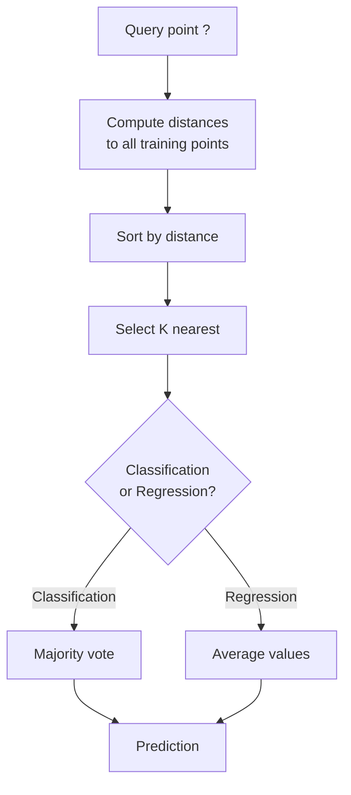
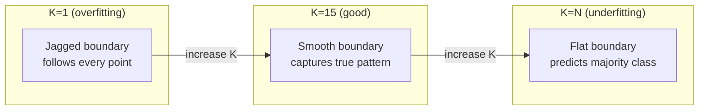
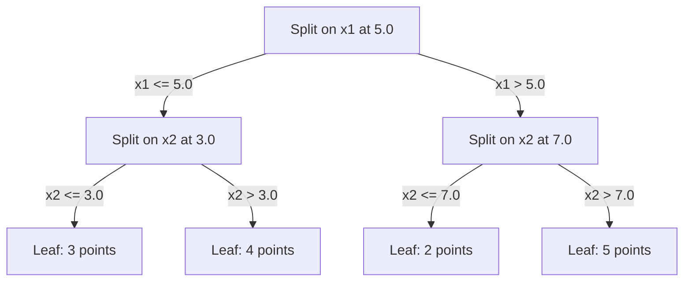

# K-近邻与距离

> 存储所有数据。通过观察邻居来预测。最简单的算法竟然有效。

**Type:** Build
**Language:** Python
**Prerequisites:** Phase 1 (Lesson 14 Norms and Distances)
**Time:** ~90 minutes

## 学习目标

- 从头实现 KNN 分类与回归，支持可配置的 K 和按距离加权的投票
- 比较 L1、L2、余弦和闵可夫斯基距离度量，并为给定数据类型选择合适的度量
- 解释维数灾难，并演示为什么 KNN 在高维空间中性能下降
- 构建 KD 树以高效搜索近邻，并分析它何时优于暴力搜索

## 问题

你有一个数据集。来了一个新数据点，你需要对它分类或预测其值。与其从数据中学习参数（如线性回归或 SVM），不如找出离新点最近的 K 个训练点，让它们投票。

这就是 K-近邻（KNN）。没有训练阶段，没有需要学习的参数，也没有要最小化的损失函数。你存储整个训练集，并在预测时计算距离。

它简单得让人不敢相信会有效。但 KNN 对很多问题都颇具竞争力，尤其是在小到中等规模的数据集上。深入理解它会揭示几个核心概念：距离度量的选择（与 Phase 1 第 14 课相关）、维数灾难，以及惰性学习与主动学习的区别。

KNN 在现代 AI 中随处可见，只是换了个名字。向量数据库在 embedding 上做 KNN 搜索，检索增强生成（RAG）寻找 K 个最近的文档块，推荐系统寻找相似用户或物品。算法本身一样，只是规模与数据结构不同。

## 概念

### KNN 如何工作

给定一个带标签的数据集和一个新的查询点：

1. 计算查询点到数据集中每个点的距离
2. 按距离排序
3. 取最近的 K 个点
4. 分类任务：在 K 个邻居中多数投票
5. 回归任务：取 K 个邻居目标值的平均（或加权平均）



这就是整个算法。没有拟合，没有梯度下降，没有 epoch。

### 选择 K

K 是唯一的超参数，它控制偏差与方差的权衡：

| K | 表现 |
|---|----------|
| $K = 1$ | 决策边界跟随每个点。训练误差为零。方差高。过拟合 |
| 较小的 K（3-5） | 对局部结构敏感，能捕捉复杂边界 |
| 较大的 K | 边界更平滑，对噪声更鲁棒，但可能欠拟合 |
| $K = N$ | 对每个点都预测多数类。偏差最大 |

一个常用起点是 $K = \sqrt{N}$，其中 $N$ 为数据点数量。二分类时建议使用奇数 K，以避免平票。



### 距离度量

距离函数定义了“近”的含义。不同的度量会产生不同的邻居和不同的预测。

**L2（欧氏距离）** 是默认选择，表示直线距离。

```math
d(a, b) = \sqrt{\sum_i (a_i - b_i)^2}
```

它对特征尺度敏感。使用 L2 距离前，务必对特征做标准化。

**L1（曼哈顿距离）** 对绝对差求和。由于对差异不做平方，比 L2 更鲁棒，不易受异常值影响。

```math
d(a, b) = \sum_i \lvert a_i - b_i \rvert
```

**余弦距离** 测量向量之间的夹角，忽略模长。对文本和 embedding 数据至关重要。

```math
d(a, b) = 1 - \frac{a \cdot b}{\lVert a \rVert \, \lVert b \rVert}
```

**闵可夫斯基距离** 用参数 $p$ 统一了 L1 和 L2。

```math
\begin{aligned}
& d(a, b) = \left( \sum_i \lvert a_i - b_i \rvert^p \right)^{1/p} \\[6pt]
& p=1\text{: Manhattan} \\
& p=2\text{: Euclidean} \\
& p \to \infty\text{: Chebyshev (max absolute difference)}
\end{aligned}
```

使用哪种度量取决于数据：

| 数据类型 | 最佳度量 | 原因 |
|-----------|------------|-----|
| 数值特征，尺度相近 | L2（欧氏） | 默认选择，适合空间数据 |
| 数值特征，有异常值 | L1（曼哈顿） | 鲁棒，不会放大较大差异 |
| 文本 embedding | 余弦 | 模长是噪声，方向才是语义 |
| 高维稀疏数据 | 余弦或 L1 | L2 受维数灾难影响 |
| 混合类型 | 自定义距离 | 按特征类型组合不同度量 |

### 加权 KNN

标准 KNN 对所有 K 个邻居一视同仁。但距离为 0.1 的邻居显然应该比距离为 5.0 的邻居更重要。

**距离加权 KNN** 按距离倒数为每个邻居赋权：

```math
\begin{aligned}
& \text{weight}_i = \frac{1}{\text{distance}_i + \epsilon} \\[6pt]
& \text{For classification: weighted vote} \\
& \text{For regression: weighted average} = \frac{\sum_i w_i y_i}{\sum_i w_i}
\end{aligned}
```

$\epsilon$ 防止查询点与训练点完全重合时出现除零。

加权 KNN 对 K 的选择不太敏感，因为无论 K 多大，远距离邻居的贡献都很小。

### 维数灾难

KNN 在高维空间中性能会下降。这不是模糊的担忧，而是数学事实。

**问题 1：距离收敛。** 随着维度增加，最大距离与最小距离的比值趋近于 1。所有点都变得与查询点“同样远”。

```
In d dimensions, for random uniform points:

d=2:    max_dist / min_dist = varies widely
d=100:  max_dist / min_dist ~ 1.01
d=1000: max_dist / min_dist ~ 1.001

When all distances are nearly equal, "nearest" is meaningless.
```

**问题 2：体积爆炸。** 为了覆盖固定比例的数据以找到 K 个邻居，你必须将搜索半径扩展到覆盖特征空间的更大比例。高维中的“邻域”几乎囊括了整个空间。

**问题 3：角落主导。** 在 $d$ 维单位超立方体中，大部分体积集中在角落附近，而非中心。随着 $d$ 增大，内切球所包含的体积占比趋于消失。

实际后果：KNN 在约 20-50 个特征以内表现良好。超过这个范围，你需要先降维（PCA、UMAP、t-SNE）再使用 KNN，或者利用树形搜索结构挖掘数据的内在低维结构。

### KD 树：快速近邻搜索

暴力 KNN 要计算查询点到每个训练点的距离，每个查询复杂度为 $O(n \cdot d)$。对于大型数据集，这太慢了。

KD 树沿着特征轴递归划分空间。每一层选择当前维度上的中位数进行划分。



搜索最近邻时，先遍历到包含查询点的叶子节点，再回溯并只检查可能包含更近点的相邻分区。

平均查询时间：低维时 $O(\log n)$。但在高维（$d > 20$）时，KD 树会退化到 $O(n)$，因为回溯能剪掉的分支越来越少。

### 球树：更适合中等维度

球树将数据划分为嵌套的超球体，而非轴对齐的盒子。每个节点定义一个球（中心 + 半径），包含该子树中的所有点。

相比 KD 树的优势：
- 在中等维度（最高约 50）表现更好
- 能处理非轴对齐的结构
- 更紧的边界体积意味着搜索时能剪掉更多分支

KD 树和球树都是精确算法。对于真正大规模的搜索（数百万点、数百维），应使用近似最近邻方法（HNSW、IVF、乘积量化），这些在 Phase 1 第 14 课中有介绍。

### 惰性学习与主动学习

KNN 是惰性学习者：训练时不做任何工作，预测时做所有工作。大多数其他算法（线性回归、SVM、神经网络）是主动学习者：训练时进行大量计算以构建紧凑模型，预测时很快。

| 方面 | 惰性（KNN） | 主动（SVM、神经网络） |
|--------|------------|------------------------|
| 训练时间 | $O(1)$，只需存储数据 | $O(n \cdot \text{epochs})$ |
| 预测时间 | 每个查询 $O(n \cdot d)$ | $O(d)$ 或 $O(\text{参数量})$ |
| 预测时内存 | 存储整个训练集 | 只存储模型参数 |
| 适应新数据 | 即时添加点 | 需要重新训练 |
| 决策边界 | 隐式，预测时计算 | 显式，训练后固定 |

惰性学习适合以下场景：
- 数据集频繁变化（无需重新训练即可增删点）
- 查询数量很少
- 需要零训练时间
- 数据集小到暴力搜索也很快

### KNN 回归

KNN 回归不是多数投票，而是取 K 个邻居目标值的平均。

```math
\begin{aligned}
& \text{prediction} = \frac{1}{K} \sum_{i \in K \text{ nearest neighbors}} y_i \\[6pt]
& \text{Or with distance weighting:} \\
& \text{prediction} = \frac{\sum_i w_i y_i}{\sum_i w_i} \quad \text{where } w_i = \frac{1}{\text{distance}_i + \epsilon}
\end{aligned}
```

KNN 回归产生分段常数（加权后分段平滑）的预测。它不能外推到训练数据范围之外。如果训练目标都在 0 到 100 之间，KNN 永远不会预测 200。

```figure
knn-smoothness
```

## 构建它

### 第 1 步：距离函数

实现 L1、L2、余弦和闵可夫斯基距离。这些与 Phase 1 第 14 课直接相关。

```python
import math

def l2_distance(a, b):
    return math.sqrt(sum((ai - bi) ** 2 for ai, bi in zip(a, b)))

def l1_distance(a, b):
    return sum(abs(ai - bi) for ai, bi in zip(a, b))

def cosine_distance(a, b):
    dot_val = sum(ai * bi for ai, bi in zip(a, b))
    norm_a = math.sqrt(sum(ai ** 2 for ai in a))
    norm_b = math.sqrt(sum(bi ** 2 for bi in b))
    if norm_a == 0 or norm_b == 0:
        return 1.0
    return 1.0 - dot_val / (norm_a * norm_b)

def minkowski_distance(a, b, p=2):
    if p == float('inf'):
        return max(abs(ai - bi) for ai, bi in zip(a, b))
    return sum(abs(ai - bi) ** p for ai, bi in zip(a, b)) ** (1 / p)
```

### 第 2 步：KNN 分类器与回归器

构建完整的 KNN，支持可配置的 K、距离函数以及可选的距离加权。

```python
class KNN:
    def __init__(self, k=5, distance_fn=l2_distance, weighted=False,
                 task="classification"):
        self.k = k
        self.distance_fn = distance_fn
        self.weighted = weighted
        self.task = task
        self.X_train = None
        self.y_train = None

    def fit(self, X, y):
        self.X_train = X
        self.y_train = y

    def predict(self, X):
        return [self._predict_one(x) for x in X]
```

### 第 3 步：用于高效搜索的 KD 树

从零开始构建 KD 树，沿每个维度的中位数递归划分。

```python
class KDTree:
    def __init__(self, X, indices=None, depth=0):
        # Recursively partition the data
        self.axis = depth % len(X[0])
        # Split on median of the current axis
        ...

    def query(self, point, k=1):
        # Traverse to leaf, then backtrack
        ...
```

完整实现、所有辅助方法和演示请见 `code/knn.py`。

### 第 4 步：特征缩放

KNN 需要特征缩放，因为距离对特征量级敏感。一个取值范围 0-1000 的特征会压倒另一个取值范围 0-1 的特征。

```python
def standardize(X):
    n = len(X)
    d = len(X[0])
    means = [sum(X[i][j] for i in range(n)) / n for j in range(d)]
    stds = [
        max(1e-10, (sum((X[i][j] - means[j]) ** 2 for i in range(n)) / n) ** 0.5)
        for j in range(d)
    ]
    return [[((X[i][j] - means[j]) / stds[j]) for j in range(d)] for i in range(n)], means, stds
```

## 使用它

配合 scikit-learn 使用：

```python
from sklearn.neighbors import KNeighborsClassifier
from sklearn.preprocessing import StandardScaler
from sklearn.pipeline import Pipeline

clf = Pipeline([
    ("scaler", StandardScaler()),
    ("knn", KNeighborsClassifier(n_neighbors=5, metric="euclidean")),
])
clf.fit(X_train, y_train)
print(f"Accuracy: {clf.score(X_test, y_test):.4f}")
```

当数据集足够大且维度足够低时，scikit-learn 会自动使用 KD 树或球树。对于高维数据，它会回退到暴力搜索。你可以用 `algorithm` 参数控制这一点。

对于大规模最近邻搜索（百万级向量），使用 FAISS、Annoy 或向量数据库：

```python
import faiss

index = faiss.IndexFlatL2(dimension)
index.add(embeddings)
distances, indices = index.search(query_vectors, k=5)
```

## 练习

1. 在包含 3 个类别的二维数据集上实现 KNN 分类。绘制 $K=1$、$K=5$、$K=15$ 和 $K=N$ 时的决策边界，观察从过拟合到欠拟合的过渡。

2. 在 2、5、10、50、100、500 维中各生成 1000 个随机点。对每个维度，计算最大成对距离与最小成对距离的比值。绘制比值随维度变化的图，以可视化维数灾难。

3. 在文本分类问题（使用 TF-IDF 向量）上比较 L1、L2 和余弦距离对 KNN 的影响。哪种度量准确率最高？为什么余弦通常在文本上胜出？

4. 实现 KD 树，并在 2D、10D、50D 的数据集（1k、10k、100k 点）上测量查询时间相对于暴力搜索的时间。在什么维度下 KD 树不再比暴力搜索快？

5. 为 $y = \sin(x) + \text{noise}$ 构建加权 KNN 回归器。与 $K=3, 10, 30$ 的未加权 KNN 比较，展示加权能生成更平滑的预测，尤其在大 K 时。

## 关键术语

| 术语 | 实际含义 |
|------|----------------------|
| K-近邻 | 非参数算法，通过寻找查询点最近的 K 个训练点来预测 |
| 惰性学习 | 训练时不做计算，所有工作都在预测时完成。KNN 是典型例子 |
| 主动学习 | 训练时进行大量计算以构建紧凑模型。大多数 ML 算法都是主动的 |
| 维数灾难 | 高维时距离收敛、邻域扩展到覆盖大部分空间，使 KNN 失效 |
| KD 树 | 沿特征轴递归划分空间的二叉树。低维时查询复杂度 $O(\log n)$ |
| 球树 | 嵌套超球体构成的树。在中等维度（最高约 50）比 KD 树更好 |
| 加权 KNN | 按距离倒数为邻居加权。更近的邻居对预测影响更大 |
| 特征缩放 | 将特征归一化到可比范围。KNN 等基于距离的方法必需 |
| 多数投票 | 统计 K 个邻居中最常见的类别来进行分类 |
| 暴力搜索 | 计算到每个训练点的距离。每个查询 $O(n \cdot d)$，精确但大数据集下慢 |
| 近似最近邻 | HNSW、LSH、IVF 等算法，比精确搜索更快找到近似最近点 |
| Voronoi 图 | 将空间划分为若干区域，每个区域包含离某个训练点最近的所有点。$K=1$ 的 KNN 产生 Voronoi 边界 |

## 延伸阅读

- [Cover & Hart: Nearest Neighbor Pattern Classification (1967)](https://ieeexplore.ieee.org/document/1053964) —— 奠基性 KNN 论文，证明其错误率最多是贝叶斯最优的两倍
- [Friedman, Bentley, Finkel: An Algorithm for Finding Best Matches in Logarithmic Expected Time (1977)](https://dl.acm.org/doi/10.1145/355744.355745) —— 原始 KD 树论文
- [Beyer et al.: When Is "Nearest Neighbor" Meaningful? (1999)](https://link.springer.com/chapter/10.1007/3-540-49257-7_15) —— 对近邻维数灾难的形式化分析
- [scikit-learn 近邻文档](https://scikit-learn.org/stable/modules/neighbors.html) —— 含算法选择的实用指南
- [FAISS: A Library for Efficient Similarity Search](https://github.com/facebookresearch/faiss) —— Meta 用于十亿级近似最近邻搜索的库
