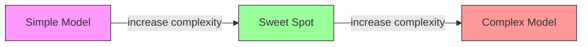
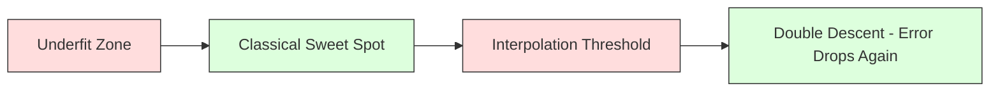
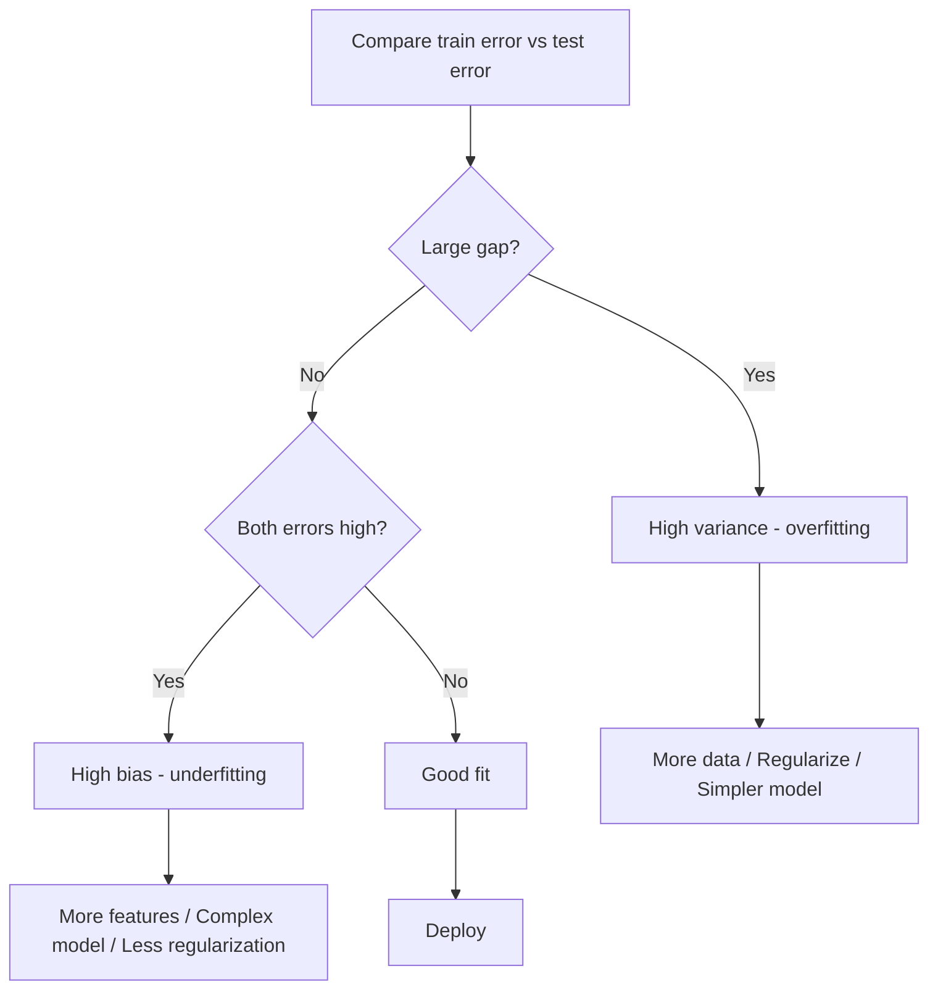
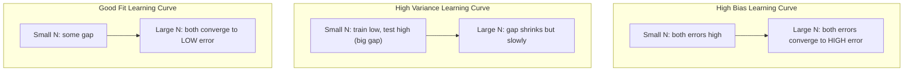
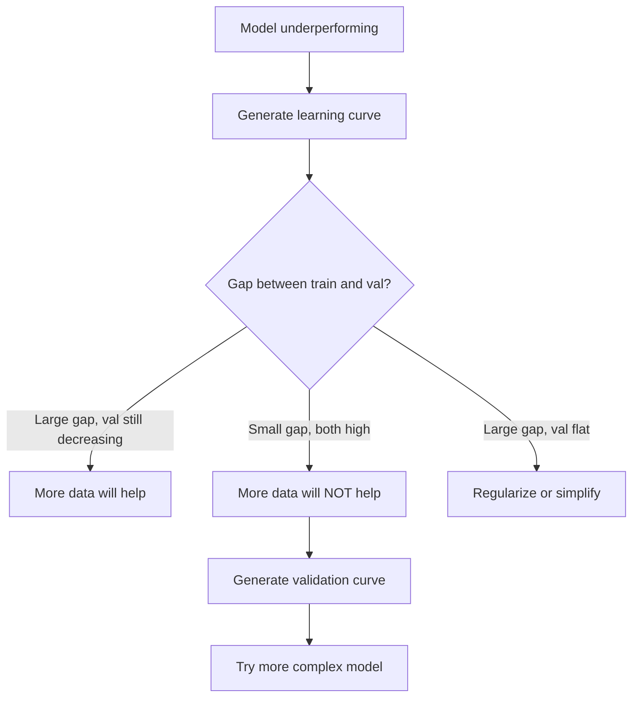

# 偏差-方差权衡

> 每个模型误差都来自三个来源之一：偏差、方差或噪声。你只能控制前两个。

**Type:** Learn
**Language:** Python
**Prerequisites:** Phase 2, Lessons 01-09 (ML basics, regression, classification, evaluation)
**Time:** ~75 minutes

## 学习目标

- 推导期望预测误差下的偏差-方差分解，并解释不可约噪声的作用
- 利用训练误差与测试误差模式诊断模型是高偏差还是高方差
- 解释正则化技术（L1、L2、dropout、early stopping）如何权衡偏差与方差
- 实现实验，可视化不同复杂度模型下的偏差-方差权衡

## 问题

你训练了一个模型。它在测试数据上有一定误差。这些误差从何而来？

如果模型太简单（在曲线数据集上用线性回归），它会持续错过真实模式。这就是偏差。如果模型太复杂（在 15 个数据点上用 20 次多项式），它会完美拟合训练数据，但在新数据上给出 wildly 不同的预测。这就是方差。

对于固定的模型容量，你无法同时最小化二者。压低偏差，方差就会上升；压低方差，偏差就会上升。理解这一权衡是机器学习中最有用的诊断技能。它告诉你应该让模型更复杂还是更简单、应该收集更多数据还是构造更好的特征、应该加强还是减弱正则化。

## 概念

### 偏差：系统性误差

偏差衡量模型平均预测与真实值之间的差距。如果你从同一分布中抽取许多不同训练集，训练同一模型并平均其预测，偏差就是该平均值与真实值之间的 gap。

高偏差意味着模型过于僵硬，无法捕捉真实模式。用直线拟合抛物线，无论你给多少数据，它永远会错过曲线。这就是欠拟合。

```
High bias (underfitting):
  Model always predicts roughly the same wrong thing.
  Training error: HIGH
  Test error: HIGH
  Gap between them: SMALL
```

### 方差：对训练数据的敏感度

方差衡量当训练数据变化时，预测变化的程度。训练集的小变化如果导致模型大幅改变，方差就高。

高方差意味着模型在拟合训练数据中的噪声，而非底层信号。20 次多项式会穿过每个训练点，但在点之间剧烈振荡。这就是过拟合。

```
High variance (overfitting):
  Model fits training data perfectly but fails on new data.
  Training error: LOW
  Test error: HIGH
  Gap between them: LARGE
```

### 分解

对于任意点 $x$，在平方损失下，期望预测误差可以精确分解为：

```math
\begin{aligned}
& \text{Expected Error} = \text{Bias}^2 + \text{Variance} + \text{Irreducible Noise} \\[6pt]
& \text{where:} \\
& \quad \text{Bias}^2 = (\mathbb{E}[\hat{f}(x)] - f(x))^2 \\
& \quad \text{Variance} = \mathbb{E}[(\hat{f}(x) - \mathbb{E}[\hat{f}(x)])^2] \\
& \quad \text{Noise} = \mathbb{E}[(y - f(x))^2] \quad (\sigma^2)
\end{aligned}
```

- $f(x)$ 是真实函数
- $\hat{f}(x)$ 是模型的预测
- $\mathbb{E}[\ldots]$ 是对不同训练集的期望
- $y$ 是观测标签（真实函数加上噪声）

噪声项是不可约的。在有噪声的数据上，没有任何模型能做得比 $\sigma^2$ 更好。你的任务是在 $\text{bias}^2$ 与 variance 之间找到正确平衡。

### 模型复杂度与误差



经典的 U 型曲线：

| 复杂度 | 偏差 | 方差 | 总误差 |
|-----------|------|----------|-------------|
| 过低 | 高 | 低 | 高（欠拟合） |
| 适中 | 中等 | 中等 | 最低 |
| 过高 | 低 | 高 | 高（过拟合） |

### 正则化作为偏差-方差控制

正则化故意增加偏差以降低方差。它约束模型，使其不能追逐噪声。

- **L2（Ridge）：** 把所有权重 shrink 向零。保留所有特征，但降低它们的影响。
- **L1（Lasso）：** 把部分权重精确压到零。执行特征选择。
- **Dropout：** 训练时随机禁用神经元。迫使模型学习冗余表示。
- **Early stopping：** 在模型完全拟合训练数据前停止训练。

正则化强度（lambda、dropout rate、训练轮数）直接控制你在偏差-方差曲线上的位置。更多正则化意味着更多偏差、更少方差。

### 双下降：现代视角

经典理论认为：过了最优点后，复杂度增加总会损害泛化。但 2019 年以来的研究发现了意想不到的现象：如果继续增加模型容量，使其远超插值阈值（模型参数足以完美拟合训练数据），测试误差可能再次下降。



这种「双下降」现象解释了为什么 massively overparameterized 的神经网络（参数远多于训练样本）仍然能很好地泛化。经典的偏差-方差权衡并没有错，但在现代 regime 下并不完整。

关于双下降的关键观察：
- 它在线性模型、决策树和神经网络中都会出现
- 在插值区域，更多数据反而可能有害（样本层面的双下降）
- 更多训练轮数也可能导致双下降（轮数层面的双下降）
- 正则化可以平滑峰值，但无法消除它

为什么会这样？在插值阈值处，模型容量刚好足以拟合所有训练点。它被迫进入一个非常特定的、穿过每个点的解，数据的小扰动就会引起拟合的大幅变化。此时方差达到峰值。越过阈值后，模型有许多可能的解都能完美拟合数据。学习算法（例如带隐式正则化的梯度下降）倾向于在这些解中选择最简单的。这种对简单解的隐式偏好，正是过参数化模型能够泛化的原因。

| 区域 | 参数 vs 样本 | 行为 |
|--------|----------------------|----------|
| Underparameterized | $p \ll n$ | 经典权衡适用 |
| Interpolation threshold | $p \sim n$ | 方差达到峰值，测试误差飙升 |
| Overparameterized | $p \gg n$ | 隐式正则化生效，测试误差下降 |

实用建议：如果你在使用神经网络或大型树集成，不要停在插值阈值处。要么远低于它（配合显式正则化），要么远高于它。最糟糕的位置就是阈值本身。

### 诊断你的模型



| 症状 | 诊断 | 解决方法 |
|---------|-----------|-----|
| 训练误差高、测试误差高 | 偏差 | 增加特征、使用更复杂模型、减弱正则化 |
| 训练误差低、测试误差高 | 方差 | 增加数据、正则化、简化模型、dropout |
| 训练误差低、测试误差低 | 拟合良好 | 交付它 |
| 训练误差下降、测试误差上升 | 过拟合进行中 | Early stopping |

### 实用策略

**当偏差是问题时：**
- 添加多项式或交互特征
- 使用更灵活的模型（用树集成代替线性模型）
- 降低正则化强度
- 训练更久（如果尚未收敛）

**当方差是问题时：**
- 获取更多训练数据
- 使用 bagging（随机森林）
- 增加正则化（更大的 lambda、更高的 dropout rate）
- 特征选择（移除噪声特征）
- 使用交叉验证尽早发现

### 集成方法与方差降低

集成方法是降低方差最实用的工具。

**Bagging（Bootstrap Aggregating）** 在不同自助样本上训练多个模型，然后平均它们的预测。每个单独模型的方差都很高，但平均后的方差会低得多。随机森林就是应用于决策树的 bagging。

其数学原理：如果你平均 $N$ 个独立预测，每个预测方差为 $\sigma^2$，则平均的方差为 $\sigma^2 / N$。这些模型并非真正独立（它们看到相似的数据），因此降低幅度小于 $1/N$，但仍然相当显著。

**Boosting** 通过顺序构建模型来降低偏差，每个新模型都关注当前集成犯的错误。梯度提升和 AdaBoost 是主要代表。如果加入过多模型，boosting 也会过拟合，因此需要 early stopping 或正则化。

| 方法 | 主要效果 | 偏差变化 | 方差变化 |
|--------|---------------|-------------|-----------------|
| Bagging | 降低方差 | 不变 | 下降 |
| Boosting | 降低偏差 | 下降 | 可能上升 |
| Stacking | 同时降低两者 | 取决于元学习器 | 取决于基模型 |
| Dropout | 隐式 bagging | 轻微上升 | 下降 |

**实用规则：** 如果你的基模型方差高（深树、高次多项式），用 bagging。如果你的基模型偏差高（浅树桩、简单线性模型），用 boosting。

### 学习曲线

学习曲线把训练误差和验证误差画成训练集大小的函数。它们是你手中最实用的诊断工具。与单次训练/测试比较不同，学习曲线展示模型的轨迹，并告诉你更多数据是否有帮助。



如何阅读：

| 场景 | 训练误差 | 验证误差 | 差距 | 含义 | 该怎么做 |
|----------|---------------|-----------------|-----|---------------|------------|
| 高偏差 | 高 | 高 | 小 | 模型无法捕捉模式 | 增加特征、使用更复杂模型、减弱正则化 |
| 高方差 | 低 | 高 | 大 | 模型记住了训练数据 | 增加数据、正则化、简化模型 |
| 拟合良好 | 中等 | 中等 | 小 | 模型泛化良好 | 交付它 |
| 高方差，正在改善 | 低 | 随数据增加而下降 | 在缩小 | 数据能解决的方差问题 | 收集更多数据 |
| 高偏差，平坦 | 高 | 高且平坦 | 小且平坦 | 更多数据无济于事 | 改变模型架构 |

关键洞见：如果两条曲线都已经平稳，差距小但误差都高，更多数据无用，你需要更好的模型。如果差距大且仍在缩小，更多数据会有帮助。

### 如何生成学习曲线

有两种方法：

**方法 1：改变训练集大小，固定模型。** 保持模型和超参数不变。在训练数据的越来越大的子集上训练。在每个大小处测量训练误差和验证误差。这就是标准学习曲线。

**方法 2：改变模型复杂度，固定数据。** 保持数据不变。扫描一个复杂度参数（多项式次数、树深度、网络层数）。在每个复杂度处测量训练误差和验证误差。这是验证曲线，直接展示偏差-方差权衡。

两种方法互为补充。第一种告诉你更多数据是否有帮助。第二种告诉你换模型是否有帮助。在决定下一步之前，先运行两者。



```figure
bias-variance
```

## 构建它

`code/bias_variance.py` 中的代码运行完整的偏差-方差分解实验。下面是逐步思路。

### 第 1 步：从已知函数生成合成数据

我们使用 $f(x) = \sin(1.5x) + 0.5x$ 并加入高斯噪声。知道真实函数后，我们就能精确计算偏差和方差。

```python
def true_function(x):
    return np.sin(1.5 * x) + 0.5 * x

def generate_data(n_samples=30, noise_std=0.5, x_range=(-3, 3), seed=None):
    rng = np.random.RandomState(seed)
    x = rng.uniform(x_range[0], x_range[1], n_samples)
    y = true_function(x) + rng.normal(0, noise_std, n_samples)
    return x, y
```

### 第 2 步：自助采样与多项式拟合

对于每个多项式次数，我们抽取多个自助训练集，拟合多项式，并在固定测试网格上记录预测。这给出了每个测试点处的预测分布。

```python
def fit_polynomial(x_train, y_train, degree, lam=0.0):
    X = np.column_stack([x_train ** d for d in range(degree + 1)])
    if lam > 0:
        penalty = lam * np.eye(X.shape[1])
        penalty[0, 0] = 0
        w = np.linalg.solve(X.T @ X + penalty, X.T @ y_train)
    else:
        w = np.linalg.lstsq(X, y_train, rcond=None)[0]
    return w
```

我们在 200 个不同的自助样本上拟合。每个自助样本都来自同一底层分布，但包含不同的点。

### 第 3 步：计算 Bias^2、Variance 分解

有了每个测试点处的 200 组预测，我们可以直接从定义计算分解：

```python
mean_pred = predictions.mean(axis=0)
bias_sq = np.mean((mean_pred - y_true) ** 2)
variance = np.mean(predictions.var(axis=0))
total_error = np.mean(np.mean((predictions - y_true) ** 2, axis=1))
```

- `mean_pred` 是从自助样本估计的 $\mathbb{E}[\hat{f}(x)]$
- `bias_sq` 是平均预测与真实值之间差距的平方
- `variance` 是预测在自助样本间的平均 spread
- `total_error` 应近似等于 $\text{bias}^2 + \text{variance} + \text{noise}$

### 第 4 步：学习曲线

学习曲线在固定模型复杂度的情况下扫描训练集大小。它们展示模型是受数据限制还是受容量限制。

```python
def demo_learning_curves():
    sizes = [10, 15, 20, 30, 50, 75, 100, 150, 200, 300]
    degree = 5

    for n in sizes:
        train_errors = []
        test_errors = []
        for seed in range(50):
            x_train, y_train = generate_data(n_samples=n, seed=seed * 100)
            w = fit_polynomial(x_train, y_train, degree)
            train_pred = predict_polynomial(x_train, w)
            train_mse = np.mean((train_pred - y_train) ** 2)
            test_pred = predict_polynomial(x_test, w)
            test_mse = np.mean((test_pred - y_test) ** 2)
            train_errors.append(train_mse)
            test_errors.append(test_mse)
        # Average over runs gives the learning curve point
```

对于高方差模型（小数据下的 5 次多项式），你会看到：
- 训练误差起始很低，随数据增加而上升，因为记忆变得更困难
- 测试误差起始很高，随模型获得更多信号而下降
- 差距随数据增加而缩小

对于高偏差模型（1 次），两条曲线都快速收敛到相同的高误差，更多数据无济于事。

### 第 5 步：正则化扫描

代码还包含 `demo_regularization_sweep()`，它固定一个高次多项式（15 次），并扫描 Ridge 正则化强度从 0.001 到 100。这从另一个角度展示了偏差-方差权衡：不是改变模型复杂度，而是改变约束强度。

```python
def demo_regularization_sweep():
    alphas = [0.001, 0.005, 0.01, 0.05, 0.1, 0.5, 1.0, 5.0, 10.0, 50.0, 100.0]
    for alpha in alphas:
        results = bias_variance_decomposition([15], lam=alpha)
        r = results[15]
        print(f"alpha={alpha:.3f}  bias={r['bias_sq']:.4f}  var={r['variance']:.4f}")
```

在 alpha 较小时，15 次多项式几乎不受约束。方差占主导，因为模型在每个自助样本中追逐噪声。在 alpha 很大时，惩罚太强，模型实际上接近常数函数。偏差占主导。最优 alpha 位于这两个极端之间。

这是与改变多项式次数相同的 U 型曲线，但由连续旋钮而非离散值控制。在实践中，正则化是控制该权衡的首选方式，因为它允许细粒度控制而无需改变特征集合。

## 使用它

sklearn 提供 `learning_curve` 和 `validation_curve`，可以自动化这些诊断，无需手写自助循环。

### 验证曲线：扫描模型复杂度

```python
from sklearn.model_selection import validation_curve
from sklearn.pipeline import make_pipeline
from sklearn.preprocessing import PolynomialFeatures
from sklearn.linear_model import Ridge

degrees = list(range(1, 16))
train_scores_all = []
val_scores_all = []

for d in degrees:
    pipe = make_pipeline(PolynomialFeatures(d), Ridge(alpha=0.01))
    train_scores, val_scores = validation_curve(
        pipe, X, y, param_name="polynomialfeatures__degree",
        param_range=[d], cv=5, scoring="neg_mean_squared_error"
    )
    train_scores_all.append(-train_scores.mean())
    val_scores_all.append(-val_scores.mean())
```

这直接给出偏差-方差权衡曲线。验证分数相对于训练分数最差的地方，方差占主导；两个分数都差的地方，偏差占主导。

### 学习曲线：扫描训练集大小

```python
from sklearn.model_selection import learning_curve

pipe = make_pipeline(PolynomialFeatures(5), Ridge(alpha=0.01))
train_sizes, train_scores, val_scores = learning_curve(
    pipe, X, y, train_sizes=np.linspace(0.1, 1.0, 10),
    cv=5, scoring="neg_mean_squared_error"
)
train_mse = -train_scores.mean(axis=1)
val_mse = -val_scores.mean(axis=1)
```

把 `train_mse` 和 `val_mse` 对 `train_sizes` 作图。曲线形状会告诉你关于模型的一切。

### 带正则化扫描的交叉验证

```python
from sklearn.model_selection import cross_val_score

alphas = [0.001, 0.01, 0.1, 1.0, 10.0, 100.0]
for alpha in alphas:
    pipe = make_pipeline(PolynomialFeatures(10), Ridge(alpha=alpha))
    scores = cross_val_score(pipe, X, y, cv=5, scoring="neg_mean_squared_error")
    print(f"alpha={alpha:>7.3f}  MSE={-scores.mean():.4f} +/- {scores.std():.4f}")
```

这在固定模型复杂度下扫描正则化强度。你会看到同样的偏差-方差权衡：低 alpha 对应高方差，高 alpha 对应高偏差。

### 整合：完整的诊断工作流

在实践中，你按顺序运行这些诊断：

1. 训练模型，计算训练误差和测试误差。
2. 如果两者都高：存在偏差问题，跳到第 4 步。
3. 如果训练低但测试高：存在方差问题。生成学习曲线，看更多数据是否有帮助；如果没有，则正则化。
4. 生成验证曲线，扫描主要复杂度参数，找到最优点。
5. 在最优点处生成学习曲线。如果差距仍然很大，你需要更多数据或正则化。
6. 用不同 alpha 值尝试 Ridge/Lasso，配合 `cross_val_score`，选择交叉验证误差最低的 alpha。

对于大多数表格数据集，这只需要 10-15 分钟计算，却能节省数小时的盲目尝试。

## 交付它

本节课产出：`outputs/prompt-model-diagnostics.md`

## 练习

1. 用 `noise_std=0`（无噪声）运行分解。不可约误差项会发生什么？最优复杂度会改变吗？
2. 把训练集大小从 30 增加到 300。方差分量如何变化？最优多项式次数会移动吗？
3. 在实验中加入 L2 正则化（Ridge 回归）。固定一个高次多项式（15 次），把 lambda 从 0 扫到 100。绘制 $\text{bias}^2$ 和 variance 随 lambda 变化的曲线。
4. 把真实函数从多项式改为 `sin(x)`。偏差-方差分解如何变化？是否仍存在明确的最优次数？
5. 实现一个简单的 bootstrap aggregating（bagging）包装器：在 10 个自助样本上训练模型并平均预测。证明它能在不显著增加偏差的情况下降低方差。

## 关键术语

| 术语 | 人们常说 | 实际含义 |
|------|---------|---------|
| Bias | "The model is too simple" | 错误假设带来的系统性误差。模型平均预测与真实值之间的差距。 |
| Variance | "The model is overfitting" | 对训练数据敏感带来的误差。预测在不同训练集之间的变化程度。 |
| Irreducible error | "Noise in the data" | 真实数据生成过程中的随机性带来的误差。没有任何模型能消除它。 |
| Underfitting | "Not learning enough" | 模型具有高偏差。即使在训练数据上也错过真实模式。 |
| Overfitting | "Memorizing the data" | 模型具有高方差。它拟合了训练数据中无法泛化的噪声。 |
| Regularization | "Constraining the model" | 添加惩罚以降低模型复杂度，用偏差换取更低的方差。 |
| Double descent | "More parameters can help" | 当模型容量远超插值阈值时，测试误差再次下降。 |
| Model complexity | "How flexible the model is" | 模型拟合任意模式的能力。由架构、特征或正则化控制。 |

## 延伸阅读

- [Hastie, Tibshirani, Friedman: Elements of Statistical Learning, Ch. 7](https://hastie.su.domains/ElemStatLearn/) —— 偏差-方差分解的权威论述
- [Belkin et al., Reconciling modern machine learning practice and the bias-variance trade-off (2019)](https://arxiv.org/abs/1812.11118) —— 双下降论文
- [Nakkiran et al., Deep Double Descent (2019)](https://arxiv.org/abs/1912.02292) —— 轮数层面与样本层面的双下降
- [Scott Fortmann-Roe: Understanding the Bias-Variance Tradeoff](http://scott.fortmann-roe.com/docs/BiasVariance.html) —— 清晰的视觉解释
