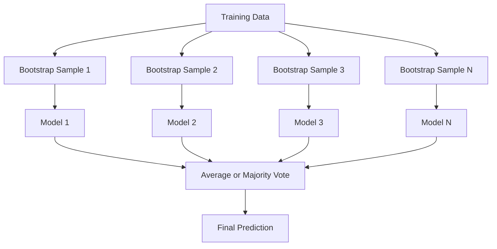
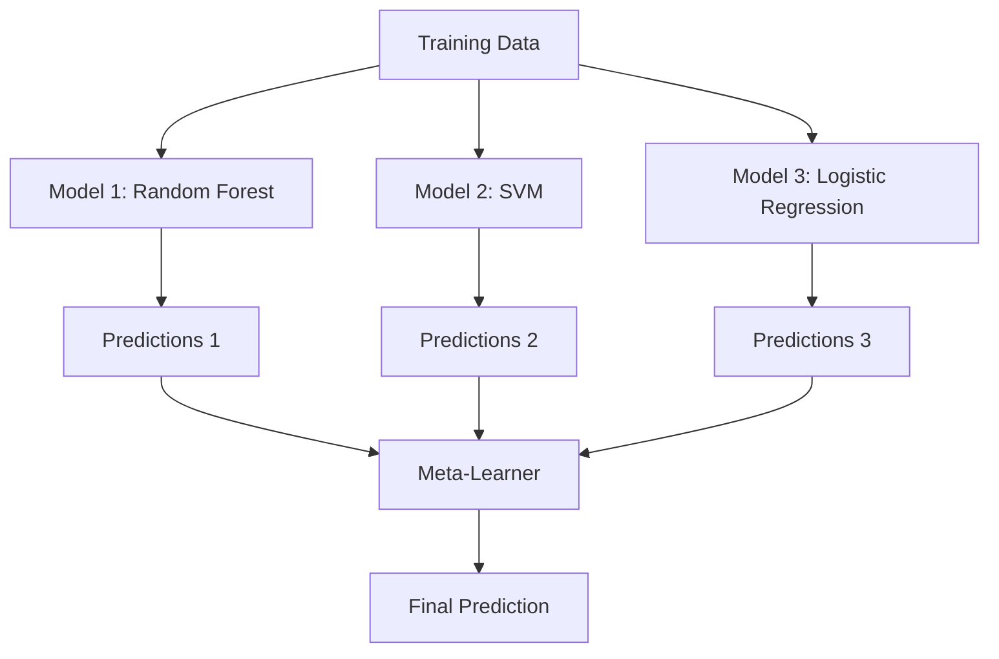

# 集成方法

> 一群弱学习器，只要组合得当，就能变成强学习器。这不是比喻，而是定理。

**Type:** Build
**Language:** Python
**Prerequisites:** Phase 2, Lesson 10 (Bias-Variance Tradeoff)
**Time:** ~120 minutes

## 学习目标

- 从零实现 AdaBoost 与梯度提升，并解释 boosting 如何通过顺序训练来降低偏差
- 构建 bagging 集成，并证明对不相关模型取平均如何在几乎不增加偏差的情况下降低方差
- 比较 bagging、boosting 与 stacking，理解它们分别针对误差的哪个组成部分
- 评估集成多样性，并解释为什么多数投票的准确率会随着独立弱学习器的增加而提升

## 问题

决策树训练快、易解释，但容易过拟合。线性模型在复杂边界上又容易欠拟合。你可以花上数天打磨一个完美的模型架构，也可以把一堆不完美的模型组合起来，得到比任何单个模型都更好的结果。

集成方法做的就是这个。它们是在表格数据上赢得 Kaggle 比赛最可靠的技术，驱动着大多数生产级机器学习系统，也把偏差 - 方差权衡体现得淋漓尽致。Bagging 降低方差，Boosting 降低偏差，Stacking 则学习在什么输入下该信任哪个模型。

## 概念

### 为什么集成有效

假设你有 $N$ 个相互独立的分类器，每个准确率为 $p > 0.5$。多数投票的准确率为：

```math
P(\text{majority correct}) = \sum_{k > N/2} \binom{N}{k} p^k (1-p)^{N-k}
```

对于 21 个准确率均为 60% 的分类器，多数投票准确率约为 74%；若增加到 101 个，准确率可升至 84%。当模型犯的错误各不相同时，错误就会相互抵消。

关键要求是**多样性**。如果所有模型都犯同样的错误，组合它们毫无帮助。集成之所以有效，是因为它们通过以下方式产生多样化的模型：

- 不同的训练子集（bagging）
- 不同的特征子集（随机森林）
- 顺序纠错（boosting）
- 不同的模型族（stacking）

### Bagging（Bootstrap 聚合）

Bagging 通过在训练数据的不同 bootstrap 样本上训练每个模型来创造多样性。



bootstrap 样本是从原始数据中有放回地抽取、大小与原始数据相同的样本。每个 bootstrap 中大约有 63.2% 的唯一样本出现，剩下 36.8% 的样本（out-of-bag 样本）天然构成了一份免费的验证集。

Bagging 在几乎不增加偏差的情况下降低方差。每棵树都会对其 bootstrap 样本过拟合，但每棵树的过拟合方式不同，取平均后噪声就会相互抵消。

**随机森林**是 Bagging 的升级版：在每个分裂点只考虑特征的随机子集，从而强制树之间更加多样化。分类问题中候选特征数通常为 `sqrt(n_features)`，回归问题中通常为 `n_features / 3`。

### Boosting（顺序纠错）

Boosting 按顺序训练模型，每个新模型都聚焦于前面模型分错的样本。


Boosting 降低偏差。每个新模型修正当前集成的系统性错误，最终预测是所有模型的加权和，表现更好的模型拥有更高的权重。

权衡在于：如果轮数过多，boosting 也会过拟合，因为它会持续拟合那些困难样本，而其中一些可能只是噪声。

### AdaBoost

AdaBoost（自适应提升）是第一个实用的 boosting 算法。它可以与任何基学习器配合使用，通常使用决策桩（深度为 1 的树）。

算法如下：

```
1. Initialize sample weights: w_i = 1/N for all i

2. For t = 1 to T:
   a. Train weak learner h_t on weighted data
   b. Compute weighted error:
      err_t = sum(w_i * I(h_t(x_i) != y_i)) / sum(w_i)
   c. Compute model weight:
      alpha_t = 0.5 * ln((1 - err_t) / err_t)
   d. Update sample weights:
      w_i = w_i * exp(-alpha_t * y_i * h_t(x_i))
   e. Normalize weights to sum to 1

3. Final prediction: H(x) = sign(sum(alpha_t * h_t(x)))
```

错误率低的模型获得更高的 alpha；被分错的样本权重上升，下一个模型就会更关注它们。

### 梯度提升

梯度提升把 boosting 推广到了任意损失函数。它不再重新加权样本，而是让每个新模型拟合当前集成的残差（即损失的负梯度）。

```
1. Initialize: F_0(x) = argmin_c sum(L(y_i, c))

2. For t = 1 to T:
   a. Compute pseudo-residuals:
      r_i = -dL(y_i, F_{t-1}(x_i)) / dF_{t-1}(x_i)
   b. Fit a tree h_t to the residuals r_i
   c. Find optimal step size:
      gamma_t = argmin_gamma sum(L(y_i, F_{t-1}(x_i) + gamma * h_t(x_i)))
   d. Update:
      F_t(x) = F_{t-1}(x) + learning_rate * gamma_t * h_t(x)

3. Final prediction: F_T(x)
```

对于平方误差损失，伪残差就是真实残差：$r_i = y_i - F_{t-1}(x_i)$。每棵树实际上都在拟合前面集成的误差。

学习率（收缩系数）控制每棵树的贡献。学习率越小，需要越多的树，但泛化性能通常越好。典型取值为 0.01 到 0.3。

### XGBoost：为什么它统治表格数据

XGBoost（极端梯度提升）是在梯度提升基础上加入工程优化，使其更快、更准、更抗过拟合：

- **正则化目标：** 对叶子权重施加 L1 和 L2 惩罚，防止单棵树过于自信
- **二阶近似：** 同时利用损失函数的一阶和二阶导数，做出更优的分裂决策
- **稀疏感知分裂：** 原生处理缺失值，在每个分裂点学习缺失数据的最佳去向
- **列子采样：** 与随机森林类似，在每个分裂点采样特征以增加多样性
- **加权分位数草图：** 在分布式数据上高效寻找连续特征的分裂点
- **缓存感知块结构：** 针对 CPU 缓存行优化的内存布局

在表格数据上，XGBoost（以及它的继任者 LightGBM）持续优于神经网络，而且短期内不会改观。如果你的数据是行列表格，先用梯度提升。

### Stacking（元学习）

Stacking 用多个基模型的预测结果作为元学习器（meta-learner）的特征。



元学习器学习在哪些输入上信任哪个基模型。如果随机森林在某些区域表现更好，而 SVM 在另一些区域更强，元学习器就会学会相应地路由。

为避免数据泄漏，基模型的预测必须通过训练集上的交叉验证生成。永远不要用同一份数据训练基模型并生成元特征。

### 投票

最简单的集成。直接组合预测结果。

- **硬投票：** 对类别标签进行多数表决。
- **软投票：** 对预测概率取平均，再选择平均概率最高的类别。通常更优，因为它利用了置信度信息。

```figure
f3-ensemble-average
```

## 构建它

### 第 1 步：决策桩（基学习器）

`code/ensembles.py` 从零实现了所有内容。我们先从决策桩开始：只有单个分裂的树。

```python
class DecisionStump:
    def __init__(self):
        self.feature_idx = None
        self.threshold = None
        self.polarity = 1
        self.alpha = None

    def fit(self, X, y, weights):
        n_samples, n_features = X.shape
        best_error = float("inf")

        for f in range(n_features):
            thresholds = np.unique(X[:, f])
            for thresh in thresholds:
                for polarity in [1, -1]:
                    pred = np.ones(n_samples)
                    pred[polarity * X[:, f] < polarity * thresh] = -1
                    error = np.sum(weights[pred != y])
                    if error < best_error:
                        best_error = error
                        self.feature_idx = f
                        self.threshold = thresh
                        self.polarity = polarity

    def predict(self, X):
        n = X.shape[0]
        pred = np.ones(n)
        idx = self.polarity * X[:, self.feature_idx] < self.polarity * self.threshold
        pred[idx] = -1
        return pred
```

### 第 2 步：从零实现 AdaBoost

```python
class AdaBoostScratch:
    def __init__(self, n_estimators=50):
        self.n_estimators = n_estimators
        self.stumps = []
        self.alphas = []

    def fit(self, X, y):
        n = X.shape[0]
        weights = np.full(n, 1 / n)

        for _ in range(self.n_estimators):
            stump = DecisionStump()
            stump.fit(X, y, weights)
            pred = stump.predict(X)

            err = np.sum(weights[pred != y])
            err = np.clip(err, 1e-10, 1 - 1e-10)

            alpha = 0.5 * np.log((1 - err) / err)
            weights *= np.exp(-alpha * y * pred)
            weights /= weights.sum()

            stump.alpha = alpha
            self.stumps.append(stump)
            self.alphas.append(alpha)

    def predict(self, X):
        total = sum(a * s.predict(X) for a, s in zip(self.alphas, self.stumps))
        return np.sign(total)
```

### 第 3 步：从零实现梯度提升

```python
class GradientBoostingScratch:
    def __init__(self, n_estimators=100, learning_rate=0.1, max_depth=3):
        self.n_estimators = n_estimators
        self.lr = learning_rate
        self.max_depth = max_depth
        self.trees = []
        self.initial_pred = None

    def fit(self, X, y):
        self.initial_pred = np.mean(y)
        current_pred = np.full(len(y), self.initial_pred)

        for _ in range(self.n_estimators):
            residuals = y - current_pred
            tree = SimpleRegressionTree(max_depth=self.max_depth)
            tree.fit(X, residuals)
            update = tree.predict(X)
            current_pred += self.lr * update
            self.trees.append(tree)

    def predict(self, X):
        pred = np.full(X.shape[0], self.initial_pred)
        for tree in self.trees:
            pred += self.lr * tree.predict(X)
        return pred
```

### 第 4 步：与 sklearn 对比

代码验证了我们的从零实现与 sklearn 的 `AdaBoostClassifier` 和 `GradientBoostingClassifier` 准确率接近，并把所有方法并列比较。

## 使用它

### 何时使用哪种方法

| 方法 | 降低 | 最适合 | 注意 |
|------|------|--------|------|
| Bagging / Random Forest | 方差 | 噪声大、特征多 | 对偏差无效 |
| AdaBoost | 偏差 | 数据干净、基学习器简单 | 对异常值和噪声敏感 |
| Gradient Boosting | 偏差 | 表格数据、竞赛 | 训练慢，不调参容易过拟合 |
| XGBoost / LightGBM | 两者 | 生产级表格 ML | 超参数多 |
| Stacking | 两者 | 追求最后 1-2% 准确率 | 复杂，元学习器容易过拟合 |
| Voting | 方差 | 快速组合多样化模型 | 只有模型多样时才有效 |

### 表格数据的生产栈

对于大部分表格预测问题，建议按以下顺序尝试：

1. 默认参数的 **LightGBM 或 XGBoost**
2. 调优 n_estimators、learning_rate、max_depth、min_child_weight
3. 如果还需要最后 0.5%，用 3-5 个多样化模型构建 stacking 集成
4. 全程使用交叉验证

表格数据上的神经网络几乎总是不如梯度提升，尽管相关研究一直在尝试。TabNet、NODE 等架构偶尔能追平，但很少能击败调好的 XGBoost。

## 交付它

本节课生成 `outputs/prompt-ensemble-selector.md`——一个帮助你为给定数据集选择合适集成方法的 prompt。描述你的数据（规模、特征类型、噪声水平、类别平衡）和要解决的问题，prompt 会引导你完成决策清单、推荐方法、给出起始超参数，并提醒该方法常见的坑。同时生成 `outputs/skill-ensemble-builder.md`，包含完整的选择指南。

## 练习

1. 修改 AdaBoost 实现，在每一轮后记录训练准确率。绘制准确率随估计器数量的变化曲线。它何时收敛？

2. 通过给回归树加入随机特征子采样，从零实现随机森林。训练 100 棵 `max_features=sqrt(n_features)` 的树并取平均预测。与单棵树比较方差降低幅度。

3. 在梯度提升实现中加入早停：每轮后记录验证损失，若连续 10 轮没有改善就停止。实际用了多少棵树？

4. 用三个基模型（logistic 回归、决策树、k 近邻）和一个 logistic 回归元学习器构建 stacking 集成。用 5 折交叉验证生成元特征。与每个基模型单独比较。

5. 用默认参数在相同数据集上运行 XGBoost，比较其准确率与你从零实现的梯度提升。同时计时。速度差距有多大？

## 关键术语

| 术语 | 通常说法 | 实际含义 |
|------|----------|----------|
| Bagging | "在随机子集上训练" | Bootstrap 聚合：在 bootstrap 样本上训练模型，取平均预测以降低方差 |
| Boosting | "关注困难样本" | 顺序训练模型，每个模型纠正当前集成的错误，以降低偏差 |
| AdaBoost | "重新加权数据" | 通过样本权重更新实现 boosting；分错的点在下个学习器中获得更高权重 |
| Gradient boosting | "拟合残差" | 通过让每个新模型拟合损失函数的负梯度来实现 boosting |
| XGBoost | "Kaggle 武器" | 带正则化、二阶优化和系统级加速技巧的梯度提升 |
| Stacking | "模型之上再建模型" | 把基模型的预测作为元学习器的输入特征 |
| Random forest | "多棵随机树" | 用决策树做 bagging，并在每个分裂点随机选择特征子集以增加多样性 |
| Ensemble diversity | "犯不同的错误" | 模型之间的错误必须低相关，集成才能比单个模型更好 |
| Out-of-bag error | "免费验证" | 未进入 bootstrap 的样本（约 36.8%）充当验证集，无需额外划分 |

## 延伸阅读

- [Schapire & Freund: Boosting: Foundations and Algorithms](https://mitpress.mit.edu/9780262526036/) -- AdaBoost 提出者的专著
- [Friedman: Greedy Function Approximation: A Gradient Boosting Machine (2001)](https://doi.org/10.1214/aos/1013203451) -- 梯度提升的原始论文
- [Chen & Guestrin: XGBoost (2016)](https://arxiv.org/abs/1603.02754) -- XGBoost 论文
- [Wolpert: Stacked Generalization (1992)](https://www.sciencedirect.com/science/article/abs/pii/S0893608005800231) -- Stacking 的原始论文
- [scikit-learn Ensemble Methods](https://scikit-learn.org/stable/modules/ensemble.html) -- 实践参考
