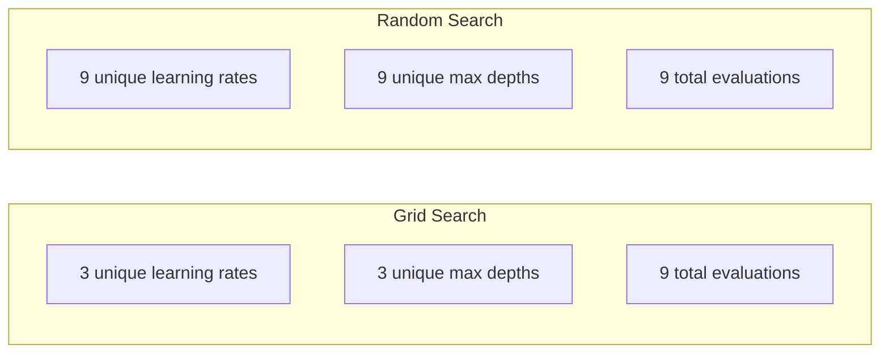
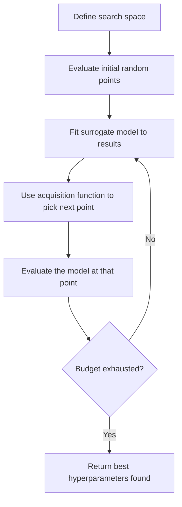
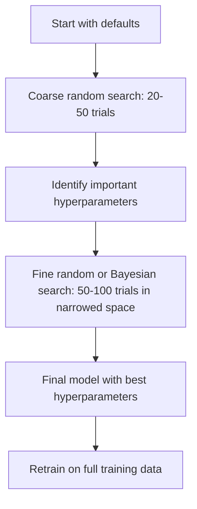
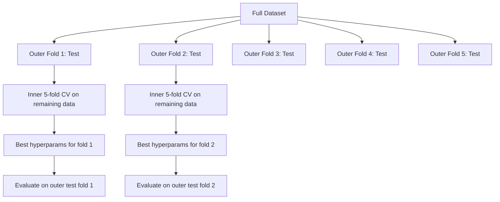

# 超参数调优

> 超参数是训练开始前需要拧动的旋钮。拧得好，模型就从平庸变优秀。

**Type:** Build
**Language:** Python
**Prerequisites:** Phase 2, Lesson 11 (Ensemble Methods)
**Time:** ~90 minutes

## 学习目标

- 从零实现网格搜索、随机搜索与贝叶斯优化，并比较它们的样本效率
- 解释为什么当大多数超参数的有效维度较低时，随机搜索优于网格搜索
- 使用代理模型与采集函数构建贝叶斯优化循环，指导搜索方向
- 设计一套通过合理交叉验证避免对验证集过拟合的超参数调优策略

## 问题

你的梯度提升模型有学习率、树的数量、最大深度、叶节点最小样本数、子采样比例、列采样比例这 6 个超参数。如果每个超参数有 5 个合理取值，网格就有 $5^6 = 15{,}625$ 种组合。训练一次需要 10 秒，全部试完需要 43 小时。

网格搜索是最直观的办法，也是规模扩大后最差的办法。随机搜索用更少的计算就能做得更好。贝叶斯优化通过借鉴历史评估进一步改进。知道该用哪种策略、哪些超参数才真正重要，能帮你省下好几天白费的 GPU 时间。

## 概念

### 参数 vs 超参数

参数在训练过程中学习得到（权重、偏置、分裂阈值）。超参数在训练前设定，控制学习过程如何进行。

| 超参数 | 控制什么 | 典型范围 |
|--------|----------|----------|
| Learning rate | 每次更新的步长 | 0.001 到 1.0 |
| Number of trees/epochs | 训练多久 | 10 到 10,000 |
| Max depth | 模型复杂度 | 1 到 30 |
| Regularization ($\lambda$) | 防止过拟合 | 0.0001 到 100 |
| Batch size | 梯度估计的噪声 | 16 到 512 |
| Dropout rate | 丢弃神经元的比例 | 0.0 到 0.5 |

### 网格搜索

网格搜索评估指定取值的每一种组合。它穷举、易理解，但随超参数数量指数增长。

```
Grid for 2 hyperparameters:

  learning_rate: [0.01, 0.1, 1.0]
  max_depth:     [3, 5, 7]

  Evaluations: 3 x 3 = 9 combinations

  (0.01, 3)  (0.01, 5)  (0.01, 7)
  (0.1,  3)  (0.1,  5)  (0.1,  7)
  (1.0,  3)  (1.0,  5)  (1.0,  7)
```

网格搜索有一个根本缺陷：如果一个超参数重要、另一个不重要，大部分评估都被浪费了。9 次评估只覆盖了重要参数的 3 个不同取值。

### 随机搜索

随机搜索从分布中采样超参数，而不是从网格中选取。同样是 9 次评估预算，你可以得到每个超参数的 9 个不同取值。



随机搜索为什么能打败网格搜索（Bergstra & Bengio, 2012）：

- 大多数超参数的有效维度很低。6 个超参数中通常只有 1-2 个对当前问题真正重要。
- 网格搜索在不重要的维度上浪费评估。
- 随机搜索在相同预算下更密集地覆盖重要维度。
- 60 次随机试验中，有 95% 的概率找到距离最优值 5% 以内的点（若搜索空间内存在这样的点）。

### 贝叶斯优化

随机搜索忽略结果。它不会学到「高学习率导致发散」或「深度 3  consistently 优于深度 10」。贝叶斯优化利用历史评估来决定下一步搜哪里。



两个核心组件：

**代理模型（surrogate model）：** 一个评估成本低的模型（通常用高斯过程），用来近似昂贵的目标函数。它在搜索空间任意一点都能给出预测值和不确定性估计。

**采集函数（acquisition function）：** 通过平衡利用（在已知好点附近搜索）与探索（在不确定性高的地方搜索）来决定下一次评估哪里。常见选择：

- **Expected Improvement（EI）：** 在该点预期能比现在最好结果提升多少？
- **Upper Confidence Bound（UCB）：** 预测值加上不确定性的若干倍。UCB 高意味着有潜力或尚未探索。
- **Probability of Improvement（PI）：** 该点击败当前最优的概率是多少？

贝叶斯优化通常比随机搜索少用 2-5 倍评估就能找到更好的超参数。拟合代理模型的开销与实际模型训练相比可以忽略不计。

### 早停

不是每次训练都要跑完。如果一个配置在 10 个 epoch 后明显很差，就提前终止。这就是超参数搜索中的早停。

策略：
- **Patience-based：** 若验证损失连续 N 个 epoch 没有改善，就停止
- **Median pruning：** 若某次试验的中间结果比同阶段已完成试验的中位数还差，就停止
- **Hyperband：** 给很多配置分配小预算，然后逐步增加表现最好者的预算

Hyperband 尤其有效。它先用 1 个 epoch 启动 81 个配置，保留前 1/3，给它们 3 个 epoch，再保留前 1/3，依此类推。这样比让所有配置都跑满预算快 10-50 倍。

### 学习率调度器

学习率几乎总是最重要的超参数。与其固定不变，不如用调度器在训练过程中调整。

| 调度器 | 公式 | 何时使用 |
|--------|------|----------|
| Step decay | 每 N 个 epoch 乘以 0.1 | 经典 CNN 训练 |
| Cosine annealing | $\text{lr} \cdot 0.5 \cdot (1 + \cos(\pi t / T))$ | 现代默认 |
| Warmup + decay | 先线性上升再余弦下降 | Transformer |
| One-cycle | 一个周期内先升后降 | 快速收敛 |
| Reduce on plateau | 指标停滞时按因子下降 | 稳妥默认 |

### 超参数重要性

不是所有超参数都同等重要。关于随机森林（Probst et al., 2019）和梯度提升的研究显示出一致规律：

**高重要性：**
- 学习率（永远先调）
- 估计器数量 / epoch 数（用早停代替调参）
- 正则化强度

**中等重要性：**
- 最大深度 / 层数
- 叶节点最小样本数 / weight decay
- 子采样比例

**低重要性：**
- 最大特征数（对随机森林）
- 具体激活函数选择
- Batch size（在合理范围内）

先调重要的，其余保持默认。

### 实用策略



具体流程：

1. **从库默认值开始。** 默认值由经验丰富的从业者挑选，往往已经能达到 80% 的效果。
2. **粗粒度随机搜索。** 范围宽，20-50 次试验。用早停快速淘汰差配置。
3. **分析结果。** 哪些超参数与性能相关？缩小搜索空间。
4. **精细搜索。** 在缩小的空间里用贝叶斯优化或聚焦随机搜索，50-100 次试验。
5. **用找到的最佳超参数在整个训练数据上重新训练。**

### 与交叉验证结合

在单一验证集上调参有风险。最佳超参数可能恰好过拟合到那个验证折。嵌套交叉验证通过两个循环解决这一问题：

- **外层循环**（评估）：把数据分成 train+val 与 test，报告无偏性能。
- **内层循环**（调参）：把 train+val 再分成 train 与 val，找出最佳超参数。



每一折外层都独立寻找自己的最佳超参数。外层分数是对泛化性能的无偏估计。

用 sklearn：

```python
from sklearn.model_selection import cross_val_score, GridSearchCV
from sklearn.ensemble import GradientBoostingRegressor

inner_cv = GridSearchCV(
    GradientBoostingRegressor(),
    param_grid={
        "learning_rate": [0.01, 0.05, 0.1],
        "max_depth": [2, 3, 5],
        "n_estimators": [50, 100, 200],
    },
    cv=5,
    scoring="neg_mean_squared_error",
)

outer_scores = cross_val_score(
    inner_cv, X, y, cv=5, scoring="neg_mean_squared_error"
)

print(f"Nested CV MSE: {-outer_scores.mean():.4f} +/- {outer_scores.std():.4f}")
```

这很昂贵（5 外层折 × 5 内层折 × 27 个网格点 = 675 次模型拟合），但能给出值得信赖的性能估计。在论文中报告最终结果或决策风险较高时使用。

### 实用技巧

**从学习率开始。** 它几乎总是基于梯度方法中最重要的超参数。学习率糟糕会让其他一切都失去意义。先把其他超参数固定为默认值，优先扫学习率。

**对学习率和正则化使用对数均匀分布。** 0.001 到 0.01 的差距与 0.1 到 1.0 的差距同样重要。线性搜索会在大值端浪费预算。

**用早停代替调 n_estimators。** 对 boosting 和神经网络，把 n_estimators 或 epochs 设高，让早停决定何时终止。这相当于从搜索中删掉一个超参数。

**预算分配。** 把 60% 的调参预算花在最重要的 2 个超参数上，剩下 40% 给其他。前 2 个超参数通常解释了大部分性能变化。

**尺度很重要。** 永远不要在对数尺度上搜索 batch size（16、32、64 即可）。永远要在对数尺度上搜索学习率。让搜索分布匹配超参数对模型的影响方式。

| 模型类型 | 关键超参数 | 推荐搜索 | 预算 |
|----------|------------|----------|------|
| Random Forest | n_estimators, max_depth, min_samples_leaf | 随机搜索，50 次 | 低（训练快） |
| Gradient Boosting | learning_rate, n_estimators, max_depth | 贝叶斯，100 次 + 早停 | 中 |
| Neural Network | learning_rate, weight_decay, batch_size | 贝叶斯或随机，100+ 次 | 高（训练慢） |
| SVM | C, gamma（RBF 核） | 对数尺度网格，25-50 次 | 低（2 个参数） |
| Lasso/Ridge | alpha | 对数尺度一维搜索，20 次 | 很低 |
| XGBoost | learning_rate, max_depth, subsample, colsample | 贝叶斯，100-200 次 + 早停 | 中 |

**不确定时：** 随机搜索的试验数至少为超参数数量的 2 倍（例如 6 个超参数至少 12 次试验）。你会发现，精心设计的网格搜索常常不如 50 次随机搜索。

```figure
k-fold-cv
```

## 构建它

### 第 1 步：从零实现网格搜索

`code/tuning.py` 从零实现了网格搜索、随机搜索和简单的贝叶斯优化器。

```python
def grid_search(model_fn, param_grid, X_train, y_train, X_val, y_val):
    keys = list(param_grid.keys())
    values = list(param_grid.values())
    best_score = -float("inf")
    best_params = None
    n_evals = 0

    for combo in itertools.product(*values):
        params = dict(zip(keys, combo))
        model = model_fn(**params)
        model.fit(X_train, y_train)
        score = evaluate(model, X_val, y_val)
        n_evals += 1

        if score > best_score:
            best_score = score
            best_params = params

    return best_params, best_score, n_evals
```

### 第 2 步：从零实现随机搜索

```python
def random_search(model_fn, param_distributions, X_train, y_train,
                  X_val, y_val, n_iter=50, seed=42):
    rng = np.random.RandomState(seed)
    best_score = -float("inf")
    best_params = None

    for _ in range(n_iter):
        params = {k: sample(v, rng) for k, v in param_distributions.items()}
        model = model_fn(**params)
        model.fit(X_train, y_train)
        score = evaluate(model, X_val, y_val)

        if score > best_score:
            best_score = score
            best_params = params

    return best_params, best_score, n_iter
```

### 第 3 步：贝叶斯优化（简化版）

核心思想：把高斯过程拟合到已观测的（超参数，分数）对上，再用采集函数决定下一个观察点。

```python
class SimpleBayesianOptimizer:
    def __init__(self, search_space, n_initial=5):
        self.search_space = search_space
        self.n_initial = n_initial
        self.X_observed = []
        self.y_observed = []

    def _kernel(self, x1, x2, length_scale=1.0):
        dists = np.sum((x1[:, None, :] - x2[None, :, :]) ** 2, axis=2)
        return np.exp(-0.5 * dists / length_scale ** 2)

    def _fit_gp(self, X_new):
        X_obs = np.array(self.X_observed)
        y_obs = np.array(self.y_observed)
        y_mean = y_obs.mean()
        y_centered = y_obs - y_mean

        K = self._kernel(X_obs, X_obs) + 1e-4 * np.eye(len(X_obs))
        K_star = self._kernel(X_new, X_obs)

        L = np.linalg.cholesky(K)
        alpha = np.linalg.solve(L.T, np.linalg.solve(L, y_centered))
        mu = K_star @ alpha + y_mean

        v = np.linalg.solve(L, K_star.T)
        var = 1.0 - np.sum(v ** 2, axis=0)
        var = np.maximum(var, 1e-6)

        return mu, var

    def _expected_improvement(self, mu, var, best_y):
        sigma = np.sqrt(var)
        z = (mu - best_y) / (sigma + 1e-10)
        ei = sigma * (z * norm_cdf(z) + norm_pdf(z))
        return ei

    def suggest(self):
        if len(self.X_observed) < self.n_initial:
            return sample_random(self.search_space)

        candidates = [sample_random(self.search_space) for _ in range(500)]
        X_cand = np.array([to_vector(c) for c in candidates])
        mu, var = self._fit_gp(X_cand)
        ei = self._expected_improvement(mu, var, max(self.y_observed))
        return candidates[np.argmax(ei)]

    def observe(self, params, score):
        self.X_observed.append(to_vector(params))
        self.y_observed.append(score)
```

GP 代理在每个候选点给出两样东西：预测分数（mu）和不确定性（var）。Expected Improvement 平衡二者：它青睐预测分数高**或**不确定性高的点。早期大部分点的不确定性都很高，因此优化器会探索；后期则聚焦在最优前景区域。

### 第 4 步：对比三种方法

在同样的合成目标上运行三种方法并比较。下面的对比使用简化包装器，直接调用优化器与目标函数（不涉及真实模型训练），因此 API 与上面基于模型的实现略有不同：

```python
def synthetic_objective(params):
    lr = params["learning_rate"]
    depth = params["max_depth"]
    return -(np.log10(lr) + 2) ** 2 - (depth - 4) ** 2 + 10

param_grid = {
    "learning_rate": [0.001, 0.01, 0.1, 1.0],
    "max_depth": [2, 3, 4, 5, 6, 7, 8],
}

grid_best = None
grid_score = -float("inf")
grid_history = []
for combo in itertools.product(*param_grid.values()):
    params = dict(zip(param_grid.keys(), combo))
    score = synthetic_objective(params)
    grid_history.append((params, score))
    if score > grid_score:
        grid_score = score
        grid_best = params

param_dist = {
    "learning_rate": ("log_float", 0.001, 1.0),
    "max_depth": ("int", 2, 8),
}

rand_best = None
rand_score = -float("inf")
rand_history = []
rng = np.random.RandomState(42)
for _ in range(28):
    params = {k: sample(v, rng) for k, v in param_dist.items()}
    score = synthetic_objective(params)
    rand_history.append((params, score))
    if score > rand_score:
        rand_score = score
        rand_best = params

optimizer = SimpleBayesianOptimizer(param_dist, n_initial=5)
bayes_history = []
for _ in range(28):
    params = optimizer.suggest()
    score = synthetic_objective(params)
    optimizer.observe(params, score)
    bayes_history.append((params, score))
bayes_score = max(s for _, s in bayes_history)

print(f"{'Method':<20} {'Best Score':>12} {'Evaluations':>12}")
print("-" * 50)
print(f"{'Grid Search':<20} {grid_score:>12.4f} {len(grid_history):>12}")
print(f"{'Random Search':<20} {rand_score:>12.4f} {len(rand_history):>12}")
print(f"{'Bayesian Opt':<20} {bayes_score:>12.4f} {len(bayes_history):>12}")
```

在相同预算下，贝叶斯优化通常最快找到最好分数，因为它不会把评估浪费在明显糟糕的区域。随机搜索比网格搜索覆盖更广。网格搜索只有在超参数很少且能承担穷举成本时才占优。

## 使用它

### 实践中的 Optuna

Optuna 是严肃超参数调优的推荐库。它原生支持剪枝、分布式搜索与可视化。

```python
import optuna

def objective(trial):
    lr = trial.suggest_float("learning_rate", 1e-4, 1e-1, log=True)
    n_est = trial.suggest_int("n_estimators", 50, 500)
    max_depth = trial.suggest_int("max_depth", 2, 10)

    model = GradientBoostingRegressor(
        learning_rate=lr,
        n_estimators=n_est,
        max_depth=max_depth,
    )
    model.fit(X_train, y_train)
    return mean_squared_error(y_val, model.predict(X_val))

study = optuna.create_study(direction="minimize")
study.optimize(objective, n_trials=100)

print(f"Best params: {study.best_params}")
print(f"Best MSE: {study.best_value:.4f}")
```

Optuna 的关键特性：
- `suggest_float(..., log=True)` 适合在对数尺度上搜索的参数（学习率、正则化）
- `suggest_int` 用于整数参数
- `suggest_categorical` 用于离散选择
- 内置 MedianPruner，可提前终止差试验
- `study.trials_dataframe()` 用于分析

### 带剪枝的 Optuna

剪枝可以提前停止没有前途的试验，节省大量计算。模式如下：

```python
import optuna
from sklearn.model_selection import cross_val_score

def objective(trial):
    params = {
        "learning_rate": trial.suggest_float("lr", 1e-4, 0.5, log=True),
        "max_depth": trial.suggest_int("max_depth", 2, 10),
        "n_estimators": trial.suggest_int("n_estimators", 50, 500),
        "subsample": trial.suggest_float("subsample", 0.5, 1.0),
    }

    model = GradientBoostingRegressor(**params)
    scores = cross_val_score(model, X_train, y_train, cv=3,
                             scoring="neg_mean_squared_error")
    mean_score = -scores.mean()

    trial.report(mean_score, step=0)
    if trial.should_prune():
        raise optuna.TrialPruned()

    return mean_score

pruner = optuna.pruners.MedianPruner(n_startup_trials=10, n_warmup_steps=5)
study = optuna.create_study(direction="minimize", pruner=pruner)
study.optimize(objective, n_trials=200)
```

`MedianPruner` 会在某次试验的中间值比同阶段已完成试验的中位数还差时停止该试验。剪枝需要调用 `trial.report()` 报告中间指标，并调用 `trial.should_prune()` 检查是否该停止。`n_startup_trials=10` 确保至少有 10 次试验完整跑完后再启用剪枝。这通常能节省 40-60% 的总计算量。

### sklearn 内置调参器

快速实验时，sklearn 提供 `GridSearchCV`、`RandomizedSearchCV` 和 `HalvingRandomSearchCV`：

```python
from sklearn.model_selection import RandomizedSearchCV
from scipy.stats import loguniform, randint

param_dist = {
    "learning_rate": loguniform(1e-4, 0.5),
    "max_depth": randint(2, 10),
    "n_estimators": randint(50, 500),
}

search = RandomizedSearchCV(
    GradientBoostingRegressor(),
    param_dist,
    n_iter=100,
    cv=5,
    scoring="neg_mean_squared_error",
    random_state=42,
    n_jobs=-1,
)
search.fit(X_train, y_train)
print(f"Best params: {search.best_params_}")
print(f"Best CV MSE: {-search.best_score_:.4f}")
```

对学习率和正则化使用 scipy 的 `loguniform`，对整数超参数使用 `randint`。`n_jobs=-1` 会在所有 CPU 核心上并行。

### 超参数调优常见错误

**预处理导致的数据泄漏。** 如果在交叉验证前用全部数据拟合 scaler，验证折的信息就会泄漏到训练中。始终把预处理放进 `Pipeline`，让它只在训练折上拟合。

**对验证集过拟合。** 跑成千上万次试验实际上是在验证集上训练。对最终性能估计使用嵌套交叉验证，或留出一个在调参过程中绝不触碰的测试集。

**搜索范围太窄。** 如果最佳值落在搜索空间边界上，说明搜索不够广。最优值可能在你的范围之外。每次都要检查最佳参数是否落在边缘。

**忽视交互效应。** 学习率与估计器数量在 boosting 中强交互。低学习率需要更多估计器。独立调它们比一起调效果更差。

**对迭代模型不用早停。** 对梯度提升和神经网络，把 n_estimators 或 epochs 设高并用早停。这严格优于把迭代次数当作超参数来调。

## 练习

1. 用相同的总预算（例如 50 次评估）运行网格搜索和随机搜索，比较找到的最佳分数。用不同种子重复 10 次实验。随机搜索赢的频率是多少？

2. 从零实现 Hyperband。从 81 个配置开始，每个配置训练 1 个 epoch；每轮保留前 1/3 并把它们预算翻三倍。比较总计算量（所有配置的所有 epoch 之和）与让 81 个配置都跑满预算的差异。

3. 在第 11 课的梯度提升实现中加入余弦退火学习率调度器。与固定学习率相比是否有提升？

4. 用 Optuna 在真实数据集（如 sklearn 的 breast cancer 数据集）上调优 RandomForestClassifier。用 `optuna.visualization.plot_param_importances(study)` 查看哪些超参数最重要。结果是否与本课的重要性排序一致？

5. 实现一个简单的采集函数（Expected Improvement），演示探索与利用。画出代理模型的均值与不确定性，并标出 EI 选择的下一个评估点。

## 关键术语

| 术语 | 通常说法 | 实际含义 |
|------|----------|----------|
| Hyperparameter | "训练前设置的值" | 在训练前设定、控制学习过程的值，不是从数据中学到的 |
| Grid search | "穷举所有组合" | 在指定参数网格上穷举搜索，成本随维度指数增长 |
| Random search | "随机采样试试" | 从分布中采样超参数，比网格搜索更好地覆盖重要维度 |
| Bayesian optimization | "智能搜索" | 用目标函数的代理模型决定下一步评估哪里，平衡探索与利用 |
| Surrogate model | "廉价近似" | 通常用高斯过程近似昂贵目标函数，从已观测评估中拟合得到 |
| Acquisition function | "下一步看哪里" | 通过平衡期望改进与不确定性为候选点评分；EI 与 UCB 是常见选择 |
| Early stopping | "别浪费时间" | 验证性能不再提升时提前终止训练 |
| Hyperband | "配置淘汰赛" | 自适应资源分配：小预算启动很多配置，保留好的并增加预算 |
| Learning rate scheduler | "训练时改 lr" | 在训练过程中调整学习率以获得更好收敛的函数 |

## 延伸阅读

- [Bergstra & Bengio: Random Search for Hyper-Parameter Optimization (2012)](https://jmlr.org/papers/v13/bergstra12a.html) -- 证明随机搜索优于网格搜索的经典论文
- [Snoek et al., Practical Bayesian Optimization of Machine Learning Algorithms (2012)](https://arxiv.org/abs/1206.2944) -- 机器学习中的贝叶斯优化
- [Li et al., Hyperband: A Novel Bandit-Based Approach (2018)](https://jmlr.org/papers/v18/16-558.html) -- Hyperband 论文
- [Optuna: A Next-generation Hyperparameter Optimization Framework](https://arxiv.org/abs/1907.10902) -- Optuna 论文
- [Probst et al., Tunability: Importance of Hyperparameters (2019)](https://jmlr.org/papers/v20/18-444.html) -- 哪些超参数真正重要
