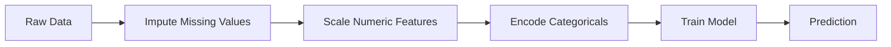
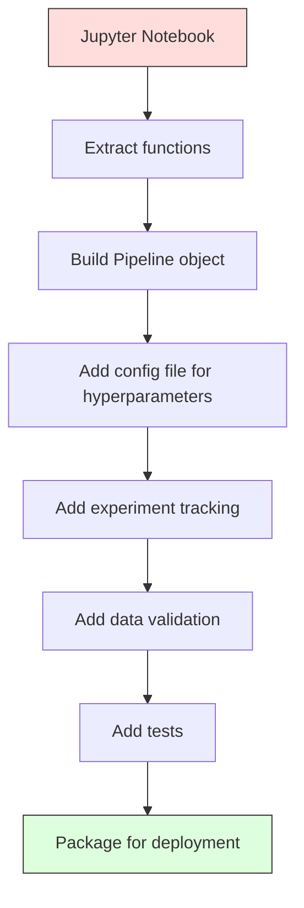

# 机器学习 pipeline

> 模型不是产品，pipeline 才是。Pipeline 涵盖从原始数据到部署预测的全过程，每一步都必须可复现。

**Type:** Build
**Language:** Python
**Prerequisites:** Phase 2, Lesson 12 (Hyperparameter Tuning)
**Time:** ~120 minutes

## 学习目标

- 从零构建一条机器学习 pipeline，把插补、缩放、编码和模型训练串联成单一可复现对象
- 识别数据泄漏场景，并解释 pipeline 如何仅在训练数据上拟合转换器来避免泄漏
- 构建 ColumnTransformer，对数值特征和类别特征应用不同的预处理
- 实现 pipeline 序列化，并证明同一个拟合后的 pipeline 在训练环境与生产环境产生一致结果

## 问题

你有一个 notebook：加载数据、用中位数填充缺失值、缩放特征、训练模型、打印准确率。它能跑通，你就上线了。

一个月后有人重新训练模型，得到了不同结果。原来中位数是在包含测试数据的完整数据集上计算的（数据泄漏）。缩放参数没有保存，推理时用了不同的统计量。特征工程代码在训练端和服务端被复制粘贴，两份副本逐渐分化。某个类别特征在生产中出现了编码器从未见过的新取值。

这些不是假设，而是机器学习系统在生产中最常见的失效原因。Pipeline 把所有转换步骤打包成一个有序的、可复现的对象，一次性解决这些问题。

## 概念

### 什么是 pipeline

pipeline 是一组有序的数据转换后接一个模型。每一步以前一步的输出为输入。整条 pipeline 在训练数据上拟合一次。推理时，同一个拟合后的 pipeline 转换新数据并给出预测。



pipeline 保证：
- 转换器只在训练数据上拟合（无泄漏）
- 推理时应用同样的转换
- 整个对象可以序列化并作为一个工件部署
- 交叉验证按折应用 pipeline，防止细微泄漏

### 数据泄漏：无声的杀手

当测试集或未来数据的信息污染了训练时，就发生了数据泄漏。Pipeline 能防止最常见的泄漏形式。

**错误（泄漏）：**
```python
X = df.drop("target", axis=1)
y = df["target"]

scaler = StandardScaler()
X_scaled = scaler.fit_transform(X)

X_train, X_test = X_scaled[:800], X_scaled[800:]
y_train, y_test = y[:800], y[800:]
```

scaler 见到了测试数据。均值和标准差包含了测试样本，这会虚高准确率估计。

**正确：**
```python
X_train, X_test = X[:800], X[800:]

scaler = StandardScaler()
X_train_scaled = scaler.fit_transform(X_train)
X_test_scaled = scaler.transform(X_test)
```

使用 pipeline 时，你无需手动考虑这些。Pipeline 自动处理。

### sklearn Pipeline

sklearn 的 `Pipeline` 把转换器与估计器串联起来，对外暴露 `.fit()`、`.predict()` 和 `.score()`，按顺序执行所有步骤。

```python
from sklearn.pipeline import Pipeline
from sklearn.preprocessing import StandardScaler
from sklearn.linear_model import LogisticRegression

pipe = Pipeline([
    ("scaler", StandardScaler()),
    ("model", LogisticRegression()),
])

pipe.fit(X_train, y_train)
predictions = pipe.predict(X_test)
```

调用 `pipe.fit(X_train, y_train)` 时：
1. scaler 在 X_train 上调用 `fit_transform`
2. model 在缩放后的 X_train 上调用 `fit`

调用 `pipe.predict(X_test)` 时：
1. scaler 在 X_test 上调用 `transform`（不是 fit_transform）
2. model 在缩放后的 X_test 上调用 `predict`

scaler 在拟合阶段绝不会看到测试数据。这正是关键所在。

### ColumnTransformer：不同列走不同管道

真实数据集同时有数值列和类别列，需要不同的预处理。`ColumnTransformer` 负责处理这种情况。

```python
from sklearn.compose import ColumnTransformer
from sklearn.preprocessing import StandardScaler, OneHotEncoder
from sklearn.impute import SimpleImputer

numeric_pipe = Pipeline([
    ("impute", SimpleImputer(strategy="median")),
    ("scale", StandardScaler()),
])

categorical_pipe = Pipeline([
    ("impute", SimpleImputer(strategy="most_frequent")),
    ("encode", OneHotEncoder(handle_unknown="ignore")),
])

preprocessor = ColumnTransformer([
    ("num", numeric_pipe, ["age", "income", "score"]),
    ("cat", categorical_pipe, ["city", "gender", "plan"]),
])

full_pipeline = Pipeline([
    ("preprocess", preprocessor),
    ("model", GradientBoostingClassifier()),
])
```

`OneHotEncoder(handle_unknown="ignore")` 对生产环境至关重要。当出现新类别（模型从未见过的城市）时，它输出零向量而不是崩溃。

### 实验追踪

pipeline 让训练可复现，但你还需要追踪每次实验发生了什么：用了哪些超参数、哪个数据集版本、什么指标、哪份代码在运行。

**MLflow** 是最常见的开源方案：

```python
import mlflow

with mlflow.start_run():
    mlflow.log_param("max_depth", 5)
    mlflow.log_param("n_estimators", 100)
    mlflow.log_param("learning_rate", 0.1)

    pipe.fit(X_train, y_train)
    accuracy = pipe.score(X_test, y_test)

    mlflow.log_metric("accuracy", accuracy)
    mlflow.sklearn.log_model(pipe, "model")
```

每次运行都会记录参数、指标、工件和完整模型。你可以比较运行、复现任何实验、部署任意模型版本。

**Weights & Biases（wandb）** 提供同样的功能，并附带托管仪表盘：

```python
import wandb

wandb.init(project="my-pipeline")
wandb.config.update({"max_depth": 5, "n_estimators": 100})

pipe.fit(X_train, y_train)
accuracy = pipe.score(X_test, y_test)

wandb.log({"accuracy": accuracy})
```

### 模型版本管理

实验追踪之后，还需要管理模型版本。哪个模型在生产环境？哪个在 staging？上周的又是哪个？

MLflow 的 Model Registry 提供：
- **版本追踪：** 每个保存的模型都有版本号
- **阶段流转：** "Staging"、"Production"、"Archived"
- **审批工作流：** 模型必须被显式提升为 production
- **回滚：** 瞬间切回之前的版本

### 用 DVC 做数据版本控制

代码用 git 管理版本，数据也应该被版本化，但 git 无法处理大文件。DVC（Data Version Control）解决这个问题。

```
dvc init
dvc add data/training.csv
git add data/training.csv.dvc data/.gitignore
git commit -m "Track training data"
dvc push
```

DVC 把实际数据存放在远程存储（S3、GCS、Azure），只在 git 中保留一个记录哈希的小 `.dvc` 文件。当你检出某个 git commit 时，`dvc checkout` 会恢复当时使用的精确数据。

这意味着每个 git commit 都同时固定了代码与数据。完全可复现。

### 可复现实验

可复现实验需要四样东西：

1. **固定随机种子：** 为 numpy、random 和框架（torch、sklearn）设置种子
2. **锁定依赖：** requirements.txt 或 poetry.lock 指定精确版本
3. **版本化数据：** DVC 或同类工具
4. **配置文件：** 所有超参数放在配置里，不要硬编码

```python
import numpy as np
import random

def set_seed(seed=42):
    random.seed(seed)
    np.random.seed(seed)
    try:
        import torch
        torch.manual_seed(seed)
        torch.cuda.manual_seed_all(seed)
        torch.backends.cudnn.deterministic = True
    except ImportError:
        pass
```

### 从 Notebook 到生产 pipeline



典型演进路径：

1. **Notebook 探索：** 快速实验、可视化、特征想法
2. **抽取函数：** 把预处理、特征工程、评估拆成模块
3. **构建 Pipeline：** 把转换串联成 sklearn Pipeline 或自定义类
4. **配置管理：** 把所有超参数移入 YAML/JSON 配置
5. **实验追踪：** 加入 MLflow 或 wandb 记录
6. **数据验证：** 训练前检查 schema、分布和缺失值模式
7. **测试：** 转换器的单元测试、整条 pipeline 的集成测试
8. **部署：** 序列化 pipeline，用 API（FastAPI、Flask）封装，再容器化

### 常见 pipeline 错误

| 错误 | 为什么不好 | 修复 |
|------|------------|------|
| 拆分前在全部数据上拟合 | 数据泄漏 | 用 Pipeline 配合 cross_val_score |
| 在 pipeline 外做特征工程 | 训练与服务端转换不一致 | 把所有转换放进 Pipeline |
| 不处理未知类别 | 生产中遇到新取值时崩溃 | OneHotEncoder(handle_unknown="ignore") |
| 硬编码列名 | schema 变化时失效 | 从配置中读取列名列表 |
| 没有数据验证 | 坏数据进入时静默给出错误预测 | 预测前添加 schema 检查 |
| 训练/服务不一致 | 模型在生产看到不同特征 | 训练与服务用同一个 Pipeline 对象 |

```figure
f3-pipeline-flow
```

## 构建它

`code/pipeline.py` 从零构建了一条完整的机器学习 pipeline：

### 第 1 步：自定义转换器

```python
class CustomTransformer:
    def __init__(self):
        self.means = None
        self.stds = None

    def fit(self, X):
        self.means = np.mean(X, axis=0)
        self.stds = np.std(X, axis=0)
        self.stds[self.stds == 0] = 1.0
        return self

    def transform(self, X):
        return (X - self.means) / self.stds

    def fit_transform(self, X):
        return self.fit(X).transform(X)
```

### 第 2 步：从零实现 pipeline

```python
class PipelineFromScratch:
    def __init__(self, steps):
        self.steps = steps

    def fit(self, X, y=None):
        X_current = X.copy()
        for name, step in self.steps[:-1]:
            X_current = step.fit_transform(X_current)
        name, model = self.steps[-1]
        model.fit(X_current, y)
        return self

    def predict(self, X):
        X_current = X.copy()
        for name, step in self.steps[:-1]:
            X_current = step.transform(X_current)
        name, model = self.steps[-1]
        return model.predict(X_current)
```

### 第 3 步：带 pipeline 的交叉验证

代码演示了如何用 pipeline 做交叉验证来防止数据泄漏：scaler 在每一折的训练数据上分别拟合。

### 第 4 步：完整的生产级 sklearn pipeline

一条包含 `ColumnTransformer`、多条预处理路径、模型、合理交叉验证和实验日志记录的完整 pipeline。

## 交付它

本节课生成：
- `outputs/prompt-ml-pipeline.md` -- 构建与调试机器学习 pipeline 的 skill
- `code/pipeline.py` -- 从零实现到 sklearn 的完整 pipeline

## 练习

1. 构建一条处理 3 个数值列和 2 个类别列的数据集的 pipeline。用 `ColumnTransformer` 对数值列做中位数插补 + 缩放，对类别列做最频繁值插补 + one-hot 编码。用 5 折交叉验证训练。

2. 故意引入数据泄漏：在拆分前用全部数据拟合 scaler。比较泄漏的交叉验证分数与 pipeline 交叉验证分数。差距有多大？

3. 用 `joblib.dump` 序列化你的 pipeline，在另一个脚本中加载并运行预测。验证预测结果完全一致。

4. 向 pipeline 中添加一个自定义转换器，为两个最重要的数值列创建二阶多项式特征。它应该放在 pipeline 的哪个位置？

5. 为 pipeline 设置 MLflow 追踪。运行 5 组不同超参数的实验。用 MLflow UI（`mlflow ui`）比较运行并选出最佳模型。

## 关键术语

| 术语 | 通常说法 | 实际含义 |
|------|----------|----------|
| Pipeline | "转换 + 模型链" | 一组有序拟合转换器加一个模型，作为一个整体应用以防止泄漏 |
| Data leakage | "测试信息漏进训练" | 使用训练集之外的信息构建模型，虚高性能估计 |
| ColumnTransformer | "每列不同预处理" | 对不同列子集应用不同 pipeline，再合并结果 |
| Experiment tracking | "记录运行" | 记录每次训练的参数、指标、工件和代码版本 |
| MLflow | "追踪与部署模型" | 开源的实验追踪、模型注册与部署平台 |
| DVC | "数据的 Git" | 大文件版本控制系统，哈希存在 git，数据存在远程存储 |
| Model registry | "模型版本目录" | 用阶段标签（staging、production、archived）追踪模型版本的系统 |
| Training/serving skew | "在 notebook 里能跑" | 训练与推理阶段数据处理不一致导致的静默错误 |
| Reproducibility | "同样代码同样结果" | 用相同代码、数据和配置得到一致结果的能力 |

## 延伸阅读

- [scikit-learn Pipeline docs](https://scikit-learn.org/stable/modules/compose.html) -- 官方 pipeline 参考
- [MLflow documentation](https://mlflow.org/docs/latest/index.html) -- 实验追踪与模型注册
- [DVC documentation](https://dvc.org/doc) -- 数据版本控制
- [Sculley et al., Hidden Technical Debt in Machine Learning Systems (2015)](https://papers.nips.cc/paper/2015/hash/86df7dcfd896fcaf2674f757a2463eba-Abstract.html) -- 机器学习系统复杂性的奠基论文
- [Google ML Best Practices: Rules of ML](https://developers.google.com/machine-learning/guides/rules-of-ml) -- 生产机器学习实践建议
