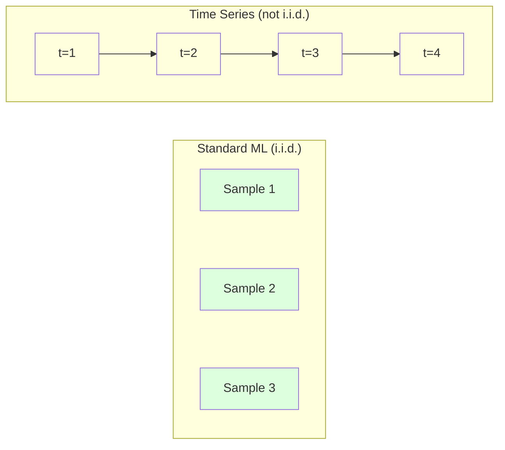
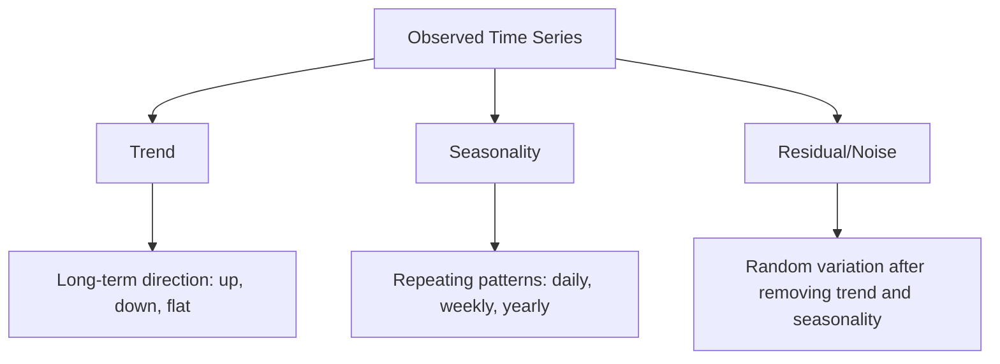
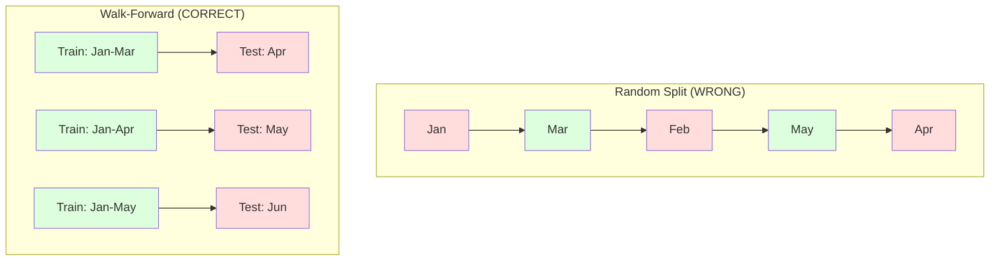

# 时间序列基础

> 如果先检查平稳性，过去的表现确实能预测未来的结果。

**Type:** Build
**Language:** Python
**Prerequisites:** Phase 2, Lessons 01-09
**Time:** ~90 minutes

## 学习目标

- 将时间序列分解为趋势、季节性和残差成分，并检验平稳性
- 实现滞后特征和滚动统计量，把时间序列转化为监督学习问题
- 构建滚动前向验证框架，防止未来数据泄漏到训练集中
- 解释为什么随机训练/测试划分对时间序列无效，并展示与合理时序划分之间的性能差距

## 问题

你拥有按时间排序的数据：每日销售额、每小时温度、每分钟 CPU 使用率、每周股价。你想预测下一个值、下一周、下一季度。

你伸手去拿标准 ML 工具箱：随机训练/测试划分、交叉验证、特征矩阵输入、预测输出。每一步都是错的。

时间序列打破了标准 ML 赖以成立的假设。样本不是独立的——今天的温度取决于昨天。随机划分会把未来信息泄漏到过去。在回测中看起来很棒的特征，到了生产环境会失效，因为它们依赖的模式会随时间改变。

一个模型在随机交叉验证下可能达到 95% 准确率，而在合理的时间评估下可能只有 55%。这差别不是技术细节，而是「纸上有效」与「生产有效」之间的分水岭。

本节课覆盖基础：时间数据到底哪里不同、如何诚实地评估模型、以及如何把时间序列转化为标准 ML 模型可以消费的特征。

## 概念

### 时间序列有何不同

标准 ML 假设 i.i.d.——独立同分布。每个样本独立地从同一个分布中抽取。时间序列同时违反这两点：

- **不独立。** 今天的股价取决于昨天。本周销售额与上周相关。
- **不同分布。** 分布会随时间变化。12 月的销售额与 3 月不同。

这些违反不是小事。它们会改变你构建特征、评估模型和选择算法的方式。



在标准 ML 中，样本是可互换的。打乱它们不会改变任何东西。在时间序列中，顺序就是一切。打乱会破坏信号。

### 时间序列的成分

每个时间序列都是以下成分的叠加：



- **趋势（Trend）**：长期方向。收入每年增长 10%。全球气温上升。
- **季节性（Seasonality）**：固定间隔重复的模式。零售销售额在 12 月飙升。空调使用量在 7 月达到峰值。
- **残差（Residual）**：去掉趋势和季节性后剩下的部分。如果残差看起来像白噪声，说明分解已经抓住了信号。

### 平稳性

如果时间序列的统计性质（均值、方差、自相关）不随时间变化，它就是平稳的。大多数预测方法都假设平稳性。

**为什么重要：** 非平稳序列的均值会漂移。用 1 月数据训练的模型学到的均值，与 2 月将要出现的均值不同，因此会系统性地出错。

**如何检验：** 在滑动窗口上计算滚动均值和滚动标准差。如果它们漂移，序列就是非平稳的。

**如何修正：** 差分。不直接对原始值建模，而是对相邻值之间的变化建模：

```math
\text{diff}[t] = \text{value}[t] - \text{value}[t-1]
```

如果一轮差分不能让序列平稳，就再来一次（二阶差分）。大多数真实世界序列最多需要两轮。

**示例：**

原始序列：[100, 102, 106, 112, 120]
一阶差分：  [2, 4, 6, 8]（仍在向上趋势）
二阶差分：  [2, 2, 2]（恒定——平稳）

原始序列具有二次趋势。一阶差分把它变成线性趋势，二阶差分让它变平。实践中你很少需要超过两轮。

**正式检验：** Augmented Dickey-Fuller（ADF）检验是检验平稳性的标准统计检验。零假设是「序列非平稳」。p 值低于 0.05 意味着可以拒绝零假设，得出平稳的结论。我们不从零实现 ADF（它需要渐近分布表），但代码中的滚动统计方法提供了实用的可视化检查。

### 自相关

自相关衡量时刻 $t$ 的值与时刻 $t-k$ 的值（过去 $k$ 步）之间的相关程度。自相关函数（ACF）对每个滞后 $k$ 绘制这种相关性。

**ACF 告诉你：**
- 序列的记忆有多远。如果 ACF 在滞后 5 之后降到零，那么 5 步之前的值就无关了。
- 是否存在季节性。如果 ACF 在滞后 12（月度数据）处突增，说明存在年度季节性。
- 该创建多少滞后特征。使用到 ACF 变得可忽略为止的滞后。

**PACF（偏自相关函数）** 去除了间接相关。如果今天与 3 天前相关，只是因为两者都与昨天相关，那么滞后 3 处的 PACF 会为零，而 ACF 不会。

### 滞后特征：把时间序列变成监督学习

标准 ML 模型需要特征矩阵 X 和目标 y。时间序列只给你一列值。滞后特征就是两者之间的桥梁。

对序列 [10, 12, 14, 13, 15] 创建滞后 1 和滞后 2 特征：

| lag_2 | lag_1 | target |
|-------|-------|--------|
| 10    | 12    | 14     |
| 12    | 14    | 13     |
| 14    | 13    | 15     |

现在你就有了一个标准回归问题。任何 ML 模型（线性回归、随机森林、梯度提升）都可以从滞后值预测目标。

你还可以构造其他特征：
- **滚动统计量**：过去 k 个值的 mean、std、min、max
- **日历特征**：星期几、月份、是否假日、是否周末
- **差分值**：与上一步的变化
- **扩展统计量**：累积均值、累积和
- **比值特征**：当前值 / 滚动均值（离近期均值有多远）
- **交互特征**：lag_1 * day_of_week（工作日对动量的影响）

**用多少滞后？** 看自相关函数。如果 ACF 在滞后 10 以内都显著，就至少用 10 个滞后。如果有周季节性，就包含滞后 7（可能还有 14）。更多滞后给模型更多历史，但也增加更多待拟合特征，提高过拟合风险。

**目标对齐陷阱。** 创建滞后特征时，目标必须是时刻 $t$ 的值，所有特征必须使用 $t-1$ 或更早时刻的值。如果你不小心把时刻 $t$ 的值作为特征包含进来，就会得到一个完美预测器——以及一个完全无用的模型。这是时间序列特征工程中最常见的 bug。

### 滚动前向验证

这是本节课最重要的概念。标准 k 折交叉验证随机把样本分配到训练集和测试集。对时间序列来说，这会泄漏未来信息。



滚动前向验证：
1. 用直到时刻 $t$ 的数据训练
2. 预测时刻 $t+1$（或多步时预测 $t+1$ 到 $t+k$）
3. 把窗口向前滑动
4. 重复

每个测试折只包含在全部训练数据之后出现的数据。没有未来泄漏。这能诚实估计模型部署后的表现。

**扩展窗口（Expanding window）** 使用所有历史数据训练（窗口不断增长）。**滑动窗口（Sliding window）** 使用固定大小的训练窗口（窗口向前滑动）。如果你认为旧数据仍然相关，用扩展窗口；如果世界在变化、旧数据有害，用滑动窗口。

### ARIMA 直观理解

ARIMA 是经典的时间序列模型。它有三个组成部分：

- **AR（自回归）**：用过去的值预测。AR(p) 使用最近 $p$ 个值。
- **I（差分）**：通过差分达到平稳。I(d) 应用 $d$ 轮差分。
- **MA（滑动平均）**：用过去的预测误差预测。MA(q) 使用最近 $q$ 个误差。

ARIMA(p, d, q) 把三者结合。$p$、$d$、$q$ 根据 ACF/PACF 分析或自动搜索（auto-ARIMA）来选择。

我们不从零实现 ARIMA——它需要超出本节课范围的数值优化。关键洞察是理解每个组件的作用，以便你能解释 ARIMA 结果并知道何时使用它。

### 何时使用什么方法

| 方法 | 最适合 | 处理季节性 | 处理外部特征 |
|----------|---------|-------------------|------------------------|
| Lag features + ML | 有很多外部特征的表格数据 | 用日历特征可以 | 是 |
| ARIMA | 单变量序列，短期预测 | SARIMA 变体可以 | 不行（ARIMAX 有限支持） |
| 指数平滑 | 简单趋势 + 季节性 | 可以（Holt-Winters） | 不行 |
| Prophet | 业务预测，含节假日 | 可以（傅里叶项） | 有限支持 |
| 神经网络（LSTM、Transformer） | 长序列、大量序列 | 可学习 | 是 |

对大多数实际问题，滞后特征 + 梯度提升是最强的起点。它天然处理外部特征、不需要平稳性、而且容易调试。

### 预测范围与策略

单步预测预测下一个时间步。多步预测预测多个时间步。有三种策略：

**递归（Recursive / iterated）：** 先预测一步，再把预测值作为下一步的输入。简单，但误差会累积——每一步预测都用上一步的预测，错误会复合。

**直接（Direct）：** 为每个预测范围单独训练一个模型。模型 1 预测 $t+1$，模型 5 预测 $t+5$。没有误差累积，但每个模型训练样本更少，且模型之间不共享信息。

**多输出（Multi-output）：** 训练一个同时输出所有预测范围的模型。在不同范围之间共享信息，但要求模型支持多输出（或自定义损失函数）。

对大多数实际问题，短预测范围（1-5 步）用递归，长预测范围用直接法。

### 时间序列常见错误

| 错误 | 为什么会发生 | 如何修正 |
|---------|---------------|-----------|
| 随机训练/测试划分 | 标准 ML 的习惯 | 使用滚动前向或时序划分 |
| 使用未来特征 | 误把时刻 $t$ 的值作为特征 | 审计每个特征的时间对齐 |
| 对季节性过拟合 | 模型记住了日历模式 | 测试集至少保留一个完整季节性周期 |
| 忽略尺度变化 | 收入翻倍但模式不变 | 对百分比变化建模而不是绝对值 |
| 滞后特征太多 | 「历史越多越好」 | 用 ACF 确定相关滞后 |
| 不做差分 | 「模型自己会学会」 | 树模型能处理趋势；线性模型需要平稳性 |

```figure
f3-series-decompose
```

## 构建它

`code/time_series.py` 中的代码从零实现了核心构建块。

### 滞后特征构造器

```python
def make_lag_features(series, n_lags):
    n = len(series)
    X = np.full((n, n_lags), np.nan)
    for lag in range(1, n_lags + 1):
        X[lag:, lag - 1] = series[:-lag]
    valid = ~np.isnan(X).any(axis=1)
    return X[valid], series[valid]
```

这会把一维序列转化为特征矩阵：每一行用最近的 `n_lags` 个值作为特征，当前值作为目标。

### 滚动前向交叉验证

```python
def walk_forward_split(n_samples, n_splits=5, min_train=50):
    assert min_train < n_samples, "min_train must be less than n_samples"
    step = max(1, (n_samples - min_train) // n_splits)
    for i in range(n_splits):
        train_end = min_train + i * step
        test_end = min(train_end + step, n_samples)
        if train_end >= n_samples:
            break
        yield slice(0, train_end), slice(train_end, test_end)
```

每次划分都确保训练数据严格在测试数据之前。训练窗口随着每个折不断扩展。

### 简单自回归模型

纯 AR 模型就是基于滞后特征的线性回归：

```python
class SimpleAR:
    def __init__(self, n_lags=5):
        self.n_lags = n_lags
        self.weights = None
        self.bias = None

    def fit(self, series):
        X, y = make_lag_features(series, self.n_lags)
        # Solve via normal equations
        X_b = np.column_stack([np.ones(len(X)), X])
        theta = np.linalg.lstsq(X_b, y, rcond=None)[0]
        self.bias = theta[0]
        self.weights = theta[1:]
        return self
```

这在概念上与第 02 课的线性回归相同，只是把它应用到了同一变量的时延版本上。

### 平稳性检查

代码计算滚动统计量，从视觉和数值两方面评估平稳性：

```python
def check_stationarity(series, window=50):
    rolling_mean = np.array([
        series[max(0, i - window):i].mean()
        for i in range(1, len(series) + 1)
    ])
    rolling_std = np.array([
        series[max(0, i - window):i].std()
        for i in range(1, len(series) + 1)
    ])
    return rolling_mean, rolling_std
```

如果滚动均值漂移或滚动标准差变化，序列就是非平稳的。应用差分后再检查。

代码还通过比较序列的前半段和后半段来检查平稳性。如果均值差异超过半个标准差，或方差比超过 2 倍，序列就被标记为非平稳。

### 自相关

```python
def autocorrelation(series, max_lag=20):
    n = len(series)
    mean = series.mean()
    var = series.var()
    acf = np.zeros(max_lag + 1)
    for k in range(max_lag + 1):
        cov = np.mean((series[:n-k] - mean) * (series[k:] - mean))
        acf[k] = cov / var if var > 0 else 0
    return acf
```

## 使用它

使用 sklearn 时，你可以直接把滞后特征喂给任何回归器：

```python
from sklearn.linear_model import Ridge
from sklearn.ensemble import GradientBoostingRegressor

X, y = make_lag_features(series, n_lags=10)

for train_idx, test_idx in walk_forward_split(len(X)):
    model = Ridge(alpha=1.0)
    model.fit(X[train_idx], y[train_idx])
    predictions = model.predict(X[test_idx])
```

对于 ARIMA，使用 statsmodels：

```python
from statsmodels.tsa.arima.model import ARIMA

model = ARIMA(train_series, order=(5, 1, 2))
fitted = model.fit()
forecast = fitted.forecast(steps=30)
```

`time_series.py` 中的代码用滚动前向验证演示并比较了这两种方法。

### sklearn 的 TimeSeriesSplit

sklearn 提供了 `TimeSeriesSplit` 来实现滚动前向验证：

```python
from sklearn.model_selection import TimeSeriesSplit

tscv = TimeSeriesSplit(n_splits=5)
for train_index, test_index in tscv.split(X):
    X_train, X_test = X[train_index], X[test_index]
    y_train, y_test = y[train_index], y[test_index]
    model.fit(X_train, y_train)
    score = model.score(X_test, y_test)
```

这等价于我们从头实现的 `walk_forward_split`，但集成在 sklearn 的交叉验证框架中。你可以把它和 `cross_val_score` 一起用：

```python
from sklearn.model_selection import cross_val_score

scores = cross_val_score(model, X, y, cv=TimeSeriesSplit(n_splits=5))
print(f"Mean score: {scores.mean():.4f} +/- {scores.std():.4f}")
```

### 评估指标

时间序列预测使用回归指标，但要结合时间意识：

- **MAE（平均绝对误差）**：$\lvert y_{\text{true}} - y_{\text{pred}} \rvert$ 的平均。用原单位解释很容易。「平均而言，预测偏差 3.2 度。」
- **RMSE（均方根误差）**：均方误差的平方根。比 MAE 更惩罚大误差。当大错误比许多小错误更糟糕时使用。
- **MAPE（平均绝对百分比误差）**：$|\text{error} / \text{true\_value}| \times 100$ 的平均。与尺度无关，便于跨不同序列比较。但真实值为零时无定义。
- **朴素基线对比：** 永远要和简单基线对比。季节性朴素基线预测上一周期的值（昨天、上周）。如果你的模型连朴素基线都打不过，一定有问题。

### 滚动特征

代码展示了如何把滚动统计量（7 天和 14 天窗口下的 mean、std、min、max）加到滞后特征上。它们给模型提供近期趋势和波动性的信息，这是仅靠滞后特征无法捕捉的。

例如，如果滚动均值在上升，说明存在上升趋势。如果滚动标准差在增加，说明波动性在增大。这些是树模型可以学习、但线性模型无法学习的模式。

## 交付它

本节课产出：
- `outputs/prompt-time-series-advisor.md`——用于梳理时间序列问题的 prompt
- `code/time_series.py`——滞后特征、滚动前向验证、AR 模型、平稳性检查

### 你必须击败的基线

在构建任何模型之前，先建立基线：

1. **最近值（Persistence）。** 预测明天和今天一样。对很多序列来说，这已经 surprisingly 难打败。
2. **季节性朴素。** 预测今天和上周同一天（或去年同一天）一样。如果你的模型连这都打不过，说明它除了季节性什么也没学到。
3. **移动平均。** 预测最近 k 个值的平均。能平滑噪声，但无法捕捉突变。

如果你的复杂 ML 模型输给了季节性朴素基线，那一定出 bug 了。最常见的原因：特征中有未来泄漏、评估方法错误、或者序列本质上是随机的、不可预测。

### 实用建议

1. **先画图。** 在建模之前，先画出原始序列。寻找趋势、季节性、异常值、结构性断点（行为的突然变化）。30 秒的目视检查往往比一小时的自动分析更有价值。

2. **先差分，再建模。** 如果序列有明显趋势，在创建滞后特征前先差分。树模型能处理趋势，但线性模型不能，而差分永远不会有害。

3. **测试集至少保留一个完整季节性周期。** 如果有周季节性，测试集至少要有一整周；如果是月季节性，至少要有一整月。否则你无法评估模型是否捕捉到了季节性模式。

4. **生产环境监控。** 时间序列模型会随着世界变化而退化。持续跟踪滚动预测误差。当误差开始上升时，用最近数据重新训练模型。

5. **警惕制度切换（regime changes）。** 用疫情前数据训练的模型无法预测疫情后的行为。把已知制度切换的指示变量作为特征，或者使用会遗忘旧数据的滑动窗口。

6. **对偏斜序列做对数变换。** 收入、价格和计数常常右偏。取对数可以稳定方差，把乘法模式变成加法模式，让线性模型可以处理。在对数空间预测，然后取指数回到原单位。

## 练习

1. **平稳性实验。** 生成一个带线性趋势的序列。用滚动统计量检查平稳性。应用一阶差分。再检查。对于二次趋势，需要几轮差分才能平稳？

2. **滞后选择。** 在一个季节性序列（周期=7）上计算 ACF。哪些滞后的自相关最高？只用这些滞后（而不是连续滞后 1 到 7）创建滞后特征。与使用滞后 1-7 相比，准确率是否提高？

3. **滚动前向 vs 随机划分。** 在滞后特征上训练一个 Ridge 回归。分别用随机 80/20 划分和滚动前向验证评估。随机划分会高估多少性能？

4. **特征工程。** 在滞后特征基础上加入滚动均值（window=7）、滚动标准差（window=7）和星期几特征。用滚动前向验证比较加与不加这些特征时的准确率。

5. **多步预测。** 把 AR 模型改成预测未来 5 步而不是 1 步。比较两种策略：(a) 预测一步、再用预测值作为下一步输入（递归）；(b) 为每个 horizon 单独训练模型（直接）。哪种更准确？

## 关键术语

| 术语 | 人们怎么说 | 实际含义 |
|------|----------------|----------------------|
| Stationarity | 「统计量不随时间变化」 | 均值、方差和自相关结构在时间上保持恒定的序列 |
| Differencing | 「相邻值相减」 | 计算 $y[t] - y[t-1]$ 以去除趋势、达到平稳性 |
| Autocorrelation (ACF) | 「序列与自身的相关性」 | 时间序列与其滞后副本之间的相关性，作为滞后长度的函数 |
| Partial autocorrelation (PACF) | 「只保留直接相关」 | 去掉所有更短滞后影响后，滞后 $k$ 处的自相关 |
| Lag features | 「用过去值当输入」 | 用 $y[t-1], y[t-2], \ldots, y[t-k]$ 作为特征预测 $y[t]$ |
| Walk-forward validation | 「尊重时间的交叉验证」 | 训练数据在时间上始终早于测试数据的评估方式 |
| ARIMA | 「经典时间序列模型」 | 自回归积分滑动平均：结合过去值（AR）、差分（I）和过去误差（MA） |
| Seasonality | 「重复出现的日历模式」 | 与日历周期（日、周、年）绑定的、有规律可预测的时间序列周期 |
| Trend | 「长期方向」 | 序列水平随时间持续上升或下降 |
| Expanding window | 「使用全部历史」 | 滚动前向验证中训练集随每个折不断增长 |
| Sliding window | 「固定长度历史」 | 滚动前向验证中训练集是固定长度窗口并向前滑动 |

## 延伸阅读

- [Hyndman and Athanasopoulos, Forecasting: Principles and Practice (3rd ed.)](https://otexts.com/fpp3/)——最好的免费时间序列预测教材
- [scikit-learn Time Series Split](https://scikit-learn.org/stable/modules/generated/sklearn.model_selection.TimeSeriesSplit.html)——sklearn 的滚动前向划分器
- [statsmodels ARIMA 文档](https://www.statsmodels.org/stable/generated/statsmodels.tsa.arima.model.ARIMA.html)——带诊断的 ARIMA 实现
- [Makridakis et al., The M5 Competition (2022)](https://www.sciencedirect.com/science/article/pii/S0169207021001874)——大规模预测竞赛，对比 ML 方法与统计方法
