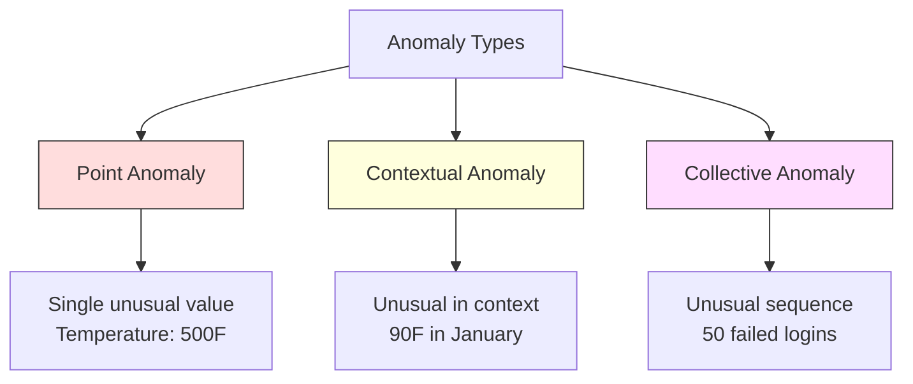
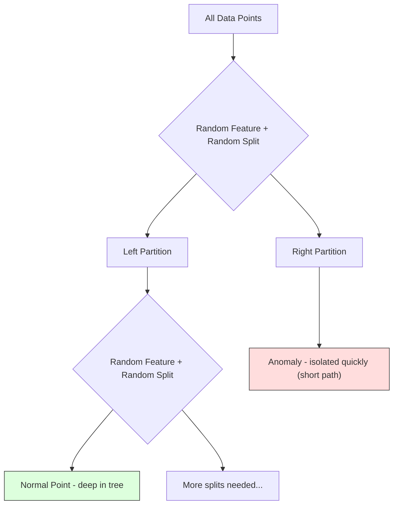
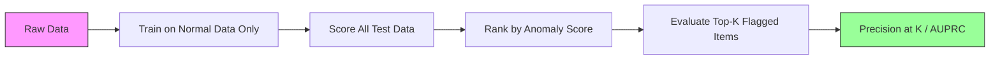

# 异常检测

> 正常很容易定义。异常就是任何不符合正常模式的东西。

**Type:** Build
**Language:** Python
**Prerequisites:** Phase 2, Lessons 01-09
**Time:** ~75 minutes

## 学习目标

- 从零实现 Z-score、IQR 和 Isolation Forest 异常检测方法
- 区分点异常、上下文异常和集合异常，并为每种异常选择合适的检测方法
- 解释为什么异常检测被框定为「对正常数据建模」，而不是「把异常当作一个类别分类」
- 比较无监督异常检测与监督分类，评估「覆盖新类型异常」与「精确率」之间的权衡

## 问题

一张信用卡下午 2 点在美国纽约被使用，下午 2:05 却在日本东京被使用。工厂传感器在正常范围为 80-120 度时读到了 150 度。服务器每秒发出 50,000 个请求，而日均只有 200 个。

这些都是异常。发现它们很重要：欺诈造成数十亿损失，设备故障造成停机，网络入侵造成数据泄露。

挑战在于：你很少拥有标注好的异常样本。欺诈只占交易的 0.1%。设备故障每年只发生几次。你没法训练标准分类器，因为「异常」类别几乎没有可学的东西。即便你有一些标签，你见过的异常也不代表未来只会遇到这些。明天的诈骗手段会和今天不同。

异常检测把问题翻转过来：不学习什么是异常，而是学习什么是正常。任何偏离正常模式的东西都可疑。这种方法不需要标签、能适应新类型异常、并能扩展到大规模数据集。

## 概念

### 异常的类型

并非所有异常都一样：

- **点异常（Point anomalies）。** 单个数据点在任何上下文下都不寻常。温度读数 500 度；平时只花 50 美元的账户突然消费 50,000 美元。
- **上下文异常（Contextual anomalies）。** 给定上下文才显得不寻常的数据点。夏天 90 度很正常，冬天 90 度就异常。同一个值，上下文不同，结论不同。
- **集合异常（Collective anomalies）。** 单独看每个点都正常，但整个序列异常。连续 5 次登录失败很常见，连续 50 次就是暴力破解攻击。

大多数方法检测点异常。上下文异常需要时间或位置特征。集合异常需要能感知序列的方法。



### 无监督的视角

在标准分类中，你拥有两个类别的标签。在异常检测中，通常属于以下三种情况之一：

1. **完全无监督。** 没有任何标签。你把检测器拟合到所有数据上，希望异常足够稀少，不会腐化「正常」模型。
2. **半监督。** 你只有干净的正常数据。用这份干净数据拟合，再对其它数据打分。这是可能时最强的设置。
3. **弱监督。** 你只有少量标注异常。用它们做评估，而不是训练。先无监督训练，再在标注子集上计算精确率/召回率。

关键洞察：异常检测与分类有着本质不同。你是在建模正常数据的分布，而不是两个类别之间的决策边界。

### 监督 vs 无监督：权衡

如果你确实有标注异常，应该把它们用于训练（监督分类）还是仅用于评估（无监督检测）？

**监督（当作分类问题）：**
- 能抓住你以前见过的那类异常
- 对已知异常类型精确率更高
- 完全错过新型异常
- 出现新异常类型时需要重新训练
- 需要足够的异常样本（通常太少）

**无监督（建模正常，标记偏离）：**
- 能抓住任何偏离正常模式的情况，包括新型异常
- 不需要标注异常
- 假阳性率更高（并非所有不寻常都是坏事）
- 对分布漂移更鲁棒

实践中，最好的系统把两者结合：无监督检测负责广覆盖，监督模型负责已知的高优先级异常类型，人类复核处理模糊案例。

### Z-Score 方法

最简单的方法。计算每个特征的均值和标准差。把偏离均值超过 $k$ 个标准差的点标记为异常。

```text
z_score = (x - mean) / std
anomaly if |z_score| > threshold
```

默认阈值是 3.0（对高斯分布，99.7% 的正常数据落在 3 个标准差以内）。

**优点：** 简单、快速、可解释（「这个值偏离正常 4.5 个标准差」）。

**缺点：** 假设数据近似正态分布。对训练数据中的异常值敏感（异常值会拉高均值、放大标准差，使自己更难被发现）。在多峰分布上失效。

**适用场景：** 单变量监控、数据大致呈钟形。服务器响应时间、制造公差、基线稳定的传感器读数。

**失效场景：** 多簇数据（两个办公地点有不同基准温度）、偏斜数据（交易金额中 1000 美元少见但不异常）、训练集包含异常值的数据。

### IQR 方法

比 Z-score 更稳健。用四分位距代替均值和标准差。

```
Q1 = 25th percentile
Q3 = 75th percentile
IQR = Q3 - Q1
lower_bound = Q1 - factor * IQR
upper_bound = Q3 + factor * IQR
anomaly if x < lower_bound or x > upper_bound
```

默认 factor 是 1.5。

**优点：** 对异常值稳健（分位数不受极端值影响）。适用于偏斜分布。不需要正态性假设。

**缺点：** 单变量（对每个特征独立应用）。无法检测只有联合考虑多个特征时才异常的异常点（某个点在每个特征单独看都正常，但在联合空间中异常）。

**实用提示：** IQR 中 1.5 的因子对应箱线图的胡须。胡须外的点是潜在异常值。把 factor 从 1.5 改成 3.0 会让检测器更保守（标记更少、假阳性更少）。合适的 factor 取决于你对误报的容忍度。

### Isolation Forest

核心洞察：异常点稀少且不同。在数据的随机划分中，异常点更容易被孤立——它们只需要更少的随机拆分就能与多数点分开。



**工作原理：**
1. 构建多棵随机树（一片孤立森林）
2. 在每个节点，随机选一个特征，并在该特征的 min 与 max 之间随机选一个拆分值
3. 不断拆分，直到每个点都被孤立（各自落在单独叶子）
4. 异常点在所有树中的平均路径长度更短

**为什么有效：** 正常点位于稠密区域。要把一个正常点与邻居分开，需要很多次随机拆分。异常点位于稀疏区域。一两次随机拆分就足以孤立它们。

异常分数基于所有树中的平均路径长度，并用随机二叉搜索树的期望路径长度归一化：

```math
\text{score}(x) = 2^{-\text{average\_path\_length}(x) / c(n)}
```

其中 `c(n)` 是 $n$ 个样本的期望路径长度。分数接近 1 表示异常；接近 0.5 表示正常；接近 0 表示非常正常（深陷在稠密簇中）。

**优点：** 无分布假设。适用于高维。扩展性好（由于对每棵树子采样，速度对样本量次线性）。可处理混合特征类型。

**缺点：** 对稠密区域中的异常（掩蔽效应）较吃力。当大量特征不相关时，随机拆分效果下降。

**关键超参数：**
- `n_estimators`：树的数量。100 通常足够。更多树分数更稳定，但计算更慢。
- `max_samples`：每棵树的样本数。原始论文默认 256。更小值让单棵树更不准，但增加多样性。子采样正是 Isolation Forest 快的原因——每棵树只看数据的一小部分。
- `contamination`：预期异常比例。仅用于设定阈值，不影响分数本身。

### Local Outlier Factor（LOF）

LOF 比较一个点周围的局部密度与它邻居周围的密度。一个被稠密区域包围的稀疏区域中的点就是异常。

**工作原理：**
1. 对每个点，找到它的 $k$ 个最近邻
2. 计算局部可达密度（邻域有多稠密）
3. 把每个点的密度与邻居的密度比较
4. 如果一个点的密度远低于邻居，它就是异常

**LOF 分数：**
- LOF 接近 1.0 表示密度与邻居相似（正常）
- LOF 大于 1.0 表示密度低于邻居（可能异常）
- LOF 明显大于 1.0（如 2.0+）表示密度显著更低（很可能异常）

「局部」二字至关重要。想象一个数据集有两个簇：一个 1000 点的稠密簇和一个 50 点的稀疏簇。稀疏簇边缘上的一个点从全局看不异常——它有 50 个邻居。但如果它的直接邻居比它更稠密，它在局部就是异常的。LOF 捕捉到了全局方法会忽略的这种细微差别。

**优点：** 能发现局部异常（在邻域里不寻常、但全局并不极端的点）。适用于不同密度的簇。

**缺点：** 大数据集上慢（朴素实现 $O(n^2)$）。对 $k$ 的选择敏感。在极高维度表现不佳（维度灾难影响距离计算）。

### 方法对比

| 方法 | 假设 | 速度 | 处理高维 | 发现局部异常 |
|--------|------------|-------|-------------------|------------------------|
| Z-score | 正态分布 | 极快 | 可以（逐特征） | 否 |
| IQR | 无（逐特征） | 极快 | 可以（逐特征） | 否 |
| Isolation Forest | 无 | 快 | 可以 | 部分可以 |
| LOF | 距离有意义 | 慢 | 较差 | 是 |

### 评估挑战

评估异常检测器比评估分类器更难：

- **极端类别不平衡。** 当异常只占 0.1% 时，全部预测为「正常」就能达到 99.9% 准确率。准确率毫无用处。
- **AUROC 有误导性。** 严重不平衡时，AUROC 看起来不错，即使模型在实用阈值下漏掉了大多数异常。
- **更好的指标：** Precision@k（前 $k$ 个被标记项中有多少是真异常）、AUPRC（精确率-召回率曲线下面积）、固定假阳性率下的召回率。



### 异常检测流程

实践中，异常检测遵循以下流程：

1. **收集基线数据。** 理想情况下是一段你知道没有（或极少）异常的时期。
2. **特征工程。** 原始特征加上衍生特征（滚动统计量、时间特征、比值）。
3. **训练检测器。** 在基线数据上拟合。模型学习「正常」长什么样。
4. **对新数据打分。** 每个新观测获得一个异常分数。
5. **选择阈值。** 设定分数截断点。这是业务决策：阈值越高，误报越少、漏报越多。
6. **告警与调查。** 被标记的点送交人工复核或自动响应。
7. **收集反馈。** 记录被标记项是真异常还是误报。用这些数据评估检测器并随时间调整阈值。

这个流程永远不会「完成」。数据分布会漂移、新异常类型会出现、阈值需要调整。把异常检测当作一个活的系统，而不是一次性模型。

```figure
f3-anomaly-fence
```

## 构建它

`code/anomaly_detection.py` 中的代码从零实现了 Z-score、IQR 和 Isolation Forest。

### Z-Score 检测器

```python
def zscore_detect(X, threshold=3.0):
    mean = X.mean(axis=0)
    std = X.std(axis=0)
    std[std == 0] = 1.0
    z = np.abs((X - mean) / std)
    return z.max(axis=1) > threshold
```

简单且向量化。只要任一特征超过阈值，就标记该点。

### IQR 检测器

```python
def iqr_detect(X, factor=1.5):
    q1 = np.percentile(X, 25, axis=0)
    q3 = np.percentile(X, 75, axis=0)
    iqr = q3 - q1
    iqr[iqr == 0] = 1.0
    lower = q1 - factor * iqr
    upper = q3 + factor * iqr
    outside = (X < lower) | (X > upper)
    return outside.any(axis=1)
```

### 从零实现 Isolation Forest

从零实现会构建随机划分特征空间的孤立树：

```python
class IsolationTree:
    def __init__(self, max_depth):
        self.max_depth = max_depth

    def fit(self, X, depth=0):
        n, p = X.shape
        if depth >= self.max_depth or n <= 1:
            self.is_leaf = True
            self.size = n
            return self
        self.is_leaf = False
        self.feature = np.random.randint(p)
        x_min = X[:, self.feature].min()
        x_max = X[:, self.feature].max()
        if x_min == x_max:
            self.is_leaf = True
            self.size = n
            return self
        self.threshold = np.random.uniform(x_min, x_max)
        left_mask = X[:, self.feature] < self.threshold
        self.left = IsolationTree(self.max_depth).fit(X[left_mask], depth + 1)
        self.right = IsolationTree(self.max_depth).fit(X[~left_mask], depth + 1)
        return self
```

孤立一个点所需的路径长度决定其异常分数。路径越短，越异常。

`IsolationForest` 类包装多棵树：

```python
class IsolationForest:
    def __init__(self, n_estimators=100, max_samples=256, seed=42):
        self.n_estimators = n_estimators
        self.max_samples = max_samples

    def fit(self, X):
        sample_size = min(self.max_samples, X.shape[0])
        max_depth = int(np.ceil(np.log2(sample_size)))
        for _ in range(self.n_estimators):
            idx = rng.choice(X.shape[0], size=sample_size, replace=False)
            tree = IsolationTree(max_depth=max_depth)
            tree.fit(X[idx])
            self.trees.append(tree)

    def anomaly_score(self, X):
        avg_path = average path length across all trees
        scores = 2.0 ** (-avg_path / c(max_samples))
        return scores
```

归一化因子 `c(n)` 是含 $n$ 个元素的二叉搜索树中一次不成功搜索的期望路径长度。它等于 `2 * H(n-1) - 2*(n-1)/n`，其中 `H` 是调和数。该归一化保证不同规模数据集上的分数可比。

### 演示场景

代码生成多个测试场景：

1. **单簇含异常值。** 一个二维高斯簇，注入远离中心的异常。所有方法在这里都应该有效。
2. **多峰数据。** 三个不同规模、不同密度的簇。簇之间的点是异常。Z-score 会因为逐特征范围很宽而吃力。
3. **高维数据。** 50 个特征，但异常只在其中 5 个上不同。测试方法能否在特征子集中发现异常。

每个演示都用精确率、召回率、F1 和 Precision@k 对比所有方法。

## 使用它

使用 sklearn（使用库实现，而非从零实现）：

```python
from sklearn.ensemble import IsolationForest
from sklearn.neighbors import LocalOutlierFactor

iso = IsolationForest(n_estimators=100, contamination=0.05, random_state=42)
iso.fit(X_train)
predictions = iso.predict(X_test)

lof = LocalOutlierFactor(n_neighbors=20, contamination=0.05, novelty=True)
lof.fit(X_train)
predictions = lof.predict(X_test)
```

注意 `contamination` 设定预期异常比例。正确设置很重要——太低会漏掉异常，太高会产生误报。

`anomaly_detection.py` 中的代码将从头实现与 sklearn 在同一数据上的结果进行对比。

### sklearn 的 contamination 参数

sklearn 中的 `contamination` 参数决定把连续异常分数转换成二值预测的阈值。它不改变底层分数。

```python
iso_5 = IsolationForest(contamination=0.05)
iso_10 = IsolationForest(contamination=0.10)
```

两者产生相同的异常分数。但 `iso_5` 标记前 5%，`iso_10` 标记前 10%。如果你不知道真实异常率（通常不知道），把 contamination 设为 "auto" 并直接使用原始分数。根据自己的成本权衡设定阈值。

### One-Class SVM

另一个值得了解的无人监督异常检测器。One-Class SVM 用核技巧在高维特征空间中拟合一个包围正常数据的边界。

```python
from sklearn.svm import OneClassSVM

oc_svm = OneClassSVM(kernel="rbf", gamma="auto", nu=0.05)
oc_svm.fit(X_train)
predictions = oc_svm.predict(X_test)
```

`nu` 参数近似异常比例。One-Class SVM 在中小数据集上表现不错，但无法扩展到非常大的数据（核矩阵二次增长）。

### 自编码器方法（预告）

自编码器是学会压缩并重建数据的神经网络。在正常数据上训练。测试时，异常具有很高的重建误差，因为网络只学会了重建正常模式。

这会在第 3 阶段（深度学习）详细覆盖，但原理相同：建模正常，标记偏离。

### 集成异常检测

就像集成方法能改善分类（第 11 课），组合多个异常检测器也能提升检测效果。最简单的方法：

1. 运行多个检测器（Z-score、IQR、Isolation Forest、LOF）
2. 把每个检测器的分数归一化到 [0, 1]
3. 对归一化分数取平均
4. 对平均分数超过阈值的点进行标记

这能减少假阳性，因为不同方法有不同的失效模式。被四种方法都标记的点几乎肯定是异常。只被一种方法标记的点可能只是该方法的特殊偏好。

更复杂的集成会根据各检测器的估计可靠性（在已知异常的验证集上测量，如有）来加权。

### 生产环境考量

1. **阈值漂移。** 随着数据分布漂移，固定阈值会过时。监控异常分数的分布并定期调整。
2. **告警疲劳。** 误报太多会让运维人员忽视告警。先用高阈值（更少、更可靠的告警），信任建立后再逐步降低。
3. **集成方法。** 生产环境中组合多个检测器。只有多种方法一致认为异常时才标记。这能显著降低假阳性。
4. **特征工程。** 原始特征往往不够。加入滚动统计量、比值、距离上次事件的时间、领域特定特征。好的特征集比检测器选择更重要。
5. **反馈闭环。** 运维人员调查被标记项并确认或驳回时，把这些反馈回注系统。持续积累标注数据以评估和改进检测器。

## 交付它

本节课产出：
- `outputs/skill-anomaly-detector.md`——选择合适检测器的决策技能
- `code/anomaly_detection.py`——从零实现的 Z-score、IQR、Isolation Forest，并与 sklearn 对比

### 选择阈值

异常分数是连续的。你需要阈值来做二值决策。这是业务决策，不是技术决策。

考虑两个场景：
- **欺诈检测。** 漏掉欺诈代价高（拒付、客户信任）。误报只消耗人工分析师 5 分钟。把阈值设低以抓住更多欺诈，接受更多误报。
- **设备维护。** 误报意味着不必要的停机，损失 50,000 美元；漏掉故障意味着 500,000 美元维修。要平衡这两种成本来设阈值。

两种情况下，最优阈值都取决于假阳性与假阴性之间的成本比。在不同阈值下绘制精确率和召回率，叠加上成本函数，选择成本最低点。

### 扩展到生产环境

对于生产环境的实时异常检测：

1. **批量训练，在线打分。** 定期（每天、每周）用近期正常数据训练模型。每个新观测到达时实时打分。
2. **特征计算必须一致。** 如果你用 30 天滚动统计量训练，那么对新观测计算特征时也需要 30 天历史。缓冲所需历史。
3. **分数分布监控。** 跟踪异常分数的分布随时间变化。如果中位数分数向上漂移，说明数据在变化或模型已过时。
4. **可解释性。** 标记异常时说明原因。Z-score：「特征 X 比正常高 4.2 个标准差。」Isolation Forest：「该点平均 3.1 次拆分就被孤立（正常点需要 8.5 次）。」

## 练习

1. **阈值调优。** 用 1.0 到 5.0、步长 0.5 的阈值运行 Z-score 检测器。在每个阈值下绘制精确率和召回率。对你的数据来说，最佳平衡点在哪里？

2. **多变量异常。** 创建二维数据：每个特征单独看都正常，但组合起来异常（例如远离主簇对角线的点）。证明逐特征 Z-score 会漏掉这些，而 Isolation Forest 能抓住。

3. **从零实现 LOF。** 用 k 近邻实现 Local Outlier Factor。在同一数据上与 sklearn 的 LocalOutlierFactor 比较。分别用 $k=10$ 和 $k=50$——$k$ 的选择如何影响结果？

4. **流式异常检测。** 把 Z-score 检测器改成流式：新点到达时更新运行均值和方差（Welford 在线算法）。与批量 Z-score 在同一数据上比较。

5. **真实世界评估。** 取一个带已知异常的数据集（例如 Kaggle 的信用卡欺诈）。用 Precision@100、Precision@500 和 AUPRC 评估四种方法。哪种最好？为什么？

## 关键术语

| 术语 | 人们怎么说 | 实际含义 |
|------|----------------|----------------------|
| Anomaly | 「异常值、不寻常的点」 | 显著偏离正常数据预期模式的数据点 |
| Point anomaly | 「单个奇怪值」 | 单独看就不寻常的观测 |
| Contextual anomaly | 「值正常，上下文不对」 | 在给定上下文（时间、地点等）中不寻常，但在另一个上下文可能正常的观测 |
| Isolation Forest | 「用随机拆分找异常值」 | 由随机树组成的集成，用比正常点更少的拆分孤立异常点 |
| Local Outlier Factor | 「和邻居比密度」 | 标记局部密度远低于邻居密度的点的方法 |
| Z-score | 「偏离均值多少个标准差」 | $(x - \text{mean}) / \text{std}$，衡量点偏离中心多少个标准差 |
| IQR | 「四分位距」 | $Q3 - Q1$，衡量中间 50% 数据的散布，用于稳健的异常值检测 |
| Contamination | 「预期异常比例」 | 告诉检测器应把多大比例数据标记为异常的超参数 |
| Precision@k | 「前 k 个标记中有多少是真异常」 | 只计算最可疑的 $k$ 个点上的精确率，适用于不平衡异常检测 |
| AUPRC | 「精确率-召回率曲线下面积」 | 汇总所有阈值下精确率-召回率表现的指标，对不平衡数据比 AUROC 更合适 |

## 延伸阅读

- [Liu et al., Isolation Forest (2008)](https://cs.nju.edu.cn/zhouzh/zhouzh.files/publication/icdm08b.pdf)——原始 Isolation Forest 论文
- [Breunig et al., LOF: Identifying Density-Based Local Outliers (2000)](https://dl.acm.org/doi/10.1145/342009.335388)——原始 LOF 论文
- [scikit-learn Outlier Detection 文档](https://scikit-learn.org/stable/modules/outlier_detection.html)——sklearn 所有异常检测器概览
- [Chandola et al., Anomaly Detection: A Survey (2009)](https://dl.acm.org/doi/10.1145/1541880.1541882)——异常检测方法综合综述
- [Goldstein and Uchida, A Comparative Evaluation of Unsupervised Anomaly Detection Algorithms (2016)](https://journals.plos.org/plosone/article?id=10.1371/journal.pone.0152173)——10 种方法在真实数据集上的实证比较
