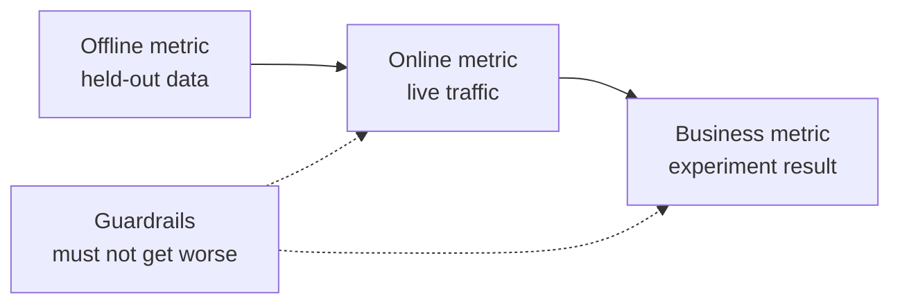

# 机器学习系统设计 —— 从问题到部署模型

> 模型只是系统的一部分。设计决定了模型预测什么、谁据此行动、成本多少，以及它失效时会发生什么。

**Type:** Build
**Languages:** Python
**Prerequisites:** Phase 2, Lessons 09 (Model Evaluation) and 13 (ML Pipelines)
**Time:** ~110 minutes

## 学习目标

- 将业务问题框定为 ML 任务：明确预测目标、使用预测的决策，以及为什么规则不够用
- 区分离线、在线、业务和护栏指标，并将每个模型与平凡基线和启发式基线比较
- 根据流量数字估算批量与在线推理的每日成本、延迟和新鲜度
- 选择发布模式（影子、金丝雀、A/B 测试），并为每种故障模式设定安全默认
- 识别模型改变其下一版本训练数据的反馈循环
- 撰写 ML 设计文档，并用固定检查清单为其打分

## 问题

一家订阅公司要求做一个「流失模型」。一位数据科学家训练了一个梯度提升分类器，报告 AUC 为 0.91。三个月后，没人用它。

原因与算法无关。没人决定一个分数会触发什么动作。分数每周才出来一次，但留存团队每天都在给客户打电话。标签来自一张取消表，该表还存储了取消原因，所以某个特征里就包含了答案。没人把模型和支持团队已经在用的规则做比较：给任何闲置两周的人打电话。

这些失败都发生在训练开始之前。它们是设计失败，而一页纸的设计文档就能问到每一点。本节课教你文档中的那些决策。你将构建一个工具包，为批量和在线服务定价、将模型与基线比较，并依据检查清单为设计文档打分。

## 概念

### 从业务目标到 ML 任务

业务目标不是 ML 任务。你可以通过四个问题把它转化为 ML 任务：

1. 模型具体预测什么，针对哪个实体（用户、支付、门店、商品）？
2. 哪个决策会使用这个预测，由谁或什么来做出该决策？
3. 何时需要这个预测，当时有哪些数据可用？
4. 你怎么知道决策变得更好了？

| 业务目标 | 预测 | 使用它的决策 | ML 任务 |
|---|---|---|---|
| 减少流失 | 用户未来 30 天内取消的概率 | 每晚向 top 5% 用户发送挽留优惠 | 二分类 |
| 降低欺诈损失 | 一笔支付是欺诈的概率 | 在 100 毫秒内批准、审核或拦截 | 二分类 |
| 保持货架有货 | 下周每家门店每天的销售件数 | 每家门店的订货量 | 预测 |
| 展示相关商品 | (用户, 商品) 对的相关性分数 | 信息流中商品的排序 | 排序 |

第二列需要最仔细地写。「预测流失」把时间范围、实体和动作都留空了。「预测该用户未来 30 天内是否会取消，以便今晚的任务能决定谁收到优惠」则把三个问题都确定了。

### 何时不使用 ML

Google《机器学习规则》的第一条说，不要害怕在没有机器学习的情况下发布产品。机器学习需要数据，而简单的启发式通常能帮你走一段路。以下情况不要使用 ML：

- 一条简短的规则就能达成目标且长期正确。规则运行、测试和解释起来都更便宜。
- 你没有标签，也没有实际方法收集它们。
- 没人会根据预测采取行动，所以更好的预测也不会改变任何事。
- 预测时刻可用的数据不包含信号。
- 一次错误就不可接受，且没有人能检查输出。
- 搭建和运行系统的成本高于更好决策带来的价值。

当规则变得冗长且脆弱时，ML 才开始值得。同一份指南的第三条规则建议用 ML 替代复杂的启发式，因为学习得到的模型更容易更新和维护。

### 指标的三个层级

你在三个层级上测量 ML 系统，再加上一组限制：

| 层级 | 何时可测量 | 流失示例 |
|---|---|---|
| 离线指标 | 上线前，在留出历史数据上 | 优惠阈值处的 F1，top 5% 中的精确率 |
| 在线指标 | 上线期间，在真实流量上 | 优惠接受率、被评分用户占比、分数分布 |
| 业务指标 | 上线数周后，通过实验 | 处理组与对照组的 30 天流失率 |
| 护栏指标 | 始终 | 每挽回用户的优惠成本、退订率、p99 延迟 |



这些层级经常不一致。离线指标给过去的数据打分，但过去的数据里并没有你的模型。在线指标取决于人们对决策的反应。业务指标变化缓慢，且带有公司里其他所有事情带来的噪声。

选择与决策相匹配的离线指标。如果任务要联系 top 5% 的用户，就测量 top 5% 里的精确率。AUC 对所有阈值取平均，包括那些你根本不会用的阈值。同一份指南的第二条规则说，在决定 ML 系统要做什么之前，先设计并实现指标。

### 基线

单独的指标值毫无意义。如果最佳替代方案只到 0.30，F1 0.56 就很好；如果一条规则就能到 0.60，那就很差。将每个模型与三类基线比较：

- **平凡基线。** 总是预测多数类，或总是预测训练均值。我们在模型评估课里用过这个检查。
- **启发式基线。** 来自领域知识的规则，或在训练数据上拟合的单特征阈值。
- **当前系统。** 今天实际做决策的任何东西，哪怕是一个拿着电子表格的人。

提升（lift）是模型分数减去最强基线的分数。在看结果之前就设定一个最小提升，并让它足够大，以覆盖额外系统带来的成本。平凡基线通常很弱。启发式基线才是难击败的对手。

### 数据与标签要求

训练之前回答这些问题：

- **标签来源。** 哪个表或事件定义了标签，由谁负责？
- **标签延迟。** 预测之后多久真实结果才会出现？欺诈退单可能在支付后数周才出现。流失标签在 30 天窗口期末才出现。
- **标签质量。** 谁给标签赋值，错误频率多高？
- **预测时刻可用性。** 预测时每个特征都存在吗？系统在结果产生之后才写入的特征会把标签泄露到训练里。
- **每类样本量。** 有多少正样本？200 个正样本会限制你只能使用简单模型。
- **时间划分。** 留出最近的时间段。我们在时间序列课里按时间划分数据，原因相同。

### 延迟、吞吐量与成本预算

三个数字约束着每个服务设计：

- **延迟预算。** p99 延迟是 100 个请求中有 99 个保持在其下的时间。支付检查可能需要 50 毫秒。夜间报告可以跑几个小时。
- **峰值吞吐量。** 按最繁忙的那一分钟来设计系统，而不是按日均。峰值 QPS 通常是平均值的数倍。
- **成本预算。** 用每天多少美元或每 1000 次预测多少美元来表达，这样才能比较不同设计。

利特尔定律（Little's law）连接了前两者。进行中的请求数等于吞吐量乘以延迟。在每秒 400 个请求、每个 50 毫秒的情况下，任何时刻都有 20 个请求在处理中。

### 批量推理与在线推理

服务预测有两种基本方式：

- **批量推理。** 定时任务为每个实体打分，并将分数写入表或键值存储。应用在请求时读取已存储的分数。
- **在线推理。** 应用在请求时将特征发送给模型服务并等待分数。

| 属性 | 批量 | 在线 |
|---|---|---|
| 新鲜度 | 取决于上次运行时间加上运行耗时 | 使用请求时刻的数据 |
| 请求延迟 | 一次键值读取，几毫秒 | 特征获取加上模型耗时 |
| 成本驱动 | 实体数量乘以每天运行次数 | 按峰值 QPS 规划的副本数 |
| 新实体 | 下次运行前没有分数 | 首次请求即被打分 |
| 故障表现 | 旧分数仍可读取 | 请求失败或超时 |

本节课的工具包为两者定价。批量成本随实体数量和每天运行次数增加。更短的新鲜度限制意味着更多运行。在线成本随峰值流量增加，因为峰值之间的空闲副本也要付费。一个耗时一小时的批量任务无论如何都无法满足低于一小时的新鲜度限制。

混合设计很常见。夜间批量任务为已知用户打分，在线路径为新用户和需要新鲜数据的请求打分。

### 部署模式

新模型分阶段触达用户：

1. **影子。** 新模型接收一份真实流量的副本。系统记录它的预测但从不使用。你将延迟、错误率和预测分布与当前模型比较。
2. **金丝雀。** 新模型为少量流量做真实决策，通常是 1% 到 5%。你逐步扩大比例，并在护栏指标跌破时回滚。
3. **A/B 测试。** 随机划分的用户群分别看到不同模型。你用统计检验测量业务指标，需要足够的流量和时间才能看出差异。

每个阶段都需要能在几分钟内完成的回滚。保持旧模型版本部署，通过配置切换流量。LLM 服务阶段在语言模型中也讲解同样的三种模式，见[影子与金丝雀发布课](../../../17-infrastructure-and-production/20-shadow-canary-progressive/docs/en.md)和[A/B 测试课](../../../17-infrastructure-and-production/21-ab-testing-llm-features/docs/en.md)。

### 反馈循环

当模型的决策改变了训练其下一版本的数据时，就存在反馈循环。Sculley 等人将直接和隐藏的反馈循环列为 ML 系统技术债的主要来源之一。三种常见情况：

- **干预掩盖了标签。** 流失模型发送优惠，优惠留住了一些用户。下个月，高风险用户看起来很忠诚，重训后的模型学到他们的特征并不能预测流失。
- **被阻止的动作没有结果。** 欺诈模型拦截了一笔支付，因此该支付永远不会收到退单标签。重训模型从被拦截区域看到的欺诈样本变少。
- **曝光限制了反馈。** 排序模型展示它的头部条目，因此只有这些条目能收集点击。

修复方法共享一个思路：保留一些模型没有影响过的数据。留出一小群随机用户，永远不给他们施加干预。给一小部分流量随机决策。记录每个样本的分数和决策，以便后续训练能区分被影响过的数据和干净数据。

### 故障模式与安全默认

系统的每个部分迟早都会故障。在设计阶段就确定每种故障的默认动作，而不是在事故发生时：

| 故障 | 没有预案的结果 | 安全默认 |
|---|---|---|
| 模型服务超时 | 请求失败 | 使用启发式基线 |
| 夜间批量任务失败 | 分数丢失或变旧 | 在固定时间内提供最后一份好分数，然后回退到规则 |
| 特征缺失或越界 | 模型对错误输入打分 | 使用文档化的默认值并记录事件 |
| 没有历史的新实体 | 没有分数 | 使用规则或群体平均值 |
| 分数分布突然偏移 | 大规模错误决策 | 暂停自动动作并告警人工 |

指标章节中的启发式基线也是大多数故障的默认动作，所以要先构建它。

### 设计文档

设计文档在训练开始前把上述所有决策记录在一处。本节课的检查器会对它的 JSON 版本打分。有六个项目会阻塞评审，因为每一项都会让系统不安全或无用：

| 章节 | 回答的问题 | 是否阻塞 |
|---|---|---|
| 问题 | 预测什么、哪个决策使用它、为什么规则不够用 | 决策 |
| 指标 | 使用哪些离线、在线、业务和护栏指标 | 业务指标 |
| 基线 | 使用哪些平凡、启发式和当前系统基线 | 启发式或当前基线 |
| 数据 | 标签从哪里来、延迟多久、每个特征在预测时刻是否存在 | 无泄露 |
| 预算与服务 | 适用哪些延迟、峰值 QPS、成本和新鲜度限制，哪种服务模式适合 | 否 |
| 发布 | 使用哪些影子、金丝雀和 A/B 阶段，如何回滚 | 影子或金丝雀，加回滚 |
| 反馈循环 | 模型如何改变它自己的未来数据，如何保证干净数据 | 否 |
| 故障模式 | 每种故障的默认动作是什么 | 每种故障都有默认 |
| 监控 | 上线后关注什么 | 否 |

```figure
mlprod-serving-cost
```

## 构建它

`code/main.py` 中的代码只使用标准库。它包含三个工具：服务成本模型、基线比较器和设计文档检查器。

### 步骤 1：描述工作负载与价格

工作负载保存流量数字和预算。成本模型保存价格。这些价格是练习用的整数，不是厂商报价。

```python
@dataclass(frozen=True)
class Workload:
    name: str
    entities: int
    requests_per_day: int
    peak_qps: float
    max_staleness_hours: float
    latency_budget_ms: float


@dataclass(frozen=True)
class CostModel:
    batch_dollars_per_million: float = 0.40
    batch_job_hours: float = 1.0
    lookup_dollars_per_million: float = 0.25
    lookup_latency_ms: float = 4.0
    replica_dollars_per_hour: float = 0.50
    replica_qps: float = 200.0
    min_replicas: int = 2
    online_latency_ms: float = 35.0
```

### 步骤 2：为批量和在线服务定价

批量任务必须在新鲜度限制内完成。两次运行之间的间隔等于限制减去任务耗时。每次运行都为每个实体打分，无论是否有人需要这个分数。

```python
def batch_plan(workload: Workload, costs: CostModel) -> ServingPlan:
    refresh_hours = workload.max_staleness_hours - costs.batch_job_hours
    if refresh_hours <= 0:
        return ServingPlan(
            "batch", False, math.inf, costs.lookup_latency_ms, math.inf, 0.0,
            "staleness limit is shorter than one batch job",
        )
    runs_per_day = 24.0 / refresh_hours
    predictions = workload.entities * runs_per_day
    dollars = (
        predictions / 1e6 * costs.batch_dollars_per_million
        + workload.requests_per_day / 1e6 * costs.lookup_dollars_per_million
    )
    ...
```

在线服务要付费部署足够的副本以处理峰值，为保证可用性最少两个副本：

```python
def online_plan(workload: Workload, costs: CostModel) -> ServingPlan:
    replicas = max(costs.min_replicas, math.ceil(workload.peak_qps / costs.replica_qps))
    dollars = replicas * costs.replica_dollars_per_hour * 24.0
    feasible = costs.online_latency_ms <= workload.latency_budget_ms
    ...
```

`choose_serving` 保留满足延迟和新鲜度限制的方案，并返回最便宜的一个。当没有方案满足时返回 `None`，这意味着你需要调整预算。

### 步骤 3：将模型与其基线比较

比较器用同一个指标为模型和每个基线打分。它衡量的是相对于最强基线的提升，而不是最弱的。

```python
def compare_to_baselines(
    y_true: list,
    model_pred: list,
    baselines: dict[str, list],
    metric,
    metric_name: str,
    higher_is_better: bool = True,
    min_lift: float = 0.02,
) -> BaselineReport:
    if not baselines:
        raise ValueError("a model needs at least one baseline")
    scores = {name: metric(y_true, pred) for name, pred in baselines.items()}
    pick = max if higher_is_better else min
    best_name = pick(scores, key=scores.get)
    model_score = metric(y_true, model_pred)
    lift = model_score - scores[best_name] if higher_is_better else scores[best_name] - model_score
    return BaselineReport(metric_name, {"model": model_score, **scores}, best_name, lift, min_lift)
```

启发式基线是一个单特征规则。`fit_rule` 尝试将该特征的每个取值作为训练数据上的阈值，保留 F1 最好的那个阈值。演示会在合成流失数据上训练一个小的 logistic regression，并将其与三个基线比较。

### 步骤 4：为设计文档打分

每个检查项有一个键、一个权重、一个阻塞标志、一条消息和一个检查函数。阻塞项的权重为 2。

```python
CheckItem("decision", 2, True, "name the action that uses each prediction", lambda d: _text(d, "problem.decision")),
CheckItem("baselines", 2, True, "add a heuristic or current-system baseline", check_baselines),
CheckItem("no_leakage", 2, True, "confirm every feature exists at prediction time",
          lambda d: get_path(d, "data.features_available_at_prediction_time") is True),
CheckItem("serving_fit", 1, False, "pick a serving mode that meets the staleness, latency, and cost budgets",
          check_serving_fit),
```

`check_serving_fit` 复用成本模型。它从文档中读取工作负载数字，并为所选模式定价。当该模式错过新鲜度限制、延迟预算或每日成本预算时，检查失败。一份写著「batch」但新鲜度限制只有 3 分钟的文档会在这里失败。成本模型没有混合方案，所以一份写著「hybrid」的文档也会失败，直到你在练习 1 中加上该方案。

`review_design_doc` 把通过项的权重相加，再除以总权重。只有当分数达到 0.85 且没有阻塞项失败时，裁决才是「ready for review」。

### 步骤 5：运行

```bash
python3 code/main.py
```

```console
nightly churn scores
  ok batch        $0.91/day      4 ms  1.0 runs per day over 2,000,000 entities
  ok online      $24.00/day     35 ms  2 replicas sized for 40 peak QPS
  choose: batch

feed ranking, 2-hour freshness
  ok batch       $48.50/day      4 ms  24.0 runs per day over 5,000,000 entities
  ok online      $24.00/day     35 ms  2 replicas sized for 120 peak QPS
  choose: online

=== Model versus baselines (churn, metric F1) ===
  model                    0.564
  days_idle > 12.8688      0.500
  random at base rate      0.232
  majority class           0.000
  model beats the strongest baseline (days_idle > 12.8688) by +0.064
```

多数类基线在 F1 上得 0，因为它从不预测流失。拟合得到的规则才是真正的对手。模型以 0.064 击败它，所以模型有资格上线。如果特征更弱，规则可能胜出，那么规则才是应该部署的系统。

设计文档评审会打印出有六个阻塞项的弱文档，以及得分为 1.00 的完整文档。传入路径以评审你自己的文档：

```bash
python3 code/main.py my_design_doc.json
```

## 使用它

工具包的每个部分都对应生产环境中团队使用的工具。

**基线。** scikit-learn 把平凡基线作为估计器提供，因此它们可以融入与模型相同的 pipeline：

```python
from sklearn.dummy import DummyClassifier, DummyRegressor
from sklearn.metrics import f1_score

majority = DummyClassifier(strategy="most_frequent").fit(X_train, y_train)
base_rate = DummyClassifier(strategy="stratified", random_state=0).fit(X_train, y_train)
mean_value = DummyRegressor(strategy="mean").fit(X_train, y_reg_train)

print(f1_score(y_test, majority.predict(X_test)))
```

`most_frequent` 对应 `majority_baseline`，`stratified` 对应 `base_rate_baseline`。scikit-learn 没有启发式基线，因为启发式来自你的业务领域。

**批量服务。** Apache Airflow 或 Dagster 这类工作流调度器运行打分任务。任务将分数写入仓库表或 Redis、DynamoDB 这类键值存储。

**在线服务。** KServe、BentoML、NVIDIA Triton 和 TorchServe 等模型服务器将模型包装在 HTTP 或 gRPC 端点后面。对于小模型，一个加载了模型的普通 web 服务也行。

**发布。** Argo Rollouts 这类 Kubernetes 工具为金丝雀发布切分流量。GrowthBook 和 Statsig 等实验平台将用户分配到 A/B 组并计算统计结果。

**设计评审。** Breck 等人发表了 ML Test Score，包含 28 项生产 ML 系统的测试与监控需求评分标准。我们的检查器更小，它问的是那些测试之前的设计问题。

## 交付它

本节课产出 `outputs/skill-ml-design-review.md`。该 skill 会逐节评审 ML 设计文档，并首先指出阻塞性缺口。它还会用本节课的批量和在线成本算术来检查服务选择。

## 练习

1. 为 `choose_serving` 增加混合方案。对已知用户批量打分，对新用户在线打分。比较其每日成本。
2. 调整流失数据，直到模型不再击败规则。报告消除提升所需的最小系数变化。
3. 在检查清单中加入 `budgets.max_dollars_per_1k_predictions` 项。编写一个缺少它就失败的测试。
4. 为支付欺诈检查编写一份 JSON 设计文档。运行检查器并修复每个阻塞项。
5. 模拟流失反馈循环。移除收到优惠用户的标签，重新训练，并测量 F1 的变化。

## 关键术语

| 术语 | 人们的说法 | 含义 |
|------|----------------|----------------------|
| ML task | "Build a churn model" | 预测目标、实体、时间范围，以及使用预测的决策 |
| Offline metric | "The model score" | 上线前在留出历史数据上计算的指标 |
| Online metric | "Live numbers" | 模型运行时在实际流量上测量的指标 |
| Business metric | "The goal" | 决策必须改变的公司结果，通过实验测量 |
| Guardrail metric | "Do no harm" | 新模型上线时不允许变差的指标 |
| Baseline | "The dumb model" | 模型必须以一定幅度击败的平凡、启发式或当前系统预测器 |
| Batch inference | "Precomputed scores" | 定时任务为每个实体打分并存储结果供查询 |
| Online inference | "Real-time model" | 模型在请求到达时为每个请求打分 |
| Shadow deployment | "Dark launch" | 新模型给真实流量打分，但没人使用它的输出 |
| Canary release | "Slow rollout" | 新模型为少量、逐步增长的流量做决策，并准备好回滚 |
| Feedback loop | "The model trains itself" | 模型的决策改变了训练其下一版本的数据 |

## 延伸阅读

- [Sculley et al., Hidden Technical Debt in Machine Learning Systems (NeurIPS 2015)](https://papers.nips.cc/paper/2015/hash/86df7dcfd896fcaf2674f757a2463eba-Abstract.html)：反馈循环、纠缠以及模型周围的系统成本
- [Google, Rules of Machine Learning](https://developers.google.com/machine-learning/guides/rules-of-ml)：首个模型、指标和训练-服务一致性的实践规则
- [Breck et al., The ML Test Score (IEEE Big Data 2017)](https://research.google/pubs/the-ml-test-score-a-rubric-for-ml-production-readiness-and-technical-debt-reduction/)：衡量生产就绪度的 28 项测试
- [Kohavi, Tang, and Xu, Trustworthy Online Controlled Experiments (Cambridge University Press, 2020)](https://experimentguide.com/)：如何运行能得到正确答案的 A/B 测试
- [Sato, Wider, and Windheuser, Continuous Delivery for Machine Learning (2019)](https://martinfowler.com/articles/cd4ml.html)：版本化的数据、模型和部署 pipeline
- [Google Cloud, MLOps: Continuous delivery and automation pipelines in machine learning](https://cloud.google.com/architecture/mlops-continuous-delivery-and-automation-pipelines-in-machine-learning)：训练和服务自动化的三个成熟度等级
