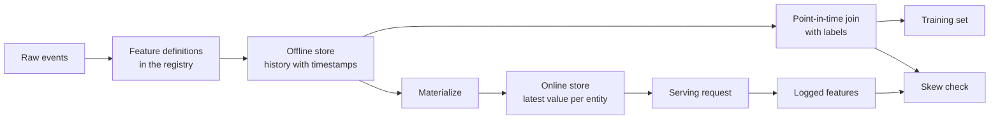

# 特征存储与训练-服务偏移

> 一个特征只有一个定义，但有两个读取方。训练按每个标签时间读取其历史值，服务读取其最新值。当两个读取方不一致时，模型就会看到它从未训练过的输入。

**Type:** Build
**Languages:** Python
**Prerequisites:** Phase 2, Lessons 08 (Feature Engineering), 13 (ML Pipelines), 15 (Time Series), and 19 (ML System Design)
**Time:** ~100 minutes

## 学习目标

- 描述离线存储、在线存储、实体、事件时间戳和 TTL，以及各自的作用
- 实现点-in-time 正确关联，并展示朴素关联如何把未来值复制到训练数据中
- 说出训练-服务偏移的四个原因：两套代码路径、陈旧特征、不同默认值和时间穿越
- 构建一个特征注册表，让同一定义同时服务于训练路径和服务路径
- 在不读取每个日期之后数据的前提下，为过去日期回填新特征
- 通过比较记录的服务特征与训练路径在相同实体和时间上的特征来检测偏移

## 问题

一个团队构建了一个流失模型。每个标签表示用户在标签日后的 30 天内是否没有购买。团队将标签与 `user_id` 上的用户特征表关联，并用 `days_since_last_purchase` 训练规则。离线准确率为 0.948。

在线流量上，该模型表现得比旧版更简单的版本还差。特征表保存了每个用户在标签日之后几周的新值。一个最后购买日在第 115 天的用户，在第 175 天的快照中显示为 60 天未购买，因此特征里包含了答案。与此同时，另一个团队在不同的服务里重新实现了服务特征。他们的 30 天窗口多包含了一天，而且新用户的默认值是 -1 而不是 365。

两个缺陷有相同的原因。训练和服务以两种不同的方式计算「同一个特征」。本节课从零构建特征存储的各个部分。你将编写注册表、回填、点-in-time 关联、带 TTL 的在线存储，以及偏移检查。演示用数字复现了这两个缺陷。

## 概念

### 同一特征的两个读取方

训练和服务以不同的形式请求特征：

| 属性 | 训练（离线） | 服务（在线） |
|---|---|---|
| 问题 | "1000 万个（实体，时间）对的值分别是多少？" | "这个实体现在的值是多少？" |
| 时间 | 过去的多个时间点 | 现在 |
| 数据量 | 每次任务数百万行 | 每次请求一行 |
| 延迟 | 几分钟即可 | 几毫秒 |
| 存储 | 离线存储：带时间戳的完整历史，以列式文件或数据仓库存储 | 在线存储：每个实体的最新值，以键值数据库存储 |

特征存储让两个存储都来自同一组特征定义。物化（materialization）是将最新值从离线存储复制到在线存储的任务。



### 实体、时间戳和 TTL

四个术语描述每一行特征：

- **Entity.** 特征描述的对象键，例如 `user_id` 或 `card_id`。
- **Event timestamp.** 值生效的时间。例如「截至第 14 天」的购买次数，其事件时间戳为第 14 天。
- **Created timestamp.** 系统写入该行的时间。今天运行的回填会写入旧的事件时间戳和新的创建时间戳。
- **TTL (time to live).** 值的最大有效年龄。超过 TTL 的值视为缺失，读取方使用默认值。

具有相同实体、来源和 TTL 的一组特征通常称为特征视图（feature view）。

### 点-in-time 正确关联

训练行将标签与标签时间存在的特征值配对。点-in-time 关联为每个标签执行以下操作：

1. 找到相同实体的特征行。
2. 保留事件时间戳小于或等于标签时间戳的行。
3. 取其中最新的一行。
4. 如果标签时间戳与事件时间戳之差超过 TTL，则丢弃。

下面是一个用户、第 16 天的标签，以及每周特征行的示例：

| 特征行日期 | `purchases_30d` | 点-in-time 关联 | 按 `user_id` 的朴素关联 |
|---|---|---|---|
| 7 | 4 | | |
| 14 | 3 | Selected | |
| 21 | 1 | Future | |
| 28 | 0 | Future | Selected |

标签询问用户在第 17 到 46 天是否有购买。第 28 天的行已经计算了标签日之后的安静天数。它显示 0 次购买，因为用户停止了购买，而这正是标签要衡量的事件。朴素关联把答案复制到了输入中。

我们在时间序列课中出于同样的原因按时间划分数据。点-in-time 关联把这条规则应用到每一行，而不是一个划分点。

### 训练-服务偏移的原因

Google 的《机器学习规则》将训练-服务偏移定义为训练期间性能与服务期间性能之间的差异。他们列出了三个原因：两个流水线中的数据处理不同、训练和服务之间的数据发生变化，以及反馈循环。在特征流水线中，四个具体原因反复出现：

| 原因 | 发生了什么 | 演示中的示例 |
|---|---|---|
| 两套代码路径 | 训练和服务用不同代码计算特征 | 服务窗口包含 `now - 30` 这一天，而训练窗口不包含 |
| 陈旧特征 | 服务读取的值的年龄与训练使用的值不同 | 训练读取每周快照，而新服务计算最新值 |
| 不同默认值 | 两条路径以不同方式填充缺失值 | 训练用 365 表示「尚未购买」，服务用 -1 |
| 时间穿越 | 训练读取了标签时间之后的值 | 朴素关联为每个标签读取最新快照 |

同一份指南的第 32 条规则说，要尽可能在训练流水线和服务流水线之间复用代码。特征存储遵循这一规则，让两条路径调用同一个定义。

### 特征注册表

注册表是特征定义的目录。每个条目包含名称、实体、来源、转换、窗口、默认值、TTL、负责人、版本和描述。

两条规则保证其安全：

- 两条路径都从注册表读取定义。任何服务都不保留转换的私有副本。
- 定义的变更会创建新版本。旧版本保留，因此旧模型仍使用它们训练时的特征。

### 回填

新特征没有历史，但训练需要在每个旧标签时间都有它的值。回填在每个过去日期运行定义，并为每个实体和日期写入一行。每次运行只读取时间戳小于或等于该日期的事件。

回填成本随实体数量乘以日期数量而增长。它们还会带来一种微妙的泄露。今天运行的回填写入旧事件时间戳的行，但它可能读取到延迟到达或后来修正的数据。严格的点-in-time 关联还会检查创建时间戳是否小于或等于标签时间。

### 检测偏移

同一份指南的第 29 条规则说，要在服务时记录特征并在训练中使用它们。即使很小的记录样本也能用来检查一致性。将每个记录值与训练路径为相同实体和时间产生的值进行比较。对每个特征，报告不匹配比例和平均绝对差。

要找出原因，比较三对值：

1. 在线存储读取与训练关联。这测试整个系统，应该显示零偏移。
2. 新鲜计算与训练关联。这隔离陈旧性。
3. 第二套代码路径与新鲜计算。这隔离代码差异，例如窗口和默认值。

```figure
mlprod-pit-join
```

## 构建它

`code/main.py` 中的代码仅使用标准库。时间是整数天。每周批处理作业在第 7、14……直到 175 天写入特征快照。

### 步骤 1：特征定义与注册表

`FeatureDefinition` 将转换作为数据保存：聚合、窗口和默认值。它的 `compute` 方法从不读取 `as_of` 之后的事件。

```python
@dataclass(frozen=True)
class FeatureDefinition:
    name: str
    entity: str
    aggregate: str
    window_days: int | None
    default: float
    version: int = 1
    owner: str = "growth-team"
    description: str = ""

    def compute(self, events: list[Event], as_of: int) -> float:
        visible = [e for e in events if e.day <= as_of]
        if self.window_days is not None:
            visible = [e for e in visible if e.day > as_of - self.window_days]
        if self.aggregate == "count":
            return float(len(visible))
        if self.aggregate == "sum":
            return round(sum(e.amount for e in visible), 2)
        if self.aggregate == "days_since_last":
            return float(as_of - max(e.day for e in visible)) if visible else self.default
        raise ValueError(f"unknown aggregate {self.aggregate!r}")
```

`FeatureRegistry.register` 允许重复注册相同定义，但会拒绝同名同版本的不同定义。`fill_defaults` 为两条路径提供缺失值的相同默认值。

模型用 `spend_30d@1` 这样的引用固定定义。`compute` 和 `fill_defaults` 解析该引用，没有 `@` 的名称读取最新版本。带有 `@` 但没有版本号的引用会抛出 `ValueError`，因此拼写错误不会在不发出警告的情况下读取最新版本。该引用也是每个存储行的键，因此回填、在线存储和服务读取都使用固定版本。

### 步骤 2：回填离线存储

```python
def backfill(registry: FeatureRegistry, names: list[str], events: list[Event], days: list[int]) -> list[FeatureRow]:
    rows = []
    for entity, entity_events in sorted(group_events(events).items()):
        for day in days:
            rows.append(FeatureRow(entity, day, registry.compute(names, entity_events, day)))
    return rows
```

演示为 299 个用户在 25 个快照日上回填三个特征，共得到 7475 行。

### 步骤 3：点-in-time 关联

每个实体的行按日期排序一次。对每个标签，`bisect_right` 找到小于或等于标签日的最后一行。TTL 检查会丢弃太旧的行。

```python
def point_in_time_join(labels: list[LabelRow], rows: list[FeatureRow], ttl_days: int | None = None) -> list[JoinedRow]:
    by_entity: dict[str, list[FeatureRow]] = defaultdict(list)
    for row in rows:
        by_entity[row.entity].append(row)
    days_index = {}
    for entity, entity_rows in by_entity.items():
        entity_rows.sort(key=lambda r: r.day)
        days_index[entity] = [r.day for r in entity_rows]
    joined = []
    for label in labels:
        days = days_index.get(label.entity, [])
        pos = bisect.bisect_right(days, label.day) - 1
        match = by_entity[label.entity][pos] if pos >= 0 else None
        if match is not None and ttl_days is not None and label.day - match.day > ttl_days:
            match = None
        joined.append(JoinedRow(
            label.entity, label.day, label.label,
            match.day if match else None, match.values if match else None,
        ))
    return joined
```

### 步骤 4：衡量朴素关联造成的泄露

`naive_latest_join` 只按实体关联，因此返回每个标签的最新行。演示在第 100、120、140 天构建标签，并在每个训练集上拟合单特征规则。然后用点-in-time 特征测试两个规则在第 145 天标签上的表现：

```console
  naive join used a snapshot from after the label day for 100% of rows
  offline accuracy, naive join: 0.948 (rule: idle > 53 days)
  offline accuracy, PIT join:   0.893 (rule: idle > 19 days)
  accuracy on day 145, trained with naive join: 0.763
  accuracy on day 145, trained with PIT join:   0.876
```

朴素关联离线看起来更好，0.948 对 0.893。在新数据上则更差，0.763 对 0.876。泄露的特征将拟合阈值从 19 天未购买推到了 53 天。

### 步骤 5：在线存储与物化

在线存储每个实体保留一行，并拒绝超过 TTL 的旧行。`materialize` 只写入日期小于或等于作业时间的行。

```python
class OnlineStore:
    def __init__(self, ttl_days: int):
        self.ttl_days = ttl_days
        self._latest: dict[str, FeatureRow] = {}

    def write(self, row: FeatureRow) -> None:
        current = self._latest.get(row.entity)
        if current is None or row.day >= current.day:
            self._latest[row.entity] = row

    def read(self, entity: str, now: int) -> dict[str, float] | None:
        row = self._latest.get(entity)
        if row is None or row.day > now or now - row.day > self.ttl_days:
            return None
        return dict(row.values)
```

TTL 为 10 天时，第 145 天的读取返回第 140 天的行。第 160 天读取，如果没有新的物化，则返回默认值，因为该行已经 20 天旧了。

### 步骤 6：偏移检查

`detect_skew` 比较以 `(entity, day)` 为键的两个视图。它报告每个特征的不匹配率和平均绝对差，并在超过 1% 的值不同时标记该特征。当两个视图的键不同或没有键时，它会抛出 `ValueError`。缺失的请求可能隐藏偏移，没有请求的检查什么也显示不了。

```python
def detect_skew(
    training: dict[tuple[str, int], dict[str, float]],
    serving: dict[tuple[str, int], dict[str, float]],
    features: list[str],
    tolerance: float = 1e-6,
    max_mismatch_rate: float = 0.01,
) -> list[SkewReport]:
    if set(training) != set(serving):
        raise ValueError(f"{len(set(training) ^ set(serving))} keys are in only one view: log and compare the same requests")
    if not training:
        raise ValueError("no requests to compare")
    keys = sorted(training)
    reports = []
    for feature in features:
        diffs = [abs(training[k][feature] - serving[k][feature]) for k in keys]
        mismatches = sum(1 for d in diffs if d > tolerance)
        rate = mismatches / len(keys)
        mean_diff = sum(diffs) / len(keys)
        reports.append(SkewReport(feature, len(keys), rate, mean_diff, rate > max_mismatch_rate))
    return reports
```

演示记录第 141 到 150 天的请求，并运行概念部分的三项比较。请求池包含 20 个没有历史的新用户。

```bash
python3 code/main.py
```

```console
=== Skew checks on 383 logged requests, days 141 to 150 ===
  online store read  vs  training join (one definition, same snapshots)
    ok   days_since_last_purchase   mismatch   0.0%  mean |diff|    0.00
    ok   purchases_30d              mismatch   0.0%  mean |diff|    0.00
    ok   spend_30d                  mismatch   0.0%  mean |diff|    0.00
  fresh compute      vs  training join (staleness only)
    SKEW days_since_last_purchase   mismatch  83.0%  mean |diff|    2.77
    SKEW purchases_30d              mismatch  30.5%  mean |diff|    0.38
    SKEW spend_30d                  mismatch  37.1%  mean |diff|   16.77
  second code path   vs  fresh compute (code differences only)
    SKEW days_since_last_purchase   mismatch   5.5%  mean |diff|   20.07
    SKEW purchases_30d              mismatch  12.5%  mean |diff|    0.13
    SKEW spend_30d                  mismatch  12.5%  mean |diff|    5.09
```

按顺序阅读三个块：

- **同一定义，相同快照。** 在线存储和训练关联读取相同的物化行，因此偏移为零。
- **陈旧性。** 在大多数请求上，新鲜值与每周快照不同。这里更新的数据不一定更好，因为模型是从最多六天旧的值学习到的。
- **代码差异。** 第二套代码路径在 12.5% 的窗口计数上不同，因为它的窗口多包含一天。它只在新用户的 `days_since_last_purchase` 上不同，但差异很大：-1 对 365。

## 使用它

Feast 是一个开源特征存储。从零实现的每个部分都有对应的 Feast 实现：

| 从零实现 | Feast |
|---|---|
| `FeatureDefinition`、`FeatureRegistry` | 特征仓库中的 `Entity`、`FeatureView` 和 `Field`，通过 `feast apply` 注册 |
| `FeatureRow` 历史 | 离线存储，例如基于 Parquet 文件的 `FileSource` 或数据仓库表 |
| 带 TTL 的 `point_in_time_join` | `store.get_historical_features(entity_df=..., features=[...])` |
| `materialize` | `feast materialize-incremental <结束时间>` |
| `OnlineStore.read` | `store.get_online_features(features=[...], entity_rows=[...])` |
| 创建时间戳检查 | 来源上的 `created_timestamp_column` 和 `filter_by_created_timestamp=True` |

定义看起来像这样。代码遵循 Feast 快速入门，运行本节课不需要它。

```python
from datetime import timedelta

from feast import Entity, FeatureView, Field, FileSource
from feast.types import Float32, Int64

user = Entity(name="user", join_keys=["user_id"])

user_activity_source = FileSource(
    name="user_activity_source",
    path="data/user_activity.parquet",
    timestamp_field="event_timestamp",
    created_timestamp_column="created",
)

user_activity = FeatureView(
    name="user_activity",
    entities=[user],
    ttl=timedelta(days=10),
    schema=[
        Field(name="purchases_30d", dtype=Int64),
        Field(name="spend_30d", dtype=Float32),
        Field(name="days_since_last_purchase", dtype=Int64),
    ],
    source=user_activity_source,
)
```

训练和服务随后读取相同的特征视图：

```python
from feast import FeatureStore

store = FeatureStore(repo_path=".")

training_df = store.get_historical_features(
    entity_df=labels_df,
    features=["user_activity:purchases_30d", "user_activity:days_since_last_purchase"],
    filter_by_created_timestamp=True,
).to_df()

online = store.get_online_features(
    features=["user_activity:purchases_30d", "user_activity:days_since_last_purchase"],
    entity_rows=[{"user_id": 42}],
).to_dict()
```

`labels_df` 每行包含一个标签，以及 `user_id`、`event_timestamp` 和标签。Feast 文档指出，TTL 是相对于实体 dataframe 中的每个时间戳，而不是查询时间。这与 `point_in_time_join` 中的 TTL 检查一致。同一页面描述了 `filter_by_created_timestamp=True`，它可以防止回填值泄露到训练数据中。并非所有离线存储都支持此选项。不支持的存储会报错，而不是忽略该选项。

Tecton、Hopsworks 以及大型云 ML 平台中的特征存储都使用离线存储和在线存储的相同划分。对于偏移检查，TensorFlow Data Validation 可以比较训练数据和服务数据以检测偏移。Breck 等人描述了 Google 端到端 ML 平台 TFX 中的数据验证系统，包括训练-服务偏移。

## 交付它

本节课生成 `outputs/skill-feature-skew-audit.md`。该 skill 审计特征流水线中的时间穿越和训练-服务偏移。它会逐步检查关联、定义、默认值、各路径的新鲜度，以及偏移检查所需的日志记录。

## 练习

1. 将快照间隔从 7 天改为 1 天。重新运行陈旧性比较并解释结果。
2. 将 TTL 设为 3 天。统计失去特征并使用默认值的训练行数量。
3. 给 `FeatureRow` 添加创建日期。让关联忽略标签日之后写入的行。
4. 将 `spend_7d` 注册为 `spend_30d` 的第 2 个版本。回填它，并从注册表打印两个版本。
5. 修复 `legacy_serving_features`，直到第三个偏移检查通过。列出每项修改。

## 关键术语

| 术语 | 常见说法 | 含义 |
|------|----------------|----------------------|
| 特征存储 | "特征数据库" | 从同一组定义计算特征，并将其提供给训练和服务使用的系统 |
| 离线存储 | "训练数据" | 带事件时间戳的完整特征历史，由训练任务和回填读取 |
| 在线存储 | "特征缓存" | 每个实体的最新值，服务路径在毫秒级读取 |
| 实体 | "ID" | 特征描述的对象键，例如用户或卡片 |
| 事件时间戳 | "发生时间" | 特征值生效的时间 |
| 点-in-time 关联 | "as-of 关联" | 将每个标签与标签时间或之前最新的特征行配对的关联 |
| TTL | "过期时间" | 特征值在被读取方视为缺失之前的最大年龄 |
| 物化 | "同步到在线" | 将最新特征值从离线存储复制到在线存储的任务 |
| 回填 | "计算历史" | 在过去日期运行特征定义以创建其历史 |
| 训练-服务偏移 | "离线时工作正常" | 训练和服务中特征或行为的差异 |

## 进一步阅读

- [Feast, Point-in-time joins](https://docs.feast.dev/getting-started/concepts/point-in-time-joins): TTL semantics and the created timestamp filter
- [Feast documentation](https://docs.feast.dev/): feature views, offline stores, online stores, and materialization
- [Google, Rules of Machine Learning](https://developers.google.com/machine-learning/guides/rules-of-ml): the training-serving skew rules, from Rule #29 to Rule #37
- [Breck et al., Data Validation for Machine Learning (SysML 2019)](https://research.google/pubs/data-validation-for-machine-learning/): data validation at Google, including training-serving skew
- [TensorFlow Data Validation guide](https://www.tensorflow.org/tfx/guide/tfdv): schema checks, skew detection, and drift detection
- [Sculley et al., Hidden Technical Debt in Machine Learning Systems (NeurIPS 2015)](https://papers.nips.cc/paper/2015/hash/86df7dcfd896fcaf2674f757a2463eba-Abstract.html): data dependencies and pipeline debt around a model
