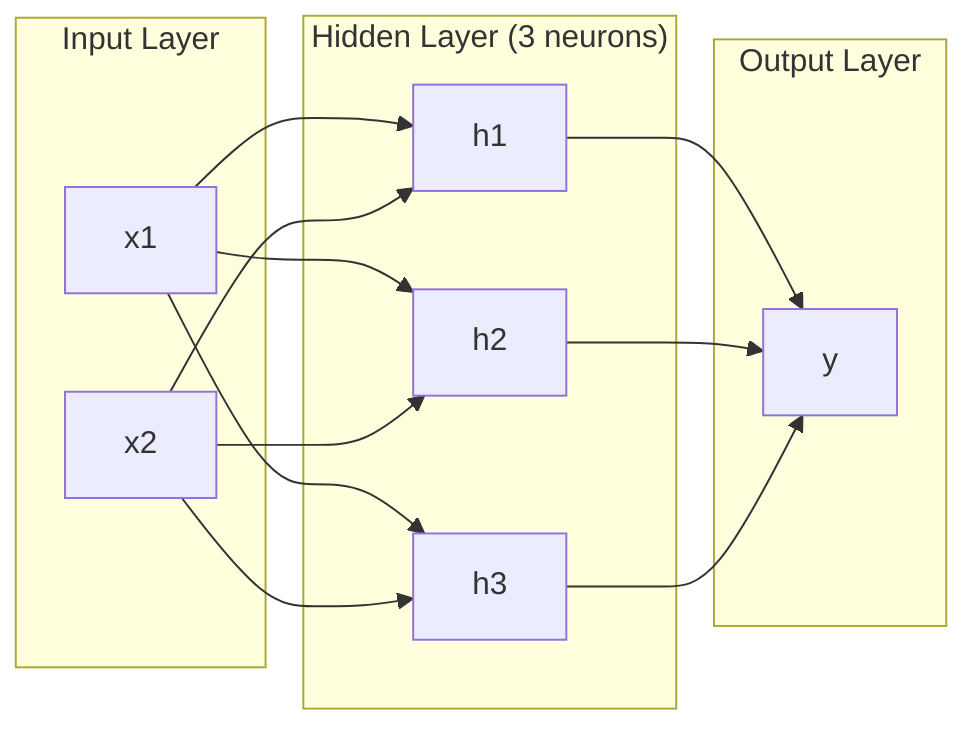
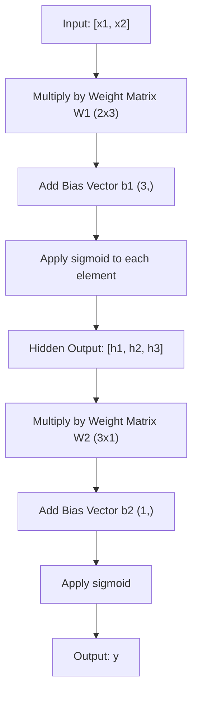
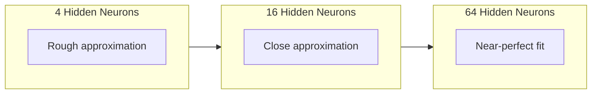

# 多层网络与前向传播

> 一个神经元画一条线。把它们堆叠起来，你就能画出任何东西。

**Type:** Build
**Languages:** Python
**Prerequisites:** Phase 01 (Math Foundations), Lesson 03.01 (The Perceptron)
**Time:** ~90 minutes

## 学习目标

- 用 Layer 和 Network 类从零构建多层网络，完成完整的前向传播
- 追踪网络每一层的矩阵维度，识别形状不匹配
- 解释堆叠非线性激活如何让网络学习弯曲的决策边界
- 使用 2-2-1 架构和手动调优的 sigmoid 权重解决 XOR 问题

## 问题

单个神经元就是画线器。仅此而已。一条直线穿过数据。AI 中的每个实际问题——图像识别、语言理解、下围棋——都需要曲线。把神经元堆叠成层，才能获得曲线。

1969 年，Minsky 和 Papert 证明了这一限制是致命的：单层网络无法学习 XOR。不是「学得很吃力」——而是数学上不可能。XOR 真值表把 [0,1] 和 [1,0] 放在一边，[0,0] 和 [1,1] 放在另一边。没有一条直线能把它们分开。

这导致神经网络研究资金被削减了十多年。事后看来，解决办法显而易见：别只用一层。把神经元堆叠成层，让第一层把输入空间切割成新特征，让第二层把这些特征组合成单个直线无法做出的决策。

这一堆叠就是多层网络。它是当今生产环境中每个深度学习模型的基础。前向传播——数据从输入层经过隐藏层流向输出层——是其他一切能工作之前你首先需要构建的东西。

## 概念

### 层：输入层、隐藏层、输出层

多层网络有三种层：

**输入层**——不算是真正的层。它只保存原始数据。两个特征意味着两个输入节点。这里没有计算。

**隐藏层**——真正干活的地方。每个神经元接收上一层的所有输出，应用权重和偏置，再把结果传给激活函数。「隐藏」是因为你在训练数据中永远不会直接看到这些值。

**输出层**——最终答案。二分类用单个 sigmoid 神经元；多分类用每个类一个神经元。



这是一个 2-3-1 网络：两个输入、三个隐藏神经元、一个输出。每条连接都有一个权重。每个神经元（除输入层外）都有一个偏置。

每一层都会输出一个数字向量，称为隐藏状态（hidden state）。对于文本，隐藏状态提高维度——把一个词编码成 768 个数来捕捉语义。对于图像，它们降低维度——把数百万像素压缩成可管理的表示。隐藏状态就是学习发生的地方。

### 神经元与激活函数

每个神经元做三件事：

1. 把每个输入乘以对应权重
2. 把所有乘积求和并加上偏置
3. 把总和传给激活函数

目前，激活函数使用 sigmoid：

```math
\text{sigmoid}(z) = \frac{1}{1 + e^{-z}}
```

Sigmoid 把任意数压缩到 (0, 1)。很大的正输入推向 1，很大的负输入推向 0，零映射到 0.5。这条光滑曲线让学习成为可能——与感知机硬邦邦的阶跃不同，sigmoid 在任何地方都有梯度。

### 前向传播：数据如何流动

前向传播把输入数据逐层推过网络，直到输出。前向传播过程中不发生学习。它纯粹是计算：乘、加、激活、重复。



在每一层，三个操作依次发生：

```math
\begin{aligned}
z &= W \cdot \text{input} + b \quad \text{(linear transformation)} \\
a &= \text{sigmoid}(z) \quad \text{(activation)}
\end{aligned}
```

一层的输出成为下一层的输入。这就是前向传播的全部。

### 矩阵维度

追踪维度是深度学习中最关键的调试技能。下面是 2-3-1 网络：

| 步骤 | 操作 | 维度 | 结果形状 |
|------|------|------|----------|
| Input | $x$ | -- | (2,) |
| Hidden linear | $W_1 x + b_1$ | $W_1$: (3, 2), $b_1$: (3,) | (3,) |
| Hidden activation | $\text{sigmoid}(z_1)$ | -- | (3,) |
| Output linear | $W_2 h + b_2$ | $W_2$: (1, 3), $b_2$: (1,) | (1,) |
| Output activation | $\text{sigmoid}(z_2)$ | -- | (1,) |

规则是：第 $k$ 层的权重矩阵 $W$ 形状为（当前层神经元数，前一层神经元数）。行数对应当前层，列数对应前一层。如果形状对不上，那就是 bug。

### 通用近似定理

1989 年，George Cybenko 证明了一个 remarkable 的结论：一个具有单个隐藏层且神经元足够多的神经网络，可以以任意精度逼近任何连续函数。

这并不意味着一个隐藏层总是最好的。它只说明这种架构在理论上是万能的。实践中，更深的网络（更多层、每层更少神经元）能用远比浅而宽的网络更少的总参数学到同样的函数。这就是深度学习有效的原因。

直觉是：隐藏层的每个神经元学到一个小小的「凸起」或特征。把足够多的凸起放在正确的位置，就能逼近任何光滑曲线。神经元越多，凸起越多，逼近越好。



### 可组合性

神经网络是可组合的。你可以堆叠、串联、并行它们。Whisper 模型用编码器网络处理音频，再用独立的解码器网络生成文本。现代 LLM 是仅解码器架构。BERT 是仅编码器。T5 是编码器-解码器。架构选择决定了模型能做什么。

```figure
mlp-forward
```

## 构建它

纯 Python，没有 numpy。每个矩阵运算都从零手写。

### 第 1 步：Sigmoid 激活函数

```python
import math

def sigmoid(x):
    x = max(-500.0, min(500.0, x))
    return 1.0 / (1.0 + math.exp(-x))
```

把输入限制在 [-500, 500] 可以防止溢出。`math.exp(500)` 很大但仍是有限值；`math.exp(1000)` 则是无穷大。

### 第 2 步：Layer 类

深度学习中最重要的运算是矩阵乘法。每一层、每个注意力头、每次前向传播——本质上全是矩阵乘法。线性层接收一个输入向量，乘以权重矩阵，再加上偏置向量：$y = Wx + b$。这一个等式就占了神经网络 90% 的计算量。

一个层保存一个权重矩阵和一个偏置向量。它的 forward 方法接收输入向量，返回激活后的输出。

```python
class Layer:
    def __init__(self, n_inputs, n_neurons, weights=None, biases=None):
        if weights is not None:
            self.weights = weights
        else:
            import random
            self.weights = [
                [random.uniform(-1, 1) for _ in range(n_inputs)]
                for _ in range(n_neurons)
            ]
        if biases is not None:
            self.biases = biases
        else:
            self.biases = [0.0] * n_neurons

    def forward(self, inputs):
        self.last_input = inputs
        self.last_output = []
        for neuron_idx in range(len(self.weights)):
            z = sum(
                w * x for w, x in zip(self.weights[neuron_idx], inputs)
            )
            z += self.biases[neuron_idx]
            self.last_output.append(sigmoid(z))
        return self.last_output
```

权重矩阵的形状是 (n_neurons, n_inputs)。每一行是一个神经元在所有输入上的权重。forward 方法遍历神经元，计算加权总和加偏置，应用 sigmoid，收集结果。

### 第 3 步：Network 类

网络就是一个层的列表。前向传播把它们串联起来：第 $k$ 层的输出喂给第 $k+1$ 层。

```python
class Network:
    def __init__(self, layers):
        self.layers = layers

    def forward(self, inputs):
        current = inputs
        for layer in self.layers:
            current = layer.forward(current)
        return current
```

这就是前向传播的全部逻辑。四行代码。数据进去，流过每一层，从另一边出来。

### 第 4 步：用手动调优的权重解决 XOR

在第 01 课中，我们通过组合 OR、NAND 和 AND 感知机解决了 XOR。现在用 Layer 和 Network 类做同样的事。2-2-1 架构：两个输入、两个隐藏神经元、一个输出。

```python
hidden = Layer(
    n_inputs=2,
    n_neurons=2,
    weights=[[20.0, 20.0], [-20.0, -20.0]],
    biases=[-10.0, 30.0],
)

output = Layer(
    n_inputs=2,
    n_neurons=1,
    weights=[[20.0, 20.0]],
    biases=[-30.0],
)

xor_net = Network([hidden, output])

xor_data = [
    ([0, 0], 0),
    ([0, 1], 1),
    ([1, 0], 1),
    ([1, 1], 0),
]

for inputs, expected in xor_data:
    result = xor_net.forward(inputs)
    predicted = 1 if result[0] >= 0.5 else 0
    print(f"  {inputs} -> {result[0]:.6f} (rounded: {predicted}, expected: {expected})")
```

大权重（20、-20）让 sigmoid 表现得像阶跃函数。第一个隐藏神经元近似 OR，第二个近似 NAND，输出神经元把它们组合成 AND，这就是 XOR。

### 第 5 步：圆形分类

一个更难的问题：把二维点分类为位于以原点为中心、半径 0.5 的圆内还是圆外。这需要弯曲的决策边界——单个感知机不可能做到。

```python
import random
import math

random.seed(42)

data = []
for _ in range(200):
    x = random.uniform(-1, 1)
    y = random.uniform(-1, 1)
    label = 1 if (x * x + y * y) < 0.25 else 0
    data.append(([x, y], label))

circle_net = Network([
    Layer(n_inputs=2, n_neurons=8),
    Layer(n_inputs=8, n_neurons=1),
])
```

随机权重下，网络分类效果很差，但前向传播仍然可以运行。重点在于：前向传播只是计算。学习正确的权重是反向传播的事，将在第 03 课讲解。

```python
correct = 0
for inputs, expected in data:
    result = circle_net.forward(inputs)
    predicted = 1 if result[0] >= 0.5 else 0
    if predicted == expected:
        correct += 1

print(f"Accuracy with random weights: {correct}/{len(data)} ({100*correct/len(data):.1f}%)")
```

随机权重的准确率很低——通常比直接猜多数类还差。训练之后（第 03 课），同样是 8 个隐藏神经元的这个架构会画出一条把圆内和圆外分开的弯曲边界。

## 使用它

PyTorch 用四行代码完成上面的一切：

```python
import torch
import torch.nn as nn

model = nn.Sequential(
    nn.Linear(2, 8),
    nn.Sigmoid(),
    nn.Linear(8, 1),
    nn.Sigmoid(),
)

x = torch.tensor([[0.0, 0.0], [0.0, 1.0], [1.0, 0.0], [1.0, 1.0]])
output = model(x)
print(output)
```

`nn.Linear(2, 8)` 就是你的 Layer 类：权重矩阵形状 (8, 2)，偏置向量形状 (8,)。`nn.Sigmoid()` 就是按元素应用的 sigmoid 函数。`nn.Sequential()` 就是你的 Network 类：按顺序串联各层。

差别在于速度和规模。PyTorch 在 GPU 上运行，能处理数百万样本的批次，并自动计算反向传播所需的梯度。但前向传播的逻辑与你刚才从零构建的完全相同。

## 交付它

本节课产出一个可复用的网络架构设计提示：

- `outputs/prompt-network-architect.md`

当你需要决定层数、每层神经元数以及某个问题该用哪种激活函数时，使用它。

## 练习

1. 构建一个 2-4-2-1 网络（两个隐藏层），用随机权重对 XOR 数据运行前向传播。打印中间隐藏层的输出，观察表示在每一层如何变换。

2. 把圆形分类器中的隐藏层大小从 8 改为 2，再改为 32。每次都使用随机权重运行前向传播。隐藏神经元数量会改变输出范围或分布吗？为什么？

3. 在 Network 类上实现 `count_parameters` 方法，返回可训练的权重和偏置总数。在 784-256-128-10 网络（经典 MNIST 架构）上测试它。它有多少参数？

4. 为 3-4-4-2 网络构建前向传播。输入 RGB 颜色值（归一化到 0-1）并观察两个输出。这是一个简单的二分类颜色分类器架构。

5. 把 sigmoid 替换成「泄漏阶跃」函数：如果 z < 0 返回 0.01 * z，否则返回 1.0。用第 4 步同样的手动调优权重对 XOR 运行前向传播。它还能工作吗？为什么光滑的 sigmoid 比硬截断更受欢迎？

## 关键术语

| 术语 | 通常说法 | 实际含义 |
|------|----------|----------|
| 前向传播（Forward pass） | "运行模型" | 把输入推过每一层——乘权重、加偏置、激活——产生输出 |
| 隐藏层（Hidden layer） | "中间部分" | 输入层和输出层之间的任何层，其值不会直接在数据中观察到 |
| 多层网络（Multi-layer network） | "深度神经网络" | 顺序堆叠的神经元层，每一层的输出作为下一层的输入 |
| 激活函数（Activation function） | "非线性部分" | 对线性变换结果应用的函数，把曲线引入决策边界 |
| Sigmoid | "S 曲线" | $\sigma(z) = 1/(1+e^{-z})$，把任意实数压缩到 (0,1)，处处光滑可导 |
| 权重矩阵（Weight matrix） | "参数" | 形状为（当前层神经元数，前一层神经元数）的矩阵 $W$，包含可学习的连接强度 |
| 偏置向量（Bias vector） | "偏移量" | 矩阵乘法后加的向量，让神经元即使输入全为零也能激活 |
| 通用近似（Universal approximation） | "神经网络什么都能学" | 一个隐藏层加足够多的神经元可以逼近任何连续函数——但「足够多」可能是数十亿 |
| 线性变换（Linear transformation） | "矩阵乘法步骤" | $z = W x + b$，激活前的计算，把输入映射到新空间 |
| 决策边界（Decision boundary） | "分类器切换的地方" | 输入空间中网络输出越过分类阈值的表面 |

## 延伸阅读

- Michael Nielsen, "Neural Networks and Deep Learning", Chapter 1-2 (http://neuralnetworksanddeeplearning.com/) —— 最清晰的前向传播与网络结构免费讲解，含交互式可视化
- Cybenko, "Approximation by Superpositions of a Sigmoidal Function" (1989) —— 通用近似定理的原始论文， surprisingly 好读
- 3Blue1Brown, "But what is a neural network?" (https://www.youtube.com/watch?v=aircAruvnKk) —— 20 分钟视觉 walkthrough，建立关于层、权重和前向传播的正确直觉
- Goodfellow, Bengio, Courville, "Deep Learning", Chapter 6 (https://www.deeplearningbook.org/) —— 多层网络的标准参考书，免费在线
