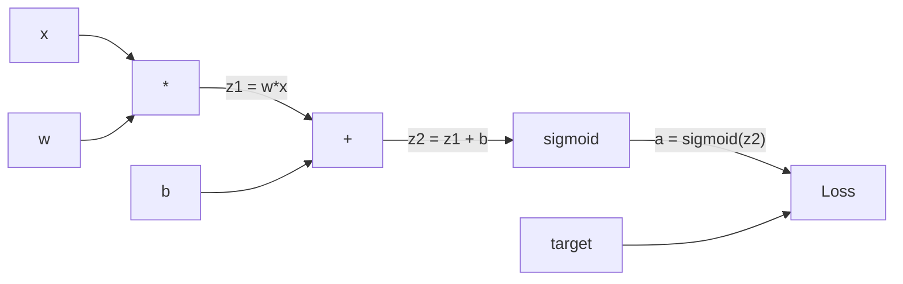
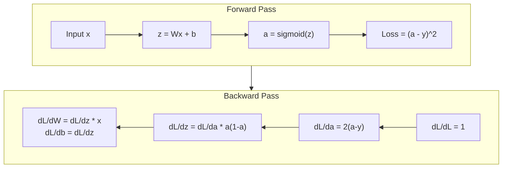
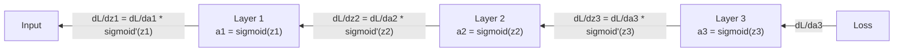

# 反向传播：从零实现

> 反向传播是让学习成为可能的算法。没有它，神经网络只是昂贵的随机数生成器。

**Type:** Build
**Languages:** Python
**Prerequisites:** Lesson 03.02 (Multi-Layer Networks)
**Time:** ~120 minutes

## 学习目标

- 实现基于 Value 的 autograd 引擎，构建计算图并通过拓扑排序计算梯度
- 用链式法则推导加法、乘法和 sigmoid 的反向传播
- 仅使用从零实现的反向传播引擎，在 XOR 和圆形分类上训练多层网络
- 识别深度 sigmoid 网络中的梯度消失问题，并解释梯度为何指数级缩小

## 问题

你的网络有一个隐藏层，输入 768 维、输出 3072 维。这意味着 2,359,296 个权重。它做了一个错误预测。哪些权重导致了错误？如果逐个权重测试，就要做 230 万次前向传播。反向传播只需一次反向传播就能算出全部 230 万个梯度。这不是优化，而是「可训练」与「不可能」之间的区别。

朴素做法是：取一个权重，稍微扰动一下，重新运行前向传播，测量损失是上升还是下降。这给出了该权重的梯度。然后对网络中的每个权重都这样做。再乘以数千个训练步和数百万个数据点。你需要地质年代才能训练出任何有用的东西。

反向传播解决了这个问题。一次前向传播，一次反向传播，所有梯度都算出。诀窍是把微积分中的链式法则系统地应用到计算图上。正是这个算法让深度学习变得实用。没有它，我们还会被困在玩具问题上。

## 概念

### 链式法则在网络中的应用

你在第 01 阶段第 05 课学过链式法则。快速回顾：如果 $y = f(g(x))$，那么 $\frac{dy}{dx} = f'(g(x)) \cdot g'(x)$。你把链上的导数相乘。

在神经网络中，「链」就是从输入到损失的操作序列。每一层都应用权重、加上偏置、通过激活函数。损失函数把最终输出与目标比较。反向传播沿着这条链倒着追踪，计算每个操作对错误的贡献。

### 计算图

每次前向传播都会构建一张图。每个节点是一个操作（乘法、加法、sigmoid）。每条边正向传递数值，反向传递梯度。



前向传播：数值从左向右流动。$x$ 和 $w$ 产生 $z_1 = w x$。加上 $b$ 得到 $z_2$。sigmoid 给出激活 $a$。把 $a$ 与目标 $y$ 用损失函数比较。

反向传播：梯度从右向左流动。从 $\partial L/\partial a$（损失随激活的变化）开始，乘以 $\partial a/\partial z_2$（sigmoid 导数），得到 $\partial L/\partial z_2$。再拆成 $\partial L/\partial b$（由于 $z_2 = z_1 + b$，它等于 $\partial L/\partial z_2$）和 $\partial L/\partial z_1$。然后 $\partial L/\partial w = \partial L/\partial z_1 \cdot x$，$\partial L/\partial x = \partial L/\partial z_1 \cdot w$。

图中每个节点在反向传播中只有一个任务：接收来自上方的梯度，乘以局部导数，再向下传递。

### 前向与反向



前向传播会存储每个中间值：$z$、$a$、每一层的输入。反向传播需要这些存储的值来计算梯度。这就是反向传播核心的内存-计算权衡：用内存（存储激活）换速度（一次传播而非数百万次）。

### 梯度在网络中的流动

对于一个 3 层网络，梯度会逐层链式传递：



在每一层，梯度都会乘以 sigmoid 导数。sigmoid 导数是 $a(1 - a)$，最大值是 0.25（当 $a = 0.5$ 时）。3 层深度，梯度最多被乘以 $0.25^3 = 0.0156$。10 层深度：$0.25^{10} = 0.000001$。

### 梯度消失

这就是梯度消失问题。sigmoid 把输出压缩在 0 到 1 之间，导数始终小于 0.25。堆叠足够多的 sigmoid 层，梯度就会缩小到接近零。早期层几乎学不到东西，因为它们收到的梯度接近零。

```
sigmoid(z):     Output range [0, 1]
sigmoid'(z):    Max value 0.25 (at z = 0)

After 5 layers:   gradient * 0.25^5 = 0.001x original
After 10 layers:  gradient * 0.25^10 = 0.000001x original
```

这就是深度 sigmoid 网络几乎无法训练的原因。解决办法——ReLU 及其变体——是第 04 课的主题。目前需要理解的是：反向传播本身没问题，问题是它穿过的那些层。

### 推导双层网络的梯度

下面是具体数学：输入为 $x$，隐藏层用 sigmoid，输出层用 sigmoid，损失为 MSE。

前向传播：

```math
\begin{aligned}
z_1 &= W_1 x + b_1 \\
a_1 &= \text{sigmoid}(z_1) \\
z_2 &= W_2 a_1 + b_2 \\
a_2 &= \text{sigmoid}(z_2) \\
L &= (a_2 - y)^2
\end{aligned}
```

反向传播（逐步应用链式法则）：

```math
\begin{aligned}
\frac{\partial L}{\partial a_2} &= 2(a_2 - y) \\
\frac{\partial a_2}{\partial z_2} &= a_2 (1 - a_2) \\
\frac{\partial L}{\partial z_2} &= \frac{\partial L}{\partial a_2} \cdot \frac{\partial a_2}{\partial z_2} = 2(a_2 - y) \cdot a_2 (1 - a_2) \\[6pt]
\frac{\partial L}{\partial W_2} &= \frac{\partial L}{\partial z_2} \cdot a_1 \\
\frac{\partial L}{\partial b_2} &= \frac{\partial L}{\partial z_2} \\[6pt]
\frac{\partial L}{\partial a_1} &= \frac{\partial L}{\partial z_2} \cdot W_2 \\
\frac{\partial a_1}{\partial z_1} &= a_1 (1 - a_1) \\
\frac{\partial L}{\partial z_1} &= \frac{\partial L}{\partial a_1} \cdot \frac{\partial a_1}{\partial z_1} \\[6pt]
\frac{\partial L}{\partial W_1} &= \frac{\partial L}{\partial z_1} \cdot x \\
\frac{\partial L}{\partial b_1} &= \frac{\partial L}{\partial z_1}
\end{aligned}
```

每个梯度都是从损失回溯、一路乘以局部导数的结果。反向传播仅此而已。

```figure
backprop-vanishing
```

## 构建它

### 第 1 步：Value 节点

计算中的每个数字都会变成一个 Value。它保存自己的数据、梯度以及创建方式（这样它就知道如何反向计算梯度）。

```python
class Value:
    def __init__(self, data, children=(), op=''):
        self.data = data
        self.grad = 0.0
        self._backward = lambda: None
        self._children = set(children)
        self._op = op

    def __repr__(self):
        return f"Value(data={self.data:.4f}, grad={self.grad:.4f})"
```

初始梯度为 0.0，反向函数暂时是空操作。`_children` 记录哪些 Value 产生了当前 Value，以便后续对图做拓扑排序。

### 第 2 步：带反向函数的运算

每个运算都会创建一个新 Value，并定义梯度如何反向流过它。

```python
def __add__(self, other):
    other = other if isinstance(other, Value) else Value(other)
    out = Value(self.data + other.data, (self, other), '+')

    def _backward():
        self.grad += out.grad
        other.grad += out.grad

    out._backward = _backward
    return out

def __mul__(self, other):
    other = other if isinstance(other, Value) else Value(other)
    out = Value(self.data * other.data, (self, other), '*')

    def _backward():
        self.grad += other.data * out.grad
        other.grad += self.data * out.grad

    out._backward = _backward
    return out
```

对于加法：$\partial(a+b)/\partial a = 1$，$\partial(a+b)/\partial b = 1$，所以两个输入都直接得到输出的梯度。

对于乘法：$\partial(ab)/\partial a = b$，$\partial(ab)/\partial b = a$，每个输入得到另一个输入的值乘以输出梯度。

`+=` 至关重要。一个 Value 可能被多个运算使用，它的梯度是所有路径的梯度之和。

### 第 3 步：Sigmoid 与损失

```python
import math

def sigmoid(self):
    x = self.data
    x = max(-500, min(500, x))
    s = 1.0 / (1.0 + math.exp(-x))
    out = Value(s, (self,), 'sigmoid')

    def _backward():
        self.grad += (s * (1 - s)) * out.grad

    out._backward = _backward
    return out
```

Sigmoid 导数：$\text{sigmoid}(x) \cdot (1 - \text{sigmoid}(x))$。我们在前向传播中已经算出 $\text{sigmoid}(x) = s$，直接复用，无需额外计算。

```python
def mse_loss(predicted, target):
    diff = predicted + Value(-target)
    return diff * diff
```

单个输出的 MSE：$(\text{predicted} - \text{target})^2$。我们把减法表达为加上一个取反的 Value。

### 第 4 步：反向传播

拓扑排序确保我们按正确顺序处理节点——在通过一个节点传播之前，它的梯度已经完整累积。

```python
def backward(self):
    topo = []
    visited = set()

    def build_topo(v):
        if v not in visited:
            visited.add(v)
            for child in v._children:
                build_topo(child)
            topo.append(v)

    build_topo(self)
    self.grad = 1.0
    for v in reversed(topo):
        v._backward()
```

从损失开始（梯度为 1.0，因为 $dL/dL = 1$），逆着排好序的图传播。每个节点的 `_backward` 把梯度推给它的子节点。

### 第 5 步：层与网络

```python
import random

class Neuron:
    def __init__(self, n_inputs):
        scale = (2.0 / n_inputs) ** 0.5
        self.weights = [Value(random.uniform(-scale, scale)) for _ in range(n_inputs)]
        self.bias = Value(0.0)

    def __call__(self, x):
        act = sum((wi * xi for wi, xi in zip(self.weights, x)), self.bias)
        return act.sigmoid()

    def parameters(self):
        return self.weights + [self.bias]


class Layer:
    def __init__(self, n_inputs, n_outputs):
        self.neurons = [Neuron(n_inputs) for _ in range(n_outputs)]

    def __call__(self, x):
        out = [n(x) for n in self.neurons]
        return out[0] if len(out) == 1 else out

    def parameters(self):
        params = []
        for n in self.neurons:
            params.extend(n.parameters())
        return params


class Network:
    def __init__(self, sizes):
        self.layers = []
        for i in range(len(sizes) - 1):
            self.layers.append(Layer(sizes[i], sizes[i + 1]))

    def __call__(self, x):
        for layer in self.layers:
            x = layer(x)
            if not isinstance(x, list):
                x = [x]
        return x[0] if len(x) == 1 else x

    def parameters(self):
        params = []
        for layer in self.layers:
            params.extend(layer.parameters())
        return params

    def zero_grad(self):
        for p in self.parameters():
            p.grad = 0.0
```

Neuron 接收输入，计算加权求和加偏置，再应用 sigmoid。权重初始化按 $\sqrt{2/n_{\text{inputs}}}$ 缩放，以防止 sigmoid 在较深层饱和。Layer 是一组 Neuron。Network 是一组 Layer。`parameters()` 方法收集所有可学习的 Value，以便更新它们。

### 第 6 步：在 XOR 上训练

```python
random.seed(42)
net = Network([2, 4, 1])

xor_data = [
    ([0.0, 0.0], 0.0),
    ([0.0, 1.0], 1.0),
    ([1.0, 0.0], 1.0),
    ([1.0, 1.0], 0.0),
]

learning_rate = 1.0

for epoch in range(1000):
    total_loss = Value(0.0)
    for inputs, target in xor_data:
        x = [Value(i) for i in inputs]
        pred = net(x)
        loss = mse_loss(pred, target)
        total_loss = total_loss + loss

    net.zero_grad()
    total_loss.backward()

    for p in net.parameters():
        p.data -= learning_rate * p.grad

    if epoch % 100 == 0:
        print(f"Epoch {epoch:4d} | Loss: {total_loss.data:.6f}")

print("\nXOR Results:")
for inputs, target in xor_data:
    x = [Value(i) for i in inputs]
    pred = net(x)
    print(f"  {inputs} -> {pred.data:.4f} (expected {target})")
```

观察损失下降。从随机预测到正确的 XOR 输出，完全由反向传播计算梯度并把权重推向正确方向驱动。

### 第 7 步：圆形分类

在第 02 课中，你手动调优了圆形分类的权重。现在让网络自己学习。

```python
random.seed(7)

def generate_circle_data(n=100):
    data = []
    for _ in range(n):
        x1 = random.uniform(-1.5, 1.5)
        x2 = random.uniform(-1.5, 1.5)
        label = 1.0 if x1 * x1 + x2 * x2 < 1.0 else 0.0
        data.append(([x1, x2], label))
    return data

circle_data = generate_circle_data(80)

circle_net = Network([2, 8, 1])
learning_rate = 0.5

for epoch in range(2000):
    random.shuffle(circle_data)
    total_loss_val = 0.0
    for inputs, target in circle_data:
        x = [Value(i) for i in inputs]
        pred = circle_net(x)
        loss = mse_loss(pred, target)
        circle_net.zero_grad()
        loss.backward()
        for p in circle_net.parameters():
            p.data -= learning_rate * p.grad
        total_loss_val += loss.data

    if epoch % 200 == 0:
        correct = 0
        for inputs, target in circle_data:
            x = [Value(i) for i in inputs]
            pred = circle_net(x)
            predicted_class = 1.0 if pred.data > 0.5 else 0.0
            if predicted_class == target:
                correct += 1
        accuracy = correct / len(circle_data) * 100
        print(f"Epoch {epoch:4d} | Loss: {total_loss_val:.4f} | Accuracy: {accuracy:.1f}%")
```

这里我们使用在线 SGD——每个样本之后就更新权重，而不是累积整个批次。这能更快地打破对称性，并避免在整个损失曲面上出现 sigmoid 饱和。每个 epoch 打乱数据，防止网络记住样本顺序。

无需手动调优。网络自己就能发现圆形决策边界。这就是反向传播的力量：你定义架构、损失函数和数据，算法自己找出权重。

## 使用它

PyTorch 用几行代码完成上面的一切。核心思想完全相同——autograd 在前向传播时构建计算图，然后反向追踪以计算梯度。

```python
import torch
import torch.nn as nn

model = nn.Sequential(
    nn.Linear(2, 4),
    nn.Sigmoid(),
    nn.Linear(4, 1),
    nn.Sigmoid(),
)
optimizer = torch.optim.SGD(model.parameters(), lr=1.0)
criterion = nn.MSELoss()

X = torch.tensor([[0,0],[0,1],[1,0],[1,1]], dtype=torch.float32)
y = torch.tensor([[0],[1],[1],[0]], dtype=torch.float32)

for epoch in range(1000):
    pred = model(X)
    loss = criterion(pred, y)
    optimizer.zero_grad()
    loss.backward()
    optimizer.step()

print("PyTorch XOR Results:")
with torch.no_grad():
    for i in range(4):
        pred = model(X[i])
        print(f"  {X[i].tolist()} -> {pred.item():.4f} (expected {y[i].item()})")
```

`loss.backward()` 就是你的 `total_loss.backward()`。`optimizer.step()` 就是你手写的 `p.data -= lr * p.grad`。`optimizer.zero_grad()` 就是你的 `net.zero_grad()`。同样的算法，工业级实现。PyTorch 还处理 GPU 加速、混合精度、梯度检查点和数百种层类型。但反向传播还是同一个链式法则在同一张计算图上的应用。

训练时运行前向传播、再反向传播、然后更新权重。推理时只运行前向传播，没有梯度、没有更新。这个区别很重要，因为生产环境中发生的是推理。当你调用 Claude 或 GPT 这样的 API 时，你正在运行推理——你的提示通过网络正向流动，token 从另一端出来，权重不变。理解反向传播之所以重要，是因为它塑造了网络中每一个权重的值。

## 交付它

本节课产出：
- `outputs/prompt-gradient-debugger.md` —— 一个可复用的提示，用于诊断任何神经网络中的梯度问题（梯度消失、梯度爆炸、NaN）

## 练习

1. 给 Value 类添加 `__sub__` 方法 $(a - b = a + (-1 \cdot b))$。再实现 `__neg__` 方法。通过与简单表达式 $(a - b)^2$ 的手动计算对比，验证梯度正确。

2. 给 Value 添加 `relu` 方法（输出 $\max(0, x)$，若 $x \gt 0$ 则导数为 1，否则为 0）。把隐藏层的 sigmoid 换成 ReLU，再次在 XOR 上训练。比较收敛速度——你应该看到更快，这预告了第 04 课。

3. 在 Value 上实现 `__pow__` 方法以支持整数幂。用它把 `mse_loss` 替换成正式的 `(predicted - target) ** 2` 表达式。验证梯度与原实现一致。

4. 给训练循环加入梯度裁剪：调用 `backward()` 后，把所有梯度裁剪到 [-1, 1]。训练一个更深的网络（4 层以上 sigmoid），比较裁剪前后的损失曲线。这是你抵御梯度爆炸的第一道防线。

5. 做一个可视化：在 XOR 训练完成后，打印网络中每个参数的梯度。找出梯度最小的那一层。这能直观展示你在「概念」部分读到的梯度消失问题。

## 关键术语

| 术语 | 通常说法 | 实际含义 |
|------|----------|----------|
| 反向传播（Backpropagation） | "网络在学习" | 通过计算图反向应用链式法则，计算每个权重 $\partial L/\partial w$ 的算法 |
| 计算图（Computational graph） | "网络结构" | 有向无环图，节点是运算，边正向传递数值、反向传递梯度 |
| 链式法则（Chain rule） | "把导数相乘" | 若 $y = f(g(x))$，则 $\frac{dy}{dx} = f'(g(x)) \cdot g'(x)$ —— 反向传播的数学基础 |
| 梯度（Gradient） | "最陡上升方向" | 损失对某个参数的偏导数，告诉你如何改变该参数以降低损失 |
| 梯度消失（Vanishing gradient） | "深层网络学不动" | 梯度在穿过像 sigmoid 这样的饱和激活层时指数级缩小，导致早期层无法训练 |
| 前向传播（Forward pass） | "运行网络" | 按顺序应用每一层的运算，从输入计算输出并存储中间值 |
| 反向传播（Backward pass） | "计算梯度" | 逆着计算图遍历，用链式法则在每个节点累积梯度 |
| 学习率（Learning rate） | "学得多快" | 控制权重更新步长的标量：$w_{\text{new}} = w_{\text{old}} - \text{lr} \cdot \text{gradient}$ |
| 拓扑排序（Topological sort） | "正确顺序" | 图中每个节点都出现在它依赖的节点之后的排序，确保传播前梯度已完整累积 |
| 自动微分（Autograd） | "自动求导" | 前向计算时构建计算图并自动计算梯度的系统——PyTorch 引擎所做的事 |

## 延伸阅读

- Rumelhart, Hinton & Williams, "Learning representations by back-propagating errors" (1986) —— 让反向传播成为主流、解锁多层网络训练的经典论文
- 3Blue1Brown, "Neural Networks" series (https://www.youtube.com/playlist?list=PLZHQObOWTQDNU6R1_67000Dx_ZCJB-3pi) —— 反向传播与梯度在网络中流动的最佳视觉解释
