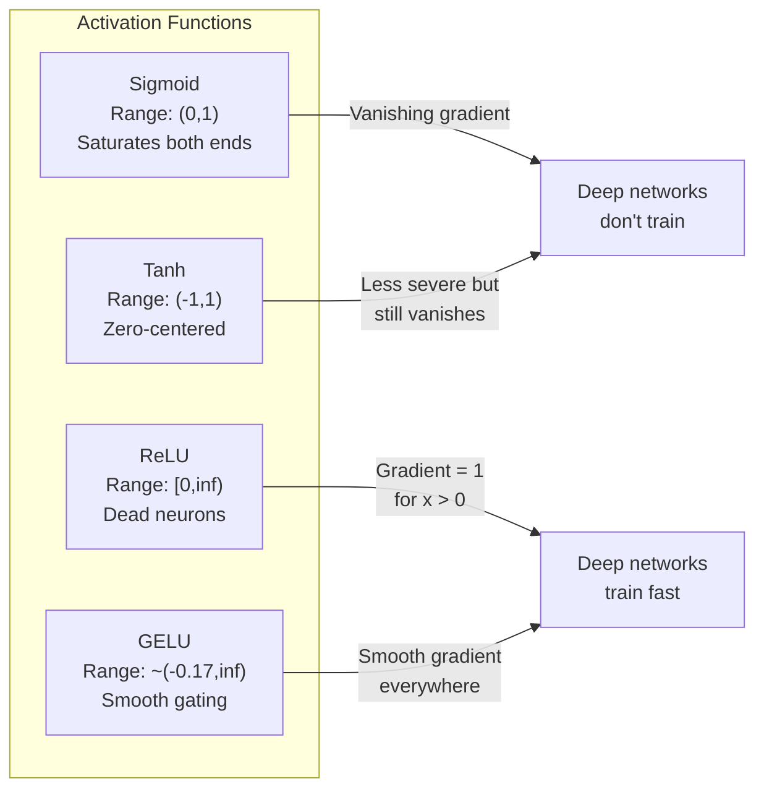
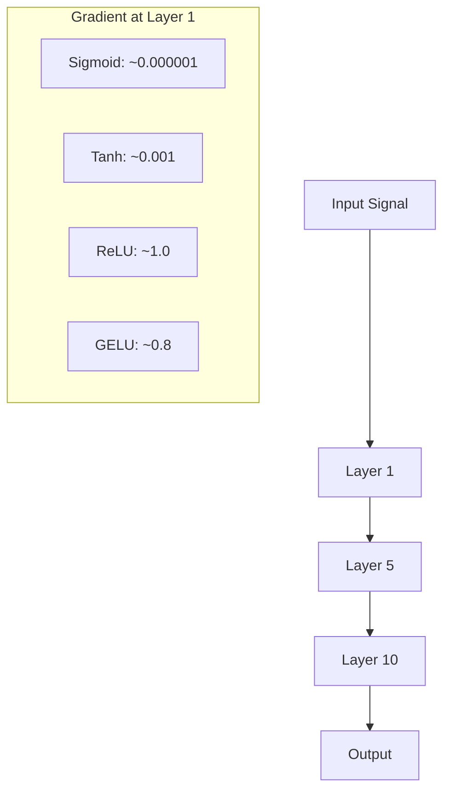
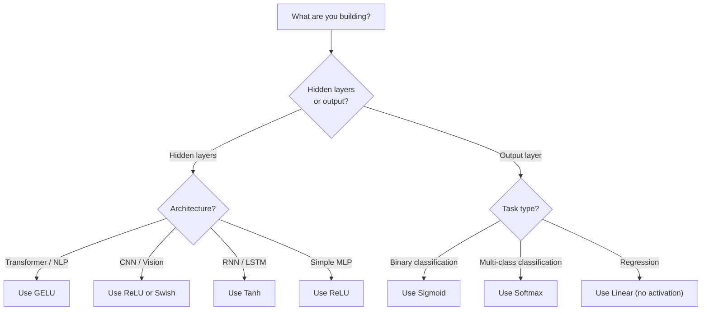

# 激活函数

> 没有非线性，你的 100 层网络不过是花哨的矩阵乘法。激活函数是让神经网络能够用曲线思考的闸门。

**Type:** Build
**Languages:** Python
**Prerequisites:** Lesson 03.03 (Backpropagation)
**Time:** ~75 minutes

## 学习目标

- 从零实现 sigmoid、tanh、ReLU、Leaky ReLU、GELU、Swish 和 softmax 及其导数
- 通过测量不同激活函数在 10 层以上网络中的激活幅度，诊断梯度消失问题
- 检测 ReLU 网络中的死亡神经元，并解释 GELU 为何能避免这种失效模式
- 为给定架构（transformer、CNN、RNN、输出层）选择合适的激活函数

## 问题

堆叠两个线性变换：$y = W_2(W_1 x + b_1) + b_2$。展开后：$y = W_2 W_1 x + W_2 b_1 + b_2$。也就是 $y = A x + c$——一个单一的线性变换。无论你堆叠多少线性层，结果都会坍缩成一个矩阵乘法。你的 100 层网络与单层网络具有相同的表示能力。

这不是理论上的猎奇。这意味着深度线性网络真的无法学习 XOR，无法分类螺旋数据集，无法识别人脸。没有激活函数，深度只是一种幻觉。

激活函数打破了线性。它们通过非线性函数扭曲每一层的输出，让网络能够弯曲决策边界、逼近任意函数并真正学习。但选错激活函数，梯度就会消失为零（深度网络中的 sigmoid）、爆炸到无穷（未加 careful 初始化的无界激活），或者神经元永久死亡（ReLU 配合很大的负偏置）。激活函数的选择直接决定了网络到底能不能学习。

## 概念

### 为什么需要非线性

矩阵乘法是可组合的。先用矩阵 $A$ 乘向量，再用矩阵 $B$ 乘，等价于直接用 $AB$ 乘。这意味着堆叠 10 个线性层，数学上只相当于一个具有大矩阵的线性层。那么多参数、那么深——全浪费了。你需要某种东西来打破这条链。这就是激活函数的作用。

证明如下。一个线性层计算 $f(x) = W x + b$。堆叠两个：

```math
\begin{aligned}
\text{Layer 1:} \quad h &= W_1 x + b_1 \\
\text{Layer 2:} \quad y &= W_2 h + b_2
\end{aligned}
```

代入：

```math
\begin{aligned}
y &= W_2 (W_1 x + b_1) + b_2 \\
y &= (W_2 W_1) x + (W_2 b_1 + b_2) \\
y &= A x + c
\end{aligned}
```

只有一个层。如果在两层之间插入一个非线性激活 $g()$：

```math
\begin{aligned}
h &= g(W_1 x + b_1) \\
y &= W_2 h + b_2
\end{aligned}
```

现在代入就失效了。$W_2 g(W_1 x + b_1) + b_2$ 无法化简成单个线性变换，网络可以表示非线性函数。每增加一个带激活的层，就表示能力随之增加。

### Sigmoid

神经网络最初使用的激活函数。

```math
\text{sigmoid}(x) = \frac{1}{1 + e^{-x}}
```

输出范围：(0, 1)。光滑、可导，能把任意实数映射成类似概率的值。

导数：

```math
\text{sigmoid}'(x) = \text{sigmoid}(x) \cdot (1 - \text{sigmoid}(x))
```

该导数的最大值是 0.25，出现在 $x = 0$ 处。反向传播中，梯度会逐层相乘。10 层 sigmoid 意味着梯度最多被乘 0.25 十次：

```math
0.25^{10} = 0.000000953674
```

不到原始信号的百万分之一。这就是梯度消失问题。早期层的梯度变得极小，权重几乎不更新。网络看起来在学——后层损失在下降——但第一层被冻住了。深度 sigmoid 网络根本训练不了。

另一个问题：sigmoid 输出始终为正（0 到 1），这意味着权重上的梯度始终同号，会导致梯度下降时来回震荡。

### Tanh

Sigmoid 的居中版本。

```math
\tanh(x) = \frac{e^x - e^{-x}}{e^x + e^{-x}}
```

输出范围：(-1, 1)。以零为中心，消除了震荡问题。

导数：

```math
\tanh'(x) = 1 - \tanh(x)^2
```

最大导数为 1.0，出现在 $x = 0$ 处——是 sigmoid 的 4 倍。但梯度消失问题依然存在。对于很大或很小的输入，导数趋近于零。10 层之后仍然会把梯度压碎，只是没那么狠。

### ReLU：突破

修正线性单元（Rectified Linear Unit）。2010 年由 Nair 和 Hinton 在深度学习领域推广（该函数本身可追溯到 Fukushima 1969 年的工作），它改变了一切。

```math
\text{relu}(x) = \max(0, x)
```

输出范围：$[0, \infty)$。导数极其简单：

```math
\text{relu}'(x) = \begin{cases} 1 & \text{if } x > 0 \\ 0 & \text{if } x \le 0 \end{cases}
```

对于正输入，梯度不再消失。梯度就是 1，直接传过去。这就是深度网络变得可训练的原因——ReLU 保留了跨层的梯度幅度。

但它有一个失效模式：死亡神经元问题。如果某个神经元的加权输入始终为负（由于很大的负偏置或糟糕的权重初始化），它的输出就始终为零，梯度也始终为零，永远不会更新。它永久死亡。实践中，ReLU 网络里 10% 到 40% 的神经元可能在训练过程中死亡。

### Leaky ReLU

修复死亡神经元最简单的方法。

```math
\text{leaky\_relu}(x) = \begin{cases} x & \text{if } x > 0 \\ \alpha x & \text{if } x \le 0 \end{cases}
```

其中 $\alpha$ 是一个小常数，通常取 0.01。负半轴有很小的斜率而不是零，因此死亡神经元仍能收到梯度信号并恢复。

### GELU：现代默认

高斯误差线性单元（Gaussian Error Linear Unit），2016 年由 Hendrycks 和 Gimpel 提出。BERT、GPT 和大多数现代 transformer 的默认激活函数。

```math
\text{gelu}(x) = x \cdot \Phi(x)
```

其中 $\Phi(x)$ 是标准正态分布的累积分布函数。实践中使用的近似：

```math
\text{gelu}(x) \approx 0.5 \cdot x \cdot \left(1 + \tanh\left(\sqrt{2/\pi} \cdot (x + 0.044715 \cdot x^3)\right)\right)
```

GELU 处处光滑，允许小的负值（不像 ReLU 硬截断到零），并具有概率解释：它根据输入在高斯分布下为正的概率对输入加权。这种平滑门控在 transformer 架构中优于 ReLU，因为它提供了更好的梯度流动并彻底避免了死亡神经元问题。

### Swish / SiLU

由 Ramachandran 等人于 2017 年通过自动搜索发现的自门控激活函数。

```math
\text{swish}(x) = x \cdot \text{sigmoid}(x)
```

Swish 形式上就是 $x \cdot \text{sigmoid}(x)$。Google 通过在激活函数空间上的自动搜索发现了它——一个设计神经网络的神经网络。

与 GELU 类似，它光滑、非单调，并允许小的负值。差别很微妙：Swish 用 sigmoid 做门控，GELU 用高斯 CDF。实践中性能几乎相同。Swish 用于 EfficientNet 和一些视觉模型。GELU 在语言模型中占主导。

### Softmax：输出层激活函数

不在隐藏层中使用。Softmax 把原始分数（logits）向量转换成概率分布。

```math
\text{softmax}(x_i) = \frac{e^{x_i}}{\sum_j e^{x_j}}
```

每个输出都在 0 到 1 之间，所有输出之和为 1。这使它成为多分类任务的标准最终激活。最大的 logit 获得最高概率，但与 argmax 不同，softmax 可导，并保留了相对置信度的信息。

### 形状对比



### 梯度流动对比



### 何时使用哪种激活函数



```figure
softmax-temperature
```

## 构建它

### 第 1 步：实现所有激活函数及其导数

每个函数接收一个 float，返回一个 float。每个导数函数接收同样的输入，返回梯度。

```python
import math

def sigmoid(x):
    x = max(-500, min(500, x))
    return 1.0 / (1.0 + math.exp(-x))

def sigmoid_derivative(x):
    s = sigmoid(x)
    return s * (1 - s)

def tanh_act(x):
    return math.tanh(x)

def tanh_derivative(x):
    t = math.tanh(x)
    return 1 - t * t

def relu(x):
    return max(0.0, x)

def relu_derivative(x):
    return 1.0 if x > 0 else 0.0

def leaky_relu(x, alpha=0.01):
    return x if x > 0 else alpha * x

def leaky_relu_derivative(x, alpha=0.01):
    return 1.0 if x > 0 else alpha

def gelu(x):
    return 0.5 * x * (1 + math.tanh(math.sqrt(2 / math.pi) * (x + 0.044715 * x ** 3)))

def gelu_derivative(x):
    phi = 0.5 * (1 + math.erf(x / math.sqrt(2)))
    pdf = math.exp(-0.5 * x * x) / math.sqrt(2 * math.pi)
    return phi + x * pdf

def swish(x):
    return x * sigmoid(x)

def swish_derivative(x):
    s = sigmoid(x)
    return s + x * s * (1 - s)

def softmax(xs):
    max_x = max(xs)
    exps = [math.exp(x - max_x) for x in xs]
    total = sum(exps)
    return [e / total for e in exps]
```

### 第 2 步：可视化梯度死亡区域

在 -5 到 5 之间均匀取 100 个点，计算每个点的梯度。打印文本直方图，展示每种激活函数的梯度在哪里接近零。

```python
def gradient_scan(name, derivative_fn, start=-5, end=5, n=100):
    step = (end - start) / n
    near_zero = 0
    healthy = 0
    for i in range(n):
        x = start + i * step
        g = derivative_fn(x)
        if abs(g) < 0.01:
            near_zero += 1
        else:
            healthy += 1
    pct_dead = near_zero / n * 100
    print(f"{name:15s}: {healthy:3d} healthy, {near_zero:3d} near-zero ({pct_dead:.0f}% dead zone)")

gradient_scan("Sigmoid", sigmoid_derivative)
gradient_scan("Tanh", tanh_derivative)
gradient_scan("ReLU", relu_derivative)
gradient_scan("Leaky ReLU", leaky_relu_derivative)
gradient_scan("GELU", gelu_derivative)
gradient_scan("Swish", swish_derivative)
```

### 第 3 步：梯度消失实验

用 sigmoid 与 ReLU 把一个信号正向传播 N 层，测量激活幅度如何变化。

```python
import random

def vanishing_gradient_experiment(activation_fn, name, n_layers=10, n_inputs=5):
    random.seed(42)
    values = [random.gauss(0, 1) for _ in range(n_inputs)]

    print(f"\n{name} through {n_layers} layers:")
    for layer in range(n_layers):
        weights = [random.gauss(0, 1) for _ in range(n_inputs)]
        z = sum(w * v for w, v in zip(weights, values))
        activated = activation_fn(z)
        magnitude = abs(activated)
        bar = "#" * int(magnitude * 20)
        print(f"  Layer {layer+1:2d}: magnitude = {magnitude:.6f} {bar}")
        values = [activated] * n_inputs

vanishing_gradient_experiment(sigmoid, "Sigmoid")
vanishing_gradient_experiment(relu, "ReLU")
vanishing_gradient_experiment(gelu, "GELU")
```

### 第 4 步：死亡神经元检测器

创建一个 ReLU 网络，传入随机输入，统计有多少神经元从未激活。

```python
def dead_neuron_detector(n_inputs=5, hidden_size=20, n_samples=1000):
    random.seed(0)
    weights = [[random.gauss(0, 1) for _ in range(n_inputs)] for _ in range(hidden_size)]
    biases = [random.gauss(0, 1) for _ in range(hidden_size)]

    fire_counts = [0] * hidden_size

    for _ in range(n_samples):
        inputs = [random.gauss(0, 1) for _ in range(n_inputs)]
        for neuron_idx in range(hidden_size):
            z = sum(w * x for w, x in zip(weights[neuron_idx], inputs)) + biases[neuron_idx]
            if relu(z) > 0:
                fire_counts[neuron_idx] += 1

    dead = sum(1 for c in fire_counts if c == 0)
    rarely_fire = sum(1 for c in fire_counts if 0 < c < n_samples * 0.05)
    healthy = hidden_size - dead - rarely_fire

    print(f"\nDead Neuron Report ({hidden_size} neurons, {n_samples} samples):")
    print(f"  Dead (never fired):     {dead}")
    print(f"  Barely alive (<5%):     {rarely_fire}")
    print(f"  Healthy:                {healthy}")
    print(f"  Dead neuron rate:       {dead/hidden_size*100:.1f}%")

    for i, c in enumerate(fire_counts):
        status = "DEAD" if c == 0 else "WEAK" if c < n_samples * 0.05 else "OK"
        bar = "#" * (c * 40 // n_samples)
        print(f"  Neuron {i:2d}: {c:4d}/{n_samples} fires [{status:4s}] {bar}")

dead_neuron_detector()
```

### 第 5 步：训练对比——Sigmoid vs ReLU vs GELU

用同一个双层网络在圆形数据集（圆内点 = 类别 1，圆外点 = 类别 0）上分别用三种激活函数训练，比较收敛速度。

```python
def make_circle_data(n=200, seed=42):
    random.seed(seed)
    data = []
    for _ in range(n):
        x = random.uniform(-2, 2)
        y = random.uniform(-2, 2)
        label = 1.0 if x * x + y * y < 1.5 else 0.0
        data.append(([x, y], label))
    return data


class ActivationNetwork:
    def __init__(self, activation_fn, activation_deriv, hidden_size=8, lr=0.1):
        random.seed(0)
        self.act = activation_fn
        self.act_d = activation_deriv
        self.lr = lr
        self.hidden_size = hidden_size

        self.w1 = [[random.gauss(0, 0.5) for _ in range(2)] for _ in range(hidden_size)]
        self.b1 = [0.0] * hidden_size
        self.w2 = [random.gauss(0, 0.5) for _ in range(hidden_size)]
        self.b2 = 0.0

    def forward(self, x):
        self.x = x
        self.z1 = []
        self.h = []
        for i in range(self.hidden_size):
            z = self.w1[i][0] * x[0] + self.w1[i][1] * x[1] + self.b1[i]
            self.z1.append(z)
            self.h.append(self.act(z))

        self.z2 = sum(self.w2[i] * self.h[i] for i in range(self.hidden_size)) + self.b2
        self.out = sigmoid(self.z2)
        return self.out

    def backward(self, target):
        error = self.out - target
        d_out = error * self.out * (1 - self.out)

        for i in range(self.hidden_size):
            d_h = d_out * self.w2[i] * self.act_d(self.z1[i])
            self.w2[i] -= self.lr * d_out * self.h[i]
            for j in range(2):
                self.w1[i][j] -= self.lr * d_h * self.x[j]
            self.b1[i] -= self.lr * d_h
        self.b2 -= self.lr * d_out

    def train(self, data, epochs=200):
        losses = []
        for epoch in range(epochs):
            total_loss = 0
            correct = 0
            for x, y in data:
                pred = self.forward(x)
                self.backward(y)
                total_loss += (pred - y) ** 2
                if (pred >= 0.5) == (y >= 0.5):
                    correct += 1
            avg_loss = total_loss / len(data)
            accuracy = correct / len(data) * 100
            losses.append(avg_loss)
            if epoch % 50 == 0 or epoch == epochs - 1:
                print(f"    Epoch {epoch:3d}: loss={avg_loss:.4f}, accuracy={accuracy:.1f}%")
        return losses


data = make_circle_data()

configs = [
    ("Sigmoid", sigmoid, sigmoid_derivative),
    ("ReLU", relu, relu_derivative),
    ("GELU", gelu, gelu_derivative),
]

results = {}
for name, act_fn, act_d_fn in configs:
    print(f"\n=== Training with {name} ===")
    net = ActivationNetwork(act_fn, act_d_fn, hidden_size=8, lr=0.1)
    losses = net.train(data, epochs=200)
    results[name] = losses

print("\n=== Final Loss Comparison ===")
for name, losses in results.items():
    print(f"  {name:10s}: start={losses[0]:.4f} -> end={losses[-1]:.4f} (improvement: {(1 - losses[-1]/losses[0])*100:.1f}%)")
```

## 使用它

PyTorch 把这些都提供了函数式和模块式两种形式：

```python
import torch
import torch.nn as nn
import torch.nn.functional as F

x = torch.randn(4, 10)

relu_out = F.relu(x)
gelu_out = F.gelu(x)
sigmoid_out = torch.sigmoid(x)
swish_out = F.silu(x)

logits = torch.randn(4, 5)
probs = F.softmax(logits, dim=1)

model = nn.Sequential(
    nn.Linear(10, 64),
    nn.GELU(),
    nn.Linear(64, 32),
    nn.GELU(),
    nn.Linear(32, 5),
)
```

Transformer 的隐藏层：GELU。CNN 的隐藏层：ReLU。分类的输出层：softmax。回归的输出层：无（线性）。概率输出的输出层：sigmoid。就这些。从这些默认值开始，只有在有证据时才更换。

RNN 和 LSTM 在隐藏状态用 tanh、门控用 sigmoid，但如果你今天从零构建，大概率不会用 RNN。如果 ReLU 网络里神经元在死亡，就换 GELU。除非有特定理由，否则不要先选 Leaky ReLU——GELU 既解决死亡神经元问题，又提供更好的梯度流动。

## 交付它

本节课产出：
- `outputs/prompt-activation-selector.md` —— 一个可复用提示，帮助你在任何架构中选择合适的激活函数

## 练习

1. 实现参数化 ReLU（PReLU），其中负半轴斜率 $\alpha$ 是可学习参数。在圆形数据集上训练它，并与固定 Leaky ReLU 比较。

2. 把梯度消失实验改成 50 层而不是 10 层。绘制 sigmoid、tanh、ReLU 和 GELU 在每一层的幅度。每层激活信号实际上降到零？

3. 实现 ELU（指数线性单元）：$\text{elu}(x) = x$ 若 $x \gt 0$，$\alpha (e^x - 1)$ 若 $x \le 0$。在相同网络上比较它的死亡神经元率与 ReLU。

4. 构建一个训练时的「梯度健康监控器」：每个 epoch 计算每一层的平均梯度幅度。当任何一层的梯度低于 0.001 或超过 100 时打印警告。

5. 把训练对比改成使用第 01 课的 XOR 数据集而不是圆形。哪种激活函数在 XOR 上收敛最快？为什么与圆形结果不同？

## 关键术语

| 术语 | 通常说法 | 实际含义 |
|------|----------|----------|
| 激活函数（Activation function） | "非线性部分" | 对每个神经元输出应用的函数，打破线性，让网络学习非线性映射 |
| 梯度消失（Vanishing gradient） | "深度网络里梯度消失了" | 激活导数小于 1 时，梯度逐层指数级缩小，导致早期层无法训练 |
| 梯度爆炸（Exploding gradient） | "梯度炸了" | 有效乘子超过 1 时，梯度逐层指数级增长，导致训练不稳定 |
| 死亡神经元（Dead neuron） | "一个停止学习的神经元" | ReLU 神经元输入永久为负，输出和梯度都为零 |
| Sigmoid | "把值压到 0-1" | 逻辑函数 $1/(1+e^{-x})$，历史上重要，但在深度网络中造成梯度消失 |
| ReLU | "把负数截断为零" | $\max(0, x)$——通过保留梯度幅度让深度学习变得实用的激活函数 |
| GELU | "transformer 的激活函数" | 高斯误差线性单元（Gaussian Error Linear Unit），根据输入为正的概率加权，光滑且避免死亡神经元 |
| Swish/SiLU | "自门控 ReLU" | $x \cdot \text{sigmoid}(x)$，通过自动搜索发现，用于 EfficientNet |
| Softmax | "把分数变成概率" | 把 logits 向量归一化为概率分布，所有值在 (0,1) 之间且和为 1 |
| Leaky ReLU | "不会死亡的 ReLU" | $\max(\alpha x, x)$，$\alpha$ 很小（0.01），通过允许小的负梯度防止神经元死亡 |
| 饱和（Saturation） | "sigmoid 的平坦部分" | 激活导数趋近于零的区域，阻断梯度流动 |
| Logit | "softmax 之前的原始分数" | 应用 softmax 或 sigmoid 之前最后一层的未归一化输出 |

## 延伸阅读

- Nair & Hinton, "Rectified Linear Units Improve Restricted Boltzmann Machines" (2010) —— 引入 ReLU、让深度网络训练成为可能的论文
- Hendrycks & Gimpel, "Gaussian Error Linear Units (GELUs)" (2016) —— 提出后来成为 transformer 默认激活的 GELU
- Ramachandran et al., "Searching for Activation Functions" (2017) —— 通过自动搜索发现 Swish，证明激活函数设计也可以自动化
- Glorot & Bengio, "Understanding the difficulty of training deep feedforward neural networks" (2010) —— 诊断梯度消失/爆炸问题并提出 Xavier 初始化的论文
- Goodfellow, Bengio, Courville, "Deep Learning" Chapter 6.3 (https://www.deeplearningbook.org/) —— 对隐藏单元与激活函数的严格处理
