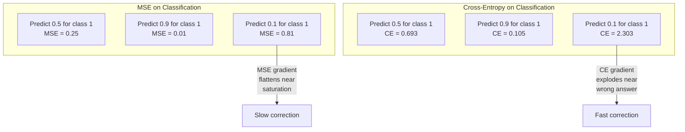
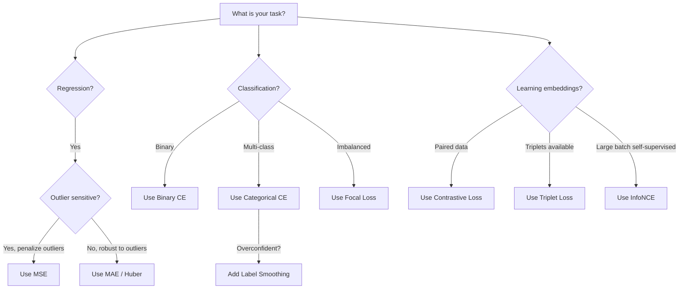
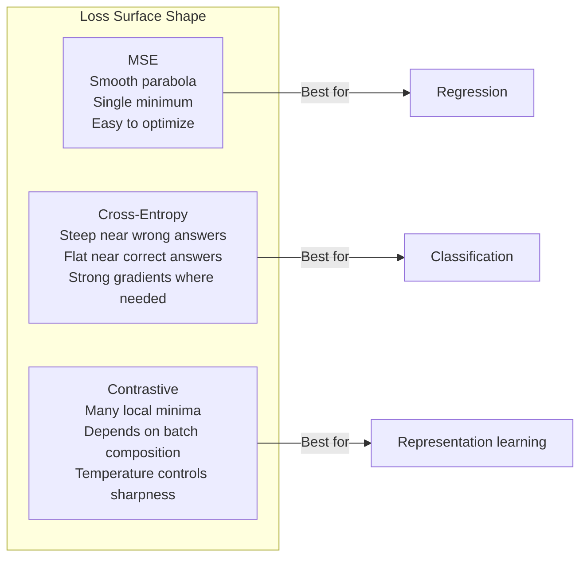

# 损失函数

> 你的网络做出一个预测。真实标签却给出不同答案。它错得有多离谱？这个数值就是损失。选错损失函数，模型就会完全朝着错误的目标优化。

**Type:** Build
**Languages:** Python
**Prerequisites:** Lesson 03.04 (Activation Functions)
**Time:** ~75 minutes

## 学习目标

- 用 Python 从零实现 MSE、二分类交叉熵、多分类交叉熵和对比损失（InfoNCE）及其梯度
- 通过演示「对所有样本都预测 0.5」的失败模式，解释为什么 MSE 不适用于分类任务
- 将标签平滑（label smoothing）应用于交叉熵，并说明它如何防止模型过度自信
- 针对回归、二分类、多分类和嵌入（embedding）学习任务选择合适的损失函数

## 问题

在分类问题上最小化 MSE 的模型，会「自信地」对所有样本都预测 0.5。它在最小化损失，却也毫无用处。

损失函数是模型真正优化的唯一目标。不是准确率，不是 F1 分数，也不是你向经理汇报的任何指标。优化器计算损失函数的梯度，并调整权重以让这个数字更小。如果损失函数没有捕捉到你真正关心的目标，模型就会找到数学上最廉价的方式去满足它，而这种方式几乎从不是你真正想要的。

下面是一个具体例子。你有一个二分类任务：两个类别，各占 50%。你使用 MSE 作为损失。模型对每个输入都预测 0.5。平均 MSE 为 0.25，这是在不学习任何内容的情况下可能达到的最小值。模型完全没有判别能力，却在技术上最小化了你的损失函数。换成交叉熵后，同样的模型被迫将预测推向 0 或 1，因为 -log(0.5) = 0.693 是一个很糟糕的损失，而 -log(0.99) = 0.01 会奖励自信的正确预测。损失函数的选择，决定了模型是学习还是在玩弄指标。

问题还会更严重。在自监督学习中，你甚至都没有标签。对比损失完全定义了学习信号：什么算相似，什么算不同，以及模型应该把它们推得多开。对比损失设计错了，你的嵌入（embedding）就会坍缩到同一个点——每个输入都映射到同一个向量。技术上损失为零，却毫无价值。

## 概念

### 均方误差（MSE）

回归任务的默认选择。计算预测值与目标值之间差值的平方，再对所有样本取平均。

```math
\text{MSE} = \frac{1}{n} \sum (y_{\text{pred}} - y_{\text{true}})^2
```

为什么平方很重要：它对大误差按二次方惩罚。误差为 2 的代价是误差为 1 的 4 倍；误差为 10 的代价是 100 倍。这使得 MSE 对异常值敏感——一个严重错误的预测会主导整个损失。

实际数字：如果你的模型预测房价，大多数房屋误差 10,000 美元，但一栋豪宅误差 200,000 美元，MSE 会极力修正那栋豪宅，可能损害其余 99 栋房屋的性能。

MSE 对某个预测值的梯度为：

```math
\frac{\partial \text{MSE}}{\partial y_{\text{pred}}} = \frac{2}{n} (y_{\text{pred}} - y_{\text{true}})
```

梯度与误差成线性关系。更大的误差得到更大的梯度。这在回归中是优点（大误差需要大修正），在分类中却是缺点（你希望指数级惩罚自信的错误答案，而不是线性惩罚）。

### 交叉熵损失

分类任务的损失函数。它根植于信息论——衡量预测概率分布与真实分布之间的差异。

**二分类交叉熵（BCE）：**

```math
\text{BCE} = -\left(y \log(p) + (1 - y) \log(1 - p)\right)
```

其中 $y$ 是真实标签（0 或 1），$p$ 是预测概率。

为什么 $-\log(p)$ 有效：当真实标签为 1 且你预测 $p = 0.99$ 时，损失为 $-\log(0.99) = 0.01$。当你预测 $p = 0.01$ 时，损失为 $-\log(0.01) = 4.6$。这 460 倍的差距就是交叉熵有效的原因。它严厉惩罚自信的错误预测，几乎不惩罚自信的正确预测。

梯度讲述了同样的道理：

```math
\frac{\partial \text{BCE}}{\partial p} = -\frac{y}{p} + \frac{1-y}{1-p}
```

当 $y = 1$ 且 $p$ 接近 0 时，梯度为 $-1/p$，趋近于负无穷。模型会得到强烈的信号去修正错误。当 $p$ 接近 1 时，梯度极小。已经正确，无需修正。

**多分类交叉熵：**

用于 one-hot 编码目标的多分类任务。

```math
\text{CCE} = -\sum_i y_i \log(p_i)
```

只有真实类别对损失有贡献（因为其他所有 $y_i$ 都为 0）。如果有 10 个类别，正确类别的概率为 0.1（随机猜测），损失为 $-\log(0.1) = 2.3$。如果正确类别的概率为 0.9，损失为 $-\log(0.9) = 0.105$。模型学会将概率质量集中在正确答案上。

### 为什么 MSE 不适用于分类



MSE 的梯度在预测接近 0 或 1 时会变平缓（由于 sigmoid 饱和）。交叉熵的梯度会补偿这一点——$-\log$ 抵消了 sigmoid 的平坦区域，在最需要强梯度的地方给出强梯度。

### 标签平滑

标准 one-hot 标签会说「这是 100% 的类别 3，其他都是 0%」。这是一个很强的断言。标签平滑把它软化：

```math
\text{smooth\_label} = (1 - \alpha) \cdot \text{one\_hot} + \frac{\alpha}{\text{num\_classes}}
```

当 $\alpha = 0.1$ 且有 10 个类别时：目标从 [0, 0, 1, 0, ...] 变成 [0.01, 0.01, 0.91, 0.01, ...]。模型不再追求输出 1.0，而是追求 0.91。

它为什么有效：模型如果想通过 softmax 精确输出 1.0，就需要把 logit 推到无穷大。这会导致过度自信、损害泛化，并让模型对分布偏移变得脆弱。标签平滑将目标上限设为 0.9（当 $\alpha = 0.1$ 时），使 logit 保持在合理范围内。GPT 和大多数现代模型都使用标签平滑或其等价技术。

### 对比损失

没有标签，没有类别，只有成对的输入和一个问题：它们是相似还是不同？

**SimCLR 风格的对比损失（NT-Xent / InfoNCE）：**

取一张图片。对它做两种数据增强（裁剪、旋转、颜色抖动）。它们构成「正样本对」——应该具有相似的嵌入。Batch 中的其他每张图片都构成「负样本对」——应该具有不同的嵌入。

```math
L = -\log \frac{\exp(\text{sim}(z_i, z_j) / \tau)}{\sum_k \exp(\text{sim}(z_i, z_k) / \tau)}
```

其中 $\text{sim}()$ 是余弦相似度，$z_i$ 和 $z_j$ 是正样本对，求和遍历所有负样本，$\tau$（温度）控制分布的尖锐程度。温度越低 = 负样本越难 = 分离越激进。

实际数字：batch size 为 256 意味着每个正样本对对应 255 个负样本。温度 $\tau = 0.07$（SimCLR 默认值）。损失看起来就像一个关于相似度的 softmax——它希望正样本对的相似度在所有 256 个选项中最高。

**三元组损失（Triplet Loss）：**

需要三个输入：anchor、positive（同类）、negative（异类）。

```math
L = \max\left(0, d(\text{anchor}, \text{positive}) - d(\text{anchor}, \text{negative}) + \text{margin}\right)
```

margin（通常为 0.2-1.0）强制 positive 与 negative 之间的距离至少相差这么多。如果 negative 已经足够远，损失为 0——没有梯度，没有更新。这让训练更高效，但需要精心设计 triplet 挖掘策略（选择靠近 anchor 的困难负样本）。

### Focal Loss

用于类别不平衡的数据集。标准交叉熵对所有正确分类的样本一视同仁。Focal loss 会降低简单样本的权重：

```math
\text{FL} = -\alpha (1 - p_t)^\gamma \log(p_t)
```

其中 $p_t$ 是真实类别的预测概率，$\gamma$ 控制聚焦程度。当 $\gamma = 0$ 时，这就是标准交叉熵。当 $\gamma = 2$（默认值）时：

- 简单样本（$p_t = 0.9$）：权重 $= (0.1)^2 = 0.01$。基本被忽略。
- 困难样本（$p_t = 0.1$）：权重 $= (0.9)^2 = 0.81$。获得完整梯度信号。

Lin 等人提出 Focal Loss 用于目标检测，其中 99% 的候选区域都是背景（简单负样本）。没有 focal loss，模型会被大量简单背景样本淹没，永远学不会检测目标。有了它，模型将容量集中在困难、模糊的样本上。

### 损失函数决策树



### 损失景观



```figure
cross-entropy-loss
```

## 构建它

### 第 1 步：MSE 及其梯度

```python
def mse(predictions, targets):
    n = len(predictions)
    total = 0.0
    for p, t in zip(predictions, targets):
        total += (p - t) ** 2
    return total / n

def mse_gradient(predictions, targets):
    n = len(predictions)
    grads = []
    for p, t in zip(predictions, targets):
        grads.append(2.0 * (p - t) / n)
    return grads
```

### 第 2 步：二分类交叉熵

`log(0)` 问题真实存在。如果模型对正样本恰好预测 0，则 $\log(0) = -\infty$。裁剪可以避免这种情况。

```python
import math

def binary_cross_entropy(predictions, targets, eps=1e-15):
    n = len(predictions)
    total = 0.0
    for p, t in zip(predictions, targets):
        p_clipped = max(eps, min(1 - eps, p))
        total += -(t * math.log(p_clipped) + (1 - t) * math.log(1 - p_clipped))
    return total / n

def bce_gradient(predictions, targets, eps=1e-15):
    grads = []
    for p, t in zip(predictions, targets):
        p_clipped = max(eps, min(1 - eps, p))
        grads.append(-(t / p_clipped) + (1 - t) / (1 - p_clipped))
    return grads
```

### 第 3 步：带 Softmax 的多分类交叉熵

Softmax 将原始 logit 转换为概率。然后我们对 one-hot 目标计算交叉熵。

```python
def softmax(logits):
    max_val = max(logits)
    exps = [math.exp(x - max_val) for x in logits]
    total = sum(exps)
    return [e / total for e in exps]

def categorical_cross_entropy(logits, target_index, eps=1e-15):
    probs = softmax(logits)
    p = max(eps, probs[target_index])
    return -math.log(p)

def cce_gradient(logits, target_index):
    probs = softmax(logits)
    grads = list(probs)
    grads[target_index] -= 1.0
    return grads
```

Softmax 加交叉熵的梯度有着非常简洁的形式：真实类别为（预测概率 - 1），其他所有类别为（预测概率）。这种优雅的简化并非偶然——这正是 softmax 与交叉熵总是成对出现的原因。

### 第 4 步：标签平滑

```python
def label_smoothed_cce(logits, target_index, num_classes, alpha=0.1, eps=1e-15):
    probs = softmax(logits)
    loss = 0.0
    for i in range(num_classes):
        if i == target_index:
            smooth_target = 1.0 - alpha + alpha / num_classes
        else:
            smooth_target = alpha / num_classes
        p = max(eps, probs[i])
        loss += -smooth_target * math.log(p)
    return loss
```

### 第 5 步：对比损失（简化版 InfoNCE）

```python
def cosine_similarity(a, b):
    dot = sum(x * y for x, y in zip(a, b))
    norm_a = math.sqrt(sum(x * x for x in a))
    norm_b = math.sqrt(sum(x * x for x in b))
    if norm_a < 1e-10 or norm_b < 1e-10:
        return 0.0
    return dot / (norm_a * norm_b)

def contrastive_loss(anchor, positive, negatives, temperature=0.07):
    sim_pos = cosine_similarity(anchor, positive) / temperature
    sim_negs = [cosine_similarity(anchor, neg) / temperature for neg in negatives]

    max_sim = max(sim_pos, max(sim_negs)) if sim_negs else sim_pos
    exp_pos = math.exp(sim_pos - max_sim)
    exp_negs = [math.exp(s - max_sim) for s in sim_negs]
    total_exp = exp_pos + sum(exp_negs)

    return -math.log(max(1e-15, exp_pos / total_exp))
```

### 第 6 步：分类任务上 MSE 与交叉熵的对比

用第 04 课的同一个网络（圆形数据集）分别训练两种损失函数。观察交叉熵收敛更快。

```python
import random

def sigmoid(x):
    x = max(-500, min(500, x))
    return 1.0 / (1.0 + math.exp(-x))

def make_circle_data(n=200, seed=42):
    random.seed(seed)
    data = []
    for _ in range(n):
        x = random.uniform(-2, 2)
        y = random.uniform(-2, 2)
        label = 1.0 if x * x + y * y < 1.5 else 0.0
        data.append(([x, y], label))
    return data


class LossComparisonNetwork:
    def __init__(self, loss_type="bce", hidden_size=8, lr=0.1):
        random.seed(0)
        self.loss_type = loss_type
        self.lr = lr
        self.hidden_size = hidden_size

        self.w1 = [[random.gauss(0, 0.5) for _ in range(2)] for _ in range(hidden_size)]
        self.b1 = [0.0] * hidden_size
        self.w2 = [random.gauss(0, 0.5) for _ in range(hidden_size)]
        self.b2 = 0.0

    def forward(self, x):
        self.x = x
        self.z1 = []
        self.h = []
        for i in range(self.hidden_size):
            z = self.w1[i][0] * x[0] + self.w1[i][1] * x[1] + self.b1[i]
            self.z1.append(z)
            self.h.append(max(0.0, z))

        self.z2 = sum(self.w2[i] * self.h[i] for i in range(self.hidden_size)) + self.b2
        self.out = sigmoid(self.z2)
        return self.out

    def backward(self, target):
        if self.loss_type == "mse":
            d_loss = 2.0 * (self.out - target)
        else:
            eps = 1e-15
            p = max(eps, min(1 - eps, self.out))
            d_loss = -(target / p) + (1 - target) / (1 - p)

        d_sigmoid = self.out * (1 - self.out)
        d_out = d_loss * d_sigmoid

        for i in range(self.hidden_size):
            d_relu = 1.0 if self.z1[i] > 0 else 0.0
            d_h = d_out * self.w2[i] * d_relu
            self.w2[i] -= self.lr * d_out * self.h[i]
            for j in range(2):
                self.w1[i][j] -= self.lr * d_h * self.x[j]
            self.b1[i] -= self.lr * d_h
        self.b2 -= self.lr * d_out

    def compute_loss(self, pred, target):
        if self.loss_type == "mse":
            return (pred - target) ** 2
        else:
            eps = 1e-15
            p = max(eps, min(1 - eps, pred))
            return -(target * math.log(p) + (1 - target) * math.log(1 - p))

    def train(self, data, epochs=200):
        losses = []
        for epoch in range(epochs):
            total_loss = 0.0
            correct = 0
            for x, y in data:
                pred = self.forward(x)
                self.backward(y)
                total_loss += self.compute_loss(pred, y)
                if (pred >= 0.5) == (y >= 0.5):
                    correct += 1
            avg_loss = total_loss / len(data)
            accuracy = correct / len(data) * 100
            losses.append((avg_loss, accuracy))
            if epoch % 50 == 0 or epoch == epochs - 1:
                print(f"    Epoch {epoch:3d}: loss={avg_loss:.4f}, accuracy={accuracy:.1f}%")
        return losses
```

## 使用它

PyTorch 内置了所有标准损失函数，并做了数值稳定性处理：

```python
import torch
import torch.nn as nn
import torch.nn.functional as F

predictions = torch.tensor([0.9, 0.1, 0.7], requires_grad=True)
targets = torch.tensor([1.0, 0.0, 1.0])

mse_loss = F.mse_loss(predictions, targets)
bce_loss = F.binary_cross_entropy(predictions, targets)

logits = torch.randn(4, 10)
labels = torch.tensor([3, 7, 1, 9])
ce_loss = F.cross_entropy(logits, labels)
ce_smooth = F.cross_entropy(logits, labels, label_smoothing=0.1)
```

请使用 `F.cross_entropy`（而不是 `F.nll_loss` 加手动 softmax）。它将 log-softmax 与负对数似然合并为一个数值稳定的操作。先单独应用 softmax 再取对数稳定性更差——你会在减去大指数时损失精度。

对于对比学习，大多数团队使用自定义实现或 `lightly`、`pytorch-metric-learning` 等库。核心循环始终相同：计算成对相似度，对正负样本构造 softmax，然后反向传播。

## 交付它

本节课产出：
- `outputs/prompt-loss-function-selector.md` —— 一个用于选择合适损失函数的可复用 prompt
- `outputs/prompt-loss-debugger.md` —— 一个当损失曲线异常时使用的诊断 prompt

## 练习

1. 实现 Huber 损失（smooth L1 loss），即小误差用 MSE、大误差用 MAE。训练一个回归网络拟合 $y = \sin(x)$，在 5% 的训练目标上加入随机噪声（异常值）的情况下，比较 MSE 与 Huber 的最终测试误差。

2. 在二分类训练循环中加入 focal loss。构造一个类别不平衡数据集（90% 类别 0，10% 类别 1）。比较标准 BCE 与 focal loss（$\gamma = 2$）在 200 轮训练后对少数类的召回率。

3. 实现带 semi-hard 负样本挖掘的三元组损失。为 5 个类别生成 2D 嵌入数据。对每个 anchor，找出仍然比 positive 更远的 hardest negative（semi-hard）。比较其与随机 triplet 选择的收敛速度。

4. 再次运行 MSE 与交叉熵的对比实验，但跟踪每层在训练过程中的梯度大小。绘制每轮的平均梯度范数。验证在模型最不确定的早期 epoch 中，交叉熵会产生更大的梯度。

5. 实现 KL 散度损失，并验证在真实分布为 one-hot 时，最小化 $\mathrm{KL}(\text{true} \Vert \text{predicted})$ 给出的梯度与交叉熵相同。然后尝试软目标（如知识蒸馏），其中「真实」分布来自教师模型的 softmax 输出。

## 关键术语

| 术语 | 常见说法 | 实际含义 |
|------|----------|----------|
| 损失函数 | "模型有多错" | 一个将预测与目标映射为标量的可微函数，优化器通过最小化它来调整权重 |
| MSE | "平均平方误差" | 预测值与目标值差值的平方的平均值；对大的误差按二次方惩罚 |
| 交叉熵 | "分类损失" | 使用 $-\log(p)$ 衡量预测概率分布与真实分布之间的差异 |
| 二分类交叉熵 | "BCE" | 两类别的交叉熵：$-(y \log(p) + (1-y) \log(1-p))$ |
| 标签平滑 | "软化目标" | 用软值（例如 0.1/0.9）替代硬 0/1 目标，以防止过度自信并提升泛化能力 |
| 对比损失 | "拉近同类、推开异类" | 通过在嵌入空间中让相似样本对靠近、不相似样本对远离，从而学习表示的损失函数 |
| InfoNCE | "CLIP/SimCLR 的损失" | 对相似度分数做温度缩放并归一化的交叉熵；将对比学习视为分类问题 |
| Focal loss | "不平衡数据的解决方案" | 用 $(1-p_t)^\gamma$ 加权交叉熵，降低简单样本的权重，聚焦困难样本 |
| 三元组损失 | "Anchor-positive-negative" | 在嵌入空间中让 anchor 与 positive 的距离比与 negative 的距离至少小一个 margin |
| 温度 | "锐度旋钮" | 作用于 logit 或相似度分数的标量除数，控制最终分布的尖锐程度；越低越尖锐 |

## 扩展阅读

- Lin 等，"Focal Loss for Dense Object Detection"（2017）—— 提出 focal loss 以处理目标检测中的极端类别不平衡（RetinaNet）
- Chen 等，"A Simple Framework for Contrastive Learning of Visual Representations"（SimCLR，2020）—— 用 NT-Xent 损失定义了现代对比学习流程
- Szegedy 等，"Rethinking the Inception Architecture"（2016）—— 将标签平滑作为一种正则化技术引入，现已成为大多数大模型的标配
- Hinton 等，"Distilling the Knowledge in a Neural Network"（2015）—— 使用软目标和 KL 散度进行知识蒸馏，为模型压缩奠定基础
