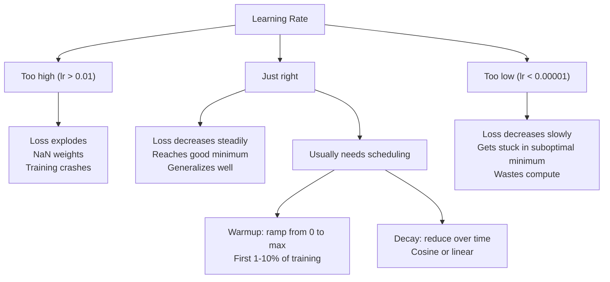
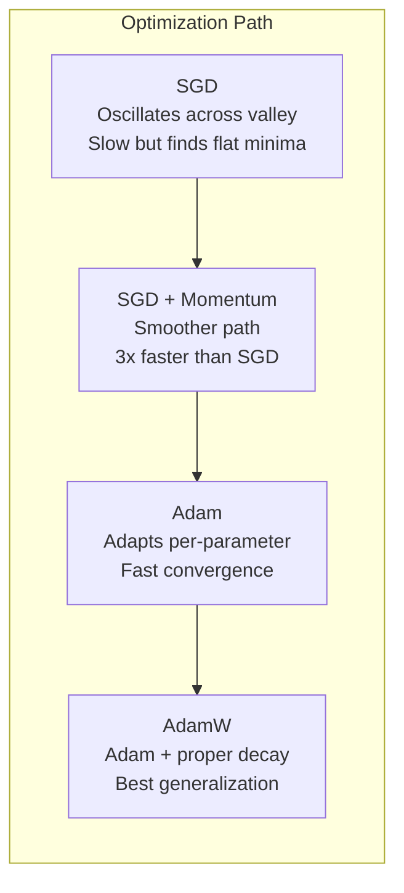
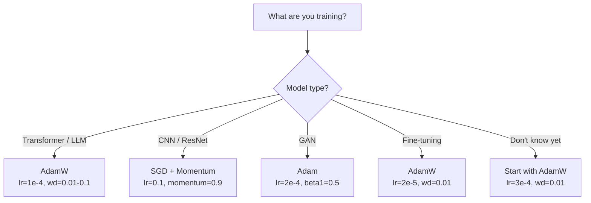

# 优化器

> 梯度下降告诉你该往哪个方向走，却没说走多远、走多快。SGD 是指南针，Adam 是带实时路况的 GPS。

**Type:** Build
**Languages:** Python
**Prerequisites:** Lesson 03.05 (Loss Functions)
**Time:** ~75 minutes

## 学习目标

- 用 Python 从零实现 SGD、带动量的 SGD、Adam 和 AdamW 优化器
- 解释 Adam 的偏差修正如何补偿训练初期从零初始化的矩估计
- 证明为什么在同一任务上，AdamW 比带 L2 正则化的 Adam 具有更好的泛化能力
- 为 Transformer、CNN、GAN 和微调任务选择合适的优化器及其默认超参数

## 问题

你已经算出梯度。你知道第 4,721 号权重应该减小 0.003 才能降低损失。但 0.003 是什么单位？要以什么比例缩放？在第 1 步和第 1,000 步应该走同样远吗？

朴素梯度下降对每一步的每个参数都使用相同的学习率：$w = w - \text{lr} \cdot \text{gradient}$。这在训练神经网络时会造成三个实际问题。

首先是振荡。损失景观很少像光滑的碗，更像一条狭长山谷。梯度指向山谷的陡峭方向（横穿），而不是有用方向（沿谷方向）。梯度下降会在狭窄的维度上来回反弹，在真正有用的方向上却进展甚微。你一定见过这种情况：损失快速下降后陷入平台期，不是因为模型收敛了，而是因为它在振荡。

其次，所有参数共用一个学习率是错误的。有些权重需要大更新（它们还处于欠拟合阶段），有些权重只需要小更新（已接近最优值）。适合前者的学习率会毁掉后者，反之亦然。

第三是鞍点。在高维空间中，损失景观存在广阔的平坦区域，梯度接近零。朴素 SGD 以梯度的速度在这些区域爬行，而实际上梯度几乎为零。模型看起来卡住了。它并非真的卡住，而是处于一个平坦区域，另一侧仍有可行的下降方向。但 SGD 没有机制把它推过去。

Adam 解决了这三个问题。它为每个参数维护两个滑动平均：平均梯度（动量，处理振荡）和平均平方梯度（自适应学习率，处理不同尺度）。再结合对最初几步的偏差修正，它成为一个能在 80% 的问题上以默认超参数工作的优化器。本节课从零构建它，让你清楚知道它在另外 20% 的问题上何时、为何会失效。

## 概念

### 随机梯度下降（SGD）

最简单的优化器。在一个 mini-batch 上计算梯度，然后朝相反方向更新。

```math
w = w - \text{lr} \cdot \text{gradient}
```

「随机」意味着你使用数据的随机子集（mini-batch）来估计梯度，而不是整个数据集。这种噪声其实很有用——它帮助模型逃离尖锐的局部最小值。但噪声也会引起振荡。

学习率是唯一的旋钮。太大：损失发散。太小：训练永远进行不完。最优值取决于架构、数据、batch size 和训练阶段。在现代网络上，朴素 SGD 的典型取值范围是 0.01 到 0.1。但即便在同一次训练中，理想学习率也会变化。

### 动量（Momentum）

滚球下坡的比喻虽被滥用，却很贴切。与只靠当前梯度迈步不同，你维护一个速度，它会累积历史梯度。

```math
\begin{aligned}
m_t &= \beta \, m_{t-1} + \text{gradient} \\
w &= w - \text{lr} \cdot m_t
\end{aligned}
```

Beta（通常取 0.9）控制保留多少历史。当 $\beta = 0.9$ 时，动量大致相当于最近 10 个梯度的平均值（$1 / (1 - 0.9) = 10$）。

它为什么能修正振荡：同方向的梯度会累积，反方向的梯度会抵消。在那条狭长山谷中，「横穿」分量每步变号，会被逐渐衰减；「沿谷」分量始终一致，会被不断放大。结果是在有用方向上平稳加速。

实际数字：在条件不良的损失景观上，仅 SGD 可能需要 10,000 步。而带动量的 SGD（$\beta = 0.9$）在同样问题上通常只需 3,000-5,000 步。这种加速并非微不足道。

### RMSProp

第一个真正有效的逐参数自适应学习率方法。由 Hinton 在 Coursera 课程中提出，从未正式发表。

```math
\begin{aligned}
s_t &= \beta \, s_{t-1} + (1 - \beta) \cdot \text{gradient}^2 \\
w &= w - \text{lr} \cdot \frac{\text{gradient}}{\sqrt{s_t} + \epsilon}
\end{aligned}
```

$s_t$ 跟踪平方梯度的滑动平均。持续获得大梯度的参数会被较大的数除（有效学习率更小）；获得小梯度的参数会被较小的数除（有效学习率更大）。

这解决了「所有参数共用一个学习率」的问题。一个已经获得大更新的权重可能已接近目标——让它慢下来；一个一直只获得小更新的权重可能训练不足——让它快起来。

Epsilon（通常取 1e-8）防止在参数尚未更新时出现除零。

### Adam：动量 + RMSProp

Adam 结合了这两种思想。它为每个参数维护两个指数滑动平均：

```math
\begin{aligned}
m_t &= \beta_1 m_{t-1} + (1 - \beta_1) \cdot \text{gradient} && \text{(first moment: mean)} \\
v_t &= \beta_2 v_{t-1} + (1 - \beta_2) \cdot \text{gradient}^2 && \text{(second moment: variance)}
\end{aligned}
```

**偏差修正**是大多数解释都会跳过的关键细节。在第 1 步，$m_1 = (1 - \beta_1) \cdot \text{gradient}$。当 $\beta_1 = 0.9$ 时，它只有 $0.1 \cdot \text{gradient}$——比真实值小 10 倍。滑动平均还没「热起来」。偏差修正正是为此补偿：

```math
\begin{aligned}
\hat{m} &= \frac{m_t}{1 - \beta_1^t} \\
\hat{v} &= \frac{v_t}{1 - \beta_2^t}
\end{aligned}
```

在第 1 步且 $\beta_1 = 0.9$ 时：$\hat{m} = m_1 / (1 - 0.9) = m_1 / 0.1 =$ 真实梯度。在第 100 步：$(1 - 0.9^{100})$ 约等于 1.0，修正项逐渐消失。偏差修正只在最初约 10 步重要，50 步之后基本可忽略。

更新公式：

```math
w = w - \text{lr} \cdot \frac{\hat{m}}{\sqrt{\hat{v}} + \epsilon}
```

Adam 默认值：$\text{lr} = 0.001$，$\beta_1 = 0.9$，$\beta_2 = 0.999$，$\epsilon = 10^{-8}$。这些默认值能处理 80% 的问题。当它们失效时，先改学习率，再改 $\beta_2$。几乎从不需要改动 $\beta_1$ 或 $\epsilon$。

### AdamW：正确的权重衰减

L2 正则化会向损失中加入 $\lambda w^2$。在朴素 SGD 中，这等价于权重衰减（每步从权重中减去 $\lambda w$）。但在 Adam 中，这种等价性不再成立。

Loshchilov & Hutter 的洞察：当你把 L2 加入损失，再由 Adam 处理梯度时，自适应学习率也会缩放正则化项。梯度方差大的参数受到的惩罚更小，方差小的参数受到的惩罚更大。这不是你想要的结果——你希望无论梯度统计如何，每个参数都受到一致的正则化。

AdamW 在 Adam 更新之后，直接把权重衰减作用于权重：

```math
w = w - \text{lr} \cdot \frac{\hat{m}}{\sqrt{\hat{v}} + \epsilon} - \text{lr} \cdot \lambda w
```

权重衰减项（$\text{lr} \cdot \lambda w$）不会被 Adam 的自适应因子缩放。每个参数得到相同比例的收缩。

这看起来只是个小细节，其实不然。AdamW 几乎在所有任务上都比 Adam + L2 正则化收敛到更好的解。它是 PyTorch 中训练 Transformer、扩散模型和大多数现代架构的默认优化器。BERT、GPT、LLaMA、Stable Diffusion——都是用 AdamW 训练的。

### 学习率：最重要的超参数



如果你只调一个超参数，就调学习率。学习率 10 倍的变化，比你能做的任何架构决策都更重要。常见默认值：

- SGD：lr = 0.01 到 0.1
- Adam/AdamW：lr = 1e-4 到 3e-4
- 微调预训练模型：lr = 1e-5 到 5e-5
- 学习率预热：在训练前 1-10% 步中线性上升

### 优化器对比



### 每个优化器何时胜出



```figure
optimizer-trajectory
```

## 构建它

### 第 1 步：朴素 SGD

```python
class SGD:
    def __init__(self, lr=0.01):
        self.lr = lr

    def step(self, params, grads):
        for i in range(len(params)):
            params[i] -= self.lr * grads[i]
```

### 第 2 步：带动量的 SGD

```python
class SGDMomentum:
    def __init__(self, lr=0.01, beta=0.9):
        self.lr = lr
        self.beta = beta
        self.velocities = None

    def step(self, params, grads):
        if self.velocities is None:
            self.velocities = [0.0] * len(params)
        for i in range(len(params)):
            self.velocities[i] = self.beta * self.velocities[i] + grads[i]
            params[i] -= self.lr * self.velocities[i]
```

### 第 3 步：Adam

```python
import math

class Adam:
    def __init__(self, lr=0.001, beta1=0.9, beta2=0.999, epsilon=1e-8):
        self.lr = lr
        self.beta1 = beta1
        self.beta2 = beta2
        self.epsilon = epsilon
        self.m = None
        self.v = None
        self.t = 0

    def step(self, params, grads):
        if self.m is None:
            self.m = [0.0] * len(params)
            self.v = [0.0] * len(params)

        self.t += 1

        for i in range(len(params)):
            self.m[i] = self.beta1 * self.m[i] + (1 - self.beta1) * grads[i]
            self.v[i] = self.beta2 * self.v[i] + (1 - self.beta2) * grads[i] ** 2

            m_hat = self.m[i] / (1 - self.beta1 ** self.t)
            v_hat = self.v[i] / (1 - self.beta2 ** self.t)

            params[i] -= self.lr * m_hat / (math.sqrt(v_hat) + self.epsilon)
```

### 第 4 步：AdamW

```python
class AdamW:
    def __init__(self, lr=0.001, beta1=0.9, beta2=0.999, epsilon=1e-8, weight_decay=0.01):
        self.lr = lr
        self.beta1 = beta1
        self.beta2 = beta2
        self.epsilon = epsilon
        self.weight_decay = weight_decay
        self.m = None
        self.v = None
        self.t = 0

    def step(self, params, grads):
        if self.m is None:
            self.m = [0.0] * len(params)
            self.v = [0.0] * len(params)

        self.t += 1

        for i in range(len(params)):
            self.m[i] = self.beta1 * self.m[i] + (1 - self.beta1) * grads[i]
            self.v[i] = self.beta2 * self.v[i] + (1 - self.beta2) * grads[i] ** 2

            m_hat = self.m[i] / (1 - self.beta1 ** self.t)
            v_hat = self.v[i] / (1 - self.beta2 ** self.t)

            params[i] -= self.lr * m_hat / (math.sqrt(v_hat) + self.epsilon)
            params[i] -= self.lr * self.weight_decay * params[i]
```

### 第 5 步：训练对比

用同一个两层网络，在第 05 课的圆形数据集上分别用四种优化器训练，比较收敛速度。

```python
import random

def sigmoid(x):
    x = max(-500, min(500, x))
    return 1.0 / (1.0 + math.exp(-x))

def make_circle_data(n=200, seed=42):
    random.seed(seed)
    data = []
    for _ in range(n):
        x = random.uniform(-2, 2)
        y = random.uniform(-2, 2)
        label = 1.0 if x * x + y * y < 1.5 else 0.0
        data.append(([x, y], label))
    return data


class OptimizerTestNetwork:
    def __init__(self, optimizer, hidden_size=8):
        random.seed(0)
        self.hidden_size = hidden_size
        self.optimizer = optimizer

        self.w1 = [[random.gauss(0, 0.5) for _ in range(2)] for _ in range(hidden_size)]
        self.b1 = [0.0] * hidden_size
        self.w2 = [random.gauss(0, 0.5) for _ in range(hidden_size)]
        self.b2 = 0.0

    def get_params(self):
        params = []
        for row in self.w1:
            params.extend(row)
        params.extend(self.b1)
        params.extend(self.w2)
        params.append(self.b2)
        return params

    def set_params(self, params):
        idx = 0
        for i in range(self.hidden_size):
            for j in range(2):
                self.w1[i][j] = params[idx]
                idx += 1
        for i in range(self.hidden_size):
            self.b1[i] = params[idx]
            idx += 1
        for i in range(self.hidden_size):
            self.w2[i] = params[idx]
            idx += 1
        self.b2 = params[idx]

    def forward(self, x):
        self.x = x
        self.z1 = []
        self.h = []
        for i in range(self.hidden_size):
            z = self.w1[i][0] * x[0] + self.w1[i][1] * x[1] + self.b1[i]
            self.z1.append(z)
            self.h.append(max(0.0, z))

        self.z2 = sum(self.w2[i] * self.h[i] for i in range(self.hidden_size)) + self.b2
        self.out = sigmoid(self.z2)
        return self.out

    def compute_grads(self, target):
        eps = 1e-15
        p = max(eps, min(1 - eps, self.out))
        d_loss = -(target / p) + (1 - target) / (1 - p)
        d_sigmoid = self.out * (1 - self.out)
        d_out = d_loss * d_sigmoid

        grads = [0.0] * (self.hidden_size * 2 + self.hidden_size + self.hidden_size + 1)
        idx = 0
        for i in range(self.hidden_size):
            d_relu = 1.0 if self.z1[i] > 0 else 0.0
            d_h = d_out * self.w2[i] * d_relu
            grads[idx] = d_h * self.x[0]
            grads[idx + 1] = d_h * self.x[1]
            idx += 2

        for i in range(self.hidden_size):
            d_relu = 1.0 if self.z1[i] > 0 else 0.0
            grads[idx] = d_out * self.w2[i] * d_relu
            idx += 1

        for i in range(self.hidden_size):
            grads[idx] = d_out * self.h[i]
            idx += 1

        grads[idx] = d_out
        return grads

    def train(self, data, epochs=300):
        losses = []
        for epoch in range(epochs):
            total_loss = 0.0
            correct = 0
            for x, y in data:
                pred = self.forward(x)
                grads = self.compute_grads(y)
                params = self.get_params()
                self.optimizer.step(params, grads)
                self.set_params(params)

                eps = 1e-15
                p = max(eps, min(1 - eps, pred))
                total_loss += -(y * math.log(p) + (1 - y) * math.log(1 - p))
                if (pred >= 0.5) == (y >= 0.5):
                    correct += 1
            avg_loss = total_loss / len(data)
            accuracy = correct / len(data) * 100
            losses.append((avg_loss, accuracy))
            if epoch % 75 == 0 or epoch == epochs - 1:
                print(f"    Epoch {epoch:3d}: loss={avg_loss:.4f}, accuracy={accuracy:.1f}%")
        return losses
```

## 使用它

PyTorch 优化器处理参数分组、梯度裁剪和学习率调度：

```python
import torch
import torch.optim as optim

model = torch.nn.Sequential(
    torch.nn.Linear(784, 256),
    torch.nn.ReLU(),
    torch.nn.Linear(256, 10),
)

optimizer = optim.AdamW(model.parameters(), lr=3e-4, weight_decay=0.01)

scheduler = optim.lr_scheduler.CosineAnnealingLR(optimizer, T_max=100)

for epoch in range(100):
    optimizer.zero_grad()
    output = model(torch.randn(32, 784))
    loss = torch.nn.functional.cross_entropy(output, torch.randint(0, 10, (32,)))
    loss.backward()
    torch.nn.utils.clip_grad_norm_(model.parameters(), max_norm=1.0)
    optimizer.step()
    scheduler.step()
```

固定模式永远是：zero_grad、forward、loss、backward、（clip）、step、（schedule）。记住这个顺序。顺序搞错（例如在 `optimizer.step()` 之前调用 `scheduler.step()`）是常见 bug 的来源。

对于 CNN，许多从业者仍然偏爱 SGD + 动量（lr=0.1，momentum=0.9，weight_decay=1e-4）配合 step 或 cosine 调度。SGD 能找到更平坦的最小值，通常泛化更好。对于 Transformer 和 LLM，AdamW + 预热 + cosine 衰减是通用默认。没有实测理由，不要挑战这个共识。

## 交付它

本节课产出：
- `outputs/prompt-optimizer-selector.md` —— 一个用于为任何架构选择合适优化器和学习率的决策 prompt

## 练习

1. 实现 Nesterov 动量：在当前位置的前瞻位置（$w - \text{lr} \cdot \beta v$）计算梯度，而不是在当前位置。与标准动量在圆形数据集上比较收敛速度。

2. 实现学习率预热调度：在训练前 10% 步中线性从 0 上升到 max_lr，然后 cosine 衰减到 0。比较 Adam + 预热与无预热的 Adam。测量在圆形数据集上达到 90% 准确率所需的 epoch 数。

3. 跟踪 Adam 训练期间每个参数的有效学习率。有效学习率为 $\text{lr} \cdot \hat{m} / (\sqrt{\hat{v}} + \epsilon)$。绘制第 10、50、200 步后的有效学习率分布。所有参数的更新速度都相同吗？

4. 实现梯度裁剪（按全局范数裁剪）。将最大梯度范数设为 1.0。使用较高学习率（Adam 取 lr=0.01）进行有裁剪和无裁剪训练。统计 10 个随机种子下，有裁剪和无裁剪分别有多少次运行发散（损失变为 NaN）。

5. 在一个权重初始化较大的网络上比较 Adam 与 AdamW。将所有权重初始化为 [-5, 5] 内的随机值（远大于常规值）。用 weight_decay=0.1 训练 200 轮。绘制两种优化器训练过程中权重的 L2 范数。AdamW 应表现出更快的权重收缩。

## 关键术语

| 术语 | 常见说法 | 实际含义 |
|------|----------|----------|
| 学习率 | "步长" | 梯度更新上的标量乘数；训练中影响最大的单个超参数 |
| SGD | "基础梯度下降" | 随机梯度下降：在 mini-batch 上计算梯度，通过减去 $\text{lr} \cdot \text{gradient}$ 来更新权重 |
| 动量 | "滚球下坡比喻" | 过去梯度的指数滑动平均；抑制振荡并加速一致方向 |
| RMSProp | "自适应学习率" | 用每个参数近期梯度的运行 RMS 去除该参数梯度；均衡各参数的学习率 |
| Adam | "默认优化器" | 结合动量（一阶矩）和 RMSProp（二阶矩），并对初始步骤做偏差修正 |
| AdamW | "正确的 Adam" | 解耦权重衰减的 Adam；将正则化直接作用于权重，而非通过梯度 |
| 偏差修正 | "滑动平均的预热" | 通过除以 $(1 - \beta^t)$ 来补偿 Adam 矩估计从零初始化带来的偏差 |
| 权重衰减 | "收缩权重" | 每步从权重中减去其一定比例；一种惩罚大权重的正则化手段 |
| 学习率调度 | "随时间改变 lr" | 在训练过程中调整学习率的函数；预热 + cosine 衰减是现代默认 |
| 梯度裁剪 | "限制梯度范数" | 当梯度向量的范数超过阈值时按比例缩小；防止梯度更新爆炸 |

## 扩展阅读

- Kingma & Ba，"Adam: A Method for Stochastic Optimization"（2014）—— 原始 Adam 论文，包含收敛分析与偏差修正推导
- Loshchilov & Hutter，"Decoupled Weight Decay Regularization"（2017）—— 证明 L2 正则化与权重衰减在 Adam 中不等价，并提出 AdamW
- Smith，"Cyclical Learning Rates for Training Neural Networks"（2017）—— 提出 LR range test 与循环学习率调度，免除手动调固定学习率
- Ruder，"An Overview of Gradient Descent Optimization Algorithms"（2016）—— 最全面的优化器变体综述，对比清晰、直觉明确
