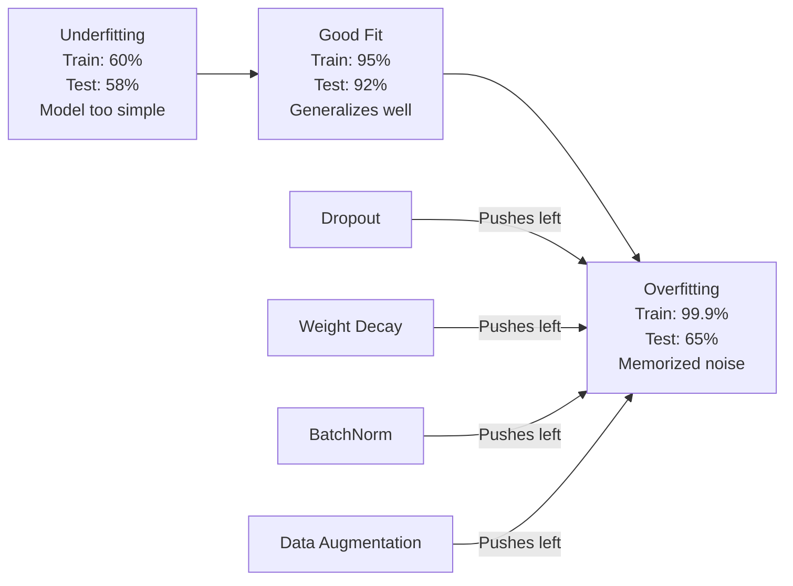
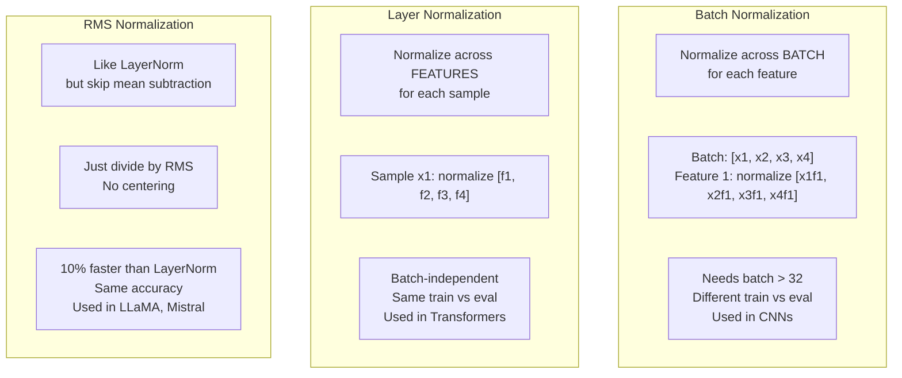
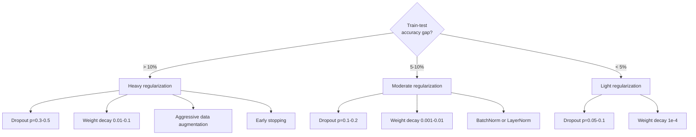

# 正则化

> 你的模型在训练数据上拿到 99%，在测试数据上却只有 60%。它记住了数据，而不是学会了规律。正则化是你对模型复杂度征收的税，用来强制它学会泛化。

**Type:** Build
**Languages:** Python
**Prerequisites:** Lesson 03.06 (Optimizers)
**Time:** ~75 minutes

## 学习目标

- 用 Python 从零实现带反向缩放的 dropout、L2 权重衰减、批归一化（Batch Normalization）、层归一化（Layer Normalization）和 RMSNorm
- 通过正则化实验测量训练-测试准确率差距，并诊断过拟合
- 解释为什么 Transformer 使用 LayerNorm 而不是 BatchNorm，以及为什么现代 LLM 更偏好 RMSNorm
- 根据过拟合的严重程度，应用合适的正则化技术组合

## 问题

参数足够多的神经网络可以记住任何数据集。这不是假设——Zhang 等（2017）通过在 ImageNet 上给标准网络训练随机标签证明了这一点。这些网络在完全随机的标签分配上达到了接近零的训练损失。它们记住了上百万个随机输入-输出对，而没有任何可学习的规律。训练损失完美，测试准确率却为零。

这就是过拟合问题，而且随着模型变大而愈发严重。GPT-3 有 1,750 亿参数，训练集约 5,000 亿 token。面对如此庞大的参数量，模型有足够容量逐字记住大量训练数据。没有正则化，它只会复述训练样本，而不是学习可泛化的规律。

训练表现与测试表现之间的差距就是过拟合差距。本节课的每一项技术都从不同角度压缩这个差距。Dropout 迫使网络不依赖任何单个神经元；权重衰减防止任何单个权重变得过大；批归一化让损失景观更平滑，使优化器找到更平坦、更泛化的最小值；层归一化做同样的事，但在批归一化失效的场景下依然有效（小批量、变长序列）；RMSNorm 通过去掉均值计算快约 10%。每项技术都很简单。合在一起，它们决定了模型是记住数据还是学会泛化。

## 概念

### 过拟合谱系

每个模型都处在从欠拟合（太简单，无法捕捉规律）到过拟合（太复杂，把噪声也学了）之间的某个位置。最佳位置介于两者之间，而正则化从过拟合一侧把模型推向这个甜点。



### Dropout 随机失活

最简单也最优雅的正则化技术。训练期间，以概率 $p$ 随机将每个神经元的输出置零。

```math
\text{output} = \text{activation}(z) \cdot \text{mask} \quad \text{where }\text{mask}[i] \sim \text{Bernoulli}(1 - p)
```

当 $p = 0.5$ 时，每次前向传播都有一半神经元被置零。网络必须学习冗余表示，因为它无法预测哪些神经元会可用。这防止了共适应（co-adaptation）——即神经元学会依赖特定其他神经元的存在。

集成解释：一个拥有 $N$ 个神经元并启用 dropout 的网络可以产生 $2^N$ 个可能的子网络（每个神经元开或关的任意组合）。用 dropout 训练相当于同时训练所有 $2^N$ 个子网络，每个子网络在不同的 mini-batch 上学习。测试时使用所有神经元（无 dropout），并将输出乘以 $(1 - p)$，使其期望值与训练时一致。这等价于对 $2^N$ 个子网络的预测做平均——单个模型就实现了巨型集成。

实际中，缩放通常在训练期间完成（反向 dropout / inverted dropout）：

```math
\begin{aligned}
\text{During training:} \quad & \text{output} = \text{activation}(z) \cdot \text{mask} / (1 - p) \\
\text{During testing:} \quad & \text{output} = \text{activation}(z) \quad \text{(no change needed)}
\end{aligned}
```

这样更干净，因为测试代码完全不需要知道 dropout 的存在。

默认概率：Transformer 取 p=0.1，MLP 取 p=0.5，CNN 取 p=0.2-0.3。dropout 越大 = 正则化越强 = 欠拟合风险越高。

### 权重衰减（L2 正则化）

将所有权重的平方和加入损失：

```math
\text{total\_loss} = \text{task\_loss} + \frac{\lambda}{2} \sum_i w_i^2
```

正则化项的梯度是 $\lambda w$。这意味着每步都会把每个权重按自身大小的比例向零收缩。大权重受到更多惩罚。模型被推向那些没有单个权重主导的解。

它为什么有助于泛化：过拟合模型往往具有大权重，会放大训练数据中的噪声。权重衰减让权重保持较小，从而限制模型的有效容量，迫使它依赖稳健、可泛化的特征，而不是记忆训练数据的怪癖。

超参数 $\lambda$ 控制强度。典型值：

- Transformer 上的 AdamW：0.01
- CNN 上的 SGD：1e-4
- 严重过拟合的模型：0.1

如第 06 课所述：权重衰减与 L2 正则化在 SGD 中等价，在 Adam 中不等价。用 Adam 训练时务必使用 AdamW（解耦权重衰减）。

### 批归一化（Batch Normalization）

在将每层输出传给下一层之前，先在 mini-batch 维度上做归一化。

对于某层的一个 mini-batch 激活：

```math
\begin{aligned}
\mu &= \frac{1}{B} \sum_i x_i && \text{(batch mean)} \\
\sigma^2 &= \frac{1}{B} \sum_i (x_i - \mu)^2 && \text{(batch variance)} \\
\hat{x} &= \frac{x_i - \mu}{\sqrt{\sigma^2 + \epsilon}} && \text{(normalize)} \\
y &= \gamma \hat{x} + \beta && \text{(scale and shift)}
\end{aligned}
```

Gamma 和 beta 是可学习参数，允许网络在需要时「撤销」归一化。没有它们，你就会强制每层输出都是零均值、单位方差，而这未必是网络想要的。

**训练与推理的区分：** 训练期间，$\mu$ 和 $\sigma$ 来自当前 mini-batch。推理期间，使用训练期间累积的运行平均值（momentum=0.1 的指数滑动平均，即 90% 旧值 + 10% 新值）。

BatchNorm 为什么有效至今仍有争议。原论文声称它减少了「内部协变量偏移」（前面层更新导致后续层输入分布变化）。Santurkar 等（2018）证明这个解释是错的。真正的原因是：BatchNorm 让损失景观更平滑。梯度更可预测，Lipschitz 常数更小，优化器可以更安全地迈大步。这就是 BatchNorm 能让你使用更高学习率并更快收敛的原因。

BatchNorm 有一个根本限制：它依赖 batch 统计。batch size 为 1 时，均值和方差毫无意义；batch size 较小（< 32）时，统计量充满噪声，会损害性能。这对目标检测（显存限制 batch size）和语言建模（序列长度可变）等任务尤为重要。

### 层归一化（Layer Normalization）

在每个样本的特征维度上做归一化，而不是在 batch 维度上。对单个样本：

```math
\begin{aligned}
\mu &= \frac{1}{D} \sum_j x_j && \text{(feature mean)} \\
\sigma^2 &= \frac{1}{D} \sum_j (x_j - \mu)^2 && \text{(feature variance)} \\
\hat{x} &= \frac{x_j - \mu}{\sqrt{\sigma^2 + \epsilon}} \\
y &= \gamma \hat{x} + \beta
\end{aligned}
```

$D$ 是特征维度。每个样本独立归一化——不依赖 batch size。这就是 Transformer 使用 LayerNorm 而不是 BatchNorm 的原因：序列长度可变、batch size 通常很小（生成时甚至为 1），且训练和推理的计算完全一致。

Transformer 中的 LayerNorm 通常放在每个自注意力块和每个前馈块之后（Post-LN），或放在它们之前（Pre-LN，训练更稳定）。

### RMSNorm

不做均值减法的 LayerNorm。由 Zhang & Sennrich（2019）提出。

```math
\begin{aligned}
\text{rms} &= \sqrt{\frac{1}{D} \sum_j x_j^2} \\
y &= \gamma \cdot \frac{x}{\text{rms}}
\end{aligned}
```

仅此而已。没有均值计算，没有 beta 参数。观察发现：LayerNorm 中的重新居中（均值减法）对模型性能贡献很小，却要消耗计算。去掉它后，准确率相同，开销降低约 10%。

LLaMA、LLaMA 2、LLaMA 3、Mistral 和大多数现代 LLM 都使用 RMSNorm 而非 LayerNorm。在数十亿参数、数万亿 token 的规模下，这 10% 的节省非常可观。

### 归一化方法对比



### 数据增强作为正则化

这不是修改模型，而是修改数据。在保留标签的前提下变换训练输入：

- 图像：随机裁剪、翻转、旋转、颜色抖动、cutout
- 文本：同义词替换、回译、随机删除
- 音频：时间拉伸、音高偏移、加噪

效果与正则化完全相同：它增大了训练集的有效规模，让模型更难记住具体样本。一个只看到每张图片原始形态的模型可以记住它；一个看到每张图片 50 种增强版本的模型则被迫学习不变的结构。

### 早停（Early Stopping）

最简单的正则化：当验证损失开始上升时就停止训练。此时模型还没有过拟合。实践中，每轮跟踪验证损失，保存最佳模型，并在「耐心窗口」（通常 5-20 轮）内继续训练。如果验证损失在耐心窗口内没有改善，就停止并加载保存的最佳模型。

### 何时应用什么



```figure
l2-regularization
```

## 构建它

### 第 1 步：Dropout（训练与评估模式）

```python
import random
import math


class Dropout:
    def __init__(self, p=0.5):
        self.p = p
        self.training = True
        self.mask = None

    def forward(self, x):
        if not self.training:
            return list(x)
        self.mask = []
        output = []
        for val in x:
            if random.random() < self.p:
                self.mask.append(0)
                output.append(0.0)
            else:
                self.mask.append(1)
                output.append(val / (1 - self.p))
        return output

    def backward(self, grad_output):
        grads = []
        for g, m in zip(grad_output, self.mask):
            if m == 0:
                grads.append(0.0)
            else:
                grads.append(g / (1 - self.p))
        return grads
```

### 第 2 步：L2 权重衰减

```python
def l2_regularization(weights, lambda_reg):
    penalty = 0.0
    for w in weights:
        penalty += w * w
    return lambda_reg * 0.5 * penalty

def l2_gradient(weights, lambda_reg):
    return [lambda_reg * w for w in weights]
```

### 第 3 步：批归一化（Batch Normalization）

```python
class BatchNorm:
    def __init__(self, num_features, momentum=0.1, eps=1e-5):
        self.gamma = [1.0] * num_features
        self.beta = [0.0] * num_features
        self.eps = eps
        self.momentum = momentum
        self.running_mean = [0.0] * num_features
        self.running_var = [1.0] * num_features
        self.training = True
        self.num_features = num_features

    def forward(self, batch):
        batch_size = len(batch)
        if self.training:
            mean = [0.0] * self.num_features
            for sample in batch:
                for j in range(self.num_features):
                    mean[j] += sample[j]
            mean = [m / batch_size for m in mean]

            var = [0.0] * self.num_features
            for sample in batch:
                for j in range(self.num_features):
                    var[j] += (sample[j] - mean[j]) ** 2
            var = [v / batch_size for v in var]

            for j in range(self.num_features):
                self.running_mean[j] = (1 - self.momentum) * self.running_mean[j] + self.momentum * mean[j]
                self.running_var[j] = (1 - self.momentum) * self.running_var[j] + self.momentum * var[j]
        else:
            mean = list(self.running_mean)
            var = list(self.running_var)

        self.x_hat = []
        output = []
        for sample in batch:
            normalized = []
            out_sample = []
            for j in range(self.num_features):
                x_h = (sample[j] - mean[j]) / math.sqrt(var[j] + self.eps)
                normalized.append(x_h)
                out_sample.append(self.gamma[j] * x_h + self.beta[j])
            self.x_hat.append(normalized)
            output.append(out_sample)
        return output
```

### 第 4 步：层归一化（Layer Normalization）

```python
class LayerNorm:
    def __init__(self, num_features, eps=1e-5):
        self.gamma = [1.0] * num_features
        self.beta = [0.0] * num_features
        self.eps = eps
        self.num_features = num_features

    def forward(self, x):
        mean = sum(x) / len(x)
        var = sum((xi - mean) ** 2 for xi in x) / len(x)

        self.x_hat = []
        output = []
        for j in range(self.num_features):
            x_h = (x[j] - mean) / math.sqrt(var + self.eps)
            self.x_hat.append(x_h)
            output.append(self.gamma[j] * x_h + self.beta[j])
        return output
```

### 第 5 步：RMSNorm

```python
class RMSNorm:
    def __init__(self, num_features, eps=1e-6):
        self.gamma = [1.0] * num_features
        self.eps = eps
        self.num_features = num_features

    def forward(self, x):
        rms = math.sqrt(sum(xi * xi for xi in x) / len(x) + self.eps)
        output = []
        for j in range(self.num_features):
            output.append(self.gamma[j] * x[j] / rms)
        return output
```

### 第 6 步：有正则化与无正则化的训练

```python
def sigmoid(x):
    x = max(-500, min(500, x))
    return 1.0 / (1.0 + math.exp(-x))


def make_circle_data(n=200, seed=42):
    random.seed(seed)
    data = []
    for _ in range(n):
        x = random.uniform(-2, 2)
        y = random.uniform(-2, 2)
        label = 1.0 if x * x + y * y < 1.5 else 0.0
        data.append(([x, y], label))
    return data


class RegularizedNetwork:
    def __init__(self, hidden_size=16, lr=0.05, dropout_p=0.0, weight_decay=0.0):
        random.seed(0)
        self.hidden_size = hidden_size
        self.lr = lr
        self.dropout_p = dropout_p
        self.weight_decay = weight_decay
        self.dropout = Dropout(p=dropout_p) if dropout_p > 0 else None

        self.w1 = [[random.gauss(0, 0.5) for _ in range(2)] for _ in range(hidden_size)]
        self.b1 = [0.0] * hidden_size
        self.w2 = [random.gauss(0, 0.5) for _ in range(hidden_size)]
        self.b2 = 0.0

    def forward(self, x, training=True):
        self.x = x
        self.z1 = []
        self.h = []
        for i in range(self.hidden_size):
            z = self.w1[i][0] * x[0] + self.w1[i][1] * x[1] + self.b1[i]
            self.z1.append(z)
            self.h.append(max(0.0, z))

        if self.dropout and training:
            self.dropout.training = True
            self.h = self.dropout.forward(self.h)
        elif self.dropout:
            self.dropout.training = False
            self.h = self.dropout.forward(self.h)

        self.z2 = sum(self.w2[i] * self.h[i] for i in range(self.hidden_size)) + self.b2
        self.out = sigmoid(self.z2)
        return self.out

    def backward(self, target):
        eps = 1e-15
        p = max(eps, min(1 - eps, self.out))
        d_loss = -(target / p) + (1 - target) / (1 - p)
        d_sigmoid = self.out * (1 - self.out)
        d_out = d_loss * d_sigmoid

        for i in range(self.hidden_size):
            d_relu = 1.0 if self.z1[i] > 0 else 0.0
            d_h = d_out * self.w2[i] * d_relu
            self.w2[i] -= self.lr * (d_out * self.h[i] + self.weight_decay * self.w2[i])
            for j in range(2):
                self.w1[i][j] -= self.lr * (d_h * self.x[j] + self.weight_decay * self.w1[i][j])
            self.b1[i] -= self.lr * d_h
        self.b2 -= self.lr * d_out

    def evaluate(self, data):
        correct = 0
        total_loss = 0.0
        for x, y in data:
            pred = self.forward(x, training=False)
            eps = 1e-15
            p = max(eps, min(1 - eps, pred))
            total_loss += -(y * math.log(p) + (1 - y) * math.log(1 - p))
            if (pred >= 0.5) == (y >= 0.5):
                correct += 1
        return total_loss / len(data), correct / len(data) * 100

    def train_model(self, train_data, test_data, epochs=300):
        history = []
        for epoch in range(epochs):
            total_loss = 0.0
            correct = 0
            for x, y in train_data:
                pred = self.forward(x, training=True)
                self.backward(y)
                eps = 1e-15
                p = max(eps, min(1 - eps, pred))
                total_loss += -(y * math.log(p) + (1 - y) * math.log(1 - p))
                if (pred >= 0.5) == (y >= 0.5):
                    correct += 1
            train_loss = total_loss / len(train_data)
            train_acc = correct / len(train_data) * 100
            test_loss, test_acc = self.evaluate(test_data)
            history.append((train_loss, train_acc, test_loss, test_acc))
            if epoch % 75 == 0 or epoch == epochs - 1:
                gap = train_acc - test_acc
                print(f"    Epoch {epoch:3d}: train_acc={train_acc:.1f}%, test_acc={test_acc:.1f}%, gap={gap:.1f}%")
        return history
```

## 使用它

PyTorch 将所有归一化和正则化都封装为模块：

```python
import torch
import torch.nn as nn

model = nn.Sequential(
    nn.Linear(784, 256),
    nn.BatchNorm1d(256),
    nn.ReLU(),
    nn.Dropout(0.3),
    nn.Linear(256, 128),
    nn.BatchNorm1d(128),
    nn.ReLU(),
    nn.Dropout(0.3),
    nn.Linear(128, 10),
)

model.train()
out_train = model(torch.randn(32, 784))

model.eval()
out_test = model(torch.randn(1, 784))
```

`model.train()` / `model.eval()` 切换至关重要。它控制 dropout 的开关，并告诉 BatchNorm 使用 batch 统计还是运行统计。推理前忘记调用 `model.eval()` 是深度学习中最常见的 bug 之一。你的测试准确率会随机波动，因为 dropout 仍在生效，BatchNorm 仍在使用 mini-batch 统计。

Transformer 中的模式不同：

```python
class TransformerBlock(nn.Module):
    def __init__(self, d_model=512, nhead=8, dropout=0.1):
        super().__init__()
        self.attention = nn.MultiheadAttention(d_model, nhead, dropout=dropout)
        self.norm1 = nn.LayerNorm(d_model)
        self.ff = nn.Sequential(
            nn.Linear(d_model, d_model * 4),
            nn.GELU(),
            nn.Linear(d_model * 4, d_model),
            nn.Dropout(dropout),
        )
        self.norm2 = nn.LayerNorm(d_model)
        self.dropout = nn.Dropout(dropout)

    def forward(self, x):
        attended, _ = self.attention(x, x, x)
        x = self.norm1(x + self.dropout(attended))
        x = self.norm2(x + self.ff(x))
        return x
```

LayerNorm，不是 BatchNorm。Dropout p=0.1，不是 p=0.5。这些是 Transformer 的默认配置。

## 交付它

本节课产出：
- `outputs/prompt-regularization-advisor.md` —— 一个诊断过拟合并推荐合适正则化策略的 prompt

## 练习

1. 实现 2D 空间 dropout：不是丢弃单个神经元，而是丢弃整个特征通道。将连续特征分组视为通道，整组丢弃。在 hidden_size=32 的圆形数据集上，比较它与标准 dropout 的训练-测试差距。

2. 结合第 05 课的标签平滑与本节课的 dropout 进行训练。测试四种配置：两者都不加、只加 dropout、只加标签平滑、两者都加。测量每种配置最终的训练-测试准确率差距。哪种组合差距最小？

3. 在你的圆形数据集网络中，在隐藏层与激活函数之间加入 BatchNorm 层。分别在学习率 0.01、0.05、0.1 下训练有 BatchNorm 和无 BatchNorm 的版本。BatchNorm 应能让你在朴素网络会发散的较高学习率下稳定训练。

4. 实现早停：每轮跟踪测试损失，保存最佳权重，若测试损失 20 轮未改善则停止。用正则化网络训练 1000 轮。报告最佳测试准确率出现在哪一轮，以及你节省了多少轮计算。

5. 在 4 层网络（不仅是 2 层）上比较 LayerNorm 与 RMSNorm。用相同权重初始化两者。训练 200 轮，比较最终准确率、训练速度（每轮耗时）和第一层的梯度大小。验证 RMSNorm 在准确率相同的前提下更快。

## 关键术语

| 术语 | 常见说法 | 实际含义 |
|------|----------|----------|
| 过拟合 | "模型记住了数据" | 训练表现显著超过测试表现，说明模型学到的是噪声而非信号 |
| 正则化 | "防止过拟合" | 任何通过约束模型复杂度来提升泛化能力的技术：dropout、权重衰减、归一化、数据增强 |
| Dropout | "随机删除神经元" | 训练期间以概率 $p$ 随机将神经元输出置零，迫使学习冗余表示；等价于训练集成模型 |
| 权重衰减 | "L2 惩罚" | 每步将所有权重向零收缩 $\lambda w$；通过权重大小惩罚复杂度 |
| 批归一化 | "按 batch 归一化" | 在 batch 维度上对层输出做归一化；训练用 batch 统计，推理用运行平均 |
| 层归一化 | "按样本归一化" | 在每个样本内部跨特征归一化；不依赖 batch，用于 batch size 多变的 Transformer |
| RMSNorm | "去掉均值的 LayerNorm" | 均方根归一化；去掉 LayerNorm 的均值减法，在准确率相同的情况下快约 10% |
| 早停 | "在过拟合前停止" | 当验证损失停止改善时终止训练；最简单的正则化，常与其他技术配合使用 |
| 数据增强 | "用更少的数据造出更多数据" | 对训练输入做变换（翻转、裁剪、加噪）以增大数据有效规模，迫使模型学习不变性 |
| 泛化差距 | "训练-测试差距" | 训练表现与测试表现之间的差异；正则化的目标就是最小化这个差距 |

## 扩展阅读

- Srivastava 等，"Dropout: A Simple Way to Prevent Neural Networks from Overfitting"（2014）—— 原始 dropout 论文，包含集成解释与大量实验
- Ioffe & Szegedy，"Batch Normalization: Accelerating Deep Network Training by Reducing Internal Covariate Shift"（2015）—— 提出 BatchNorm 及其训练流程，是深度学习领域被引用最多的论文之一
- Zhang & Sennrich，"Root Mean Square Layer Normalization"（2019）—— 证明 RMSNorm 在降低计算量的同时达到 LayerNorm 的准确率；被 LLaMA 和 Mistral 采用
- Zhang 等，"Understanding Deep Learning Requires Rethinking Generalization"（2017）—— 里程碑式论文，证明神经网络能记住随机标签，挑战了传统泛化观念
