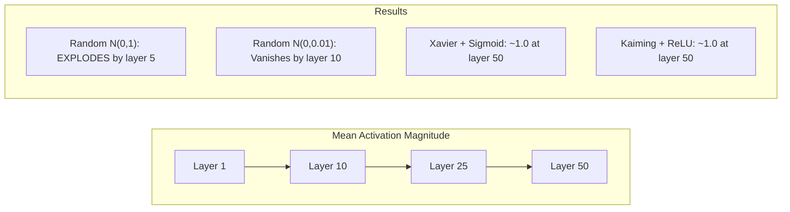
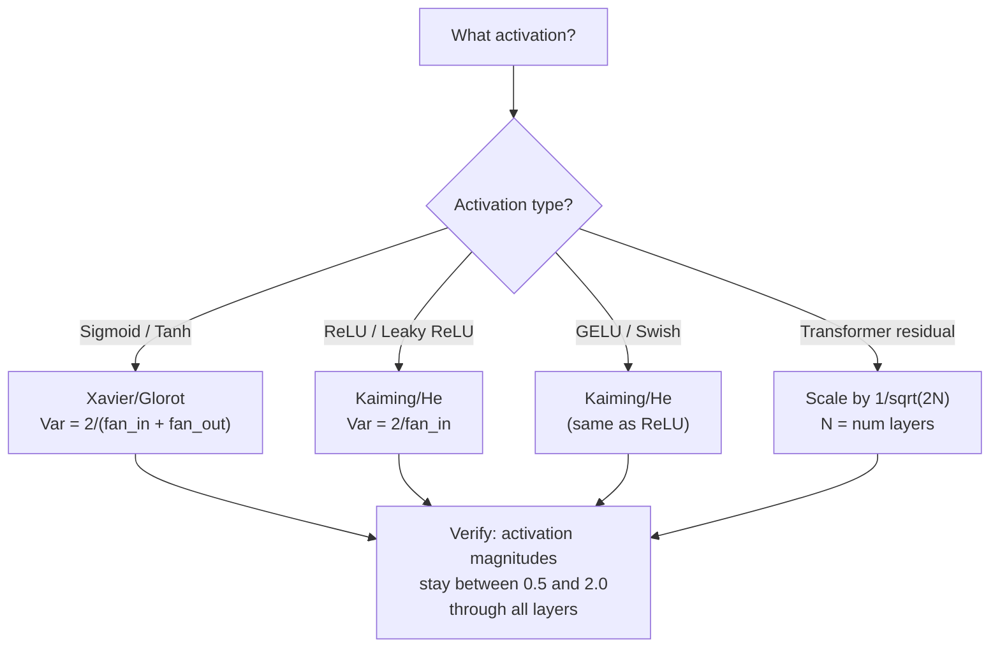

# 权重初始化与训练稳定性

> 初始化错了，训练永远不会开始。初始化对了，50 层网络也能像 3 层一样平稳训练。

**Type:** Build
**Languages:** Python
**Prerequisites:** Lesson 03.04 (Activation Functions), Lesson 03.07 (Regularization)
**Time:** ~90 minutes

## 学习目标

- 实现 zero、random、Xavier/Glorot 和 Kaiming/He 初始化策略，并测量它们在 50 层网络中对激活幅值的影响
- 推导 Xavier 初始化为何使用 Var(w) = 2/(fan_in + fan_out)，Kaiming 为何使用 Var(w) = 2/fan_in
- 演示零初始化的对称性问题，并解释为何仅靠随机尺度还不够
- 为激活函数匹配正确的初始化策略：sigmoid/tanh 用 Xavier，ReLU/GELU 用 Kaiming

## 问题

把所有权重初始化为零。什么都学不到。每个神经元计算相同的函数，得到相同的梯度，以相同的方式更新。训练 10,000 个 epoch 后，你的 512 神经元隐藏层仍然是同一个神经元的 512 份拷贝。你为 512 个参数买单，却只得到 1 个。

把它们初始化得太大。激活值会在网络中爆炸。到第 10 层，数值达到 1e15；到第 20 层，溢出为无穷大。梯度则以相反方向走同样的轨迹。

用标准正态分布随机初始化。3 层网络能工作。到了 50 层，信号会坍缩到零或爆炸到无穷大，具体取决于随机尺度是稍微太小还是稍微太大。"能工作"与"崩掉"之间的边界薄如刀刃。

权重初始化是深度学习中最被低估的决策。架构能发论文，优化器能写博客，初始化只在脚注里出现。但一旦出错，其他一切都毫无意义——你的网络在训练开始前就已经死了。

## 概念

### 对称性问题

一层中的每个神经元结构都一样：输入乘以权重，加上偏置，再应用激活函数。如果所有权重从同一个值开始（零是最极端的情况），每个神经元计算出的输出都相同。反向传播时，每个神经元收到相同的梯度。更新时，每个神经元改变的量也相同。

你被卡住了。网络有数百个参数，但它们像被锁在一起一样同步移动。这被称为对称性，而随机初始化就是强行打破它的方法。每个神经元从权重空间中的不同点出发，因此能学到不同的特征。

但"随机"还不够。随机性的*尺度*决定了网络能否训练。

### 逐层方差传播

考虑一个具有 fan_in 个输入的单层：

```math
z = w_1 x_1 + w_2 x_2 + \cdots + w_n x_n
```

如果每个权重 $w_i$ 来自方差为 $\mathrm{Var}(w)$ 的分布，每个输入 $x_i$ 的方差为 $\mathrm{Var}(x)$，那么输出方差为：

```math
\mathrm{Var}(z) = \text{fan}_{\text{in}} \cdot \mathrm{Var}(w) \cdot \mathrm{Var}(x)
```

如果 $\mathrm{Var}(w) = 1$ 且 $\text{fan}_{\text{in}} = 512$，输出方差就是输入方差的 512 倍。经过 10 层：$512^{10} = 1.2 \times 10^{27}$。你的信号已经爆炸。

如果 $\mathrm{Var}(w) = 0.001$，每层输出方差会缩小 $0.001 \cdot 512 = 0.512$ 倍。经过 10 层：$0.512^{10} = 0.00013$。你的信号已经消失。

目标：选择 $\mathrm{Var}(w)$，使得 $\mathrm{Var}(z) = \mathrm{Var}(x)$。这样信号幅值就能在各层之间保持不变。

### Xavier/Glorot 初始化

Glorot 和 Bengio（2010）为 sigmoid 和 tanh 激活推导出了这个方案。为了在正向和反向传播中都保持方差不变：

```math
\mathrm{Var}(w) = \frac{2}{\text{fan}_{\text{in}} + \text{fan}_{\text{out}}}
```

实践中，权重从以下分布采样：

```math
w \sim \text{Uniform}(-\text{limit}, \text{limit}) \quad \text{where } \text{limit} = \sqrt{\frac{6}{\text{fan}_{\text{in}} + \text{fan}_{\text{out}}}}
```

或：

```math
w \sim \text{Normal}\left(0, \sqrt{\frac{2}{\text{fan}_{\text{in}} + \text{fan}_{\text{out}}}}\right)
```

这是因为 sigmoid 和 tanh 在零附近近似线性，而正确初始化后的激活值就落在这个区域。方差能在数十层内保持稳定。

### Kaiming/He 初始化

ReLU 会杀死一半的输出（所有负数变为零）。有效的 fan_in 减半，因为平均而言一半输入被置零。Xavier 初始化没有考虑到这一点——它低估了所需的方差。

He 等人（2015）调整了公式：

```math
\mathrm{Var}(w) = \frac{2}{\text{fan}_{\text{in}}}
```

权重从以下分布采样：

```math
w \sim \text{Normal}\left(0, \sqrt{\frac{2}{\text{fan}_{\text{in}}}}\right)
```

因子 2 补偿了 ReLU 将一半激活置零的影响。没有它，信号每层会缩小约 0.5 倍。50 层之后：$0.5^{50} = 8.8 \times 10^{-16}$。Kaiming 初始化阻止了这种情况。

### Transformer 初始化

GPT-2 引入了一种不同的模式。残差连接把每个子层的输出加到输入上：

```math
x = x + \text{sublayer}(x)
```

每次相加都会增加方差。如果有 $N$ 个残差层，方差会与 $N$ 成比例增长。GPT-2 将残差层的权重缩放 $1/\sqrt{2N}$，其中 $N$ 是层数。这能保持累积信号幅值稳定。

Llama 3（405B 参数、126 层）使用了类似的方案。没有这种缩放，残差流会在 126 层 attention 和前馈块之间无界增长。

```mermaid
flowchart TD
    subgraph "Zero Init"
        Z1["Layer 1<br/>All weights = 0"] --> Z2["Layer 2<br/>All neurons identical"]
        Z2 --> Z3["Layer 3<br/>Still identical"]
        Z3 --> ZR["Result: 1 effective neuron<br/>regardless of width"]
    end

    subgraph "Xavier Init"
        X1["Layer 1<br/>Var = 2/(fan_in+fan_out)"] --> X2["Layer 2<br/>Signal stable"]
        X2 --> X3["Layer 50<br/>Signal stable"]
        X3 --> XR["Result: Trains with<br/>sigmoid/tanh"]
    end

    subgraph "Kaiming Init"
        K1["Layer 1<br/>Var = 2/fan_in"] --> K2["Layer 2<br/>Signal stable"]
        K2 --> K3["Layer 50<br/>Signal stable"]
        K3 --> KR["Result: Trains with<br/>ReLU/GELU"]
    end
```



### 50 层网络的激活幅值



### 选择合适的初始化



```figure
weight-init-variance
```

## 构建它

### 步骤 1：初始化策略

初始化权重矩阵的四种方式。每个函数返回一个二维矩阵（列表的列表），具有 fan_in 列和 fan_out 行。

```python
import math
import random


def zero_init(fan_in, fan_out):
    return [[0.0 for _ in range(fan_in)] for _ in range(fan_out)]


def random_init(fan_in, fan_out, scale=1.0):
    return [[random.gauss(0, scale) for _ in range(fan_in)] for _ in range(fan_out)]


def xavier_init(fan_in, fan_out):
    std = math.sqrt(2.0 / (fan_in + fan_out))
    return [[random.gauss(0, std) for _ in range(fan_in)] for _ in range(fan_out)]


def kaiming_init(fan_in, fan_out):
    std = math.sqrt(2.0 / fan_in)
    return [[random.gauss(0, std) for _ in range(fan_in)] for _ in range(fan_out)]
```

### 步骤 2：激活函数

我们需要 sigmoid、tanh 和 ReLU，以便用对应的激活函数测试每种初始化策略。

```python
def sigmoid(x):
    x = max(-500, min(500, x))
    return 1.0 / (1.0 + math.exp(-x))


def tanh_act(x):
    return math.tanh(x)


def relu(x):
    return max(0.0, x)
```

### 步骤 3：50 层前向传播

将随机数据传入深层网络，并测量每层的平均激活幅值。

```python
def forward_deep(init_fn, activation_fn, n_layers=50, width=64, n_samples=100):
    random.seed(42)
    layer_magnitudes = []

    inputs = [[random.gauss(0, 1) for _ in range(width)] for _ in range(n_samples)]

    for layer_idx in range(n_layers):
        weights = init_fn(width, width)
        biases = [0.0] * width

        new_inputs = []
        for sample in inputs:
            output = []
            for neuron_idx in range(width):
                z = sum(weights[neuron_idx][j] * sample[j] for j in range(width)) + biases[neuron_idx]
                output.append(activation_fn(z))
            new_inputs.append(output)
        inputs = new_inputs

        magnitudes = []
        for sample in inputs:
            magnitudes.append(sum(abs(v) for v in sample) / width)
        mean_mag = sum(magnitudes) / len(magnitudes)
        layer_magnitudes.append(mean_mag)

    return layer_magnitudes
```

### 步骤 4：实验

运行所有组合：零初始化、随机 N(0,1)、随机 N(0,0.01)、Xavier + sigmoid、Xavier + tanh、Kaiming + ReLU。打印关键层的幅值。

```python
def run_experiment():
    configs = [
        ("Zero init + Sigmoid", lambda fi, fo: zero_init(fi, fo), sigmoid),
        ("Random N(0,1) + ReLU", lambda fi, fo: random_init(fi, fo, 1.0), relu),
        ("Random N(0,0.01) + ReLU", lambda fi, fo: random_init(fi, fo, 0.01), relu),
        ("Xavier + Sigmoid", xavier_init, sigmoid),
        ("Xavier + Tanh", xavier_init, tanh_act),
        ("Kaiming + ReLU", kaiming_init, relu),
    ]

    print(f"{'Strategy':<30} {'L1':>10} {'L5':>10} {'L10':>10} {'L25':>10} {'L50':>10}")
    print("-" * 80)

    for name, init_fn, act_fn in configs:
        mags = forward_deep(init_fn, act_fn)
        row = f"{name:<30}"
        for idx in [0, 4, 9, 24, 49]:
            val = mags[idx]
            if val > 1e6:
                row += f" {'EXPLODED':>10}"
            elif val < 1e-6:
                row += f" {'VANISHED':>10}"
            else:
                row += f" {val:>10.4f}"
        print(row)
```

### 步骤 5：对称性演示

展示零初始化会产生完全相同的神经元。

```python
def symmetry_demo():
    random.seed(42)
    weights = zero_init(2, 4)
    biases = [0.0] * 4

    inputs = [0.5, -0.3]
    outputs = []
    for neuron_idx in range(4):
        z = sum(weights[neuron_idx][j] * inputs[j] for j in range(2)) + biases[neuron_idx]
        outputs.append(sigmoid(z))

    print("\nSymmetry Demo (4 neurons, zero init):")
    for i, out in enumerate(outputs):
        print(f"  Neuron {i}: output = {out:.6f}")
    all_same = all(abs(outputs[i] - outputs[0]) < 1e-10 for i in range(len(outputs)))
    print(f"  All identical: {all_same}")
    print(f"  Effective parameters: 1 (not {len(weights) * len(weights[0])})")
```

### 步骤 6：逐层幅值报告

打印一个可视化的柱状图，展示 50 层网络中的激活幅值。

```python
def magnitude_report(name, magnitudes):
    print(f"\n{name}:")
    for i, mag in enumerate(magnitudes):
        if i % 5 == 0 or i == len(magnitudes) - 1:
            if mag > 1e6:
                bar = "X" * 50 + " EXPLODED"
            elif mag < 1e-6:
                bar = "." + " VANISHED"
            else:
                bar_len = min(50, max(1, int(mag * 10)))
                bar = "#" * bar_len
            print(f"  Layer {i+1:3d}: {bar} ({mag:.6f})")
```

## 使用它

PyTorch 把这些实现为了内置函数：

```python
import torch
import torch.nn as nn

layer = nn.Linear(512, 256)

nn.init.xavier_uniform_(layer.weight)
nn.init.xavier_normal_(layer.weight)

nn.init.kaiming_uniform_(layer.weight, nonlinearity='relu')
nn.init.kaiming_normal_(layer.weight, nonlinearity='relu')

nn.init.zeros_(layer.bias)
```

当你调用 `nn.Linear(512, 256)` 时，PyTorch 默认使用 Kaiming 均匀初始化。这就是为什么大多数简单网络"刚好能工作"——PyTorch 已经替你做了正确选择。但当你构建自定义架构或网络深度超过 20 层时，你需要理解背后的原理，并可能覆盖默认设置。

对于 Transformer，Hugging Face 模型通常在它们的 `_init_weights` 方法中处理初始化。GPT-2 的实现将残差投影缩放 $1/\sqrt{N}$。如果你从零构建 Transformer，需要亲自加上这一点。

## 交付它

本节课产出：

- `outputs/prompt-init-strategy.md` —— 一个用于诊断权重初始化问题并推荐正确策略的 prompt

## 练习

1. 加入 LeCun 初始化（$\mathrm{Var} = 1/\text{fan}_{\text{in}}$，为 SELU 激活设计）。用 LeCun init + tanh 运行 50 层实验，并与 Xavier + tanh 比较。

2. 实现 GPT-2 的残差缩放：在将每层输出加入残差流之前，先乘以 $1/\sqrt{2N}$。比较使用与不使用缩放时残差幅值的增长速度。

3. 创建一个"初始化健康检查"函数，接收网络的层维度与激活类型，然后推荐正确的初始化方式，并在当前初始化会导致问题时发出警告。

4. 在 $\text{fan}_{\text{in}} = 16$ 与 $\text{fan}_{\text{in}} = 1024$ 上运行实验。Xavier 和 Kaiming 会随 fan_in 自适应，但随机初始化不会。展示随着层宽增大，"能工作"与"会崩"之间的鸿沟如何扩大。

5. 实现正交初始化（生成随机矩阵，计算其 SVD，使用正交矩阵 U）。与 Kaiming 在 50 层 ReLU 网络上进行比较。

## 关键术语

| 术语 | 常见说法 | 实际含义 |
|------|----------|----------|
| Weight initialization | "随机设置初始权重" | 选择初始权重值的策略，它决定了网络到底能不能训练 |
| Symmetry breaking | "让神经元变得不同" | 通过随机初始化确保神经元学到不同特征，而不是计算完全相同的函数 |
| Fan-in | "一个神经元的输入数量" | 传入连接数，决定了输入方差在加权和中的累积方式 |
| Fan-out | "一个神经元的输出数量" | 传出连接数，与反向传播时保持梯度方差有关 |
| Xavier/Glorot init | "sigmoid 初始化" | $\mathrm{Var}(w) = 2/(\text{fan} _{\text{in}} + \text{fan} _{\text{out}})$，设计用于在 sigmoid 和 tanh 激活中保持方差 |
| Kaiming/He init | "ReLU 初始化" | $\mathrm{Var}(w) = 2/\text{fan}_{\text{in}}$，考虑了 ReLU 会将一半激活置零 |
| Variance propagation | "信号如何逐层增长或缩小" | 基于权重尺度分析激活方差逐层变化的数学方法 |
| Residual scaling | "GPT-2 的初始化技巧" | 将残差连接权重缩放 $1/\sqrt{2N}$，防止方差在 $N$ 个 Transformer 层中增长 |
| Dead network | "什么都训练不了" | 由于糟糕的初始化导致所有梯度为零或所有激活饱和的网络 |
| Exploding activations | "数值变成无穷大" | 权重方差过大，导致激活幅值随层数指数增长 |

## 延伸阅读

- Glorot & Bengio, "Understanding the difficulty of training deep feedforward neural networks" (2010) —— Xavier 初始化与方差分析的原始论文
- He et al., "Delving Deep into Rectifiers" (2015) —— 为 ReLU 网络提出 Kaiming 初始化
- Radford et al., "Language Models are Unsupervised Multitask Learners" (2019) —— GPT-2 论文，包含残差缩放初始化
- Mishkin & Matas, "All You Need is a Good Init" (2016) —— 层序单位方差初始化，一种基于经验的替代解析公式的方法
