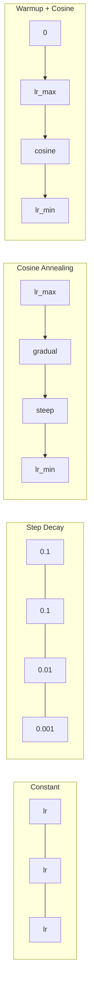
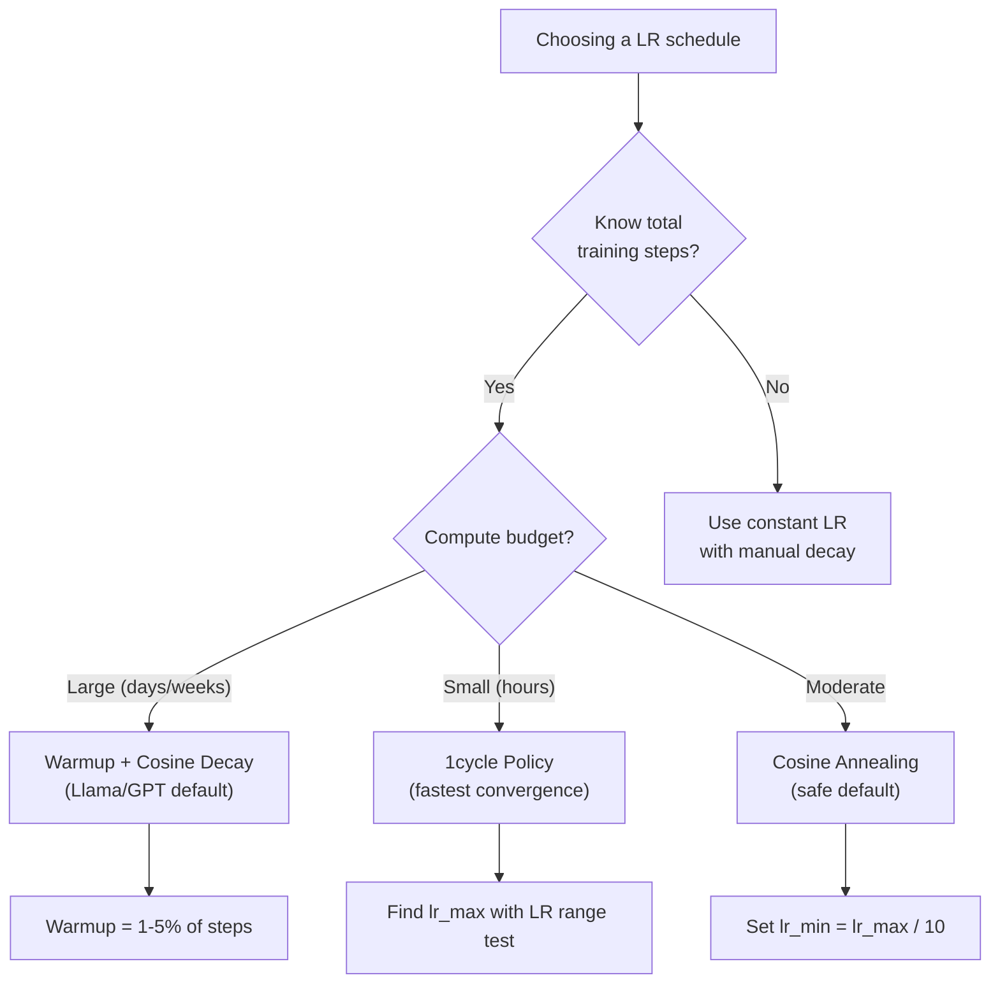
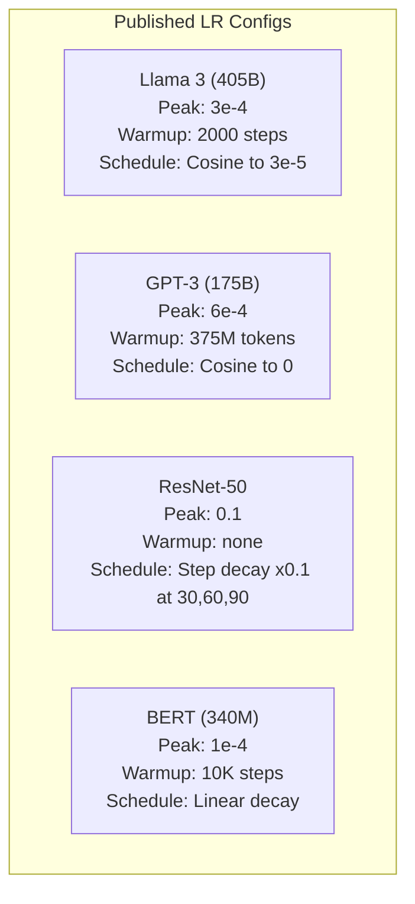

# 学习率调度与 Warmup

> 学习率是最重要的超参数。不是架构，不是数据集大小，也不是激活函数。是学习率。如果你什么都不调，也要调它。

**Type:** Build
**Languages:** Python
**Prerequisites:** Lesson 03.06 (Optimizers), Lesson 03.08 (Weight Initialization)
**Time:** ~90 minutes

## 学习目标

- 从零实现 constant、step decay、cosine annealing、warmup + cosine 和 1cycle 学习率调度
- 演示学习率选择的三种失败模式：过高导致发散、过低导致停滞、不衰减导致震荡
- 解释为什么 warmup 对基于 Adam 的优化器是必要的，以及它如何稳定训练早期
- 在同一任务上比较五种调度的收敛速度，并为给定训练预算选择合适的调度

## 问题

把学习率设为 0.1。训练发散——损失在 3 步内跳到无穷大。设为 0.0001。训练爬行——100 个 epoch 后，模型几乎没从随机状态移动。设为 0.01。训练前 50 个 epoch 有效，然后损失围绕一个最小值震荡，永远到不了，因为步长太大。

最优学习率不是常数。它在训练过程中会变化。早期需要大步长快速覆盖区域，训练后期需要小步长扎进尖锐的最小值。90% 准确率的模型和 95% 准确率的模型之间的差距，往往就在于调度。

过去三年发布的每个重要模型都使用了学习率调度。Llama 3 使用峰值 lr=3e-4、2000 步 warmup、余弦衰减到 3e-5。GPT-3 使用 lr=6e-4、在 3.75 亿 token 上 warmup。这些不是随意选择，而是耗资数百万美元的大规模超参搜索的结果。

你需要理解调度，因为默认值不一定适合你的问题。微调预训练模型时的正确调度与从头训练不同；增大 batch size 时需要改变 warmup 长度；当训练在 10,000 步崩溃时，你要知道这是调度问题还是别的问题。

## 概念

### 恒定学习率

最简单的方法：选一个数，每一步都用它。

```math
\text{lr}(t) = \text{lr}_0
```

很少最优。它要么对训练末期太高（在最小值附近震荡），要么对训练初期太低（浪费计算走小步）。对小型模型和调试还行；对训练超过一小时的任务来说，是个糟糕选择。

### 阶梯衰减

ResNet 时代的经典做法。在固定 epoch 把学习率砍掉一个倍数（通常是 10 倍）。

```math
\text{lr}(t) = \text{lr}_0 \cdot \gamma^{\lfloor \text{epoch} / \text{step\_size} \rfloor}
```

其中 $\gamma = 0.1$、step_size = 30 表示：每 30 个 epoch 学习率降低 10 倍。ResNet-50 就是这样——lr=0.1，在第 30、60、90 个 epoch 各降 10 倍。

问题在于：最佳衰减点取决于数据集和架构。换一个任务就要重新调整下降时机。transition 很突然——学习率骤降时损失可能 spike。

### 余弦退火

从最大学习率平滑衰减到最小学习率，遵循余弦曲线：

```math
\text{lr}(t) = \text{lr}_{\min} + 0.5 \cdot (\text{lr}_{\max} - \text{lr}_{\min}) \cdot \left(1 + \cos\left(\frac{\pi t}{T}\right)\right)
```

其中 $t$ 是当前步，$T$ 是总步数。

$t=0$ 时余弦项为 1，所以 $\text{lr} = \text{lr} _{\max}$；$t=T$ 时余弦项为 -1，所以 $\text{lr} = \text{lr} _{\min}$。衰减初期温和，中期加速，末期再次温和。

这是现代训练运行的默认选择。除了 $\text{lr} _{\max}$ 和 $\text{lr} _{\min}$ 几乎不需要调别的超参。余弦形状符合经验观察：大部分学习发生在训练中段，关键期需要合理的步长。

### Warmup：为什么要从小开始

Adam 等自适应优化器会维护梯度的均值和方差的滑动估计。第 0 步时这些估计被初始化为零，前几次梯度更新基于不靠谱的统计量。如果这一时期学习率很大，模型会迈出巨大而方向错误的步子。

Warmup 解决这个问题：从一个很小的学习率（通常是 lr_max / warmup_steps，甚至是 0）开始，在前 $N$ 步线性提升到 $\text{lr}_{\max}$。等到达全量学习率时，Adam 的统计量已经稳定。

```math
\text{lr}(t) = \text{lr}_{\max} \cdot \frac{t}{\text{warmup\_steps}} \quad \text{for } t < \text{warmup\_steps}
```

典型 warmup 长度是总训练步数的 1-5%。Llama 3 在约 1.8 万亿 token 上训练，warmup 了 2000 步。GPT-3 在 3.75 亿 token 上 warmup。

### 线性 Warmup + 余弦衰减

现代默认方案：先线性 ramp，再余弦衰减：

```
if t < warmup_steps:
    lr(t) = lr_max * (t / warmup_steps)
else:
    progress = (t - warmup_steps) / (total_steps - warmup_steps)
    lr(t) = lr_min + 0.5 * (lr_max - lr_min) * (1 + cos(pi * progress))
```

这就是 Llama、GPT、PaLM 以及大多数现代 Transformer 使用的方案。Warmup 防止早期不稳定，余弦衰减帮助模型 settle 到好的最小值。

### 1cycle 策略

Leslie Smith（2018）的发现：在训练前半段把学习率从低值 ramp 到高值，后半段再降回来。这违反直觉——为什么要在训练中段*提高*学习率？

理论是：高学习率通过给优化轨迹加噪声起到正则化作用。模型在 ramp-up 阶段探索更多损失景观，找到更好的 basin；ramp-down 阶段在找到的 basin 内精细优化。

```
Phase 1 (0 to T/2):    lr ramps from lr_max/25 to lr_max
Phase 2 (T/2 to T):    lr ramps from lr_max to lr_max/10000
```

对于固定计算预算，1cycle 通常比余弦退火训练得更快。代价：你必须提前知道总步数。

### 调度形状



### 决策流程图



### 已发布模型的真实数据



```figure
lr-schedule
```

## 构建它

### 步骤 1：调度函数

每个函数接收当前步并返回该步的学习率。

```python
import math


def constant_schedule(step, lr=0.01, **kwargs):
    return lr


def step_decay_schedule(step, lr=0.1, step_size=100, gamma=0.1, **kwargs):
    return lr * (gamma ** (step // step_size))


def cosine_schedule(step, lr=0.01, total_steps=1000, lr_min=1e-5, **kwargs):
    if step >= total_steps:
        return lr_min
    return lr_min + 0.5 * (lr - lr_min) * (1 + math.cos(math.pi * step / total_steps))


def warmup_cosine_schedule(step, lr=0.01, total_steps=1000, warmup_steps=100, lr_min=1e-5, **kwargs):
    if total_steps <= warmup_steps:
        return lr * (step / max(warmup_steps, 1))
    if step < warmup_steps:
        return lr * step / warmup_steps
    progress = (step - warmup_steps) / (total_steps - warmup_steps)
    return lr_min + 0.5 * (lr - lr_min) * (1 + math.cos(math.pi * progress))


def one_cycle_schedule(step, lr=0.01, total_steps=1000, **kwargs):
    mid = max(total_steps // 2, 1)
    if step < mid:
        return (lr / 25) + (lr - lr / 25) * step / mid
    else:
        progress = (step - mid) / max(total_steps - mid, 1)
        return lr * (1 - progress) + (lr / 10000) * progress
```

### 步骤 2：可视化所有调度

打印一个基于文本的图表，展示每个调度在训练过程中如何变化。

```python
def visualize_schedule(name, schedule_fn, total_steps=500, **kwargs):
    steps = list(range(0, total_steps, total_steps // 20))
    if total_steps - 1 not in steps:
        steps.append(total_steps - 1)

    lrs = [schedule_fn(s, total_steps=total_steps, **kwargs) for s in steps]
    max_lr = max(lrs) if max(lrs) > 0 else 1.0

    print(f"\n{name}:")
    for s, lr_val in zip(steps, lrs):
        bar_len = int(lr_val / max_lr * 40)
        bar = "#" * bar_len
        print(f"  Step {s:4d}: lr={lr_val:.6f} {bar}")
```

### 步骤 3：训练网络

一个简单的两层网络，处理 circle 数据集，与前面的课程类似，但现在我们改变调度。

```python
import random


def sigmoid(x):
    x = max(-500, min(500, x))
    return 1.0 / (1.0 + math.exp(-x))


def relu(x):
    return max(0.0, x)


def relu_deriv(x):
    return 1.0 if x > 0 else 0.0


def make_circle_data(n=200, seed=42):
    random.seed(seed)
    data = []
    for _ in range(n):
        x = random.uniform(-2, 2)
        y = random.uniform(-2, 2)
        label = 1.0 if x * x + y * y < 1.5 else 0.0
        data.append(([x, y], label))
    return data


def train_with_schedule(schedule_fn, schedule_name, data, epochs=300, base_lr=0.05, **kwargs):
    random.seed(0)
    hidden_size = 8
    total_steps = epochs * len(data)

    std = math.sqrt(2.0 / 2)
    w1 = [[random.gauss(0, std) for _ in range(2)] for _ in range(hidden_size)]
    b1 = [0.0] * hidden_size
    w2 = [random.gauss(0, std) for _ in range(hidden_size)]
    b2 = 0.0

    step = 0
    epoch_losses = []

    for epoch in range(epochs):
        total_loss = 0
        correct = 0

        for x, target in data:
            lr = schedule_fn(step, lr=base_lr, total_steps=total_steps, **kwargs)

            z1 = []
            h = []
            for i in range(hidden_size):
                z = w1[i][0] * x[0] + w1[i][1] * x[1] + b1[i]
                z1.append(z)
                h.append(relu(z))

            z2 = sum(w2[i] * h[i] for i in range(hidden_size)) + b2
            out = sigmoid(z2)

            error = out - target
            d_out = error * out * (1 - out)

            for i in range(hidden_size):
                d_h = d_out * w2[i] * relu_deriv(z1[i])
                w2[i] -= lr * d_out * h[i]
                for j in range(2):
                    w1[i][j] -= lr * d_h * x[j]
                b1[i] -= lr * d_h
            b2 -= lr * d_out

            total_loss += (out - target) ** 2
            if (out >= 0.5) == (target >= 0.5):
                correct += 1
            step += 1

        avg_loss = total_loss / len(data)
        accuracy = correct / len(data) * 100
        epoch_losses.append(avg_loss)

    return epoch_losses
```

### 步骤 4：比较所有调度

用同一个网络训练，比较最终损失和收敛行为。

```python
def compare_schedules(data):
    configs = [
        ("Constant", constant_schedule, {}),
        ("Step Decay", step_decay_schedule, {"step_size": 15000, "gamma": 0.1}),
        ("Cosine", cosine_schedule, {"lr_min": 1e-5}),
        ("Warmup+Cosine", warmup_cosine_schedule, {"warmup_steps": 3000, "lr_min": 1e-5}),
        ("1cycle", one_cycle_schedule, {}),
    ]

    print(f"\n{'Schedule':<20} {'Start Loss':>12} {'Mid Loss':>12} {'End Loss':>12} {'Best Loss':>12}")
    print("-" * 70)

    for name, schedule_fn, extra_kwargs in configs:
        losses = train_with_schedule(schedule_fn, name, data, epochs=300, base_lr=0.05, **extra_kwargs)
        mid_idx = len(losses) // 2
        best = min(losses)
        print(f"{name:<20} {losses[0]:>12.6f} {losses[mid_idx]:>12.6f} {losses[-1]:>12.6f} {best:>12.6f}")
```

### 步骤 5：学习率过高 vs 过低

演示三种失败模式：过高（发散）、过低（爬行）、刚好。

```python
def lr_sensitivity(data):
    learning_rates = [1.0, 0.1, 0.01, 0.001, 0.0001]

    print("\nLR Sensitivity (constant schedule, 100 epochs):")
    print(f"  {'LR':>10} {'Start Loss':>12} {'End Loss':>12} {'Status':>15}")
    print("  " + "-" * 52)

    for lr in learning_rates:
        losses = train_with_schedule(constant_schedule, f"lr={lr}", data, epochs=100, base_lr=lr)
        start = losses[0]
        end = losses[-1]

        if end > start or math.isnan(end) or end > 1.0:
            status = "DIVERGED"
        elif end > start * 0.9:
            status = "BARELY MOVED"
        elif end < 0.15:
            status = "CONVERGED"
        else:
            status = "LEARNING"

        end_str = f"{end:.6f}" if not math.isnan(end) else "NaN"
        print(f"  {lr:>10.4f} {start:>12.6f} {end_str:>12} {status:>15}")
```

## 使用它

PyTorch 在 `torch.optim.lr_scheduler` 中提供了这些调度器：

```python
import torch
import torch.optim as optim
from torch.optim.lr_scheduler import CosineAnnealingLR, OneCycleLR, StepLR

model = nn.Sequential(nn.Linear(10, 64), nn.ReLU(), nn.Linear(64, 1))
optimizer = optim.Adam(model.parameters(), lr=3e-4)

scheduler = CosineAnnealingLR(optimizer, T_max=1000, eta_min=1e-5)

for step in range(1000):
    loss = train_step(model, optimizer)
    scheduler.step()
```

对于 warmup + 余弦，可以使用 lambda scheduler 或 Hugging Face 的 `get_cosine_schedule_with_warmup`：

```python
from transformers import get_cosine_schedule_with_warmup

scheduler = get_cosine_schedule_with_warmup(
    optimizer,
    num_warmup_steps=2000,
    num_training_steps=100000,
)
```

Hugging Face 的函数是大多数 Llama 和 GPT 微调脚本使用的。不确定时，使用 warmup + 余弦，warmup 取总步数的 3-5%。它几乎适用于所有情况。

## 交付它

本节课产出：

- `outputs/prompt-lr-schedule-advisor.md` —— 一个为你的训练配置推荐合适学习率调度和超参数的 prompt

## 练习

1. 实现指数衰减：$\text{lr}(t) = \text{lr}_0 \cdot \gamma^t$，其中 $\gamma = 0.999$。在 circle 数据集上与余弦退火比较。

2. 实现学习率范围测试（Leslie Smith）：训练几百步，同时把学习率从 1e-7 指数增加到 1。绘制损失 vs LR 曲线。最优最大 LR 就在损失开始上升之前。

3. 用 warmup + 余弦训练，但改变 warmup 长度：0%、1%、5%、10%、20% 的总步数。找到训练最稳定的甜点。

4. 实现带热重启的余弦退火（SGDR）：每 $T$ 步把学习率重置为 $\text{lr}_{\max}$ 再重新衰减。在更长的训练上与标准余弦比较。

5. 构建一个"调度外科医生"：监控训练损失，在损失稳定时自动从 warmup 切换到余弦，如果损失长时间 plateau 则降低学习率。

## 关键术语

| 术语 | 常见说法 | 实际含义 |
|------|----------|----------|
| Learning rate | "模型学习有多快" | 乘以梯度来决定参数更新大小的标量 |
| Schedule | "随时间改变 LR" | 把训练步映射到学习率的函数，用于优化收敛 |
| Warmup | "先用小 LR" | 在前 $N$ 步把学习率从接近零线性提升到目标值，以稳定优化器统计量 |
| Cosine annealing | "平滑衰减 LR" | 按余弦曲线把学习率从 $\text{lr} _{\max}$ 降到 $\text{lr} _{\min}$ |
| Step decay | "在里程碑处降低 LR" | 在固定 epoch 间隔把学习率乘以一个倍数（通常是 0.1） |
| 1cycle policy | "先升后降" | Leslie Smith 的方法：在单个周期内把学习率先升后降，以加快收敛 |
| LR range test | "找到最佳学习率" | 短暂训练并不断提高学习率，找到损失开始发散的值 |
| Cosine with warm restarts | "重置并重复" | 周期性地把学习率重置为 $\text{lr} _{\max}$ 再重新衰减（SGDR） |
| Eta min | "LR 的下限" | 调度衰减到的最小学习率 |
| Peak learning rate | "最大 LR" | 训练期间达到的最高学习率，通常在 warmup 之后 |

## 延伸阅读

- Loshchilov & Hutter, "SGDR: Stochastic Gradient Descent with Warm Restarts" (2017) —— 提出余弦退火与热重启
- Smith, "Super-Convergence: Very Fast Training of Neural Networks Using Large Learning Rates" (2018) —— 1cycle 策略论文
- Touvron et al., "Llama 2: Open Foundation and Fine-Tuned Chat Models" (2023) —— 记录了大规模训练使用的 warmup + 余弦调度
- Goyal et al., "Accurate, Large Minibatch SGD: Training ImageNet in 1 Hour" (2017) —— 大 batch 训练的线性缩放规则与 warmup
