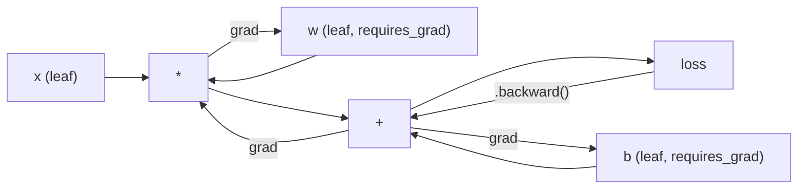
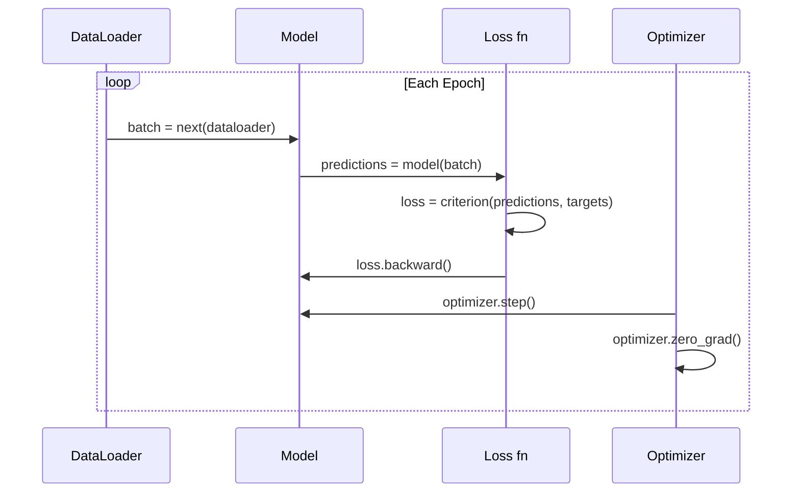

# PyTorch 入门

> 你曾用活塞和曲轴亲手造出引擎。现在来学真正上路的那一款。

**Type:** Build
**Languages:** Python
**Prerequisites:** Lesson 03.10 (Build Your Own Mini Framework)
**Time:** ~75 minutes

## 学习目标

- 使用 PyTorch 的 nn.Module、nn.Sequential 与 autograd 构建并训练神经网络
- 使用 PyTorch 张量、GPU 加速以及标准训练循环（zero_grad、forward、loss、backward、step）
- 将手写迷你框架的组件转换为对应的 PyTorch 等价实现
- 在同一任务上分析并比较纯 Python 框架与 PyTorch 的训练速度

## 问题

你已经有了一个可用的迷你框架。线性层、ReLU、dropout、batch norm、Adam、DataLoader、训练循环。它能用纯 Python 在一个圆形分类问题上训练一个 4 层网络。

但它在同一问题上比 PyTorch 慢 500 倍。

你的迷你框架用嵌套 Python 循环一次处理一个样本。PyTorch 则将同样的操作分派给优化的 C++/CUDA kernel，在 GPU 上运行。在单张 NVIDIA A100 上，PyTorch 训练 ResNet-50（2560 万参数）在 ImageNet（128 万张图片）上大约只需 6 小时。你的框架在同样的任务上大概需要 3000 小时——如果它没先耗尽内存的话。

速度并不是唯一的差距。你的框架没有 GPU 支持。没有自动微分——你得为每个模块手写 backward()。没有序列化。没有分布式训练。没有混合精度。没有除了 print 之外的梯度流调试手段。

PyTorch 填补了所有这些缺口。而且它用的是和你亲手搭建的一模一样的思维模型：Module、forward()、parameters()、backward()、optimizer.step()。概念一一对应，语法几乎一致。区别在于，PyTorch 在你从零设计的接口背后，封装了十年的系统工程。

## 概念

### 为什么 PyTorch 赢了

2015 年，TensorFlow 要求你先定义一个静态计算图，然后才能运行。你先建图，再编译，然后把数据喂进去。调试意味着盯着图可视化发呆。想改结构就得从头重建整个图。

PyTorch 于 2017 年推出，秉持不同的哲学：即时执行（eager execution）。你写 Python，它立即运行。`y = model(x)` 此刻就真的算出了 y，而不是「向一个稍后才会计算的图添加节点」。这意味着标准 Python 调试工具都能用。print() 能用。pdb 能用。forward 里写 if/else 也能用。

到 2020 年，市场已经给出答案。PyTorch 在机器学习论文中的占比从 2017 年的 7% 上升到 2022 年的 75% 以上。Meta、Google DeepMind、OpenAI、Anthropic 和 Hugging Face 都把 PyTorch 作为主要框架。TensorFlow 2.x 随后也采用了即时执行——这 tacitly 承认了 PyTorch 的设计是正确的。

教训是：开发者体验会复利。一个慢 10%、但调试快 50% 的框架终将胜出。

### 张量

张量（tensor）是具有三个关键属性的多维数组：shape、dtype 和 device。

```python
import torch

x = torch.zeros(3, 4)           # shape: (3, 4), dtype: float32, device: cpu
x = torch.randn(2, 3, 224, 224) # batch of 2 RGB images, 224x224
x = torch.tensor([1, 2, 3])     # from a Python list
```

**Shape** 是维度。标量的 shape 是 ()，向量是 (n,)，矩阵是 (m, n)，一批图片是 (batch, channels, height, width)。

**Dtype** 控制精度和内存。

| dtype | Bits | Range | Use case |
|-------|------|-------|----------|
| float32 | 32 | ~7 decimal digits | Default training |
| float16 | 16 | ~3.3 decimal digits | Mixed precision |
| bfloat16 | 16 | Same range as float32, less precision | LLM training |
| int8 | 8 | -128 to 127 | Quantized inference |

**Device** 决定计算发生在哪里。

```python
device = torch.device("cuda" if torch.cuda.is_available() else "cpu")
x = torch.randn(3, 4, device=device)
x = x.to("cuda")
x = x.cpu()
```

每个操作要求所有张量位于同一设备。这是初学者最常遇到的 PyTorch 错误：`RuntimeError: Expected all tensors to be on the same device`。解决办法是在计算前把所有张量移到同一设备上。

**Reshape** 是常数时间操作——它只改元数据，不改数据。

```python
x = torch.randn(2, 3, 4)
x.view(2, 12)      # reshape to (2, 12) -- must be contiguous
x.reshape(6, 4)    # reshape to (6, 4) -- works always
x.permute(2, 0, 1) # reorder dimensions
x.unsqueeze(0)     # add dimension: (1, 2, 3, 4)
x.squeeze()        # remove size-1 dimensions
```

### Autograd

你的迷你框架要求你为每个模块实现 backward()。PyTorch 不需要。它把张量上的每个操作记录成有向无环图（计算图），然后反向遍历该图来自动计算梯度。



与你框架的关键区别：PyTorch 使用基于 tape 的自动微分（tape-based autodiff）。前向传播时每个操作都追加到一条「tape」上。调用 `.backward()` 时按反向重放这条 tape。

```python
x = torch.randn(3, requires_grad=True)
y = x ** 2 + 3 * x
z = y.sum()
z.backward()
print(x.grad)  # dz/dx = 2x + 3
```

Autograd 的三条规则：

1. 只有 `requires_grad=True` 的 leaf tensor 才会累积梯度
2. 梯度默认会累积——每次反向传播前要调用 `optimizer.zero_grad()`
3. `torch.no_grad()` 会关闭梯度跟踪（评估时使用）

### nn.Module

`nn.Module` 是 PyTorch 中所有神经网络组件的基类。你在第 10 课已经构建过这个抽象。PyTorch 的版本额外提供了自动参数注册、递归模块发现、设备管理和状态字典序列化。

```python
import torch.nn as nn

class MLP(nn.Module):
    def __init__(self, input_dim, hidden_dim, output_dim):
        super().__init__()
        self.layer1 = nn.Linear(input_dim, hidden_dim)
        self.relu = nn.ReLU()
        self.layer2 = nn.Linear(hidden_dim, output_dim)

    def forward(self, x):
        x = self.layer1(x)
        x = self.relu(x)
        x = self.layer2(x)
        return x
```

当你在 `__init__` 里把 `nn.Module` 或 `nn.Parameter` 赋值给属性时，PyTorch 会自动注册它们。`model.parameters()` 会递归收集所有已注册的参数。这就是你不必像迷你框架那样手动汇总权重的原因。

关键构建模块：

| Module | What it does | Parameters |
|--------|-------------|------------|
| nn.Linear(in, out) | $Wx + b$ | in*out + out |
| nn.Conv2d(in_ch, out_ch, k) | 2D convolution | in_ch*out_ch*k*k + out_ch |
| nn.BatchNorm1d(features) | Normalize activations | 2 * features |
| nn.Dropout(p) | Random zeroing | 0 |
| nn.ReLU() | $\max(0, x)$ | 0 |
| nn.GELU() | Gaussian error linear | 0 |
| nn.Embedding(vocab, dim) | Lookup table | vocab * dim |
| nn.LayerNorm(dim) | Per-sample normalization | 2 * dim |

### 损失函数与优化器

PyTorch 内置了你亲手实现的所有东西的生产级版本。

**损失函数**（来自 `torch.nn`）：

| Loss | Task | Input |
|------|------|-------|
| nn.MSELoss() | Regression | Any shape |
| nn.CrossEntropyLoss() | Multi-class classification | Logits (not softmax) |
| nn.BCEWithLogitsLoss() | Binary classification | Logits (not sigmoid) |
| nn.L1Loss() | Regression (robust) | Any shape |
| nn.CTCLoss() | Sequence alignment | Log probabilities |

注意：`CrossEntropyLoss` 内部把 `LogSoftmax` 和 `NLLLoss` 合在一起。要传原始 logits，不要传 softmax 输出。这是一个常见错误，会悄无声息地产生错误梯度。

**优化器**（来自 `torch.optim`）：

| Optimizer | When to use | Typical LR |
|-----------|-------------|-----------|
| SGD(params, lr, momentum) | CNNs, well-tuned pipelines | 0.01--0.1 |
| Adam(params, lr) | Default starting point | 1e-3 |
| AdamW(params, lr, weight_decay) | Transformers, fine-tuning | 1e-4--1e-3 |
| LBFGS(params) | Small-scale, second-order | 1.0 |

### 训练循环

每个 PyTorch 训练循环都遵循同样的 5 步模式。你在第 10 课已经学过。



标准写法：

```python
for epoch in range(num_epochs):
    model.train()
    for inputs, targets in train_loader:
        inputs, targets = inputs.to(device), targets.to(device)
        optimizer.zero_grad()
        outputs = model(inputs)
        loss = criterion(outputs, targets)
        loss.backward()
        optimizer.step()
```

batch 循环里的五行代码。就是这五行训练了 GPT-4、Stable Diffusion 和 LLaMA。架构会变，数据会变，这五行不会变。

### Dataset 与 DataLoader

PyTorch 的 `Dataset` 是一个抽象类，有两个方法：`__len__` 和 `__getitem__`。`DataLoader` 在此基础上提供批处理、打乱顺序和多进程数据加载。

```python
from torch.utils.data import Dataset, DataLoader

class MNISTDataset(Dataset):
    def __init__(self, images, labels):
        self.images = images
        self.labels = labels

    def __len__(self):
        return len(self.labels)

    def __getitem__(self, idx):
        return self.images[idx], self.labels[idx]

loader = DataLoader(dataset, batch_size=64, shuffle=True, num_workers=4)
```

`num_workers=4` 会启动 4 个进程，在 GPU 训练当前 batch 的同时并行加载数据。在磁盘受限的工作负载（大图片、音频）上，仅此一项就能让训练速度翻倍。

### GPU 训练

把模型移到 GPU：

```python
device = torch.device("cuda" if torch.cuda.is_available() else "cpu")
model = model.to(device)
```

这会递归地把所有参数和 buffer 移到 GPU。然后在训练时把每个 batch 也移过去：

```python
inputs, targets = inputs.to(device), targets.to(device)
```

**混合精度**（Mixed precision）在现代 GPU（A100、H100、RTX 4090）上可以把内存占用减半、吞吐翻倍：前向/反向用 float16 计算，主权重保留 float32：

```python
from torch.amp import autocast, GradScaler

scaler = GradScaler()
for inputs, targets in loader:
    with autocast(device_type="cuda"):
        outputs = model(inputs)
        loss = criterion(outputs, targets)
    scaler.scale(loss).backward()
    scaler.step(optimizer)
    scaler.update()
    optimizer.zero_grad()
```

### 对比：迷你框架、PyTorch 与 JAX

| Feature | Mini Framework (L10) | PyTorch | JAX |
|---------|---------------------|---------|-----|
| Autodiff | Manual backward() | Tape-based autograd | Functional transforms |
| Execution | Eager (Python loops) | Eager (C++ kernels) | Traced + JIT compiled |
| GPU support | No | Yes (CUDA, ROCm, MPS) | Yes (CUDA, TPU) |
| Speed (MNIST MLP) | ~300s/epoch | ~0.5s/epoch | ~0.3s/epoch |
| Module system | Custom Module class | nn.Module | Stateless functions (Flax/Equinox) |
| Debugging | print() | print(), pdb, breakpoint() | Harder (JIT tracing breaks print) |
| Ecosystem | None | Hugging Face, Lightning, timm | Flax, Optax, Orbax |
| Learning curve | You built it | Moderate | Steep (functional paradigm) |
| Production use | Toy problems | Meta, OpenAI, Anthropic, HF | Google DeepMind, Midjourney |

```figure
dropout-mask
```

## 构建它

用纯 PyTorch 原语训练一个 3 层 MLP，在 MNIST 上分类。不用高层封装，不用 `torchvision.datasets`。我们自己下载并解析原始数据。

### 第 1 步：从原始文件加载 MNIST

MNIST 以 4 个 gzip 文件发布：训练图片（60,000 × 28 × 28）、训练标签、测试图片（10,000 × 28 × 28）、测试标签。我们下载它们并解析二进制格式。

```python
import torch
import torch.nn as nn
import struct
import gzip
import urllib.request
import os

def download_mnist(path="./mnist_data"):
    base_url = "https://storage.googleapis.com/cvdf-datasets/mnist/"
    files = [
        "train-images-idx3-ubyte.gz",
        "train-labels-idx1-ubyte.gz",
        "t10k-images-idx3-ubyte.gz",
        "t10k-labels-idx1-ubyte.gz",
    ]
    os.makedirs(path, exist_ok=True)
    for f in files:
        filepath = os.path.join(path, f)
        if not os.path.exists(filepath):
            urllib.request.urlretrieve(base_url + f, filepath)

def load_images(filepath):
    with gzip.open(filepath, "rb") as f:
        magic, num, rows, cols = struct.unpack(">IIII", f.read(16))
        data = f.read()
        images = torch.frombuffer(bytearray(data), dtype=torch.uint8)
        images = images.reshape(num, rows * cols).float() / 255.0
    return images

def load_labels(filepath):
    with gzip.open(filepath, "rb") as f:
        magic, num = struct.unpack(">II", f.read(8))
        data = f.read()
        labels = torch.frombuffer(bytearray(data), dtype=torch.uint8).long()
    return labels
```

### 第 2 步：定义模型

一个 3 层 MLP：784 -> 256 -> 128 -> 10。ReLU 激活。Dropout 正则化。为了简单不加 batch norm。

```python
class MNISTModel(nn.Module):
    def __init__(self):
        super().__init__()
        self.net = nn.Sequential(
            nn.Linear(784, 256),
            nn.ReLU(),
            nn.Dropout(0.2),
            nn.Linear(256, 128),
            nn.ReLU(),
            nn.Dropout(0.2),
            nn.Linear(128, 10),
        )

    def forward(self, x):
        return self.net(x)
```

输出层产生 10 个原始 logits（每个数字一个）。不加 softmax——`CrossEntropyLoss` 内部会处理。

参数量：$784 \cdot 256 + 256 + 256 \cdot 128 + 128 + 128 \cdot 10 + 10 = 235{,}146$。按现代标准非常小。GPT-2 small 有 124M 参数。这个几秒就能训练完。

### 第 3 步：训练循环

标准的前向-损失-反向-更新模式。

```python
def train_one_epoch(model, loader, criterion, optimizer, device):
    model.train()
    total_loss = 0
    correct = 0
    total = 0
    for images, labels in loader:
        images, labels = images.to(device), labels.to(device)
        optimizer.zero_grad()
        outputs = model(images)
        loss = criterion(outputs, labels)
        loss.backward()
        optimizer.step()
        total_loss += loss.item() * images.size(0)
        _, predicted = outputs.max(1)
        correct += predicted.eq(labels).sum().item()
        total += labels.size(0)
    return total_loss / total, correct / total


def evaluate(model, loader, criterion, device):
    model.eval()
    total_loss = 0
    correct = 0
    total = 0
    with torch.no_grad():
        for images, labels in loader:
            images, labels = images.to(device), labels.to(device)
            outputs = model(images)
            loss = criterion(outputs, labels)
            total_loss += loss.item() * images.size(0)
            _, predicted = outputs.max(1)
            correct += predicted.eq(labels).sum().item()
            total += labels.size(0)
    return total_loss / total, correct / total
```

注意评估时要用 `torch.no_grad()`。这会关闭 autograd，减少内存占用并加速推理。不用的话，PyTorch 会构建一个你根本不会用的计算图。

### 第 4 步：把所有东西拼起来

```python
def main():
    device = torch.device("cuda" if torch.cuda.is_available() else "cpu")

    download_mnist()
    train_images = load_images("./mnist_data/train-images-idx3-ubyte.gz")
    train_labels = load_labels("./mnist_data/train-labels-idx1-ubyte.gz")
    test_images = load_images("./mnist_data/t10k-images-idx3-ubyte.gz")
    test_labels = load_labels("./mnist_data/t10k-labels-idx1-ubyte.gz")

    train_dataset = torch.utils.data.TensorDataset(train_images, train_labels)
    test_dataset = torch.utils.data.TensorDataset(test_images, test_labels)
    train_loader = torch.utils.data.DataLoader(
        train_dataset, batch_size=64, shuffle=True
    )
    test_loader = torch.utils.data.DataLoader(
        test_dataset, batch_size=256, shuffle=False
    )

    model = MNISTModel().to(device)
    criterion = nn.CrossEntropyLoss()
    optimizer = torch.optim.Adam(model.parameters(), lr=1e-3)

    num_params = sum(p.numel() for p in model.parameters())
    print(f"Device: {device}")
    print(f"Parameters: {num_params:,}")
    print(f"Train samples: {len(train_dataset):,}")
    print(f"Test samples: {len(test_dataset):,}")
    print()

    for epoch in range(10):
        train_loss, train_acc = train_one_epoch(
            model, train_loader, criterion, optimizer, device
        )
        test_loss, test_acc = evaluate(
            model, test_loader, criterion, device
        )
        print(
            f"Epoch {epoch+1:2d} | "
            f"Train Loss: {train_loss:.4f} | Train Acc: {train_acc:.4f} | "
            f"Test Loss: {test_loss:.4f} | Test Acc: {test_acc:.4f}"
        )

    torch.save(model.state_dict(), "mnist_mlp.pt")
    print(f"\nModel saved to mnist_mlp.pt")
    print(f"Final test accuracy: {test_acc:.4f}")
```

训练 10 个 epoch 后的预期结果：测试准确率约 97.8%。CPU 训练时间约 30 秒，GPU 约 5 秒。用同架构的迷你框架：约 45 分钟。

## 使用它

### 快速对比：迷你框架 vs PyTorch

| Mini Framework (Lesson 10) | PyTorch |
|---------------------------|---------|
| `model = Sequential(Linear(784, 256), ReLU(), ...)` | `model = nn.Sequential(nn.Linear(784, 256), nn.ReLU(), ...)` |
| `pred = model.forward(x)` | `pred = model(x)` |
| `optimizer.zero_grad()` | `optimizer.zero_grad()` |
| `grad = criterion.backward()` then `model.backward(grad)` | `loss.backward()` |
| `optimizer.step()` | `optimizer.step()` |
| No GPU | `model.to("cuda")` |
| Manual backward for every module | Autograd handles everything |

接口几乎一模一样。区别全在底层。

### 保存与加载模型

```python
torch.save(model.state_dict(), "model.pt")

model = MNISTModel()
model.load_state_dict(torch.load("model.pt", weights_only=True))
model.eval()
```

始终保存 `state_dict()`（参数字典），而不是模型对象。保存模型对象会用到 pickle，代码重构后就会坏掉。state dict 是可移植的。

### 学习率调度

```python
scheduler = torch.optim.lr_scheduler.CosineAnnealingLR(
    optimizer, T_max=10
)
for epoch in range(10):
    train_one_epoch(model, train_loader, criterion, optimizer, device)
    scheduler.step()
```

PyTorch 内置了 15 种以上调度器：StepLR、ExponentialLR、CosineAnnealingLR、OneCycleLR、ReduceLROnPlateau。它们都接入同一个优化器接口。

## 交付它

本课产生两个产物：

- `outputs/prompt-pytorch-debugger.md` —— 一个用于诊断常见 PyTorch 训练失败的 prompt
- `outputs/skill-pytorch-patterns.md` —— 一份 PyTorch 训练模式的技能参考

## 练习

1. **添加 batch normalization。** 在每个线性层后（激活前）插入 `nn.BatchNorm1d`。对比 dropout-only 版本的测试准确率和训练速度。Batch norm 通常能在更少 epoch 内达到 98% 以上。

2. **实现学习率查找器。** 用一个 epoch 让学习率从 1e-7 指数增长到 1.0，绘制 loss 与 LR 的关系。最优 LR 就在损失开始上升之前。用它给 MNIST 模型选个更好的 LR。

3. **用混合精度移植到 GPU。** 在训练循环中加入 `torch.amp.autocast` 和 `GradScaler`。测量 GPU 上开/关混合精度的吞吐（samples/second）。在 A100 上预计有约 2 倍加速。

4. **构建自定义 Dataset。** 下载 Fashion-MNIST（格式与 MNIST 相同，但内容是服饰）。实现 `FashionMNISTDataset(Dataset)` 类，包含 `__getitem__` 和 `__len__`。用同一个 MLP 训练并比较准确率。Fashion-MNIST 更难——预计约 88%，而 MNIST 约 98%。

5. **把 Adam 换成 SGD + momentum。** 用 `SGD(params, lr=0.01, momentum=0.9)` 训练。对比收敛曲线。然后加上 `CosineAnnealingLR` 调度器，看 SGD 到第 10 个 epoch 是否能追上 Adam。

## 关键术语

| Term | What people say | What it actually means |
|------|----------------|----------------------|
| Tensor | "A multi-dimensional array" | A typed, device-aware array with automatic differentiation support baked into every operation |
| Autograd | "Automatic backprop" | A tape-based system that records operations during forward pass, then replays them in reverse to compute exact gradients |
| nn.Module | "A layer" | The base class for any differentiable computation block -- registers parameters, supports nesting, handles train/eval modes |
| state_dict | "The model weights" | An OrderedDict mapping parameter names to tensors -- the portable, serializable representation of a trained model |
| .backward() | "Compute gradients" | Traverse the computational graph in reverse, computing and accumulating gradients for every leaf tensor with requires_grad=True |
| .to(device) | "Move to GPU" | Recursively transfer all parameters and buffers to the specified device (CPU, CUDA, MPS) |
| DataLoader | "The data pipeline" | An iterator that batches, shuffles, and optionally parallelizes data loading from a Dataset |
| Mixed precision | "Use float16" | Train with float16 forward/backward for speed while keeping float32 master weights for numerical stability |
| Eager execution | "Run it now" | Operations execute immediately when called, not deferred to a later compilation step -- the core design choice that differentiates PyTorch from TF 1.x |
| zero_grad | "Reset gradients" | Set all parameter gradients to zero before the next backward pass, since PyTorch accumulates gradients by default |

## 延伸阅读

- Paszke et al., "PyTorch: An Imperative Style, High-Performance Deep Learning Library" (2019) —— 解释 PyTorch 设计权衡的原始论文
- PyTorch Tutorials: "Learning PyTorch with Examples" (https://pytorch.org/tutorials/beginner/pytorch_with_examples.html) —— 官方从张量到 nn.Module 的入门路径
- PyTorch Performance Tuning Guide (https://pytorch.org/tutorials/recipes/recipes/tuning_guide.html) —— 混合精度、DataLoader workers、固定内存及其他生产优化
- Horace He, "Making Deep Learning Go Brrrr" (https://horace.io/brrr_intro.html) —— GPU 训练为什么快，以及 PyTorch 专属优化策略
