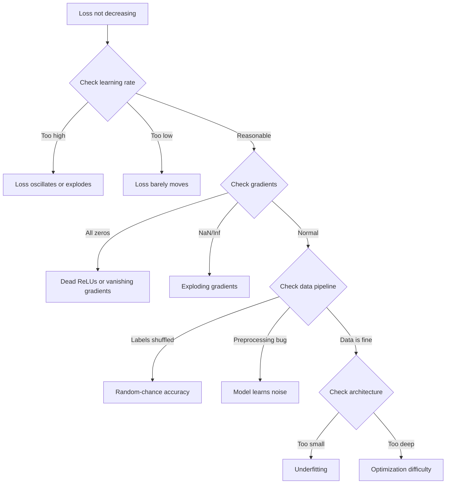
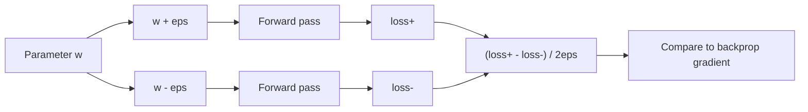
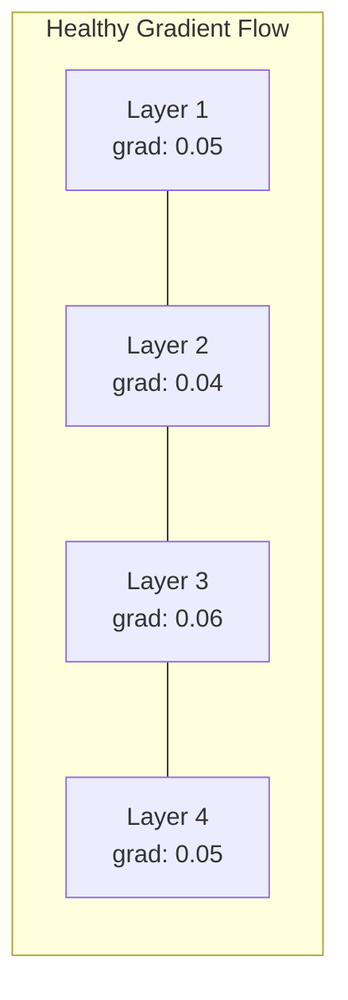
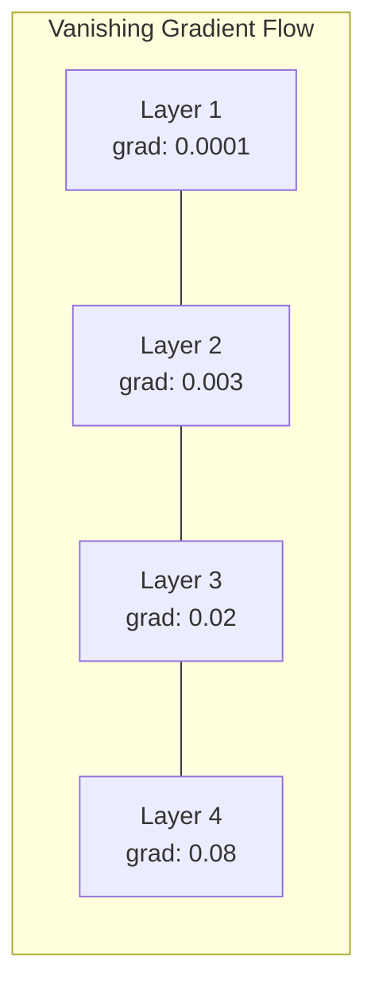
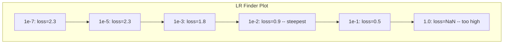

# 调试神经网络

> 你的网络编译通过了，也运行了，还输出了一个数字。这个数字是错的，但没有任何崩溃。欢迎来到最难的调试类型——没有错误提示的那种。

**Type:** Build
**Languages:** Python, PyTorch
**Prerequisites:** Phase 03 Lessons 01-10 (especially backpropagation, loss functions, optimizers)
**Time:** ~90 minutes

## 学习目标

- 用系统化的调试策略诊断常见神经网络故障（NaN 损失、损失曲线平坦、过拟合、振荡）
- 应用「单 batch 过拟合」技术验证模型架构和训练循环是否正确
- 检查梯度大小、激活分布和权重范数，识别梯度消失/爆炸问题
- 建立一份覆盖数据管道、模型架构、损失函数、优化器和学习率的调试检查清单

## 问题

传统软件出问题时会展。空指针会抛异常，类型不匹配会在编译期失败，差一错误会产生明显错误的输出。

神经网络不会给你这种奢侈。

一个坏的神经网络会运行到结束，打印一个损失值，输出预测。损失可能还会下降，预测看起来也似乎合理。但模型其实是默默错的——它在学捷径、记忆噪声，或者收敛到一个无用的局部最小值。Google 研究人员估计，60–70% 的机器学习调试时间都花在「沉默」bug 上：它们不报错，但会降低模型质量。

工作模型与坏模型之间的差距往往只是一行放错位置的代码：一个漏掉的 `zero_grad()`、一个转置的维度、一个差了 10 倍的学习率。那篇经典的 "Recipe for Training Neural Networks"（2019）开头就是这样说的：「最常见的神经网络错误是不报错的 bug。」

本课教你如何找到这些 bug。

## 概念

### 调试心态

忘掉「打印加祈祷」式调试。神经网络调试需要系统化方法，因为反馈循环很慢（每次训练要几分钟到几小时），而且症状很模糊（损失不好可能意味着 20 种不同的事情）。

黄金法则：**从简单开始，每次只加一块复杂度，并独立验证每一块。**



### 症状 1：损失不下降

这是最常见的抱怨。训练循环在跑，epoch 在走，但损失保持平坦或剧烈波动。

**学习率不对。** 太高：损失振荡或跳到 NaN。太低：损失下降得极慢，看起来像平的。Adam 从 1e-3 开始，SGD 从 1e-1 或 1e-2 开始。在断定是其他问题之前，务必先试 3 个学习率，每个相差 10 倍（例如 1e-2、1e-3、1e-4）。

**Dead ReLU。** 如果某个 ReLU 神经元收到很大的负输入，它会输出 0，且梯度为 0。它再也不会激活。如果死的神经元够多，网络就无法学习。检查方法：打印每个 ReLU 层后精确为 0 的激活比例。如果超过 50% 都死了，就换成 LeakyReLU 或降低学习率。

**梯度消失。** 在使用 sigmoid 或 tanh 激活的深层网络中，梯度在反向传播时指数级缩小。等它们到达第一层时几乎为 0，第一层就停止学习。修复：用 ReLU/GELU、加残差连接，或用 batch normalization。

**梯度爆炸。** 相反的问题——梯度指数级增长。在 RNN 和极深网络中很常见。损失会跳到 NaN。修复：梯度裁剪（`torch.nn.utils.clip_grad_norm_`）、降低学习率，或加归一化。

### 症状 2：损失在降，但模型很差

损失下降了，训练准确率到了 99%，但测试准确率只有 55%；或者模型在真实数据上输出无意义结果。

**过拟合。** 模型记住了训练数据，而不是学习规律。训练损失与验证损失之间的差距随时间扩大。修复：更多数据、dropout、权重衰减、早停、数据增强。

**数据泄漏。** 测试数据漏进了训练集。准确率 suspiciously 高。常见原因：在拆分前先打乱、用完整数据集的统计量做预处理、不同 split 之间有重复样本。修复：先拆分再预处理，检查重复。

**标签错误。** 大多数真实数据集中有 5–10% 的标签是错的（Northcutt et al., 2021 —— "Pervasive Label Errors in Test Sets"）。模型学会了这些噪声。修复：用 confident learning 找出并修正错误标签，或用 loss truncation 忽略高损失样本。

### 症状 3：损失中出现 NaN 或 Inf

损失值变成 `nan` 或 `inf`。训练已死。

**学习率太高。** 梯度更新幅度过大，导致权重爆炸。修复：降低 10 倍。

**log(0) 或 log(负数)。** 交叉熵计算 `log(p)`。如果模型输出精确的 0 或负概率，log 会爆炸。修复：把预测值 clamp 到 `[eps, 1-eps]`，其中 `eps=1e-7`。

**除以零。** Batch normalization 要除以标准差。如果一个 batch 的值全一样，std=0。修复：在分母上加 epsilon（PyTorch 默认会这样做，但自定义实现可能不会）。

**数值溢出。** 大激活值喂进 `exp()` 会产生 Inf。Softmax 特别容易。修复：在指数化前先减去最大值（log-sum-exp 技巧）。

### 技术 1：梯度检查

把解析梯度（来自反向传播）和数值梯度（来自有限差分）做比较。如果它们不一致，说明反向传播有 bug。

参数 `w` 的数值梯度：

```math
\text{grad\_numerical} = \frac{\text{loss}(w + \text{eps}) - \text{loss}(w - \text{eps})}{2 \cdot \text{eps}}
```

一致度指标（相对差异）：

```math
\text{rel\_diff} = \frac{\lvert \text{grad\_analytical} - \text{grad\_numerical} \rvert}{\max(\lvert \text{grad\_analytical} \rvert, \lvert \text{grad\_numerical} \rvert, 10^{-8})}
```

如果 `rel_diff < 1e-5`：正确。如果 `rel_diff > 1e-3`：几乎肯定有 bug。



### 技术 2：激活统计

在训练过程中监测每层输出的均值和标准差。健康的网络会保持激活值均值接近 0、标准差接近 1（归一化后），或至少是有界的。

| Health indicator | Mean | Std | Diagnosis |
|-----------------|------|-----|-----------|
| Healthy | ~0 | ~1 | Network is learning normally |
| Saturated | >>0 or <<0 | ~0 | Activations stuck at extreme values |
| Dead | 0 | 0 | Neurons are dead (all zeros) |
| Exploding | >>10 | >>10 | Activations growing without bound |

### 技术 3：梯度流可视化

绘制每层的平均梯度大小。在健康网络中，各层梯度大小应该大致相近。如果早期层的梯度比后期层小 1000 倍，就是梯度消失。





### 技术 4：单 Batch 过拟合测试

这是深度学习里最重要的调试技术。

取一个小 batch（8–32 个样本），用它训练 100 步以上。损失应该降到接近 0，训练准确率应该达到 100%。如果没有，说明你的模型或训练循环有根本性 bug——不要继续全量训练。

这个测试能抓住：
- 坏的损失函数
- 坏的反向传播
- 模型容量太小，无法表示数据
- 优化器没有连到模型参数
- 数据和标签没对齐

它只要 30 秒就能跑完，却能省下几小时的全量训练调试时间。

### 技术 5：学习率查找器

Leslie Smith（2017）提出在一个 epoch 内把学习率从非常小（1e-7）扫到非常大（10），同时记录损失。绘制损失 vs 学习率。最优学习率大致是损失下降最快那个学习率的 1/10。



本例中的最佳学习率：~1e-3（最陡点前一个数量级）。

### 常见 PyTorch Bug

这些是 PyTorch 社区里最浪费大家时间的 bug：

| Bug | Symptom | Fix |
|-----|---------|-----|
| Forgetting `optimizer.zero_grad()` | Gradients accumulate across batches, loss oscillates | Add `optimizer.zero_grad()` before `loss.backward()` |
| Forgetting `model.eval()` at test time | Dropout and batch norm behave differently, test accuracy varies between runs | Add `model.eval()` and `torch.no_grad()` |
| Wrong tensor shapes | Silent broadcasting produces wrong results, no error | Print shapes after every operation during debugging |
| CPU/GPU mismatch | `RuntimeError: expected CUDA tensor` | Use `.to(device)` on model AND data |
| Not detaching tensors | Computation graph grows forever, OOM | Use `.detach()` or `with torch.no_grad()` |
| In-place operations breaking autograd | `RuntimeError: modified by in-place operation` | Replace `x += 1` with `x = x + 1` |
| Data not normalized | Loss stuck at random-chance level | Normalize inputs to mean=0, std=1 |
| Labels as wrong dtype | Cross-entropy expects `Long`, got `Float` | Cast labels: `labels.long()` |

### 调试总表

| Symptom | Likely cause | First thing to try |
|---------|-------------|-------------------|
| Loss stuck at -log(1/num_classes) | Model predicting uniform distribution | Check data pipeline, verify labels match inputs |
| Loss NaN after a few steps | Learning rate too high | Reduce LR by 10x |
| Loss NaN immediately | log(0) or division by zero | Add epsilon to log/division operations |
| Loss oscillating wildly | LR too high or batch size too small | Reduce LR, increase batch size |
| Loss decreasing then plateaus | LR too high for fine-tuning phase | Add LR schedule (cosine or step decay) |
| Training acc high, test acc low | Overfitting | Add dropout, weight decay, more data |
| Training acc = test acc = chance | Model not learning anything | Run overfit-one-batch test |
| Training acc = test acc but both low | Underfitting | Bigger model, more layers, more features |
| Gradients all zero | Dead ReLUs or detached computation graph | Switch to LeakyReLU, check `.requires_grad` |
| Out of memory during training | Batch too large or graph not freed | Reduce batch size, use `torch.no_grad()` for eval |

```figure
learning-curves
```

## 构建它

构建一个诊断工具包，监测激活、梯度和损失曲线。我们会故意把网络搞坏，再用工具包诊断每种问题。

### 第 1 步：NetworkDebugger 类

通过 hook 进入 PyTorch 模型，记录每层的激活与梯度统计。

```python
import torch
import torch.nn as nn
import math


class NetworkDebugger:
    def __init__(self, model):
        self.model = model
        self.activation_stats = {}
        self.gradient_stats = {}
        self.loss_history = []
        self.lr_losses = []
        self.hooks = []
        self._register_hooks()

    def _register_hooks(self):
        for name, module in self.model.named_modules():
            if isinstance(module, (nn.Linear, nn.Conv2d, nn.ReLU, nn.LeakyReLU)):
                hook = module.register_forward_hook(self._make_activation_hook(name))
                self.hooks.append(hook)
                hook = module.register_full_backward_hook(self._make_gradient_hook(name))
                self.hooks.append(hook)

    def _make_activation_hook(self, name):
        def hook(module, input, output):
            with torch.no_grad():
                out = output.detach().float()
                self.activation_stats[name] = {
                    "mean": out.mean().item(),
                    "std": out.std().item(),
                    "fraction_zero": (out == 0).float().mean().item(),
                    "min": out.min().item(),
                    "max": out.max().item(),
                }
        return hook

    def _make_gradient_hook(self, name):
        def hook(module, grad_input, grad_output):
            if grad_output[0] is not None:
                with torch.no_grad():
                    grad = grad_output[0].detach().float()
                    self.gradient_stats[name] = {
                        "mean": grad.mean().item(),
                        "std": grad.std().item(),
                        "abs_mean": grad.abs().mean().item(),
                        "max": grad.abs().max().item(),
                    }
        return hook

    def record_loss(self, loss_value):
        self.loss_history.append(loss_value)

    def check_loss_health(self):
        if len(self.loss_history) < 2:
            return "NOT_ENOUGH_DATA"
        recent = self.loss_history[-10:]
        if any(math.isnan(v) or math.isinf(v) for v in recent):
            return "NAN_OR_INF"
        if len(self.loss_history) >= 20:
            first_half = sum(self.loss_history[:10]) / 10
            second_half = sum(self.loss_history[-10:]) / 10
            if second_half >= first_half * 0.99:
                return "NOT_DECREASING"
        if len(recent) >= 5:
            diffs = [recent[i+1] - recent[i] for i in range(len(recent)-1)]
            if max(diffs) - min(diffs) > 2 * abs(sum(diffs) / len(diffs)):
                return "OSCILLATING"
        return "HEALTHY"

    def check_activations(self):
        issues = []
        for name, stats in self.activation_stats.items():
            if stats["fraction_zero"] > 0.5:
                issues.append(f"DEAD_NEURONS: {name} has {stats['fraction_zero']:.0%} zero activations")
            if abs(stats["mean"]) > 10:
                issues.append(f"EXPLODING_ACTIVATIONS: {name} mean={stats['mean']:.2f}")
            if stats["std"] < 1e-6:
                issues.append(f"COLLAPSED_ACTIVATIONS: {name} std={stats['std']:.2e}")
        return issues if issues else ["HEALTHY"]

    def check_gradients(self):
        issues = []
        grad_magnitudes = []
        for name, stats in self.gradient_stats.items():
            grad_magnitudes.append((name, stats["abs_mean"]))
            if stats["abs_mean"] < 1e-7:
                issues.append(f"VANISHING_GRADIENT: {name} abs_mean={stats['abs_mean']:.2e}")
            if stats["abs_mean"] > 100:
                issues.append(f"EXPLODING_GRADIENT: {name} abs_mean={stats['abs_mean']:.2e}")
        if len(grad_magnitudes) >= 2:
            first_mag = grad_magnitudes[0][1]
            last_mag = grad_magnitudes[-1][1]
            if last_mag > 0 and first_mag / last_mag > 100:
                issues.append(f"GRADIENT_RATIO: first/last = {first_mag/last_mag:.0f}x (vanishing)")
        return issues if issues else ["HEALTHY"]

    def print_report(self):
        print("\n=== NETWORK DEBUGGER REPORT ===")
        print(f"\nLoss health: {self.check_loss_health()}")
        if self.loss_history:
            print(f"  Last 5 losses: {[f'{v:.4f}' for v in self.loss_history[-5:]]}")
        print("\nActivation diagnostics:")
        for item in self.check_activations():
            print(f"  {item}")
        print("\nGradient diagnostics:")
        for item in self.check_gradients():
            print(f"  {item}")
        print("\nPer-layer activation stats:")
        for name, stats in self.activation_stats.items():
            print(f"  {name}: mean={stats['mean']:.4f} std={stats['std']:.4f} zero={stats['fraction_zero']:.1%}")
        print("\nPer-layer gradient stats:")
        for name, stats in self.gradient_stats.items():
            print(f"  {name}: abs_mean={stats['abs_mean']:.2e} max={stats['max']:.2e}")

    def remove_hooks(self):
        for hook in self.hooks:
            hook.remove()
        self.hooks.clear()
```

### 第 2 步：单 Batch 过拟合测试

```python
def overfit_one_batch(model, x_batch, y_batch, criterion, lr=0.01, steps=200):
    optimizer = torch.optim.Adam(model.parameters(), lr=lr)
    model.train()
    print("\n=== OVERFIT ONE BATCH TEST ===")
    print(f"Batch size: {x_batch.shape[0]}, Steps: {steps}")

    for step in range(steps):
        optimizer.zero_grad()
        output = model(x_batch)
        loss = criterion(output, y_batch)
        loss.backward()
        optimizer.step()

        if step % 50 == 0 or step == steps - 1:
            with torch.no_grad():
                preds = (output > 0).float() if output.shape[-1] == 1 else output.argmax(dim=1)
                targets = y_batch if y_batch.dim() == 1 else y_batch.squeeze()
                acc = (preds.squeeze() == targets).float().mean().item()
            print(f"  Step {step:3d} | Loss: {loss.item():.6f} | Accuracy: {acc:.1%}")

    final_loss = loss.item()
    if final_loss > 0.1:
        print(f"\n  FAIL: Loss did not converge ({final_loss:.4f}). Model or training loop is broken.")
        return False
    print(f"\n  PASS: Loss converged to {final_loss:.6f}")
    return True
```

### 第 3 步：学习率查找器

```python
def find_learning_rate(model, x_data, y_data, criterion, start_lr=1e-7, end_lr=10, steps=100):
    import copy
    original_state = copy.deepcopy(model.state_dict())
    optimizer = torch.optim.SGD(model.parameters(), lr=start_lr)
    lr_mult = (end_lr / start_lr) ** (1 / steps)

    model.train()
    results = []
    best_loss = float("inf")
    current_lr = start_lr

    print("\n=== LEARNING RATE FINDER ===")

    for step in range(steps):
        optimizer.zero_grad()
        output = model(x_data)
        loss = criterion(output, y_data)

        if math.isnan(loss.item()) or loss.item() > best_loss * 10:
            break

        best_loss = min(best_loss, loss.item())
        results.append((current_lr, loss.item()))

        loss.backward()
        optimizer.step()

        current_lr *= lr_mult
        for param_group in optimizer.param_groups:
            param_group["lr"] = current_lr

    model.load_state_dict(original_state)

    if len(results) < 10:
        print("  Could not complete LR sweep -- loss diverged too quickly")
        return results

    min_loss_idx = min(range(len(results)), key=lambda i: results[i][1])
    suggested_lr = results[max(0, min_loss_idx - 10)][0]

    print(f"  Swept {len(results)} steps from {start_lr:.0e} to {results[-1][0]:.0e}")
    print(f"  Minimum loss {results[min_loss_idx][1]:.4f} at lr={results[min_loss_idx][0]:.2e}")
    print(f"  Suggested learning rate: {suggested_lr:.2e}")

    return results
```

### 第 4 步：梯度检查

```python
def _flat_to_multi_index(flat_idx, shape):
    multi_idx = []
    remaining = flat_idx
    for dim in reversed(shape):
        multi_idx.insert(0, remaining % dim)
        remaining //= dim
    return tuple(multi_idx)


def gradient_check(model, x, y, criterion, eps=1e-4):
    model.train()
    x_double = x.double()
    y_double = y.double()
    model_double = model.double()

    print("\n=== GRADIENT CHECK ===")
    overall_max_diff = 0
    checked = 0

    for name, param in model_double.named_parameters():
        if not param.requires_grad:
            continue

        layer_max_diff = 0

        model_double.zero_grad()
        output = model_double(x_double)
        loss = criterion(output, y_double)
        loss.backward()
        analytical_grad = param.grad.clone()

        num_checks = min(5, param.numel())
        for i in range(num_checks):
            idx = _flat_to_multi_index(i, param.shape)
            original = param.data[idx].item()

            param.data[idx] = original + eps
            with torch.no_grad():
                loss_plus = criterion(model_double(x_double), y_double).item()

            param.data[idx] = original - eps
            with torch.no_grad():
                loss_minus = criterion(model_double(x_double), y_double).item()

            param.data[idx] = original

            numerical = (loss_plus - loss_minus) / (2 * eps)
            analytical = analytical_grad[idx].item()

            denom = max(abs(numerical), abs(analytical), 1e-8)
            rel_diff = abs(numerical - analytical) / denom

            layer_max_diff = max(layer_max_diff, rel_diff)
            checked += 1

        overall_max_diff = max(overall_max_diff, layer_max_diff)
        status = "OK" if layer_max_diff < 1e-5 else "MISMATCH"
        print(f"  {name}: max_rel_diff={layer_max_diff:.2e} [{status}]")

    model.float()

    print(f"\n  Checked {checked} parameters")
    if overall_max_diff < 1e-5:
        print("  PASS: Gradients match (rel_diff < 1e-5)")
    elif overall_max_diff < 1e-3:
        print("  WARN: Small differences (1e-5 < rel_diff < 1e-3)")
    else:
        print("  FAIL: Gradient mismatch detected (rel_diff > 1e-3)")
    return overall_max_diff
```

### 第 5 步：故意搞坏的网络

现在把工具包应用到几个坏网络上，分别诊断。

```python
def demo_broken_networks():
    torch.manual_seed(42)
    x = torch.randn(64, 10)
    y = (x[:, 0] > 0).long()

    print("\n" + "=" * 60)
    print("BUG 1: Learning rate too high (lr=10)")
    print("=" * 60)
    model1 = nn.Sequential(nn.Linear(10, 32), nn.ReLU(), nn.Linear(32, 2))
    debugger1 = NetworkDebugger(model1)
    optimizer1 = torch.optim.SGD(model1.parameters(), lr=10.0)
    criterion = nn.CrossEntropyLoss()
    for step in range(20):
        optimizer1.zero_grad()
        out = model1(x)
        loss = criterion(out, y)
        debugger1.record_loss(loss.item())
        loss.backward()
        optimizer1.step()
    debugger1.print_report()
    debugger1.remove_hooks()

    print("\n" + "=" * 60)
    print("BUG 2: Dead ReLUs from bad initialization")
    print("=" * 60)
    model2 = nn.Sequential(nn.Linear(10, 32), nn.ReLU(), nn.Linear(32, 32), nn.ReLU(), nn.Linear(32, 2))
    with torch.no_grad():
        for m in model2.modules():
            if isinstance(m, nn.Linear):
                m.weight.fill_(-1.0)
                m.bias.fill_(-5.0)
    debugger2 = NetworkDebugger(model2)
    optimizer2 = torch.optim.Adam(model2.parameters(), lr=1e-3)
    for step in range(50):
        optimizer2.zero_grad()
        out = model2(x)
        loss = criterion(out, y)
        debugger2.record_loss(loss.item())
        loss.backward()
        optimizer2.step()
    debugger2.print_report()
    debugger2.remove_hooks()

    print("\n" + "=" * 60)
    print("BUG 3: Missing zero_grad (gradients accumulate)")
    print("=" * 60)
    model3 = nn.Sequential(nn.Linear(10, 32), nn.ReLU(), nn.Linear(32, 2))
    debugger3 = NetworkDebugger(model3)
    optimizer3 = torch.optim.SGD(model3.parameters(), lr=0.01)
    for step in range(50):
        out = model3(x)
        loss = criterion(out, y)
        debugger3.record_loss(loss.item())
        loss.backward()
        optimizer3.step()
    debugger3.print_report()
    debugger3.remove_hooks()

    print("\n" + "=" * 60)
    print("HEALTHY NETWORK: Correct setup for comparison")
    print("=" * 60)
    model_good = nn.Sequential(nn.Linear(10, 32), nn.ReLU(), nn.Linear(32, 2))
    debugger_good = NetworkDebugger(model_good)
    optimizer_good = torch.optim.Adam(model_good.parameters(), lr=1e-3)
    for step in range(50):
        optimizer_good.zero_grad()
        out = model_good(x)
        loss = criterion(out, y)
        debugger_good.record_loss(loss.item())
        loss.backward()
        optimizer_good.step()
    debugger_good.print_report()
    debugger_good.remove_hooks()

    print("\n" + "=" * 60)
    print("OVERFIT-ONE-BATCH TEST (healthy model)")
    print("=" * 60)
    model_test = nn.Sequential(nn.Linear(10, 32), nn.ReLU(), nn.Linear(32, 2))
    overfit_one_batch(model_test, x[:8], y[:8], criterion)

    print("\n" + "=" * 60)
    print("LEARNING RATE FINDER")
    print("=" * 60)
    model_lr = nn.Sequential(nn.Linear(10, 32), nn.ReLU(), nn.Linear(32, 2))
    find_learning_rate(model_lr, x, y, criterion)

    print("\n" + "=" * 60)
    print("GRADIENT CHECK")
    print("=" * 60)
    model_grad = nn.Sequential(nn.Linear(10, 8), nn.ReLU(), nn.Linear(8, 2))
    gradient_check(model_grad, x[:4], y[:4], criterion)
```

## 使用它

### PyTorch 内置工具

```python
import torch
import torch.nn as nn

model = nn.Sequential(
    nn.Linear(768, 256),
    nn.ReLU(),
    nn.Linear(256, 10),
)

with torch.autograd.detect_anomaly():
    output = model(input_tensor)
    loss = criterion(output, target)
    loss.backward()

for name, param in model.named_parameters():
    if param.grad is not None:
        print(f"{name}: grad_mean={param.grad.abs().mean():.2e}")
```

### Weights & Biases 集成

```python
import wandb

wandb.init(project="debug-training")

for epoch in range(100):
    loss = train_one_epoch()
    wandb.log({
        "loss": loss,
        "lr": optimizer.param_groups[0]["lr"],
        "grad_norm": torch.nn.utils.clip_grad_norm_(model.parameters(), float("inf")),
    })

    for name, param in model.named_parameters():
        if param.grad is not None:
            wandb.log({f"grad/{name}": wandb.Histogram(param.grad.cpu().numpy())})
```

### TensorBoard

```python
from torch.utils.tensorboard import SummaryWriter

writer = SummaryWriter("runs/debug_experiment")

for epoch in range(100):
    loss = train_one_epoch()
    writer.add_scalar("Loss/train", loss, epoch)

    for name, param in model.named_parameters():
        writer.add_histogram(f"weights/{name}", param, epoch)
        if param.grad is not None:
            writer.add_histogram(f"gradients/{name}", param.grad, epoch)
```

### 调试检查清单（全量训练前）

1. 跑单 batch 过拟合测试。失败就停。
2. 打印模型摘要——确认参数量合理。
3. 用随机数据跑一遍前向传播——检查输出形状。
4. 先训 5 个 epoch——确认损失在下降。
5. 检查激活统计——没有死层、没有爆炸。
6. 检查梯度流——没有消失、没有爆炸。
7. 验证数据管道——打印 5 个随机样本及其标签。

## 交付它

本课产物：
- `outputs/prompt-nn-debugger.md` —— 一个用于诊断神经网络训练失败的 prompt
- `outputs/skill-debug-checklist.md` —— 一份用于调试训练问题的决策树检查清单

调试的关键部署模式：
- 在生产训练脚本中加入监测 hook
- 每 N 步把激活和梯度统计记录到 W&B 或 TensorBoard
- 对 NaN 损失、死神经元（>80% 为 0）、梯度爆炸实现自动告警
- 修改架构或数据管道时，始终运行单 batch 过拟合测试

## 练习

1. **添加梯度爆炸检测器。** 修改 `NetworkDebugger`，当梯度超过阈值时自动检测并建议梯度裁剪值。在一个没有归一化的 20 层网络上测试。

2. **构建 dead neuron 复活器。** 写一个函数，识别始终输出 0 的 dead ReLU 神经元，并用 Kaiming 初始化重新初始化它们的输入权重。证明它能让 >70% 神经元死亡的网络恢复。

3. **实现带绘图的学习率查找器。** 扩展 `find_learning_rate`，把结果存为 CSV，再写个独立脚本用 matplotlib 读取并显示 LR vs 损失曲线。找出 ResNet-18 在 CIFAR-10 上的最优 LR。

4. **创建数据管道验证器。** 写一个函数检查：训练/测试 split 之间的重复样本、标签分布不平衡（>10:1）、输入归一化（均值接近 0、标准差接近 1）、数据中的 NaN/Inf。在一个故意破坏的数据集上运行。

5. **调试真实故障。** 拿第 10 课的迷你框架，引入一个隐蔽 bug（例如把反向传播中的权重矩阵转置），然后用梯度检查精确定位哪个参数的梯度不对。记录调试过程。

## 关键术语

| Term | What people say | What it actually means |
|------|----------------|----------------------|
| Silent bug | "It runs but gives bad results" | A bug that produces no error but degrades model quality -- the dominant failure mode in ML |
| Dead ReLU | "The neurons died" | A ReLU neuron whose input is always negative, so it outputs 0 and receives 0 gradient permanently |
| Vanishing gradients | "Early layers stop learning" | Gradients shrink exponentially through layers, making weights in early layers effectively frozen |
| Exploding gradients | "Loss went to NaN" | Gradients grow exponentially through layers, causing weight updates so large they overflow |
| Gradient checking | "Verify backprop is correct" | Comparing analytical gradients from backprop to numerical gradients from finite differences |
| Overfit-one-batch | "The most important debug test" | Training on a single small batch to verify the model CAN learn -- if it cannot, something is fundamentally broken |
| LR finder | "Sweep to find the right learning rate" | Exponentially increasing the learning rate over one epoch and picking the rate just before loss diverges |
| Data leakage | "Test data leaked into training" | When information from the test set contaminates training, producing artificially high accuracy |
| Activation statistics | "Monitor layer health" | Tracking mean, std, and zero-fraction of each layer's output to detect dead, saturated, or exploding neurons |
| Gradient clipping | "Cap the gradient magnitude" | Scaling gradients down when their norm exceeds a threshold, preventing exploding gradient updates |

## 延伸阅读

- Smith, "Cyclical Learning Rates for Training Neural Networks"（2017）—— 提出学习率范围测试（LR finder）的论文
- Northcutt et al., "Pervasive Label Errors in Test Sets Destabilize Machine Learning Benchmarks"（2021）—— 证明 ImageNet、CIFAR-10 等主要基准中有 3–6% 的标签是错的
- Zhang et al., "Understanding Deep Learning Requires Rethinking Generalization"（2017）—— 证明神经网络能记忆随机标签，这正是单 batch 过拟合测试有效的理由
- PyTorch 文档：`torch.autograd.detect_anomaly` 和 `torch.autograd.set_detect_anomaly`，用于内置 NaN/Inf 检测
