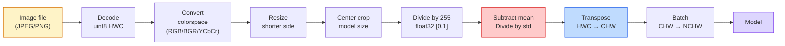
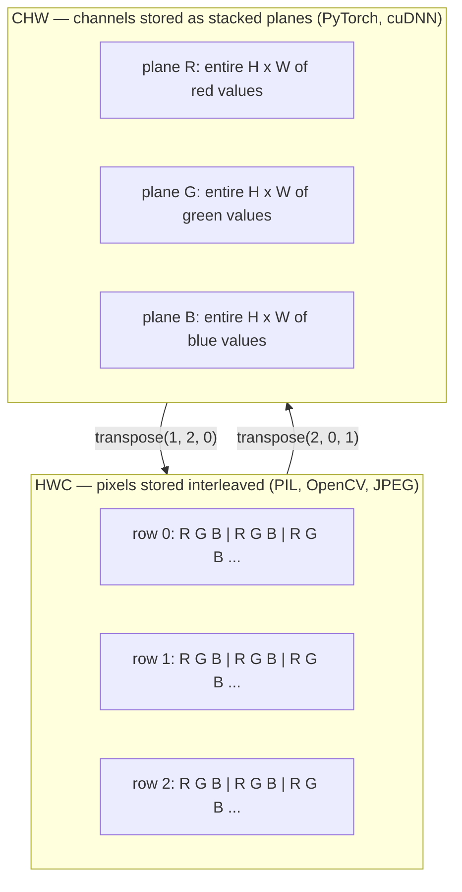

# 图像基础 —— 像素、通道与颜色空间

> 图像就是光采样构成的 tensor。你今后使用的每一个视觉模型，都从这个事实出发。

**Type:** Build
**Languages:** Python
**Prerequisites:** Phase 1 Lesson 12 (Tensor Operations), Phase 3 Lesson 11 (Intro to PyTorch)
**Time:** ~45 minutes

## 学习目标

- 解释连续场景如何被离散化为像素，以及采样 / 量化决策如何为下游模型划定性能天花板
- 以 NumPy 数组形式读取、切片和检查图像，并在 HWC 与 CHW 布局之间熟练切换
- 在 RGB、灰度、HSV 与 YCbCr 之间互转，并说明每种颜色空间存在的理由
- 按 pretrained PyTorch 视觉模型的期望，逐像素完成预处理（归一化、标准化、缩放、通道前置）

## 问题

你读到的每一篇论文、下载的每一个预训练权重、调用的每一个视觉 API 都假定输入按特定方式编码。把模型想要的 `float32` 换成 `uint8`，它照样能跑——然后默默输出垃圾。把 BGR 喂给按 RGB 训练的网络，准确率能掉十几个点。在模型期望 channels-first 时给了 channels-last，第一个卷积层会把高度当成特征通道。这些都不会报错，只会毁掉指标，然后你花一周去追一个藏在你加载文件方式里的 bug。

一旦你知道卷积在滑动什么，卷积本身并不难。难的是「图像」对相机、JPEG 解码器、PIL、OpenCV、torchvision 和 CUDA kernel 来说意味着不同东西。每一层栈都有自己的轴序、字节范围和通道约定。一个连这些都理不清的视觉工程师，交付的 pipeline 必然是坏的。

本节课夯实基础，让本阶段后续内容有所依托。学完后，你会知道像素是什么、为什么每个像素有三个数而不是一个、「用 ImageNet 统计量归一化」到底在做什么，以及如何在本阶段其他课程都会假定的两三种布局之间切换。

## 概念

### 完整预处理 pipeline 一览

每个生产级视觉系统都是同一系列可逆变换。任何一步出错，模型看到的输入就和训练时不同。



红色和蓝色框是 80% 静默失败的来源：漏做标准化、布局错误。

### 像素是采样点，不是方块

相机传感器在网格状的微小探测器上计数光子。每个探测器在极短时间内积分入射光，输出与光子数成正比的电压。随后传感器把电压离散化为整数。一个探测器就是一个像素。

```
Continuous scene                 Sensor grid                     Digital image
(infinite detail)                (H x W detectors)               (H x W integers)

    ~~~~~                        +--+--+--+--+--+                 210 198 180 155 120
   ~   ~   ~                     |  |  |  |  |  |                 205 195 178 152 118
  ~ light ~      ---->           +--+--+--+--+--+     ---->       200 190 175 150 115
   ~~~~~                         |  |  |  |  |  |                 195 185 170 148 112
                                 +--+--+--+--+--+                 188 180 165 145 108
```

这一步有两个选择，它们固定了后续一切的天花板：

- **空间采样**决定每度场景放多少探测器。太少，边缘会出现锯齿（aliasing）。太多，存储和计算爆炸。
- **强度量化**决定电压被分桶的精细程度。8 位得到 256 级，是显示标准。10、12、16 位梯度更平滑，对医学影像、HDR 和原始传感器 pipeline 很重要。

像素不是带面积的彩色方块，它是一个单独的测量值。当你缩放或旋转时，你是在对这个测量网格重采样。

### 为什么有三个通道

一个探测器统计整个可见光谱的光子——这就是灰度。要得到颜色，传感器在网格上覆盖红、绿、蓝滤光片的马赛克。去马赛克（demosaicing）后，每个空间位置都有三个整数：红滤光探测器、绿滤光探测器和附近蓝滤光探测器的响应。这三个整数就是像素的 RGB 三元组。

```
One pixel in memory:

    (R, G, B) = (210, 140, 30)   <- reddish-orange

An H x W RGB image:

    shape (H, W, 3)     stored as   H rows of W pixels of 3 values
                                    each in [0, 255] for uint8
```

三个通道并非魔法。深度相机会加入 Z 通道，卫星会加入红外和紫外波段，医学扫描通常有一个通道（X 光、CT）或很多通道（高光谱）。通道数位于最后一个轴；卷积层会学习跨通道混合。

### 两种布局约定：HWC 与 CHW

同一个 tensor，两种排序。每个库各选一种。

```
HWC (height, width, channels)           CHW (channels, height, width)

   W ->                                    H ->
  +-----+-----+-----+                     +-----+-----+
H |R G B|R G B|R G B|                   C |R R R R R R|
| +-----+-----+-----+                   | +-----+-----+
v |R G B|R G B|R G B|                   v |G G G G G G|
  +-----+-----+-----+                     +-----+-----+
                                          |B B B B B B|
                                          +-----+-----+

   PIL, OpenCV, matplotlib,              PyTorch, most deep learning
   almost every image file on disk       frameworks, cuDNN kernels
```

CHW 存在是因为卷积核在 H 和 W 上滑动。把通道轴放最前意味着每个卷积核在每个通道上看到的是连续的 2D 平面，向量化很干净。磁盘格式保留 HWC，因为这与传感器扫描行输出的方式一致。

你将输入上千次的那行转换：

```
img_chw = img_hwc.transpose(2, 0, 1)      # NumPy
img_chw = img_hwc.permute(2, 0, 1)        # PyTorch tensor
```

内存布局可视化：



### 字节范围与 dtype

三种约定占主导：

| Convention | dtype | Range | Where you see it |
|------------|-------|-------|------------------|
| Raw | `uint8` | [0, 255] | Files on disk, PIL, OpenCV output |
| Normalized | `float32` | [0.0, 1.0] | After `img.astype('float32') / 255` |
| Standardized | `float32` | roughly [-2, +2] | After subtracting mean and dividing by std |

卷积网络是在标准化输入上训练的。ImageNet 统计量 `mean=[0.485, 0.456, 0.406]`、`std=[0.229, 0.224, 0.225]` 是在完整 ImageNet 训练集上，对归一化到 [0, 1] 的像素按三个通道计算的算术均值与标准差。把原始 `uint8` 直接喂给期望标准化浮点的模型，是应用视觉中最常见的静默失败。

### 颜色空间及其存在理由

RGB 是采集格式，但对模型来说并不总是最有用的表示。

```
 RGB               HSV                       YCbCr / YUV

 R red             H hue (angle 0-360)       Y luminance (brightness)
 G green           S saturation (0-1)        Cb chroma blue-yellow
 B blue            V value/brightness (0-1)  Cr chroma red-green

 Linear to         Separates color from      Separates brightness from
 sensor output     brightness. Useful for    color. JPEG and most video
                   color thresholding, UI    codecs compress the chroma
                   sliders, simple filters   channels harder because the
                                             human eye is less sensitive
                                             to chroma detail than to Y.
```

对大多数现代 CNN，你喂 RGB。其他空间会在这些场景出现：

- **HSV** —— 经典 CV 代码、基于颜色的分割、白平衡。
- **YCbCr** —— 读取 JPEG 内部、视频 pipeline、只在 Y 通道上操作的超分辨率模型。
- **Grayscale** —— OCR、文档模型，以及任何颜色是干扰变量而非信号的场景。

RGB 转灰度是加权求和而非简单平均，因为人眼对绿色比红、蓝更敏感：

```math
Y = 0.299 R + 0.587 G + 0.114 B \qquad \text{(ITU-R BT.601, the classic weights)}
```

### 宽高比、缩放与插值

每个模型都有固定输入尺寸（大多数 ImageNet 分类器是 224x224，现代检测器是 384x384 或 512x512）。你的图像很少正好匹配。三种重要的缩放选择：

- **短边缩放 + 中心裁剪** —— 标准 ImageNet 做法。保持宽高比，丢弃边缘一条像素。
- **缩放并填充** —— 保持宽高比且保留所有像素，加黑边。检测和 OCR 的标准做法。
- **直接缩放到目标尺寸** —— 拉伸图像。便宜、几何失真，对很多分类任务可接受。

当新网格与旧网格不对齐时，插值方法决定中间像素如何计算：

```
Nearest neighbour     fastest, blocky, only choice for masks/labels
Bilinear              fast, smooth, default for most image resizing
Bicubic               slower, sharper on upscaling
Lanczos               slowest, best quality, used for final display
```

经验法则：训练用 bilinear，最终展示用 bicubic 或 lanczos，任何包含整数类别 ID 的内容用 nearest。

```figure
conv-output-size
```

## 构建它

### 第 1 步：构建图像 tensor 并检查形状

从确定性合成图像开始，这样第一节实验只用 NumPy 就能离线运行。文件解码是另一个边界：一旦 JPEG 或 PNG 解码器返回 RGB 字节，下面的所有 tensor 操作都一样。

```python
import numpy as np

def synthetic_rgb(h=128, w=192, seed=0):
    rng = np.random.default_rng(seed)
    yy, xx = np.meshgrid(np.linspace(0, 1, h), np.linspace(0, 1, w), indexing="ij")
    r = (np.sin(xx * 6) * 0.5 + 0.5) * 255
    g = yy * 255
    b = (1 - yy) * xx * 255
    rgb = np.stack([r, g, b], axis=-1) + rng.normal(0, 6, (h, w, 3))
    return np.clip(rgb, 0, 255).astype(np.uint8)

arr = synthetic_rgb()

print(f"type:   {type(arr).__name__}")
print(f"dtype:  {arr.dtype}")
print(f"shape:  {arr.shape}     # (H, W, C)")
print(f"min:    {arr.min()}")
print(f"max:    {arr.max()}")
print(f"pixel at (0, 0): {arr[0, 0]}")
```

期望输出：`shape: (H, W, 3)`、`dtype: uint8`、范围 `[0, 255]`。无论字节来自相机、图像解码器还是这个合成生成器，这都是标准的解码后表示。

### 第 2 步：拆分通道并调整布局

分别取出 R、G、B，然后把 HWC 转成 PyTorch 需要的 CHW。

```python
R = arr[:, :, 0]
G = arr[:, :, 1]
B = arr[:, :, 2]
print(f"R shape: {R.shape}, mean: {R.mean():.1f}")
print(f"G shape: {G.shape}, mean: {G.mean():.1f}")
print(f"B shape: {B.shape}, mean: {B.mean():.1f}")

arr_chw = arr.transpose(2, 0, 1)
print(f"\nHWC shape: {arr.shape}")
print(f"CHW shape: {arr_chw.shape}")
```

三张灰度平面，每个通道一张。CHW 只是重排轴；如果内存布局允许，严格来说不需要拷贝数据。

### 第 3 步：灰度与 HSV 转换

加权求和转灰度，再手写一个 RGB 到 HSV 的转换。

```python
def rgb_to_grayscale(rgb):
    weights = np.array([0.299, 0.587, 0.114], dtype=np.float32)
    return (rgb.astype(np.float32) @ weights).astype(np.uint8)

def rgb_to_hsv(rgb):
    rgb_f = rgb.astype(np.float32) / 255.0
    r, g, b = rgb_f[..., 0], rgb_f[..., 1], rgb_f[..., 2]
    cmax = np.max(rgb_f, axis=-1)
    cmin = np.min(rgb_f, axis=-1)
    delta = cmax - cmin

    h = np.zeros_like(cmax)
    mask = delta > 0
    argmax = np.argmax(rgb_f, axis=-1)
    rmax = mask & (argmax == 0)
    gmax = mask & (argmax == 1)
    bmax = mask & (argmax == 2)
    h[rmax] = ((g[rmax] - b[rmax]) / delta[rmax]) % 6
    h[gmax] = ((b[gmax] - r[gmax]) / delta[gmax]) + 2
    h[bmax] = ((r[bmax] - g[bmax]) / delta[bmax]) + 4
    h = h * 60.0

    s = np.divide(delta, cmax, out=np.zeros_like(delta), where=cmax > 0)
    v = cmax
    return np.stack([h, s, v], axis=-1)

gray = rgb_to_grayscale(arr)
hsv = rgb_to_hsv(arr)
print(f"gray shape: {gray.shape}, range: [{gray.min()}, {gray.max()}]")
print(f"hsv   shape: {hsv.shape}")
print(f"hue range: [{hsv[..., 0].min():.1f}, {hsv[..., 0].max():.1f}] degrees")
print(f"sat range: [{hsv[..., 1].min():.2f}, {hsv[..., 1].max():.2f}]")
print(f"val range: [{hsv[..., 2].min():.2f}, {hsv[..., 2].max():.2f}]")
```

色相以度输出，饱和度与明度在 [0, 1] 之间。这与 OpenCV `hsv_full` 约定一致。

### 第 4 步：归一化、标准化与逆变换

从原始字节得到 pretrained ImageNet 模型期望的精确 tensor，再还原回去。

```python
mean = np.array([0.485, 0.456, 0.406], dtype=np.float32)
std = np.array([0.229, 0.224, 0.225], dtype=np.float32)

def preprocess_imagenet(rgb_uint8):
    x = rgb_uint8.astype(np.float32) / 255.0
    x = (x - mean) / std
    x = x.transpose(2, 0, 1)
    return x

def deprocess_imagenet(chw_float32):
    x = chw_float32.transpose(1, 2, 0)
    x = x * std + mean
    x = np.clip(x * 255.0, 0, 255).astype(np.uint8)
    return x

x = preprocess_imagenet(arr)
print(f"preprocessed shape: {x.shape}     # (C, H, W)")
print(f"preprocessed dtype: {x.dtype}")
print(f"preprocessed mean per channel:  {x.mean(axis=(1, 2)).round(3)}")
print(f"preprocessed std  per channel:  {x.std(axis=(1, 2)).round(3)}")

roundtrip = deprocess_imagenet(x)
max_diff = np.abs(roundtrip.astype(int) - arr.astype(int)).max()
print(f"roundtrip max pixel diff: {max_diff}    # should be 0 or 1")
```

各通道均值应接近 0，标准差接近 1。preprocess / deprocess 这对操作正是每个 torchvision `transforms.Normalize` 在底层做的事情。

### 第 5 步：从零实现缩放

最近邻把每个输出坐标四舍五入到一个源像素。双线性插值找到周围四个像素并按距离混合。下面的实现都使用端点对齐坐标，使第一个和最后一个源像素保持固定。

```python
def resize_coordinates(source_length, target_length):
    if target_length == 1:
        return np.zeros(1, dtype=np.float32)
    return np.linspace(0, source_length - 1, target_length, dtype=np.float32)

def nearest_resize(image, target_height, target_width):
    y = np.rint(resize_coordinates(image.shape[0], target_height)).astype(int)
    x = np.rint(resize_coordinates(image.shape[1], target_width)).astype(int)
    return image[y[:, None], x[None, :]]

def bilinear_resize(image, target_height, target_width):
    y = resize_coordinates(image.shape[0], target_height)
    x = resize_coordinates(image.shape[1], target_width)
    y0 = np.floor(y).astype(int)
    x0 = np.floor(x).astype(int)
    y1 = np.minimum(y0 + 1, image.shape[0] - 1)
    x1 = np.minimum(x0 + 1, image.shape[1] - 1)
    wy = (y - y0)[:, None, None]
    wx = (x - x0)[None, :, None]

    source = image.astype(np.float32)
    top = source[y0[:, None], x0[None, :]] * (1 - wx)
    top += source[y0[:, None], x1[None, :]] * wx
    bottom = source[y1[:, None], x0[None, :]] * (1 - wx)
    bottom += source[y1[:, None], x1[None, :]] * wx
    result = top * (1 - wy) + bottom * wy
    return np.clip(np.rint(result), 0, 255).astype(image.dtype)

target_height = arr.shape[0] * 3
target_width = arr.shape[1] * 3
nearest = nearest_resize(arr, target_height, target_width)
bilinear = bilinear_resize(arr, target_height, target_width)

def local_roughness(x):
    gy = np.diff(x.astype(float), axis=0)
    gx = np.diff(x.astype(float), axis=1)
    return float(np.abs(gy).mean() + np.abs(gx).mean())

for name, out in [("nearest", nearest), ("bilinear", bilinear)]:
    print(f"{name:>8}  shape={out.shape}  roughness={local_roughness(out):6.2f}")
```

最近邻的 roughness 最高，因为它保留硬边。双线性更平滑，因为每个新像素会混合两个轴上的位置。可运行扩展版把同样的可分离思想推广到每轴四个邻点，使用 Catmull-Rom 三次核，然后无需图像库即可打印三种结果。

## 使用它

PyTorch 对批量、设备感知的 tensor 执行相同操作。下面代码缩放短边、中心裁剪、逐通道标准化，并生成 pretrained 模型期望的 NCHW tensor。

```python
import torch
import torch.nn.functional as F

image_hwc = torch.from_numpy(synthetic_rgb(256, 320))
batch = image_hwc.permute(2, 0, 1).unsqueeze(0).float() / 255.0

height, width = batch.shape[-2:]
scale = 256 / min(height, width)
resized_height = round(height * scale)
resized_width = round(width * scale)
batch = F.interpolate(
    batch,
    size=(resized_height, resized_width),
    mode="bilinear",
    align_corners=False,
    antialias=True,
)

top = (resized_height - 224) // 2
left = (resized_width - 224) // 2
batch = batch[:, :, top:top + 224, left:left + 224]

mean = torch.tensor([0.485, 0.456, 0.406]).view(1, 3, 1, 1)
std = torch.tensor([0.229, 0.224, 0.225]).view(1, 3, 1, 1)
batch = (batch - mean) / std

print(f"tensor dtype: {batch.dtype}")
print(f"batched shape: {tuple(batch.shape)}")
print(f"per-channel mean: {batch.mean(dim=(0, 2, 3)).tolist()}")
print(f"per-channel std:  {batch.std(dim=(0, 2, 3)).tolist()}")
```

四步，严格按此顺序：字节转浮点并把 HWC 换为 NCHW，短边缩放到 256，取 224x224 中心裁剪，然后减去 ImageNet 均值并除以其标准差。颠倒顺序会默默改变到达模型的内容。

## 交付它

本节课产出：

- `outputs/prompt-vision-preprocessing-audit.md` —— 一个 prompt，能把任意 model card 或 dataset card 转换成团队必须遵守的精确预处理 invariant 检查清单。
- `outputs/skill-image-tensor-inspector.md` —— 一个 skill，给定任意图像形状的 tensor 或数组，报告 dtype、布局、范围，并判断其看起来是原始、已归一化还是已标准化。

## 练习

1. **（简单）** 创建一个 2x2 RGB `uint8` 数组，包含四种不同颜色。HWC 转 CHW 并转回来，打印两种形状，并证明往返保留每个值。
2. **（中等）** 编写 `standardize(img, mean, std)` 及其逆函数，使得对任意 uint8 图像都通过 `roundtrip_max_diff <= 1` 测试。函数必须对单张 HWC 图像和 NCHW 批量使用同一调用即可工作。
3. **（困难）** 取一个 3 通道 ImageNet 标准化 tensor，用一个 1x1 卷积把 RGB 加权混合成单通道灰度。权重初始化为 `[0.299, 0.587, 0.114]`，冻结后验证输出与手写的 `rgb_to_grayscale` 在浮点误差范围内一致。还有哪些经典颜色空间变换可以写成 1x1 卷积？

## 关键术语

| Term | What people say | What it actually means |
|------|----------------|----------------------|
| Pixel | "A coloured square" | One sample of light intensity at one grid location — three numbers for colour, one for grayscale |
| Channel | "The colour" | One of the parallel spatial grids stacked into an image tensor; last axis in HWC, first in CHW |
| HWC / CHW | "The shape" | Axis orderings for an image tensor; disk and PIL use HWC, PyTorch and cuDNN use CHW |
| Normalize | "Scale the image" | Divide by 255 so pixels live in [0, 1] — necessary but not sufficient |
| Standardize | "Zero-center" | Subtract mean and divide by std per channel so the input distribution matches what the model was trained on |
| Grayscale conversion | "Average the channels" | A weighted sum with coefficients 0.299/0.587/0.114 that matches human luminance perception |
| Interpolation | "How resize picks pixels" | The rule that decides output values when the new grid does not align with the old one — nearest for labels, bilinear for training, bicubic for display |
| Aspect ratio | "Width over height" | The ratio that distinguishes "resize and pad" from "resize and stretch" |

## 延伸阅读

- [Charles Poynton — A Guided Tour of Color Space](https://web.archive.org/web/20251220000525/https://poynton.ca/PDFs/Guided_tour.pdf) —— 对为什么存在这么多颜色空间以及何时该用哪一种最清晰的技术处理
- [PyTorch Vision Transforms Docs](https://pytorch.org/vision/stable/transforms.html) —— 你在生产中实际会组合使用的完整 transforms pipeline
- [How JPEG Works (Colt McAnlis)](https://www.youtube.com/watch?v=F1kYBnY6mwg) —— 关于色度子采样、DCT 以及 JPEG 为何编码 YCbCr 而非 RGB 的精辟可视化讲解
- [ImageNet Preprocessing Conventions (torchvision models)](https://pytorch.org/vision/stable/models.html) —— `mean=[0.485, 0.456, 0.406]` 的来源与真相，以及为何模型动物园里的每个模型都期望它
