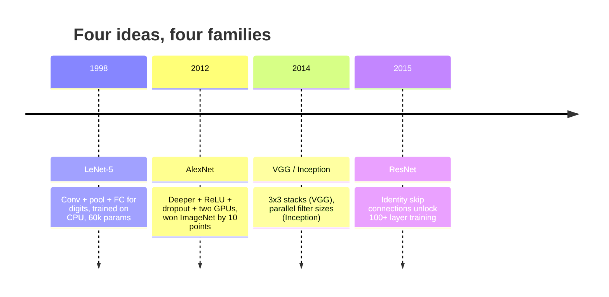
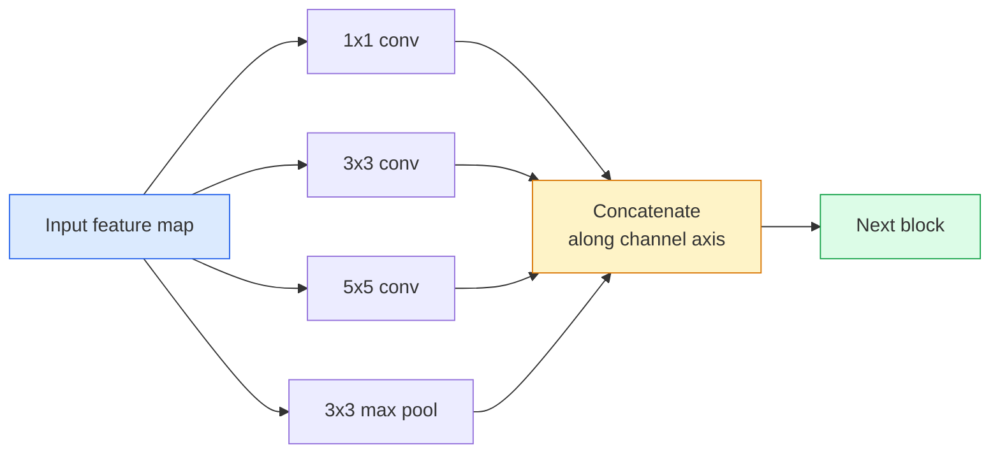
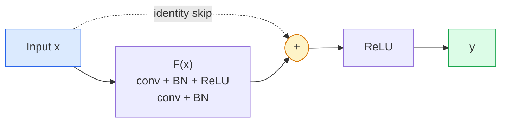

# CNN —— 从 LeNet 到 ResNet

> 过去三十年里，每个重要 CNN 都是同一个「卷积—非线性—下采样」配方加上一个新想法。按顺序学会这些想法。

**Type:** Learn + Build
**Languages:** Python
**Prerequisites:** Phase 3 Lesson 11 (PyTorch), Phase 4 Lesson 01 (Image Fundamentals), Phase 4 Lesson 02 (Convolutions from Scratch)
**Time:** ~75 minutes

## 学习目标

- 梳理 LeNet-5 → AlexNet → VGG → Inception → ResNet 的架构谱系，并说明每个家族贡献的单一新想法
- 在 PyTorch 中实现 LeNet-5、VGG 风格块和 ResNet BasicBlock，每个都在 40 行以内
- 解释为什么残差连接把 1,000 层网络从不可训练变成了最先进
- 阅读现代骨干网络（ResNet-18、ResNet-50），在查看源码前预测其输出形状、感受野和参数量

## 问题

2011 年，最好的 ImageNet 分类器 top-5 准确率约 74%。2012 年 AlexNet 达到 85%。2015 年 ResNet 达到 96%。没有新数据，没有新一代 GPU。提升来自架构想法。一名能干的视觉工程师必须知道哪个想法来自哪篇论文，因为 2026 年你部署的每个生产骨干都是这些相同模块的重组——而且这些想法一直在迁移：分组卷积从 CNN 走到 transformer，残差连接从 ResNet 走到每个存在的 LLM，批归一化活在扩散模型里。

按顺序研究这些网络还能让你避免一个常见错误：在 LeNet 规模的网络就能解决问题时，去追求最大的可用模型。MNIST 不需要 ResNet。知道每个家族的缩放曲线，才能知道自己该坐在曲线的哪个位置。

## 概念

### 改变视觉的四个想法



古典视觉里，再没有哪四次跳跃比这更重要。

### LeNet-5（1998）

Yann LeCun 的数字识别器。60,000 个参数。两个卷积-池化块、两个全连接层、tanh 激活。它定义了每个 CNN 都继承的模板：

```
input (1, 32, 32)
  conv 5x5 -> (6, 28, 28)
  avg pool 2x2 -> (6, 14, 14)
  conv 5x5 -> (16, 10, 10)
  avg pool 2x2 -> (16, 5, 5)
  flatten -> 400
  dense -> 120
  dense -> 84
  dense -> 10
```

现代世界所谓的 CNN——交替卷积与下采样，最后接一个小分类头——就是层数更多、通道更宽、激活更好的 LeNet。

### AlexNet（2012）

三个改变一起打破了 ImageNet：

1. **ReLU** 取代 tanh。梯度不再消失，训练速度提升约六倍。
2. **Dropout** 用在全连接头。正则化变成了一个层，而不是技巧。
3. **深度与宽度**。五个卷积层、三个全连接层、6,000 万参数，在两个 GPU 上训练，模型切分在它们之间。

论文的图 2 至今仍显示 GPU 切分成的两条并行流。这种并行是硬件 workaround，不是架构洞见——但上面三个想法仍存在于你使用的每个模型中。

### VGG（2014）

VGG 问：如果只用 3x3 卷积并加深，会发生什么？

```
stack:   conv 3x3 -> conv 3x3 -> pool 2x2
repeat:  16 or 19 conv layers
```

两个 3x3 卷积看到的 5x5 输入区域与一个 5x5 卷积相同，但参数更少（$2 \cdot 9 \cdot C^2 = 18C^2$ 对比 $25 \cdot C^2$），中间还多了一个 ReLU。VGG 把这个观察变成了整个架构。它的简洁——一种块类型，重复堆叠——使其成为之后一切工作的参照点。

代价：1.38 亿参数，训练慢，推理贵。

### Inception（2014，同一年）

Google 对「该用多大核？」的回答是：全都要，并行使用。



每个分支各司其职——1x1 做通道混合，3x3 做局部纹理，5x5 做更大模式，池化做平移不变特征——concat 让下一层挑选哪个分支有用。Inception v1 在每个分支内部用 1x1 卷积作为瓶颈，以保持参数量合理。

### 退化问题

到 2015 年，VGG-19 能工作，VGG-32 不能。深度本该有帮助，但超过约 20 层后，训练 loss 和测试 loss 都变差。这不是过拟合，而是优化器找不到有用权重，因为梯度在每层之间乘法级缩小。

```
Plain deep network:
  y = f_L( f_{L-1}( ... f_1(x) ... ) )

Gradient wrt early layer:
  dL/dW_1 = dL/dy * df_L/df_{L-1} * ... * df_2/df_1 * df_1/dW_1

Each multiplicative term has magnitude roughly (weight magnitude) * (activation gain).
Stack 100 of them with gains < 1 and the gradient is effectively zero.
```

VGG 在 19 层能工作，是因为同时发表的批归一化让激活值保持合适的尺度。但即便批归一化也救不了超过约 30 层的深度。

### ResNet（2015）

何恺明、张祥雨、任少卿、孙剑提出一个改变，解决了一切：

```math
\begin{aligned}
\text{standard block:} \quad & y = F(x) \\
\text{residual block:} \quad & y = F(x) + x
\end{aligned}
```

`+ x` 意味着每层都可以通过让 `F(x)` 趋近于零来选择什么都不做。1,000 层的 ResNet 现在最多只和 1 层网络一样差，因为每个额外块都有一个 trivial 的逃生口。有了这个保证，优化器愿意让每个块*稍微*有用——而稍微有用，堆叠 100 次，就是最先进。



这个块的两个变体随处可见：

- **BasicBlock**（ResNet-18、ResNet-34）：两个 3x3 卷积，跳过两者。
- **Bottleneck**（ResNet-50、-101、-152）：1x1 降维、3x3 中间、1x1 升维，跳过三者。通道数高时更便宜。

当跳跃必须跨过一个下采样（stride=2）时，identity 路径会被替换为 1x1 stride=2 卷积以匹配形状。

### 为什么残差连接超出视觉仍然重要

这个想法其实与图像分类无关。它把深度网络从「祈祷梯度能活下来」变成了可靠、可扩展的工程工具。你下一阶段会读到的每个 transformer，每个块里都有完全相同的跳跃连接。没有 ResNet，就没有 GPT。

```figure
pooling
```

## 构建它

### 第 1 步：LeNet-5

一个最小、忠实的 LeNet。Tanh 激活，平均池化。对现代唯一的让步是下游用 `nn.CrossEntropyLoss`，而不是原始的高斯连接。

```python
import torch
import torch.nn as nn
import torch.nn.functional as F

class LeNet5(nn.Module):
    def __init__(self, num_classes=10):
        super().__init__()
        self.conv1 = nn.Conv2d(1, 6, kernel_size=5)
        self.conv2 = nn.Conv2d(6, 16, kernel_size=5)
        self.pool = nn.AvgPool2d(2)
        self.fc1 = nn.Linear(16 * 5 * 5, 120)
        self.fc2 = nn.Linear(120, 84)
        self.fc3 = nn.Linear(84, num_classes)

    def forward(self, x):
        x = self.pool(torch.tanh(self.conv1(x)))
        x = self.pool(torch.tanh(self.conv2(x)))
        x = torch.flatten(x, 1)
        x = torch.tanh(self.fc1(x))
        x = torch.tanh(self.fc2(x))
        return self.fc3(x)

net = LeNet5()
x = torch.randn(1, 1, 32, 32)
print(f"output: {net(x).shape}")
print(f"params: {sum(p.numel() for p in net.parameters()):,}")
```

期望输出：`output: torch.Size([1, 10])`，`params: 61,706`。这就是开启现代视觉的整个数字分类器。

### 第 2 步：VGG 块

一个可复用的块：两个 3x3 卷积、ReLU、批归一化、最大池化。

```python
class VGGBlock(nn.Module):
    def __init__(self, in_c, out_c):
        super().__init__()
        self.conv1 = nn.Conv2d(in_c, out_c, kernel_size=3, padding=1)
        self.bn1 = nn.BatchNorm2d(out_c)
        self.conv2 = nn.Conv2d(out_c, out_c, kernel_size=3, padding=1)
        self.bn2 = nn.BatchNorm2d(out_c)
        self.pool = nn.MaxPool2d(2)

    def forward(self, x):
        x = F.relu(self.bn1(self.conv1(x)))
        x = F.relu(self.bn2(self.conv2(x)))
        return self.pool(x)

class MiniVGG(nn.Module):
    def __init__(self, num_classes=10):
        super().__init__()
        self.stack = nn.Sequential(
            VGGBlock(3, 32),
            VGGBlock(32, 64),
            VGGBlock(64, 128),
        )
        self.head = nn.Sequential(
            nn.AdaptiveAvgPool2d(1),
            nn.Flatten(),
            nn.Linear(128, num_classes),
        )

    def forward(self, x):
        return self.head(self.stack(x))

net = MiniVGG()
x = torch.randn(1, 3, 32, 32)
print(f"output: {net(x).shape}")
print(f"params: {sum(p.numel() for p in net.parameters()):,}")
```

三个 VGG 块处理 CIFAR 尺寸输入，接一个自适应池化和一个线性层。约 290k 参数。对 CIFAR-10 足够。

### 第 3 步：ResNet BasicBlock

ResNet-18 和 ResNet-34 的核心构建块。

```python
class BasicBlock(nn.Module):
    def __init__(self, in_c, out_c, stride=1):
        super().__init__()
        self.conv1 = nn.Conv2d(in_c, out_c, kernel_size=3, stride=stride, padding=1, bias=False)
        self.bn1 = nn.BatchNorm2d(out_c)
        self.conv2 = nn.Conv2d(out_c, out_c, kernel_size=3, stride=1, padding=1, bias=False)
        self.bn2 = nn.BatchNorm2d(out_c)
        if stride != 1 or in_c != out_c:
            self.shortcut = nn.Sequential(
                nn.Conv2d(in_c, out_c, kernel_size=1, stride=stride, bias=False),
                nn.BatchNorm2d(out_c),
            )
        else:
            self.shortcut = nn.Identity()

    def forward(self, x):
        out = F.relu(self.bn1(self.conv1(x)))
        out = self.bn2(self.conv2(out))
        out = out + self.shortcut(x)
        return F.relu(out)
```

卷积层上 `bias=False` 是批归一化的约定——BN 的 beta 参数已经承担了偏置，再带卷积偏置就是浪费。`shortcut` 只在步幅或通道数变化时才需要真正的卷积；否则它是无操作的 identity。

### 第 4 步：一个迷你 ResNet

堆叠四组 BasicBlock，得到适用于 CIFAR 尺寸输入的 ResNet。

```python
class TinyResNet(nn.Module):
    def __init__(self, num_classes=10):
        super().__init__()
        self.stem = nn.Sequential(
            nn.Conv2d(3, 32, kernel_size=3, stride=1, padding=1, bias=False),
            nn.BatchNorm2d(32),
            nn.ReLU(inplace=True),
        )
        self.layer1 = self._make_group(32, 32, num_blocks=2, stride=1)
        self.layer2 = self._make_group(32, 64, num_blocks=2, stride=2)
        self.layer3 = self._make_group(64, 128, num_blocks=2, stride=2)
        self.layer4 = self._make_group(128, 256, num_blocks=2, stride=2)
        self.head = nn.Sequential(
            nn.AdaptiveAvgPool2d(1),
            nn.Flatten(),
            nn.Linear(256, num_classes),
        )

    def _make_group(self, in_c, out_c, num_blocks, stride):
        blocks = [BasicBlock(in_c, out_c, stride=stride)]
        for _ in range(num_blocks - 1):
            blocks.append(BasicBlock(out_c, out_c, stride=1))
        return nn.Sequential(*blocks)

    def forward(self, x):
        x = self.stem(x)
        x = self.layer1(x)
        x = self.layer2(x)
        x = self.layer3(x)
        x = self.layer4(x)
        return self.head(x)

net = TinyResNet()
x = torch.randn(1, 3, 32, 32)
print(f"output: {net(x).shape}")
print(f"params: {sum(p.numel() for p in net.parameters()):,}")
```

四组，每组两个块。第 2、3、4 组开头步幅为 2。每次下采样时通道数翻倍。约 280 万参数。这就是能干净扩展到 ResNet-152 的标准配方。

### 第 5 步：比较参数到特征的效率

把相同输入跑过三个网络，比较参数量。

```python
def summary(name, net, x):
    y = net(x)
    params = sum(p.numel() for p in net.parameters())
    print(f"{name:12s}  input {tuple(x.shape)} -> output {tuple(y.shape)}  params {params:>10,}")

x = torch.randn(1, 3, 32, 32)
summary("LeNet5",     LeNet5(),       torch.randn(1, 1, 32, 32))
summary("MiniVGG",    MiniVGG(),      x)
summary("TinyResNet", TinyResNet(),   x)
```

三个模型，三个时代，三个数量级的参数。对 CIFAR-10 准确率，大致需要：LeNet 60%、MiniVGG 89%、TinyResNet 训练几个 epoch 后 93%。

## 使用它

`torchvision.models` 提供上述所有模型的 pretrained 版本。调用签名在各家族之间一致，这正是骨干网络抽象的意义。

```python
from torchvision.models import resnet18, ResNet18_Weights, vgg16, VGG16_Weights

r18 = resnet18(weights=ResNet18_Weights.IMAGENET1K_V1)
r18.eval()

print(f"ResNet-18 params: {sum(p.numel() for p in r18.parameters()):,}")
print(r18.layer1[0])
print()

v16 = vgg16(weights=VGG16_Weights.IMAGENET1K_V1)
v16.eval()
print(f"VGG-16   params: {sum(p.numel() for p in v16.parameters()):,}")
```

ResNet-18 有 1,170 万参数，VGG-16 有 1.38 亿。ImageNet top-1 准确率相近（69.8% 对 71.6%）。残差连接带来了约 12 倍的参数效率优势。这就是 ResNet 变体从 2016 到 2021 年 ViT 出现前一直主导的原因——在计算受限的真实部署中至今仍占主导。

迁移学习的做法总是相同：加载 pretrained，冻结骨干，替换分类头。

```python
for p in r18.parameters():
    p.requires_grad = False
r18.fc = nn.Linear(r18.fc.in_features, 10)
```

三行代码。现在你有一个 10 类 CIFAR 分类器，继承了 ImageNet 付费学到的表示。

## 交付它

本节课产出：

- `outputs/prompt-backbone-selector.md` —— 一个 prompt，根据任务、数据集大小和计算预算选择合适的 CNN 家族（LeNet/VGG/ResNet/MobileNet/ConvNeXt）。
- `outputs/skill-residual-block-reviewer.md` —— 一个 skill，读取 PyTorch 模块并标记跳跃连接错误（步幅变化时缺失 shortcut、shortcut 激活顺序、BN 相对于加法的放置位置）。

## 练习

1. **（简单）** 逐层手工计算 `TinyResNet` 的参数量，并与 `sum(p.numel() for p in net.parameters())` 比较。参数预算的大部分流向哪里——卷积、BN 还是分类头？
2. **（中等）** 实现 Bottleneck 块（1x1 → 3x3 → 1x1 带跳跃），并用它构建一个 CIFAR 上的 ResNet-50 风格网络。与 `TinyResNet` 比较参数量。
3. **（困难）** 移除 `BasicBlock` 中的跳跃连接，在 CIFAR-10 上分别训练一个 34 块「plain」网络和一个 34 块 ResNet，各 10 个 epoch。绘制训练 loss 随 epoch 变化曲线。复现 He et al. 图 1 的结果：深的 plain 网络比它的浅层版本收敛到更高 loss。

## 关键术语

| Term | What people say | What it actually means |
|------|----------------|----------------------|
| Backbone | "The model" | The stack of convolutional blocks that produces the feature map fed to the task head |
| Residual connection | "Skip connection" | `y = F(x) + x`; lets the optimiser learn identity by setting F to zero, which makes arbitrary depth trainable |
| BasicBlock | "Two 3x3 convs with a skip" | The ResNet-18/34 building block: conv-BN-ReLU-conv-BN-add-ReLU |
| Bottleneck | "1x1 down, 3x3, 1x1 up" | The ResNet-50/101/152 block; cheap at high channel counts because the 3x3 runs on a reduced width |
| Degradation problem | "Deeper is worse" | Past ~20 plain conv layers, both training and test error increase; solved by residual connections, not by more data |
| Stem | "The first layer" | The initial conv that converts 3-channel input into the base feature width; usually 7x7 stride 2 for ImageNet, 3x3 stride 1 for CIFAR |
| Head | "The classifier" | The layers after the final backbone block: adaptive pool, flatten, linear(s) |
| Transfer learning | "Pretrained weights" | Loading a backbone trained on ImageNet and fine-tuning only the head on your task |

## 延伸阅读

- [Deep Residual Learning for Image Recognition (He et al., 2015)](https://arxiv.org/abs/1512.03385) —— ResNet 论文；每张图都值得研究
- [Very Deep Convolutional Networks (Simonyan & Zisserman, 2014)](https://arxiv.org/abs/1409.1556) —— VGG 论文；仍是「为什么用 3x3」的最佳参考
- [ImageNet Classification with Deep CNNs (Krizhevsky et al., 2012)](https://papers.nips.cc/paper_files/paper/2012/hash/c399862d3b9d6b76c8436e924a68c45b-Abstract.html) —— AlexNet；终结手工特征时代的论文
- [Going Deeper with Convolutions (Szegedy et al., 2014)](https://arxiv.org/abs/1409.4842) —— Inception v1；并行滤波器想法至今仍出现在视觉 transformer 中
